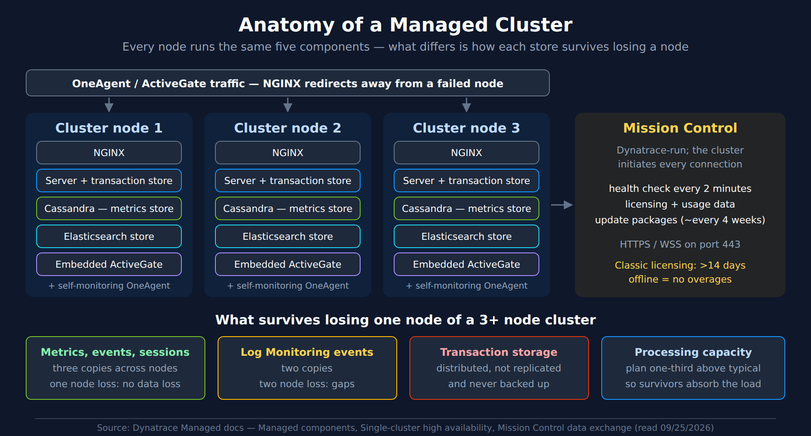
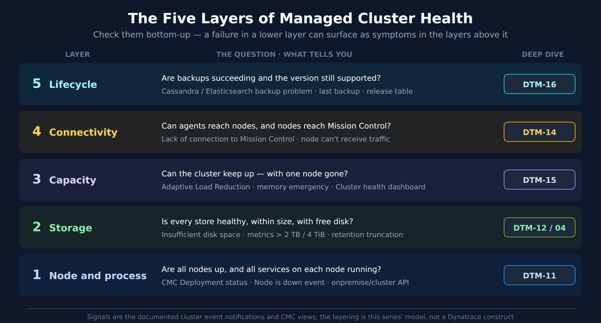

# DTM-10: Managed Cluster Architecture and Health Model

> **Series:** DTM — Dynatrace Managed | **Reference:** 10 — Managed Cluster Architecture and Health Model | **Created:** September 2026 | **Last Updated:** 10/29/2026

> **Dynatrace Classic only.** This series applies to **Dynatrace Managed**, the self-hosted, on-premises deployment. None of it applies to Dynatrace SaaS.

## Overview

A Dynatrace Managed cluster is a small distributed system you operate yourself: every node runs a web server, the Dynatrace Server, two databases, and an ActiveGate, and the cluster phones home to Dynatrace's Mission Control. "Is the cluster healthy?" is therefore not one question but several — and the answers live in different places.

This notebook is the map for the cluster-health notebooks, DTM-11 to DTM-16. It covers **what runs on a node**, **where each kind of data lives and how it survives a failure**, a **five-layer health model** that tells you what to check and in which order, and **where each health signal is surfaced** — the Cluster Management Console, cluster event notifications, self-monitoring, the Cluster API, and Mission Control.

**What you'll learn:**

- The five components on every cluster node and what each one stores
- Why losing one node of three costs you nothing, while losing a disk can cost you transaction data permanently
- The five health layers — node, storage, capacity, connectivity, lifecycle — and the signal for each
- Which self-monitoring option you actually have, given your licensing
- Which cluster events to route to a human on day one

---

## Table of Contents

1. [Short Answer](#short-answer)
2. [What Runs on a Cluster Node](#node-components)
3. [Where Each Kind of Data Lives](#data-stores)
4. [The Redundancy Model — What a Node Failure Costs](#redundancy)
5. [The Five Layers of Cluster Health](#health-layers)
6. [Where Health Is Surfaced](#health-surfaces)
7. [Cluster Events to Route on Day One](#day-one-events)
8. [What the Documentation Does Not Say](#doc-gaps)
9. [Recommended Approach](#recommendation)
10. [Summary and Next Steps](#summary)

---

## Prerequisites

| Requirement | Details |
|-------------|---------|
| **Dynatrace deployment** | A self-hosted **Dynatrace Managed** cluster. Nothing in this series applies to Dynatrace SaaS. |
| **Access** | Cluster Management Console (CMC) administrator access; for the Cluster API, a cluster API token with the `ServiceProviderAPI` permission |
| **Query language** | None. Managed has no Grail, so this series has **no DQL cells** — every check is a CMC view, a cluster event, or a Cluster API call |
| **Version basis** | Written against the Managed documentation read 09/25/2026, when 1.342 – 1.346 were the generally supported releases |

<a id="short-answer"></a>
## 1. Short Answer

- **Every node is identical.** Each runs NGINX, the Dynatrace Server, Cassandra, Elasticsearch and an embedded ActiveGate. Health means *all five* are up on *every* node.
- **Three nodes is the production floor**, because metrics, events and user sessions are kept in three copies — one node can fail with no data loss. A Dynatrace blog says five or more nodes tolerate two failures; the docs make no such statement, so plan for one (§4).
- **Transaction storage is the exception.** Distributed traces and code-level data are spread across nodes, not replicated, and not backed up. A lost node or a full disk loses that slice permanently.
- **Check health bottom-up**: node and process → storage → capacity → connectivity → lifecycle. This ordering is this series' model (§5), not a Dynatrace construct — a lower-layer fault can surface as symptoms in the layers above it.
- **The cheapest alarm system is already built in — but it only covers part of the picture.** Cluster event notifications email on node-down, low disk, lost Mission Control connection and a cluster that should be scaled out. Whether some *Configurable* events, Adaptive Load Reduction among them, email by default is something the docs contradict themselves on, so set it explicitly (§6.2). Many other events, **backup problems included**, never email you: they appear only in the CMC **Events** list and in Mission Control. Route the emails to a monitored mailbox, and read the Events list on a schedule.

> <sub>**Sources:** [Managed components (DT docs)](https://docs.dynatrace.com/managed/managed-cluster/basics/managed-components), [Single-cluster high availability (DT docs)](https://docs.dynatrace.com/managed/managed-cluster/high-availability/single-cluster-high-availability), [Configure Cluster event notifications (DT docs)](https://docs.dynatrace.com/managed/managed-cluster/configuration/configure-cluster-event-notifications).</sub>

<a id="node-components"></a>
## 2. What Runs on a Cluster Node

The Managed Installer deploys the same component set on every node — *"All listed components are deployed on the first node you create when setting up a Managed Cluster, as well as on every subsequent node."*



<!-- MARKDOWN_TABLE_ALTERNATIVE
| Element | Role |
|---------|------|
| NGINX | Front door for agent traffic; redirects away from a failed node |
| Dynatrace Server | Processing, UI, API; owns the transaction store |
| Cassandra | Metrics repository (and configuration) |
| Elasticsearch | Elasticsearch store |
| Embedded ActiveGate | Built-in ActiveGate on each node |
| Self-monitoring OneAgent | Full-Stack OneAgent on each node |
| Mission Control | Dynatrace-run; health checks every 2 min, licensing, updates; cluster-initiated over 443 |
| Redundancy | Metrics/events/sessions 3 copies; log events 2 copies; transaction storage not replicated or backed up |
For environments where SVG doesn't render
-->

| Component | systemd unit | What it does for health |
|-----------|--------------|-------------------------|
| **NGINX** | `dynatrace-nginx` | Receives OneAgent traffic and redirects it to working nodes when one fails |
| **Dynatrace Server** | `dynatrace-server` | Processing, web UI and APIs; writes the transaction store |
| **Apache Cassandra** | `dynatrace-cassandra` | The metrics repository — long-term time series and configuration |
| **Elasticsearch** | `dynatrace-elasticsearch` | The Elasticsearch store (log events are replicated here) |
| **Embedded ActiveGate** | `dynatrace-security-gateway` | The node's built-in ActiveGate |
| Nodekeeper, firewall | `dynatrace-nodekeeper`, `dynatrace-firewall` | Node housekeeping and the node's `iptables` rules |

Every node also carries a **self-monitoring OneAgent**: *"Dynatrace Managed deployment includes Dynatrace OneAgent at each Managed Cluster node, which provides self-monitoring of Managed Cluster health."*

The node-level health check is a single command — the `check` action of the node control script *"Checks the status of iptable rules and the processes for Nodekeeper, Cassandra, Elasticsearch, ActiveGate, Watcher, and NGINX."* DTM-11 covers it in detail.

> <sub>**Sources:** [Managed components (DT docs)](https://docs.dynatrace.com/managed/managed-cluster/basics/managed-components), [Start/stop/restart a node (DT docs)](https://docs.dynatrace.com/managed/managed-cluster/operation/start-stop-restart-node), [Hosted self-monitoring (DT docs)](https://docs.dynatrace.com/managed/managed-cluster/self-monitoring/hosted-self-monitoring).</sub>

<a id="data-stores"></a>
## 3. Where Each Kind of Data Lives

Four data stores sit on each node's disk, each under its own path. Their health, sizing and failure behavior differ, which is why storage gets two notebooks of its own (DTM-12 and DTM-13).

| Store | Install parameter | Default path under `/var/opt/dynatrace-managed` | Replicated? | Backed up? |
|-------|-------------------|-----------------------------------|-------------|------------|
| **Metrics repository** (Cassandra) | `CASSANDRA_DATASTORE_PATH` | `/cassandra` | Yes | **Partly** — daily snapshot that excludes 1-minute and 5-minute data and the most frequently changing column families (see below) |
| **Elasticsearch store** | `ELASTICSEARCH_DATASTORE_PATH` | `/elasticsearch` | Yes | Yes — incremental, every 2 h by default |
| **Transactions store** | `SERVER_DATASTORE_PATH` | `/server/tenantData` | **No** — distributed | **No** |
| **Session replay store** | `SERVER_REPLAY_DATASTORE_PATH` | `/server/replayData` | **No** — *"Dynatrace Managed loses only the data stored on that node, such as distributed traces and session replays."* | Not stated |

Five layout rules come straight from the docs, and each one is a health rule in disguise:

1. **Separate the stores.** *"SERVER_DATASTORE_PATH, CASSANDRA_DATASTORE_PATH, ELASTICSEARCH_DATASTORE_PATH should be placed in separate directories and they should not be a sub-directory of the other."* The hardware guide goes further: *"Mount different types of data storage on separate disk volumes for maximum flexibility and performance."* Separate volumes mean one store filling up cannot starve the others.
2. **Keep nodes symmetric.** *"Use the same partition size on all Managed Cluster nodes."* Data is spread evenly, so the smallest node's disk is effectively the cluster's disk — and an undersized node can be stopped outright: *"All Managed Cluster nodes must have the same partition size for dynatrace-storage."* It then raises *"The node with id %s is not properly configured."* (SEVERE, not emailed).
3. **No network file systems for live data.** *"High-latency remote volumes such as NFS or CIFS aren't supported for primary storage; NFS is sufficient for backups only."*
4. **Keep data off the root volume.** *"Don't store Dynatrace data on the root volume"* — resizing it later is harder.
5. **Exclude the data paths from antivirus.** *"Exclude data storage paths from antivirus scanning to prevent data consistency issues"*.

The metrics backup is narrower than "daily snapshot" suggests: *"Dynatrace excludes the most frequently changing column families (excluded column families comprise about 80% of total storage) in addition to 1-minute and 5-minute resolution data."* A restore brings back configuration and longer-term metrics, not your recent high-resolution history. DTM-12 covers what that means in practice.

The size ceiling that matters most: *"Keep the Long-term Metrics Store data below 2 TB per node."* and *"Dynatrace Managed raises a warning cluster event when the data on a node exceeds 2 TB, and a severe cluster event when it exceeds 4 TB."* Both thresholds have their own cluster event (§7).

> <sub>**Sources:** [Change storage location (DT docs)](https://docs.dynatrace.com/managed/managed-cluster/operation/change-storage-location), [Hardware requirements (DT docs)](https://docs.dynatrace.com/managed/managed-cluster/installation/managed-hardware-requirements), [Backup and restore a cluster (DT docs)](https://docs.dynatrace.com/managed/managed-cluster/operation/back-up-and-restore-a-cluster), [Single-cluster high availability (DT docs)](https://docs.dynatrace.com/managed/managed-cluster/high-availability/single-cluster-high-availability), [Adaptive data retention (DT docs)](https://docs.dynatrace.com/managed/manage/data-privacy-and-security/data-privacy/adaptive-data-retention), [Configure Cluster event notifications (DT docs)](https://docs.dynatrace.com/managed/managed-cluster/configuration/configure-cluster-event-notifications).</sub>

<a id="redundancy"></a>
## 4. The Redundancy Model — What a Node Failure Costs

**Three nodes is the floor for production.** *"Production environments require a minimum 3-node Managed Cluster for reliability and data redundancy."* The reason is the copy count: *"The Managed Cluster maintains three copies of this data, so Dynatrace Managed continues to operate after the loss of one node. The loss of two or more nodes might affect Managed Cluster performance and availability"* — depending on data distribution and required consistency.

What survives a node loss depends on the data class:

| Data class | Copies | Loss of one node | Loss of two nodes |
|------------|--------|------------------|-------------------|
| Metrics, events, user sessions, configuration | 3 | No data loss | Performance and availability may be affected |
| Log Monitoring events | 2 | No data loss | *"the failure of two nodes makes some log events unavailable"* |
| Transaction storage (traces, call stacks, code-level data) | 1 — distributed | **That node's share is gone** — though *"Dynatrace Managed can estimate the missing data"* from the representative set the other nodes keep | More of it is gone |

The transaction-storage row is the one teams miss: *"Dynatrace Managed does not replicate raw transaction data, such as call stacks, database statements, and code-level visibility, across nodes. Instead, it distributes this data evenly across all nodes."* Combined with the backup scope — *"Transaction storage data isn't backed up"* — a node that dies with its disk takes its share of trace history with it, and no restore brings it back.

**Headroom is part of redundancy.** Surviving a failure only helps if the remaining nodes can absorb the load. The docs are specific: *"Plan for a processing capacity one-third higher than typical utilization."* A three-node cluster running each node near capacity is one failure away from overload, even though no data is at risk.

**Larger clusters tolerate more.** A Dynatrace blog on high availability puts the scaling plainly: *"in a three-node cluster, one node can go down; in a cluster with five or more nodes, two nodes can go down."* The docs make no such statement — they keep three copies at every cluster size — so plan for one failure.

**Two data centers.** Premium High Availability (PHA) extends this across sites: *"Deploy at least six nodes, with three nodes per DC."* Also: *"PHA is available only for online Managed Clusters."* DTM-16 covers PHA and failover.

> <sub>**Sources:**</sub>
> - <sub>[Single-cluster high availability (DT docs)](https://docs.dynatrace.com/managed/managed-cluster/high-availability/single-cluster-high-availability)</sub>
> - <sub>[Hardware requirements (DT docs)](https://docs.dynatrace.com/managed/managed-cluster/installation/managed-hardware-requirements)</sub>
> - <sub>[Backup and restore a cluster (DT docs)](https://docs.dynatrace.com/managed/managed-cluster/operation/back-up-and-restore-a-cluster)</sub>
> - <sub>[Premium High Availability and turnkey disaster recovery (Dynatrace blog)](https://www.dynatrace.com/news/blog/premium-high-availability-and-turnkey-disaster-recovery-for-dynatrace-managed-early-adopter/)</sub>
> - <sub>[Multi-data center high availability (DT docs)](https://docs.dynatrace.com/managed/managed-cluster/high-availability/multi-data-centers)</sub>
> - <sub>**Derived:** "a dead node's trace history is unrecoverable" combines the no-replication and no-backup statements</sub>

<a id="health-layers"></a>
## 5. The Five Layers of Cluster Health

This series groups the documented health signals into five layers and checks them **bottom-up**. The grouping and the order are this series' model, not a Dynatrace construct. The docs do tie one step together: a disk short of space means *"data retention might be reduced"*. One further link is documented: a node whose storage partition is smaller than the others' is stopped (*"Dynatrace shuts down this Managed Cluster node"*; §3), so a storage fault becomes a layer-1 fault. In community practice, a full disk can also surface as load reduction (layer 3) — verify the chain against your own cluster's event history. Fix the lowest failing layer first.



<!-- MARKDOWN_TABLE_ALTERNATIVE
| Layer | Question | Signals | Deep dive |
|-------|----------|---------|-----------|
| 1 Node and process | Are all nodes up and all services running? | CMC Deployment status, Node is down, onpremise/cluster API | DTM-11 |
| 2 Storage | Is every store healthy, within size, with free disk? | Insufficient disk space, metrics > 2 TB (warning) / 4 TiB (supported limit), retention truncation | DTM-12 / 04 |
| 3 Capacity | Can the cluster keep up, with one node gone? | Adaptive Load Reduction, memory emergency, Cluster health dashboard | DTM-15 |
| 4 Connectivity | Can agents reach nodes and nodes reach Mission Control? | Lack of connection to Mission Control, node can't receive traffic | DTM-14 |
| 5 Lifecycle | Are backups succeeding and the version supported? | Backup problem events, last backup, release table | DTM-16 |
For environments where SVG doesn't render
-->

| Layer | The question | Documented signals | Deep dive |
|-------|--------------|--------------------|-----------|
| **1. Node and process** | Are all nodes up, and every service on each running? | CMC *Deployment status*; *"Node is down"*, *"Host is down"* events; `/api/v1.0/onpremise/cluster` | DTM-11 |
| **2. Storage** | Is every store healthy, within its size ceiling, with free disk? | *Insufficient disk space*; *"Long-term Metrics Store size exceeds recommended 2 TB on %s."* (warning, never emailed); *Metrics storage exceeds supported size (4 TiB)*; *Transaction storage retention period truncation* | DTM-12, DTM-13 |
| **3. Capacity** | Can the cluster keep up today — and with one node gone? | *Adaptive Load Reduction activity*; *"Heap memory: Server %d started memory emergency mode."*; the *Cluster health self-monitoring* dashboard | DTM-15 |
| **4. Connectivity** | Can agents reach the nodes, and the nodes reach Mission Control? | *"There is lack of connection to Dynatrace Mission Control."*; *"A cluster node can't receive OneAgent traffic."* | DTM-14 |
| **5. Lifecycle** | Are backups succeeding, and is the installed version still supported? | *"Cassandra backup problem."*, *"ElasticSearch backup problem."*; CMC *Last backup*; the Managed release table | DTM-16 |

Two further signals are cross-cutting, not layer-specific. **Clock drift** (*"Server time of server %d is out of sync. … Please enable NTP on all cluster nodes."*) corrupts ordering across every store. **Adaptive data retention** silently shortens how far back you can look when disk runs short (§7).

> <sub>**Sources:** [Configure Cluster event notifications (DT docs)](https://docs.dynatrace.com/managed/managed-cluster/configuration/configure-cluster-event-notifications), [Cluster Management Console (DT docs)](https://docs.dynatrace.com/managed/managed-cluster/basics/cluster-management-console), [Local self-monitoring (DT docs)](https://docs.dynatrace.com/managed/managed-cluster/self-monitoring/local-self-monitoring).</sub>

<a id="health-surfaces"></a>
## 6. Where Health Is Surfaced

Five places report cluster health. They overlap, but each has a job the others can't do.

### 6.1 Cluster Management Console (CMC)

The first stop for a human. *"Home displays the Dynatrace Managed deployment overview, with a graphical representation of your deployment at a glance."* It also shows the date and storage location of the **last backup**. *"Deployment status provides an overview of your Cluster infrastructure"* — expand a node's row for its details. **Events** *"lists log events by message and timestamp."* **Audit log** *"lists events triggered by the cluster and selected configuration changes for all environments"*, but only *"changes related to cluster-wide configuration, licensing, storage quota, and permissions"*. Environment-level entries come from the Audit Logs API. To test the Mission Control link on demand, open the **Licensing** page and select **Check Mission Control connection** in the upper-right corner.

### 6.2 Cluster event notifications

The built-in alarm system (§7). Recipients are set in CMC under **Settings > Emails > Email notifications**; delivery needs an SMTP server under **Settings > Emails > SMTP server**. The same page holds the **emergency contacts**, who *"receive notifications from Dynatrace product experts in the event of catastrophic Managed Cluster states"*.

Each cluster event has two delivery columns in the docs: **Email notification** and **MC notification** (Mission Control). They differ event by event — some always email, some never do, and some are *Configurable*, which *"means that you can configure the notifications via Settings API"* through the `builtin:cluster-events-notification-settings` schema at `/api/cluster/v2/settings/objects`. When no settings object exists, *"all notifications trigger an email to configured recipients"* — that default applies to the configurable events, not to events whose email column is *No*. **The page contradicts itself, though.** Its own example under *"If the items list is empty, the default value is used"* sets `transactionStorageTruncation` and `adaptiveLoadReductionActivated` to `sendEmail: false`. Don't rely on either reading: create the settings object explicitly (§9, step 3).

### 6.3 Self-monitoring — which one you have depends on licensing

*"Depending on your configuration, it stores data locally, sends it to Mission Control (MC), or forwards it to a dedicated self-monitoring environment."* The three options aren't interchangeable:

| Option | What you get | The catch |
|--------|--------------|-----------|
| **Local self-monitoring** | An environment named `Local-Self-Monitoring` with `dsfm:` metrics and a **Cluster health self-monitoring** dashboard that shows *"an indicator of whether your Managed Cluster has sufficient capacity for the current load"*; it *"doesn't count toward license consumption"* | *"available only for Dynatrace Managed customers using DDU licensing"*. A Dynatrace blog says otherwise: *"A dedicated self-monitoring Dynatrace environment called Local self-monitoring is now enabled by default on all Dynatrace Managed Clusters."* Check your CMC |
| **Hosted (premium) self-monitoring** | Data from the per-node Full-Stack OneAgents in a Dynatrace-hosted environment | *"only available and included in Enterprise Success and Support subscriptions"* |
| **Private self-monitoring** | Your own environment monitoring the cluster, including cross-cluster setups (*"have a pre-production Managed Cluster monitor a production Managed Cluster, and vice versa"*) | *"requires installing OneAgent on your Managed Cluster nodes, which consumes Dynatrace licenses"* |

Check which option applies to you **before** an incident. The dashboard you plan to open may not exist on your licensing model.

### 6.4 The Cluster API

For automation and external monitoring. Authenticate with a cluster API token in the `Authorization` header using the `Api-Token` realm. The node-list call needs the `ServiceProviderAPI` permission.

Every known node, with its `id`, `operationState` (for example `"RUNNING"`), build version, and JVM and OS details:

```bash
curl -s "https://<your-cluster>/api/v1.0/onpremise/cluster" \
  -H "accept: application/json" \
  -H "Authorization: Api-Token <cluster-api-token>"
```

Each node's capabilities (web UI, agent traffic) and its data-center assignment:

```bash
curl -s "https://<your-cluster>/api/v1.0/onpremise/cluster/configuration" \
  -H "accept: application/json" \
  -H "Authorization: Api-Token <cluster-api-token>"
```

In community practice, the external check is a poll of the first call that alerts when any node's `operationState` is not `RUNNING` — a check that doesn't depend on the cluster alerting on itself.

### 6.5 Mission Control — what Dynatrace sees

*"All communication between a Managed Cluster and Mission Control is encrypted and initiated only by the Cluster."* The health check runs *"Once every 2 minutes"* and carries, per node, *"node ID, node IP address, node state, server state"* and, among other fields, *"CPU statistics, memory statistics, storage statistics"*. This is what lets Dynatrace support act proactively, and why a cluster that can't reach Mission Control is harder to support (DTM-14).

> <sub>**Sources:**</sub>
> - <sub>[Cluster Management Console (DT docs)](https://docs.dynatrace.com/managed/managed-cluster/basics/cluster-management-console)</sub>
> - <sub>[Configure Cluster event notifications (DT docs)](https://docs.dynatrace.com/managed/managed-cluster/configuration/configure-cluster-event-notifications)</sub>
> - <sub>[Proactive self-monitoring for Dynatrace Managed (Dynatrace blog)](https://www.dynatrace.com/news/blog/proactive-self-monitoring-ensures-seamless-operations-for-dynatrace-managed-at-scale/)</sub>
> - <sub>[Self-monitoring (DT docs)](https://docs.dynatrace.com/managed/managed-cluster/self-monitoring), [Local](https://docs.dynatrace.com/managed/managed-cluster/self-monitoring/local-self-monitoring), [Hosted](https://docs.dynatrace.com/managed/managed-cluster/self-monitoring/hosted-self-monitoring), [Private](https://docs.dynatrace.com/managed/managed-cluster/self-monitoring/private-self-monitoring) (DT docs)</sub>
> - <sub>[Get cluster information about known cluster nodes (DT docs)](https://docs.dynatrace.com/managed/dynatrace-api/cluster-api/cluster-api-v1/cluster-v1/get-cluster-info-known-servers), [Get cluster nodes configuration (DT docs)](https://docs.dynatrace.com/managed/dynatrace-api/cluster-api/cluster-api-v1/cluster-v1/get-cluster-nodes-configuration), [Cluster API authentication (DT docs)](https://docs.dynatrace.com/managed/dynatrace-api/cluster-api/cluster-api-authentication)</sub>
> - <sub>[Mission Control data exchange (DT docs)](https://docs.dynatrace.com/managed/managed-cluster/basics/mission-control-data-exchange)</sub>

<a id="day-one-events"></a>
## 7. Cluster Events to Route on Day One

Cluster event notifications are free and already built. They fail in two ways: nobody reads the mailbox, or the event you care about **was never emailed at all**. The *Emailed* column below is the docs' **Email notification** column. Every event in the table also goes to Mission Control.

| Event (as the docs name it) | Layer | Emailed | Why it can't wait |
|------------------------------|-------|---------|-------------------|
| *"Node is down - %s."* | 1 | Yes, *"if happened outside of the upgrade procedure"* | You are now running without redundancy |
| *Insufficient disk space on a Managed Cluster node* | 2 | Configurable | *"Ignoring that message may cause data loss."* |
| *Transaction storage retention period truncation* | 2 | Configurable | Adaptive data retention is already deleting trace history early |
| *"Long-term Metrics Store size exceeds recommended 2 TB on %s."* | 2 | **No** | The recommended per-node ceiling — the first warning, and it never emails |
| *Metrics storage exceeds supported size (4 TiB)* | 2 | Configurable | You are past the supported ceiling (the recommended ceiling is 2 TB per node) |
| *Adaptive Load Reduction activity* | 3 | Configurable — the docs conflict on the default (§6.2) | The cluster is dropping incoming traces to keep up |
| *"Your Dynatrace Managed cluster should be scaled-out!"* | 3 | Yes | The cluster is too small for its load (DTM-15) |
| *"There is lack of connection to Dynatrace Mission Control."* | 4 | Yes | Classic licensing: after 14 days offline (7 for trials), license overages are disallowed. Under DPS, usage is sent once the connection returns |
| *"Cassandra backup problem."* / *"ElasticSearch backup problem."* | 5 | **No** | Your restore point is aging silently — and nothing emails you about it |

**The events that don't email.** Backup failures are not the only ones. Heap-memory emergency mode, *"A cluster node can't receive OneAgent traffic."*, a component going down, and Cassandra connection losses are all Mission-Control-only too (DTM-11 lists them). You see them only in the CMC **Events** list, so reading it is a scheduled task, not something an alert will prompt.

Two behaviors behind these events are worth knowing before they fire:

- **Adaptive data retention** is automatic. When *"The disk is full"* or an environment exceeds its quota, it *"periodically increases or decreases the retention time"* for transaction storage, Session Replay and Log Monitoring data. Nothing fails loudly — you can simply look back less far than you think.
- **Adaptive load reduction** drops work: *"New incoming distributed traces are skipped in a random fashion"*. Brief episodes are tolerable, but the docs warn that *"consistent use for intervals of 15 minutes or longer can impact the accuracy of your monitoring data and metrics"*.

> <sub>**Sources:**</sub>
> - <sub>[Configure Cluster event notifications (DT docs)](https://docs.dynatrace.com/managed/managed-cluster/configuration/configure-cluster-event-notifications)</sub>
> - <sub>[Change storage location (DT docs)](https://docs.dynatrace.com/managed/managed-cluster/operation/change-storage-location)</sub>
> - <sub>[Adaptive data retention (DT docs)](https://docs.dynatrace.com/managed/manage/data-privacy-and-security/data-privacy/adaptive-data-retention)</sub>
> - <sub>[Adaptive traffic management for Managed (DT docs)](https://docs.dynatrace.com/managed/ingest-from/dynatrace-oneagent/adaptive-traffic-management-managed)</sub>
> - <sub>[Mission Control proactive support (DT docs)](https://docs.dynatrace.com/managed/managed-cluster/basics/mission-control-proactive-support) — *"If a connection outage to Mission Control lasts longer than 14 days (7 days for free trial accounts), the Managed Cluster disallows the ability to exceed the license limit (overages)."* (classic licensing); under DPS *"the Managed Cluster collects usage data and sends it to Mission Control as soon as the connection is restored"*</sub>

<a id="doc-gaps"></a>
## 8. What the Documentation Does Not Say

A health model is only as good as its thresholds. These were searched for in the Managed documentation on 09/25/2026, re-checked on 09/28/2026, and **not found**. Treat any number you hear for them as folklore until you can point to a source:

| Gap | What the docs *do* give you |
|-----|-----------------------------|
| **A defined list of CMC node states** | Passing mentions only — nodes *"marked as Offline in the Cluster Management Console"* (backup and restore) and a Deployment status page listing *"all nodes healthy"* (recover from a backup) — plus the Cluster API's `operationState` field, with `"RUNNING"` as the documented example value. A Dynatrace product manager posted the full list of 12 values in 2020 ([state of nodes (Dynatrace community)](https://community.dynatrace.com/t5/Alerting/state-of-nodes/m-p/113564); DTM-11 §2) |
| **A Cluster API v2 endpoint for node health** | Nothing — v2 covers environments, tokens, users, remote access, license, Log Monitoring and Synthetic nodes. Node status is v1 only |
| **Disk-usage percentage thresholds** for Cassandra or Elasticsearch | The *Insufficient disk space* event and the 2 TB / 4 TB metrics-store ceilings. Community KB articles add Elasticsearch's upstream watermarks and Cassandra's compaction headroom (DTM-12 §6, DTM-13 §5) |
| **Which store holds Davis problems and events** | Nothing in the docs. A Dynatrace product manager's 2019 forum answer puts them in Elasticsearch ([what are the different type of data (Dynatrace community)](https://community.dynatrace.com/t5/Alerting/what-are-the-different-type-of-data/td-p/122675)). By contrast, RUM Classic user sessions and Log Monitoring data are documented: *"Data is stored in Elasticsearch store at DATASTORE_PATH/elasticsearch."* The backup-sizing page agrees: *"user sessions might take up to 99% of total Elasticsearch storage"* (DTM-13) |

One inconsistency to watch: the multi-data-center page says in one section that the cluster *"maintains two copies of this data"* and in another that *"PHA stores three copies of all configuration data, metrics, and user sessions in each DC."* Confirm your replication posture with Dynatrace support before relying on a copy count across sites.

> <sub>**Sources:** [Get cluster information about known cluster nodes (DT docs)](https://docs.dynatrace.com/managed/dynatrace-api/cluster-api/cluster-api-v1/cluster-v1/get-cluster-info-known-servers), [Cluster API v2 (DT docs)](https://docs.dynatrace.com/managed/dynatrace-api/cluster-api/cluster-api-v2), [Multi-data center high availability (DT docs)](https://docs.dynatrace.com/managed/managed-cluster/high-availability/multi-data-centers), [Backup and restore a cluster (DT docs)](https://docs.dynatrace.com/managed/managed-cluster/operation/back-up-and-restore-a-cluster), [Recover from a backup (DT docs)](https://docs.dynatrace.com/managed/managed-cluster/high-availability/recover-from-backup), [Estimating cluster backup size (DT docs)](https://docs.dynatrace.com/managed/managed-cluster/operation/estimating-cluster-backup-size), [Data retention periods (DT docs)](https://docs.dynatrace.com/managed/manage/data-privacy-and-security/data-privacy/data-retention-periods). **Observed 09/28/2026:** none of the four gaps is filled anywhere in the 140 pages under `/managed/managed-cluster/` and `/managed/dynatrace-api/cluster-api/` (crawled and searched for node-state names, `operationState` values, disk-percentage figures and store names; first checked 09/25/2026); the Cluster API v2 index lists no cluster-node status call. The Davis-events row was also searched across all 2,681 `/managed/` pages on 09/28/2026: the only storage statements found concern Log Monitoring events.</sub>

<a id="recommendation"></a>
## 9. Recommended Approach

1. **Confirm the floor.** Run at least three nodes of the same hardware configuration with equal partition sizes and headroom one-third above typical load. Below that, you have monitoring without redundancy.
2. **Separate the volumes.** Put Cassandra, Elasticsearch and transaction storage on separate disk volumes, never on NFS/CIFS.
3. **Make the alarms land.** Configure the SMTP server (**Settings > Emails > SMTP server**), set CMC email recipients to a monitored, shared destination, fill in the emergency contacts, and confirm a message arrives. Then create the `builtin:cluster-events-notification-settings` object with `sendEmail: true` for every configurable §7 event — don't rely on the default, because the docs disagree on whether truncation and Adaptive Load Reduction email when no object exists (§6.2).
4. **Read what doesn't email.** Review the CMC **Events** list at least weekly for the events that are never emailed — backup problems first.
5. **Know your self-monitoring option.** Work out whether you have local (DDU), hosted (Enterprise Success) or private (license-consuming) self-monitoring, and bookmark the dashboard you'd actually open.
6. **Add one external check.** Poll `/api/v1.0/onpremise/cluster` from outside the cluster and alert on any node not `RUNNING`.
7. **Walk the layers weekly, bottom-up**: nodes → storage → capacity → connectivity → lifecycle. The rest of this series is one notebook per layer.

<a id="summary"></a>
## 10. Summary and Next Steps

A Managed cluster is healthy when all five components run on every node, every store has room, the cluster has headroom to lose a node, agents and Mission Control can reach it, and its backups and version are current. Three-copy replication makes a single node loss survivable for metrics, events and sessions — but not for transaction storage, which is neither replicated nor backed up.

**Next in the series:**

| Notebook | Layer |
|----------|-------|
| DTM-11: Server Nodes and Processes | 1 — Node and process |
| DTM-12: Cassandra Metrics Store Health | 2 — Storage |
| DTM-13: Elasticsearch Store Health | 2 — Storage |
| DTM-14: Cluster ActiveGates and Mission Control Connectivity | 4 — Connectivity |
| DTM-15: Capacity and Scaling | 3 — Capacity |
| DTM-16: Backup, Upgrade, and Disaster Recovery | 5 — Lifecycle |
| DTM-99: Best Practice Summary and Health-Check Checklist | All |

**Series map:** DTM-00: The Dynatrace Managed Journey routes every notebook in this series.

**Related series:** M2S (Managed to SaaS Migration) covers moving a Managed cluster to SaaS. A healthy cluster is a precondition for a clean migration.

---

<sub>*This notebook was AI-generated from community-submitted and publicly available sources. This notebook series is not officially supported by Dynatrace. Always verify information against official [Dynatrace documentation](https://docs.dynatrace.com/managed).*</sub>
