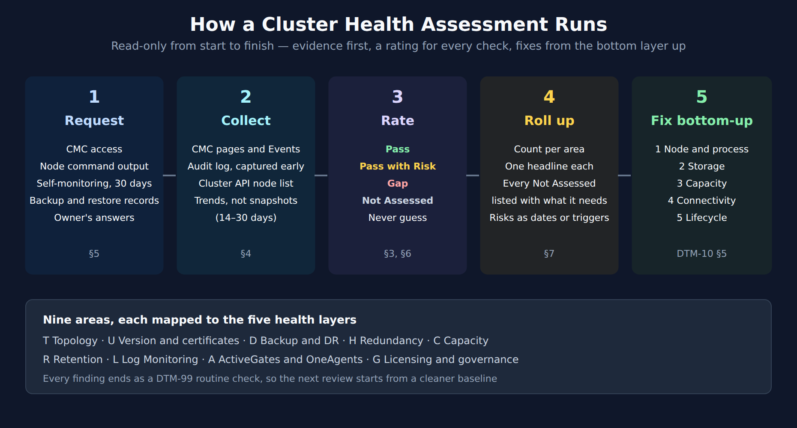

# DTM-17: Running a Cluster Health Assessment

> **Series:** DTM — Dynatrace Managed | **Reference:** 17 — Running a Cluster Health Assessment | **Created:** October 2026 | **Last Updated:** 10/29/2026

> **Dynatrace Classic only.** This series applies to **Dynatrace Managed**, the self-hosted, on-premises deployment. None of it applies to Dynatrace SaaS.

## Overview

DTM-99 is the routine a cluster's own team runs every day, week and month. This notebook is for a different occasion: a **one-off review** of a Managed cluster, by someone from outside the team or by the team itself before a decision. Typical triggers are a hardware purchase, a licence renewal, a move to Managed-to-SaaS, a new site, or a run of incidents nobody can explain.

A review like that needs things the routine doesn't: a way to rate each check, a rule for what to do when the evidence is missing, a list of what to ask for before starting, and a summary someone else can act on. This notebook supplies those, and an ID'd checklist that points each line back to the notebook holding its detail and sources.

**What you'll find here:**

- How an assessment differs from the routine checks, and why it is read-only
- A four-value rating scale, and the rule against guessing
- Where each kind of evidence comes from, and what to request up front
- A checklist of nine areas with stable IDs (T1, D8, L2 …), each mapped to the five health layers
- How to roll the findings up into something a cluster owner can act on

---

## Table of Contents

1. [Short Answer](#short-answer)
2. [Assessment or Routine?](#assessment-vs-routine)
3. [Rating Each Check](#ratings)
4. [Evidence Sources](#evidence)
5. [What to Request Before You Start](#request)
6. [The Assessment Checklist](#checklist)
7. [Rolling Up the Findings](#roll-up)
8. [What the Documentation Does Not Say](#doc-gaps)
9. [Recommended Approach](#recommendation)
10. [Summary and Next Steps](#summary)

---

## Prerequisites

| Requirement | Details |
|-------------|---------|
| **Dynatrace deployment** | A self-hosted **Dynatrace Managed** cluster. Nothing in this series applies to Dynatrace SaaS. |
| **Access** | Cluster Management Console (CMC) access for the reviewer; root (or `sudo`) on the nodes for whoever runs the node commands; a cluster API token with `ServiceProviderAPI` for the node-list call |
| **Query language** | None. Managed has no Grail, so this series has **no DQL cells** |
| **Read first** | DTM-10 (the five-layer health model) and DTM-99 (the routine checklist this one extends) |
| **Version basis** | Written against the Managed documentation read 10/29/2026 |

## 1. Short Answer

1. **Work read-only.** Every check below reads a CMC page, an event list, an API response, a node command's output or a document. None of them changes the cluster.
2. **Rate every check:** *Pass*, *Pass with Risk*, *Gap*, or *Not Assessed*. Use **Not Assessed** whenever the evidence is missing, and say what would settle it. Never fill a gap with a guess.
3. **Trend, don't snapshot.** Capacity and disk checks need weeks of history. One reading taken on a quiet afternoon proves very little.
4. **Ask for the evidence before you start.** CMC access, node command output, self-monitoring access, the backup and restore records, and the owner's answers on recovery objectives take longest to arrive.
5. **Roll up by area and fix bottom-up.** A count per area, one headline each, and every *Not Assessed* listed with what it needs. Fix the lowest failing layer first (DTM-10 §5).

## 2. Assessment or Routine?

| | Routine checks (DTM-99) | Assessment (this notebook) |
|---|---|---|
| **Who runs it** | The cluster's own operators | A reviewer, often from outside the team, with the owner answering questions |
| **When** | Daily, weekly, monthly, after every change | Once, before a decision or after a run of incidents |
| **Access** | Full administrator and root | As little as the review needs; node commands run by the owner and shared |
| **Output** | A fixed problem, or nothing | A rated checklist and a summary someone else acts on |
| **Missing evidence** | Go and look | Rate it *Not Assessed* and list what is needed |
| **Design questions** | Assumed settled | Re-opened: is the availability model, the retention, the recovery plan still right? |

The two share most of their checks. An assessment adds the questions the routine assumes are settled: the availability model, recovery objectives, a second cluster if there is one, and whether the sizing still matches the load.

<!-- MARKDOWN_TABLE_ALTERNATIVE
| Step | What happens | Output |
|------|--------------|--------|
| 1 Request | Ask for access, node output, self-monitoring, backup and restore records, owner answers | Evidence in hand before the review window opens |
| 2 Collect | Read CMC pages, Events, Audit log, Cluster API, node commands; trend 14–30 days | One evidence note per check |
| 3 Rate | Pass / Pass with Risk / Gap / Not Assessed — never guess | A rated checklist (§6) |
| 4 Roll up | Count per area, one headline each, list every Not Assessed with what it needs | A summary the owner can act on (§7) |
| 5 Fix bottom-up | Lowest failing layer first: node, storage, capacity, connectivity, lifecycle | An ordered fix list |
For environments where SVG doesn't render
-->

## 3. Rating Each Check

| Rating | Meaning |
|--------|---------|
| **Pass** | Evidence is present and within the healthy range |
| **Pass with Risk** | Within range today, but a trend, a peak, an unowned item or an unverified assumption puts it at risk |
| **Gap** | Outside the healthy range, or a required capability is missing |
| **Not Assessed** | The evidence wasn't available in the review window, or needs the owner's input. Name what is needed |

Three rules keep the ratings honest:

- **Not Assessed is a finding, not a failure.** It tells the owner what to produce. Hiding it, or turning it into a *Pass* because nothing looked wrong, is how a backup that has never been restored ends up rated healthy.
- **A rating rests on evidence you can point to.** A screenshot, a command's output, an event list or the owner's written answer. A verbal "yes, that's fine" moves a check from *Not Assessed* to *Pass with Risk*, not to *Pass*.
- **Read the threshold off the current documentation page** before quoting it in a report. The values in §6 come from the notebooks they point to, which record the date they were read. Limits change between releases.

The rating scale and these rules are this series' method. Dynatrace doesn't publish an assessment method for Managed clusters (§8).

## 4. Evidence Sources

| Source | What it gives you | Where the detail is |
|--------|-------------------|---------------------|
| **CMC** | *Home* (including the last backup), *Deployment status* (nodes, ActiveGates, network zones), *Environments*, *Events*, *Settings*, *Licensing*, *Audit log* | DTM-10 §6.1 |
| **CMC Events** | Every cluster event, including the ones that never email | DTM-99 §4 |
| **CMC Audit log** | *"Audit log lists events triggered by the cluster and selected configuration changes for all environments."* Only *"changes related to cluster-wide configuration, licensing, storage quota, and permissions"*; environment-level entries come from the Audit Logs API | DTM-10 §6.1 |
| **CMC environment export** | Each environment's page has an **Export configuration** action: *"To export the configuration of the selected Dynatrace environment"*. Useful for comparing two clusters (D8) | DTM-16 §8.1 |
| **Cluster API v1** | `onpremise/cluster`: every node's `operationState` and build version; `onpremise/cluster/configuration`: roles and data-center assignment | DTM-10 §6.4, DTM-11 §2 |
| **Node commands** | `dynatrace.sh status` / `check`, `cassandra-nodetool.sh status`, `_cluster/health`, `du` per store. They need root, so in a read-only review the owner runs them and shares the output | DTM-11 §3, DTM-12 §5, DTM-13 §5 |
| **Self-monitoring** | Local self-monitoring (`dsfm:` metrics and the capacity indicator), hosted, or private, depending on licensing. Private self-monitoring adds host CPU, memory and disk from OneAgents on the nodes | DTM-10 §6.3, DTM-15 §5.3 |
| **Mission Control** | Dynatrace's view of the cluster. The owner sees connection status in the CMC; for anything more, ask Dynatrace | DTM-10 §6.5, DTM-14 §6 |
| **Diagnostic archive** | Per-node logs and configuration, for questions the CMC can't answer | DTM-11 §9 |
| **The owner** | Recovery objectives, restore records, the off-site copy, planned changes, the reason behind any held update | — |
| **Documentation** | The thresholds, read on the day of the review | The notebook each row in §6 points to |

**Which self-monitoring you can use depends on licensing** (DTM-10 §6.3). Local self-monitoring is documented as DDU-only on one page and as on by default on another. Hosted self-monitoring is Dynatrace's, and private self-monitoring consumes licences. Find out which one exists before you plan a check that needs it.

> **Sources:** [Cluster Management Console (DT docs)](https://docs.dynatrace.com/managed/managed-cluster/basics/cluster-management-console) — *"For all environment audit log entries, use the Audit Logs API."*

## 5. What to Request Before You Start

The checks that stall a review are almost always waiting on evidence. Ask for it before the review window opens:

1. **CMC access** for the reviewer, and a Mission Control remote-access grant if Dynatrace will take part, covering the whole review window (DTM-14 §8).
2. **Self-monitoring access**, or exports from it, covering at least the last 30 days.
3. **Node command output** from every node: `dynatrace.sh status` and `check`, `cassandra-nodetool.sh status`, `_cluster/health`, and `du` for each store. If a question needs more, a diagnostic archive from the affected node.
4. **The node-list API response** (`onpremise/cluster` and `onpremise/cluster/configuration`).
5. **The backup and recovery file:** the restore runbook, the date and result of the last rehearsal, where the off-site copy is, and the recovery objectives the business has agreed.
6. **The change calendar** for the review window: patches, upgrades, reboots, hardware changes.
7. **Planned changes:** new log volume, new sites, new retention requirements, new environments.
8. **For a second cluster:** the same items for it, and an *Export configuration* of each environment on both sides.

In community practice, a review window of two to four weeks fits most clusters: long enough to collect trends and wait for answers, short enough that the CMC Events and Audit log still cover it. Verify the window against your own cluster's event history.

## 6. The Assessment Checklist

Each area maps to one or more of the five layers from DTM-10 (1 node and process, 2 storage, 3 capacity, 4 connectivity, 5 lifecycle) or to the design and configuration review in DTM-99 §3. **Healthy** gives the documented value where there is one. The **Detail** column names the notebook that quotes the source. Rows marked **(owner)** need the owner's input and are rated *Not Assessed* until it arrives.

### 6.1 T — Topology and design (layer 1, design review)

| ID | Check | Evidence | Healthy | Detail |
|----|-------|----------|---------|--------|
| T1 | Node count and hardware | CMC *Deployment status*; `onpremise/cluster` | At least three nodes, at most 42, every node the same hardware configuration | DTM-01 §3, DTM-15 §3 |
| T2 | Node size against its class | CMC node detail; the sizing table | Each node meets its class minimum; at least 64 GB RAM on every node if Log Monitoring is on | DTM-15 §2, DTM-13 §3 |
| T3 | Availability model **(owner)** | `onpremise/cluster/configuration` (data centers); the owner | Chosen and written down: single cluster, rack awareness, Premium HA, or a second cluster, each with the failure it covers | DTM-01 §4 |
| T4 | Premium HA prerequisites (if used) | CMC; the owner | Three or more nodes per data center, both sized the same, round trip at most 100 ms, online | DTM-16 §7.1 |
| T5 | Latency, time and operating system | Node output; host monitoring | Latency between nodes 10 ms or less; NTP and one time zone; every node on the same supported OS version | DTM-01 §3, §6; DTM-11 §7, §8 |

### 6.2 U — Version, updates and certificates (layers 4 and 5)

| ID | Check | Evidence | Healthy | Detail |
|----|-------|----------|---------|--------|
| U1 | Installed version | `onpremise/cluster` (`buildVersion`); the release-notes table | The same build on every node, inside "Currently supported" | DTM-11 §2, DTM-16 §6 |
| U2 | Update mode and holds **(owner)** | CMC *Settings > Automatic update*; the owner | Automatic updates in a maintenance window, or a manual routine that keeps up; any hold has an owner and a reason | DTM-16 §5 |
| U3 | Install partition | Node `df` output | At least 5 GB free on the partition where Managed is installed | DTM-16 §5.2 |
| U4 | Certificates **(owner)** | CMC node detail; the owner's certificate inventory | Expiry tracked outside the cluster, with a named owner. The expiry events never email | DTM-14 §5 |
| U5 | Mission Control link | CMC *Licensing* > *Check Mission Control connection* | Connected | DTM-14 §6, §7 |
| U6 | Remote access | CMC *Settings > Remote access permissions* | Scope and role chosen deliberately; review access limited to the review window | DTM-02 §4, DTM-14 §8 |

### 6.3 D — Backup and disaster recovery (layer 5)

| ID | Check | Evidence | Healthy | Detail |
|----|-------|----------|---------|--------|
| D1 | Backup enabled, scope chosen | CMC *Settings > Backup* | Enabled; user sessions and log events included or excluded on purpose | DTM-16 §2, §3 |
| D2 | Backups succeeding | CMC *Home* (last backup); Events | A recent last backup; no *Cassandra backup problem* or *ElasticSearch backup problem* events in the window | DTM-16 §3 |
| D3 | Scope understood **(owner)** | The owner | The owner knows transaction storage is never backed up and recent 1- and 5-minute metrics are not either | DTM-16 §2 |
| D4 | Backup target | Node mounts; CMC *Settings > Backup* | Shared storage at the same path on every node, NFSv4 recommended, mounted persistently, with space for the backup size estimate | DTM-16 §3 |
| D5 | Off-site copy **(owner)** | The owner | A copy kept off-site | DTM-16 §3 |
| D6 | Restore readiness **(owner)** | The restore kit and runbook | Installer version, node inventory, seed choice and matching UID:GID ready; a rehearsal on record | DTM-16 §4 |
| D7 | Recovery objectives **(owner)** | The owner | RTO and RPO agreed per data type, and compared with what a backup restore gives (the docs' comparison table: *RPO = 24h; RTO = 24h*) | DTM-16 §2 |
| D8 | Second cluster (if any) **(owner)** | Both CMCs; *Export configuration* from each environment on both sides | Configuration kept in step, retention long enough, a documented way for agents and users to reach it, and the capacity to take the load | DTM-16 §8.1 |

### 6.4 H — Redundancy and failure tolerance (layers 1 and 2)

| ID | Check | Evidence | Healthy | Detail |
|----|-------|----------|---------|--------|
| H1 | Copy counts understood | The documentation | Three copies of metrics, configuration and user sessions; two of log events; transaction storage distributed, not replicated | DTM-10 §4 |
| H2 | Failures the plan assumes | The owner's plan | Plans for one lost node. The docs keep three copies at every size; a Dynatrace blog allows two from five nodes | DTM-10 §4 |
| H3 | Capacity with one node gone | Self-monitoring trend; the arithmetic | Survivors stay below full load after one loss; on three nodes that means typical load at or below about two-thirds | DTM-15 §4.1 |
| H4 | Outage history | CMC Events; Audit log | Few node or host outages, each with a known cause | DTM-11 §6 |
| H5 | Cassandra | `cassandra-nodetool.sh status` | Every node `UN`; `Load` roughly even | DTM-12 §5 |
| H6 | Elasticsearch | `_cluster/health` | `green` | DTM-13 §5 |
| H7 | Cluster ActiveGates | CMC *Deployment status > ActiveGates* | None *Unknown*; none flagged as more than five versions behind | DTM-14 §9 |

### 6.5 C — Capacity and sizing (layers 2 and 3)

| ID | Check | Evidence | Healthy | Detail |
|----|-------|----------|---------|--------|
| C1 | Load against headroom | Self-monitoring, 14–30 days | Typical load leaves one-third headroom | DTM-15 §4, §5.3 |
| C2 | Adaptive load reduction | CMC Events | None, or brief; never 15 minutes or more | DTM-15 §5.1 |
| C3 | Memory pressure | CMC Events | No heap memory emergency mode or hard cleanup events | DTM-15 §5.2, DTM-11 §7 |
| C4 | Cluster traffic control | CMC Events | None. It stops monitoring new hosts, and it never emails | DTM-15 §5.2 |
| C5 | Metrics store size | `du` per node | Below 2 TB per node, and even across nodes | DTM-12 §3 |
| C6 | Disk space | CMC Events; `du` per store | No *Insufficient disk space* events; Elasticsearch sizes even across nodes; growth trended | DTM-12 §6, DTM-13 §5.2 |
| C7 | Load against the node class | CMC licensing figures; the sizing table | Host units and Full-Stack OneAgents within the per-node limits, whichever is reached first | DTM-15 §2 |
| C8 | Ingest limit after hardware changes **(owner)** | CMC *Environments* > *Cluster overload prevention*; change calendar | Reviewed after the last hardware change | DTM-15 §6 |
| C9 | Throughput | `dsfm:server.*` self-monitoring metrics | Steady or growing; no unexplained drop | DTM-15 §5.3 |

### 6.6 R — Retention (layer 2)

| ID | Check | Evidence | Healthy | Detail |
|----|-------|----------|---------|--------|
| R1 | Retention per environment **(owner)** | CMC *Environments > Storage settings* | Every user-session retention above the 35-day default, and every custom log retention, is a decision someone owns | DTM-13 §4 |
| R2 | Retention being cut | CMC Events | No *Transaction storage retention period truncation*: adaptive retention isn't trimming history | DTM-10 §7 |
| R3 | Quotas | CMC *Environments* | Set on purpose; none hit unexpectedly | DTM-03 §3, DTM-15 §6 |

### 6.7 L — Log Monitoring (layers 2 and 3; skip if not used)

| ID | Check | Evidence | Healthy | Detail |
|----|-------|----------|---------|--------|
| L1 | Hardware for logs | CMC node detail | 64 GB RAM or more on every node | DTM-13 §3 |
| L2 | Rejected log events | `dsfm:server.log_and_events_monitoring.events_rejected_count` | Zero, or rarely above zero | DTM-13 §6 |
| L3 | Incoming volume | `dsfm:server.log_and_events_monitoring.events_incoming_count` | Trend known; peaks known | DTM-13 §6 |
| L4 | Log pressure | CMC Events | No *Ingested log data is trimmed*, *Log ingest queue is full*, *Elasticsearch log queue is full* or *Elasticsearch log storing failed* | DTM-13 §6 |
| L5 | Two copies understood **(owner)** | The owner | The owner knows a second node failure makes some log events unavailable | DTM-13 §2 |
| L6 | Volume forecast **(owner)** | L3 and the owner's plans | Planned volume converted to daily storage and compared with the store's size (below) | DTM-13 §3 |
| L7 | Logs in the backup **(owner)** | CMC *Settings > Backup* | Included or excluded on purpose | DTM-13 §8 |

**Converting a log rate to daily volume.** Planned log volume usually arrives as events per minute, while storage is sized in bytes. Measure the average event size rather than assuming it, then:

> GB per day ≈ events per minute × average bytes per event × 1,440 ÷ 1,000,000,000

For example, 50,000 events a minute at 600 bytes each is about 43 GB a day before copies. Multiply by two for the two copies Log Monitoring keeps (DTM-13 §2).

### 6.8 A — ActiveGates and OneAgents (layer 4, design review)

| ID | Check | Evidence | Healthy | Detail |
|----|-------|----------|---------|--------|
| A1 | ActiveGate roles | CMC *Deployment status > ActiveGates* | Each ActiveGate has one purpose; Environment ActiveGates next to the OneAgents they serve | DTM-04 §2, §3 |
| A2 | ActiveGate redundancy and load | CMC; host monitoring of the ActiveGate hosts | Two or more per data center per job; CPU at or below 50% and memory at or below 80%, so the others can take over | DTM-04 §4 |
| A3 | ActiveGate updates | CMC | Environment ActiveGates on a set update mode; Cluster ActiveGates within five versions | DTM-04 §7 |
| A4 | ActiveGate tokens | CMC Events | No *ActiveGate Token(s) will expire soon.* left unhandled | DTM-14 §9 |
| A5 | Network zones | CMC *Deployment status > Network zones* | Zones follow the network layout; a fallback mode chosen for each | DTM-04 §5, DTM-05 §4 |
| A6 | OneAgent versions and policy | CMC; environment settings | Update policy set by host group; versions within support; hosts below the x86-64-v2 baseline identified | DTM-05 §5, §6 |
| A7 | OneAgent coverage **(owner)** | The owner's host inventory | Monitored hosts match the expected inventory | — |

In community practice, reviewers take the agent total from one place, not by adding up the per-ActiveGate connection counts. Those counts can overlap. Verify against your own CMC before reporting a number.

### 6.9 G — Licensing and governance (design review)

| ID | Check | Evidence | Healthy | Detail |
|----|-------|----------|---------|--------|
| G1 | Licence consumption and expiry **(owner)** | CMC *Licensing*; the owner | Consumption below the licence at peak, not only today; expiry date known | — |
| G2 | Licensing and the Mission Control link | CMC *Licensing* | On classic licensing, no outage near 14 days | DTM-14 §7 |
| G3 | Events read | CMC Events, the whole window | Every warning and severe event explained; none of the never-emailed events left unread | DTM-99 §4 |
| G4 | Audit log | CMC *Audit log*; Audit Logs API per environment | Cluster-wide configuration, licensing, storage-quota and permission changes in the window explained | §4 |
| G5 | Notifications reach people | CMC *Settings > Emails*; the notification settings object | SMTP working, recipients and emergency contacts set, configurable events set explicitly | DTM-02 §3, DTM-10 §6.2 |
| G6 | Sign-in and access | CMC *User authentication* | LDAP or SSO; the installation administrator kept as a break-glass account; a small cluster-admin group | DTM-02 §6, DTM-03 §4–§6 |
| G7 | Host hardening **(owner)** | The owner | Nodes patched to one level and hardened to the organisation's standard | DTM-01 §6 |

> **Sources:** [Cluster Management Console (DT docs)](https://docs.dynatrace.com/managed/managed-cluster/basics/cluster-management-console), [Self-monitoring metrics (DT docs)](https://docs.dynatrace.com/managed/analyze-explore-automate/metrics-classic/self-monitoring-metrics), [Pre-upgrade information (DT docs)](https://docs.dynatrace.com/managed/upgrade/up-information). Every other value is quoted, with its source, in the notebook named in the Detail column. **Derived:** the daily-volume formula is unit arithmetic; the doubling applies the two-copy rule in DTM-13 §2.

## 7. Rolling Up the Findings

A checklist of nearly sixty lines isn't a result. Roll it up so the owner can see where to start:

| Area | Pass | Pass with Risk | Gap | Not Assessed | Headline |
|------|------|----------------|-----|--------------|----------|
| T — Topology and design | | | | | |
| U — Version, updates, certificates | | | | | |
| D — Backup and disaster recovery | | | | | |
| H — Redundancy | | | | | |
| C — Capacity | | | | | |
| R — Retention | | | | | |
| L — Log Monitoring | | | | | |
| A — ActiveGates and OneAgents | | | | | |
| G — Licensing and governance | | | | | |

Then:

1. **List every *Not Assessed* check with what would settle it.** This is the owner's to-do list, and often the most useful page of the report.
2. **Order the gaps bottom-up** by the DTM-10 layers: node and process, storage, capacity, connectivity, lifecycle. A storage gap can surface as a capacity symptom, so fix the lower layer first.
3. **Write each *Pass with Risk* as a date or a trigger.** "Metrics store reaches 2 TB on node 2 in about four months at the current rate" can be acted on. "Disk is getting full" can't.
4. **Hand the routine back.** Most findings turn into a DTM-99 check that keeps them from coming back. Point to the line.

## 8. What the Documentation Does Not Say

**Not found**, in the Managed documentation read 10/29/2026:

| Gap | Working assumption in this notebook |
|-----|-------------------------------------|
| A Dynatrace method for assessing a Managed cluster: ratings, evidence, a scored result | The rating scale in §3 and the roll-up in §7 are this series' own |
| `dsfm:` self-monitoring metrics for Server garbage collection, queue overflows or sampling | Use the events (C2–C4) and, with private self-monitoring, the host and process metrics from the nodes' OneAgents |
| Where the per-environment log ingest limit is set, and how it relates to any cluster-wide figure | Read the rejected-events metric (L2). The Log Monitoring troubleshooting page answers *"Who can increase the ingestion limit per tenant?"* by pointing to a Dynatrace product expert |
| What *Export configuration* contains, and in what format | Export both sides and compare (D8); don't assume it covers every setting |
| How long the CMC Audit log and Events are kept | Capture both at the start of the review window |

**Thresholds this checklist leaves to judgment.** The documentation gives no value for these. In community practice, reviewers use the following, so state them as practice in a report rather than as limits, and verify them against your own cluster:

| Check | Value used in community practice |
|-------|----------------------------------|
| Disk on a data volume (C6) | Warn at 85% used. It is the lowest of Elasticsearch's upstream watermarks (DTM-13 §5.2) |
| Certificate expiry (U4) | Renewal planned 90 days out; a *Gap* within 30 days |
| Restore rehearsal (D6) | Within the last 12 months |
| Licence expiry (G1) | More than six months away |

> **Sources:** [Self-monitoring metrics (DT docs)](https://docs.dynatrace.com/managed/analyze-explore-automate/metrics-classic/self-monitoring-metrics), [Log Monitoring troubleshooting (DT docs)](https://docs.dynatrace.com/managed/analyze-explore-automate/log-monitoring/lmc-troubleshooting), [Cluster Management Console (DT docs)](https://docs.dynatrace.com/managed/managed-cluster/basics/cluster-management-console), [Manage your monitoring environments (DT docs)](https://docs.dynatrace.com/managed/managed-cluster/operation/manage-your-monitoring-environments). **Observed 10/29/2026:** the self-monitoring metrics page lists no garbage-collection, queue or sampling metric; the environments page describes log quotas and Log Monitoring storage, but no per-minute ingest limit; the CMC page gives no retention for the Audit log or Events.

## 9. Recommended Approach

1. **Send the request list (§5) a week before the review starts**, and agree who runs the node commands.
2. **Capture CMC Events and the Audit log on day one**, before anything ages out.
3. **Rate every check in §6**, with the evidence beside it. When the evidence is missing, rate *Not Assessed* and write down what is needed.
4. **Ask the owner the (owner) questions in one sitting**, in writing. Recovery objectives (D7) and the second cluster (D8) take the longest to answer.
5. **Roll up by area (§7)**, order the gaps bottom-up, and turn each *Pass with Risk* into a date or a trigger.
6. **Hand the cluster back to the routine.** Each finding should end as a DTM-99 check, so the next review starts from a cleaner baseline.

## 10. Summary and Next Steps

A cluster health assessment is DTM-99's checklist run once, by a reviewer, with three additions: a rating for every check, an honest *Not Assessed* where evidence is missing, and the design questions the routine takes as settled. Ask for the evidence early, trend rather than snapshot, roll the results up by area, and fix from the bottom layer up.

**Next in the series:**

| Notebook | Use it for |
|----------|------------|
| DTM-99: Best Practice Summary and Health-Check Checklist | The routine checks a finding should turn into |
| DTM-10: Managed Cluster Architecture and Health Model | The five layers and where health is surfaced |
| DTM-16: Backup, Upgrade, and Disaster Recovery | Recovery objectives, restore readiness and a second cluster |

---

*This notebook was AI-generated from community-submitted and publicly available sources. This notebook series is not officially supported by Dynatrace. Always verify information against official [Dynatrace documentation](https://docs.dynatrace.com/managed).*
