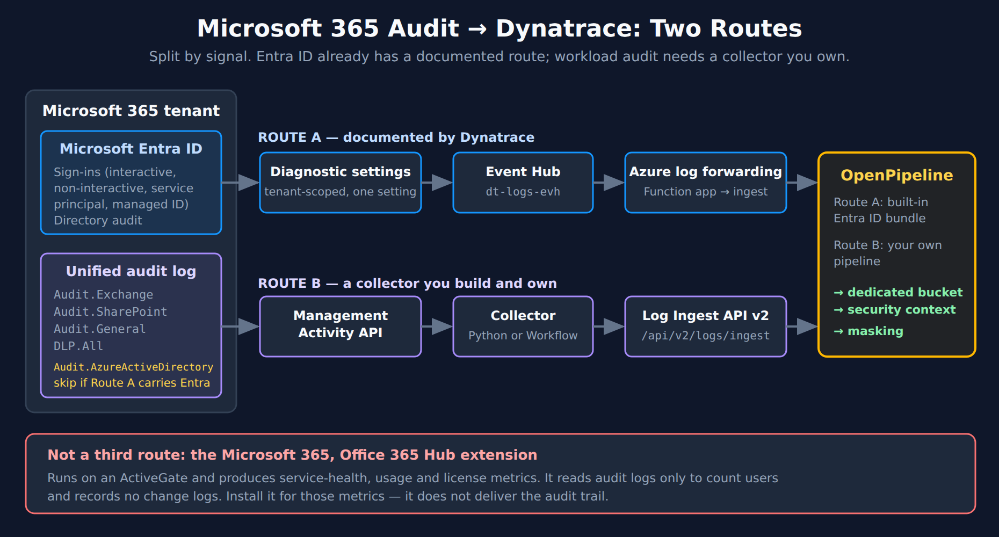
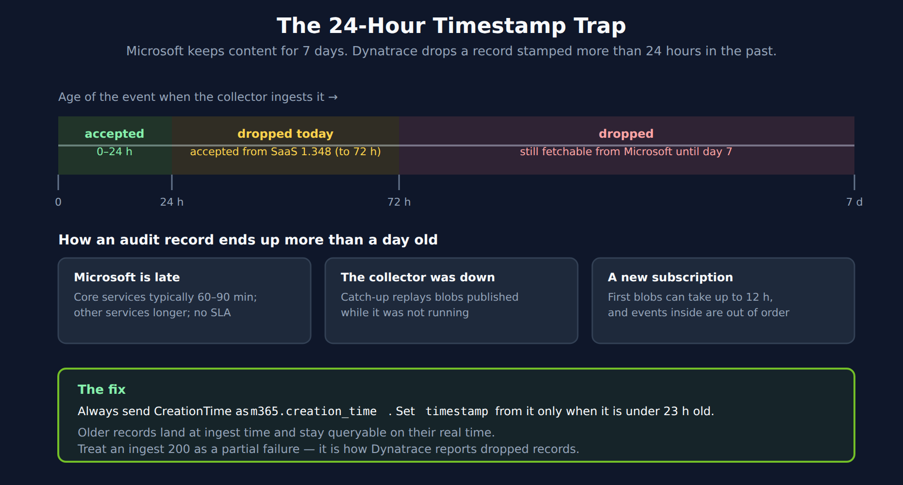
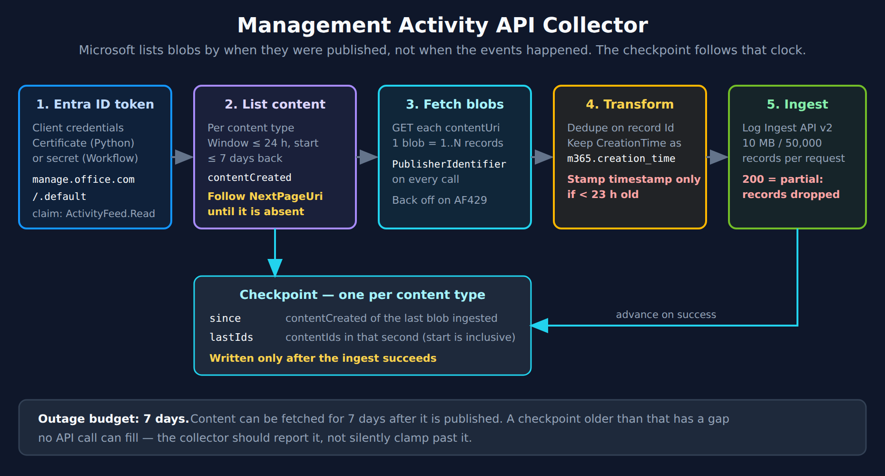

# FAQ-27: How Do I Get Microsoft 365 Audit Logs Into Dynatrace?

> **Series:** FAQ — Frequently Asked Questions | **Reference:** 27 — Microsoft 365 Audit Logs Into Dynatrace | **Created:** October 2026 | **Last Updated:** 10/27/2026

## Overview

The request usually arrives as one line — "get the O365 audit logs into Dynatrace" — and the design that comes back is usually one pipeline: a collector polls the Office 365 Management Activity API and posts everything to the Dynatrace log ingest API. That design is half right. Three things about this integration change it:

- **There is a Microsoft 365 extension on the Dynatrace Hub, and it is not an audit feed.** It runs on an ActiveGate and produces service-health, usage and license metrics. Its documentation says it reads audit logs only to count users and that no change logs are recorded or exported. Installing it is worthwhile for those metrics; it does not answer the audit question.
- **Microsoft Entra ID sign-ins already have a documented Dynatrace route.** Entra ID diagnostic settings stream to an Event Hub, Azure log forwarding sends them to Dynatrace, and OpenPipeline has a built-in bundle for them. Collecting the same sign-ins a second time through the Management Activity API is duplication, not coverage.
- **The workload audit — Exchange, SharePoint and OneDrive, Teams and the rest, DLP — has no Dynatrace route.** For that, you build and own a collector. It has to cope with a feed that Microsoft delivers late, out of order and with duplicates, against an ingest API that drops records stamped more than 24 hours in the past.

That last pairing is the expensive one. A collector that stamps each record with its event time works on the first day and then loses records quietly — after any outage longer than a day, and whenever Microsoft is late. Nothing errors: the ingest API answers `200` instead of `204`, and the records are gone.

This entry is the third **worked example of FAQ-19**, after Zscaler (**FAQ-20**) and Box (**FAQ-23**). The generic decisions — signal classes, route choice, extract-then-discard, bucket isolation — are made there; here they are made for Microsoft 365.

> **A note on the code and the DQL in this entry.** Both collectors (§ 9 and § 10) were checked against Microsoft's Management Activity API reference and exercised against mocked Microsoft and Dynatrace endpoints on 10/27/2026 — pagination, duplicate removal, the timestamp rule, the partial-ingest stop and the 7-day gap check. **They have not been run against a live Microsoft 365 tenant.** Run them against a test tenant before production. The parse and duplicate queries (§ 13.1, § 13.2) run against synthetic records with `data record(...)` at zero bytes scanned; the rest read real logs and are billed as queries — each scanned up to about a gigabyte on the validation tenant with no Microsoft 365 data present, so keep their timeframes short and scope them to your bucket once it exists. All queries were executed against a live tenant on 10/27/2026.

---

## Table of Contents

1. [Short Answer](#short-answer)
2. [What Exists Today — and What It Does Not Do](#what-exists)
3. [Two Routes, Split by Signal](#two-routes)
4. [The Management Activity API — Constraints That Shape the Collector](#api-constraints)
5. [The 24-Hour Timestamp Trap](#timestamp-trap)
6. [Duplicates and the Checkpoint](#checkpoint)
7. [App Registration and Credentials](#app-registration)
8. [Choosing the Collector — Python or Workflow](#choosing)
9. [Implementation A — Python](#python)
10. [Implementation B — Dynatrace Workflow](#workflow)
11. [Ingestion, Processing, and Storage](#ingestion)
12. [Field Mapping Starting Point](#field-mapping)
13. [Querying Audit Records in Grail](#querying)
14. [Operating the Collector](#operating)
15. [Implementation Sequence and Checklist](#sequence)
16. [Common Gotchas](#gotchas)
17. [Recommended Approach](#recommended-approach)

---

## Prerequisites

| Requirement | Details |
|-------------|---------|
| **Microsoft 365 auditing** | On by default for most organizations, but **not** for small and medium business licenses or free enterprise trials. Verify in Exchange Online PowerShell with `Get-AdminAuditLogConfig \| Format-List UnifiedAuditLogIngestionEnabled` — run it there, not in Security & Compliance PowerShell, where the property always reads `False` (§ 7) |
| **Entra ID app registration** | An app with the **Office 365 Management APIs** application permission *Read activity data for your organization*, and admin consent granted. Add the DLP permission only if you collect `DLP.All` (§ 7) |
| **Credential** | A certificate for the Python collector; a client secret in the Credential Vault for the Workflow collector (§ 7) |
| **Dynatrace environment** | SaaS with **Grail** and **OpenPipeline** |
| **Ingest credential** | Platform token with `openpipeline:logs:ingest` (Python). On a classic or hybrid environment a classic access token with `logs.ingest` also works |
| **Outbound connectivity** | Workflow path: `login.microsoftonline.com` and `manage.office.com` under **Settings > General > External requests** |
| **Security sign-off** | This feed names people, the files they opened and the mail they read. Decide retention, masking and who can read it before switching anything on (§ 11) |
| **Related reading** | **FAQ-19** (the pattern), **FAQ-23** (Box — the closest sibling), **FAQ-24** (data trust), **ORGNZ** (buckets), **OPIPE** / **OPLOGS** (OpenPipeline), **CLOUD** (Azure), **WFLOW** / **FAQ-21** (alert routing) |

---

<a id="short-answer"></a>
## 1. Short Answer

Use two routes. Send **Entra ID sign-ins and directory audit** through the documented Azure log forwarding route. Build a scheduled collector on the **Office 365 Management Activity API** for everything else. Do not expect the Microsoft 365 Hub extension to deliver audit events — it does not.

**The decisions, made:**

| Decision | Answer | Why |
|---|---|---|
| **Entra ID sign-ins and audit** | Diagnostic settings → Event Hub → Azure log forwarding | Documented by Dynatrace, with a built-in OpenPipeline bundle for sign-ins (§ 2.2) |
| **Workload audit** | Pull from the Management Activity API | No Dynatrace route exists; Microsoft is de-emphasizing webhooks (§ 4) |
| **Content types** | `Audit.Exchange`, `Audit.SharePoint`, `Audit.General`, plus `DLP.All` if needed | Leave out `Audit.AzureActiveDirectory` while Entra arrives by the other route (§ 3.1) |
| **Collector** | **Python** by default; a **Workflow** for small tenants | Microsoft's volume is set by your tenant, not by you, and a Workflow run stops at 120 s (§ 8) |
| **Timestamp** | Event time only when it is under 23 h old; always keep it in `m365.creation_time` | Ingest drops older timestamps — and Microsoft keeps content for 7 days (§ 5) |
| **Checkpoint** | Per content type, on `contentCreated`, written only after a successful ingest | The API lists content by when it was published, not when the event happened (§ 6) |
| **Duplicates** | Remove within a run; count once with `dedup` at query time | Microsoft says duplicates are expected and removing them is the consumer's job (§ 6) |
| **Destination** | Log Ingestion API v2, `log.source` `microsoft365.audit`, a dedicated bucket | Separate retention and a separate access boundary (§ 11) |

---

<a id="what-exists"></a>
## 2. What Exists Today — and What It Does Not Do

Microsoft 365 is a service you do not run, so everything you learn about it comes through Microsoft's APIs — the same position as Zscaler (**FAQ-20**) and Box (**FAQ-23**). The difference here is that two pieces already exist, and both are easy to misread.

### 2.1 The Hub extension is not an audit feed

The **Microsoft 365, Office 365** extension on the Dynatrace Hub is real and current. It runs on an ActiveGate, calls Microsoft Graph, the Office 365 Management API and the reporting web services, and produces metrics: service health, Outlook, OneDrive, Teams, SharePoint, licenses, and optional per-user usage reports.

What it does with audit logs is narrow. Its documentation says it uses them to count users, and that no change logs are recorded or exported. Its per-user reports are counts, not events — no timestamps, no individual actions.

**Install it for what it does.** Service health and adoption metrics are useful, and they cost no collector. Then build the audit route separately. Treating the extension as the audit integration is the Microsoft 365 version of FAQ-23's webhook trap: something real, correctly configured, that never carries the events you needed.

### 2.2 Entra ID has a documented route

For identity, Dynatrace documents the route end to end. In the Azure portal, **Microsoft Entra ID > Diagnostic settings** streams the categories you choose — `AuditLogs`, `SignInLogs`, `NonInteractiveUserSignInLogs`, `ServicePrincipalSignInLogs`, `ManagedIdentitySignInLogs`, `ProvisioningLogs` — to an Event Hub, and Azure log forwarding sends them to Dynatrace. The setting is tenant-wide, so one setting covers every user and application. For sign-ins, OpenPipeline has a built-in technology bundle, **Azure Entra ID Audit Logs**, that maps them onto the semantic dictionary's security-event model.

### 2.3 Nothing covers the workload audit

For Exchange, SharePoint and OneDrive, Teams and the other workloads, and for DLP events, there is no Dynatrace extension or documented route as of 10/27/2026. You build this one. The rest of this entry is about building it well.

> <sub>**Sources:**</sub>
> - <sub>[Microsoft 365, Office 365 extension (DT docs)](https://docs.dynatrace.com/docs/observe/infrastructure-observability/extensions/microsoft-365-office-365) — *"The extension uses audit logs to count O365 service users."*; *"No change logs are recorded or exported by the extension."*; *"The extension runs on Dynatrace ActiveGate."*</sub>
> - <sub>[Forward Azure logs (DT docs)](https://docs.dynatrace.com/docs/ingest-from/microsoft-azure-services/ingest-telemetry/azure-logs-and-events/azure-logs) — *"Entra ID diagnostic settings are tenant-scoped, not subscription-scoped."*</sub>
> - <sub>[Ingest Microsoft Entra ID sign-in logs (DT docs)](https://docs.dynatrace.com/docs/secure/threat-observability/security-events-ingest/ingest-microsoft-entra-id)</sub>
> - <sub>**Catalog observation (10/27/2026):** § 2.3's no-route claim rests on the Dynatrace documentation assistant, a web search of dynatrace.com and the extension page above, which covers metrics only — re-check the Hub before quoting it, because listings appear over time</sub>

---

<a id="two-routes"></a>
## 3. Two Routes, Split by Signal



<!-- MARKDOWN_TABLE_ALTERNATIVE
| Route | Covers | Path | Owner |
|-------|--------|------|-------|
| A | Entra ID sign-ins (interactive, non-interactive, service principal, managed identity) and directory audit | Entra ID diagnostic settings, then Event Hub, then Azure log forwarding, then OpenPipeline (built-in Entra ID bundle) | Documented by Dynatrace |
| B | Workload audit: Audit.Exchange, Audit.SharePoint, Audit.General, DLP.All | Management Activity API, then your collector (Python or Workflow), then Log Ingest API v2, then your own pipeline | You build and own it |
| Not a route | Microsoft 365, Office 365 Hub extension | ActiveGate; service-health, usage and license metrics | Counts users from audit logs; records no change logs |
-->

FAQ-19 § 2 says to choose the signals before the transport. For Microsoft 365 the split falls out of what already exists: identity has a route, the workloads do not, so each gets the route that fits it. Both land in the same bucket with the same retention and the same access boundary, and query side by side.

### 3.1 Do not collect Entra ID twice

The Management Activity API has an `Audit.AzureActiveDirectory` content type, and it overlaps Route A. Microsoft's own troubleshooting page says that Entra ID sign-in activity reaches the unified audit log *from* Entra ID's Event Hubs — so Route A reads the same events closer to their source, with categories (non-interactive, service-principal and managed-identity sign-ins) that you choose individually.

**While Route A is running, leave `Audit.AzureActiveDirectory` out of the collector.** If you cannot use Route A — no Azure subscription for the Event Hub, say — add it to the collector's content types instead. Do not run both and plan to deduplicate later: you pay for every sign-in twice, and the two routes produce records of different shapes, so a `dedup` on one field will not merge them.

### 3.2 Is Route A already running?

Many organizations already forward Azure logs. Check before building anything:

```dql
// Is Route A (Entra ID via Azure log forwarding) already delivering sign-ins?
// Matches the routing condition of the built-in Entra ID bundle.
// Control on the validation tenant (10/27/2026): cloud.provider == "azure" alone
// returned 35,750 records in the same hour, so an empty result here means no
// sign-in forwarding — not a broken query.
fetch logs, from:-1h
| filter cloud.provider == "azure" and contains(content, "SignInLogs")
| summarize {records = count(), last_seen = takeMax(timestamp)}
```

A non-zero count means sign-ins are arriving, and § 3.1 applies. Zero means one of three things — Route A is not set up, Entra ID's diagnostic setting does not include `SignInLogs`, or nothing is forwarding Azure logs at all. Run the query without the `contains` clause to tell the last one apart.

> <sub>**Sources:** [Troubleshooting the Management Activity API (Microsoft Learn)](https://learn.microsoft.com/en-us/office/office-365-management-api/troubleshooting-the-office-365-management-activity-api) — *"audit logs for Microsoft Entra sign-in activities are ingested into the unified audit log from Microsoft Entra Event Hubs."*; [Ingest Microsoft Entra ID sign-in logs (DT docs)](https://docs.dynatrace.com/docs/secure/threat-observability/security-events-ingest/ingest-microsoft-entra-id). **Derived:** § 3.1's leave-it-out rule combines Microsoft's statement that the API's sign-ins come from Entra ID's Event Hubs with the Dynatrace route that reads those Event Hubs directly.</sub>

---

<a id="api-constraints"></a>
## 4. The Management Activity API — Constraints That Shape the Collector

The API does not hand you events. You **subscribe** to a content type, **list** the content blobs Microsoft has published for it, and **fetch** each blob, which holds one or more audit records. Every constraint below comes from that shape.

| Constraint | Value | Design consequence |
|---|---|---|
| **Content types** | `Audit.AzureActiveDirectory`, `Audit.Exchange`, `Audit.SharePoint`, `Audit.General`, `DLP.All` | One subscription and one checkpoint per type. `Audit.General` is every workload not in the other types |
| **Listing window** | `startTime`/`endTime` at most **24 h** apart; start at most **7 days** back | Catch-up after an outage walks forward one day at a time |
| **What the window filters on** | `contentCreated` — when Microsoft published the blob | You cannot ask for events by when they happened (§ 6) |
| **Pagination** | `NextPageUri` response header | Keep following it until it is absent. Stopping at page one loses data with no error |
| **Retention** | Content fetchable for **7 days** after it is published | The longest outage you can recover from (§ 14.3) |
| **Latency** | No guaranteed maximum. Core services typically 60–90 minutes; others longer. First content on a new subscription can take up to 12 hours | Measure it (§ 13.4); it is what makes § 5 matter |
| **Ordering** | Records inside blobs are not in event order | Never assume the newest record ends a run |
| **Duplicates** | Expected; Microsoft does not remove them in the API | Remove them yourself (§ 6) |
| **Throttling** | Baseline 2,000 requests/minute per tenant; `AF429` errors, which can arrive as HTTP 403 | Send `PublisherIdentifier` on every call — including the blob GET — and back off on `AF429` |
| **Subscriptions** | Wait 15 minutes between start requests; a stopped subscription cannot recover content published while it was stopped | Never stop a subscription to "reset" a collector |

### 4.1 Poll, do not use the webhook

The API can push a notification to a webhook when content is published. Microsoft's own troubleshooting page says webhooks are being de-emphasized, and that webhook notifications have recently been *slower* than listing content directly. A webhook also needs a public HTTPS listener that answers Microsoft's validation request before the subscription is created. Poll every 5–15 minutes instead.

### 4.2 Government clouds

GCC, GCC High and DoD tenants use different API hosts (`manage-gcc.office.com`, `manage.office365.us`, `manage.protection.apps.mil`). Sovereign-cloud tenants may also sign in at a different Entra ID host, so both collectors take the API host and the sign-in host as settings.

> <sub>**Sources:**</sub>
> - <sub>[Management Activity API reference (Microsoft Learn)](https://learn.microsoft.com/en-us/office/office-365-management-api/office-365-management-activity-api-reference) — *"they must be no more than 24 hours apart, with the start time no more than 7 days in the past."*; *"Make sure this parameter is specified in all issued requests to get a dedicated quota."*; *"Once you submit a subscription request, a waiting period of 15 minutes is required before another request can be made."*; *"You will not be able to retrieve content that was available between the time the subscription was stopped and restarted."*</sub>
> - <sub>[Troubleshooting the Management Activity API (Microsoft Learn)](https://learn.microsoft.com/en-us/office/office-365-management-api/troubleshooting-the-office-365-management-activity-api) — *"There is no guaranteed maximum latency for notification delivery"*; *"For core services (such as Exchange, SharePoint, OneDrive, and Teams) event availability is typically 60 to 90 minutes."*; *"Webhooks are being de-emphasized by Microsoft because of the difficulty in debugging and troubleshooting."*; *"should also be included in the GET request to the contentUri URL when retrieving the content blob."*</sub>

---

<a id="timestamp-trap"></a>
## 5. The 24-Hour Timestamp Trap



<!-- MARKDOWN_TABLE_ALTERNATIVE
| Age of the event at ingest | Dynatrace today | From SaaS 1.348 (staged rollout) | Microsoft |
|-------|--------|--------|--------|
| 0 to 24 h | Accepted | Accepted | Fetchable |
| 24 to 72 h | Dropped if stamped with event time | Accepted | Fetchable |
| 72 h to 7 days | Dropped if stamped with event time | Dropped if stamped with event time | Fetchable |
| Fix | Always send CreationTime as m365.creation_time; set timestamp from it only when under 23 h old; treat an ingest 200 as a partial failure | | |
-->

Two documented limits disagree by a factor of seven, and the collector sits between them:

- **Microsoft keeps content for 7 days**, and delivers it late — typically an hour or so, with no guarantee.
- **Dynatrace drops a log record whose timestamp is more than 24 hours in the past.** If some records in a request are too old, the API answers **`200`** with a count of what it did not ingest. Only if *every* record is too old does it answer `400`.

So the natural mapping — `timestamp = CreationTime` — loses data in exactly the situations a collector exists for: catching up after it was down for more than a day, a slow workload, and the first run of a new subscription. Every one of those is a `200`, which most HTTP code treats as success.

**The fix has two parts, and both collectors in this entry do both:**

1. **Send the event time as its own field**, `m365.creation_time`, on every record. Set `timestamp` from it only when it is under 23 hours old; otherwise leave `timestamp` unset so the record takes its ingest time. Query event time on `m365.creation_time` — recovered records then sit at the moment they arrived on any chart built on `timestamp`, but their real time is still there.
2. **Treat `200` from the ingest API as a failure.** It means records were dropped. Stop, and do not advance the checkpoint.

> **SaaS 1.348 widens the window.** SaaS 1.348 (staged tenant rollout from 10/12/2026) raises the limit to 72 hours. Verify it has reached your tenant before relying on it; until it does, 24 hours is the limit. Even at 72 hours, Microsoft's 7-day retention is longer, so the fix above still applies — change the 23-hour constant only after the new limit is live on your tenant.

`CreationTime` has no time-zone suffix (Microsoft's schema says it is UTC). Append `Z` before parsing, or a parser that assumes local time shifts every record by your UTC offset.

> <sub>**Sources:**</sub>
> - <sub>[Log ingestion limits (DT docs)](https://docs.dynatrace.com/docs/shortlink/lma-limits) — *"The event is dropped if the log event contains a timestamp before the current time minus 24 hours."*</sub>
> - <sub>[POST ingest logs (DT docs)](https://docs.dynatrace.com/docs/dynatrace-api/environment-api/log-monitoring-v2/post-ingest-logs) — *"Only a part of input events were ingested due to event invalidity."*</sub>
> - <sub>[What's new in Dynatrace SaaS 1.348 (DT docs)](https://docs.dynatrace.com/docs/whats-new/saas/sprint-348) — *"up to 72 hours in the past"*; rollout start 10/12/2026, re-read 10/27/2026</sub>
> - <sub>[Troubleshooting the Management Activity API (Microsoft Learn)](https://learn.microsoft.com/en-us/office/office-365-management-api/troubleshooting-the-office-365-management-activity-api) — *"Content is available to fetch via the API for 7 days after the notification of the content availability."*</sub>
> - <sub>[Management Activity API schema (Microsoft Learn)](https://learn.microsoft.com/en-us/office/office-365-management-api/office-365-management-activity-api-schema) — *"The date and time in Coordinated Universal Time (UTC) when the audit log record was generated."*</sub>

---

<a id="checkpoint"></a>
## 6. Duplicates and the Checkpoint

### 6.1 Two clocks

Every audit record carries two times, and the API only lets you ask about one of them:

| Field | Means | Can you filter on it? |
|---|---|---|
| `contentCreated` (on the blob) | When Microsoft **published** the blob | **Yes** — it is what `startTime`/`endTime` filter on |
| `CreationTime` (on each record) | When the **event** happened | No — the API has no event-time query |

The checkpoint therefore follows `contentCreated`. A checkpoint built on the newest `CreationTime` seen goes wrong in both directions: a late record from an early event moves it backwards, and out-of-order blobs move it past records that have not arrived yet.

### 6.2 The checkpoint, exactly

One checkpoint per content type, holding two values:

| Value | Holds | Why |
|---|---|---|
| `since` | `contentCreated` of the last blob ingested, to the second | The start of the next listing window |
| `last_ids` | The `contentId`s already ingested *at* that second | `startTime` is inclusive, so the next listing returns them again |

When a whole window has been ingested, `since` moves to the window's end — which is exclusive — and `last_ids` empties. The collector writes the checkpoint **only after the ingest succeeds**, so a failed run re-reads blobs instead of skipping them. Re-reading a blob produces duplicates, which the next section deals with; skipping one is a gap nobody can see afterwards.

### 6.3 Duplicates are part of the contract

Microsoft states that duplicates are expected: the audit service retries on errors, and the API does not remove the resulting copies, which Purview's export does. Removing them is your job. Both collectors drop repeated record `Id`s within a run, which is cheap. Copies that span runs — and re-reads after a failed run — are counted once at query time with `dedup audit.id` (§ 13.2). Watch the duplicate rate; a sudden rise usually means a checkpoint that is not being written.

> <sub>**Sources:** [Troubleshooting the Management Activity API (Microsoft Learn)](https://learn.microsoft.com/en-us/office/office-365-management-api/troubleshooting-the-office-365-management-activity-api) — *"It is the responsibility of the SIEM solution to implement logic to remove such duplicated events upon ingestion."*; *"This is the date the notification was created."* (of `contentCreated`); [Management Activity API reference (Microsoft Learn)](https://learn.microsoft.com/en-us/office/office-365-management-api/office-365-management-activity-api-reference). **Derived:** § 6.2's `since` / `last_ids` pair follows from the documented inclusive `startTime` and exclusive `endTime`.</sub>

---

<a id="app-registration"></a>
## 7. App Registration and Credentials

### 7.1 Turn auditing on, and check it

Auditing is on by default for most Microsoft 365 organizations — but not for small and medium business licenses (Business Basic, Standard and Premium) or unmanaged free trials of enterprise licenses. Check it before debugging anything else:

```powershell
# Exchange Online PowerShell — not Security & Compliance PowerShell,
# where this property always reads False even when auditing is on.
Get-AdminAuditLogConfig | Format-List UnifiedAuditLogIngestionEnabled
```

`True` means auditing is on. If you turn it on, allow up to 60 minutes for the change to take effect, and then up to 12 hours for the first content on a new subscription (§ 4).

### 7.2 The app registration

| Step | What | Notes |
|---|---|---|
| **1. Register** | Entra ID > **App registrations** > **New registration** | Single-tenant is enough for your own organization |
| **2. Permission** | **API permissions** > **Office 365 Management APIs** (not Microsoft Graph) > **Application permissions** > *Read activity data for your organization* | Add *Read DLP policy events, including detected sensitive information* only if you collect `DLP.All` |
| **3. Consent** | **Grant admin consent** | Without it every call fails |
| **4. Credential** | Upload a certificate, or create a client secret (§ 7.3) | Record the tenant ID and client ID |
| **5. Check the token** | Decode one token and look for `ActivityFeed.Read` in its `roles` claim | The API checks for that claim and rejects the call with `AF10001` if it is missing |

**Permission names do not match across pages.** Microsoft's API reference names the claim `ActivityFeed.Read`; the Dynatrace extension page lists `ActivityFeed.Read.All`. Pick the permission by its description in the portal, then confirm the token carries the claim the API checks — `ActivityFeed.Read`.

### 7.3 Certificate or secret

Microsoft's getting-started guide says to configure an X.509 certificate for app-only tokens, and its troubleshooting page shows the same flow with a client secret. Both work. Prefer the certificate where you can:

| Collector | Credential | Why |
|---|---|---|
| **Python** (§ 9) | **Certificate** (`.pfx`) in Key Vault or your secret store | No shared secret on the wire; MSAL signs the assertion |
| **Workflow** (§ 10) | **Client secret** in the Credential Vault | A certificate would mean writing the signed-assertion code yourself inside the JS runtime; a secret needs one form post |

A client secret expires. Put its expiry date in your calendar, and alert on token failures — an expired secret looks exactly like a quiet tenant until the staleness alert fires (§ 14).

> <sub>**Sources:**</sub>
> - <sub>[Turn auditing on or off (Microsoft Learn)](https://learn.microsoft.com/en-us/purview/audit-log-enable-disable) — *"Audit logging is on by default for Microsoft 365 organizations."*; *"Enabling auditing might take up to 60 minutes to take effect."*</sub>
> - <sub>[Get started with Office 365 Management APIs (Microsoft Learn)](https://learn.microsoft.com/en-us/office/office-365-management-api/get-started-with-office-365-management-apis) — *"You must configure an X.509 certificate with your application to be used as client credentials when requesting app-only access tokens from Microsoft Entra ID."*</sub>
> - <sub>[Management Activity API reference (Microsoft Learn)](https://learn.microsoft.com/en-us/office/office-365-management-api/office-365-management-activity-api-reference) — *"the access token must contain the ActivityFeed.Read claim"*</sub>
> - <sub>[Troubleshooting the Management Activity API (Microsoft Learn)](https://learn.microsoft.com/en-us/office/office-365-management-api/troubleshooting-the-office-365-management-activity-api) — the client-secret token example</sub>
> - <sub>[Microsoft 365, Office 365 extension (DT docs)](https://docs.dynatrace.com/docs/observe/infrastructure-observability/extensions/microsoft-365-office-365)</sub>

---

<a id="choosing"></a>
## 8. Choosing the Collector — Python or Workflow

| | **Python** | **Workflow (JS runtime)** |
|---|---|---|
| **Infrastructure** | You run it — Azure Functions, a container, a VM | None |
| **Execution ceiling** | None | **120 s** per run (hard) |
| **Credential** | Certificate | Client secret in the Credential Vault |
| **Checkpoint** | Your own durable store | `stateClient` app state — verify it works from a workflow first (§ 10.1) |
| **Catch-up after an outage** | Drains every missed day in one run | One day-window per content type per run; a long outage drains across many runs |
| **Scheduling, retry, failure alerting** | You build them | Built in |

**Default to Python.** In FAQ-23 the volume was known and a Workflow cleared the ceiling with room to spare. Here the volume is set by your Microsoft 365 tenant: every mailbox access, file view and Teams action is a record, so the only reliable figure is the one you measure. A Python collector has no ceiling, and Microsoft's own sample for this API is an Azure Function.

**Use a Workflow when** the tenant is small enough that one run drains a content type in well under two minutes — measure it: the Workflow returns `finished: false` for any content type it could not drain. It keeps everything inside Dynatrace, and failure alerting comes free.

If you have a choice, a sensible split is FAQ-23's: Workflow for steady state, with the Python collector built and tested as the catch-up tool.

> <sub>**Sources:** [JavaScript runtime (Dynatrace Developer)](https://developer.dynatrace.com/develop/reference/javascript-runtime/) — *"Function execution times out after 120 seconds."*; [Run JavaScript action (DT docs)](https://docs.dynatrace.com/docs/analyze-explore-automate/workflows/default-workflow-actions/run-javascript-workflow-action) — *"The task result size is limited to 6 MB."*; [Office 365 Activity Feed Azure Function sample (Microsoft Learn)](https://learn.microsoft.com/en-us/samples/officedev/o365-activityfeed-azurefunction/office-365-activity-feed-sample/).</sub>

---

<a id="python"></a>
## 9. Implementation A — Python

### 9.1 Install

```bash
pip install "msal>=1.29" requests
```

`msal` is Microsoft's authentication library for Python. Version 1.29 added the `.pfx` certificate form used below; the older PEM-plus-thumbprint form still works, but MSAL's own documentation marks it deprecated because it uses a SHA-1 thumbprint.

### 9.2 The collector

Checked against the Management Activity API reference and `msal` 1.39.0 on 10/27/2026, and run against mocked Microsoft and Dynatrace endpoints (pagination, duplicates, the timestamp rule, a partial ingest and a 7-day gap). **Not yet run against a live Microsoft 365 tenant.** It authenticates to Dynatrace with a **platform token** (scope `openpipeline:logs:ingest`); on a classic or hybrid environment a classic access token with `logs.ingest` also works — send `Api-Token <token>` instead of `Bearer <token>`.

```python
"""Collect Microsoft 365 audit records from the Management Activity API
and ship them to the Dynatrace Log Ingestion API.

Run every 5-15 minutes. One checkpoint file per content type.
Requires Python 3.11+, msal>=1.29, requests.
"""
import json
import os
import sys
import time
from datetime import datetime, timedelta, timezone
from pathlib import Path

import msal
import requests

TENANT_ID   = os.environ["M365_TENANT_ID"]
CLIENT_ID   = os.environ["M365_CLIENT_ID"]
CERT_PFX    = os.environ["M365_CERT_PFX_PATH"]          # certificate + private key
CERT_PASS   = os.environ.get("M365_CERT_PASSPHRASE")
API_ROOT    = os.environ.get("M365_API_ROOT", "https://manage.office.com")  # GCC etc. differ
LOGIN_HOST  = os.environ.get("M365_LOGIN_HOST", "https://login.microsoftonline.com")
PUBLISHER   = os.environ.get("M365_PUBLISHER_ID", TENANT_ID)  # your own tenant GUID

DT_ENV_URL        = os.environ["DT_ENV_URL"]          # https://abc12345.live.dynatrace.com
DT_PLATFORM_TOKEN = os.environ["DT_PLATFORM_TOKEN"]   # scope: openpipeline:logs:ingest

CHECKPOINT_DIR = Path(os.environ.get("M365_CHECKPOINT_DIR", "/var/lib/m365-audit"))

# Audit.AzureActiveDirectory is left out on purpose when Entra ID logs arrive
# through Azure log forwarding (section 3). Add it if they do not.
CONTENT_TYPES = ["Audit.Exchange", "Audit.SharePoint", "Audit.General", "DLP.All"]

LOG_SOURCE    = "microsoft365.audit"
INGEST_BATCH  = 1000                    # well under 50,000 records / 10 MB
MAX_EVENT_AGE = timedelta(hours=23)     # ingest drops timestamps > 24 h old (section 5)
MAX_LOOKBACK  = timedelta(days=7) - timedelta(minutes=10)  # content lives 7 days
SETTLE        = timedelta(minutes=5)    # do not close a window on the last few minutes
FEED = f"{API_ROOT}/api/v1.0/{TENANT_ID}/activity/feed"

_app = msal.ConfidentialClientApplication(
    CLIENT_ID,
    authority=f"{LOGIN_HOST}/{TENANT_ID}",
    client_credential={"private_key_pfx_path": CERT_PFX, "passphrase": CERT_PASS},
)


def token() -> str:
    """App-only token; MSAL caches it and renews it before it expires."""
    result = _app.acquire_token_for_client(scopes=[f"{API_ROOT}/.default"])
    if "access_token" not in result:
        raise RuntimeError(f"Entra ID token request failed: {result.get('error_description')}")
    return result["access_token"]


def m365_get(url: str, params: dict | None = None) -> requests.Response:
    """GET with PublisherIdentifier on every call, retrying throttling and 5xx."""
    params = dict(params or {})
    if "PublisherIdentifier=" not in url:
        params["PublisherIdentifier"] = PUBLISHER
    for attempt in range(6):
        resp = requests.get(url, params=params, timeout=60,
                            headers={"Authorization": f"Bearer {token()}"})
        # Throttling arrives as AF429, sometimes with HTTP 403 rather than 429.
        throttled = resp.status_code == 429 or "AF429" in resp.text[:200]
        if resp.ok and not throttled:
            return resp
        if throttled or resp.status_code >= 500:
            time.sleep(2 ** attempt)
            continue
        raise RuntimeError(f"Management API {resp.status_code}: {resp.text[:500]}")
    raise RuntimeError(f"Management API still failing after retries: {url}")


def ensure_subscriptions() -> None:
    """Start any content-type subscription that is not enabled yet."""
    resp = m365_get(f"{FEED}/subscriptions/list")
    enabled = {s["contentType"] for s in resp.json() if s.get("status") == "enabled"}
    for ct in CONTENT_TYPES:
        if ct not in enabled:
            r = requests.post(f"{FEED}/subscriptions/start", timeout=60,
                              params={"contentType": ct, "PublisherIdentifier": PUBLISHER},
                              headers={"Authorization": f"Bearer {token()}"})
            r.raise_for_status()
            print(f"started subscription {ct}; first content can take up to 12 h")


def utc(ts: str) -> datetime:
    """Parse Microsoft's UTC timestamps; CreationTime carries no offset."""
    dt = datetime.fromisoformat(ts.replace("Z", "+00:00"))
    return dt if dt.tzinfo else dt.replace(tzinfo=timezone.utc)


def fmt(dt: datetime) -> str:
    """startTime/endTime format the API accepts: YYYY-MM-DDTHH:MM:SS (UTC)."""
    return dt.astimezone(timezone.utc).strftime("%Y-%m-%dT%H:%M:%S")


def list_blobs(ct: str, start: datetime, end: datetime) -> list[dict]:
    """Every blob published in [start, end), following NextPageUri to the end."""
    blobs: list[dict] = []
    url = f"{FEED}/subscriptions/content"
    params: dict | None = {"contentType": ct, "startTime": fmt(start), "endTime": fmt(end)}
    while url:
        resp = m365_get(url, params)
        blobs.extend(resp.json())
        url, params = resp.headers.get("NextPageUri"), None
    return sorted(blobs, key=lambda b: b["contentCreated"])


def to_dt_record(rec: dict, ct: str, content_id: str, now: datetime) -> dict:
    """Map one audit record to a Dynatrace log record."""
    created = rec.get("CreationTime")
    record = {
        "content":            json.dumps(rec, separators=(",", ":")),
        "log.source":         LOG_SOURCE,
        "audit.id":           rec.get("Id"),
        "audit.action":       rec.get("Operation"),
        "audit.identity":     rec.get("UserId"),
        "audit.result":       rec.get("ResultStatus"),
        "m365.content_type":  ct,
        "m365.workload":      rec.get("Workload"),
        "m365.record_type":   rec.get("RecordType"),
        "m365.client_ip":     rec.get("ClientIP"),
        "m365.object_id":     rec.get("ObjectId"),
        "m365.content_id":    content_id,
        "m365.collected_at":  now.isoformat(),
    }
    if created:
        event_time = utc(created)
        record["m365.creation_time"] = event_time.isoformat()
        # Stamp event time only when ingest will accept it. Older records keep
        # their ingest time as timestamp; their real time is m365.creation_time.
        if now - event_time < MAX_EVENT_AGE:
            record["timestamp"] = event_time.isoformat()
    return record


def ingest(records: list[dict]) -> None:
    """POST to the Dynatrace Log Ingestion API, batched."""
    url = f"{DT_ENV_URL}/api/v2/logs/ingest"
    headers = {"Authorization": f"Bearer {DT_PLATFORM_TOKEN}",
               "Content-Type": "application/json; charset=utf-8"}
    for i in range(0, len(records), INGEST_BATCH):
        batch = records[i:i + INGEST_BATCH]
        for attempt in range(5):
            resp = requests.post(url, headers=headers, data=json.dumps(batch), timeout=60)
            if resp.status_code == 204:
                break
            # 200 is a PARTIAL success: some records were not ingested.
            # Fail so the checkpoint does not move past them.
            if resp.status_code == 200:
                raise RuntimeError(f"Dynatrace partial ingest: {resp.text}")
            if resp.status_code == 413 and len(batch) > 1:
                mid = len(batch) // 2
                ingest(batch[:mid])
                ingest(batch[mid:])
                break
            if resp.status_code in (429, 500, 502, 503, 504):
                time.sleep(2 ** attempt)
                continue
            raise RuntimeError(f"Dynatrace ingest {resp.status_code}: {resp.text[:500]}")
        else:
            raise RuntimeError("Dynatrace ingest failed after 5 attempts")


def read_checkpoint(ct: str, now: datetime) -> dict:
    path = CHECKPOINT_DIR / f"{ct}.json"
    if path.exists():
        return json.loads(path.read_text())
    return {"since": fmt(now - timedelta(hours=24)), "last_ids": []}


def write_checkpoint(ct: str, since: datetime, last_ids: list[str]) -> None:
    """Write atomically — a torn checkpoint is worse than none."""
    CHECKPOINT_DIR.mkdir(parents=True, exist_ok=True)
    path = CHECKPOINT_DIR / f"{ct}.json"
    tmp = path.with_suffix(".tmp")
    tmp.write_text(json.dumps({"since": fmt(since), "last_ids": last_ids}))
    tmp.replace(path)


def collect(ct: str) -> tuple[int, bool]:
    """Drain one content type. Returns (records ingested, gap detected)."""
    now = datetime.now(timezone.utc)
    cp = read_checkpoint(ct, now)
    since, last_ids = utc(cp["since"]), list(cp["last_ids"])
    gap = False
    if since < now - MAX_LOOKBACK:
        # Content older than 7 days cannot be fetched. Say so instead of
        # pretending the collection is complete.
        print(f"GAP {ct}: checkpoint {fmt(since)} is beyond the 7-day window", file=sys.stderr)
        since, last_ids, gap = now - MAX_LOOKBACK, [], True

    seen: set[str] = set()
    total = 0
    while since < now - SETTLE:
        end = min(since + timedelta(hours=24), now - SETTLE)
        pending: list[dict] = []
        cursor, cursor_ids = since, last_ids
        for blob in list_blobs(ct, since, end):
            if blob["contentId"] in last_ids:
                continue                    # already ingested before a restart
            for rec in m365_get(blob["contentUri"]).json():
                rid = rec.get("Id")
                if rid in seen:
                    continue                # duplicates are expected (section 6)
                seen.add(rid)
                pending.append(to_dt_record(rec, ct, blob["contentId"], now))
            created = utc(blob["contentCreated"]).replace(microsecond=0)
            cursor_ids = cursor_ids + [blob["contentId"]] if created == cursor else [blob["contentId"]]
            cursor = created
            if len(pending) >= INGEST_BATCH:
                ingest(pending)
                total += len(pending)
                pending = []
                write_checkpoint(ct, cursor, cursor_ids)   # only after success
        if pending:
            ingest(pending)
            total += len(pending)
        # The whole window is done: the next one starts at its exclusive end.
        since, last_ids = end, []
        write_checkpoint(ct, since, last_ids)
    return total, gap


if __name__ == "__main__":
    ensure_subscriptions()
    any_gap = False
    for content_type in CONTENT_TYPES:
        count, had_gap = collect(content_type)
        any_gap |= had_gap
        print(f"{content_type}: ingested {count} records")
    sys.exit(2 if any_gap else 0)
```

### 9.3 What in that code is load-bearing

| Detail | Why |
|---|---|
| **`PublisherIdentifier` on every call, including the blob GET** | Without it your calls share a pool with every other caller and are throttled |
| **`AF429` checked in the body, not just HTTP 429** | Microsoft's own example of throttling arrives as HTTP 403 |
| **`NextPageUri` followed to the end** | A busy tenant's listing is paged; stopping at page one loses blobs silently |
| **`timestamp` only under 23 h** | § 5 — the record is otherwise dropped with a `200` |
| **`200` raises** | It is a partial ingest. The checkpoint stays where it was |
| **Checkpoint written after ingest, atomically** | A failed run re-reads; a torn file cannot point past unread content |
| **Exit code 2 on a 7-day gap** | Content older than 7 days cannot be fetched. Report it rather than clamp past it quietly |
| **`SETTLE` of 5 minutes** | A window is not closed on its newest few minutes, in case a just-published blob is not listed yet |

### 9.4 Where to run it

| Host | Fit |
|---|---|
| **Azure Functions (timer trigger)** | Natural fit — certificate in Key Vault, checkpoint in Table or Blob Storage rather than a file |
| **Kubernetes `CronJob`** | Good if you already run Kubernetes; persistent volume for the checkpoint |
| **A VM with cron or a systemd timer** | Works; keep the checkpoint on persistent disk |

Whatever runs it needs monitoring of its own — see § 14.

> <sub>**Sources:** [msal on PyPI](https://pypi.org/project/msal/); [Management Activity API reference (Microsoft Learn)](https://learn.microsoft.com/en-us/office/office-365-management-api/office-365-management-activity-api-reference); [Troubleshooting the Management Activity API (Microsoft Learn)](https://learn.microsoft.com/en-us/office/office-365-management-api/troubleshooting-the-office-365-management-activity-api) — *"Response Code 403"* in the throttling example; [POST ingest logs (DT docs)](https://docs.dynatrace.com/docs/dynatrace-api/environment-api/log-monitoring-v2/post-ingest-logs) — *"Only a part of input events were ingested due to event invalidity."* **Observation (10/27/2026):** the `private_key_pfx_path` form and the deprecation of the SHA-1 form were read from `msal` 1.39.0's own docstring.</sub>

---

<a id="workflow"></a>
## 10. Implementation B — Dynatrace Workflow

### 10.1 Set up first

| Step | What | Why it matters |
|---|---|---|
| **1. Start the subscriptions** | Once per content type: `POST /subscriptions/start?contentType=…` — or run the Python collector once, which does it | The Workflow below lists and fetches; it does not start subscriptions |
| **2. Credential Vault entry** | Client ID as username, client secret as password; **AppEngine** scope, **Allow access without app context** on, workflow actor granted access | Workflow JavaScript runs without an app context; a credential missing any of the three cannot be read |
| **3. Outbound allowlist** | `login.microsoftonline.com` and `manage.office.com` under **Settings > General > External requests** | Every HTTP call from the task is checked against this list |
| **4. Standard workflow** | Not a simple workflow | Simple workflows have no **Run JavaScript** action |
| **5. Test the checkpoint store** | A two-task workflow: `setAppState` in the first, `getAppState` in the second | See the note below |

> **Verify app state works from a workflow before you schedule this.** The collector keeps its checkpoint in app state through `stateClient`, as FAQ-23's does. Two Dynatrace pages leave open whether a Run JavaScript task can reach app state: the state service says states *"are only accessible from their respective apps"*, and the Run JavaScript page says *"JavaScript tasks run without an app context."* If the test value does not come back, keep the checkpoint in a store the workflow can read and write; nothing else in the design changes.

### 10.2 The collector

A single **Run JavaScript** action on a 5–15 minute schedule. Checked against the `@dynatrace-sdk/client-classic-environment-v2` 9.1.0 and `@dynatrace-sdk/client-state` 1.11.0 typings and run against mocked SDK and Microsoft endpoints on 10/27/2026; not yet run in a workflow against a live tenant.

```javascript
import { credentialVaultClient, logsClient } from "@dynatrace-sdk/client-classic-environment-v2";
import { stateClient, isNotFound } from "@dynatrace-sdk/client-state";

const M365_CREDENTIAL_ID = "CREDENTIALS_VAULT-XXXXXXXXXXXXXXXX"; // username = client ID, password = secret
const TENANT_ID     = "00000000-0000-0000-0000-000000000000";
const API_ROOT      = "https://manage.office.com";
const FEED          = `${API_ROOT}/api/v1.0/${TENANT_ID}/activity/feed`;
const PUBLISHER     = TENANT_ID;
const CONTENT_TYPES = ["Audit.Exchange", "Audit.SharePoint", "Audit.General", "DLP.All"];
const LOG_SOURCE    = "microsoft365.audit";
const TIME_BUDGET_MS = 90 * 1000;          // stop well before the 120 s ceiling
const INGEST_BATCH  = 1000;
const MAX_EVENT_AGE_MS = 23 * 3600 * 1000; // ingest drops timestamps > 24 h old (§ 5)
const LOOKBACK_MS   = 7 * 24 * 3600 * 1000 - 10 * 60 * 1000;
const SETTLE_MS     = 5 * 60 * 1000;
const DAY_MS        = 24 * 3600 * 1000;

const fmt = (d) => d.toISOString().slice(0, 19);                 // YYYY-MM-DDTHH:MM:SS
const utc = (s) => new Date(/Z|[+-]\d\d:\d\d$/.test(s) ? s : `${s}Z`);

export default async function () {
  const started = Date.now();
  const outOfTime = () => Date.now() - started > TIME_BUDGET_MS;

  // --- 1. Token (client secret from the Credential Vault) -----------------
  const creds = await credentialVaultClient.getCredentialsDetails({ id: M365_CREDENTIAL_ID });
  const tokenRes = await fetch(`https://login.microsoftonline.com/${TENANT_ID}/oauth2/v2.0/token`, {
    method: "POST",
    headers: { "Content-Type": "application/x-www-form-urlencoded" },
    body: new URLSearchParams({
      grant_type: "client_credentials",
      client_id: creds.username,
      client_secret: creds.password,
      scope: `${API_ROOT}/.default`,
    }).toString(),
  });
  if (!tokenRes.ok) throw new Error(`Entra ID token failed: ${tokenRes.status} ${await tokenRes.text()}`);
  const { access_token } = await tokenRes.json();

  const m365 = async (url) => {
    const u = new URL(url);
    if (!u.searchParams.has("PublisherIdentifier")) u.searchParams.set("PublisherIdentifier", PUBLISHER);
    const res = await fetch(u, { headers: { Authorization: `Bearer ${access_token}` } });
    const text = await res.text();
    // Throttling is AF429, sometimes on HTTP 403. Stop; the next run resumes.
    if (res.status === 429 || text.slice(0, 200).includes("AF429")) return { throttled: true };
    if (!res.ok) throw new Error(`Management API ${res.status}: ${text.slice(0, 500)}`);
    return { body: JSON.parse(text), next: res.headers.get("NextPageUri") };
  };

  const ingest = async (records) => {
    for (let i = 0; i < records.length; i += INGEST_BATCH) {
      const result = await logsClient.storeLog({
        type: "application/json; charset=utf-8",
        body: records.slice(i, i + INGEST_BATCH),
      });
      // storeLog resolves empty on 204 and returns a body on 200, which is a
      // PARTIAL ingest — some records were dropped. Fail before the checkpoint moves.
      if (result) throw new Error(`Dynatrace partial ingest: ${JSON.stringify(result)}`);
    }
  };

  const summary = {};
  for (const ct of CONTENT_TYPES) {
    if (outOfTime()) break;
    const key = `m365-audit-${ct}`;
    const now = new Date();

    // --- 2. Checkpoint ------------------------------------------------------
    let cp = { since: fmt(new Date(now - DAY_MS)), lastIds: [] };
    try {
      const saved = await stateClient.getAppState({ key });
      if (saved?.value) cp = JSON.parse(saved.value);
    } catch (e) {
      if (!isNotFound(e)) throw e;     // first run has no checkpoint yet
    }
    let since = utc(cp.since);
    let lastIds = cp.lastIds;
    let gap = false;
    if (now - since > LOOKBACK_MS) {   // older than Microsoft keeps content
      since = new Date(now - LOOKBACK_MS); lastIds = []; gap = true;
    }
    const end = new Date(Math.min(since.getTime() + DAY_MS, now - SETTLE_MS));
    if (end <= since) { summary[ct] = { ingested: 0, gap }; continue; }

    // --- 3. List every blob in [since, end), following NextPageUri -----------
    const blobs = [];
    let url = `${FEED}/subscriptions/content?contentType=${ct}&startTime=${fmt(since)}&endTime=${fmt(end)}`;
    let throttled = false;
    while (url) {
      const page = await m365(url);
      if (page.throttled) { throttled = true; break; }
      blobs.push(...page.body);
      url = page.next;
    }
    if (throttled) { summary[ct] = { throttled: true, gap }; continue; }
    blobs.sort((a, b) => a.contentCreated.localeCompare(b.contentCreated));

    // --- 4. Fetch, transform, ingest, checkpoint -----------------------------
    const seen = new Set();
    let pending = [], total = 0, finished = true;
    let cursor = since, cursorIds = lastIds;
    for (const blob of blobs) {
      if (lastIds.includes(blob.contentId)) continue;
      if (outOfTime()) { finished = false; break; }
      const got = await m365(blob.contentUri);
      if (got.throttled) { finished = false; break; }
      const collectedAt = new Date().toISOString();
      for (const rec of got.body) {
        if (seen.has(rec.Id)) continue;    // duplicates are expected (§ 6)
        seen.add(rec.Id);
        const record = {
          content: JSON.stringify(rec),
          "log.source": LOG_SOURCE,
          "audit.id": rec.Id,
          "audit.action": rec.Operation,
          "audit.identity": rec.UserId,
          "audit.result": rec.ResultStatus,
          "m365.content_type": ct,
          "m365.workload": rec.Workload,
          "m365.record_type": rec.RecordType,
          "m365.client_ip": rec.ClientIP,
          "m365.object_id": rec.ObjectId,
          "m365.content_id": blob.contentId,
          "m365.collected_at": collectedAt,
        };
        if (rec.CreationTime) {
          const eventTime = utc(rec.CreationTime);
          record["m365.creation_time"] = eventTime.toISOString();
          if (Date.now() - eventTime < MAX_EVENT_AGE_MS) record.timestamp = eventTime.toISOString();
        }
        pending.push(record);
      }
      const created = new Date(utc(blob.contentCreated).setUTCMilliseconds(0));
      cursorIds = created.getTime() === cursor.getTime() ? [...cursorIds, blob.contentId] : [blob.contentId];
      cursor = created;
    }

    if (pending.length) { await ingest(pending); total += pending.length; }
    // A finished window advances to its exclusive end; an interrupted one
    // resumes after the last blob ingested.
    const next = finished ? { since: fmt(end), lastIds: [] } : { since: fmt(cursor), lastIds: cursorIds };
    await stateClient.setAppState({ key, body: { value: JSON.stringify(next) } });
    summary[ct] = { ingested: total, finished, gap };
  }

  // Keep the task result small (6 MB limit): counts only.
  return summary;
}
```

### 10.3 What in that code is load-bearing

| Detail | Why |
|---|---|
| **`TIME_BUDGET_MS` of 90 s** | Stops fetching before the 120 s ceiling and saves where it got to. The next run resumes |
| **`storeLog` result checked** | The SDK resolves with nothing on `204` and with a body on `200`. A body means records were dropped (§ 5) |
| **`finished` in the result** | `false` means the content type did not drain in one run. Persistently `false` means the tenant is too busy for a Workflow — move to Python |
| **One window per content type per run** | Keeps every run inside the ceiling. A long outage drains across many runs |
| **Counts only in the return value** | The task result is limited to 6 MB |
| **No TTL on the app state** | A checkpoint that expires silently restarts the collector at "the last 24 hours" |

> <sub>**Sources:**</sub>
> - <sub>[Run JavaScript action (DT docs)](https://docs.dynatrace.com/docs/analyze-explore-automate/workflows/default-workflow-actions/run-javascript-workflow-action) — *"The AppEngine scope is selected."*; *"All HTTP calls are validated against the global allowlist."*; *"JavaScript tasks run without an app context."*</sub>
> - <sub>[State service (Dynatrace Developer)](https://developer.dynatrace.com/develop/platform-services/services/state-service/) — *"These states are only accessible from their respective apps and can't be accessed using a different app or ad-hoc functions."*</sub>
> - <sub>[JavaScript runtime (Dynatrace Developer)](https://developer.dynatrace.com/develop/reference/javascript-runtime/) — *"Function execution times out after 120 seconds."*</sub>
> - <sub>**Observation (10/27/2026):** `storeLog` returning `SuccessEnvelope | void` — a body on `200`, nothing on `204` — was read from `@dynatrace-sdk/client-classic-environment-v2` 9.1.0</sub>

---

<a id="ingestion"></a>
## 11. Ingestion, Processing, and Storage



<!-- MARKDOWN_TABLE_ALTERNATIVE
| Step | Component | Key constraint |
|------|-----------|----------------|
| 1 | Entra ID token | Client credentials; certificate (Python) or secret (Workflow); scope manage.office.com/.default; token must carry ActivityFeed.Read |
| 2 | List content | Per content type; window at most 24 h, start at most 7 days back; filters on contentCreated; follow NextPageUri until absent |
| 3 | Fetch blobs | GET each contentUri; one blob holds one or more records; PublisherIdentifier on every call; back off on AF429 |
| 4 | Transform | Dedupe on record Id; keep CreationTime as m365.creation_time; stamp timestamp only if under 23 h old |
| 5 | Ingest | Log Ingest API v2; 10 MB and 50,000 records per request; 200 means records were dropped |
| Checkpoint | One per content type | since = contentCreated of the last blob ingested; lastIds = contentIds in that second; written only after the ingest succeeds |
| Outage budget | 7 days | Content can be fetched for 7 days after it is published; an older checkpoint is a gap to report |
-->

### 11.1 Ingest limits

| Limit | Value | Consequence |
|---|---|---|
| Payload per request | **10 MB** | Both collectors send 1,000 records per request |
| Records per request | **50,000** | Rarely binding |
| After processing | Rejected above **16 MB** | A batch can grow during processing; halve on `413` (the Python collector does) |
| Log age | **24 h** — 72 h from SaaS 1.348 (staged rollout) | § 5 |

### 11.2 Extract, then discard — selectively

FAQ-19 § 4 holds the mechanics and the stage-order trap: discard with **`No storage assignment`** in the Bucket assignment stage, never **`Drop record`** in Processing, or the metrics you meant to extract are never built.

Audit is the case where discarding needs the most care. Some of it exists to be produced on request, months later, and a counter cannot answer "who opened this file." Decide with whoever owns compliance:

| Records | Typical posture |
|---|---|
| Admin and configuration changes, permission and sharing changes, mailbox-permission changes, DLP matches | **Keep** for the full audit retention period |
| Sign-in failures and unusual sign-ins | **Keep** (they arrive by Route A) |
| High-volume reads — `FileAccessed`, `MailItemsAccessed`, page views | **Extract counts, then decide.** Keep raw only where a regulation or an investigation process requires it |

### 11.3 Isolation and masking

Put both routes into a **dedicated bucket** (**ORGNZ**): audit retention is usually longer than application-log retention, and this data should be readable by security and compliance, not by everyone who can read logs.

Set `dt.security_context` in the pipeline so an IAM policy can scope it — and read **FAQ-24** first: where `dt.security_context` holds an array, `=` or `IN` against it is always false.

Mask in the Processing stage before storage: for SharePoint and OneDrive, `ObjectId` holds the full path of the file or folder accessed. Hash where you need correlation without identity — remembering that a hash of a corporate email address can be enumerated.

> <sub>**Sources:** [Log ingestion limits (DT docs)](https://docs.dynatrace.com/docs/shortlink/lma-limits); [Configure data storage and retention for logs (DT docs)](https://docs.dynatrace.com/docs/analyze-explore-automate/logs/lma-bucket-assignment) — *"This means you can extract metrics and generate alerts from records that you won't store."*; [Management Activity API schema (Microsoft Learn)](https://learn.microsoft.com/en-us/office/office-365-management-api/office-365-management-activity-api-schema).</sub>

---

<a id="field-mapping"></a>
## 12. Field Mapping Starting Point

The collectors map Microsoft's common schema onto semantic-dictionary fields where one exists, and onto `m365.*` where none does. Mapping to `audit.*` is what lets a Microsoft 365 record sit next to records from other audit sources in one query.

| Microsoft field | Dynatrace field | Notes |
|---|---|---|
| `Id` | `audit.id` | **Duplicate key** — unique per audit record |
| `Operation` | `audit.action` | `FileDownloaded`, `MailItemsAccessed`, `Set-Mailbox`, … — the primary dimension |
| `UserId` | `audit.identity` | The UPN. Includes system accounts and `app@sharepoint` |
| `ResultStatus` | `audit.result` | `Succeeded` / `PartiallySucceeded` / `Failed`; `True` / `False` for Exchange admin |
| `CreationTime` | `m365.creation_time`, and `timestamp` when under 23 h old | UTC with no suffix — append `Z` (§ 5) |
| `Workload` | `m365.workload` | `Exchange`, `SharePoint`, `OneDrive`, `MicrosoftTeams`, … |
| `RecordType` | `m365.record_type` | An integer enum; `6` is a SharePoint file operation |
| `ClientIP` | `m365.client_ip` | Kept as a string: some services send a trusted application's address, and Entra ID events send none. Convert with `toIp()` in the pipeline once you have seen your data |
| `ObjectId` | `m365.object_id` | File path or object name — mask (§ 11.3) |
| (blob) `contentId` | `m365.content_id` | Ties a record back to the blob it came from |
| (collector) | `m365.content_type`, `m365.collected_at` | Which subscription, and when it was collected (§ 14.1) |

`audit.id` is `experimental` in the semantic dictionary and `client.ip` is too; `audit.action`, `audit.identity` and `audit.result` are `stable`. An experimental field can change name — check the dictionary before building a dashboard on one.

If you also forward Entra ID through Route A, map both routes' user field to the same name. Correlating a file download with the sign-in before it is one of the most useful things this data does, and it only works if the user is spelled the same way in both.

> <sub>**Sources:** [Management Activity API schema (Microsoft Learn)](https://learn.microsoft.com/en-us/office/office-365-management-api/office-365-management-activity-api-schema) — *"Unique identifier of an audit record."*; [Global field reference (DT docs)](https://docs.dynatrace.com/docs/semantic-dictionary/fields). **Dictionary:** `audit.action`, `audit.identity`, `audit.result` (`stable`); `audit.id`, `audit.time`, `client.ip` (`experimental`), read 10/27/2026.</sub>

---

<a id="querying"></a>
## 13. Querying Audit Records in Grail

§ 13.1 and § 13.2 run against synthetic records at zero bytes scanned — swap the `data record(...)` lines for `fetch logs, from:-24h | filter log.source == "microsoft365.audit"` once data flows. § 13.3 and § 13.4 read real logs and are billed as queries.

### 13.1 Parse a raw record

Both collectors put the raw record in `content` and the main fields alongside it. Parsing `content` is useful while validating, and for fields the collectors do not lift out:

```dql
// Parse a raw Microsoft 365 audit record into semantic-dictionary fields.
// Runs standalone against a synthetic record — zero bytes scanned.
// CreationTime has no time-zone suffix; it is UTC, so append "Z".
data record(content = "{\"CreationTime\":\"2026-10-27T14:03:19\",\"Id\":\"80c76bd2-9d81-4c57-a97a-accfc3443dca\",\"Operation\":\"FileDownloaded\",\"OrganizationId\":\"41463f53-8812-40f4-890f-865bf6e35190\",\"RecordType\":6,\"UserKey\":\"i:0h.f|membership|1003bffd8ec47ca6@live.com\",\"UserType\":0,\"Workload\":\"SharePoint\",\"ResultStatus\":\"Succeeded\",\"ObjectId\":\"https://contoso.sharepoint.com/sites/finance/Shared Documents/q3-forecast.xlsx\",\"UserId\":\"jdoe@contoso.com\",\"ClientIP\":\"203.0.113.42\"}",
            m365.content_type = "Audit.SharePoint")
| parse content, "JSON:rec"
| fieldsAdd audit.id       = rec[Id],
            audit.action   = rec[Operation],
            audit.identity = rec[UserId],
            audit.result   = rec[ResultStatus],
            audit.time     = toTimestamp(concat(rec[CreationTime], "Z")),
            client.ip      = toIp(rec[ClientIP]),
            m365.workload  = rec[Workload],
            m365.record_type = toLong(rec[RecordType]),
            m365.object_id = rec[ObjectId]
| fields audit.time, m365.content_type, m365.workload, audit.action, audit.identity, audit.result, client.ip, m365.object_id, audit.id
```

### 13.2 Duplicates — measure them, then count once

The first query is the weekly health check: the duplicate rate per content type. The second is the pattern for every report — `dedup audit.id` before counting, so a record Microsoft delivered twice counts once.

```dql
// Duplicate rate per content type. Microsoft states duplicates are expected
// and that removing them is the consumer's job.
// Runs standalone against synthetic records — zero bytes scanned.
data record(m365.content_type = "Audit.Exchange",   audit.id = "a1"),
     record(m365.content_type = "Audit.Exchange",   audit.id = "a1"),
     record(m365.content_type = "Audit.Exchange",   audit.id = "a2"),
     record(m365.content_type = "Audit.SharePoint", audit.id = "b1"),
     record(m365.content_type = "Audit.SharePoint", audit.id = "b2")
| summarize {ingested = count(), unique = countDistinctExact(audit.id)}, by:{m365.content_type}
| fieldsAdd duplicates = ingested - unique
| fieldsAdd duplicate_pct = round(100.0 * duplicates / ingested, decimals: 1)
| sort duplicate_pct desc
```

```dql
// Count each audit record once, however many copies Microsoft delivered.
// Runs standalone against synthetic records — zero bytes scanned.
data record(audit.id = "a1", audit.action = "FileDownloaded"),
     record(audit.id = "a1", audit.action = "FileDownloaded"),
     record(audit.id = "a2", audit.action = "FileDownloaded"),
     record(audit.id = "a3", audit.action = "UserLoggedIn")
| dedup audit.id
| summarize records = count(), by:{audit.action}
| sort records desc
```

### 13.3 Confirm records landed in the right bucket

A record in the wrong bucket is still queryable — it just has the wrong retention and the wrong readers.

```dql
// Which bucket did the audit records land in? Expect your dedicated bucket,
// not default_logs. An empty result means no data yet — not success.
fetch logs, from:-24h
| filter log.source == "microsoft365.audit"
| summarize records = count(), by:{dt.system.bucket, m365.content_type}
| sort records desc
```

### 13.4 How late is Microsoft?

The number that decides whether § 5 bites. Lag is collection time minus event time; `over_23h` counts records that arrived with ingest time as `timestamp`. Checked on 10/27/2026 against two synthetic records 1 hour and 26 hours late, which returned 60 and 1,560 minutes and one record over 23 hours.

```dql
// How late does Microsoft deliver, per content type? Lag is collection time
// minus event time. Watch p99 against the 24 h ingest window.
fetch logs, from:-24h
| filter log.source == "microsoft365.audit"
| fieldsAdd lag = toTimestamp(m365.collected_at) - toTimestamp(m365.creation_time)
| summarize {records = count(),
             p50_min = percentile(lag, 50) / 1m,
             p99_min = percentile(lag, 99) / 1m,
             over_23h = countIf(lag > 23h)},
            by:{m365.content_type}
| sort p99_min desc
```

---

<a id="operating"></a>
## 14. Operating the Collector

**The failure mode:** the collector stops — an expired client secret, a revoked consent, a full disk. It produces no records, and no records looks like a quiet tenant. Microsoft keeps content for 7 days, so an outage nobody notices for a week becomes a permanent gap in the audit trail.

### 14.1 The staleness check — on the right clock

Measure freshness on **when records were collected** (`m365.collected_at`), not on `timestamp`. Microsoft is normally an hour or more behind, so a check on event time reports an outage every morning. And keep the explicit `events == 0` branch: with no data, `null > 30` is false, and the check would report `OK` for a collector that has never run — the trap FAQ-23 § 13.1 reproduced.

```dql
// Collector health, measured on when records were COLLECTED, not when the
// events happened — Microsoft's own delay would otherwise read as an outage.
// The events == 0 branch matters: with no data, null > 30 is false and the
// check would report OK.
fetch logs, from:-6h
| filter log.source == "microsoft365.audit"
| summarize {events = count(),
             last_collected = takeMax(toTimestamp(m365.collected_at)),
             content_types = countDistinctExact(m365.content_type)}
| fieldsAdd minutes_since_last = round((now() - last_collected) / 1m, decimals: 1)
| fieldsAdd collector_status = if(events == 0, "NO DATA — collector never ran or is misconfigured",
                               else: if(minutes_since_last > 30, "STALLED",
                               else: "OK"))
```

On the validation tenant, with no collector, this returned `NO DATA` on 10/27/2026 — the branch working as intended. Set the threshold from what you see: a tenant whose busiest content type is quiet at night needs a longer one than 30 minutes, or a check per content type.

### 14.2 What to alert on

| Condition | Severity | Why |
|---|---|---|
| No records collected for longer than your threshold | High | The collector is down; the 7-day clock is running |
| `NO DATA` | High | Usually auditing off, consent missing, or the token claim (§ 7.2) |
| Collector exit code 2, or a Workflow `gap: true` | High | Content has already been lost; record the window for the audit file |
| Token request failures | High | An expiring client secret announces itself here first |
| `over_23h` rising (§ 13.4) | Medium | Microsoft is running late; check the collector is not falling behind too |
| Duplicate rate rising (§ 13.2) | Medium | Usually a checkpoint that is not being written |
| Workflow `finished: false` on every run | Medium | The tenant has outgrown a Workflow (§ 10.3) |

### 14.3 Recovering from an outage

| Outage length | Recovery |
|---|---|
| **Under 7 days** | Restart the collector. It resumes from its checkpoint and walks forward a day at a time. Records more than 23 hours old land with ingest time as `timestamp` and their real time in `m365.creation_time` |
| **7 days or more** | The API cannot help: content older than 7 days cannot be fetched. Both collectors report the gap. Records in that window are still searchable in Purview Audit for your audit retention period, and exportable from there — outside this pipeline |
| **Checkpoint lost** | Both collectors start at "the last 24 hours". Set the checkpoint back by hand to as far as 7 days to replay; `dedup audit.id` absorbs the overlap |

Never stop and restart a **subscription** as a recovery step. Microsoft says content published while a subscription was stopped cannot be retrieved afterwards.

> <sub>**Sources:** [Troubleshooting the Management Activity API (Microsoft Learn)](https://learn.microsoft.com/en-us/office/office-365-management-api/troubleshooting-the-office-365-management-activity-api) — *"Content is available to fetch via the API for 7 days after the notification of the content availability."*; [Management Activity API reference (Microsoft Learn)](https://learn.microsoft.com/en-us/office/office-365-management-api/office-365-management-activity-api-reference) — *"You will not be able to retrieve content that was available between the time the subscription was stopped and restarted."* **Tenant observation (10/27/2026):** the § 14.1 query returned `NO DATA` with zero records on the validation tenant.</sub>

---

<a id="sequence"></a>
## 15. Implementation Sequence and Checklist

### 15.1 Sequence

| Phase | Do | Gate before moving on |
|---|---|---|
| **1. Inventory** | Run § 3.2; install the Hub extension if you want service-health metrics | Know whether Route A already exists |
| **2. Route A** | Entra ID diagnostic settings → Event Hub → Azure log forwarding; enable the Entra ID bundle | Sign-ins arriving (§ 3.2) |
| **3. Microsoft side** | Verify auditing (§ 7.1); register the app, grant consent, check the token's claim (§ 7.2) | A manual `subscriptions/list` call succeeds |
| **4. Dynatrace side** | Bucket, security context, pipeline; token or Credential Vault entry; allowlist and checkpoint test for a Workflow | A test run reaches Microsoft and writes a checkpoint |
| **5. Collector** | Python (§ 9) or Workflow (§ 10) | Records in the right bucket (§ 13.3) |
| **6. Prove the timestamp rule** | Stop the collector for more than a day, then restart it | Records over 23 h old arrive with `m365.creation_time` set, and the ingest log shows no `200` |
| **7. Operate** | Staleness alert, duplicate check, lag check | Alerts proven by stopping the collector |
| **8. Downstream** | Dashboards, alert routing per FAQ-21 | — |

Phase 6 is the one teams skip, and it is the only way to find out whether the collector loses records before an auditor does.

### 15.2 Checklist

**Microsoft side**

- [ ] `UnifiedAuditLogIngestionEnabled` is `True` (checked in Exchange Online PowerShell)
- [ ] App registered with the **Office 365 Management APIs** application permission, admin consent granted
- [ ] Token's `roles` claim includes `ActivityFeed.Read`
- [ ] Certificate (Python) or secret (Workflow) stored, with its expiry date recorded
- [ ] Subscriptions started for each content type you collect — and not for `Audit.AzureActiveDirectory` while Route A runs

**Dynatrace side**

- [ ] Route A configured, or `Audit.AzureActiveDirectory` added to the collector
- [ ] Dedicated bucket with agreed retention; `dt.security_context` set
- [ ] Pipeline: parse → mask → extract → **`No storage assignment`** in the Bucket assignment stage, never `Drop record`
- [ ] Workflow path: Credential Vault settings, both hosts allowlisted, standard workflow, checkpoint store tested

**Operations**

- [ ] Checkpoint per content type, on `contentCreated`, written only after ingest succeeds
- [ ] `200` from the ingest API treated as a failure
- [ ] Staleness alert on `m365.collected_at`, tested by stopping the collector
- [ ] Gap reporting (exit code 2 / `gap: true`) routed to someone
- [ ] Retention, masking and readers signed off by whoever owns the data

---

<a id="gotchas"></a>
## 16. Common Gotchas

| # | Gotcha | Symptom | Fix |
|---|---|---|---|
| 1 | **Treating the Hub extension as the audit integration** | Metrics arrive; no audit events ever do | It counts users from audit logs and records no change logs. Build Route B (§ 2.1) |
| 2 | **`timestamp = CreationTime` on every record** | Works for a day; records vanish after any outage over 24 h | Event time only under 23 h; always send `m365.creation_time` (§ 5) |
| 3 | **Treating ingest `200` as success** | Dropped records with no error | `200` is a partial ingest; stop and keep the checkpoint (§ 5) |
| 4 | **Checkpoint on the newest `CreationTime`** | Records skipped or replayed at random | Checkpoint on `contentCreated` (§ 6.1) |
| 5 | **Not following `NextPageUri`** | Fine on a quiet test tenant; gaps in production | Loop until the header is absent (§ 4) |
| 6 | **No `PublisherIdentifier` on the blob GET** | `AF429` throttling | Add it to every call, including `contentUri` (§ 4) |
| 7 | **Checking only for HTTP 429** | Throttled calls treated as hard failures | `AF429` can arrive as HTTP 403 — check the body (§ 9.3) |
| 8 | **Collecting `Audit.AzureActiveDirectory` alongside Route A** | Every sign-in twice, in two shapes `dedup` cannot match | Leave it out while Route A runs (§ 3.1) |
| 9 | **Auditing off** | Every call fails or returns nothing | Check in Exchange Online PowerShell, not Security & Compliance (§ 7.1) |
| 10 | **Microsoft Graph permissions instead of Office 365 Management APIs** | `AF10001` | The permission sits under **Office 365 Management APIs** (§ 7.2) |
| 11 | **Restarting a subscription to "reset" the collector** | Permanent gap | Content published while stopped cannot be retrieved (§ 14.3) |
| 12 | **Staleness measured on `timestamp`** | False outage alerts every quiet hour | Measure on `m365.collected_at` (§ 14.1) |
| 13 | **Staleness check with no `events == 0` branch** | A collector that never ran reports `OK` | Test the count explicitly (§ 14.1) |
| 14 | **`CreationTime` parsed as local time** | Every record shifted by the UTC offset | It is UTC with no suffix — append `Z` (§ 5) |
| 15 | **`Drop record` in Processing** | Raw discarded and metrics never built | `No storage assignment` in the Bucket assignment stage (§ 11.2) |
| 16 | **`=` or `IN` on `dt.security_context`** | An IAM policy that matches nothing | Read FAQ-24 before writing the policy (§ 11.3) |

Gotchas 1, 3, 5 and 13 share FAQ-23's shape: each produces a confident, plausible answer — metrics flowing, `200 OK`, a first page of results, a health check that says `OK` — rather than an error.

---

<a id="recommended-approach"></a>
## 17. Recommended Approach

**Use what exists first.** Install the Hub extension if you want Microsoft 365 service health and adoption metrics, and send Entra ID sign-ins and directory audit through Azure log forwarding. Neither needs a collector.

**Then build one collector for the workload audit, in Python.** Subscribe to `Audit.Exchange`, `Audit.SharePoint` and `Audit.General` — plus `DLP.All` if you need it, and `Audit.AzureActiveDirectory` only if Entra ID cannot take the other route. Checkpoint per content type on `contentCreated`, follow every `NextPageUri`, and send `PublisherIdentifier` on every call. Use a Workflow instead only after measuring that your tenant drains inside one run.

**Get the timestamp rule right before anything else.** Send the event time as `m365.creation_time` on every record, stamp `timestamp` from it only when it is under 23 hours old, and treat an ingest `200` as a failure. Then prove it by stopping the collector for more than a day.

**Count each record once.** Duplicates are part of Microsoft's contract. Remove them within a run, and `dedup audit.id` in every report.

**Alert on the collector, on the right clock.** Measure freshness on collection time, test it by stopping the collector, and route gap reports to someone who will record them. Microsoft keeps content for seven days; after that, an unnoticed outage is permanent.

**What "done" looks like:** sign-ins and workload audit in one dedicated bucket with signed-off retention and readers; a collector that has survived a deliberate day-long stop without losing a record; and a staleness alert that has been tested by breaking it on purpose.

---

---

<sub>*This notebook was AI-generated from community-submitted and publicly available sources. This notebook series is not officially supported by Dynatrace. Always verify information against official Dynatrace documentation.*</sub>
