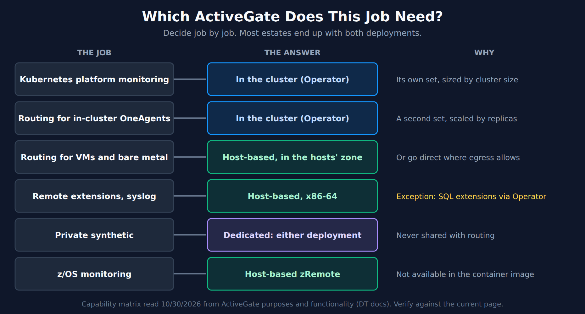
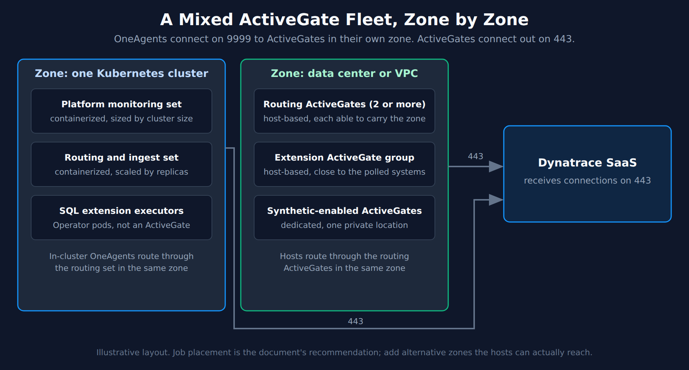

# FAQ-28: When and Where Should I Deploy ActiveGates?

> **Series:** FAQ — Frequently Asked Questions | **Reference:** 28 — When and Where to Deploy ActiveGates | **Created:** October 2026 | **Last Updated:** 10/30/2026

## Overview

The question usually arrives as a choice between two deployments: should our ActiveGates run on VMs or in Kubernetes? That framing skips two earlier decisions, and it treats as one component what are really several jobs.

- **Some jobs no longer need an ActiveGate.** On Latest Dynatrace, several classic ActiveGate modules are superseded, and OneAgent can go direct wherever hosts have egress.
- **Others can only run in one place.** The container image is a subset of the host-based ActiveGate. Remote extensions, for one, are not in it.
- **For the rest it is a real trade-off.** Kubernetes gives you declarative, replica-scaled deployment. VMs give you full module coverage, auto-update and remote configuration.

So decide per job, not per organization. Most estates end up with both deployments, and that is a sensible end state rather than an unfinished migration.

This entry owns the decision. Installation is in **ONBRD-03**, machine sizing in **FAQ-10**, updates in **FAQ-05**, private locations in **SYNTH-04** and routing through an ActiveGate versus going direct in **ONBRD-03 § 2**.

---

## Table of Contents

1. [Short Answer](#short-answer)
2. [Do You Need an ActiveGate for This Job?](#need-one)
3. [One ActiveGate, One Purpose](#one-purpose)
4. [What the Container Image Can Run](#capability-matrix)
5. [Pros and Cons: VMs Compared With Kubernetes](#vm-k8s-pros-cons)
6. [Where to Place Them](#placement)
7. [Kubernetes: Two Sets of ActiveGates](#two-sets)
8. [A Mixed Fleet, Worked Through](#mixed-fleet)
9. [Audit the Fleet You Have](#audit)
10. [Common Gotchas](#gotchas)
11. [Recommended Approach](#recommended-approach)

---

## Prerequisites

| Requirement | Details |
|-------------|---------|
| **Dynatrace environment** | SaaS with Grail, for the audit queries in § 9 |
| **Job list** | What each planned or existing ActiveGate will do: routing, Kubernetes monitoring, extensions, ingest, synthetic, z/OS |
| **Network map** | Which hosts and clusters can reach what, and where egress is allowed |
| **Related reading** | **ONBRD-03** (deploying ActiveGate), **FAQ-10** (sizing and scaling), **FAQ-05** (updates), **SYNTH-04** (private locations), **K8S** series (DynaKube) |

<a id="short-answer"></a>
## 1. Short Answer

Choose by job. Use Kubernetes for what lives in the cluster, and host-based ActiveGates for what the container image can't run or what lives outside it.

| Job | Deploy | Why |
|---|---|---|
| **Kubernetes platform monitoring** | In the cluster, through the Operator | Its own ActiveGate set, sized by cluster size (§ 7) |
| **Routing for in-cluster OneAgents** | In the cluster, through the Operator | A second set, scaled by replicas (§ 7) |
| **Routing for VMs and bare metal** | Host-based, in the hosts' network zone, or no ActiveGate if they can go direct | Field practice favors a stable address (§ 5) |
| **Remote extensions** | Host-based, x86-64 | Not available on containerized, s390 or arm64 ActiveGates (§ 4) |
| **SQL extensions, where you run Kubernetes** | Either a host-based ActiveGate or the Operator's executor pods | The one documented Kubernetes path for extensions (§ 4) |
| **Private synthetic** | Dedicated ActiveGates, on either deployment | A synthetic ActiveGate does nothing else (§ 3) |
| **z/OS monitoring** | Host-based zRemote | Not available in the container image (§ 4) |
| **Classic AWS, Azure, VMware and similar modules** | Plan the replacement first | Superseded, and blocked on Group 3 tenants (§ 2) |



<!-- MARKDOWN_TABLE_ALTERNATIVE
| Job | Answer | Note |
|-----|--------|------|
| Kubernetes platform monitoring | In the cluster (Operator) | Its own set, sized by cluster size |
| Routing for in-cluster OneAgents | In the cluster (Operator) | A second set, scaled by replicas |
| Routing for VMs and bare metal | Host-based, in the hosts' zone | Or go direct where egress allows |
| Remote extensions, syslog | Host-based, x86-64 | Exception: SQL extensions via Operator |
| Private synthetic | Dedicated: either deployment | Never shared with routing |
| z/OS monitoring | Host-based zRemote | Not available in the container image |
-->

> <sub>**Sources:** [ActiveGate purposes and functionality (DT docs)](https://docs.dynatrace.com/docs/ingest-from/dynatrace-activegate/capabilities), [Size Dynatrace ActiveGates in Kubernetes (DT docs)](https://docs.dynatrace.com/docs/ingest-from/setup-on-k8s/guides/deployment-and-configuration/resource-management/ag-resource-limits). **Derived:** the job-to-deployment table combines the capability matrix in § 4 with the sizing guide's two-set recommendation in § 7; the VM preference for external routing is field practice, marked in § 5.</sub>

<a id="need-one"></a>
## 2. Do You Need an ActiveGate for This Job?

Check this first, because the answer has changed for several classic use cases.

**Superseded modules.** *"For ActiveGates connected to Dynatrace tenants in Group 3 (Enhanced), the superseded modules are blocked from loading and will not execute. ActiveGate itself and all other modules continue to start and run as usual."*

| Classic ActiveGate module | Use instead |
|---|---|
| AWS monitoring | AWS Cloud Platform Monitoring |
| Azure monitoring | Azure Cloud Platform Monitoring |
| Cloud Foundry monitoring | Cloud Foundry extension |
| Oracle database insights | Databases |
| VMware monitoring | VMware (remote monitoring) extension |
| Memory dumps | *"No successor solution"* |

Some of those replacements still run on an ActiveGate: the VMware and Cloud Foundry extensions are extensions, so they bring you back to a host-based ActiveGate. The cloud replacements don't need one for metric polling. See **ONBRD-03 § 2** for the per-cloud status, which is version-gated and moves often.

**OneAgent routing.** If hosts can already reach your environment, routing through an ActiveGate is a design choice. *"OneAgent will connect to an Environment ActiveGate, if one is present. It will, however, connect to a the Dynatrace Saas Cluster directly, if no connection to an Environment ActiveGate is possible."* **ONBRD-03 § 2** carries the full trade-off, including the shared-egress limit that can force the decision on large fleets.

**Still an ActiveGate job.** Remote extensions, Kubernetes platform monitoring, private synthetic, z/OS monitoring and access to sealed networks.

> <sub>**Sources:** [ActiveGate purposes and functionality (DT docs)](https://docs.dynatrace.com/docs/ingest-from/dynatrace-activegate/capabilities), [Supported connectivity schemes for ActiveGates (DT docs)](https://docs.dynatrace.com/docs/ingest-from/dynatrace-activegate/supported-connectivity-schemes-for-activegates), [Route OneAgent traffic to Dynatrace (DT docs)](https://docs.dynatrace.com/docs/ingest-from/dynatrace-activegate/capabilities/routing-monitoring-purpose).</sub>

<a id="one-purpose"></a>
## 3. One ActiveGate, One Purpose

An ActiveGate has one of three purposes: routing and monitoring, private synthetic, or zRemote. *"Each purpose comes with a different subset of functional modules. Modules should not be mixed between purposes—such re-configuration is not supported."*

So a synthetic location is always its own ActiveGate: *"A clean ActiveGate installation for the purpose of synthetic monitoring disables all other ActiveGate features, including communication with OneAgents."* Don't count those machines toward routing capacity.

Inside the routing and monitoring purpose you can combine modules, but the jobs compete for the same machine. Dynatrace recommends splitting them on Kubernetes (§ 7). In community practice, teams apply the same idea on VMs by putting extensions in their own ActiveGate group, so that a heavy extension can't slow OneAgent routing. **FAQ-10** covers how to tell when one machine is doing too much.

> <sub>**Sources:** [ActiveGate purposes and functionality (DT docs)](https://docs.dynatrace.com/docs/ingest-from/dynatrace-activegate/capabilities), [Install a Synthetic-enabled ActiveGate (DT docs)](https://docs.dynatrace.com/docs/observe/digital-experience/synthetic/synthetic-app/private-locations/active-gate-for-private-locations-install).</sub>

<a id="capability-matrix"></a>
## 4. What the Container Image Can Run

*"The container image covers only a subset of that, provided by the core ActiveGate process."* This matrix is read from the Dynatrace pages on 10/30/2026 and changes with releases, so verify it against the current page before you plan on it.

| Function | Module | Host-based x86-64 | Host-based arm64 | Host-based s390 | Containerized |
|---|---|---|---|---|---|
| OneAgent routing, buffering, sealed-network access | OneAgent routing | Yes | Yes | Yes | **Yes** |
| Kubernetes/OpenShift monitoring | Kubernetes | Yes | Yes | Yes | **Yes** |
| Dynatrace API | REST API | Yes | Yes | Yes | **Yes** |
| Metric ingestion | HTTP Metric API | Yes | Yes | Yes | **Yes** |
| OpenTelemetry metrics and traces | OTLP Ingest | Yes | Yes | Yes | **Yes** |
| Log ingest API, OpenTelemetry logs | Log Monitoring | Yes | Yes | Yes | **Yes**, with the Operator (see below) |
| Real User Monitoring | Beacon forwarder | Yes | Yes | Yes | **Yes** |
| Live Debugging | Debugging | Yes | Yes | No | **Yes** |
| Remote extensions | Extensions | Yes | No | No | **No** |
| Syslog ingestion | Extensions | Yes | No | No | **No** |
| Azure monitoring (classic) | Azure | Yes | Yes | Yes | **Yes** |
| Cloud Foundry, Oracle database insights, VMware (classic) | Various | Yes | Yes | Yes | **Yes** |
| AWS monitoring (classic) | AWS | Yes | Yes | Yes | **No** |
| Memory dumps (classic) | Memory dumps | Yes | Yes | Yes | **No** |
| Private HTTP and browser monitors | Synthetic | Yes | No | No | **Yes** |

The zRemote purpose isn't in this table because *"An ActiveGate container image currently supports only a subset of routing and monitoring as well as private synthetic."*

Three notes on reading it:

- **Log ingest needs persistent storage.** *"Log ingest API endpoint is supported on containerized ActiveGate in a number of supported Kubernetes flavours when provisioned with Dynatrace Operator. Since ActiveGate uses file buffers, persistent storage is recommended to prevent data loss during restarts or rescheduling"*.
- **Two Dynatrace pages disagree on logs.** The differences page (updated Nov 25, 2025) marks the API's Logs endpoint as unavailable on containers. The purposes page (updated Apr 02, 2026) marks it available with the Operator, as quoted above. This entry follows the newer, more specific page.
- **SQL extensions have a separate path.** *"Run SQL monitoring extensions on Kubernetes using Dynatrace Operator."* These run as executor pods configured through `.spec.extensions.databases` in a DynaKube, not on an ActiveGate, and they need *"Dynatrace version 1.346+."* Oracle, Microsoft SQL Server, PostgreSQL, MySQL / MariaDB, SAP HANA, IBM Db2 and generic JDBC are supported. Check that the release has reached your tenant. Until then, a host-based ActiveGate remains the working path.

For syslog, Dynatrace adds *"We recommend Dynatrace OTel Collector as an alternative, as it has a Syslog receiver"*.

> <sub>**Sources:** [ActiveGate purposes and functionality (DT docs)](https://docs.dynatrace.com/docs/ingest-from/dynatrace-activegate/capabilities), [Differences between containerized and host-based ActiveGates (DT docs)](https://docs.dynatrace.com/docs/ingest-from/dynatrace-activegate/activegate-in-container/differences), [Extensions (DT docs)](https://docs.dynatrace.com/docs/ingest-from/extensions), [SQL extensions on Kubernetes (DT docs)](https://docs.dynatrace.com/docs/ingest-from/extensions/kubernetes).</sub>

<a id="vm-k8s-pros-cons"></a>
## 5. Pros and Cons: VMs Compared With Kubernetes

Where the matrix in § 4 allows both deployments, these are the trade-offs. Rows marked *field practice* are community experience rather than documented behavior, so test them against your own environment.

### Running ActiveGates on VMs

| Pros | Basis |
|---|---|
| **Every module and purpose is available**, including remote extensions, syslog and zRemote | Documented (§ 4) |
| **Auto-update and one-click update work.** *"Auto-update and One-click update functionalities are limited to host-based—using installer—deployment only."* | Documented |
| **Remote configuration works**, so you can change network zones and groups centrally: it *"works for OneAgents in Full-Stack and Infrastructure Monitoring mode and for host-based ActiveGates."* | Documented on a page labelled Dynatrace Classic (see below) |
| **Stable address.** Easier for external OneAgents to reach and for firewalls to allow-list | *Field practice* |
| **Independent of the clusters it serves**, so it keeps routing other hosts through a cluster outage or upgrade | *Field practice* |
| **Works where there's no Kubernetes platform team** | *Field practice* |

| Cons | Basis |
|---|---|
| **You own the operating system.** Dynatrace de-supports an OS version *"at least 6 months after its end of life (EOL), to give you enough time to upgrade your environment"*. ONBRD-03 § 3 lists the current dates | Documented |
| **Remote extensions are x86-64 only**, so the arm64 shapes that route more hosts per vCPU can't run them | Documented (§ 4) |
| **High availability is your design.** *"In order to ensure high availability, operating ActiveGates should be able to takeover traffic of the unavailable ActiveGates"*, so each machine carries spare capacity (FAQ-10) | Documented |
| **Scaling means provisioning machines**, not changing a replica count | *Field practice* |
| **Configuration drifts** unless you automate the build | *Field practice* |
| **Outside a cluster, it adds a network hop** for in-cluster traffic, and any telemetry source that expects a local endpoint has to cross the cluster boundary | *Field practice* |

### Running ActiveGates in Kubernetes

| Pros | Basis |
|---|---|
| **Declarative deployment.** *"ActiveGates in containers are deployed and uploaded using cloud-specific tooling. For example, Kubernetes uses custom resource definitions."* | Documented |
| **Horizontal scaling.** *"Increase the number of ActiveGate replicas in your DynaKube configuration."* | Documented |
| **Published sizing by cluster size**, for each deployment type | Documented (§ 7) |
| **Auto-scaling private locations.** *"Locations are scaled automatically by adjusting the number of ActiveGates per location"* | Documented |
| **Close to the workloads**, with no extra hop for in-cluster OneAgents | *Field practice* |
| **No operating system to patch** beyond the image and nodes your platform already manages | *Field practice* |

| Cons | Basis |
|---|---|
| **A subset of modules.** No remote extensions, syslog, zRemote, classic AWS or memory dumps | Documented (§ 4) |
| **No auto-update or one-click update.** *"ActiveGate is updated automatically on pod restart whenever there is a new version available, unless the image already specifies a certain version."* So a version can change on an unrelated restart unless you pin it | Documented |
| **No remote configuration.** It *"does NOT work with"* containerized ActiveGates, so changes go through your deployment | Documented on a page labelled Dynatrace Classic (see below) |
| **Persistent storage for log ingest**, or you risk data loss on rescheduling (§ 4) | Documented |
| **Pod addresses change.** External hosts need a stable Service or load balancer in front, which you have to run | *Field practice* |
| **Shares the cluster's fate.** A cluster outage can take routing for anything outside the cluster with it, just when you want the data | *Field practice* |
| **Needs a team that runs the Operator**, with its upgrade cycle and API version moves (K8S series) | *Field practice* |

> **About the remote configuration rows.** The page that states this limit is labelled Dynatrace Classic and was published in 2022. It's the only statement we found. Fleet Management, its Latest Dynatrace counterpart, doesn't mention containerized ActiveGates in this context, so confirm the behavior in your environment before you design around it.

### Choosing between them

Three questions usually settle it:

1. **Does the job need a module the container lacks?** If so, you need a VM and the trade-offs don't matter.
2. **Does the traffic start inside the cluster?** If so, run it in the cluster. If it starts outside, prefer a VM unless a platform team already runs a stable, load-balanced path.
3. **Who will operate it?** Choose the deployment your team already patches and upgrades well. An ActiveGate nobody owns is the worst option on either platform.

> <sub>**Sources:** [Update ActiveGate (DT docs)](https://docs.dynatrace.com/docs/ingest-from/dynatrace-activegate/operation/update-activegate), [Remote configuration management (DT docs)](https://docs.dynatrace.com/docs/ingest-from/bulk-configuration-classic), [Fleet Management (DT docs)](https://docs.dynatrace.com/docs/ingest-from/fleet-management), [Differences between containerized and host-based ActiveGates (DT docs)](https://docs.dynatrace.com/docs/ingest-from/dynatrace-activegate/activegate-in-container/differences), [Size Dynatrace ActiveGates in Kubernetes (DT docs)](https://docs.dynatrace.com/docs/ingest-from/setup-on-k8s/guides/deployment-and-configuration/resource-management/ag-resource-limits), [Containerized private Synthetic locations (DT docs)](https://docs.dynatrace.com/docs/observe/digital-experience/synthetic/synthetic-app/private-locations/containerized-locations-synth-app), [Linux ActiveGate hardware and system requirements (DT docs)](https://docs.dynatrace.com/docs/ingest-from/dynatrace-activegate/installation/linux/linux-activegate-hardware-and-system-requirements), [End-of-support announcements (DT docs)](https://docs.dynatrace.com/docs/whats-new/technology/end-of-support-news).</sub>

<a id="placement"></a>
## 6. Where to Place Them



<!-- MARKDOWN_TABLE_ALTERNATIVE
| Zone | ActiveGates | Deployment | Connects |
|------|-------------|------------|----------|
| One Kubernetes cluster | Platform monitoring set | Containerized | Out on 443 |
| One Kubernetes cluster | Routing and ingest set | Containerized, replicas | OneAgents in on 9999, out on 443 |
| One Kubernetes cluster | SQL extension executors | Operator pods, not an ActiveGate | Poll databases |
| Data center or VPC | Routing, 2 or more | Host-based | OneAgents in on 9999, out on 443 |
| Data center or VPC | Extension group | Host-based | Polls nearby systems, out on 443 |
| Data center or VPC | Synthetic-enabled | Dedicated | Out on 443 |
-->

**Ports.** *"Environment ActiveGate receives connections on port 9999."* and *"Dynatrace SaaS Cluster receives connections on port 443."* Check both firewall directions before you pick a location.

**Network zones decide which ActiveGate a OneAgent uses.** You manage them from Fleet Management; the detailed behavior below comes from pages Dynatrace labels Classic. *"Network zones prevent inefficient connections by defining the ActiveGate that each OneAgent should use."* Without them, OneAgents *"try to connect to any ActiveGate in a random order"*, so adding an ActiveGate for one purpose can pull traffic you didn't plan for.

- **Naming.** Dynatrace recommends the pattern `provider.region.availability-zone.datacenter.tier`.
- **Failover.** *"For each network zone, you can configure one or more alternative zones"*. *"Make sure that ActiveGates from an alternative network zone are reachable by OneAgents of the primary network zone."* ONBRD-03 § 2 covers the fallback modes.
- **Kubernetes.** `spec.networkZone` in a DynaKube *"Sets a network zone for the OneAgent and ActiveGate Pods."*

**Number per zone.** A production zone needs at least two ActiveGates, each able to carry the zone when the other is down. FAQ-10 works out the numbers.

**Community practice for placement**, to adapt rather than copy:

- Give each Kubernetes cluster its own network zone, so its OneAgents stay on its ActiveGates.
- Put host-based extension ActiveGates in their own ActiveGate group, close to the systems they poll, since those systems may restrict which source addresses can connect.
- If an ActiveGate must sit outside the cluster it serves, measure the latency before relying on it.
- On zonal storage such as AWS EBS, a persistent volume stays in one availability zone. Spread replicas across zones with topology spread constraints, then confirm that a pod can reschedule after a node failure.

> <sub>**Sources:** [Supported connectivity schemes for ActiveGates (DT docs)](https://docs.dynatrace.com/docs/ingest-from/dynatrace-activegate/supported-connectivity-schemes-for-activegates), [Fleet Management (DT docs)](https://docs.dynatrace.com/docs/ingest-from/fleet-management), [Get started with network zones (DT docs)](https://docs.dynatrace.com/docs/manage/network-zones-classic/network-zones-basic-info), [OneAgent connectivity in network zones (DT docs)](https://docs.dynatrace.com/docs/manage/network-zones-classic/oneagent-connectivity), [DynaKube parameters (DT docs)](https://docs.dynatrace.com/docs/ingest-from/setup-on-k8s/reference/dynakube-parameters).</sub>

<a id="two-sets"></a>
## 7. Kubernetes: Two Sets of ActiveGates

*"We recommend to run two sets of ActiveGates for production deployments"*:

- *"One set should cover Kubernetes platform monitoring, including any Prometheus integration and Kubernetes Security Posture Management (KSPM) functionalities."*
- *"One set should cover OneAgent traffic routing and telemetry ingest (including OTLP log ingest)."*

The guide gives three reasons:

| Reason | Dynatrace's wording |
|---|---|
| **Isolation** | *"A spike in OneAgent traffic won't slow down Kubernetes metrics collection, and vice versa."* |
| **Scaling** | *"OneAgent traffic routing and platform monitoring have fundamentally different scaling characteristics"* |
| **Troubleshooting** | *"When issues occur, you can immediately identify whether they originate from platform monitoring or OneAgent traffic, reducing diagnosis time."* |

The way you express the split depends on the Operator version. The guide shows a single DynaKube on Operator 1.11.0+, and two DynaKubes on earlier versions. **ONBRD-03 § 7** has working manifests, and **FAQ-10 § 4** has the sizing tables.

Two sizing limits are worth knowing while you plan: *"For clusters beyond 500 nodes, contact Dynatrace Support for tailored recommendations."* Also, the guide stops at 20,000 pods, and beyond that says to start from the large cluster guidance and *"gradually increase resources until stable gap-free monitoring is established."*

A single ActiveGate carrying both jobs is reasonable for a small or development cluster. In community practice it is also how most clusters start. Split it before production, not during an incident.

> <sub>**Sources:** [Size Dynatrace ActiveGates in Kubernetes (DT docs)](https://docs.dynatrace.com/docs/ingest-from/setup-on-k8s/guides/deployment-and-configuration/resource-management/ag-resource-limits).</sub>

<a id="mixed-fleet"></a>
## 8. A Mixed Fleet, Worked Through

An illustrative estate: two production Kubernetes clusters, 600 VMs in one data center, an Oracle database and network devices to poll, and internal web applications to test.

| Need | Decision | Reason |
|---|---|---|
| Platform monitoring in each cluster | One containerized set per cluster | § 7 |
| Routing for in-cluster OneAgents | One containerized routing set per cluster | § 7 |
| Routing for 600 VMs with no direct egress | Two host-based ActiveGates in the data center's zone | The hosts sit outside the clusters (§ 5). Each carries the whole zone (FAQ-10) |
| SNMP polling of network devices | Host-based extension ActiveGates in their own group | Extensions aren't in the container image (§ 4) |
| Oracle monitoring | The same extension group, or the Operator's SQL executors if the tenant is on 1.346+ | Keep one place to operate unless there's a reason to split (§ 4) |
| Internal web tests | A containerized private location if the clusters can reach the targets, otherwise dedicated VMs | Synthetic is its own purpose (§ 3) |
| Zones | One per cluster, one for the data center, with an alternative zone only where the hosts can reach it | § 6 |

The result is containerized ActiveGates for everything that lives in a cluster and a small host-based tier for everything else. The result would be different if the VMs had direct egress: the routing ActiveGates would be optional, and the extension group might be the only host-based tier left.

<a id="audit"></a>
## 9. Audit the Fleet You Have

Before you change anything, see what each ActiveGate actually does. Smartscape reports the deployment and the loaded modules. These queries scan 0 bytes of Grail.

A host-based ActiveGate loads the Extensions module as `EXTENSION_CONTROLLER`, not under the name on the capabilities page. A filter on the wrong name returns zero and looks like a fleet with no extensions, so check the raw `modules` list from the first query before you trust the counts in the second.

```dql
// Every ActiveGate: how it is deployed, where it sits, and which modules it loaded.
// Live-verified 10/30/2026.
smartscapeNodes "ACTIVEGATE"
| fields name, dt.active_gate.id, dt.active_gate.version, dt.active_gate.group.name,
         dt.network_zone.id, is_containerized, modules
| sort is_containerized desc, name asc
```

```dql
// Jobs per deployment type and zone. Read it against the decisions in section 1:
//   - a zone showing activegates = 1 has no failover
//   - extensions > 0 only appears on host-based rows
//   - a row with both kubernetes and routing > 0 on a production cluster
//     is a candidate for the two-set split in section 7
// Live-verified 10/30/2026: 5 ActiveGates, the 4 containerized ones with extensions = 0.
smartscapeNodes "ACTIVEGATE"
| fieldsAdd runs_extensions = iAny(modules[] == "EXTENSION_CONTROLLER"),
            routes_oneagents = iAny(modules[] == "AGENT_ROUTING"),
            k8s_monitoring = iAny(modules[] == "KUBERNETES")
| summarize {activegates = count(),
             extensions = countIf(runs_extensions),
             routing = countIf(routes_oneagents),
             kubernetes = countIf(k8s_monitoring)},
    by:{is_containerized, dt.network_zone.id}
| sort is_containerized asc, activegates desc
```

<a id="gotchas"></a>
## 10. Common Gotchas

| Gotcha | What happens | What to do |
|---|---|---|
| **Designing extensions onto in-cluster ActiveGates** | The container image has no Extensions module, so you find out at deployment | Plan host-based extension ActiveGates per zone, or the SQL path on Kubernetes for SQL sources |
| **Choosing arm64 for capacity, then adding extensions** | arm64 routes more hosts per vCPU but can't run remote extensions | Check every job against § 4 before you standardize |
| **Expecting remote configuration to reach pods** | The documented limit excludes containerized ActiveGates (§ 5) | Change zones and groups in the DynaKube |
| **An unpinned image** | The ActiveGate can change version on any pod restart | Pin it deliberately, then own the upgrade (FAQ-05) |
| **Log ingest with no persistent storage** | Buffered data can be lost on a restart or reschedule | Provision storage before you send logs through it |
| **Reusing a synthetic ActiveGate for routing** | A clean synthetic installation doesn't talk to OneAgents | Keep them separate, and don't count them as routing capacity |
| **Planning an ActiveGate for a superseded module** | On a Group 3 tenant the module doesn't load, while the ActiveGate looks healthy | Use the replacement in § 2 |
| **Adding an ActiveGate with no network zones** | Unzoned OneAgents may start using it | Define zones first (§ 6) |

> <sub>**Sources:** [ActiveGate purposes and functionality (DT docs)](https://docs.dynatrace.com/docs/ingest-from/dynatrace-activegate/capabilities), [Remote configuration management (DT docs)](https://docs.dynatrace.com/docs/ingest-from/bulk-configuration-classic), [Differences between containerized and host-based ActiveGates (DT docs)](https://docs.dynatrace.com/docs/ingest-from/dynatrace-activegate/activegate-in-container/differences), [Install a Synthetic-enabled ActiveGate (DT docs)](https://docs.dynatrace.com/docs/observe/digital-experience/synthetic/synthetic-app/private-locations/active-gate-for-private-locations-install), [OneAgent connectivity in network zones (DT docs)](https://docs.dynatrace.com/docs/manage/network-zones-classic/oneagent-connectivity).</sub>

<a id="recommended-approach"></a>
## 11. Recommended Approach

1. **List the jobs** for each planned or existing ActiveGate, and run the audit queries in § 9.
2. **Remove the jobs that don't need one**: superseded modules, and routing where hosts can go direct (§ 2).
3. **Check each remaining job against § 4.** Anything the container can't run goes on a host-based x86-64 ActiveGate.
4. **For what's left, follow the traffic.** Traffic that starts in the cluster stays in the cluster. Traffic from outside it goes to a host-based tier by default (§ 5).
5. **Split Kubernetes production clusters into two sets** (§ 7), and put extensions in their own group on VMs (§ 3).
6. **Draw the zones before you deploy**, with at least two ActiveGates in each production zone (§ 6).
7. **Size and maintain them** with FAQ-10 and FAQ-05, then re-run § 9 after each change and re-check § 4 at each major upgrade.

---

## Summary

- Decide per job. Most estates need both deployments.
- The container image is a subset. Remote extensions, syslog, zRemote, classic AWS and memory dumps require a host-based ActiveGate, and SQL extensions have their own Operator path.
- VMs give you full coverage, auto-update and remote configuration, and you own the OS and the scaling.
- Kubernetes gives you declarative deployment and replica scaling, and you own the storage, the version pinning and the path in from outside.
- Each purpose gets its own ActiveGates, each Kubernetes production cluster gets two sets, and network zones decide who uses what.

---

<sub>*This notebook was AI-generated from community-submitted and publicly available sources. This notebook series is not officially supported by Dynatrace. Always verify information against official Dynatrace documentation.*</sub>
