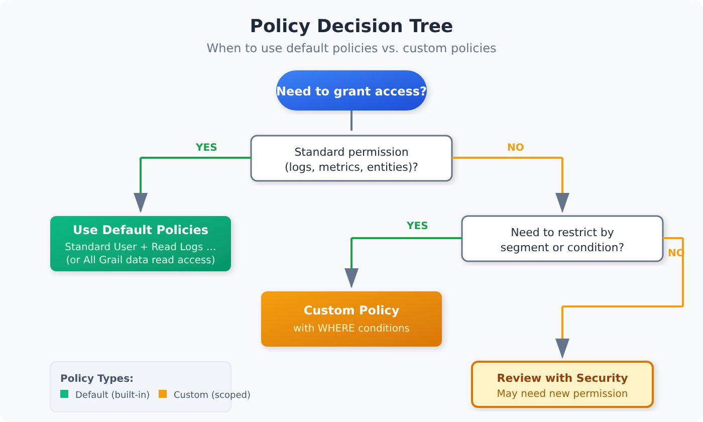

# IAM-04: Policy Authoring and Management

> **Series:** IAM — IAM Administration | **Notebook:** 4 of 12 | **Created:** January 2026 | **Last Updated:** 10/26/2026

## Mastering Dynatrace Policy Syntax
Policies are the heart of Dynatrace Gen3 IAM. They define what actions users can perform. This notebook provides a comprehensive guide to policy authoring, from basic syntax to advanced patterns.

---

## Table of Contents

1. [Policy Fundamentals](#policy-fundamentals)
2. [Policy Statement Syntax](#policy-statement-syntax)
3. [Services and Actions Reference](#services-and-actions-reference)
4. [Condition Expressions](#condition-expressions)
5. [Common Policy Patterns](#common-policy-patterns)
6. [Default vs Custom Policies](#default-vs-custom-policies)
7. [Policy Testing and Validation](#policy-testing-and-validation)
8. [GitOps for Policies](#gitops-for-policies)
9. [Policy Assessment Queries](#policy-assessment-queries)

---

## Prerequisites

| Requirement | Details |
|-------------|----------|
| **Dynatrace Environment** | SaaS with Gen3 IAM enabled |
| **Permissions** | `account-user-management` to create/modify policies |
| **Prior Knowledge** | **IAM-01** through **IAM-03** |

### SaaS 1.337: `frontend.name` as a permission field

SaaS 1.337 added `frontend.name` as a condition for metrics, RUM and Smartscape data, so access can be scoped per frontend without splitting buckets. The condition is `storage:frontend.name` on each table permission, and the policy reference lists `=`, `IN`, `startsWith` and `MATCH` for it:

```text
ALLOW storage:metrics:read WHERE storage:frontend.name IN ("checkout-web", "account-web");
ALLOW storage:user.events:read WHERE storage:frontend.name IN ("checkout-web", "account-web");
ALLOW storage:user.sessions:read WHERE storage:frontend.name MATCH ("checkout-web", "account-web");
```

Use `MATCH` for `user.sessions`: a session can span several frontends. Check each value in Experience Vitals before binding the policy, because the `frontend.name` value is not always the display name.

> <sub>**Sources:**</sub>
> - <sub>[SaaS 1.337 (DT docs)](https://docs.dynatrace.com/docs/whats-new/saas/sprint-337) — *"Statements like ALLOW storage:metrics:read WHERE storage:frontend.name = "mobile_app" let you selectively control access to metrics and Smartscape data at the record- and field level."*</sub>
> - <sub>[RUM data access controls best practices (DT docs)](https://docs.dynatrace.com/docs/platform/upgrade/best-practices/stage-02-post-ingest-enrichment/rum-data-access-controls) — *"Because user sessions may span multiple frontends, use the MATCH operator"*; *"The frontend.name value may differ from the display name shown in Experience Vitals."*</sub>
> - <sub>[IAM policy reference (DT docs)](https://docs.dynatrace.com/docs/manage/identity-access-management/permission-management/manage-user-permissions-policies/advanced/iam-policystatements)</sub>

---

<a id="policy-fundamentals"></a>
## 1. Policy Fundamentals
Policies define **what actions** users can perform. They're separate from boundaries (which control **what data** users can see).

> **One policy language for all authorization.** Dynatrace's security policies are the single configuration surface for *every* authorization requirement — environment access, Grail data access, and AppEngine capabilities alike. What used to be split between classic *roles* (RBAC — "viewer", "admin") and attribute-based permissions is now unified: classic roles are expressed as `environment:roles:*` permissions inside the same `ALLOW` grammar as `storage:*` and `app-engine:*`. There is no separate RBAC subsystem to manage — one policy, one language, optionally scoped by `WHERE` conditions or boundaries.

### Policy Scope Levels

| Scope | Applies To | Managed By |
|-------|------------|------------|
| **Account** | All environments in account | Account Admin |
| **Environment** | Single environment | Environment Admin |

### Policy Assignment

Policies are assigned to **groups**, not individual users:

```
Group: dt-checkout-editors
├── Policy: Pro User (default)
├── Policy: log-management (custom)
└── Boundary: checkout-services-only
```

### Policy Types

| Type | Description | Examples |
|------|-------------|----------|
| **Default Policies** | Pre-built by Dynatrace | Standard User, Pro User, Admin User |
| **Custom Policies** | Created by you | `log-read-only`, `dashboard-manager` |

<a id="policy-statement-syntax"></a>
## 2. Policy Statement Syntax
Every policy contains one or more **statements** that define allowed actions.


<!-- MARKDOWN_TABLE_ALTERNATIVE
| Component | Description | Example |
|-----------|-------------|----------|
| Effect | ALLOW or DENY | ALLOW |
| Service | What capability | storage |
| Resource | What object type | logs |
| Action | What operation | read |
| Condition | Optional filter | WHERE dt.security_context = "team-a" |
-->

### Basic Statement Structure

```
ALLOW <service>:<resource>:<action>;
```

**Examples:**

| Statement | Meaning |
|-----------|----------|
| `ALLOW storage:logs:read;` | Read log records (plus `storage:buckets:read` — see below) |
| `ALLOW storage:spans:read;` | Read span records (plus `storage:buckets:read`) |
| `ALLOW settings:objects:write;` | Modify settings |
| `ALLOW document:documents:read;` | Read dashboards/notebooks |

### Wildcards Are NOT Supported

> **Live-verified (Account Management API, 07/2026):** wildcards in permissions are **rejected** with `Invalid policy statement. ALLOW or DENY must be followed by a permission in the form service-name:resource:action`. This applies to every position: `storage:*:read`, `storage:logs:*`, and `*:*:read` all fail.

Enumerate permissions explicitly — comma-separated lists keep statements compact:

| Instead of (invalid) | Write (valid) |
|-----------|----------|
| `ALLOW storage:*:read` | `ALLOW storage:logs:read, storage:spans:read, storage:metrics:read, storage:events:read, storage:bizevents:read, storage:entities:read, storage:system:read, storage:buckets:read;` |
| `ALLOW storage:logs:*` | `ALLOW storage:logs:read, storage:logs:write;` |
| `ALLOW settings:objects:*` | `ALLOW settings:objects:read, settings:objects:write;` |

> **Also live-verified — storage WRITE permissions accept no WHERE conditions.** `ALLOW storage:logs:write WHERE storage:bucket-name = "x"` is rejected (`Invalid condition name for permission storage:logs:write`). Storage writes are all-or-nothing: only `storage:logs:write`, `storage:metrics:write`, `storage:events:write` exist (`storage:spans:write` and `storage:bizevents:write` do **not**), and none can be scoped by `WHERE`. Scope *reads* with conditions; grant *writes* unscoped and only to trusted ingest paths — or control ingest via OpenPipeline instead. (Settings writes are different: `settings:objects:write` **does** accept `settings:schemaId` and `settings:dt.security_context` conditions.)

### Multiple Statements

Combine statements to build complete policies:

```
ALLOW storage:buckets:read;
ALLOW storage:logs:read;
ALLOW storage:spans:read;
ALLOW storage:metrics:read;
ALLOW document:documents:read;
```

> **Note:** Statements are additive. Multiple ALLOW statements combine to grant broader access.

> **Grail reads take two permissions.** A table permission (`storage:logs:read`, `storage:spans:read` …) is not enough on its own: `storage:buckets:read` is *"Required additionally to a table permission."* Grant it unconditionally when the table permissions carry the scoping (`dt.security_context`), or with `WHERE storage:bucket-name …` / `WHERE storage:table-name …` when the scope *is* the bucket. Every pattern below includes it.
>
> **DENY statements behave differently.** *"Boundaries don't apply to DENY statements"*, and in Grail *"Conditional DENY statements are supported only for the buckets:read permission. All other table-level storage permissions do not support conditional DENY."* — so express an exclusion on a table permission by narrowing the `ALLOW`, or as a `DENY storage:buckets:read WHERE storage:bucket-name …`.
>
> <sub>**Sources:** [IAM policy reference (DT docs)](https://docs.dynatrace.com/docs/manage/identity-access-management/permission-management/manage-user-permissions-policies/advanced/iam-policystatements) — `storage:buckets:read` and the Grail DENY rule quoted above; [Policy boundaries (DT docs)](https://docs.dynatrace.com/docs/manage/identity-access-management/permission-management/manage-user-permissions-policies/iam-policy-boundaries) — *"Boundaries don't apply to DENY statements"*.</sub>

<a id="services-and-actions-reference"></a>
## 3. Services and Actions Reference
### Core Services

| Service | Purpose | Common Resources |
|---------|---------|------------------|
| `storage` | Grail data access | `logs`, `spans`, `metrics`, `events`, `bizevents`, `buckets`, `bucket-definitions` |
| `settings` | Configuration objects | `objects`, `schemas` |
| `document` | Notebooks, dashboards | `documents`, `direct-shares`, `environment-shares` |
| `environment` | Classic roles | `roles` (`environment:roles:*`) |
| `state` | App state storage | `app-states`, `user-app-states` |
| `automation` | Workflows, AutomationEngine | `workflows`, `calendars`, `rules` |

> **What each permission actually does:** **IAM-97: IAM Permission Reference** covers every permission in the *Standard User* default policy and the usual reader-persona additions — what each really grants, its scope and risk, which built-in apps request it, and the basis for each claim. It also covers services this table leaves out, such as `state-management`, `app-settings`, `synthetic`, `credential-vault`, `platform-management` and `unified-analysis`.

### Common Actions

| Action | Description |
|--------|-------------|
| `read` | View/query data |
| `write` | Create/modify data |
| `delete` | Remove data |
| `run` | Run (workflows: `automation:workflows:run`) |
| `admin` | Administer all objects of a type (e.g. `document:documents:admin`, `automation:workflows:admin`) |

### Storage Service Details

| Resource | Description | Actions |
|----------|-------------|----------|
| `logs` | Log records | read, write |
| `spans` | Distributed traces | read |
| `metrics` | Metric data | read, write |
| `events` | Platform events | read, write |
| `bizevents` | Business events | read |
| `entities` | Smartscape entities (Classic surface) | read |
| `system` | System/audit data (query events, internal) | read |
| `buckets` | Read records from Grail buckets (required in addition to a table permission) | read |
| `bucket-definitions` | Create and manage bucket definitions | read, write, delete, truncate |

Specialized record tables follow the same `storage:<table>:read` shape — e.g. `storage:security.events:read`, `storage:user.sessions:read`, `storage:user.replays:read`, `storage:application.snapshots:read`, `storage:smartscape:read`.

**Storage condition attributes:** scope `storage:*` reads with `storage:bucket-name` (e.g. `startsWith "default_"`), `storage:table-name` (e.g. `= "logs"`), and `storage:dt.security_context` (the Gen3 record-level scoping spine — see IAM-05). Example — default-bucket monitoring read:

```
ALLOW storage:buckets:read WHERE storage:bucket-name startsWith "default_";
ALLOW storage:logs:read, storage:events:read, storage:metrics:read,
      storage:entities:read, storage:bizevents:read, storage:spans:read;
```

For system/audit data (the *Storage All System Data Read* managed policy), add `storage:system:read`:

```
ALLOW storage:buckets:read;
ALLOW storage:system:read;
ALLOW storage:logs:read, storage:events:read, storage:metrics:read,
      storage:entities:read, storage:bizevents:read, storage:spans:read;
```

### Settings Service Details

| Resource | Description | Actions |
|----------|-------------|----------|
| `objects` | Configuration objects | read, write, delete |
| `schemas` | Schema definitions | read |

### Document Service Details

| Resource | Description | Actions |
|----------|-------------|----------|
| `documents` | Dashboards, notebooks | read, write, delete, admin |
| `direct-shares` | Direct shares with users and groups | read, write, delete |
| `environment-shares` | Shares with the whole environment | read, write, delete, claim |

> <sub>**Sources:** [IAM policy reference (DT docs)](https://docs.dynatrace.com/docs/manage/identity-access-management/permission-management/manage-user-permissions-policies/advanced/iam-policystatements) — permission list read 09/24/2026.</sub>

### Environment Roles (`environment:roles:*`)

Classic environment roles are expressed as IAM permissions. This is how RBAC folds into the one policy language (see §1). All are scoped by the `environment:management-zone` attribute **except** `agent-install` and `configure-request-capture-data` (management-zone not applicable). Those two are broader than their names suggest: for each, Dynatrace states *"Users who have this permission assigned are also able to view monitoring data for all management zones."* Grant them only to groups that may see every zone.

| Permission | Classic role meaning |
|------------|----------------------|
| `environment:roles:viewer` | Access environment (read) |
| `environment:roles:manage-settings` | Change monitoring settings |
| `environment:roles:agent-install` | Download / install OneAgent |
| `environment:roles:logviewer` | View logs |
| `environment:roles:view-sensitive-request-data` | View sensitive request data |
| `environment:roles:configure-request-capture-data` | Configure capture of sensitive data |
| `environment:roles:replay-sessions-with-masking` | Replay session data (masked) |
| `environment:roles:replay-sessions-without-masking` | Replay session data (unmasked) |
| `environment:roles:view-security-problems` | View security problems |
| `environment:roles:manage-security-problems` | Manage security problems |

> <sub>**Sources:** [IAM policy reference (DT docs)](https://docs.dynatrace.com/docs/manage/identity-access-management/permission-management/manage-user-permissions-policies/advanced/iam-policystatements) — `environment:roles:agent-install` and `environment:roles:configure-request-capture-data`.</sub>

> **Privacy / compliance note.** The session-replay pair and `view-sensitive-request-data` are the load-bearing least-privilege controls here — `replay-sessions-without-masking` and `view-sensitive-request-data` expose unmasked end-user data and should be granted narrowly (specific groups, specific management zones), never bundled into a broad editor policy.

### Extensions Service Details

Extension authorization splits into *definitions* (the extension package) and *configurations* (a deployed instance):

| Permission | Description | Condition attributes |
|------------|-------------|----------------------|
| `extensions:definitions:read` / `:write` | The extension package itself | `extensions:extension-name` |
| `extensions:configurations:read` / `:write` | A deployed configuration | `extensions:host`, `extensions:host-group`, `extensions:ag-group`, `extensions:management-zone` |
| `extensions:configuration.actions:write` | Run configuration actions | (as above) |
| `extensions:discovery.jmx:read` / `extensions:discovery.pmi:read` | Discovery surfaces | — |

**Extension-ownership delegation** — let a team manage *their* extension on *their* hosts without granting tenant-wide extension rights:

```
ALLOW extensions:definitions:read, extensions:definitions:write
WHERE extensions:extension-name = "com.acme.payments";
ALLOW extensions:configurations:read, extensions:configurations:write
WHERE extensions:host-group startsWith "payments-";
```

### AppEngine Service Details (`app-engine:*`)

| Permission | Description |
|------------|-------------|
| `app-engine:apps:run` | See / open an app (controls navigation visibility) |
| `app-engine:functions:run` | Execute AppEngine functions |
| `app-engine:apps:install` | Install apps |
| `app-engine:apps:delete` | Remove apps |

App-level scoping uses the `shared:app-id` attribute (operators `=`, `!=`, `IN`, `NOT IN`, `startsWith`, `NOT startsWith`). Example — let developers install only their own apps, and grant Workflows access:

```
ALLOW app-engine:apps:install, app-engine:apps:delete WHERE shared:app-id startsWith "my.";
ALLOW app-engine:apps:run WHERE shared:app-id = "dynatrace.automations";
```

<a id="condition-expressions"></a>
## 4. Condition Expressions
Conditions add fine-grained control to policy statements.

> **Boundary standardization (canonical pattern).** The examples in this section illustrate condition operators with literal values for clarity. In production, the literal value should be a `${bindParam:NAME}` placeholder bound at policy-binding time, with the boundary field standardized on `dt.security_context` (Gen3) or management zone (Classic). See **IAM REFERENCE.md § Policy Parameterization and Boundary Standardization** for the canonical pattern, and **IAM-10: Templated Policy-Group Assignments** for binding mechanics.

### Condition Syntax

```
ALLOW <service>:<resource>:<action> WHERE <condition>;
```

### Condition Operators

| Operator | Description | Example |
|----------|-------------|----------|
| `=` | Equals | `storage:dt.security_context = "team-a"` |
| `!=` | Not equals — only on conditions that list it (e.g. `storage:bucket-name`, `settings:schemaId`); `storage:dt.security_context` does **not** accept `!=` or `NOT IN` | `storage:bucket-name != "restricted_logs"` |
| `IN` | In list | `storage:dt.security_context IN ("team-a", "team-b")` |
| `startsWith` | Prefix match | `settings:schemaId startsWith "builtin:openpipeline.logs."` |
| `MATCH` | Wildcard pattern match | `storage:dt.security_context MATCH('*/app:easytrade')` |

> **`MATCH()` vs `startsWith`:** Use `MATCH()` for flexible wildcard patterns anywhere in the value (e.g. middle segment). Use `startsWith` when matching a fixed leading prefix. **And use `MATCH()` whenever the field can hold an array** — on an array, `=`, `startsWith` and `IN` *"always return `false`"*, silently. The exception is `storage:entities:read` (classic entities), which offers no `MATCH`; there, `startsWith` is the documented operator for the multi-value field (see below). See **IAM-05** for where that bites in a boundary.

> **Corrected 09/10/2026 — `contains` is not an IAM condition operator.** An earlier revision of this table listed `contains` (`settings:schemaId contains "custom"`). The IAM policy statement syntax reference gives the operator set as `= != < > IN startsWith NOT IN NOT startsWith MATCH`, and the IAM policy reference lists `IN`, `=`, `!=`, `startsWith` and `NOT startsWith` for `settings:schemaId` — `contains` appears in neither. Use `startsWith` for a prefix, or `MATCH` for a pattern.
>
> <sub>**Sources:** [IAM policy statement syntax and examples (DT docs)](https://docs.dynatrace.com/docs/manage/identity-access-management/permission-management/manage-user-permissions-policies/iam-policystatement-syntax), [IAM policy reference (DT docs)](https://docs.dynatrace.com/docs/manage/identity-access-management/permission-management/manage-user-permissions-policies/advanced/iam-policystatements), [Permissions in Grail (DT docs)](https://docs.dynatrace.com/docs/platform/grail/organize-data/assign-permissions-in-grail) — *"Using `=`, `STARTSWITH` or `IN` when the field holds an array will always return `false`."*</sub>

### Common Condition Fields

| Domain | Field | Description |
|--------|-------|-------------|
| Storage | `storage:dt.security_context` | Security context on data |
| Storage | `storage:bucket-name` | Bucket name (for team isolation) |
| Storage | `storage:file-path` | Lookup file path. The only condition `storage:files:read` / `write` / `delete` accept, so scope files by folder (IAM-05 Pattern 8) |
| Settings | `settings:schemaId` | Settings schema |
| Settings | `settings:dt.security_context` | Security context on settings |

### Security Context vs Bucket Conditions

> **Default to `dt.security_context` for general team-scoped access.** Bucket conditions work well when the bucket already exists for a specific reason — compliance separation, retention isolation, or hard cost attribution. For routine team-scoped access without one of those scenarios, the `dt.security_context` condition alone is usually simpler. See **IAM REFERENCE.md § Bucket-Match Overlay** for the scenario gating.

| Condition Type | Use Case | Example |
|----------------|----------|----------|
| **Security Context** | Team- and app-scoped access — the primary mechanism | `storage:dt.security_context = "team-a"` |
| **Bucket** | Data already separated for retention, cost or compliance (e.g. a PCI bucket) | `storage:bucket-name = "team-a-logs"` |
| **Both** | Defense in depth where a compliance bucket exists | Both conditions in policy + boundary |

> <sub>**Sources:** [Partition data with Grail buckets (DT docs)](https://docs.dynatrace.com/docs/platform/grail/organize-data/partition-data) — buckets are *"not intended as the primary mechanism for securing or segmenting data access."*</sub>

### Condition Examples

**Scope to security context (exact):**
```
ALLOW storage:buckets:read;
ALLOW storage:logs:read WHERE storage:dt.security_context = "checkout";
```

**Scope to specific bucket:**
```
ALLOW storage:buckets:read WHERE storage:bucket-name = "checkout_logs";
ALLOW storage:logs:read WHERE storage:bucket-name = "checkout_logs";
```

**Scope to a lookup-file folder (read and upload):**
```
ALLOW storage:files:read, storage:files:write WHERE storage:file-path startsWith "/lookups/team_payments/";
```
Keep the leading and trailing slashes. Without the trailing slash, the prefix also matches `/lookups/team_payments2/`.

**Scope to settings schema:**
```
ALLOW settings:objects:write WHERE settings:schemaId startsWith "builtin:openpipeline.logs.";
```

Pick schema IDs that exist on your platform generation. Many classic schemas — `builtin:alerting.profile`, `builtin:problem.notifications`, most `builtin:logmonitoring.*` processing rules — are not visible in Latest Dynatrace, so a statement scoped to them grants nothing there (Patterns 4 and 6 below).

**Multiple conditions (AND):**
```
ALLOW storage:logs:read WHERE storage:dt.security_context = "team-a" AND storage:bucket-name = "team-a-logs";
```

**Multiple values (IN):**
```
ALLOW storage:logs:read WHERE storage:dt.security_context IN ("team-a", "team-b", "shared");
```

**Multiple buckets (team access):**
```
ALLOW storage:buckets:read WHERE storage:bucket-name IN ("checkout_logs", "shared_logs", "checkout_spans", "shared_spans");
ALLOW storage:logs:read WHERE storage:bucket-name IN ("checkout_logs", "shared_logs");
ALLOW storage:spans:read WHERE storage:bucket-name IN ("checkout_spans", "shared_spans");
```

**Parameterizing the boundary (recommended for production):**

The examples above use literal values to illustrate operators. In production, replace each literal with a `${bindParam:NAME}` placeholder and supply the value at binding time. One policy template, N bindings — instead of N near-identical policies.

**Recommended (parameterized):**
```
ALLOW storage:logs:read WHERE storage:dt.security_context = "${bindParam:team}";
```

**Resolved when bound with `{"parameters": {"team": "checkout"}}`:**
```
ALLOW storage:logs:read WHERE storage:dt.security_context = "checkout";
```

The same approach applies to bucket-name overlays, MATCH() patterns, and IN lists. See **IAM-10: Templated Policy-Group Assignments** for binding mechanics and **IAM REFERENCE.md § Policy Parameterization and Boundary Standardization** for the full canonical pattern (including the Gen3 = `dt.security_context` standardization rule and the change-management caveat).

### Structured Security Context Design

For organisations with multiple teams and cross-cutting access requirements, a flat single-value context (e.g. `"checkout"`) scales poorly. Instead, encode multiple dimensions into a structured key-value string:

```
comp:<component>/bu:<business-unit>/app:<application>
```

**Examples:**

| Entity | Security Context |
|--------|-----------------|
| Easytrade application | `comp:app/bu:digital/app:easytrade` |
| Easytrade database | `comp:db/bu:digital/app:easytrade` |
| Easytrade load balancer | `comp:lb/bu:digital/app:easytrade` |

> **⚠️ Dimension order matters for Smartscape/Classic entities.** Place the dimension you need transversal access on **first** — typically `comp` for infrastructure teams. On `storage:smartscape:read` and the record tables, use `MATCH('comp:db*')` to anchor at the start. **`storage:entities:read` (classic entities) supports `=`, `IN` and `startsWith` only** — no `MATCH` — and Dynatrace documents `startsWith` as evaluating for any matching value of the multi-value entity context.

**Using `MATCH()` for flexible policy conditions:**

App team — access all components within their application:
```
// 3rd Gen signals
ALLOW storage:metrics:read WHERE storage:dt.security_context MATCH('*/app:easytrade');
ALLOW storage:logs:read    WHERE storage:dt.security_context MATCH('*/app:easytrade');
ALLOW storage:spans:read   WHERE storage:dt.security_context MATCH('*/app:easytrade');
```

Transversal database team — access all database components across all applications:
```
// 3rd Gen signals
ALLOW storage:metrics:read WHERE storage:dt.security_context MATCH('comp:db*');
ALLOW storage:logs:read    WHERE storage:dt.security_context MATCH('comp:db*');
ALLOW storage:spans:read   WHERE storage:dt.security_context MATCH('comp:db*');
// Classic entities — storage:entities:read has no MATCH; startsWith matches any value of the array
ALLOW storage:entities:read  WHERE storage:dt.security_context startsWith "comp:db";
ALLOW storage:smartscape:read WHERE storage:dt.security_context MATCH('comp:db*');
```

> **Note:** `storage:entities:read` (classic entities) supports `=`, `IN` and `startsWith` only — Dynatrace documents `startsWith` as evaluating for any matching value of the multi-value entity context. `storage:smartscape:read` and the record tables (`storage:logs:read` etc.) also accept `MATCH`; anchor at the start with a trailing `*` to mimic a prefix match (e.g. `MATCH('comp:db*')`). See **IAM-05** for the corresponding boundary patterns.
>
> <sub>**Sources:** [IAM policy reference (DT docs)](https://docs.dynatrace.com/docs/manage/identity-access-management/permission-management/manage-user-permissions-policies/advanced/iam-policystatements), [Grant access to entities with security context (DT docs)](https://docs.dynatrace.com/docs/manage/identity-access-management/use-cases/access-security-context) — *"the security context of this entity. Can be a multi-value field and startsWith will evaluate for any matching value."*</sub>

<a id="common-policy-patterns"></a>
## 5. Common Policy Patterns

<!-- MARKDOWN_TABLE_ALTERNATIVE
| Need | Policy Type | Recommendation |
|------|-------------|----------------|
| Standard app and data access, unscoped | Default | Standard User (environment and app access — no Grail table reads) plus All Grail data read access or the per-table Read Logs / Read Spans … policies |
| Read + limited write | Custom | Create scoped policy |
| Full access | Default | Use the Admin User default policy |
| Specific capability | Custom | Create targeted policy |
-->

### Pattern 1: Read-Only Access

```
// Read all data, no write access (wildcards are not supported — enumerate)
ALLOW storage:logs:read, storage:spans:read, storage:metrics:read,
      storage:events:read, storage:bizevents:read, storage:entities:read,
      storage:system:read, storage:buckets:read;
ALLOW document:documents:read;
ALLOW state:app-states:read, state:user-app-states:read;
ALLOW settings:objects:read, settings:schemas:read;
```

### Pattern 2: Team-Scoped Access (Security Context)

> **Recommended (parameterized):** One policy bound per team via binding parameters. Boundary field standardized on `dt.security_context` (Gen3 universal scoping field). See **IAM REFERENCE.md § Policy Parameterization and Boundary Standardization**.

```
// Parameterized — one policy template, bound per team via binding parameters.
// Reads are condition-scoped; storage writes cannot take WHERE conditions
// (live-verified) — grant them separately and unscoped only where justified.
ALLOW storage:buckets:read;
ALLOW storage:logs:read, storage:spans:read, storage:metrics:read,
      storage:events:read, storage:bizevents:read
  WHERE storage:dt.security_context = "${bindParam:team}";
ALLOW settings:objects:read, settings:objects:write
  WHERE settings:dt.security_context = "${bindParam:team}";
```

**Resolved when bound with `{"parameters": {"team": "checkout-team"}}`:**

```
ALLOW storage:buckets:read;
ALLOW storage:logs:read, storage:spans:read, storage:metrics:read,
      storage:events:read, storage:bizevents:read
  WHERE storage:dt.security_context = "checkout-team";
ALLOW settings:objects:read, settings:objects:write
  WHERE settings:dt.security_context = "checkout-team";
```

Bind the same template to each team with a different `team` value rather than duplicating the policy. See **IAM-10** for binding mechanics.

### Pattern 3: Bucket-Scoped Team Access (When the Bucket Already Exists)

> **Not the primary isolation mechanism.** Dynatrace: buckets are *"not intended as the primary mechanism for securing or segmenting data access"*; they are *"best used for organizing data by retention time, cost allocation, or query optimization."* Isolate teams with `dt.security_context` (Pattern 2); add bucket conditions when a team's data already sits in its own bucket for one of those reasons.
>
> <sub>**Sources:** [Partition data with Grail buckets (DT docs)](https://docs.dynatrace.com/docs/platform/grail/organize-data/partition-data).</sub>

> **When this pattern fits:** bucket boundaries are well-suited to scenarios where the bucket already exists for a specific reason — compliance separation (PCI/HIPAA), retention isolation, or hard cost attribution. For general team-scoped access without one of those reasons, **Pattern 2 (`dt.security_context`) is usually the simpler choice**. When the bucket-based scenario does apply, parameterize per-team bucket names via binding parameters (shared bucket statements stay as literals — "shared" is a singleton, not a per-team scope). See **IAM REFERENCE.md § Bucket-Match Overlay** for scenario gating, and **§ Policy Parameterization and Boundary Standardization** for the full pattern.

```
// Parameterized — per-team data permissions (one policy template, bound per team)
ALLOW storage:buckets:read WHERE storage:bucket-name = "${bindParam:log-bucket}";
ALLOW storage:buckets:read WHERE storage:bucket-name = "${bindParam:span-bucket}";
ALLOW storage:buckets:read WHERE storage:bucket-name = "${bindParam:metric-bucket}";
ALLOW storage:logs:read    WHERE storage:bucket-name = "${bindParam:log-bucket}";
ALLOW storage:spans:read   WHERE storage:bucket-name = "${bindParam:span-bucket}";
ALLOW storage:metrics:read WHERE storage:bucket-name = "${bindParam:metric-bucket}";

// Shared buckets — literal (Class C: shared is a singleton, not per-team)
ALLOW storage:buckets:read WHERE storage:bucket-name IN ("shared_logs", "shared_spans");
ALLOW storage:logs:read  WHERE storage:bucket-name = "shared_logs";
ALLOW storage:spans:read WHERE storage:bucket-name = "shared_spans";
```

> **Writes cannot be bucket-scoped (live-verified).** `storage:logs:write WHERE storage:bucket-name = ...` is rejected by the API, and `storage:spans:write` does not exist at all — spans are ingest-only. If a team needs log/metric/event write access, grant it unscoped in a separate, deliberately-assigned policy, and control WHERE data lands via OpenPipeline routing — not via IAM conditions.

**Resolved when bound with `{"parameters": {"log-bucket": "checkout_logs", "span-bucket": "checkout_spans", "metric-bucket": "checkout_metrics"}}`:**

```
ALLOW storage:buckets:read WHERE storage:bucket-name IN ("checkout_logs", "checkout_spans", "checkout_metrics");
ALLOW storage:buckets:read WHERE storage:bucket-name IN ("shared_logs", "shared_spans");
ALLOW storage:logs:read    WHERE storage:bucket-name = "checkout_logs";
ALLOW storage:spans:read   WHERE storage:bucket-name = "checkout_spans";
ALLOW storage:metrics:read WHERE storage:bucket-name = "checkout_metrics";
ALLOW storage:logs:read  WHERE storage:bucket-name = "shared_logs";
ALLOW storage:spans:read WHERE storage:bucket-name = "shared_spans";
```

**Bucket + Security Context (Defense in Depth):**

> **Recommended (parameterized):** Both fields parameterized; the bucket-match clause is the Gen3 data overlay on the `dt.security_context` spine.

```
// Parameterized defense-in-depth
ALLOW storage:buckets:read WHERE storage:bucket-name = "${bindParam:log-bucket}";
ALLOW storage:logs:read WHERE storage:bucket-name = "${bindParam:log-bucket}"
  AND storage:dt.security_context = "${bindParam:team}";
```

**Resolved when bound with `{"parameters": {"log-bucket": "checkout_logs", "team": "checkout"}}`:**

```
ALLOW storage:buckets:read WHERE storage:bucket-name = "checkout_logs";
ALLOW storage:logs:read WHERE storage:bucket-name = "checkout_logs"
  AND storage:dt.security_context = "checkout";
```

### Pattern 4: Log Management

**Latest Dynatrace** — log processing lives in OpenPipeline, whose configuration is stored in Settings 2.0 schemas (`builtin:openpipeline.logs.pipelines`, `.routing`, `.ingest-sources`):

```
// Read all logs, manage log pipelines (OpenPipeline)
ALLOW storage:buckets:read WHERE storage:table-name = "logs";
ALLOW storage:logs:read;
ALLOW settings:objects:read, settings:objects:write
  WHERE settings:schemaId startsWith "builtin:openpipeline.logs.";
```

Pipelines and ingest sources also have owners, who can read and write the objects they create; routing has no owner-based control, so a write grant on the routing schema — as in the statement above — covers every route in that scope.

**Dynatrace Classic only** — the classic log-processing schemas are removed in Latest Dynatrace (processing, log metrics and log security context are *"Replaced by OpenPipeline"*; log buckets by *"Grail bucket assignment"*). Keep this form only on an environment that has not moved:

```
// Classic log monitoring settings
ALLOW settings:objects:read, settings:objects:write
  WHERE settings:schemaId startsWith "builtin:logmonitoring";
```

### Pattern 5: Dashboard Creator

```
// Create and share dashboards (documents:share does not exist — sharing is direct-shares)
ALLOW document:documents:read, document:documents:write, document:documents:delete;
ALLOW document:direct-shares:read, document:direct-shares:write;
ALLOW storage:buckets:read;
ALLOW storage:logs:read, storage:spans:read, storage:metrics:read,
      storage:events:read, storage:bizevents:read;
```

### Pattern 6: Alerting Manager

**Latest Dynatrace** — problem notifications and alerting profiles are *"Replaced by Workflows"*, and custom alerts are Davis anomaly detectors (`builtin:davis.anomaly-detectors`):

```
// Manage notifications (workflows) and custom alerts (anomaly detectors)
ALLOW automation:workflows:read, automation:workflows:write, automation:workflows:run;
ALLOW settings:objects:read, settings:objects:write
  WHERE settings:schemaId = "builtin:davis.anomaly-detectors";
```

**Dynatrace Classic only** — `builtin:alerting.profile`, `builtin:alerting.maintenance-window` and `builtin:problem.notifications` are not visible in Latest Dynatrace, so on a Latest environment these two statements grant nothing:

```
// Classic alerting profiles, maintenance windows and problem notifications
ALLOW settings:objects:read, settings:objects:write
  WHERE settings:schemaId startsWith "builtin:alerting";
ALLOW settings:objects:read, settings:objects:write
  WHERE settings:schemaId startsWith "builtin:problem";
```

> <sub>**Sources:** [Settings 2.0 schemas that are removed in Latest Dynatrace (DT docs)](https://docs.dynatrace.com/docs/dynatrace-api/environment-api/settings/removed-schemas) — *"None of the schemas on this page are visible in Latest Dynatrace."*; [Owner-based access control in OpenPipeline (DT docs)](https://docs.dynatrace.com/docs/platform/openpipeline/concepts/access-control) — *"Owner-based control is available for pipelines and ingest sources, and not routing."*, *"This policy gives users write permissions to all routes for a configuration scope and should therefore be used with caution."*; [Anomaly detectors schema table (DT docs)](https://docs.dynatrace.com/docs/dynatrace-api/environment-api/settings/schemas/builtin-davis-anomaly-detectors).</sub>

### Pattern 7: SRE On-Call Access

```
// Broad read access + problem/event visibility
// (state:problems does not exist — Davis problems are events in Grail)
ALLOW storage:buckets:read;
ALLOW storage:logs:read, storage:spans:read, storage:metrics:read,
      storage:events:read, storage:bizevents:read, storage:entities:read;
ALLOW document:documents:read;
ALLOW settings:objects:read;
```

### Pattern 8: Security Auditor

```
// Read everything, write nothing (enumerated — wildcards are not supported)
ALLOW storage:logs:read, storage:spans:read, storage:metrics:read,
      storage:events:read, storage:bizevents:read, storage:entities:read,
      storage:system:read, storage:buckets:read;
ALLOW settings:objects:read, settings:schemas:read;
ALLOW document:documents:read, document:direct-shares:read, document:environment-shares:read;
ALLOW state:app-states:read, state:user-app-states:read;
```

### Pattern 9: Compliance-Scoped Access (Bucket-Based)

```
// Access only to PCI-compliant data bucket
ALLOW storage:buckets:read WHERE storage:bucket-name IN ("pci_logs", "pci_spans");
ALLOW storage:logs:read WHERE storage:bucket-name = "pci_logs";
ALLOW storage:spans:read WHERE storage:bucket-name = "pci_spans";
// No access to non-PCI buckets
```

### Pattern 10: Tiered Environment Access (Management Zones)

Grant full access in lower environments and read-only in production — using `environment:roles:*` permissions scoped by the `environment:management-zone` attribute (the classic-role surface, complementary to the Grail patterns above):

```
// Full access in dev and hardening
ALLOW environment:roles:viewer, environment:roles:manage-settings
WHERE environment:management-zone IN ("dev", "hardening");

// Read-only in production
ALLOW environment:roles:viewer
WHERE environment:management-zone IN ("prod");
```

This is the canonical app-developer shape: iterate freely in non-prod, observe-only in prod. Add `environment:roles:logviewer` to the prod statement if the team needs production log access without settings rights.

### Choosing Between Patterns

| Requirement | Recommended Pattern |
|-------------|---------------------|
| Teams can share data flexibly | Pattern 2 (Security Context) |
| Teams must never see each other's data | **Pattern 2 (Security Context)**, enforced by enrichment coverage on every signal |
| Compliance/regulatory data separation | **Pattern 9 (Bucket-Based)** |
| Temporary project access | Pattern 2 (Security Context) |
| Data already split into per-team buckets for cost allocation | **Pattern 3 (Buckets)** |
| Full in non-prod, read-only in prod | **Pattern 10 (Management Zones)** |

<a id="default-vs-custom-policies"></a>
## 6. Default vs Custom Policies
### Built-in Default Policies

Dynatrace provides default policies for common use cases:

| Policy | Description | Use Case |
|--------|-------------|----------|
| **Standard User** | Access the environment and run Dynatrace apps | Most users |
| **Pro User** | Standard, plus build and run apps and workflows | Team members |
| **Admin User** | Administrative access across all platform services | Administrators |
| `account-viewer` (account permission) | View account | Cross-team visibility |
| `account-user-management` (account permission) | Manage users, groups, policies | IAM administrators |

### Reach for Managed Policies First

**Default to the policies Dynatrace ships before authoring custom ones.** Most standard scenarios — monitoring read access, app users, automation access — are already covered by managed policies; hand-rolling a custom policy for these is extra surface to maintain and audit. Author custom policies only when no managed policy fits (team-scoped data, specific single-capability grants, compliance constraints).

Commonly used managed policies for Grail and AppEngine onboarding:

| Managed policy | Grants |
|----------------|--------|
| **All Grail data read access** | Unrestricted Grail read |
| **Read `<table>`** | Per-table read (e.g. *Read Logs*, *Read Metrics*, *Read Spans*, *Read System Events*) |
| **Standard User / Pro User / Admin User** | App use, app and workflow building, administration (see the table above) |

**Legacy default policies.** *AppEngine - User*, *AppEngine - Admin*, *AppEngine - Developer access*, *AppEngine - Manage EdgeConnect*, *AutomationEngine - User access*, *AutomationEngine - Admin access*, every *Environment role - …* policy (*Access environment*, *Change monitoring settings*, *View logs*, *Download/install OneAgent*, *Configure capture of sensitive data*, …), *Extensions - Admin access*, *Extensions - User access*, *Settings Reader*, *Settings Writer*, *Storage All System Data Read*, *Storage Default Monitoring Read* and others are now listed as legacy: Dynatrace states they *"are not accessible for new policy assignments, but existing assignments of these policies remain until removed."* Use the role policies and the *Read `<table>`* policies for new bindings; where a legacy policy such as *Settings Writer* has no direct successor, write a custom policy (for example `settings:objects:read`, `settings:objects:write` and `settings:schemas:read`, scoped by `settings:schemaId` or `settings:dt.security_context`). Verify the current catalog in your tenant's Account Management — it evolves.

> <sub>**Sources:** [Default policies (DT docs)](https://docs.dynatrace.com/docs/manage/identity-access-management/permission-management/default-policies).</sub>

### When to Use Default Policies

| Scenario | Recommendation |
|----------|----------------|
| Simple permission levels | Use defaults |
| Quick onboarding | Use defaults |
| Standard roles | Use defaults |

### When to Create Custom Policies

| Scenario | Recommendation |
|----------|----------------|
| Team-scoped data access | Custom policy |
| Specific capability (logs only) | Custom policy |
| Compliance requirements | Custom policy |
| Least privilege needs | Custom policy |

### Combining Default and Custom

Groups can have both:

```
Group: dt-checkout-editors
├── Default Policy: Standard User (environment and app access)
├── Default Policy: Read Logs / Read Spans … (data access — Standard User has no Grail table reads)
└── Custom Policy: checkout-write-access (team-specific writes)
```

This provides base access plus targeted write permissions. *Standard User* grants app, document, workflow and settings-read access but no `storage:logs:read`-style table reads, so pair it with a data-access policy.

> <sub>**Sources:** [Default policies (DT docs)](https://docs.dynatrace.com/docs/manage/identity-access-management/permission-management/default-policies) — *Standard User*, *All Grail data read access* and legacy-policy statements, read 10/13/2026.</sub>

<a id="policy-testing-and-validation"></a>
## 7. Policy Testing and Validation
### Testing Methodology

1. **Create policy in test environment** (or account)
2. **Assign to test group** with a test user
3. **Verify intended access** works
4. **Verify unintended access** is blocked
5. **Document results** and adjust

### Common Validation Tests

| Test | Expected Result |
|------|------------------|
| Query logs in scope | Success |
| Query logs out of scope | Empty or denied |
| Modify settings in scope | Success |
| Modify settings out of scope | Denied |
| Create dashboard | Success (if allowed) |

### Debugging Policy Issues

If access isn't working as expected:

1. **Check group membership** - Is user in the correct group?
2. **Check policy assignment** - Is policy assigned to group?
3. **Check boundary** - Does boundary allow access to the entity?
4. **Check conditions** - Do condition values match?
5. **Check security context** - Is data tagged correctly?

See **IAM-09: Troubleshooting Access Issues** for detailed debugging.

<a id="gitops-for-policies"></a>
## 8. GitOps for Policies
Version control your policies for audit trail and peer review.

### Policy as Code Structure

```
iam-config/
├── policies/
│   ├── team-checkout-access.yaml
│   ├── team-payments-access.yaml
│   ├── sre-oncall.yaml
│   └── security-auditor.yaml
├── groups/
│   └── group-assignments.yaml
└── README.md
```

### Policy YAML Format (Monaco)

Monaco manages IAM as **account resources** — `policies:`, `groups:` and `boundaries:` are dedicated top-level types in YAML, not Settings schemas, and no JSON templates are needed. `monaco deploy` ignores account configuration — Monaco has dedicated commands for account resources, which authenticate with an OAuth client configured under `accounts:` in `manifest.yaml`.

**Policy and group (documented account format):**

```yaml
# account/iam.yaml
policies:
  - name: team-data-reader
    id: team-data-reader
    level:
      type: account
    description: Read logs and spans — scoped per team by the boundary on each binding
    policy: |-
      ALLOW storage:buckets:read;
      ALLOW storage:logs:read;
      ALLOW storage:spans:read;

boundaries:
  - id: bnd-team-checkout
    name: bnd-team-checkout
    query: storage:dt.security_context IN ("checkout");

groups:
  - name: dt-checkout-team
    id: dt-checkout-team
    description: Checkout team
    environments:
      - environment: abc12345
        policies:
          - policy:
              type: reference
              id: team-data-reader
            boundaries:
              - type: reference
                id: bnd-team-checkout
```

> **Binding parameters are not in Monaco's documented account format.** The page documents policies, groups, boundaries and the policy-to-group binding (with boundaries), but not binding `parameters`, so a `${bindParam:team}` template cannot be given its value here. Bind templated policies with parameters through the IAM API or Terraform (`dynatrace_iam_policy_bindings_v2`) — see **IAM-10** and **IAM-95**. The example above keeps the policy unparameterized and scopes it with a per-team boundary instead.
>
> <sub>**Sources:** [Monaco account configuration (DT docs)](https://docs.dynatrace.com/docs/deliver/configuration-as-code/monaco/configuration/account-configuration) — *"Using Monaco, you can define users, service users, groups, policies, and boundaries as dedicated types in YAML configuration files."*</sub>

### GitOps Workflow

1. **Branch**: Create feature branch for policy change
2. **Edit**: Modify policy YAML
3. **Review**: Submit PR, get peer review
4. **Test**: Deploy to test environment
5. **Approve**: Merge after validation
6. **Deploy**: CI/CD applies to production

### Benefits

| Benefit | Description |
|---------|-------------|
| **Audit Trail** | Git history shows who changed what, when |
| **Peer Review** | Changes reviewed before apply |
| **Rollback** | Easy revert to previous state |
| **Documentation** | Policies are self-documenting |
| **Consistency** | Same process for all changes |

See **AUTOM-03: Monaco** for full implementation details.

<a id="policy-assessment-queries"></a>
## 9. Policy Assessment Queries
Use these queries to audit policy-related activity.

> **Group, policy, boundary and binding changes are account-level, and this environment's audit events are not their change log.** *"Dynatrace provides audit logs of changes to your account-level identity and access (IAM) management settings"* — *"Administrators can view these logs in Account Management > Settings > Audit log"*, where they are kept for up to ten years (also queryable through the Account Audits API). The same page says *"The Account Management audit log doesn't yet cover every account-level change. Some IAM configuration and login events aren't recorded."* The query below shows IAM API calls made **through this environment** — useful for spotting automation, not a change log. On the validation tenant, 30 days of these events held no group or policy change at all: only user lookups and scheduled `/lookups/iam_*` file uploads, which the query now excludes.
>
> <sub>**Sources:** [Account Management audit logs (DT docs)](https://docs.dynatrace.com/docs/manage/account-management/audit-logs).</sub>

```dql
// IAM API activity in this environment (policy changes themselves: account audit log)
// Data object corrected 08/12/2026. The Dynatrace audit trail is NOT in `logs`: this cell used
// `fetch logs | filter matchesPhrase(log.source, "audit")`, and no log.source on a Grail tenant
// contains "audit" — the filter matched nothing, silently, forever. Platform audit records live in
// `dt.system.events` with `event.kind == "AUDIT_EVENT"` (265,000+ records over 7 days here), and
// they are STRUCTURED, so the old `matchesPhrase(content, ...)` string-scraping is replaced by real
// field predicates. Key fields: user.id, user.organization, event.type (GET/POST/PUT/PATCH/DELETE/
// CREATE/LOGIN/app.opened), event.outcome (HTTP status or "success"), authentication.type
// (OAUTH2/TOKEN/NONE), authentication.grant.type, resource (the API path), origin.address,
// origin.type, request.source, dt.app.id, event.provider.
// Enumerate your own with:
//   fetch dt.system.events, from:-24h | filter event.kind == "AUDIT_EVENT" | limit 1
fetch dt.system.events, from:-30d
| filter event.kind == "AUDIT_EVENT"
| filter in(event.type, {"POST", "PUT", "PATCH", "DELETE", "CREATE", "UPDATE"}) and contains(resource, "iam")
| filter not startsWith(resource, "/lookups/")
| fields timestamp, user.id, event.type, resource, event.outcome
| sort timestamp desc
| limit 50
```

```dql
// Find access denied events
// Data object corrected 08/12/2026. The Dynatrace audit trail is NOT in `logs`: this cell used
// `fetch logs | filter matchesPhrase(log.source, "audit")`, and no log.source on a Grail tenant
// contains "audit" — the filter matched nothing, silently, forever. Platform audit records live in
// `dt.system.events` with `event.kind == "AUDIT_EVENT"` (265,000+ records over 7 days here), and
// they are STRUCTURED, so the old `matchesPhrase(content, ...)` string-scraping is replaced by real
// field predicates. Key fields: user.id, user.organization, event.type (GET/POST/PUT/PATCH/DELETE/
// CREATE/LOGIN/app.opened), event.outcome (HTTP status or "success"), authentication.type
// (OAUTH2/TOKEN/NONE), authentication.grant.type, resource (the API path), origin.address,
// origin.type, request.source, dt.app.id, event.provider.
// Enumerate your own with:
//   fetch dt.system.events, from:-24h | filter event.kind == "AUDIT_EVENT" | limit 1
fetch dt.system.events, from:-7d
| filter event.kind == "AUDIT_EVENT"
| filter event.outcome == "403"
| fields timestamp, user.id, event.type, resource, origin.address
| sort timestamp desc
| limit 50
```

```dql
// Summarize permission-related audit events
// Data object corrected 08/12/2026. The Dynatrace audit trail is NOT in `logs`: this cell used
// `fetch logs | filter matchesPhrase(log.source, "audit")`, and no log.source on a Grail tenant
// contains "audit" — the filter matched nothing, silently, forever. Platform audit records live in
// `dt.system.events` with `event.kind == "AUDIT_EVENT"` (265,000+ records over 7 days here), and
// they are STRUCTURED, so the old `matchesPhrase(content, ...)` string-scraping is replaced by real
// field predicates. Key fields: user.id, user.organization, event.type (GET/POST/PUT/PATCH/DELETE/
// CREATE/LOGIN/app.opened), event.outcome (HTTP status or "success"), authentication.type
// (OAUTH2/TOKEN/NONE), authentication.grant.type, resource (the API path), origin.address,
// origin.type, request.source, dt.app.id, event.provider.
// Enumerate your own with:
//   fetch dt.system.events, from:-24h | filter event.kind == "AUDIT_EVENT" | limit 1
fetch dt.system.events, from:-7d
| filter event.kind == "AUDIT_EVENT"
| summarize events = count(), by:{event.outcome, event.type}
| sort events desc
| limit 25
```

## Next Steps

With policies defined, complete your access control setup:

### Recommended Path

1. **IAM-05: Boundary Design Patterns** - Control what entities users can see
2. **IAM-06: User Lifecycle and Provisioning** - Automate user management
3. **IAM-07: Audit Logging and Compliance** - Monitor policy effectiveness
4. **IAM-10: Templated Policy-Group Assignments** - Reusable parameterized policies for team/environment scoping at scale
5. **IAM-11: Policy Persona Workshop** - Design persona-based policies from stakeholder requirements using a structured 6-goal methodology

### Policy Checklist

Before moving on, ensure you have:

- [ ] Understood policy statement syntax
- [ ] Reviewed services and actions reference
- [ ] Designed policies for your team structure
- [ ] Decided on default vs custom policy usage
- [ ] Established testing methodology
- [ ] Considered GitOps for policy management

---

## Summary

In this notebook, you learned:

- Policy fundamentals and scope levels
- Statement syntax: `ALLOW <service>:<resource>:<action>`
- Services and actions reference
- Condition expressions for fine-grained control
- Seven common policy patterns
- When to use default vs custom policies
- Policy testing and validation approaches
- GitOps for policy version control

---

## References

- [Policy Statements Reference](https://docs.dynatrace.com/docs/manage/identity-access-management/permission-management/manage-user-permissions-policies/advanced/iam-policystatements)
- [Permission Management](https://docs.dynatrace.com/docs/manage/identity-access-management/permission-management)
- [Account Policies](https://docs.dynatrace.com/docs/manage/identity-access-management/permission-management/manage-user-permissions-policies)

### References

- [IAM policy statements reference (DT docs)](https://docs.dynatrace.com/docs/manage/identity-access-management/permission-management/manage-user-permissions-policies/advanced/iam-policystatements) — authoritative permission + attribute catalog
- [Tailored access management, Part 1 — one configuration for all authorization requirements (Dynatrace News)](https://www.dynatrace.com/news/blog/tailored-access-management-for-dynatrace-part-1-one-configuration-for-all-authorization-requirements/)
- [Tailored access management, Part 2 — onboard users to Grail and AppEngine (Dynatrace News)](https://www.dynatrace.com/news/blog/tailored-access-management-part-2-onboard-users-to-grail-and-appengine/)

---

<sub>*This notebook was AI-generated from community-submitted and publicly available sources. This notebook series is not officially supported by Dynatrace. Always verify information against official Dynatrace documentation.*</sub>
