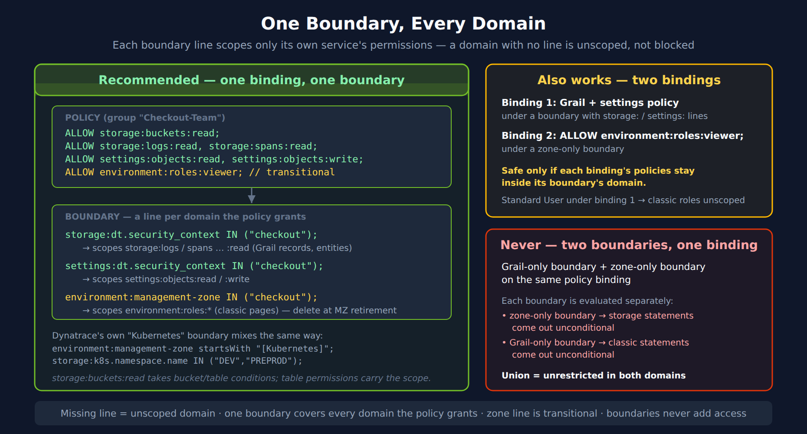

# IAM-05: Boundary Design Patterns

> **Series:** IAM — IAM Administration | **Notebook:** 5 of 12 | **Created:** January 2026 | **Last Updated:** 10/25/2026

## Controlling Data Visibility with Boundaries
Boundaries determine **what data** users can see. While policies control actions, boundaries filter visibility. This notebook covers boundary syntax, patterns, and implementation strategies, including how to scope access to lookup files in Grail.

---

## Table of Contents

1. [Boundary Fundamentals](#boundary-fundamentals)
2. [The Three-Domain Model](#the-three-domain-model)
3. [Boundary Syntax Reference](#boundary-syntax-reference)
4. [Security Context and Data Partitioning Strategy](#security-context-and-data-partitioning-strategy)
5. [Common Boundary Patterns](#common-boundary-patterns)
6. [Multi-Tenant Isolation](#multi-tenant-isolation)
7. [Boundary Testing](#boundary-testing)

---

## Prerequisites

| Requirement | Details |
|-------------|----------|
| **Dynatrace Environment** | SaaS with Gen3 IAM enabled |
| **Permissions** | `account-user-management` (boundaries are account-level objects) |
| **Prior Knowledge** | **IAM-01** through **IAM-04** |

<a id="boundary-fundamentals"></a>
## 1. Boundary Fundamentals
Boundaries filter what entities and data a user can see within an environment.

### Policies vs Boundaries

| Concept | Controls | Example |
|---------|----------|----------|
| **Policy** | What actions | "Can read logs" |
| **Boundary** | What data | "Logs from checkout service only" |

A **policy** is required; a **boundary** is optional and only narrows it:
- A **policy** grants the action (e.g., `storage:logs:read`)
- A **boundary**, attached to a policy binding, restricts it to certain data (e.g., the `checkout` security context)

A policy bound without a boundary applies to all data its permissions cover.

### How Boundaries Work

1. User attempts to access data (query, view, etc.)
2. Dynatrace checks if user's policy allows the action
3. Dynatrace filters results to match user's boundary
4. User sees only data within their boundary

### Boundary Scope

Boundaries are **account-level** objects, attached per policy binding — and the binding itself can be account- or environment-scoped:

```
Group: dt-checkout-editors
├── Policy: Pro User
└── Boundary: checkout-services-only
```

> <sub>**Sources:** [Policy boundaries (DT docs)](https://docs.dynatrace.com/docs/manage/identity-access-management/permission-management/manage-user-permissions-policies/iam-policy-boundaries) — *"Boundaries alone don't restrict anything, they are always used together with policies in the process of assigning policies to your user groups."*</sub>

<a id="the-three-domain-model"></a>
## 2. The Three-Domain Model
Boundary conditions fall into three domains, and each line scopes only the permissions of its own service. One boundary should carry a line for **every domain the policies bound with it grant** — a domain with no line is not blocked, it is unscoped.


<!-- MARKDOWN_TABLE_ALTERNATIVE
| Boundary line | Scopes | Domain |
|---|---|---|
| storage:dt.security_context IN ("checkout"); | storage:logs/spans/metrics/events/entities:read (record and entity reads) | Grail (storage) |
| settings:dt.security_context IN ("checkout"); | settings:objects:read / :write on objects whose scope carries a security context | Settings |
| environment:management-zone IN ("checkout"); | environment:roles:viewer, :manage-settings, :logviewer … (classic pages) | Classic — transitional, delete at MZ retirement |
| Drop a line | That domain's permissions become unscoped (not blocked) | |
| Two boundaries on one binding | Each is evaluated separately: a zone-only boundary leaves storage unconditional, a Grail-only boundary leaves classic roles unconditional | Widens access |
| Two bindings, one boundary each | Works only if each binding's policies stay inside its boundary's domain | |
For environments where SVG doesn't render
-->

### Domain 1: Environment

The `environment:management-zone` condition scopes the classic `environment:roles:*` permissions — the classic pages for hosts, services, applications, databases and cloud resources. It is transitional: Grail does not read it.

### Domain 2: Storage

The `storage:` conditions (`storage:dt.security_context`, `storage:bucket-name`, primary Grail fields) scope Grail reads — including Smartscape (`storage:smartscape:read`) and classic entities (`storage:entities:read`):
- Logs
- Spans (traces)
- Metrics
- Events
- Business events

### Domain 3: Settings

Controls visibility of configuration:
- Alerting rules
- SLOs
- Custom settings

### Why All Three Matter

A boundary never adds access, and a missing line never removes it. If the bound policies grant a domain the boundary has no line for, that domain is **unscoped**:

| Missing line | Effect when the bound policy grants that domain |
|--------------|-----------------------------------------------|
| `environment:management-zone` | Classic pages (`environment:roles:*`) for every zone |
| `storage:dt.security_context` | Every record the policy's `storage:*:read` permissions cover |
| `settings:dt.security_context` | Every settings object the policy's `settings:objects:*` permissions cover |

> <sub>**Sources:** [Policy boundaries (DT docs)](https://docs.dynatrace.com/docs/manage/identity-access-management/permission-management/manage-user-permissions-policies/iam-policy-boundaries) — *"Only conditions added to service configuration will be applied to relative permissions."*; the page's own example ends in *"would effectively grant unconditional read access to storage entities"* because boundary one's host-name condition does not apply to `storage:entities:read`.</sub>

<a id="boundary-syntax-reference"></a>
## 3. Boundary Syntax Reference
### Basic Boundary Structure

```
<domain>:<field> <operator> (<values>)
```

**One boundary, one line per domain the bound policies grant.** A boundary line scopes only the permissions of its own service: Dynatrace's rule is *"Only conditions added to service configuration will be applied to relative permissions."* An `environment:management-zone` line scopes `environment:roles:*` statements and nothing in Grail; a `storage:dt.security_context` line scopes `storage:` reads and nothing classic. Whatever the boundary has no line for stays **unscoped**. So when the bound policies span Grail, settings and — during the transition — classic roles, the boundary carries a line for each, together. Dynatrace's own boundary page shows this mixed shape: its `Kubernetes` boundary holds `environment:management-zone startsWith "[Kubernetes]";` next to `storage:k8s.namespace.name IN ("DEV","PREPROD");`.

```
# Policy
ALLOW storage:buckets:read;
ALLOW storage:logs:read, storage:spans:read, storage:metrics:read;
ALLOW settings:objects:read, settings:objects:write;
ALLOW environment:roles:viewer;
```

```
# Boundary — one boundary covering every domain the policy grants
storage:dt.security_context  IN ("checkout");
settings:dt.security_context IN ("checkout");
environment:management-zone  IN ("checkout");
```

> **Unverified — dry-run this shape before relying on it.** `settings:objects:read` and `settings:objects:write` accept both `environment:management-zone` and `settings:dt.security_context`, so two lines of this boundary land on the same settings statements. The boundary page defines what *repeated* condition names do — *"each policy statement is multiplied by such conditions"* — but not what two *different* names on one permission do. If they are ANDed, settings access needs the zone and the security context at once, and stops altogether when the scoped-settings change makes zone conditions never match. Resolve a pilot user's settings permissions with `POST /iam/resolution/{level-type}/{level-id}/effectivepermissions:dry-run` (bindings with their boundaries, before you apply them), or use the two-binding shape below, which keeps the zone line away from the settings statements.

The `environment:management-zone` line (and the `environment:roles:viewer` statement it scopes) is transitional: delete both when classic pages are retired, without rebinding anything. `storage:buckets:read` is *"Required additionally to a table permission"*; it takes `storage:bucket-name` / `storage:table-name` conditions rather than `dt.security_context`, so the table permissions carry the record scoping.

**Two bindings instead of one boundary also work** — a Grail/settings policy bound under a Grail-only boundary, plus a custom classic policy (`ALLOW environment:roles:viewer;`) bound under a zone-only boundary. Bindings combine as a union, so this is safe **only if each binding's policies stay inside its boundary's domain**. Bind a default policy such as *Standard User* (which includes `settings:objects:read` and `environment:roles:viewer`) under a single-domain boundary and its other domains come out unscoped.

**Never attach two single-domain boundaries to one binding.** *"When more than one boundary applies to a policy, then effective statements are calculated for each boundary separately"* — the zone-only boundary leaves the storage statements unconditional, the Grail-only boundary leaves the classic statements unconditional, and the union is unrestricted access in both domains.

> <sub>**Sources:** [Policy boundaries (DT docs)](https://docs.dynatrace.com/docs/manage/identity-access-management/permission-management/manage-user-permissions-policies/iam-policy-boundaries) — *"Only conditions added to service configuration will be applied to relative permissions."*; *"When more than one boundary applies to a policy, then effective statements are calculated for each boundary separately"*; *"In certain configurations this may cause unintended unconditional access."* [IAM policy reference (DT docs)](https://docs.dynatrace.com/docs/manage/identity-access-management/permission-management/manage-user-permissions-policies/advanced/iam-policystatements) — `storage:buckets:read`: *"Required additionally to a table permission."*</sub>

> **`=` and `IN` only work while `dt.security_context` holds a single value.** Dynatrace's Grail permissions reference: *"Using `=`, `STARTSWITH` or `IN` when the field holds an array will always return `false`."* The failure is silent — the policy is valid, it evaluates, and it matches nothing. If any enrichment path can write an array into `dt.security_context`, use `MATCH` instead: *"you must use the `MATCH` operator to get 'for any value' set semantic."*
>
> Find out which case you are in before choosing an operator: `fetch logs, from:-1h | filter isNotNull(dt.security_context) | fieldsAdd sc_type = type(dt.security_context) | summarize records = count(), by:{sc_type}`. Any `array` row means an `=` or `IN` condition misses those records. **ORGNZ-04** covers the operator semantics in full.
>
> <sub>**Sources:** [Permissions in Grail (DT docs)](https://docs.dynatrace.com/docs/platform/grail/organize-data/assign-permissions-in-grail) — the array semantics quoted above.</sub>

**`MATCH` is not available everywhere.** `environment:management-zone` does accept it (the policy reference lists `IN`, `startsWith`, `NOT startsWith`, `=`, `!=` and `MATCH` on `environment:roles:viewer`), but `storage:entities:read` (classic entities) supports only `=`, `IN` and `startsWith` for `storage:dt.security_context`, and `settings:dt.security_context` supports only `IN`, `=` and `startsWith`.

### Operators

| Operator | Description | Example |
|----------|-------------|----------|
| `IN` | Match any in list | `IN ("a", "b", "c")` |
| `=` | Exact match | `= "checkout"` |
| `!=` | Not equal — only where the policy reference lists it (e.g. `storage:bucket-name`, `environment:management-zone`); **not** on `storage:dt.security_context` or `settings:dt.security_context` | `storage:bucket-name != "pci_logs"` |
| `startsWith` | Prefix match | `startsWith "team-"` |
| `MATCH` | Wildcard pattern match | `storage:dt.security_context MATCH('*/app:easytrade')` |

> **`MATCH()` is available on the Grail record tables (`storage:logs:read` etc.), `storage:smartscape:read` and `environment:management-zone`.** It supports `*` as a wildcard at any position — anchor with a trailing `*` to mimic prefix matching. It is **not** available for `settings:dt.security_context` (`IN`, `=`, `startsWith`) or on `storage:entities:read` (below).
>
> **`storage:entities:read` (classic entities) supports `=`, `IN` and `startsWith` only** — Dynatrace documents `startsWith` as evaluating for any matching value of the multi-value entity context. `storage:smartscape:read` and the record tables also accept `MATCH`.
>
> <sub>**Sources:** [Grant access to entities with security context (DT docs)](https://docs.dynatrace.com/docs/manage/identity-access-management/use-cases/access-security-context) — *"the security context of this entity. Can be a multi-value field and startsWith will evaluate for any matching value."* [IAM policy reference (DT docs)](https://docs.dynatrace.com/docs/manage/identity-access-management/permission-management/manage-user-permissions-policies/advanced/iam-policystatements) — operator lists per condition, read 10/13/2026.</sub>

> **Place wildcards next to a word separator.** Dynatrace's guidance is to put the `*` immediately before or after a separator character — `-`, `_`, `.`, or `/`. `MATCH("db-tech-*")` evaluates more efficiently than `MATCH("db-tech*")`. This is why the structured `dt.security_context` format below uses `/` between dimensions and `:` within them: every boundary a transversal team needs then lands on a separator rather than mid-token.

### Common Fields

| Domain | Field | Description |
|--------|-------|-------------|
| environment | `management-zone` | Management zone filter |
| storage | `dt.security_context` | Data security context |
| storage | `bucket-name` | Storage bucket name |
| settings | `dt.security_context` | Settings security context |
| settings | `schemaId` | Settings schema |

### Multiple Values

Grant access to multiple security contexts — one boundary, a line per domain:

```
# Policy
ALLOW storage:buckets:read;
ALLOW storage:logs:read, storage:spans:read;
ALLOW settings:objects:read;
ALLOW environment:roles:viewer;
```

```
# Boundary
storage:dt.security_context  IN ("checkout", "payments", "shared");
settings:dt.security_context IN ("checkout", "payments", "shared");
environment:management-zone  IN ("checkout", "payments", "shared");
```

### Wildcard Access

For admin groups needing full access, bind without a boundary:

```
# Admin: all data + settings + classic roles, no boundary
ALLOW storage:buckets:read;
ALLOW storage:logs:read, storage:spans:read, storage:metrics:read;
ALLOW settings:objects:read, settings:objects:write;
ALLOW environment:roles:manage-settings, environment:roles:viewer;
```

> **Don't write a wildcard `MATCH('*')` to mean "everything".** A policy bound without a boundary already applies to all data its permissions cover, and `storage:entities:read` and `settings:dt.security_context` have no `MATCH` at all.

### Boundary Limitations

| Limitation | Description | Workaround |
|------------|-------------|------------|
| **Max 10 conditions** | Only 10 lines per boundary | Fold values into `IN` lists first. Dynatrace allows assigning multiple boundaries to a policy, but each is evaluated separately — so every extra boundary must itself carry a line for every domain the policy grants |
| **No AND inside a boundary** | One condition per line; repeated condition names multiply the statement | Need AND? Put it in the policy's WHERE clause (IAM-04). Multiple boundaries on one policy are evaluated separately — they widen, not narrow |
| **No `MATCH` on some conditions** | `storage:entities:read` and `settings:dt.security_context` accept only `=`, `IN`, `startsWith` | Use `IN`, or `startsWith` for a prefix |

> <sub>**Sources:** [Policy boundaries (DT docs)](https://docs.dynatrace.com/docs/manage/identity-access-management/permission-management/manage-user-permissions-policies/iam-policy-boundaries) — *"Boundaries don't support the AND operator, every line of a boundary can only consist of one condition."*; *"When more than one boundary applies to a policy, then effective statements are calculated for each boundary separately"*.</sub>

<a id="security-context-and-data-partitioning-strategy"></a>
## 4. Security Context and Data Partitioning Strategy
Security contexts and Grail buckets form the foundation of boundary filtering and data partitioning. Plan your strategy carefully.

> **Boundary design vs policy parameterization (read first).** This notebook covers **standalone Boundary resources** — separate IAM objects applied to groups for defense-in-depth scoping. Standalone boundaries are typically per-team with hardcoded scope (one boundary per team), distinct from the **policy WHERE clauses** in IAM-04 which ARE parameterizable via `${bindParam:NAME}` and bound per group. The two layer together: a parameterized policy (the "what" — bound per team) plus a per-team standalone boundary (the "where" — hardcoded per team) gives both scaling and defense-in-depth. See **IAM REFERENCE.md § Policy Parameterization and Boundary Standardization** for the canonical pattern; standardize the boundary FIELD on `dt.security_context` (Gen3) or management zone (Classic) regardless of which layer you're scoping.

### What is a Security Context?

A **security context** is a label applied to:
- Entities (hosts, services)
- Data (logs, spans)
- Settings (configurations)

Boundaries filter based on these labels.

### Primary Grail Fields

**Primary Grail fields** are first-class attributes that Dynatrace uses for data organization. These should drive your permission, segmentation and routing strategy:

| Field | Source | Use Case |
|-------|--------|----------|
| `k8s.cluster.name` | Kubernetes | Cluster-level isolation |
| `k8s.namespace.name` | Kubernetes | Namespace-level access |
| `aws.account.id` | AWS metadata | AWS account separation |
| `azure.subscription.id` | Azure metadata | Azure subscription separation |
| `gcp.project.id` | GCP metadata | GCP project separation |
| `dt.host_group.id` | OneAgent config | Host group-based isolation |

These fields are automatically enriched from infrastructure metadata and provide consistent, reliable partitioning dimensions.

### Grail Bucket Strategy

**Buckets** partition data in Grail for retention, cost allocation and query performance. They are **not** the access-control layer: Dynatrace states buckets are *"not intended as the primary mechanism for securing or segmenting data access."* Scope access with `dt.security_context` (and primary Grail fields); add a bucket when a retention period, cost allocation or a compliance requirement calls for one.

**Key Principle:** Create a bucket for a retention, cost or compliance reason, and route data into it based on primary Grail fields.

| Bucket Design | Example | Benefit |
|---------------|---------|---------|
| **By Retention** | `logs_30d`, `logs_365d` | Different retention per data class |
| **By Cost Owner** | `checkout_data`, `payments_data` | Cost allocation per team / LOB |
| **By Compliance** | `pci_logs`, `general_logs` | Regulatory separation (an explicit bucket-scoped grant on top of the security context) |
| **By Environment** | `prod_logs`, `dev_logs` | Different retention for prod and non-prod |

> <sub>**Sources:** [Partition data with Grail buckets (DT docs)](https://docs.dynatrace.com/docs/platform/grail/organize-data/partition-data) — *"Buckets are best used for organizing data by retention time, cost allocation, or query optimization. They are not intended as the primary mechanism for securing or segmenting data access."*</sub>

### Bucket Limitations

> **⚠️ Critical:** Plan buckets carefully - these constraints cannot be changed later.

| Limitation | Details |
|------------|---------|
| **One data type per bucket** | Logs, metrics, events, OR spans - not mixed |
| **Names are immutable** | Bucket names CANNOT be changed after creation |
| **No data migration** | Data CANNOT be moved between buckets |
| **Naming rules** | 3-100 chars, lowercase alphanumeric, underscores, hyphens only |
| **Maximum buckets** | 250 custom buckets per environment by default from SaaS 1.346 (staged tenant rollout from 08/25/2026); 80 before it |
| **Target ingest (logs)** | 1–3 TB/day per log bucket — *"Design your bucket strategy so that each bucket receives between 1 TB and 3 TB of log data per day."* |
| **Split point (other tables)** | Above 2 TB/day — *"We recommend splitting up buckets that receive more than 2 TB of daily ingest."* |
| **Maximum ingest** | No per-bucket ingest cap is documented. The 500 GB scan limit shrinks the queryable window as a bucket grows, and Dynatrace's split guidance differs between pages — see the note below |

> **Sizing guidance varies.** Dynatrace pages describe single buckets well above 3 TB/day as possible but slow to query, and they give different points at which to split. Size against your own query windows rather than a fixed ceiling.
>
> <sub>**Sources:** [Partition data with Grail buckets (DT docs)](https://docs.dynatrace.com/docs/platform/grail/organize-data/partition-data) — *"We recommend splitting up buckets that receive more than 2 TB of daily ingest."*; [How to organize your data stored in Grail (DT docs)](https://docs.dynatrace.com/docs/platform/grail/organize-data) — *"The default limit per environment is 250 custom buckets."*; [Logs bucket strategy best practices (DT docs)](https://docs.dynatrace.com/docs/platform/upgrade/best-practices/stage-05-partition-data/logs-bucket-strategy) — *"Design your bucket strategy so that each bucket receives between 1 TB and 3 TB of log data per day."*, *"At 100 TB/day in a single bucket, the same 500 GB scan covers only a few minutes of logs, making historical queries impractical without increasing scan limits."*</sub>

### Query Constraints

| Limit | Value | Impact |
|-------|-------|--------|
| **Maximum data scanned** | 500 GB | Limits queryable time window |
| **Maximum records returned** | 1,000 | Use aggregations for larger datasets |
| **Maximum response payload** | 1 MB | Large result sets may be truncated |

### Default Bucket Retentions

| Bucket | Retention |
|--------|-----------|
| `default_logs` | 35 days |
| `default_metrics` | 15 months |
| `default_spans` | 10 days |
| `default_events` | 35 days |

**Naming Convention:** Include organization, data type, and retention in bucket names:
- `team_a_logs_90d`
- `prod_spans_30d`
- `pci_metrics_365d`

### Bucket + Boundary Integration

> **When this combo fits:** the policy + standalone boundary pattern below is well-suited to scenarios where bucket-based scoping is already the right tool — compliance separation (PCI/HIPAA), retention isolation, or hard cost attribution. For general team-scoped data access without one of those reasons, a parameterized policy on `dt.security_context` alone (no bucket-name condition, no standalone boundary) is usually simpler. See **IAM REFERENCE.md § Bucket-Match Overlay** for scenario gating.

When the scenario does fit, the policy carries the **parameterized scope** and the boundary carries the **per-team hardcoded scope** for defense-in-depth. Pair them on the same group.

**Policy (parameterized — one template, bound per team):**

```
// Recommended: parameterized policy template
// storage:buckets:read is required in addition to each table permission
ALLOW storage:buckets:read WHERE storage:bucket-name = "${bindParam:log-bucket}";
ALLOW storage:buckets:read WHERE storage:bucket-name = "${bindParam:span-bucket}";
ALLOW storage:logs:read  WHERE storage:bucket-name = "${bindParam:log-bucket}";
ALLOW storage:spans:read WHERE storage:bucket-name = "${bindParam:span-bucket}";
```

**Resolved when bound to the checkout group with `{"parameters": {"log-bucket": "checkout_logs", "span-bucket": "checkout_spans"}}`:**

```
ALLOW storage:buckets:read WHERE storage:bucket-name = "checkout_logs";
ALLOW storage:buckets:read WHERE storage:bucket-name = "checkout_spans";
ALLOW storage:logs:read  WHERE storage:bucket-name = "checkout_logs";
ALLOW storage:spans:read WHERE storage:bucket-name = "checkout_spans";
```

**Standalone Gen3 boundary (per-team — hardcoded scope is intentional here):**

```
# Gen3 boundary — pair with a Gen3 policy (storage:*, settings:*)
# One boundary per team; standardize on dt.security_context as the universal field.
storage:bucket-name IN ("checkout_logs", "checkout_spans");
storage:dt.security_context IN ("checkout");
settings:dt.security_context IN ("checkout");
```

**Classic access during the transition:** if the bound policies also grant `environment:roles:*`, either bind those classic statements separately under a zone-only boundary, or — if they share this binding — they need a zone line of their own (§3). The upgrade guidance below keeps zones out of the target boundary, so the separate binding is the cleaner choice here.

> **Why the policy is parameterized but the standalone boundary isn't:** policy WHERE clauses support `${bindParam:NAME}` and are bound per group at policy-binding time. Standalone Boundary resources are independent IAM objects — typically one boundary per team with hardcoded scope, attached to the group separately. See **IAM-10** for policy-binding mechanics; see **IAM REFERENCE.md § Anti-patterns** for why parameterizing on entity-type-specific fields (e.g., `host.name`) is the "dead in water" failure mode.

### Using Buckets for Team Isolation

> **When this approach fits:** bucket-based team isolation is well-suited to scenarios where the bucket already exists for a specific reason — compliance separation (PCI/HIPAA), retention isolation, hard cost attribution, or hostile multi-tenancy. For general team-scoped access without one of those reasons, a parameterized policy on `dt.security_context` (no buckets, no standalone boundary) is usually simpler. The pattern below applies once you've decided buckets are the right tool. See **IAM REFERENCE.md § Bucket-Match Overlay** for scenario gating.

For team-level data access control (when the bucket scenario fits):

1. **Create team-specific buckets** - `team_a_logs`, `team_a_spans`, etc.
2. **Configure pipeline routing** - Route data to buckets based on primary Grail fields
3. **Create one parameterized policy** — bound to each team's group with different bucket parameters
4. **Create one standalone boundary per team** — hardcoded scope, applied per group

**Recommended (parameterized policy + per-team standalone boundary):**

```
// One parameterized policy template — bound per team
Policy: tpl-team-data-access (parameterized)
├── ALLOW storage:buckets:read WHERE storage:bucket-name = "${bindParam:log-bucket}";
├── ALLOW storage:buckets:read WHERE storage:bucket-name = "${bindParam:span-bucket}";
├── ALLOW storage:buckets:read WHERE storage:bucket-name = "${bindParam:metric-bucket}";
├── ALLOW storage:logs:read    WHERE storage:bucket-name = "${bindParam:log-bucket}";
├── ALLOW storage:spans:read   WHERE storage:bucket-name = "${bindParam:span-bucket}";
└── ALLOW storage:metrics:read WHERE storage:bucket-name = "${bindParam:metric-bucket}";

// One standalone boundary per team — hardcoded scope (defense-in-depth)
Boundary: bnd-team-checkout
    storage:bucket-name IN ("checkout_logs", "checkout_spans", "checkout_metrics");
    storage:dt.security_context IN ("checkout");

// Group: bind both — policy with team-specific parameters, boundary as-is
Group: Checkout-Team
├── Policy binding: tpl-team-data-access
│     parameters: {log-bucket: "checkout_logs", span-bucket: "checkout_spans",
│                  metric-bucket: "checkout_metrics"}
└── Boundary attachment: bnd-team-checkout
```

**Resolved view (what the policy evaluates to for the Checkout-Team group):**

```
Group: Checkout-Team
├── Policy: tpl-team-data-access (resolved for this group)
│   ├── ALLOW storage:buckets:read WHERE storage:bucket-name IN ("checkout_logs", "checkout_spans", "checkout_metrics");
│   ├── ALLOW storage:logs:read    WHERE storage:bucket-name = "checkout_logs";
│   ├── ALLOW storage:spans:read   WHERE storage:bucket-name = "checkout_spans";
│   └── ALLOW storage:metrics:read WHERE storage:bucket-name = "checkout_metrics";
└── Boundary: bnd-team-checkout (unchanged — per-team hardcoded scope)
    storage:bucket-name IN ("checkout_logs", "checkout_spans", "checkout_metrics");
    storage:dt.security_context IN ("checkout");
```

> **No management zone in `bnd-team-checkout`.** Dynatrace's upgrade guidance is explicit: *"Boundary definitions must not reference classic management zones."* That is the **target** model. If the group still needs classic pages during the transition, bind the classic statements (`ALLOW environment:roles:viewer;`) in a **separate** binding under a zone-only boundary — and keep that binding free of `storage:` and `settings:` permissions, or they come out unscoped (§3).
>
> <sub>**Sources:** [Upgrade management zones to IAM and segments (DT docs)](https://docs.dynatrace.com/docs/platform/upgrade/best-practices/stage-03-iam-segments).</sub>

Adding a new team is one boundary YAML + one binding YAML — the policy stays unchanged. See **IAM-10: Templated Policy-Group Assignments** for binding mechanics and **IAM REFERENCE.md § Change-Management Caveat** for why parameter-shape decisions matter at design time.

> **For comprehensive bucket guidance**, see **ORGNZ-03: Bucket Strategy and Design** which covers naming conventions, retention planning, and cost attribution patterns.

### Primary Grail Tags

Beyond fields, **Primary Grail Tags** can be configured from:
- Kubernetes labels (first 3 selected during setup)
- AWS resource tags
- Azure resource tags

These tags become first-class Grail attributes available for:
- Bucket assignment rules
- Policy/boundary conditions
- Pipeline routing
- Segment filters

### Assigning Security Context

Dynatrace says to *"Set the dt.security_context field as early as possible in the data pipeline, ideally at the source"*, and lists three patterns in order of preference:

1. **At the source (preferred)** — where the telemetry is generated:
   - **OneAgent host tag** `dt.security_context=<value>`, set at installation or via Deployment Status; it applies to all telemetry from that host.
   - **`DT_TAGS` environment variable** — *"For process-level granularity on shared infrastructure, add DT_TAGS:"dt.security_context=<value>" as an environment variable on the process."*
   - **Kubernetes namespace labels or annotations**, through Kubernetes metadata enrichment; applies to all telemetry from that namespace.
   - **OpenTelemetry resource attribute** `dt.security_context`, in `OTEL_RESOURCE_ATTRIBUTES` or the OpenTelemetry Collector.
2. **Central configuration** — for data collected by OneAgent, cloud integrations or Dynatrace Operator, *"configure the dt.security_context field in the central primary Grail tag configuration under Settings > Collect and capture."* There you can map a cloud or Kubernetes tag or label, pick a host, process, Kubernetes or cloud attribute (with an optional regex extractor), or set a fixed value for a scope such as an environment, Kubernetes cluster or host group, optionally restricted by a filter.
3. **OpenPipeline** — where the value must be computed, *"define dt.security_context in OpenPipeline using dedicated Set security context processors"* (available for spans, logs and metrics).

Set at the source, the context is there before pipeline routing, and once set on a signal it *"propagates to all derived data, including Davis events and problems."*

> **Note:** Auto-tagging does not set it. *Automatically applied tags* (`builtin:tags.auto-tagging`) are listed as **Removed** in Latest Dynatrace.
>
> <sub>**Sources:** [Configure security context (DT docs)](https://docs.dynatrace.com/docs/manage/tags/tags-security-context) — *"Set the dt.security_context field as early as possible in the data pipeline, ideally at the source."*; [Settings 2.0 schemas that are removed in Latest Dynatrace (DT docs)](https://docs.dynatrace.com/docs/dynatrace-api/environment-api/settings/removed-schemas) — *"None of the schemas on this page are visible in Latest Dynatrace."*</sub>

### Security Context Design Patterns

| Pattern | Example Values | Use Case |
|---------|----------------|----------|
| **Team-based** | `checkout-team`, `payments-team` | Team ownership |
| **Application-based** | `ecommerce-app`, `mobile-app` | App isolation |
| **Environment-based** | `prod`, `staging`, `dev` | Env separation |
| **Business unit** | `retail`, `wholesale`, `corporate` | Business isolation |
| **Geography** | `us-east`, `eu-west`, `apac` | Regional separation |

### Naming Conventions

| Rule | Good | Bad |
|------|------|-----|
| Lowercase | `checkout` | `Checkout` |
| Hyphens | `team-checkout` | `team_checkout` |
| Descriptive | `payments-api` | `pa` |
| No spaces | `mobile-app` | `mobile app` |

### Shared Context

Some data should be visible to multiple teams:

```
Security Contexts:
├── checkout      (checkout team data)
├── payments      (payments team data)
└── shared        (cross-team data - infrastructure, common services)
```

Teams get their context + `shared` — one boundary, a line per domain (the zone line only while classic pages are in use):
```
storage:dt.security_context  IN ("checkout", "shared");
settings:dt.security_context IN ("checkout", "shared");
environment:management-zone  IN ("checkout", "shared");
```

### Recommended Partitioning Strategy

1. **Identify primary dimensions** - What drives access control? (team, environment, region, compliance)
2. **Map to Primary Grail Fields** - Use `k8s.cluster.name`, `aws.account.id`, `dt.host_group.id`
3. **Set `dt.security_context`** - Enrich every signal (logs, spans, events, metrics) with the access dimension, and measure coverage on records, not just entities
4. **Define policies and boundaries** - Scope reads with `storage:dt.security_context` and settings with `settings:dt.security_context`, one boundary per team covering every domain
5. **Design buckets** - Only where retention, cost allocation or a compliance requirement calls for one; add `storage:bucket-name` conditions for those
6. **Configure pipelines** - Route data to those buckets based on primary fields
7. **Create segments** - For query filtering (segments are not access control)

> **See Also:** For migration from Management Zones, refer to **MZ2POL-04: Policies and Boundaries** which covers mapping MZ patterns to the new model.

<a id="common-boundary-patterns"></a>
## 5. Common Boundary Patterns
### Pattern 1: Single Team Boundary

Restrict to one team's data with **one** boundary that holds a line for every domain. Do not split it into a Grail boundary and a zone boundary on the same binding — each boundary is evaluated separately, so each leaves the other domain unconditional (§3).

```
# One boundary — a line per domain the bound policies grant
storage:dt.security_context  IN ("checkout");
settings:dt.security_context IN ("checkout");
environment:management-zone  IN ("checkout");   # transitional — delete at MZ retirement
```

> <sub>**Sources:** [Policy boundaries (DT docs)](https://docs.dynatrace.com/docs/manage/identity-access-management/permission-management/manage-user-permissions-policies/iam-policy-boundaries) — *"When more than one boundary applies to a policy, then effective statements are calculated for each boundary separately"*.</sub>

### Pattern 2: Team + Shared

Team data plus shared infrastructure:

```
# One boundary — a line per domain the bound policies grant
storage:dt.security_context  IN ("checkout", "shared", "infrastructure");
settings:dt.security_context IN ("checkout", "shared");
environment:management-zone  IN ("checkout", "shared", "infrastructure");   # transitional — delete at MZ retirement
```

### Pattern 3: Multiple Teams (Cross-Functional)

For SRE or platform teams:

```
# One boundary — a line per domain the bound policies grant
storage:dt.security_context  IN ("checkout", "payments", "catalog", "shared");
settings:dt.security_context IN ("checkout", "payments", "catalog", "shared");
environment:management-zone  IN ("checkout", "payments", "catalog", "shared");   # transitional — delete at MZ retirement
```

### Pattern 4: Environment Tier

Production vs non-production:

**Production:**
```
# One boundary — a line per domain the bound policies grant
storage:dt.security_context  IN ("prod-checkout", "prod-payments");
settings:dt.security_context IN ("prod-checkout", "prod-payments");
environment:management-zone  IN ("prod-checkout", "prod-payments");   # transitional — delete at MZ retirement
```

**Non-Production:**
```
# One boundary — a line per domain the bound policies grant
storage:dt.security_context  IN ("dev-checkout", "staging-checkout");
settings:dt.security_context IN ("dev-checkout", "staging-checkout");
environment:management-zone  IN ("dev-checkout", "staging-checkout");   # transitional — delete at MZ retirement
```

### Pattern 5: Read-All, Write-Scoped

Using two groups for the same user:

**Group 1: All-Viewers (broad read)**
```
Policies: Standard User + All Grail data read access (default policies)
Boundary: none — a policy bound without a boundary is already environment-wide
```

*Standard User* alone is not a read-everything policy: it grants app, document, workflow and settings-read access, but no Grail table reads (`storage:logs:read` and the like). Pair it with *All Grail data read access* — or the per-table *Read Logs*, *Read Spans* … policies — for data visibility.

**Group 2: Checkout-Editors (scoped write)**
```
Policy: checkout-write-policy
  ALLOW settings:objects:read, settings:objects:write;
  ALLOW environment:roles:manage-settings;          # transitional
Boundary:
  settings:dt.security_context IN ("checkout");
  environment:management-zone  IN ("checkout");      # transitional
```

A zone line alone would scope only the classic `environment:roles:manage-settings` statement; `settings:objects:write` needs the `settings:dt.security_context` line, or the group could write settings across the environment. That condition applies only to settings objects on the scope of an entity that can carry a security context — verify how the environment-scoped schemas you grant behave before relying on it, and narrow them with `settings:schemaId` in the policy where needed.

> <sub>**Sources:** [Default policies (DT docs)](https://docs.dynatrace.com/docs/manage/identity-access-management/permission-management/default-policies) — *Standard User* and *All Grail data read access* policy statements; *All Grail data read access*: *"Grants unconditional access to ALL Grail tables and to ALL Grail buckets."* [IAM policy reference (DT docs)](https://docs.dynatrace.com/docs/manage/identity-access-management/permission-management/manage-user-permissions-policies/advanced/iam-policystatements) — `settings:dt.security_context`: *"This condition is applicable to any settings object that is allowed on the scope of an entity that can have a security context assigned."*</sub>

### Pattern 6: Application Team — Structured Security Context

When `dt.security_context` follows the `comp:<component>/bu:<bu>/app:<app>` format (see **Structured Security Context Design** in **IAM-04**), app teams can access all component types for their application using a single wildcard boundary:

```
// Every line below applies to EVERY storage permission in the bound policy —
// repeated condition names multiply the statement, one copy per line (an OR).

// MATCH — Grail record tables and storage:smartscape:read
storage:dt.security_context MATCH('*/app:easytrade');

// startsWith — the operator storage:entities:read accepts (it has no MATCH);
// on records these lines also match single-value contexts with this prefix
storage:dt.security_context startsWith "comp:app/bu:digital/app:easytrade";
storage:dt.security_context startsWith "comp:db/bu:digital/app:easytrade";
storage:dt.security_context startsWith "comp:lb/bu:digital/app:easytrade";
```

> **The comments are a reading aid, not a routing rule.** A boundary cannot target a line at one permission: Dynatrace applies each condition to every statement whose service accepts it. Dynatrace lists no `MATCH` for `storage:entities:read`, so do not rely on a `MATCH` line to scope classic entities — the `startsWith` lines are what scope them. Check the effective statements per permission before binding.
>
> <sub>**Sources:** [Policy boundaries (DT docs)](https://docs.dynatrace.com/docs/manage/identity-access-management/permission-management/manage-user-permissions-policies/iam-policy-boundaries) — *"When a boundary contains repeated condition names, then each policy statement is multiplied by such conditions. Each of the repeated conditions appears separately in each applicable statement."*</sub>

This grants access to all data tagged with any component prefix for that application:
- `comp:app/bu:digital/app:easytrade`
- `comp:db/bu:digital/app:easytrade`
- `comp:lb/bu:digital/app:easytrade`

### Pattern 7: Transversal Team — Component-Based Access

Infrastructure teams (database, network, OS) that need cross-application access to their component type use a leading `comp:` prefix to enable a single rule:

```
// Both lines apply to every storage permission in the bound policy (an OR).
// MATCH — Grail record tables and storage:smartscape:read
storage:dt.security_context MATCH('comp:db*');

// startsWith — what scopes storage:entities:read (no MATCH there)
storage:dt.security_context startsWith "comp:db";
```

This grants access to all data matching:
- `comp:db/bu:digital/app:easytrade`
- `comp:db/bu:digital/app:easytravel`
- `comp:db/bu:corp/app:hipstershop`

> **Dimension order is the key design decision.** Placing `comp` first in the string means component-based transversal access is always a simple anchored match. Access by `bu` or other mid-string dimensions requires `MATCH('*/bu:digital/*')`.

### Multi-Value Security Context

`dt.security_context` can already hold an array, and on classic entities it commonly does — on the validation tenant (10/13/2026) 55 of 56 hosts held an array, and 52 of them carried two or more values. Grail record permissions evaluate arrays only with `MATCH` (`=`, `IN` and `startsWith` return false); for `storage:entities:read`, use `startsWith`, which evaluates any matching value.

The single-string model above requires choosing one leading dimension. Storing each dimension as its own array value removes that choice:

```
dt.security_context = ["bu:digital", "app:easytrade", "comp:db"]
```

This removes the dimension-ordering trade-off and simplifies all three team types to a single boundary condition per signal type:

| Team | Boundary |
|------|-------------------|
| App team (easytrade) | `storage:dt.security_context MATCH('app:easytrade')` |
| Database team (transversal) | `storage:dt.security_context MATCH('comp:db')` |
| Business unit (digital) | `storage:dt.security_context MATCH('bu:digital')` |

Whichever model you choose, check what your data actually holds before writing conditions (the array check in Section 3).

> <sub>**Sources:** [Permissions in Grail (DT docs)](https://docs.dynatrace.com/docs/platform/grail/organize-data/assign-permissions-in-grail) — *"// will match both "crn-70400-alpha" and ["crn-70131", "crn-70400-beta", "crn-70500"]"*.</sub>

### Pattern 8: Path-Scoped Lookup Files

Lookup files in Grail (uploaded tables that DQL reads with `load` and joins with `lookup`) are not records with a security context. The file permissions accept exactly one condition, the file path, so a **folder per team** is the only handle for scoping them:

| Permission | Grants | Condition | Operators |
|------------|--------|-----------|-----------|
| `storage:files:read` | Read a lookup file | `storage:file-path` | `=`, `startsWith`, `IN` |
| `storage:files:write` | Upload a file (REST API) | `storage:file-path` | `=`, `startsWith`, `IN` |
| `storage:files:delete` | Delete a file (REST API) | `storage:file-path` | `=`, `startsWith`, `IN` |

**Goal:** everyone reads `/lookups/global/*`; each team reads and writes only its own folder `/lookups/<team>/*`; only curators write to `global`.

**Policy 1: `lookups-global-read`.** Bind it to every group that queries lookups, with **no boundary**.

```
ALLOW storage:files:read WHERE storage:file-path startsWith "/lookups/global/";
```

Unlike `storage:logs:write`, which accepts no condition (IAM-10), the file permissions accept `storage:file-path`, so writes can be scoped as well as reads.

**Policy 2: `lookups-team-rw`.** Write one central policy. Bind it once per team group, and give each binding that team's boundary.

```
ALLOW storage:files:read, storage:files:write WHERE storage:file-path startsWith "/lookups/";
ALLOW storage:files:delete WHERE storage:file-path startsWith "/lookups/";   // only if teams must delete files
```

The boundary for one team, for example `team_payments`:

```
storage:file-path startsWith "/lookups/team_payments/";
```

A boundary is applied *"no matter if the statement already contains the same condition"*, so each effective statement carries both prefixes: `/lookups/` from the policy and `/lookups/team_payments/` from the boundary. The binding therefore reaches only that team's folder.

**Policy 3: `lookups-global-write`.** Bind it only to the curator or admin group, with **no boundary**.

```
ALLOW storage:files:read, storage:files:write WHERE storage:file-path startsWith "/lookups/global/";
```

#### Alternative: one templated policy, no boundaries

This series defaults to parameterized policies (IAM-10), and they fit this case too. Write Policy 2 once with a parameter, then bind it per team with that team's folder as the value:

```
ALLOW storage:files:read, storage:files:write WHERE storage:file-path startsWith "${bindParam:folder}";
```

**Binding:** `{"parameters": {"folder": "/lookups/team_payments/"}}`

This uses no boundary, so the *Boundary assignments per policy* question below does not arise. The templating page says parameters *"can be used in a policy similarly to how regular condition values are used"*, but it shows them only with `=` and `IN`. Confirm that a `startsWith` parameter is enforced before you rely on it. Parameterized policies are bound only through the Account Management API, not in the group management UI.

> <sub>**Sources:** [Templated policies (DT docs)](https://docs.dynatrace.com/docs/manage/identity-access-management/permission-management/manage-user-permissions-policies/advanced/iam-policy-templating) — *"Parameters can be used in a policy similarly to how regular condition values are used."*</sub>

#### Why global read is a separate policy

A boundary *can* say "global **or** own folder". Two `storage:file-path` lines in one boundary multiply the statement, one copy per line, which works as an OR. But the boundary applies to every statement in the policy it is bound with, so in Policy 2 that OR would also grant **write** on `global` to every team. Keeping global read in an unbounded policy of its own keeps `global` read-only for everyone except the curators.

#### Rules for path-scoped boundaries

| Rule | Why |
|------|-----|
| Keep the leading slash on every path: `"/lookups/..."` | Every file path *"Must start with `/`"*. A condition without the slash matches no file. |
| End every prefix with a slash: `"/lookups/team_a/"` | `startsWith "/lookups/team_a"` also matches `/lookups/team_a2/...` and `/lookups/team_archive`. |
| Use `startsWith` for folders | `=` and `IN` compare whole paths. `IN ("/lookups/team_a/")` matches no file inside the folder. |
| Name each folder after the team's security context value | That way one naming scheme governs both data and files. Check the value is a legal path segment, though: a path may contain only `a-zA-Z0-9`, `-`, `_`, `.` and `/`, so a structured context such as `comp:db/bu:digital/app:easytrade` (Pattern 6) needs a mapped folder name. |
| Keep Policy 2 to `storage:files:*` permissions only | A boundary line restricts only the permissions that accept its condition. Add `storage:logs:read` to Policy 2 and the file-path boundary leaves it **unrestricted**. |
| One boundary per binding | Several boundaries on one binding are evaluated separately, so they widen access. A team boundary that already holds `storage:dt.security_context` lines can take the `storage:file-path` line too. Each line applies only to the permissions that accept it. |
| Restrict with conditional `ALLOW`, never conditional `DENY` | Boundaries do not apply to `DENY` statements, and conditional `DENY` on storage is supported only for `buckets:read`. |
| Give automation tokens the same permissions | The lookup page says a token used for uploads needs these permissions too, and so does the user that owns it. |

#### Limits to plan for

| Limit | Value |
|-------|-------|
| Policies per account | 200 |
| Policy boundaries per account | 2,000 |
| Restrictions per boundary | 10 |
| Boundary assignments per policy | 10 |

> **Open question: how many teams can share Policy 2?** The IAM limits page lists *Boundary assignments per policy* as **10**, not adjustable, and gives its level as *Boundary*. If it means one policy can carry at most 10 boundary assignments across all its bindings, a single `lookups-team-rw` policy serves at most 10 teams. Dynatrace does not say which reading applies, and this guide has not tested it. Until you have confirmed it on your account (bind one policy to 11 team groups, each with its own boundary), plan for the strict reading: one copy of Policy 2 per 10 teams. That stays well inside the 200-policy limit.

#### Test with a user that holds only these bindings

| Action | Expected |
|--------|----------|
| Read `/lookups/global/<file>` | Allowed |
| Write `/lookups/global/<file>` (non-curator) | Denied |
| Read and write `/lookups/<own team>/<file>` | Allowed |
| Read and write `/lookups/<other team>/<file>` | Denied |
| Read a file directly under `/lookups/` (no team folder) | Denied |

The policy text above follows the Dynatrace docs. This guide has not bound it on a test account, so run the table before rolling it out.

> <sub>**Sources:**</sub>
> - <sub>[Lookup data in Grail (DT docs)](https://docs.dynatrace.com/docs/platform/grail/lookup-data) — *"All permissions can be restricted to specific paths or prefixes, giving users access to only a limited set of files."*; folder example *"/lookups/my_team/allow_list"*</sub>
> - <sub>[IAM policy reference (DT docs)](https://docs.dynatrace.com/docs/manage/identity-access-management/permission-management/manage-user-permissions-policies/advanced/iam-policystatements) — `storage:files:read` / `write` / `delete`, condition `storage:file-path`, operators `=`, `startsWith`, `IN`; *"Conditional DENY statements are supported only for the buckets:read permission."*</sub>
> - <sub>[Policy boundaries (DT docs)](https://docs.dynatrace.com/docs/manage/identity-access-management/permission-management/manage-user-permissions-policies/iam-policy-boundaries) — *"Boundary will be applied no matter if the statement already contains the same condition"*; *"Boundaries don't apply to DENY statements"*; *"When a boundary contains repeated condition names, then each policy statement is multiplied by such conditions."*</sub>
> - <sub>[IAM limits (DT docs)](https://docs.dynatrace.com/docs/manage/identity-access-management/iam-limits) — Policies 200, Policy boundaries 2,000, Boundary assignments per policy 10, none adjustable</sub>
> - <sub>**Derived:** the trailing-slash, whole-path `IN` and folder-naming rules follow from the `startsWith` / `=` / `IN` operators and the path character rules; "Policy 2 leaks write on global" follows from the repeated-condition and applied-to-every-statement rules</sub>

#### Audit who changes lookup files

A successful upload writes an `AUDIT_EVENT` with `event.provider == "GRAIL"`, `event.category == "FILE_MANAGEMENT"`, and the file path in `resource`. The first query below counts changes per team folder. A **denied** call, as the test table above produces, is recorded only by the API gateway, as a `403` on the files API path. That record carries no file path, so a denied attempt can be tied to a user but not to a folder (second query).

```dql
// Lookup file changes per team folder (validated 10/14/2026)
// Successful uploads are GRAIL / FILE_MANAGEMENT audit events whose resource is the file path.
// A file directly under /lookups/ (no team folder) reports as "(top level)": on the validation
// tenant every one of 390 changes in 30 days was top level, which is the gap Pattern 8 closes.
fetch dt.system.events, from:-30d
| filter event.kind == "AUDIT_EVENT" and event.category == "FILE_MANAGEMENT"
| filter startsWith(resource, "/lookups/")
| fieldsAdd parts = splitString(resource, "/")
| fieldsAdd zone = if(arraySize(parts) > 3, parts[2], else: "(top level)")
| summarize {changes = count(), files = countDistinctExact(resource), last_change = max(timestamp)}, by:{zone, user.id, event.type}
| sort changes desc
```

```dql
// Denied calls to the files API (validated 10/14/2026)
// Denials are recorded only by the API gateway, against the API path: the file path is not in the
// record. On the validation tenant: 50 uploads denied with 403 in 30 days, against 390 that succeeded.
// Not included: a 404 on lookup:delete, which reports a missing file, not a denial.
fetch dt.system.events, from:-30d
| filter event.kind == "AUDIT_EVENT" and event.provider == "API_GATEWAY"
| filter contains(resource, "/platform/storage/resource-store/v1/files/")
| filter in(event.outcome, {"401", "403"})
| summarize {denied = count(), last_seen = max(timestamp)}, by:{user.id, resource, event.outcome}
| sort denied desc
```

<a id="multi-tenant-isolation"></a>
## 6. Multi-Tenant Isolation
For organizations serving multiple customers or business units that require strict isolation.


<!-- MARKDOWN_TABLE_ALTERNATIVE
| Tenant | Security Context | Isolated Data |
|--------|------------------|---------------|
| Customer A | tenant-a | All logs, spans, metrics |
| Customer B | tenant-b | All logs, spans, metrics |
| Internal | internal | Platform metrics only |
-->

### Isolation Requirements

| Requirement | Implementation |
|-------------|----------------|
| Data isolation | Unique security context per tenant |
| No cross-tenant access | Strict boundary matching |
| Audit capability | Centralized logging |
| Shared infrastructure | Separate "platform" context |

### Multi-Tenant Boundary Example

**Tenant A Group:**
```
# One boundary — a line per domain the bound policies grant
storage:dt.security_context  IN ("tenant-a");
settings:dt.security_context IN ("tenant-a");
environment:management-zone  IN ("tenant-a");   # transitional — delete at MZ retirement
```

**Tenant B Group:**
```
# One boundary — a line per domain the bound policies grant
storage:dt.security_context  IN ("tenant-b");
settings:dt.security_context IN ("tenant-b");
environment:management-zone  IN ("tenant-b");   # transitional — delete at MZ retirement
```

**Platform Team (cross-tenant):**
```
# One boundary — a line per domain the bound policies grant
storage:dt.security_context  IN ("platform", "shared");
settings:dt.security_context IN ("platform", "shared");
environment:management-zone  IN ("platform", "shared");   # transitional — delete at MZ retirement
```

### Assigning Tenant Context

Use the order in Section 4. When each tenant already has its own host group, the central primary Grail tag configuration (**Settings > Collect and capture**) can *"Set a fixed value for all signals within a given scope (environment, Kubernetes cluster, host group)"* — one value per tenant host group, with no per-host work. Where tenants share hosts, set the context per process with `DT_TAGS`, or per Kubernetes namespace with labels or annotations.

> <sub>**Sources:** [Configure security context (DT docs)](https://docs.dynatrace.com/docs/manage/tags/tags-security-context) — *"Set a fixed value for all signals within a given scope (environment, Kubernetes cluster, host group)."*</sub>

You can also set the context on the OneAgent at deployment. The June-2026 [tags hub](https://docs.dynatrace.com/docs/manage/tags/primary-tags/tags-domain-oneagent) documents the host-tag form for `dt.*` primary fields (the older `--set-host-property` form remains documented in the oneagentctl reference):

```bash
# Set via OneAgent installer / oneagentctl (tags-hub form)
--set-host-tag="dt.security_context=tenant-a"
```

<a id="boundary-testing"></a>
## 7. Boundary Testing
Verify boundaries work as expected before production use.

```dql
// Check security context distribution on services
fetch dt.entity.service
| summarize count = count(), by:{dt.security_context}
| sort count desc
| limit 20

// Smartscape note (dt.entity.* is deprecated but still functional): dt.security_context exists
// on Smartscape nodes but as an ARRAY (empty [] when unset, not null), so isNull / isNotNull
// and by:{dt.security_context} do not carry over — a Smartscape rewrite would miscount coverage.
// Keep the classic query above.
```

```dql
// An empty result here is the HEALTHY answer, not a broken query (verified 08/12/2026: 0 of 37
// services lacked a security context on the validation tenant). Rows appearing means governance
// gaps exist. Do not "fix" this cell because it returns nothing — confirm with:
//   fetch dt.entity.service, from:-7d | summarize {total = count(), no_context = countIf(isNull(dt.security_context))}
// Find entities without security context (boundary gaps)
fetch dt.entity.service, from:-7d
| filter isNull(dt.security_context)
| fields entity.name, tags
| sort entity.name
| limit 50

// Smartscape note (dt.entity.* is deprecated but still functional): dt.security_context exists
// on Smartscape nodes but as an ARRAY (empty [] when unset, not null), so isNull / isNotNull
// and by:{dt.security_context} do not carry over — a Smartscape rewrite would miscount coverage.
// Keep the classic query above.
// (entity tags are also not a flat "tags" field on Smartscape — resolve via getNodeField.)
```

```dql
// Check host security context coverage
fetch dt.entity.host
| summarize 
    total = count(),
    withContext = countIf(isNotNull(dt.security_context)),
    missing = countIf(isNull(dt.security_context))
| fieldsAdd coveragePercent = round(100.0 * withContext / total, decimals: 2)

// Smartscape note (dt.entity.* is deprecated but still functional): dt.security_context exists
// on Smartscape nodes but as an ARRAY (empty [] when unset, not null), so isNull / isNotNull
// and by:{dt.security_context} do not carry over — a Smartscape rewrite would miscount coverage.
// Keep the classic query above.
```

```dql
// Verify logs have security context
fetch logs, from: now() - 1h
| summarize 
    total = count(),
    withContext = countIf(isNotNull(dt.security_context))
| fieldsAdd coveragePercent = round(100.0 * withContext / total, decimals: 2)
```

### Testing Methodology

1. **Create test group** with the boundary
2. **Add test user** to the group
3. **Log in as test user** (or impersonate)
4. **Verify visible entities** match expected
5. **Verify hidden entities** are not visible
6. **Query data** to confirm filtering works

### Validation Checklist

| Test | Expected |
|------|----------|
| List services | Only boundary-included services |
| Query logs | Only logs with matching context |
| View settings | Only settings with matching context |
| Access denied entity | Empty result or error |
| Lookup file in another team's folder | Read and upload denied (Pattern 8) |

## Next Steps

With boundaries configured, complete your IAM implementation:

### Recommended Path

1. **IAM-06: User Lifecycle and Provisioning** - Automate user management
2. **IAM-07: Audit Logging and Compliance** - Monitor access patterns
3. **IAM-08: Multi-Environment IAM** - Scale across environments

### Boundary Checklist

Before moving on, ensure you have:

- [ ] Understood the three-domain model
- [ ] Designed your security context strategy
- [ ] Created boundaries for each team/group
- [ ] Set `dt.security_context` at the source (or via central configuration / OpenPipeline) on every signal
- [ ] Tested boundaries with real users
- [ ] Verified no entities are missing context
- [ ] Scoped lookup files by folder, if teams upload them (Pattern 8)

---

## Summary

In this notebook, you learned:

- Boundary fundamentals and how they differ from policies
- The three-domain model (environment, storage, settings)
- Boundary syntax and operators
- Security context strategy and naming
- Common boundary patterns, including path-scoped lookup files
- Multi-tenant isolation design
- Boundary testing and validation

---

## References

- [Permission Boundaries](https://docs.dynatrace.com/docs/manage/identity-access-management/permission-management/manage-user-permissions-policies/iam-policy-boundaries)
- [Security Context](https://docs.dynatrace.com/docs/manage/identity-access-management/use-cases/access-security-context)
- [Primary Tags](https://docs.dynatrace.com/docs/manage/tags/primary-tags)
- [Lookup data in Grail (DT docs)](https://docs.dynatrace.com/docs/platform/grail/lookup-data)
- [IAM limits (DT docs)](https://docs.dynatrace.com/docs/manage/identity-access-management/iam-limits)
- [Host properties and tags via OneAgent (DT docs)](https://docs.dynatrace.com/docs/manage/tags/primary-tags/tags-domain-oneagent)

---

<sub>*This notebook was AI-generated from community-submitted and publicly available sources. This notebook series is not officially supported by Dynatrace. Always verify information against official Dynatrace documentation.*</sub>
