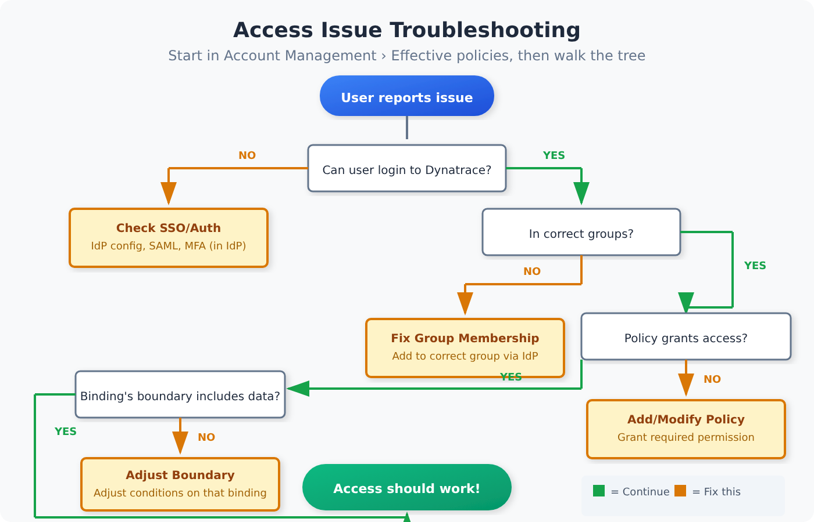

# IAM-09: Troubleshooting Access Issues

> **Series:** IAM — IAM Administration | **Notebook:** 9 of 12 | **Created:** January 2026 | **Last Updated:** 10/14/2026

## Systematic Diagnosis of IAM Problems
Access issues are among the most common support requests. This notebook provides a systematic methodology for diagnosing and resolving IAM-related problems including permission denials, policy conflicts, and boundary issues.

---

## Table of Contents

1. [Troubleshooting Methodology](#troubleshooting-methodology)
2. [Common Access Issues](#common-access-issues)
3. [Permission Denied Debugging](#permission-denied-debugging)
4. [Policy Conflict Resolution](#policy-conflict-resolution)
5. [Boundary Troubleshooting](#boundary-troubleshooting)
6. [SSO and Authentication Issues](#sso-and-authentication-issues)
7. [Token and API Access Issues](#token-and-api-access-issues)
8. [Diagnostic Queries](#diagnostic-queries)
9. [Troubleshooting Checklist](#troubleshooting-checklist)
10. [Escalation Path](#escalation-path)
11. [Series Conclusion](#series-conclusion)

---

## Prerequisites

| Requirement | Details |
|-------------|----------|
| **Dynatrace Environment** | SaaS with Gen3 IAM |
| **Permissions** | `account-user-management` for full diagnosis |
| **Knowledge** | IAM-01 through 08 completed |

<a id="troubleshooting-methodology"></a>
## 1. Troubleshooting Methodology
Follow a systematic approach to diagnose access issues.


<!-- MARKDOWN_TABLE_ALTERNATIVE
| Step | Question | If Yes | If No |
|------|----------|--------|-------|
| 0 | (Start) Open Account Management → Identity & access management → Effective policies for the user | Go to step 1 | — |
| 1 | Can user login? | Go to step 2 | Check SSO/auth |
| 2 | Is user in correct groups? | Go to step 3 | Add to group |
| 3 | Do policies grant access? | Go to step 4 | Modify policy |
| 4 | Does the boundary on the granting binding include the data? | Access should work | Adjust the boundary's conditions (for example security-context values) |
-->

### Step-by-Step Methodology

| Step | Check | Tools |
|------|-------|-------|
| 0 | See which permissions the user actually holds | Account Management → Identity & access management → **Effective policies** |
| 1 | User can authenticate | SSO logs, IdP logs |
| 2 | User exists in Dynatrace | Account Management → Users |
| 3 | User is in correct groups | Account Management → Groups |
| 4 | Groups have correct policies | Account Management → Policies |
| 5 | Policies grant required permissions | Effective policies |
| 6 | Boundaries on the granting bindings don't exclude the data | Boundary configuration on each binding |
| 7 | No conflicting policies | Policy evaluation |
| 8 | Data exists and is accessible | DQL query |

**Start with Effective policies.** Account Management lists it under Identity & access management as the place to *learn which permissions are assigned to users through policies and groups*. It answers steps 3–5 in one view before you open individual groups and policies.

> <sub>**Sources:** [Manage users, groups, and permissions (DT docs)](https://docs.dynatrace.com/docs/manage/account-management/identity-access-management) — *"Effective policies" to learn which permissions are assigned to users through policies and groups*.</sub>

### Information Gathering

Before troubleshooting, collect:

```
User Information:
□ User's email address
□ What action they're trying to perform
□ Exact error message received
□ When the issue started
□ What changed recently (role, team, etc.)

Environment Information:
□ Which environment(s) affected
□ What data/resource they're accessing
□ Screenshot of error (if available)
```

<a id="common-access-issues"></a>
## 2. Common Access Issues
### Issue Categories

| Category | Symptoms | Common Cause |
|----------|----------|---------------|
| **Authentication** | Can't login | SSO misconfigured, account disabled |
| **Authorization** | Access denied | Missing policy, wrong group |
| **Data Access** | No results | Boundary restriction, no data |
| **Partial Access** | See some, not all | Boundary or policy condition |
| **Intermittent** | Sometimes works | Caching, eventual consistency |

### Quick Diagnosis Table

| Symptom | Likely Cause | First Check |
|---------|--------------|-------------|
| "Access Denied" | Missing permission | Policy assignments |
| "Forbidden" | Boundary restriction | Boundary config |
| "Not Found" | No data or no access | Query without filters |
| "Unauthorized" | Token/auth issue | Token validity |
| Can't see entity | Boundary or policy condition | Entity's `dt.security_context` vs. the boundary |
| Can read, can't write | Read-only policy | Policy permissions |

<a id="permission-denied-debugging"></a>
## 3. Permission Denied Debugging
When users receive "Access Denied" or "Forbidden" errors.

### Diagnostic Steps

**Step 1: Verify User Exists**

1. Go to Account Management → Users
2. Search for user by email
3. Verify account is active (not disabled)

**Step 2: Check Group Membership**

1. Click on user to view details
2. Note all groups user belongs to
3. Verify expected groups are present

**Step 3: Review Group Policies**

1. For each group, check assigned policies
2. Verify policies grant needed permissions
3. Check policy conditions/restrictions

**Step 4: Check Boundaries**

1. Review boundaries assigned to groups
2. Verify boundaries include target resources
3. Check boundary conditions

### Permission Evaluation Order

```
1. User authenticated? → No = Auth failure
2. User in any groups? → No = No permissions
3. Any DENY statement matches? → Yes = Access denied (boundaries never apply to DENY)
4. Any policy grants permission? → No = Access denied
5. Boundary on the granting binding excludes the data? → Yes = Check boundary scope
6. Access granted
```

### Common Permission Issues

| Issue | Symptom | Resolution |
|-------|---------|------------|
| Not in group | No access at all | Add user to group via IdP |
| Wrong group | Partial access | Move to correct group |
| Policy too restrictive | Can't perform action | Modify or add policy |
| Missing environment | Can't access env | Add env to policy scope |

<a id="policy-conflict-resolution"></a>
## 4. Policy Conflict Resolution
When multiple policies interact unexpectedly.

### How Policy Evaluation Works

1. Collect all policies from all user's groups
2. Evaluate each policy's conditions
3. **Any ALLOW** = access granted (unless explicitly denied)
4. **No matching ALLOW** = access denied

### Conflict Scenarios

| Scenario | Policy A | Policy B | Result |
|----------|----------|----------|--------|
| Both allow | ALLOW read | ALLOW write | ALLOW both |
| One allows | ALLOW read | No match | ALLOW read |
| Overlapping | ALLOW all envs | ALLOW prod only | ALLOW all envs |
| Condition mismatch | ALLOW (condition: A) | ALLOW (condition: B) | Depends on conditions |

### Debugging Policy Conflicts

**Step 1: List All Applicable Policies**

1. Identify all groups user belongs to
2. List all policies assigned to those groups
3. Note overlapping permissions

**Step 2: Evaluate Each Policy**

For each policy, check:
- Does it apply to the target resource?
- Does it grant the required permission?
- Are conditions met?

**Step 3: Identify Conflict**

| Conflict Type | Indicator | Resolution |
|---------------|-----------|------------|
| Unintended restriction | User in wrong group | Remove from group |
| Missing permission | No policy grants access | Add policy |
| Condition not met | Policy exists but doesn't apply | Adjust condition |
| Scope mismatch | Policy applies to wrong scope | Correct scope |

<a id="boundary-troubleshooting"></a>
## 5. Boundary Troubleshooting
Boundaries restrict what data users can access within their permissions. A boundary is attached to a **policy binding** — the assignment of a policy to a group — not to a user or a group as a whole. The same user can therefore hold one permission through a bounded binding and the same permission through an unbounded one.

### Boundary Evaluation

```
User wants to access data
  ↓
A DENY statement matches? → Yes = Access denied (boundaries don't apply to DENY)
  ↓ No
Any binding grants the permission? → No = Access denied
  ↓ Yes
Is any granting binding unbounded? → Yes = That binding's policy applies without boundary conditions
  ↓ No (every granting binding has a boundary)
Does the boundary have conditions for this permission's service? → No = Unconditional for that binding
  ↓ Yes
Data within the boundary conditions? → No = Data hidden
  ↓ Yes
Data returned
```

Two consequences catch most teams out. A service (domain) left out of a boundary is **unscoped, not blocked**: only conditions added for a service are applied to that service's permissions. And when more than one boundary applies to a policy, effective statements are calculated for each boundary separately, so two narrow boundaries on one binding can each leave the other's domain unconditional.

> <sub>**Sources:** [IAM policy boundaries (DT docs)](https://docs.dynatrace.com/docs/manage/identity-access-management/permission-management/manage-user-permissions-policies/iam-policy-boundaries) — *"Boundaries don't apply to DENY statements."*; *"Only conditions added to service configuration will be applied to relative permissions."*; *"When more than one boundary applies to a policy, then effective statements are calculated for each boundary separately."*</sub>

### Common Boundary Issues

| Issue | Symptom | Cause | Resolution |
|-------|---------|-------|------------|
| Too restrictive | See no data | Boundary too narrow | Expand boundary |
| Not restrictive enough | See too much | Boundary too broad, a service missing from the boundary (unscoped), or another binding grants the same permission without a boundary | Narrow the boundary, add conditions for every service the policy uses, and check Effective policies for unbounded bindings |
| Segment applied | Some data missing | A segment the user selected hides data they are allowed to see | Clear the segment selector before debugging access |
| Wrong environment | Access works in one environment but not another | The policy binding is scoped to a different environment — environment scope is set on the **binding**, not in the boundary | Re-bind the policy at the right environment, or at account level |

### Boundary Debugging Steps

**Step 1: Identify Boundary**

1. Find user's groups
2. Check the boundary attached to each policy binding of those groups (boundaries are per binding)
3. Note each binding's scope (account or a single environment) and its boundary's conditions

**Step 2: Verify Binding Scope and Boundary Conditions**

- **Binding scope**: is the policy bound at account level, or to the environment the user is working in?
- **Storage conditions**: which security contexts, buckets or data types does the boundary allow?
- **Settings conditions**: which security contexts or schemas?
- **Classic (`environment:`) conditions**: which management zones?

**Step 3: Check Effective Policies**

Go to **Account Management > Identity & access management > Effective policies**, enter the user's email address, select the environment, and select **Find permissions**. Dynatrace documents this view for exactly this job: *"Use Effective policies to troubleshoot unexpected access denials. You can see which policy granted or restricted a specific permission and which boundary condition was applied."*

Do not add the affected user to an unbounded admin group to test. That grants production admin rights to diagnose a scoping problem, and is itself an access change an auditor will ask about. If you need to reproduce, in community practice teams bind the same policy **without** the boundary to a dedicated test group holding a test user, reproduce, then delete that binding.

**Step 4: Adjust the Binding or Boundary**

- Missing security-context values or data types → add them to the boundary
- Wrong environment → re-bind the policy at the right scope
- A domain with no condition in the boundary → add a condition for it (unscoped, not blocked — see above)

> <sub>**Sources:** [Grant access to Dynatrace (DT docs)](https://docs.dynatrace.com/docs/manage/identity-access-management/use-cases/access-platform) — *"Use Effective policies to troubleshoot unexpected access denials."*; [Manage IAM policies (DT docs)](https://docs.dynatrace.com/docs/manage/identity-access-management/permission-management/manage-user-permissions-policies/iam-policy-mgt) — *"defining one policy on the account level and binding it to environment levels."*; [IAM policy boundaries (DT docs)](https://docs.dynatrace.com/docs/manage/identity-access-management/permission-management/manage-user-permissions-policies/iam-policy-boundaries) — *"Boundaries alone don't restrict anything, they are always used together with policies in the process of assigning policies to your user groups."*</sub>

<a id="sso-and-authentication-issues"></a>
## 6. SSO and Authentication Issues
When users can't login at all.

### SSO Troubleshooting

| Symptom | Check | Resolution |
|---------|-------|------------|
| Redirect loop | IdP configuration | Verify ACS URL |
| SAML error | SAML response | Check attribute mapping |
| Signs in but has no access | Group claims vs. each group's SAML Group Attribute Value | Users are created automatically at SAML sign-in; fix the group mapping so a claim matches |
| MFA failure | Your IdP's MFA policy | Dynatrace does not configure MFA; fix it in the IdP |
| Session expired | Session settings | Extend session duration |

### SAML Debugging

**Check SAML Response:**

1. Use browser dev tools → Network
2. Find SAML response during login
3. Decode and verify:
   - Subject/NameID (email)
   - Groups attribute
   - Conditions (timestamps)

**Common SAML Issues:**

| Issue | Indicator | Fix |
|-------|-----------|-----|
| Wrong NameID | Email doesn't match | Configure NameID format |
| Missing groups | Groups not in assertion | Add groups attribute in IdP |
| Expired assertion | Time mismatch | Sync clocks, extend validity |
| Invalid signature | Signature error | Update IdP certificate |

### Group Mapping Issues

If user logs in but has wrong permissions:

1. Check SAML groups in assertion
2. Verify group mapping configuration
3. Confirm IdP group names match exactly
4. Check for case sensitivity

<a id="token-and-api-access-issues"></a>
## 7. Token and API Access Issues
When API tokens or OAuth clients don't work as expected.

### Token Issues

| Error | Cause | Resolution |
|-------|-------|------------|
| `401 Unauthorized` | Token invalid/expired | Regenerate token |
| `403 Forbidden` | Missing scope | Add required scope |
| `404 Not Found` | Wrong endpoint or no data | Verify API path |
| Token rejected | Token revoked | Create new token |

### Token Debugging Steps

**Step 1: Verify Token Valid**

1. Check token hasn't expired
2. Verify token not revoked
3. Confirm token is for correct environment

**Step 2: Check Scopes**

1. List token's scopes
2. Compare to required scopes for API
3. Add missing scopes if needed

**Step 3: Test with curl**

```bash
# Connectivity smoke test — pick an endpoint that survives the Gen3 upgrade
curl -H "Authorization: Api-Token <TOKEN>" \
  https://<env>.live.dynatrace.com/api/v2/settings/schemas
```

> **Do not use `/api/v2/entities` for this test.** It is flagged blocked at upgrade, so on a latest-Dynatrace tenant it fails for a reason that has nothing to do with the token — sending you to debug scopes and expiry when the endpoint itself is gone. `/api/v2/settings/schemas` carries forward and needs only `settings.read`, which makes it a cleaner probe. To check an entity actually resolves, use DQL (`smartscapeNodes`) rather than the classic Entities API — see FAQ entry 16.

### OAuth Client Issues

| Issue | Check | Resolution |
|-------|-------|------------|
| Can't get token | Client credentials | Verify client ID/secret |
| Wrong permissions | Client scopes | Add required scopes |
| Token expired | OAuth token expiry is not configurable | Request a new token from the client |

<a id="diagnostic-queries"></a>
## 8. Diagnostic Queries
DQL queries to help diagnose IAM issues.

```dql
// Find recent access denied events
// Data object corrected 08/12/2026. The Dynatrace audit trail is NOT in `logs`: this cell used
// `fetch logs | filter matchesPhrase(log.source, "audit")`, and no log.source on a Grail tenant
// contains "audit" — the filter matched nothing, silently, forever. Platform audit records live in
// `dt.system.events` with `event.kind == "AUDIT_EVENT"` (265,000+ records over 7 days here), and
// they are STRUCTURED, so the old `matchesPhrase(content, ...)` string-scraping is replaced by real
// field predicates. Key fields: user.id, user.organization, event.type (GET/POST/PUT/PATCH/DELETE/
// CREATE/LOGIN/app.opened), event.outcome (HTTP status or "success"), authentication.type
// (OAUTH2/TOKEN/NONE), authentication.grant.type, resource (the API path), origin.address,
// origin.type, request.source, dt.app.id, event.provider.
// Enumerate your own with:
//   fetch dt.system.events, from:-24h | filter event.kind == "AUDIT_EVENT" | limit 1
fetch dt.system.events, from:-24h
| filter event.kind == "AUDIT_EVENT"
| filter event.outcome == "403"
| fields timestamp, user.id, resource, event.type, origin.address
| sort timestamp desc
| limit 25
```

```dql
// Recent authenticated API calls (credential type per call)
// Retitled 10/12/2026: authentication.type is set on every audited request, so this lists API traffic.
// To list sign-ins only, filter event.type == "LOGIN".
// Data object corrected 08/12/2026. The Dynatrace audit trail is NOT in `logs`: this cell used
// `fetch logs | filter matchesPhrase(log.source, "audit")`, and no log.source on a Grail tenant
// contains "audit" — the filter matched nothing, silently, forever. Platform audit records live in
// `dt.system.events` with `event.kind == "AUDIT_EVENT"` (265,000+ records over 7 days here), and
// they are STRUCTURED, so the old `matchesPhrase(content, ...)` string-scraping is replaced by real
// field predicates. Key fields: user.id, user.organization, event.type (GET/POST/PUT/PATCH/DELETE/
// CREATE/LOGIN/app.opened), event.outcome (HTTP status or "success"), authentication.type
// (OAUTH2/TOKEN/NONE), authentication.grant.type, resource (the API path), origin.address,
// origin.type, request.source, dt.app.id, event.provider.
// Enumerate your own with:
//   fetch dt.system.events, from:-24h | filter event.kind == "AUDIT_EVENT" | limit 1
fetch dt.system.events, from:-7d
| filter event.kind == "AUDIT_EVENT"
| filter isNotNull(authentication.type)
| fields timestamp, user.id, authentication.type, authentication.grant.type, event.outcome
| sort timestamp desc
| limit 50
```

```dql
// Failed sign-in attempts (event.type LOGIN with outcome "failure")
// Data object corrected 08/12/2026. The Dynatrace audit trail is NOT in `logs`: this cell used
// `fetch logs | filter matchesPhrase(log.source, "audit")`, and no log.source on a Grail tenant
// contains "audit" — the filter matched nothing, silently, forever. Platform audit records live in
// `dt.system.events` with `event.kind == "AUDIT_EVENT"` (265,000+ records over 7 days here), and
// they are STRUCTURED, so the old `matchesPhrase(content, ...)` string-scraping is replaced by real
// field predicates. Key fields: user.id, user.organization, event.type (GET/POST/PUT/PATCH/DELETE/
// CREATE/LOGIN/app.opened), event.outcome (HTTP status or "success"), authentication.type
// (OAUTH2/TOKEN/NONE), authentication.grant.type, resource (the API path), origin.address,
// origin.type, request.source, dt.app.id, event.provider.
// Enumerate your own with:
//   fetch dt.system.events, from:-24h | filter event.kind == "AUDIT_EVENT" | limit 1
fetch dt.system.events, from:-7d
| filter event.kind == "AUDIT_EVENT"
| filter event.type == "LOGIN" and event.outcome == "failure"
| fields timestamp, user.id, authentication.type, origin.address
| sort timestamp desc
| limit 50
```

```dql
// Recent IAM API activity in this environment (account-level policy or group changes: account audit log)
// Data object corrected 08/12/2026. The Dynatrace audit trail is NOT in `logs`: this cell used
// `fetch logs | filter matchesPhrase(log.source, "audit")`, and no log.source on a Grail tenant
// contains "audit" — the filter matched nothing, silently, forever. Platform audit records live in
// `dt.system.events` with `event.kind == "AUDIT_EVENT"` (265,000+ records over 7 days here), and
// they are STRUCTURED, so the old `matchesPhrase(content, ...)` string-scraping is replaced by real
// field predicates. Key fields: user.id, user.organization, event.type (GET/POST/PUT/PATCH/DELETE/
// CREATE/LOGIN/app.opened), event.outcome (HTTP status or "success"), authentication.type
// (OAUTH2/TOKEN/NONE), authentication.grant.type, resource (the API path), origin.address,
// origin.type, request.source, dt.app.id, event.provider.
// Enumerate your own with:
//   fetch dt.system.events, from:-24h | filter event.kind == "AUDIT_EVENT" | limit 1
fetch dt.system.events, from:-7d
| filter event.kind == "AUDIT_EVENT"
| filter in(event.type, {"POST", "PUT", "PATCH", "DELETE", "CREATE", "UPDATE"}) and contains(resource, "iam")
| filter not startsWith(resource, "/lookups/")
| fields timestamp, user.id, event.type, resource
| sort timestamp desc
| limit 25
```

```dql
// Token lifecycle: API and ActiveGate token creation, update and deletion
// Corrected 10/13/2026: token lifecycle events carry event.provider API_TOKEN / ACTIVE_GATE_TOKEN,
// and their resource is the token ID. The previous filter (authentication.type == "TOKEN" or
// contains(resource, "token")) matched every API call made with a token instead, plus scheduled
// /lookups/iam_tokens uploads. Same filter as IAM-06 and IAM-07.
// Data object corrected 08/12/2026. The Dynatrace audit trail is NOT in `logs`: this cell used
// `fetch logs | filter matchesPhrase(log.source, "audit")`, and no log.source on a Grail tenant
// contains "audit" — the filter matched nothing, silently, forever. Platform audit records live in
// `dt.system.events` with `event.kind == "AUDIT_EVENT"` (265,000+ records over 7 days here), and
// they are STRUCTURED, so the old `matchesPhrase(content, ...)` string-scraping is replaced by real
// field predicates. Key fields: user.id, user.organization, event.type (GET/POST/PUT/PATCH/DELETE/
// CREATE/LOGIN/app.opened), event.outcome (HTTP status or "success"), authentication.type
// (OAUTH2/TOKEN/NONE), authentication.grant.type, resource (the API path), origin.address,
// origin.type, request.source, dt.app.id, event.provider.
// Enumerate your own with:
//   fetch dt.system.events, from:-24h | filter event.kind == "AUDIT_EVENT" | limit 1
fetch dt.system.events, from:-7d
| filter event.kind == "AUDIT_EVENT"
| filter in(event.provider, {"API_TOKEN", "ACTIVE_GATE_TOKEN"})
| fields timestamp, user.id, event.provider, event.type, resource, event.outcome
| sort timestamp desc
| limit 25
```

```dql
// All audit events in the last hour (immediate troubleshooting)
// Data object corrected 08/12/2026. The Dynatrace audit trail is NOT in `logs`: this cell used
// `fetch logs | filter matchesPhrase(log.source, "audit")`, and no log.source on a Grail tenant
// contains "audit" — the filter matched nothing, silently, forever. Platform audit records live in
// `dt.system.events` with `event.kind == "AUDIT_EVENT"` (265,000+ records over 7 days here), and
// they are STRUCTURED, so the old `matchesPhrase(content, ...)` string-scraping is replaced by real
// field predicates. Key fields: user.id, user.organization, event.type (GET/POST/PUT/PATCH/DELETE/
// CREATE/LOGIN/app.opened), event.outcome (HTTP status or "success"), authentication.type
// (OAUTH2/TOKEN/NONE), authentication.grant.type, resource (the API path), origin.address,
// origin.type, request.source, dt.app.id, event.provider.
// Enumerate your own with:
//   fetch dt.system.events, from:-24h | filter event.kind == "AUDIT_EVENT" | limit 1
fetch dt.system.events, from:-1h
| filter event.kind == "AUDIT_EVENT"
| fields timestamp, user.id, event.type, resource, event.outcome
| sort timestamp desc
| limit 50
```

<a id="troubleshooting-checklist"></a>
## Troubleshooting Checklist
Use this checklist when debugging access issues:

```
AUTHENTICATION
□ User can access IdP login page
□ User can authenticate with IdP
□ SAML assertion is valid
□ User account exists in Dynatrace
□ User account is active (not disabled)

GROUP MEMBERSHIP
□ User is in expected groups
□ Groups are synced from IdP (if using SCIM/JIT)
□ No unexpected group memberships

POLICIES
□ Groups have policies assigned
□ Policies grant required permissions
□ Policy conditions are met
□ No conflicting policies

BOUNDARIES
□ Policy binding scoped to the target environment (or account)
□ Boundary includes target data type
□ No overly restrictive boundaries

DATA
□ Data exists in target timeframe
□ No segment is selected that hides the data (segments filter views, they do not restrict access)
□ Query syntax is correct
```

<a id="escalation-path"></a>
## Escalation Path
When self-service troubleshooting doesn't resolve the issue:

| Level | Who | When |
|-------|-----|------|
| L1 | Team lead | Can't determine cause |
| L2 | IAM admin | Need policy/boundary changes |
| L3 | Platform team | Infrastructure/IdP issues |
| L4 | Dynatrace support | Product issues |

### Information for Escalation

Include in escalation:

```
□ User email/identifier
□ Exact error message
□ Steps to reproduce
□ Timestamp of issue
□ What was already checked
□ Audit log excerpts
□ Screenshots
```

<a id="series-conclusion"></a>
## Series Conclusion
Congratulations! You've completed the IAM series.

### Series Recap

| Notebook | Key Topics |
|----------|------------|
| **01: Governance Foundations** | Framework, roles, models |
| **02: SSO and Authentication** | SAML, IdP integration, MFA |
| **03: Group Architecture** | Hierarchy, naming, SAML mapping |
| **04: Policy Authoring** | Syntax, conditions, GitOps |
| **05: Boundary Design** | Three domains, isolation patterns |
| **06: User Lifecycle** | SCIM, JIT, tokens |
| **07: Audit and Compliance** | Audit queries, SOC2/SOX/HIPAA |
| **08: Multi-Environment** | Account vs env, break-glass |
| **09: Troubleshooting** | Methodology, common issues |
| **10: Templated Policy-Group Assignments** | Parameterized policies, IAM API bindings, Monaco |
| **11: Policy Persona Workshop** | Persona-based policy design, schema audit, domain mapping |
| **12: API Provisioning & Validation** | Provisioning scripts, binding reports, cleanup, validation DQL |
| **95: Terraform IAM Provisioning (LAB)** | Groups, policies, boundaries and bindings as Terraform |
| **96: Python IAM Provisioning (LAB)** | Step-by-step Account Management API provisioning in Python |
| **99: Best Practice Summary** | 74 best practices with priorities and settings |

### Ongoing Maintenance

| Task | Frequency |
|------|----------|
| Access reviews | Quarterly |
| Policy review | Semi-annually |
| Boundary review | Semi-annually |
| Token rotation | Per policy (90 days typical) |
| Audit log review | Monthly |
| Documentation update | As needed |

---

## Summary

In this notebook, you learned:

- Systematic troubleshooting methodology
- Common access issue categories
- Permission denied debugging steps
- Policy conflict identification and resolution
- Boundary troubleshooting techniques
- SSO and authentication debugging
- Token and API access troubleshooting
- Diagnostic DQL queries

---

## References

- [IAM Troubleshooting](https://docs.dynatrace.com/docs/manage/identity-access-management)
- [SAML Configuration](https://docs.dynatrace.com/docs/manage/identity-access-management/user-and-group-management/access-saml)
- [API Authentication](https://docs.dynatrace.com/docs/manage/identity-access-management/access-tokens-and-oauth-clients)
- [IAM policy boundaries (DT docs)](https://docs.dynatrace.com/docs/manage/identity-access-management/permission-management/manage-user-permissions-policies/iam-policy-boundaries)
- [Token concepts (DT docs)](https://docs.dynatrace.com/docs/manage/identity-access-management/access-tokens-and-oauth-clients/token-concepts) — the IAM token types table lists *"Expiry configurable?"* as *"No"* for OAuth tokens

---

<sub>*This notebook was AI-generated from community-submitted and publicly available sources. This notebook series is not officially supported by Dynatrace. Always verify information against official Dynatrace documentation.*</sub>
