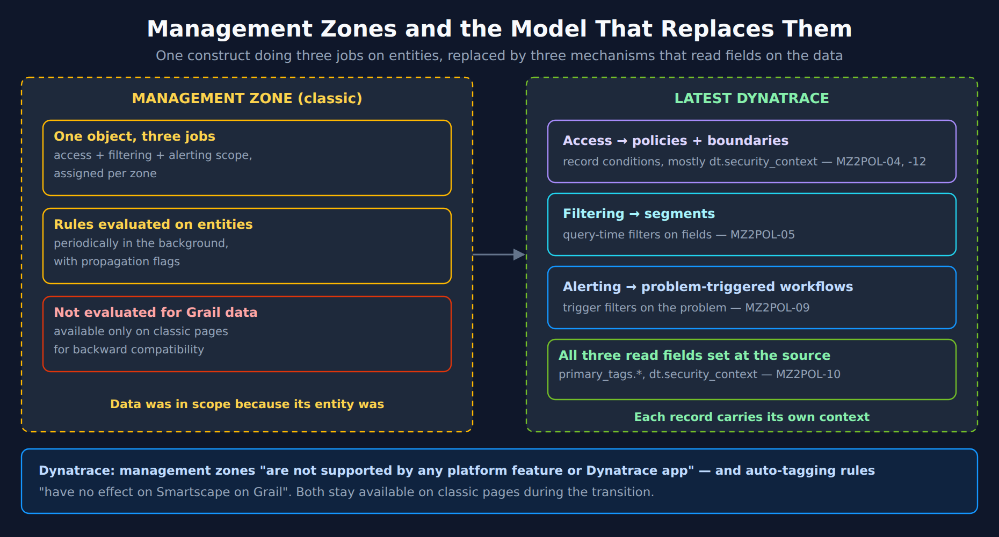
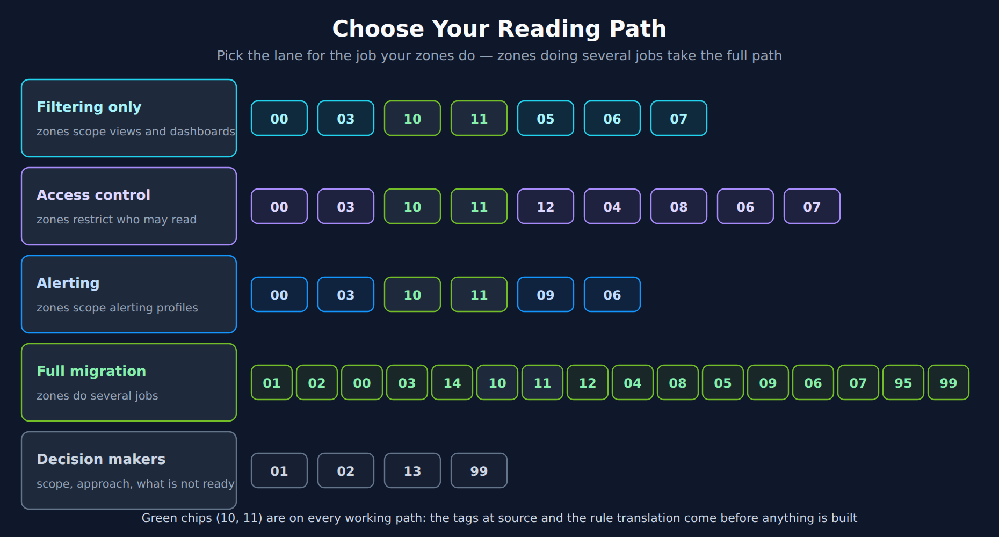

# MZ2POL-01: Introduction - Why Migrate from Management Zones

> **Series:** MZ2POL — Management Zone Migration: Segments, Policies, Workflows | **Notebook:** 2 of 17 | **Created:** December 2025 | **Last Updated:** 10/13/2026

## Overview

This notebook introduces the migration from **Management Zones (MZs)** in classic Dynatrace to the modern **Policies, Boundaries, and Segments** framework. Understanding why this migration is necessary and what benefits it brings is essential for planning a successful transition.

> **Note:** This series is for organizations **migrating from existing Management Zones**. If you're setting up IAM governance from scratch (greenfield), see the **IAM** series for comprehensive IAM administration guidance.


---

## Table of Contents

1. [The Evolution of Access Control in Dynatrace](#the-evolution-of-access-control-in-dynatrace)
2. [The New Access Control Model](#the-new-access-control-model)
3. [Understanding Your Current Management Zone Usage](#understanding-your-current-management-zone-usage)
4. [Benefits of Migration](#benefits-of-migration)
5. [Migration Timeline Considerations](#migration-timeline-considerations)
6. [Choose Your Reading Path](#choose-your-reading-path)
7. [Additional Resources](#additional-resources)

---

## Prerequisites

| Requirement | Details |
|-------------|---------|
| **Dynatrace Environment** | SaaS on Latest Dynatrace, with management zones in use |
| **Background** | None — this notebook is the starting point; MZ2POL-00 inventories your zones |

## Target Audience
- Dynatrace administrators managing access control
- Platform engineers responsible for multi-tenant configurations
- Security teams overseeing data access policies
- Teams currently using Management Zones for data filtering

## Learning Objectives

By the end of this notebook, you will:
1. Understand why Management Zones do not carry into Latest Dynatrace
2. Know the key differences between MZs and the new model
3. Recognize the benefits of Policies, Boundaries, and Segments
4. Distinguish the three jobs a Management Zone conflates — access control, filtering, and alerting — and see how each fans out to a different construct (Policies + Boundaries, Segments, and problem-triggered workflows, respectively)
5. Identify your current MZ usage patterns for migration planning

### API 1.337 (April 2026): Zone and Tag Placeholder Properties Deprecated

Dynatrace API 1.337 marked the `managementZone` and `serviceTag` properties as deprecated on the Configuration API v2 `/calculatedMetrics/service` and `/service/requestNaming` endpoints — plus `managementZones` on request naming — and changed their `placeholders` property. Each entry reads *"Deprecated changed to true"*. The notes deprecate these properties, not calculated service metrics or request naming as such, and do not change how existing objects behave.

What this means for the migration program:

- **Audit angle:** in the MZ2POL-03 assessment, list custom calculated service metrics and request-naming rules that set `managementZone` or `serviceTag`, and plan to rewrite them.
- **New automation:** in community practice, new configuration avoids deprecated properties — author new calculated metrics and naming rules without the zone property.
- **A related OneAgent change:** OneAgent 1.337 made `DT_TAGS` primary fields reach Lambda data — *"Primary fields set via DT_TAGS are now added to logs and spans in AWS Lambda deployments of OneAgent."* The general tagging-at-source model is in MZ2POL-10.

> <sub>**Sources:** [Dynatrace API 1.337 (DT docs)](https://docs.dynatrace.com/docs/whats-new/dynatrace-api/sprint-337) — `managementZone`: *"Deprecated changed to true"*, [OneAgent 1.337 (DT docs)](https://docs.dynatrace.com/docs/whats-new/oneagent/sprint-337).</sub>

---

---

<a id="the-evolution-of-access-control-in-dynatrace"></a>
## 1. The Evolution of Access Control in Dynatrace
### What Are Management Zones?

Management Zones have been the primary mechanism for:
- **Data filtering**: Limiting what data users see in the UI
- **Access control**: Restricting user access to specific entities
- **Multi-tenancy**: Separating data for different teams, regions, or business units

### Why the Change?

Management Zones were designed for **classic Dynatrace** and have fundamental limitations:

| Limitation | Impact |
|------------|--------|
| Rule-based assignment to entities | Rules referencing other zones *"can greatly delay management-zone assignment"*; all rules share a limit of *"100,000 conditions"* per environment |
| Not compatible with Grail | Cannot filter Grail-stored data |
| Tight coupling | Access, filtering and alerting scope in a single construct |

> <sub>**Sources:** [Management-zone rules (DT docs)](https://docs.dynatrace.com/docs/manage/identity-access-management-classic/permission-management/management-zones/management-zone-rules) — *"100,000 conditions for all management-zone rules taken together."*</sub>

### The New Platform Architecture

The latest Dynatrace platform uses **Grail** as its data lakehouse. Grail:
- Does **NOT** support Management Zones
- Uses **storage:** fields for record-level access control
- Requires **IAM policies** for data access
- Leverages **Segments** for query-time filtering

---

<a id="the-new-access-control-model"></a>
## 2. The New Access Control Model
The modern Dynatrace access control framework is based on **ABAC (Attribute-Based Access Control)** and consists of three key components:



<!-- MARKDOWN_TABLE_ALTERNATIVE
| Aspect | Management Zones (classic) | Latest Dynatrace |
|---|---|---|
| Jobs | Access + filtering + alerting scope in one object | Three mechanisms: policies + boundaries (access), segments (filtering), problem-triggered workflows (alerting) |
| Evaluation | Rules on entities, periodically in the background, with propagation flags | Fields on each record, set at the source |
| Grail data | Not evaluated — available only on classic pages | Native |
| Prerequisite | Entity rules | primary_tags.* and dt.security_context on the data (MZ2POL-10) |
For environments where SVG doesn't render
-->

### Policies

**What they do**: Define WHAT actions users can perform

- Encapsulate permissions against protected platform resources and data
- Leverage user, resource, data, and contextual attributes
- Can be default (read-only) or custom

### Boundaries

**What they do**: Define WHERE policies apply (scope restrictions)

- Bundle restrictions on record and/or resource level
- Enable re-usability across multiple policy assignments
- Decouple "what" from "where" for easier management
- Used together with policies when assigning to groups

### Segments

**What they do**: Provide dynamic data filtering at query time

- Reusable, pre-defined filter conditions using DQL
- Support variables for dynamic filtering
- Layerable - several segments can be applied together
- Replace MZ filtering for cross-app data segmentation

### Comparison: Management Zones vs. New Model

| Aspect | Management Zones | Policies + Boundaries + Segments |
|--------|------------------|----------------------------------|
| Scope | Classic apps only | All apps including Grail-based |
| Evaluation | Rules assign entities (and match logs and metrics by dimension) | Query-time conditions on each record |
| Combining dimensions | Within one zone's rules | Layer several segments |
| Reusability | Limited | High (components are decoupled) |
| Data filtering | Built into MZ | Segments (separate concern) |
| Access control | Built into MZ | Policies + Boundaries (separate) |

---

<a id="understanding-your-current-management-zone-usage"></a>
## 3. Understanding Your Current Management Zone Usage
Before migrating, audit your current MZ implementation.

> ⚠️ **Important:** Management Zone configurations **cannot be queried via DQL**.
>
> **Options for viewing MZ configurations:**
> 1. **Dynatrace UI (Recommended):** Settings → Management Zones
> 2. **SDK Analysis:** See **MZ2POL-00: SDK Management Zone Analysis Tool** for comprehensive analysis including rule patterns, coverage metrics, and migration readiness.

### Check Entity Distribution by Management Zone

You can query entity distribution across MZs using DQL:

```python
// Count entities per Management Zone
// Helps understand data distribution for Segment planning
fetch dt.entity.service
| expand mz = managementZones
| summarize serviceCount = count(), by:{managementZone = mz}
| sort serviceCount desc
| limit 20

// Note: dt.entity.* is deprecated, but this is a migration-ASSESSMENT query — it inspects
// the classic constructs this migration replaces, so keep the classic query above:
//   - management zones have NO Smartscape node equivalent; they are what this migration
//     replaces with segments and policies.
```

---

<a id="benefits-of-migration"></a>
## 4. Benefits of Migration
### Scalability

- **Query-time filtering** on the fields of each record
- Dynatrace describes segments as providing *"real-time filtering on huge data sets without the need to define thousands of individual rules."*

### Flexibility

- **Layered segments** - apply several filters together
- **Dynamic variables** - adapt to user context
- **DQL-powered** - full query language for conditions

### Separation of Concerns

- **Policies**: What can be done (permissions)
- **Boundaries**: Where it can be done (scope)
- **Segments**: What data to show (filtering)

### Future-Proof

- In Latest Dynatrace, management zones *"have been replaced by three new concepts"* — data partitioning, data access and data segmentation. No retirement date is published; zones keep working on classic pages
- In community practice, the Latest Dynatrace apps are where new capability lands, and they filter with segments
- Alerting profiles give way to **problem-triggered workflows** — not to Segments (see §5)

> <sub>**Sources:** [Upgrade guide: management zones to segments (DT docs)](https://docs.dynatrace.com/docs/platform/upgrade/foundations/upgrade-guide-segments) — *"Segments do not replace this aspect of management zones."* (access control, which policies take over).</sub>

> **Segments do not scope alerting.** A common misreading of this migration is that alerting profiles will eventually accept a segment the way a dashboard does. They will not. Alerting profiles are scoped by Management Zone plus severity-rule tag matching; their Gen3 successor is a problem-triggered workflow whose trigger filters on affected-entity tags and an optional DQL matcher. Segments touch alerting in exactly one place — scoping an *anomaly detector* — and never scope triggers, notifications, or problem visibility. §5 gives the full mapping.

---

<a id="migration-timeline-considerations"></a>
## 5. Migration Timeline Considerations
### Current State

- Management Zones **still work** on classic pages
- They are not evaluated for Grail data, so Latest Dynatrace apps filter with segments instead — in community practice, that is where teams first notice the gap
- Hybrid approach possible during transition

### What to Migrate

Management Zones do several unrelated jobs at once, and those jobs migrate to **different** places. Read this table as a fan-out, not a rename — there is no single construct that "replaces" a Management Zone.

| Current MZ Use Case | New Solution |
|---------------------|-------------|
| User access restriction | Policies + Boundaries |
| Data filtering in UI | Segments |
| Alerting profile scoping | **Problem-triggered workflows** — trigger filters on affected-entity tags + optional DQL matcher |
| Problem *visibility* (who may see which problems) | IAM record-level policy on `dt.security_context` |
| Anomaly detector scoping | Segments (the one place segments touch alerting) |
| Dashboard filtering | Segments |
| API access control | Policies + Boundaries |

### The three axes, kept separate

The single most common planning error is collapsing these into one:

| Axis | Question it answers | Mechanism |
|------|--------------------|-----------|
| **Routing** | Who gets paged? | Workflow trigger: affected-entity tags + DQL matcher |
| **Visibility** | Who may see the problem at all? | IAM policy on `dt.security_context` |
| **Filtering** | What does a user see in the UI? | Segments |

Segments are not an access-control mechanism and are not a routing mechanism. Anyone holding `storage:filter-segments:read` can apply any segment.

> ⚠️ **The Management Zone filter does not carry over into the alerting model.** Dynatrace's upgrade guide moves filtering into the workflow trigger: *"A workflow's Problem trigger filters problems directly with DQL matchers on the problem."* Its own best practice is that *"Tagging entities with meaningful metadata and filtering on primary_tags.* is more maintainable than chaining entity conditions"*. This means the routing dimension must be carried by something the workflow trigger can actually match on — entity **tags**, or `dt.security_context`. If your MZ rules are computed from name patterns or entity selectors rather than tags, that enrichment work is a **prerequisite**, not a follow-up. See MZ2POL-09 §4 for converting zone rules into routing dimensions, and MZ2POL-11 for the rule-by-rule translation.

> **Duration-based suppression has a successor.** An alerting profile can delay notification until a problem has been open longer than *N* minutes (`delayInMinutes`). The problem trigger's **Minimum duration** option postpones *"the trigger until the problem has been open for at least the configured duration"* — 5, 10, 15, 30, 60, 120, 240, 1440, or 10080 minutes, evaluated on `dt.duration_marker`. Since its 09/07/2026 rewrite the alert-notification upgrade guide agrees: *"The delay, update, and severity capabilities described in this guide exist only on the workflow trigger."* Inventory `delayInMinutes` across every profile and map each value onto a Minimum duration setting. See MZ2POL-09 §6.1.

### Migration Phases

1. **Assessment**: Audit current MZ usage (this notebook)
2. **Planning**: Map MZs to Policies/Boundaries/Segments
3. **Implementation**: Create new access control constructs
4. **Validation**: Test access and filtering
5. **Cutover**: Transition users to new model
6. **Cleanup**: Remove deprecated MZ configurations

> <sub>**Sources:** [Event trigger (DT docs)](https://docs.dynatrace.com/docs/analyze-explore-automate/workflows/build/trigger/event-trigger) — the **Minimum duration** option and the `dt.duration_marker` field quoted above.</sub>

<a id="choose-your-reading-path"></a>
## 6. Choose Your Reading Path

The series is long because a management zone does up to three jobs, and each job migrates to a different construct. You do not need every notebook. Classify your zones first (MZ2POL-03; the test is in MZ2POL-05 §1), then take the lane for the job they do.



<!-- MARKDOWN_TABLE_ALTERNATIVE
| Path | Use it when | Read in this order |
|---|---|---|
| **Filtering only** | Your zones only scope views and dashboards | 00 → 03 → 15 → 10 → 11 → 05 → 06 → 07 |
| **Access control** | Your zones restrict who may read what | 00 → 03 → 15 → 10 → 11 → 12 → 04 → 08 → 06 → 07 |
| **Alerting** | Your zones scope alerting profiles | 00 → 03 → 15 → 10 → 11 → 09 → 16 → 06 |
| **Full migration** | Your zones do several of these jobs | 01 → 02 → 00 → 03 → 15 → 14 → 10 → 11 → 12 → 04 → 08 → 05 → 09 → 16 → 06 → 07 → 95 → 99 |
| **Decision makers** | You need scope, approach and what is not ready yet | 01 → 02 → 13 → 99 |
Notebooks 10 (tagging at source) and 11 (rule translation) are on every working path.
For environments where SVG doesn't render
-->

| Path | Use it when | Read in this order |
|---|---|---|
| **Filtering only** | Your zones only scope views and dashboards | 00 → 03 → 15 → 10 → 11 → 05 → 06 → 07 |
| **Access control** | Your zones restrict who may read what | 00 → 03 → 15 → 10 → 11 → 12 → 04 → 08 → 06 → 07 |
| **Alerting** | Your zones scope alerting profiles | 00 → 03 → 15 → 10 → 11 → 09 → 16 → 06 |
| **Full migration** | Your zones do several of these jobs | 01 → 02 → 00 → 03 → 15 → 14 → 10 → 11 → 12 → 04 → 08 → 05 → 09 → 16 → 06 → 07 → 95 → 99 |
| **Decision makers** | You need scope, approach and what is not ready yet | 01 → 02 → 13 → 99 |

Two notebooks are on every working path: **MZ2POL-10** (tagging at source) and **MZ2POL-11** (rule translation). Every replacement — segment, boundary or workflow — reads a field on the data, so those two come before anything is built.

---

## Summary

In this notebook, you learned:

1. **Why migrate**: Management Zones are not evaluated for Grail data and remain only on classic pages
2. **The new model**: Policies (what) + Boundaries (where) + Segments (filter)
3. **Key benefits**: Scalability, flexibility, separation of concerns
4. **The fan-out**: one MZ's jobs migrate to *different* constructs — access to policies/boundaries, UI filtering to segments, alert routing to workflow triggers, problem visibility to `dt.security_context`
5. **Assessment queries**: How to audit your current MZ usage

## Next Steps

Pick your lane in §6. On the full path, continue to **MZ2POL-02: Understanding the New Access Control Model** to dive deeper into:
- Policy structure and syntax
- Boundary configuration
- Segment creation and management

For the alerting side of the migration specifically, see **WFLOW-02** (problem-trigger configuration) and **WFLOW-04** (tag- and ownership-based routing).

<a id="additional-resources"></a>
## Additional Resources
- [Access Management Concepts](https://docs.dynatrace.com/docs/manage/identity-access-management/permission-management/access-concepts)
- [Policy Boundaries](https://docs.dynatrace.com/docs/manage/identity-access-management/permission-management/manage-user-permissions-policies/iam-policy-boundaries)
- [Upgrade from RBAC to ABAC](https://docs.dynatrace.com/docs/manage/identity-access-management/permission-management/manage-user-permissions-policies/advanced/migrate-roles)
- [Segments Documentation](https://docs.dynatrace.com/docs/manage/segments/concepts/segments-concepts-queries)
- [Upgrade guide — alerting and notifications (DT docs)](https://docs.dynatrace.com/docs/platform/upgrade/keep-problems-and-alerting-working/upgrade-guide-alert-notification) — the authoritative old→new mapping, including where filtering goes in a workflow and the connector equivalence table
- [Alerting profiles (DT docs)](https://docs.dynatrace.com/docs/analyze-explore-automate/alerting-and-notifications-classic/alerting-profiles) — Dynatrace Classic surface; carries the "we recommend using simple workflows" steer
- [Use segments in anomaly detection (DT docs)](https://docs.dynatrace.com/docs/dynatrace-intelligence/use-cases/use-segments-anomaly-detection) — the one documented intersection of segments and alerting

---

<sub>*This notebook was AI-generated from community-submitted and publicly available sources. This notebook series is not officially supported by Dynatrace. Always verify information against official Dynatrace documentation.*</sub>
