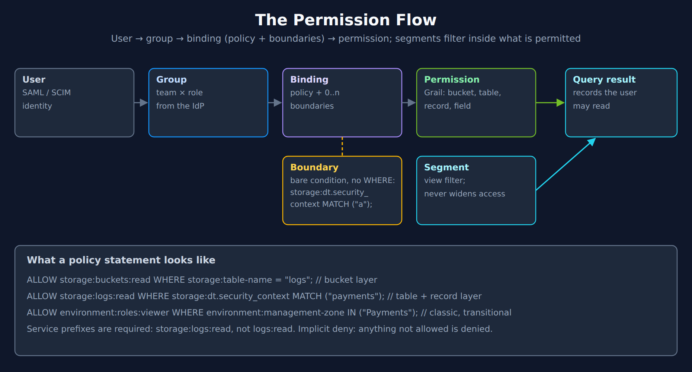
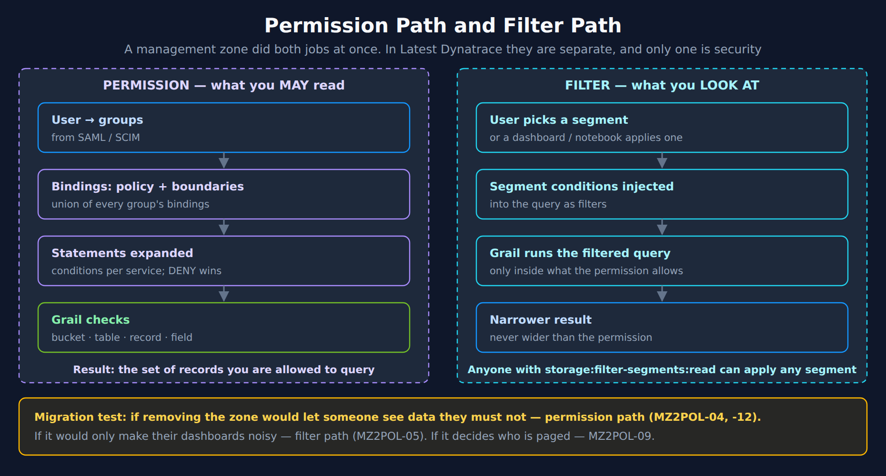

# MZ2POL-02: Understanding the New Access Control Model

> **Series:** MZ2POL — Management Zone Migration: Segments, Policies, Workflows | **Notebook:** 3 of 17 | **Created:** December 2025 | **Last Updated:** 10/25/2026

## Overview

This notebook provides a deep dive into the **ABAC (Attribute-Based Access Control)** framework that replaces Management Zones for access control. You'll learn how Policies, Boundaries, and Segments work together to provide flexible, scalable access management.

---

## Table of Contents

1. [ABAC Framework Architecture](#abac-framework-architecture)
2. [Policies Deep Dive](#policies-deep-dive)
3. [Boundaries Deep Dive](#boundaries-deep-dive)
4. [Buckets: Data Partitioning, Not the Access Mechanism](#buckets-data-partitioning)
5. [Segments Deep Dive](#segments-deep-dive)
6. [Querying Current Access Configuration](#querying-current-access-configuration)
7. [Mapping MZ Concepts to New Model](#mapping-mz-concepts-to-new-model)
8. [Access Control Decision Flow](#access-control-decision-flow)
9. [Best Practices for the New Model](#best-practices-for-the-new-model)
10. [Additional Resources](#additional-resources)


---

## Prerequisites

- Completed MZ2POL-01: Introduction
- Access to Dynatrace Account Management
- Understanding of current Management Zone configuration

## Learning Objectives

By the end of this notebook, you will:
1. Understand the ABAC framework architecture
2. Know the relationship between Policies, Boundaries, and Segments
3. Understand how permissions flow through the system
4. Be able to map MZ concepts to the new model

---

<a id="abac-framework-architecture"></a>
## 1. ABAC Framework Architecture
### The Permission Flow



<!--MARKDOWN_TABLE_ALTERNATIVE
| Component | Purpose | Configured In |
|-----------|---------|---------------|
| Users | Individual identities | Account Management |
| Groups | Collections of users | Identity & Access Management |
| Policies | Permission definitions | Policy Management |
| Boundaries | Scope restrictions | Policy Boundaries |
| Segments | Data filtering | Segments app |
| Example boundary condition | storage:dt.security_context MATCH ("a"); — a bare condition, no WHERE | — |
| Example statement | ALLOW storage:logs:read WHERE storage:dt.security_context MATCH ("payments"); — service prefixes are required | — |
-->

### Key Components

| Component | Purpose | Configured In |
|-----------|---------|---------------|
| **Users** | Individual identities | Account Management |
| **Groups** | Collections of users | Identity & Access Management |
| **Policies** | Permission definitions | Policy Management |
| **Boundaries** | Scope restrictions | Policy Boundaries |
| **Segments** | Data filtering | Segments app |

### How It Works Together

1. **Users** are assigned to **Groups**
2. **Groups** are bound to **Policies**
3. **Boundaries** can optionally restrict the **Policy** scope
4. **Segments** filter what data users see (independent of permissions)

---

<a id="policies-deep-dive"></a>
## 2. Policies Deep Dive
### What Are Policies?

Policies are the core of ABAC - they define **WHAT** users can do.

### Policy Types

| Type | Description | Editable |
|------|-------------|----------|
| **Default Policies** | Pre-defined by Dynatrace | No (read-only) |
| **Custom Policies** | Created by administrators | Yes |

### Default Policies Categories

> The current built-in IAM policy names are below. The classic Gen2 roles "Dynatrace Viewer / Professional User" and "Data Viewer / Editor" are no longer the IAM policy names.

**Platform access policies** (feature-level):
- `Standard User` - Access the environment and run Dynatrace Apps
- `Pro User` - Build, deploy, and run apps + automated workflows
- `Admin User` - Administrative access across all Platform Services

**Data access policies** (monitored data):
- `All Grail data read access` - Unrestricted Grail read
- `Read Logs` / `Read Spans` / `Read Metrics` / `Read Events` / `Read Entities` / `Read BizEvents` / `Read System Events` - Granular per-table read

> **`Settings Reader` / `Settings Writer` are legacy.** The default-policies reference lists them, with *Storage Default Monitoring Read* and *Storage All System Data Read*, under **Legacy default policies**: *"They are not accessible for new policy assignments, but existing assignments of these policies remain until removed."* For settings access, write a custom policy with `settings:objects:read` or `settings:objects:write` (plus `settings:schemas:read`), scoped by `settings:schemaId`, `settings:schemaGroup` or `settings:dt.security_context`.
>
> <sub>**Sources:** [Dynatrace default policies reference (DT docs)](https://docs.dynatrace.com/docs/manage/identity-access-management/permission-management/default-policies), [IAM policy reference (DT docs)](https://docs.dynatrace.com/docs/manage/identity-access-management/permission-management/manage-user-permissions-policies/advanced/iam-policystatements) — `settings:objects:write`: *"Enables writing of settings objects belonging to the schema"*.</sub>

### Policy Statement Structure

```
ALLOW <service>:<resource>:<action> [WHERE <condition>]
```

**Examples:**
```
ALLOW storage:buckets:read
ALLOW settings:objects:read WHERE settings:schemaId = "builtin:alerting.profile"
ALLOW storage:logs:read WHERE storage:dt.security_context = "team-a"
```

---

<a id="boundaries-deep-dive"></a>
## 3. Boundaries Deep Dive
### What Are Boundaries?

Boundaries restrict **WHERE** policies apply - they limit the scope of permissions.

### Key Characteristics

- **Optional** but powerful for fine-grained access control
- Work **together** with policies (not standalone)
- **Further restrict** existing policy permissions
- Enable **reusability** across multiple policy assignments

### Boundary Query Syntax

A boundary query is a **bare condition expression** — no `WHERE` keyword (that belongs to policy statements), one condition per line:

```
<field> <operator> "<value>"
```

**Supported Operators** — they vary by attribute (*"Not every operator applies to every service attribute."*):
- Grail record fields (`storage:dt.security_context`, `storage:dt.host_group.id`, `storage:k8s.namespace.name` …): `=`, `IN`, `startsWith`, `MATCH` — **no negation**
- `storage:bucket-name`: all of the above plus `!=`, `NOT IN`, `NOT startsWith`
- `environment:management-zone`: `=`, `!=`, `IN`, `startsWith`, `NOT startsWith`, `MATCH`

> <sub>**Sources:** [IAM policy statement syntax and examples (DT docs)](https://docs.dynatrace.com/docs/manage/identity-access-management/permission-management/manage-user-permissions-policies/iam-policystatement-syntax), [IAM policy reference (DT docs)](https://docs.dynatrace.com/docs/manage/identity-access-management/permission-management/manage-user-permissions-policies/advanced/iam-policystatements) — per-attribute operator lists.</sub>

**Common Fields:**
- `environment` - Environment restrictions
- `environment:management-zone` - MZ-based restrictions (Classic)
- `storage:dt.security_context` - Security context filtering
- `storage:bucket-name` - Bucket-based restrictions

> **Note:** `MATCH` provides wildcard pattern matching on Grail record fields (and on `environment:management-zone`) — `storage:dt.security_context MATCH("team-*")` — and supports `*` at any position (unlike `startsWith`). It is also the operator to use whenever a record field can hold an **array**: *"Using =, STARTSWITH or IN when the field holds an array will always return false."* Events carry `dt.security_context` as an array (MZ2POL-00 §5), so write `MATCH` for it in every policy and boundary ([Permissions in Grail (DT docs)](https://docs.dynatrace.com/docs/platform/grail/organize-data/assign-permissions-in-grail)). For boundary design using structured multi-dimensional context values (`comp/bu/app` for transversal team access), see **MZ2POL-04: Policies and Boundaries** and **IAM-05: Boundary Design**.

### Boundary Examples

**Restrict to specific Management Zone (transitional):**
```
environment:management-zone = "Production-NA"
```

**Restrict by Management Zone prefix:**
```
environment:management-zone startsWith "mgmt_na"
```

**Restrict by Security Context:**
```
storage:dt.security_context = "team-frontend"
```

**Restrict by Bucket (compliance case only — §4):**
```
storage:bucket-name IN ("pci_logs", "pci_spans")
```

### Boundary Limitations

| Limitation | Workaround |
|------------|------------|
| Max 10 conditions per boundary | Create multiple boundaries |
| No logical operators — one line per condition | Repeated lines on the **same** condition multiply the statement (OR); lines on different conditions each scope their own permissions. Several boundaries on one binding are evaluated separately (MZ2POL-12 §4) |
| Bare conditions (no `WHERE`) | `WHERE` belongs to policy statements, not boundaries |

---

<a id="buckets-data-partitioning"></a>
## 4. Buckets: Data Partitioning, Not the Access Mechanism
### What Are Buckets?

**Buckets** are Grail storage containers that partition your data. A management zone that restricted access does **not** translate into a bucket by default: Dynatrace states that buckets are *"not intended as the primary mechanism for securing or segmenting data access."* Access is a record-level boundary on `dt.security_context` (**MZ2POL-12: IAM Reference Architecture**; **ORGNZ-06: Security Context**).

### What Buckets Are For

| Use | Description |
|-----|-------------|
| **Retention control** | Different retention periods need different buckets |
| **Cost allocation** | Storage and query consumption attributable per bucket |
| **Query optimization** | A query scoped to a smaller bucket scans less data |
| **Specific compliance cases** | A hard exclusion — for example a `DENY` on one bucket — that record-level conditions cannot express |

The partition-data page says buckets are *"best used for organizing data by retention time, cost allocation, or query optimization"*, and recommends starting from IAM policies, with buckets *"to play a supporting role for very high-level separation."* The one access job only a bucket can do is a `DENY`: *"Such access control is only possible with buckets."* **ORGNZ-05: Bucket-Level Access Control** covers when that scenario fits.

> <sub>**Sources:** [Partition data (DT docs)](https://docs.dynatrace.com/docs/platform/grail/organize-data/partition-data) — *"not intended as the primary mechanism for securing or segmenting data access."*</sub>

### Buckets vs Boundaries vs Segments

| Aspect | Buckets | Boundaries | Segments |
|--------|---------|------------|----------|
| **Isolation** | Physical separation | Query-time filtering | Query-time filtering |
| **Reversible** | ❌ No (data can't move) | ✅ Yes | ✅ Yes |
| **Performance** | Best (smaller data sets) | Good | Good |
| **Flexibility** | Low (plan carefully) | High | High |
| **Use case** | Retention, cost, query scope; specific compliance exclusions | Permission scoping (team access) | Data filtering |

### Bucket Limitations

> **⚠️ Critical:** Plan buckets carefully - these constraints cannot be changed later.

| Limitation | Details |
|------------|---------|
| **One data type per bucket** | Logs, metrics, events, OR spans - not mixed |
| **Names are immutable** | Bucket names CANNOT be changed after creation |
| **No data migration** | Data CANNOT be moved between buckets |
| **Naming rules** | 3-100 chars, lowercase alphanumeric, underscores, hyphens only |
| **Maximum buckets** | 250 custom buckets per environment by default from SaaS 1.346 (staged tenant rollout from 08/25/2026); 80 before it |
| **Target ingest (logs)** | 1–3 TB/day per log bucket — *"Design your bucket strategy so that each bucket receives between 1 TB and 3 TB of log data per day."* |
| **Split point (other tables)** | Above 2 TB/day — *"We recommend splitting up buckets that receive more than 2 TB of daily ingest."* |
| **Maximum ingest** | No hard per-bucket cap is documented — Dynatrace describes ingesting *"well over 15 TB per day into a single bucket"* when queries stay within narrow timeframes. A larger bucket costs queryable window per scan, and Dynatrace pages give different split points ([Partition data (DT docs)](https://docs.dynatrace.com/docs/platform/grail/organize-data/partition-data), [Logs bucket strategy (DT docs)](https://docs.dynatrace.com/docs/platform/upgrade/best-practices/stage-05-partition-data/logs-bucket-strategy)) |

> <sub>**Sources:** [How to organize your data stored in Grail (DT docs)](https://docs.dynatrace.com/docs/platform/grail/organize-data) — *"The default limit per environment is 250 custom buckets."*; [Logs bucket strategy best practices (DT docs)](https://docs.dynatrace.com/docs/platform/upgrade/best-practices/stage-05-partition-data/logs-bucket-strategy) — *"Design your bucket strategy so that each bucket receives between 1 TB and 3 TB of log data per day."*; [Partition data (DT docs)](https://docs.dynatrace.com/docs/platform/grail/organize-data/partition-data) — *"We recommend splitting up buckets that receive more than 2 TB of daily ingest."* The upgrade guide's logs-bucket and data-partitioning pages still state an 80-bucket default (read 10/25/2026).</sub>

### Default Query Setting That Affects Bucket Sizing

| Setting | Default | Impact |
|---------|---------|--------|
| **`scanLimitGBytes`** on `fetch` | 500 GB of uncompressed data (`-1` reads everything in the timeframe) | A larger bucket covers a shorter time window per default scan |

> <sub>**Sources:** [Data source commands (DT docs)](https://docs.dynatrace.com/docs/platform/grail/dynatrace-query-language/commands/data-source-commands) — *"The default value is 500GB unless specified otherwise."*</sub>

### Using Buckets in Policies

Only where one of the scenarios above applies — for example, a compliance bucket that only one group may read. A bucket permission is needed on top of the table permission: `storage:buckets:read` is *"Required additionally to a table permission."*

```
// Policy: a compliance case — access to dedicated buckets
ALLOW storage:buckets:read WHERE storage:bucket-name IN ("pci_logs", "pci_spans");
ALLOW storage:logs:read WHERE storage:bucket-name = "pci_logs";
ALLOW storage:spans:read WHERE storage:bucket-name = "pci_spans";
```

### Team Access Uses a Boundary, Not a Bucket

The team boundary scopes records by security context, not by bucket. A boundary is **bare condition lines, each ending in `;`** — no `ALLOW`, no `WHERE`. **One boundary can cover every domain the bound policies grant** — Grail lines and, while classic pages are used, the zone line (MZ2POL-04 §6, MZ2POL-12 §6):

```
// Boundary "team-frontend", bound with Standard User + Read Logs / Read Spans / Read Metrics / Read Events
storage:dt.security_context MATCH ("frontend", "shared");
environment:management-zone IN ("Frontend-Team");
```

The second line is transitional: it scopes the classic `environment:roles:viewer` permission inside Standard User while classic pages are still in use. Add a `storage:bucket-name` line only in a compliance case from the table above.

> **`MATCH` is not Gen3-only** — the IAM policy reference lists it for `environment:management-zone` too. `storage:entities:read` is a Grail permission that accepts only `storage:dt.security_context` and `storage:entity.type`; `MATCH("*")` on any attribute matches everything.
>
> <sub>**Sources:** [IAM policy reference (DT docs)](https://docs.dynatrace.com/docs/manage/identity-access-management/permission-management/manage-user-permissions-policies/advanced/iam-policystatements) — `environment:roles:viewer`: *"Grants user the Access environment permission."*; `storage:buckets:read`: *"Required additionally to a table permission."*</sub>

### When to Use Buckets vs Other Options

| Scenario | Recommended Approach |
|----------|---------------------|
| Team data access (the usual access-control zone) | **Boundary** on `dt.security_context` (MZ2POL-12) |
| Different retention periods or cost attribution | **Buckets** |
| Compliance case that needs a hard exclusion (`DENY` on a bucket) | **Bucket** + bucket condition, on top of the security-context boundary (ORGNZ-05) |
| Ad-hoc data filtering | **Segments** |

### MZ to Bucket Mapping

| MZ Pattern | Bucket Strategy |
|------------|-----------------|
| Team MZs | No bucket by default — a security-context value per team |
| Environment MZs | A bucket only if the environments need different retention |
| Regional MZs | Usually none — a segment, or a security-context value if access differs |
| Compliance MZs | A compliance bucket where retention or a hard exclusion requires it |

> **For comprehensive bucket guidance**, see **ORGNZ-03: Bucket Strategy and Design**; for record-level access, **ORGNZ-06: Security Context** and **MZ2POL-12**.

---

<a id="segments-deep-dive"></a>
## 5. Segments Deep Dive
### What Are Segments?

Segments are **DQL-based filter conditions** that control what data users see - they're the replacement for MZ data filtering.

### Key Characteristics

- **Query-time evaluation** — conditions are injected into the query
- **Layerable** - several segments can be applied together
- **DQL-powered** - full query language flexibility
- Support **variables** for dynamic filtering
- **Independent of permissions** - filtering only

### How Segments Work in DQL

When a segment is applied, Grail:
1. Evaluates segment conditions relevant to the query
2. Applies filters based on the targeted data object
3. Multiple conditions for same data object = OR combined

### Segment vs. Management Zone Filtering

| Aspect | Management Zone | Segment |
|--------|-----------------|----------|
| Evaluation | Rules assign entities to the zone; dimension rules match logs and metrics | Conditions injected into each query |
| Grail data | Not evaluated | Native |
| Flexibility | Rule conditions | DQL filter conditions |
| Variables | No | Yes |
| Combining dimensions | Within one zone's rules | Layer several segments |

---

<a id="querying-current-access-configuration"></a>
## 6. Querying Current Access Configuration
### View Services with Security Context

Security Context is key for access control in the new model:

```dql
// List services and their security context
// Security context is used for fine-grained access control
fetch dt.entity.service
| fields entity.name, 
         dt.security_context,
         managementZones
| filter isNotNull(dt.security_context)
| sort entity.name asc
| limit 50

// Note: dt.entity.* is deprecated, but this is a migration-ASSESSMENT query — it inspects
// the classic constructs this migration replaces, so keep the classic query above:
//   - management zones have NO Smartscape node equivalent; they are what this migration
//     replaces with segments and policies.
//   - dt.security_context is an ARRAY on Smartscape nodes (empty [] when unset, not null),
//     so isNull / isNotNull(dt.security_context) does not carry over — a Smartscape rewrite
//     would miscount coverage.
```

### Analyze Entity Types and Their Attributes

Understanding entity attributes helps design effective segments:

```dql
// Analyze host entity attributes for segment planning
// Tags and metadata are useful for segment conditions
fetch dt.entity.host
| fields entity.name,
         tags,
         managementZones
| limit 20

// Note: dt.entity.* is deprecated, but this is a migration-ASSESSMENT query — it inspects
// the classic constructs this migration replaces, so keep the classic query above:
//   - management zones have NO Smartscape node equivalent; they are what this migration
//     replaces with segments and policies.
//   - entity tags are not a flat "tags" field on Smartscape (resolve via getNodeField).
```

### Check Kubernetes Cluster Distribution

K8s clusters often map to organizational boundaries:

```dql
// List Kubernetes clusters with their attributes
// Clusters often align with team or environment boundaries
fetch dt.entity.kubernetes_cluster
| fields entity.name,
         tags,
         managementZones
| sort entity.name asc

// Note: dt.entity.* is deprecated, but this is a migration-ASSESSMENT query — it inspects
// the classic constructs this migration replaces, so keep the classic query above:
//   - management zones have NO Smartscape node equivalent; they are what this migration
//     replaces with segments and policies.
//   - entity tags are not a flat "tags" field on Smartscape (resolve via getNodeField).
```

---

<a id="mapping-mz-concepts-to-new-model"></a>
## 7. Mapping MZ Concepts to New Model
### Common MZ Patterns and Their Replacements

| MZ Pattern | New Approach |
|------------|-------------|
| **Team-based MZs** | Security Context + Policies |
| **Environment MZs** (Dev/Prod) | Boundaries on a record field that carries the environment — a `dt.security_context` value such as `prod/payments`, or a built-in field |
| **Region MZs** | Segments with cloud region filters |
| **Application MZs** | Segments with service/app filters |
| **Multi-tenant MZs** | Boundaries + Security Context |

### Example: Team-Based Access Control

**Old (Management Zone):**
- MZ: "Team-Frontend" with rules for frontend services
- Users assigned to MZ get filtered view

**New (Policies + Boundaries + Segments)** — the MZ2POL-12 §6 shape:
1. **Policies**: `Standard User` + `Read Logs` / `Read Spans` / `Read Metrics` / `Read Events`. Standard User alone grants no table read — its Grail lines cover bucket and fieldset definitions and segments, not `storage:logs:read`.
2. **Boundary** `team-frontend`, the only boundary on the binding:
   ```
   storage:dt.security_context MATCH ("frontend", "shared");
   environment:management-zone IN ("Team-Frontend");
   ```
   The zone line is transitional. Standard User also grants the classic `environment:roles:viewer`, and without that line the classic permission would be unscoped.
3. **Segment**: `primary_tags.team = "frontend"` as a convenience filter — it changes the view, not the permission.

> <sub>**Sources:** [Dynatrace default policies reference (DT docs)](https://docs.dynatrace.com/docs/manage/identity-access-management/permission-management/default-policies) — Standard User: *"ALLOW environment:roles:viewer, environment:roles:view-security-problems;"*</sub>

### Example: Environment Separation

**Old (Management Zone):**
- MZ: "Production" with host/service rules
- MZ: "Development" with different rules

**New (Policies + Boundaries + Segments):**
1. **Policy**: Same policy for both groups
2. **Boundary (Prod)**: Environment-specific restrictions
3. **Boundary (Dev)**: Environment-specific restrictions
4. **Segments**: Environment-based data filters

---

<a id="access-control-decision-flow"></a>
## 8. Access Control Decision Flow
### Permission and Filter Are Separate Paths



<!-- MARKDOWN_TABLE_ALTERNATIVE
| Permission path — what you MAY read | Filter path — what you LOOK AT |
|---|---|
| User → groups (SAML / SCIM) | User picks a segment, or a dashboard / notebook applies one |
| Bindings: policy + boundaries — the union of every group's bindings | Segment conditions injected into the query as filters |
| Statements expanded — conditions per service; DENY wins | Grail runs the filtered query, only inside what the permission allows |
| Grail checks bucket, table, record and field | Narrower result — never wider than the permission |
| Result: the set of records you are allowed to query | Anyone with storage:filter-segments:read can apply any segment |
Migration test: if removing the zone would let someone see data they must not, it is the permission path (MZ2POL-04, MZ2POL-12); if it would only make dashboards noisy, the filter path (MZ2POL-05); if it decides who is paged, MZ2POL-09.
For environments where SVG doesn't render
-->

The permission path follows a handful of documented rules — implicit deny, a union across every binding, boundaries applied separately and only to their own service, `DENY` overriding. They matter more in a migration than any syntax detail, because each one can make a translated zone wider than the original. **MZ2POL-12 §3** walks through them with Dynatrace's wording.

> <sub>**Sources:** [Policy boundaries (DT docs)](https://docs.dynatrace.com/docs/manage/identity-access-management/permission-management/manage-user-permissions-policies/iam-policy-boundaries) — *"Only conditions added to service configuration will be applied to relative permissions."*, [Visibility of segments (DT docs)](https://docs.dynatrace.com/docs/manage/segments/concepts/segments-concepts-visibility).</sub>

### Key Differences from MZ

| MZ Behavior | New Behavior |
|-------------|-------------|
| Single construct for access + filtering | Separate concerns (Policies vs Segments) |
| Zone membership assigned to entities by rules | Conditions evaluated on each record at query time |
| Entity rules, plus dimension rules for logs and metrics | Any field on the record |
| Flat structure | Hierarchical (groups → policies → boundaries) |

---

<a id="best-practices-for-the-new-model"></a>
## 9. Best Practices for the New Model
### Policy Design

1. **Start with default policies** - customize only when needed
2. **Use least privilege** - grant minimum required permissions
3. **Group similar permissions** - avoid policy sprawl
4. **Document policy purpose** - maintain clarity

### Boundary Design

1. **Create reusable boundaries** - one boundary, many uses
2. **Use meaningful names** - indicate scope clearly
3. **Keep conditions simple** - easier to audit
4. **Leverage security context** - for entity-level control

### Segment Design

1. **Align with business structure** - teams, regions, products
2. **Use variables** - for dynamic, flexible filters
3. **Test thoroughly** - verify filtering works as expected
4. **Layer segments** - combine for precise filtering

---

## Summary

In this notebook, you learned:

1. **ABAC Framework**: How Users → Groups → Policies → Permissions flow
2. **Policies**: Define WHAT users can do (permissions)
3. **Boundaries**: Restrict WHERE policies apply (scope)
4. **Segments**: Filter WHAT data users see (DQL-based)
5. **Mapping**: How MZ patterns translate to the new model

## Next Steps

Continue to **MZ2POL-03: Assessment and Migration Planning** to:
- Audit your current MZ configuration in detail
- Create a migration mapping document
- Plan the phased migration approach

<a id="additional-resources"></a>
## Additional Resources
- [Working with Policies](https://docs.dynatrace.com/docs/manage/identity-access-management/permission-management/manage-user-permissions-policies)
- [IAM Policy Reference](https://docs.dynatrace.com/docs/manage/identity-access-management/permission-management/manage-user-permissions-policies/advanced/iam-policystatements)
- [Default Policies Reference](https://docs.dynatrace.com/docs/manage/identity-access-management/permission-management/default-policies)
- [Grant Access to Entities with Security Context](https://docs.dynatrace.com/docs/manage/identity-access-management/use-cases/access-security-context)

---

<sub>*This notebook was AI-generated from community-submitted and publicly available sources. This notebook series is not officially supported by Dynatrace. Always verify information against official Dynatrace documentation.*</sub>
