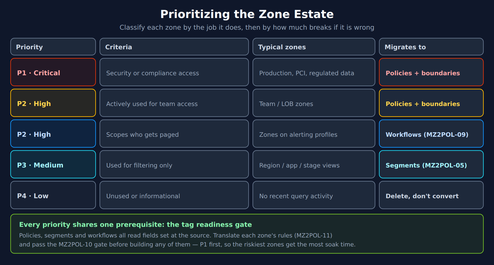

# MZ2POL-03: Assessment and Migration Planning

> **Series:** MZ2POL — Management Zone Migration: Segments, Policies, Workflows | **Notebook:** 4 of 17 | **Created:** December 2025 | **Last Updated:** 10/25/2026

## Overview

This notebook guides you through a comprehensive assessment of your current Management Zone implementation and helps you create a detailed migration plan to the new Policies, Boundaries, and Segments model.

---

## Table of Contents

1. [Management Zone Inventory](#management-zone-inventory)
2. [MZ Pattern Classification](#mz-pattern-classification)
3. [Security Context and Bucket Planning](#security-context-and-bucket-planning)
4. [Migration Priority Matrix](#migration-priority-matrix)
5. [Migration Timeline Template](#migration-timeline-template)
6. [Dependencies Checklist](#dependencies-checklist)
7. [Deliverables Checklist](#deliverables-checklist)
8. [Additional Resources](#additional-resources)


---

## Prerequisites

- Completed MZ2POL-01 and MZ2POL-02
- Admin access to Dynatrace environment
- Access to Account Management
- List of current user groups and their MZ assignments

## Learning Objectives

By the end of this notebook, you will:
1. Have a complete inventory of your Management Zones
2. Understand the mapping from MZs to new constructs
3. Have a prioritized migration plan
4. Know the risks and mitigation strategies

---

<a id="management-zone-inventory"></a>
## 1. Management Zone Inventory
> ⚠️ **Important:** Management Zone configurations **cannot be queried via DQL**.
>
> **Options for MZ inventory:**
> 1. **Dynatrace UI (Recommended):** Settings → Management Zones
> 2. **SDK Analysis:** See **MZ2POL-00: SDK Management Zone Analysis Tool** for comprehensive analysis including rule patterns, coverage metrics, and migration readiness.

### Entity Distribution Across MZs

> ⚠️ **Limitation:** DQL queries against `managementZones` may not accurately reflect the full MZ entity distribution due to how MZ rules propagate. For accurate counts, use the **classic Dynatrace UI** which shows entity counts directly on each Management Zone configuration.

The query below provides an approximation of entity distribution:

```python
// Service distribution by Management Zone
fetch dt.entity.service
| expand mz = managementZones
| summarize serviceCount = count(), by:{managementZone = mz}
| sort serviceCount desc
| limit 25

// Note: dt.entity.* is deprecated, but this is a migration-ASSESSMENT query — it inspects
// the classic constructs this migration replaces, so keep the classic query above:
//   - management zones have NO Smartscape node equivalent; they are what this migration
//     replaces with segments and policies.
```

---

<a id="mz-pattern-classification"></a>
## 2. MZ Pattern Classification
### Categorize Your Management Zones

Group your MZs by their primary purpose:

#### Category 1: Team/Ownership Based
- **Pattern**: MZs named after teams (e.g., "Team-Frontend", "Platform-Team")
- **Migration**: → Security Context + Policies + Boundaries
- **Priority**: High (affects user access)

#### Category 2: Environment Based
- **Pattern**: MZs for environments (e.g., "Production", "Staging", "Development")
- **Migration**: → A record field that carries the environment. Boundaries have no environment attribute of their own: for access, put the stage into the `dt.security_context` value (`prod/payments`) or use a built-in field the stage already maps to (`dt.host_group.id`, `k8s.namespace.name`); for filtering only, a primary tag such as `primary_tags.stage` in a segment
- **Priority**: High (critical for access separation)

#### Category 3: Geographic/Region Based
- **Pattern**: MZs for regions (e.g., "NA-East", "EU-West", "APAC")
- **Migration**: → Segments with cloud region/location filters
- **Priority**: Medium (primarily filtering)

#### Category 4: Application/Service Based
- **Pattern**: MZs for applications (e.g., "Payment-System", "User-Portal")
- **Migration**: → Segments with service/application filters
- **Priority**: Medium (primarily filtering)

#### Category 5: Infrastructure Based
- **Pattern**: MZs for infrastructure (e.g., "Kubernetes", "Legacy-VMs")
- **Migration**: → Segments with infrastructure type filters
- **Priority**: Low (usually informational)

---

<a id="security-context-and-bucket-planning"></a>
## 3. Security Context and Bucket Planning
### Design Your Security Context Strategy

Security context drives record-level access control. It is **one field**, read by every IAM record condition, so design **one value per owner** and write it onto every record that owner produces — not a different dimension per entity type. If services carried `team-*` and hosts `env-*`, a team boundary would miss the host's logs and an environment boundary would miss the service's spans.

| Dimension | Where it is written | Example value |
|-----------|---------------------|---------------|
| Access (team, plus stage where access depends on it) | `dt.security_context` on every record the team produces | `payments`, or `prod/payments` |
| Filtering and routing | `primary_tags.*`, in the same enrichment step from the same source | `primary_tags.team = payments`, `primary_tags.stage = prod` |

Write both together so they cannot drift apart — **MZ2POL-10 §4** (*One Value, Every Job*). Structured values such as `prod/payments` are covered in **MZ2POL-04 §4**.

### Design Your Bucket Strategy

> **⚠️ Critical:** Plan buckets carefully - names are immutable and data cannot be moved between buckets.

A zone that restricted access does **not** become a bucket by default. Buckets are *"not intended as the primary mechanism for securing or segmenting data access"*; team access is a boundary on `dt.security_context` (**MZ2POL-12: IAM Reference Architecture**, **ORGNZ-06: Security Context**). Create buckets for what they are for — retention, cost allocation and query optimization — and for a specific compliance case that needs a hard exclusion (**ORGNZ-05: Bucket-Level Access Control**).

**Bucket Decisions:**

| Decision | Options | Considerations |
|----------|---------|----------------|
| **Partitioning dimension** | Retention period, cost owner, query scope, compliance case | What differs in how the data must be stored or billed? |
| **Naming convention** | `{purpose}_{datatype}_{retention}` | Name the reason the bucket exists, plus type and retention |
| **Number of buckets** | One per distinct retention / cost / compliance need | Fewer is simpler — access does not need one per team |

> <sub>**Sources:** [Partition data (DT docs)](https://docs.dynatrace.com/docs/platform/grail/organize-data/partition-data) — buckets are *"best used for organizing data by retention time, cost allocation, or query optimization."*</sub>

**Bucket Limitations to Consider:**

| Limitation | Impact on Planning |
|------------|-------------------|
| One data type per bucket | Need separate buckets for logs and spans (metrics: custom buckets only from SaaS 1.349, pre-release) |
| Maximum custom buckets per environment: 250 by default from SaaS 1.346 (staged tenant rollout from 08/25/2026); 80 before it | Plan for scale within your tenant's limit. *Organize data*, *Partition data* and the 1.346 release note state 250; the upgrade guide's *Data partitioning* and *Logs bucket strategy* pages (published 08/24/2026) still state 80 (read 10/25/2026) — check which default your tenant has before planning to either number |
| 1–3 TB/day target per log bucket | *"Design your bucket strategy so that each bucket receives between 1 TB and 3 TB of log data per day."* About 4–12 hours of logs per default 500 GB scan |
| Split other tables above 2 TB/day | *"We recommend splitting up buckets that receive more than 2 TB of daily ingest."* |
| No documented hard cap per bucket | Dynatrace sizing guidance on where to split differs between pages ([Partition data (DT docs)](https://docs.dynatrace.com/docs/platform/grail/organize-data/partition-data), [Logs bucket strategy (DT docs)](https://docs.dynatrace.com/docs/platform/upgrade/best-practices/stage-05-partition-data/logs-bucket-strategy)) |
| Names immutable | Choose naming convention carefully upfront |
| No data migration | Cannot consolidate or split buckets later |

> <sub>**Sources:** [Organize data (DT docs)](https://docs.dynatrace.com/docs/platform/grail/organize-data) — *"The default limit per environment is 250 custom buckets."*; [SaaS 1.346 (DT docs)](https://docs.dynatrace.com/docs/whats-new/saas/sprint-346) — *"Dynatrace now supports up to 250 custom Grail buckets by default"*; [Partition data (DT docs)](https://docs.dynatrace.com/docs/platform/grail/organize-data/partition-data) — *"For each Dynatrace environment, you can configure up to 250 custom buckets by default."*; [Logs bucket strategy best practices (DT docs)](https://docs.dynatrace.com/docs/platform/upgrade/best-practices/stage-05-partition-data/logs-bucket-strategy) — *"The 80-bucket limit per environment can be increased based on ingest volume"*; [Data partitioning — upgrade best practices (DT docs)](https://docs.dynatrace.com/docs/platform/upgrade/best-practices/stage-05-partition-data/data-partitioning) — *"The default bucket limit per environment is 80 buckets"*.</sub>

**Default query setting (affects bucket sizing):** `fetch` reads at most 500 GB of uncompressed data unless the query sets `scanLimitGBytes` — *"The default value is 500GB unless specified otherwise."* ([Data source commands (DT docs)](https://docs.dynatrace.com/docs/platform/grail/dynatrace-query-language/commands/data-source-commands))

### Mapping MZs to Buckets

For each MZ, determine if bucket partitioning is needed — usually it is not:

| MZ Pattern | Bucket Recommendation |
|------------|----------------------|
| Team-based MZ, including strict team isolation | **Not needed** — a security-context value per team and one boundary per team (MZ2POL-12) |
| Environment MZ (Prod/Dev separation) | Only if the environments need different retention; access uses the stage in the security-context value |
| Compliance MZ (PCI, HIPAA) | Consider a compliance bucket where retention or a hard exclusion (`DENY` on the bucket) is required (ORGNZ-05) |
| Regional MZ (filtering only) | Usually **not needed** - use Segments instead |
| Application MZ (informational) | Usually **not needed** - use Segments instead |

> **For comprehensive bucket guidance**, see **ORGNZ-03: Bucket Strategy and Design**.

### Measure Security Context on the Data

IAM record conditions test the **record**, so measure coverage on logs, spans and events — not on entities. Entity coverage misleads: the classic *Grail Security Context* mapping can copy zone names onto entities, while records *"do not inherit the management zones of that entity."* On the validation tenant (10/13/2026) every service and host carried a zone-derived security context, while 41% of logs and 75% of events in the last hour carried none.

> <sub>**Sources:** [Grant access to entities with security context (DT docs)](https://docs.dynatrace.com/docs/manage/identity-access-management/use-cases/access-security-context) — *"Logs, spans, metrics, and events powered by Grail that are sent from an entity do not inherit the management zones of that entity."*</sub>

First, where the uncovered records come from — grouped by the producer fields an enrichment rule can key on (MZ2POL-10). Then the per-table share.

```dql
// Logs without a security context, by producer — the tagging targets.
fetch logs, from:-1h
| filter isNull(dt.security_context)
| summarize {records = count()}, by:{dt.host_group.id, k8s.namespace.name, host.name}
| sort records desc
| limit 50
```

```dql
// Security-context coverage on the DATA, per table (same check as MZ2POL-00 §5 and MZ2POL-06 §3).
// Events carry dt.security_context as an array, so an empty array also counts as missing.
fetch logs, from:-1h
| summarize {records = count(), without_sc = countIf(isNull(dt.security_context))}
| fieldsAdd table = "logs"
| append [fetch spans, from:-1h | summarize {records = count(), without_sc = countIf(isNull(dt.security_context))} | fieldsAdd table = "spans"]
| append [fetch events, from:-1h | summarize {records = count(), without_sc = countIf(isNull(dt.security_context) or arraySize(dt.security_context) == 0)} | fieldsAdd table = "events"]
| fieldsAdd without_pct = round(100.0 * without_sc / records, decimals: 1)
| fields table, records, without_sc, without_pct
```

---

<a id="migration-priority-matrix"></a>
## 4. Migration Priority Matrix
### Prioritize Based on Impact and Complexity



<!-- MARKDOWN_TABLE_ALTERNATIVE
| Priority | Criteria | Typical zones | Migrates to |
|---|---|---|---|
| P1 - Critical | Security/compliance access | Production, PCI, regulated data | Policies + boundaries |
| P2 - High | Actively used for team access | Team / LOB zones | Policies + boundaries |
| P2 - High | Scopes who gets paged | Zones on alerting profiles | Workflows (MZ2POL-09) |
| P3 - Medium | Used for filtering only | Region / app / stage views | Segments (MZ2POL-05) |
| P4 - Low | Unused or informational | No recent query activity | Delete, don't convert |
| All | Shared prerequisite | — | Translate rules (MZ2POL-11) and pass the MZ2POL-10 tag gate first |
For environments where SVG doesn't render
-->

| Priority | Criteria | Examples |
|----------|----------|----------|
| **P1 - Critical** | Security/compliance requirements | Production access control |
| **P2 - High** | Actively used for access control | Team-based MZs |
| **P3 - Medium** | Used for filtering only | Region/app MZs |
| **P4 - Low** | Informational/rarely used | Legacy MZs |

### Risk Assessment

| Risk | Likelihood | Impact | Mitigation |
|------|------------|--------|------------|
| Users lose access | Medium | High | Parallel running period |
| Wrong data visible | Medium | High | Thorough testing |
| Alert routing breaks | High | Medium | Update alerts before cutover |
| Dashboard filters fail | Medium | Low | Pre-update dashboards |

---

<a id="migration-timeline-template"></a>
## 5. Migration Timeline Template
### Recommended Phases

#### Phase 1: Preparation
- [ ] Complete MZ inventory
- [ ] Document current user access patterns
- [ ] Create migration mapping for all MZs
- [ ] Design security context strategy
- [ ] **Design bucket strategy** (only for retention, cost or a compliance case)
- [ ] Identify dependencies (alerts, dashboards, APIs)

#### Phase 2: Foundation - Buckets and Security Context
- [ ] **Create Grail buckets** (if applicable)
- [ ] **Configure OpenPipeline routing** to buckets
- [ ] Write security context onto the data at the source (MZ2POL-10) and re-run the coverage check in §3
- [ ] Create user groups in Account Management
- [ ] Set up IAM policy structure
- [ ] Create boundary definitions

> **⚠️ Bucket Order:** Create buckets and configure pipeline routing BEFORE migrating policies. Data must flow to correct buckets first.

#### Phase 3: Segments
- [ ] Create segments for data filtering
- [ ] Test segment functionality
- [ ] Update dashboards to use segments
- [ ] Validate filtering behavior

#### Phase 4: Policy Assignment
- [ ] Create bucket-based policies (compliance cases only)
- [ ] Bind policies to groups
- [ ] Apply boundaries to policy bindings
- [ ] Test user access (parallel with MZs)
- [ ] Document access verification results

#### Phase 5: Cutover
- [ ] Rebuild MZ-scoped alerting profiles as problem-triggered workflows (affected-entity tags + DQL matcher) — **not** as segments
- [ ] Migrate API integrations
- [ ] Remove MZ-based access (RBAC)
- [ ] Monitor for access issues

#### Phase 6: Cleanup
- [ ] Verify no MZ dependencies remain
- [ ] Archive MZ configurations
- [ ] Remove unused MZs
- [ ] Update documentation

### Bucket Migration Checklist

If a retention, cost or compliance case needs dedicated buckets:

- [ ] Bucket naming convention finalized
- [ ] Buckets created for each data type (logs and spans; metrics: custom buckets only from SaaS 1.349, pre-release)
- [ ] OpenPipeline routing rules configured
- [ ] Data flowing to correct buckets verified
- [ ] Bucket-specific policies created
- [ ] Policies include `WHERE storage:bucket-name = "..."` conditions
- [ ] Boundaries include `storage:bucket-name IN (...)` restrictions

---

<a id="dependencies-checklist"></a>
## 6. Dependencies Checklist
### What References Management Zones?

Before migrating, identify all MZ dependencies. This checklist names the categories; MZ2POL-15 finds the actual objects in settings, classic configuration, the account and code, and builds the dependency matrix:

#### Alerting
- [ ] Alerting profiles using MZ filters
- [ ] Problem notifications scoped to MZs
- [ ] Metric events with MZ dimensions

#### Dashboards & Reports
- [ ] Dashboards with MZ filters
- [ ] Reports scoped to MZs
- [ ] SLOs using MZ-filtered data

#### Integrations
- [ ] API calls with MZ parameters
- [ ] Automation workflows using MZ scopes
- [ ] Third-party integrations filtering by MZ

#### Access Control
- [ ] User groups with MZ assignments
- [ ] RBAC roles using MZ restrictions

---

## Summary

In this notebook, you:

1. **Inventoried** all Management Zones with DQL queries
2. **Classified** MZs by pattern (team, environment, region, etc.)
3. **Created** migration mapping templates
4. **Planned** security context strategy
5. **Prioritized** migration based on risk and impact
6. **Identified** dependencies to address

<a id="deliverables-checklist"></a>
## Deliverables Checklist
- [ ] Complete MZ inventory spreadsheet
- [ ] Migration mapping document for each MZ
- [ ] Security context assignment plan
- [ ] Prioritized migration schedule
- [ ] Risk assessment and mitigation plan
- [ ] Dependencies checklist

## Next Steps

**First, the tagging foundation.** Every replacement for a management zone reads a field on the data, so the tags have to be in place before you build on them:
- **MZ2POL-10: Tagging at Source** — the model change, the enrichment ladder, and the readiness gate
- **MZ2POL-11: Translating MZ Rules into Source Attributes** — the rule-by-rule catalog that turns this inventory into target fields
- **MZ2POL-12: IAM Reference Architecture** — how the access-control zones become groups, default policies and one boundary per team, and the boundary pitfalls that widen access
- **MZ2POL-14 [WORKSHOP]: Zone Disposition** — run the decisions in this notebook with the zone owners; **MZ2POL-95 [LAB]** is the worked example on a sample estate

Then continue to **MZ2POL-04: Policies and Boundaries** to:
- Learn policy syntax and structure
- Create custom policies
- Understand default policy capabilities

<a id="additional-resources"></a>
## Additional Resources
- [Management Zones Documentation](https://docs.dynatrace.com/docs/manage/identity-access-management-classic/permission-management/management-zones)
- [Upgrade from RBAC to IAM Policies](https://docs.dynatrace.com/docs/manage/identity-access-management/permission-management/manage-user-permissions-policies/advanced/migrate-roles)
- [Grant Access to Entities with Security Context](https://docs.dynatrace.com/docs/manage/identity-access-management/use-cases/access-security-context)

---

<sub>*This notebook was AI-generated from community-submitted and publicly available sources. This notebook series is not officially supported by Dynatrace. Always verify information against official Dynatrace documentation.*</sub>
