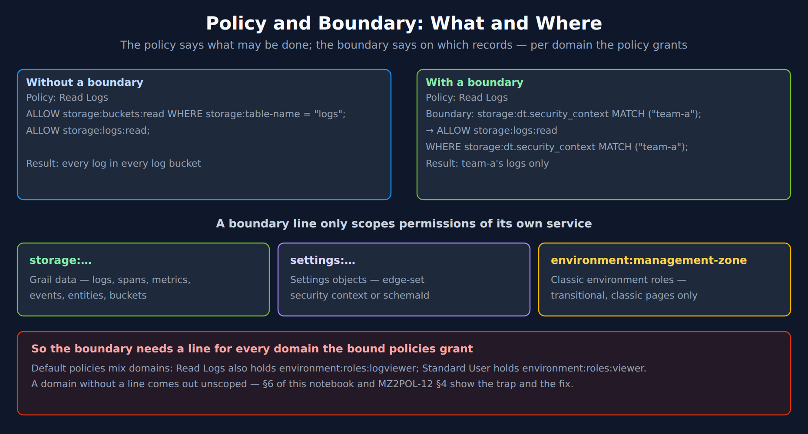
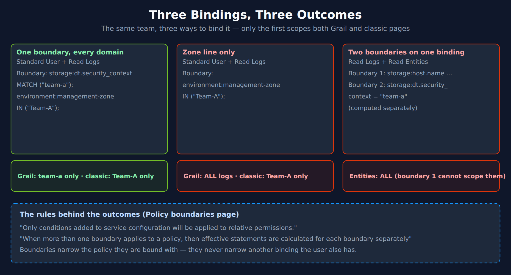
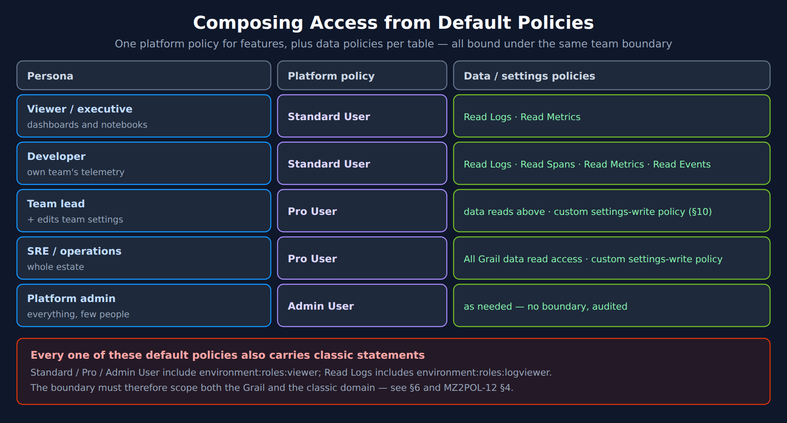
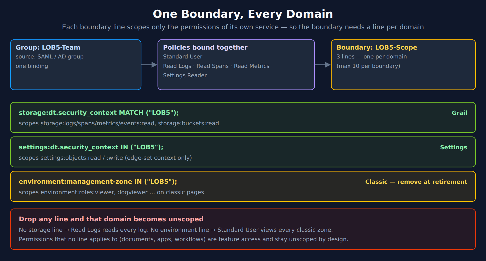
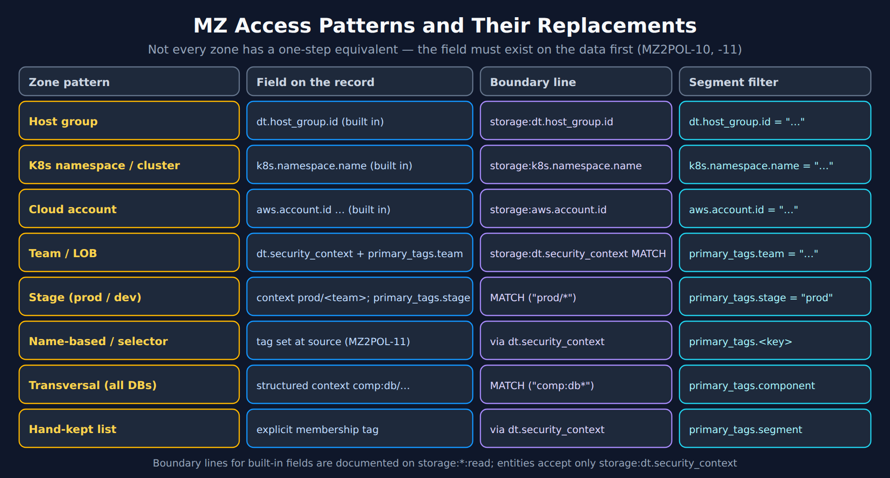

# MZ2POL-04: Policies and Boundaries

> **Series:** MZ2POL — Management Zone Migration: Segments, Policies, Workflows | **Notebook:** 5 of 15 | **Created:** December 2025 | **Last Updated:** 10/13/2026

## Overview

This notebook provides a comprehensive guide to **IAM Policies** and **Policy Boundaries** - the two components that together replace Management Zone access control. Policies define **WHAT** users can do, while boundaries define **WHERE** those permissions apply.

---

## Table of Contents

1. [Understanding the Relationship](#understanding-the-relationship)
2. [Policy Fundamentals](#policy-fundamentals)
3. [Default Policies](#default-policies)
4. [Condition and Boundary Syntax](#condition-and-boundary-syntax)
5. [Creating Boundaries](#creating-boundaries)
6. [Best Practice: One Boundary That Covers Every Domain](#best-practice-complete-boundary-for-mz-restriction)
7. [Recommended Group-Policy-Boundary Structure](#recommended-group-policy-boundary-structure)
8. [Mapping MZ Access to Policies + Boundaries](#mapping-mz-access-to-policies-boundaries)
9. [Security Context and Bucket Strategy](#security-context-and-bucket-strategy)
10. [Custom Policies](#custom-policies)
11. [Best Practices](#best-practices)
12. [Troubleshooting](#troubleshooting)
13. [Additional Resources](#additional-resources)


---

## Prerequisites

- Completed MZ2POL-01 through MZ2POL-03
- Access to Dynatrace Account Management
- Policy Management permissions

## Learning Objectives

By the end of this notebook, you will:
1. Understand policy statement syntax and structure
2. Know the default policies and when to use them
3. Understand boundary syntax and how boundaries restrict policies
4. Be able to map MZ access patterns to policy + boundary combinations
5. Know the recommended group-policy-boundary structure for SAML/AD integration

---

<a id="understanding-the-relationship"></a>
## 1. Understanding the Relationship
### Policies vs Boundaries



<!-- MARKDOWN_TABLE_ALTERNATIVE
| Case | Statement | Result |
|---|---|---|
| Without boundary | Read Logs: ALLOW storage:buckets:read WHERE storage:table-name = "logs"; ALLOW storage:logs:read; | Every log in every log bucket |
| With boundary | + storage:dt.security_context MATCH ("team-a"); | team-a's logs only |
| Domains | storage:… (Grail data) · settings:… (settings objects) · environment:management-zone (classic roles, transitional) | A boundary line scopes only its own service |
| Rule | Default policies mix domains (Read Logs holds environment:roles:logviewer; Standard User holds environment:roles:viewer) | A domain without a line comes out unscoped — §6 |
For environments where SVG doesn't render
-->

| Component | Purpose | Analogy |
|-----------|---------|--------|
| **Policy** | Defines WHAT actions are allowed | "You can read logs" |
| **Boundary** | Defines WHERE policies apply | "...but only for team-frontend" |

### How They Work Together



<!-- MARKDOWN_TABLE_ALTERNATIVE
| Binding | Boundary | Outcome |
|---|---|---|
| Standard User + Read Logs | storage:dt.security_context MATCH ("team-a"); environment:management-zone IN ("Team-A"); | Grail: team-a only · classic: Team-A only |
| Standard User + Read Logs | environment:management-zone IN ("Team-A"); only | Grail: ALL logs · classic: Team-A only |
| Read Logs + Read Entities | Two boundaries: storage:host.name …; storage:dt.security_context = "team-a" | Entities: ALL (boundary 1 cannot scope them) |
For environments where SVG doesn't render
-->

### Key Characteristics

**Policies:**
- Define permissions (ALLOW statements)
- Can include conditions (WHERE clauses)
- Default policies cover most use cases

**Boundaries:**
- Separate from policies (decoupled)
- Reusable across multiple policies
- Can only narrow the policy they are bound with — but several boundaries on one binding are evaluated separately, so a permission one boundary cannot scope comes out unscoped (MZ2POL-12 §4)
- Optional - policies work without them (full scope)

---

<a id="policy-fundamentals"></a>
## 2. Policy Fundamentals
### Policy Statement Structure

```
<effect> <service>:<resource>:<action> [WHERE <condition>]
```

| Component | Description | Examples |
|-----------|-------------|----------|
| **Effect** | Permission type | `ALLOW` or `DENY` (a `DENY` always overrules a matching `ALLOW`) |
| **Service** | Dynatrace service | `storage`, `settings`, `app` |
| **Resource** | Resource type | `logs`, `buckets`, `objects` |
| **Action** | Operation | `read`, `write`, `delete` |
| **Condition** | Optional filter | `WHERE field = "value"` |

> **Effects:** Authorization is **implicit-deny** — anything not `ALLOW`ed is denied. Compose access from `ALLOW` statements and simply omit what you don't want to grant. Reserve explicit `DENY` for narrowing a broad `ALLOW`; a `DENY` always wins over any `ALLOW`, regardless of order — but see the caveat below on what a `DENY` can and cannot narrow.
>
> **Combining conditions:** A policy `WHERE` clause supports **`AND`** (e.g. `WHERE settings:schemaId = "..." AND storage:bucket-name = "logs_prod"`). It does **not** support `OR` — to express OR, write multiple `ALLOW` statements.

> ⚠️ **`DENY` cannot narrow a grant by record-level condition — it removes the permission outright.** A `WHERE` on a `DENY` behaves differently depending on what it scopes:
>
> | Statement | What it actually does |
> |---|---|
> | `DENY storage:buckets:read WHERE storage:bucket-name = "logs_delivery"` | Works as written — denies only that bucket |
> | `DENY storage:logs:read WHERE storage:dt.security_context = "sensitive"` | **Denies every log**, not only the `sensitive` ones |
>
> Dynatrace states it plainly: this kind of scoped exclusion *"is only possible with buckets. This is because you can apply a DQL `DENY` statement to buckets, but not to record-level permissions."*
>
> **Why this matters for an MZ migration specifically.** The instinct carried over from Management Zones is to grant broadly and then carve out the one zone a team must not see. There is no record-level `DENY` that does this. Two options that work:
>
> 1. **Grant the complement** — enumerate what the group *may* see with `ALLOW ... WHERE storage:dt.security_context MATCH (...)` instead of excluding what it may not.
> 2. **Isolate, then deny the bucket** — route the excluded data to its own bucket and `DENY storage:buckets:read` on it.
>
> The failure mode is not subtle once it lands — the group loses the entire data type — but the statement *reads* as though it were scoped, so it tends to survive review.

### Basic Policy Statements

```
// Grant read access to all logs
ALLOW storage:logs:read

// Grant read access to bucket metadata
// (storage:buckets:write does not exist — buckets are managed via the
//  Grail bucket-management API, not an IAM storage permission)
ALLOW storage:buckets:read

// Grant read AND write on logs — enumerate both actions.
// Wildcards (storage:logs:*) are rejected by the API (live-verified 07/2026).
ALLOW storage:logs:read, storage:logs:write
```

### Common Services and Resources

| Service | Resources | Common Actions |
|---------|-----------|----------------|
| `storage` | `logs`, `spans`, `events`, `metrics`, `bizevents`, `entities`, `system`, `buckets`, `smartscape` | `read` on all; `write` ONLY on `logs`, `metrics`, `events` (never condition-scoped) |
| `settings` | `objects`, `schemas` | `read`, `write` (objects only) |
| `app` | `apps`, `functions` | `run`, `install` |
| `automation` | `workflows` | `read`, `write`, `run` |
| `document` | `documents` | `read`, `write`, `delete`, `share` |

---

<a id="default-policies"></a>
## 3. Default Policies
Dynatrace provides **built-in (default) IAM policies** that cover common access patterns. They are managed by Dynatrace (not editable) and auto-adjust as the platform evolves.

> **Naming note:** The classic Gen2 roles "Dynatrace Viewer / Standard User / Professional User / Admin User" and "Data Viewer / Data Editor" are **not** current IAM policy names — they were RBAC roles. The names below are the current built-in IAM policies (see the [default policies reference](https://docs.dynatrace.com/docs/manage/identity-access-management/permission-management/default-policies)).

### Platform Access Policies

| Policy | Use Case | Grants |
|--------|----------|--------|
| **Standard User** | Regular users | Access the environment and run Dynatrace Apps |
| **Pro User** | Power users | Build, deploy, and run apps + automated workflows |
| **Admin User** | Administrators | Administrative access across all Platform Services |

There is **no built-in "Viewer" policy** — compose read-only access from a platform policy plus the granular data-read policies below.

### Data Access Policies

| Policy | Use Case |
|--------|----------|
| **All Grail data read access** | Unrestricted read across all Grail tables and buckets |
| **Storage Default Monitoring Read** | Read on the default monitoring buckets; auto-extends as new tables are added |
| **Read Logs** / **Read Spans** / **Read Metrics** / **Read Events** / **Read Entities** | Granular read, one policy per signal type |
| **Settings Reader** / **Settings Writer** | Read / read-write of Settings 2.0 objects |

### Environment Role Policies (Classic surface)

| Policy | Use Case |
|--------|----------|
| **Environment role - Access environment** | Viewer-level Classic environment access |
| **Environment role - Change monitoring settings** | Edit Classic monitoring settings |

### Choosing the Right Built-in Policies



<!-- MARKDOWN_TABLE_ALTERNATIVE
| Persona | Platform policy | Data / settings policies |
|---|---|---|
| Viewer / executive | Standard User | Read Logs, Read Metrics (or Storage Default Monitoring Read) |
| Developer | Standard User | Read Logs, Read Spans, Read Metrics, Read Events |
| Team lead | Pro User | Data reads above, Settings Writer |
| SRE / operations | Pro User | Storage Default Monitoring Read, Settings Writer |
| Platform admin | Admin User | As needed — no boundary, audited |
| Note | Every default policy also carries classic statements (Standard/Pro/Admin User: environment:roles:viewer; Read Logs: environment:roles:logviewer) | The boundary must scope both domains — §6 and MZ2POL-12 §4 |
For environments where SVG doesn't render
-->

> <sub>**Sources:** [Dynatrace default policies reference (DT docs)](https://docs.dynatrace.com/docs/manage/identity-access-management/permission-management/default-policies) — *"Read Logs Grants unconditional access to the logs table and all log buckets, including all custom log buckets."*</sub>

---

<a id="condition-and-boundary-syntax"></a>
## 4. Condition and Boundary Syntax
Policies and boundaries share the same condition syntax.

### Supported Operators

| Operator | Description | Example |
|----------|-------------|----------|
| `=` | Exact match | `field = "value"` |
| `!=` | Not equal | `field != "value"` |
| `startsWith` | Prefix match | `field startsWith "prefix"` |
| `in` | Value in list | `field in ("a", "b", "c")` |
| `IN` | Value in list (alternative) | `field IN ("a", "b")` |
| `MATCH` | Wildcard pattern match, any value of a list (only where the attribute lists it) | `field MATCH ('team-*')` |

Not every operator applies to every attribute — the syntax page says so directly: *"Not every operator applies to every service attribute."* The IAM policy reference lists, per attribute:

| Attribute | Operators |
|---|---|
| Grail record fields — `storage:dt.security_context`, `storage:dt.host_group.id`, `storage:k8s.namespace.name`, `storage:log.source` … | `=`, `IN`, `startsWith`, `MATCH` — **no negation** |
| `storage:bucket-name` | `=`, `!=`, `IN`, `NOT IN`, `startsWith`, `NOT startsWith`, `MATCH` |
| `environment:management-zone` (on `environment:roles:*`) | `IN`, `startsWith`, `NOT startsWith`, `=`, `!=`, `MATCH` |
| `settings:schemaId` | `IN`, `=`, `!=`, `startsWith`, `NOT startsWith` |

> <sub>**Sources:** [IAM policy statement syntax and examples (DT docs)](https://docs.dynatrace.com/docs/manage/identity-access-management/permission-management/manage-user-permissions-policies/iam-policystatement-syntax), [IAM policy reference (DT docs)](https://docs.dynatrace.com/docs/manage/identity-access-management/permission-management/manage-user-permissions-policies/advanced/iam-policystatements) — `storage:logs:read`: *"storage:dt.security_context - Custom field for security context."*</sub>

> **Place wildcards next to a word separator.** Dynatrace's guidance is to put the `*` immediately before or after a separator character — `-`, `_`, `.`, or `/` — because `MATCH("db-tech-*")` evaluates more efficiently than `MATCH("db-tech*")`. This is a performance rule rather than a correctness one, but it has a design consequence worth acting on: **build your `dt.security_context` values with explicit separators between dimensions** rather than running them together. A structured value such as `plat:k8s/comp:db/bu:digital/app:easytrade` gives every transversal team a boundary that lands cleanly on a separator, while a concatenated value like `k8sdbdigitaleasytrade` does not.
>
> Dimension **order** matters for the same reason: whichever dimension you place first is the one that prefix matching can slice on cheapest. Put the most transversal dimension — usually platform or component — at the front. See IAM-05 for the full boundary-design treatment.

### Supported Fields

| Field | Description | Used In |
|-------|-------------|----------|
| `environment` | Environment restrictions | Boundaries |
| `environment:name` | Environment by name | Boundaries |
| `environment:management-zone` | MZ-based (transitional) | Boundaries |
| `storage:dt.security_context` | Security context | Both |
| `storage:bucket-name` | Grail bucket | Both |
| `settings:schemaId` | Settings schema ID | Policies |
| `settings:dt.security_context` | Settings security context | Boundaries |

### Combining Conditions

**AND logic** (all conditions must match):
```
ALLOW storage:logs:read 
  WHERE storage:dt.security_context = "team-a"
  AND storage:bucket-name = "production_logs"
```

**OR logic** (multiple statements or lines):
```
// In policies: Multiple statements
ALLOW storage:logs:read WHERE storage:dt.security_context = "team-a"
ALLOW storage:logs:read WHERE storage:dt.security_context = "team-b"

// In boundaries: repeated lines on the SAME condition multiply the statement (OR)
storage:dt.security_context = "team-a"
storage:dt.security_context = "team-b"
```

---

<a id="creating-boundaries"></a>
## 5. Creating Boundaries
### Via UI

1. Navigate to **Account Management** → **Identity & Access Management**
2. Select **Policy Boundaries** → **Boundaries** tab
3. Click **Create boundary**
4. Enter:
   - **Boundary name**: Descriptive name
   - **Boundary query**: Restriction conditions
5. Click **Save**

### Boundary Examples

**Team-Based Boundary:**
```
Name: Frontend Team Scope
Query: storage:dt.security_context = "team-frontend"
```

**Environment Boundary:**
```
Name: Production Only
Query: storage:dt.security_context startsWith "prod-"
```

**Multi-Team Boundary (OR logic):**
```
Name: Platform Teams
Query:
storage:dt.security_context = "team-infra"
storage:dt.security_context = "team-sre"
storage:dt.security_context = "team-platform"
```

### Boundary Limitations

| Limitation | Description | Workaround |
|------------|-------------|------------|
| Max 10 lines | Only 10 conditions per boundary | Create multiple boundaries — but see the row below on how they combine |
| No AND in lines | Each line is one condition | Lines on different conditions each scope their own permissions; for logical operators Dynatrace points to policy templating. Several boundaries on one binding are evaluated **separately** (a union), not combined — MZ2POL-12 §4 |
| No complex expressions | Limited to basic operators | Simplify conditions |

---

<a id="best-practice-complete-boundary-for-mz-restriction"></a>
## 6. Best Practice: One Boundary That Covers Every Domain
A boundary condition scopes only the permissions of its own service. Dynatrace's boundary rules: *"Only conditions added to service configuration will be applied to relative permissions."* The default policies bundle Grail, settings **and** classic statements — *Standard User* includes `environment:roles:viewer`, *Read Logs* includes `environment:roles:logviewer` — so a boundary that replicates a zone needs one line for **every domain the bound policies grant**. During the parallel run that is the zone line and the Grail lines, in the same boundary:

```text
// Boundary "LOB5-Scope", bound with Standard User, Read Logs, Read Spans, Read Metrics, Settings Reader
storage:dt.security_context MATCH ("LOB5");
settings:dt.security_context IN ("LOB5");
environment:management-zone IN ("LOB5");
```

The last line is transitional: it scopes the classic statements while classic pages are in use, and is deleted at retirement without rebinding anything. Dynatrace's own boundary page shows the same mixed shape — a `Kubernetes` boundary with an `environment:management-zone startsWith "[Kubernetes]"` line next to a `storage:k8s.namespace.name IN (...)` line.



<!-- MARKDOWN_TABLE_ALTERNATIVE
| Boundary line | Scopes | Domain |
|---|---|---|
| storage:dt.security_context MATCH ("LOB5"); | storage:logs/spans/metrics/events:read, storage:buckets:read | Grail |
| settings:dt.security_context IN ("LOB5"); | settings:objects:read / :write (edge-set security context only) | Settings |
| environment:management-zone IN ("LOB5"); | environment:roles:viewer, :logviewer … on classic pages | Classic — remove at retirement |
| Drop any line | That domain becomes unscoped: no storage line → Read Logs reads every log; no environment line → Standard User views every classic zone | |
| Not covered by any line | Documents, apps, workflows — feature access, unscoped by design | |
For environments where SVG doesn't render
-->

> **`=` and `IN` only work while `dt.security_context` holds a single value.** Dynatrace's Grail permissions reference: *"Using `=`, `STARTSWITH` or `IN` when the field holds an array will always return `false`."* The failure is silent — the policy is valid, it evaluates, and it matches nothing. If any enrichment path can write an array into `dt.security_context`, use `MATCH` instead: *"you must use the `MATCH` operator to get 'for any value' set semantic."*
>
> On the validation tenant (10/13/2026) every `events` record with a security context held it as an array, while logs and spans held a string — so the Grail line above uses `MATCH`. Check your own tables with MZ2POL-12 §10 Check 1. **ORGNZ-04** covers the operator semantics in full.
>
> <sub>**Sources:** [Permissions in Grail (DT docs)](https://docs.dynatrace.com/docs/platform/grail/organize-data/assign-permissions-in-grail) — the array semantics quoted above.</sub>

### Two bindings instead of one boundary

An earlier version of this notebook recommended the opposite: never mix, and split into two parallel bindings — custom storage/settings policies under a Grail-only boundary, plus the classic *Environment role - Access environment* policy under a zone-only boundary. That design also works, and retirement becomes deleting one binding. Two corrections to how it was described:

- **Bindings combine as a union, not an intersection.** Each binding adds access; neither narrows the other. Dynatrace: *"When more than one boundary applies to a policy, then effective statements are calculated for each boundary separately"*.
- **It is only safe if each binding's policies stay inside its boundary's domain.** Bind *Standard User* or *Read Logs* under the Grail-only boundary and their classic statements come out unscoped; bind them under the zone-only boundary and their Grail statements do (MZ2POL-12 §4.2 walks through it).

If you split, use custom storage and settings statements in the Grail binding — one statement per service, rather than one `WHERE` mixing `storage:` and `settings:` conditions:

```text
// Grail binding — custom policy, bound under a Grail-only boundary
ALLOW storage:logs:read, storage:spans:read, storage:metrics:read, storage:events:read
  WHERE storage:dt.security_context MATCH ("LOB5");
ALLOW settings:objects:read, settings:objects:write
  WHERE settings:dt.security_context IN ("LOB5");

// Classic binding — transitional
ALLOW environment:roles:viewer
  WHERE environment:management-zone IN ("LOB5");
```

> <sub>**Sources:** [Policy boundaries (DT docs)](https://docs.dynatrace.com/docs/manage/identity-access-management/permission-management/manage-user-permissions-policies/iam-policy-boundaries) — *"Only conditions added to service configuration will be applied to relative permissions."* and *"Be aware that the management zones referenced in your boundaries only apply to policy statements that support management zones."*, [Dynatrace default policies reference (DT docs)](https://docs.dynatrace.com/docs/manage/identity-access-management/permission-management/default-policies) — classic statements inside *Standard User* and *Read Logs*.</sub>
---

---

<a id="recommended-group-policy-boundary-structure"></a>
## 7. Recommended Group-Policy-Boundary Structure
For organizations using SAML/SSO with Active Directory, bind the group to default policies under **one** boundary that covers every domain (§6). Dynatrace's role-migration guide gives the same pattern: *"Make use of default policies whenever possible and define your business-specific access conditions in policy boundaries."*

| Group (from AD) | Policies | Boundary |
|---|---|---|
| `LOB5-Team` | Standard User, Read Logs, Read Spans, Read Metrics, Read Events, Settings Reader | `LOB5-Scope` — the three lines in §6 |
| `LOB5-Leads` | Pro User, Settings Writer, the same data reads | `LOB5-Scope` |

### Key Benefits

- **SAML group**: ties to existing AD group membership — no separate user management
- **One boundary per team**: every domain scoped in one reusable object; edits apply immediately to every binding that uses it
- **Clean retirement**: deleting the `environment:management-zone` line ends the classic scope without rebinding

### Keep team groups free of unscoped data policies

Permissions are a union across every group a user belongs to. Dynatrace: *"If there is an unconditional table permission in any other policy available for a user, the WHERE clause is irrelevant and the user will always be able to view all records from that table."* A user in `LOB5-Team` who is also in an "all developers" group bound to *Read Logs* without a boundary reads every log. Audit group overlap before relying on any boundary — MZ2POL-12 §10 shows the effective-permissions API call.

> <sub>**Sources:** [Upgrade role-based permissions to Dynatrace IAM policies (DT docs)](https://docs.dynatrace.com/docs/manage/identity-access-management/permission-management/manage-user-permissions-policies/advanced/migrate-roles) — *"Make use of default policies whenever possible and define your business-specific access conditions in policy boundaries."*, [Permissions in Grail (DT docs)](https://docs.dynatrace.com/docs/platform/grail/organize-data/assign-permissions-in-grail) — *"If there is an unconditional table permission in any other policy available for a user, the WHERE clause is irrelevant and the user will always be able to view all records from that table."*</sub>

### Binding via UI

1. Navigate to **Group Management**
2. Select or create a group
3. Go to **Permissions** tab
4. Click **Add permission**
5. Select:
   - **Policy**: Choose policy to bind
   - **Boundary** (optional): Select restriction
   - **Environment**: Select target environment
6. Click **Save**

---

<a id="mapping-mz-access-to-policies-boundaries"></a>
## 8. Mapping MZ Access to Policies + Boundaries
### Common MZ Permission Patterns



<!-- MARKDOWN_TABLE_ALTERNATIVE
| Zone pattern | Field on the record | Boundary line | Segment filter |
|---|---|---|---|
| Host group | dt.host_group.id (built in) | storage:dt.host_group.id | dt.host_group.id = "…" |
| K8s namespace / cluster | k8s.namespace.name (built in) | storage:k8s.namespace.name | k8s.namespace.name = "…" |
| Cloud account | aws.account.id … (built in) | storage:aws.account.id | aws.account.id = "…" |
| Team / LOB | dt.security_context + primary_tags.team | storage:dt.security_context MATCH | primary_tags.team = "…" |
| Stage | context prod/<team>; primary_tags.stage | MATCH ("prod/*") | primary_tags.stage = "prod" |
| Name-based / selector | tag set at source (MZ2POL-11) | via dt.security_context | primary_tags.<key> |
| Transversal (all DBs) | structured context comp:db/… | MATCH ("comp:db*") | primary_tags.component |
| Hand-kept list | explicit membership tag | via dt.security_context | primary_tags.segment |
| Note | Entities accept only storage:dt.security_context | | |
For environments where SVG doesn't render
-->

| MZ Permission | Equivalent Policy + Boundary |
|---------------|-----------------------------|
| View only | `Standard User` + data-read policies + Boundary |
| View + Edit | `Pro User` + `Settings Writer` + Boundary |
| Full access to MZ | `Pro User` + `All Grail data read access` + Boundary |
| Admin in MZ | `Admin User` (or a custom policy) + Boundary |

### Migration Example: Team-Based MZ

**Before (MZ-based):**
- Management Zone: "Frontend-Team"
- Rules: Services with tag `team:frontend`
- Users assigned via RBAC

**After (Policy + Boundary):**
```
1. Set security context on entities:
   - Services get dt.security_context = "team-frontend"

2. Create two parallel policy bindings — Gen3 with Gen3 boundary, Gen2 with Gen2 boundary:

   Binding 1 — Gen3 (canonical):
     ALLOW storage:logs:read, storage:spans:read, storage:metrics:read,
           settings:objects:read, settings:objects:write
     WHERE storage:dt.security_context IN ("team-frontend")
       AND settings:dt.security_context IN ("team-frontend");
     (policy WHERE uses AND, not OR — each condition scopes its own service)

   Binding 2 — Gen2 (transitional, until MZ retirement):
     ALLOW environment:roles:viewer
     WHERE environment:management-zone IN ("Frontend-Team");

3. Attach both bindings to the group:
   Group: Frontend Developers (SAML)
   Bindings: Gen3 binding + Gen2 binding (both active during migration window)
```

### Migration Example: Environment MZ

**Before (MZ-based):**
- Management Zone: "Production"
- Rules: Hosts with tag `env:production`
- Users get MZ-filtered view

**After (Policy + Boundary):**
```
1. Set security context on entities:
   - Hosts get dt.security_context = "prod-{region}"

2. Create two boundaries (don't mix Gen2 and Gen3 in one):
   Gen3 boundary "Production - Grail":
     storage:dt.security_context startsWith "prod-";
     settings:dt.security_context startsWith "prod-";
   Gen2 boundary "Production - Classic":
     environment:management-zone IN ("Production");

3. Bind to group with two parallel bindings:
   Group: Production Operators (SAML)
   Binding 1 (Gen3): Pro User + data-read policies, Boundary "Production - Grail"
   Binding 2 (Gen2): Environment role - Access environment, Boundary "Production - Classic"
```

---

<a id="security-context-and-bucket-strategy"></a>
## 9. Security Context and Bucket Strategy
### What Is Security Context?

**Security Context** (`dt.security_context`) is a special field on Grail records — logs, spans, metrics, events, user events — and on entities. It is the one record field that every Grail table accepts in an IAM condition, which makes it the recommended way to scope boundaries for Grail data (MZ2POL-12 §1).

### Primary Grail Fields

When migrating from Management Zones, leverage **Primary Grail Fields** for consistent data partitioning:

| Field | Source | MZ Migration Use |
|-------|--------|------------------|
| `k8s.cluster.name` | Kubernetes | Replace cluster-based MZs |
| `k8s.namespace.name` | Kubernetes | Replace namespace-based MZs |
| `aws.account.id` | AWS metadata | Replace AWS account MZs |
| `dt.host_group.id` | OneAgent config | Replace host group-based MZs |

### Bucket Strategy for Migration

**Buckets** partition Grail data and integrate with policies and boundaries for team-level access control.

### Bucket Limitations

> **⚠️ Critical:** Plan buckets carefully during migration - these constraints cannot be changed later.

| Limitation | Details |
|------------|---------|
| **One data type per bucket** | Logs, metrics, events, OR spans - not mixed |
| **Names are immutable** | Bucket names CANNOT be changed after creation |
| **No data migration** | Data CANNOT be moved between buckets |
| **Naming rules** | 3-100 chars, lowercase alphanumeric, underscores, hyphens only |
| **Maximum buckets** | 80 per environment (default limit) |
| **Optimal ingest** | ~1 TB/day per bucket for best query performance |
| **Acceptable ingest** | 1-3 TB/day per bucket (limited query window) |
| **Maximum ingest** | No hard per-bucket cap is documented — Dynatrace describes ingesting *"well over 15 TB per day into a single bucket"* when queries stay within narrow timeframes. A larger bucket costs queryable window per scan, and Dynatrace pages give different split points ([Partition data (DT docs)](https://docs.dynatrace.com/docs/platform/grail/organize-data/partition-data), [Logs bucket strategy (DT docs)](https://docs.dynatrace.com/docs/platform/upgrade/best-practices/stage-05-partition-data/logs-bucket-strategy)) |

### Query Constraints

| Limit | Value | Impact |
|-------|-------|--------|
| **Maximum data scanned** | 500 GB | Limits queryable time window |
| **Maximum records returned** | 1,000 | Use aggregations for larger datasets |
| **Maximum response payload** | 1 MB | Large result sets may be truncated |

### Default Bucket Retentions

| Bucket | Retention |
|--------|-----------|
| `default_logs` | 35 days |
| `default_metrics` | 15 months |
| `default_spans` | 10 days |
| `default_events` | 35 days |

### Using Buckets for Team Isolation (MZ Replacement)

When replacing team-based MZs, use buckets in **both policies AND boundaries**:

**Either one boundary covering every domain (§6), or two bindings whose policies stay inside their boundary's domain.** The two-binding form, with buckets added:

```
// Gen3 policy
ALLOW storage:logs:read,
      storage:spans:read,
      storage:metrics:read,
      settings:objects:read,
      settings:objects:write;
```

```
// Gen3 boundary — scoped by bucket + security context
storage:bucket-name          IN ("frontend_logs", "frontend_spans", "frontend_metrics");
storage:dt.security_context  IN ("team-frontend");
settings:dt.security_context IN ("team-frontend");
```

```
// Gen2 policy — Classic entity access, transitional
ALLOW environment:roles:viewer;
```

```
// Gen2 boundary
environment:management-zone IN ("Frontend-Team");
```

> **`MATCH` is not Gen3-only.** The IAM policy reference lists it for `environment:management-zone` on the classic `environment:roles:*` permissions as well as for the Grail record fields. What matters is the pattern: `MATCH("*")` matches everything on any attribute. Note too that `storage:entities:read` is a Grail permission — it accepts only `storage:dt.security_context` and `storage:entity.type`.

### Migration Mapping: MZ to Buckets

| MZ Pattern | Bucket Strategy |
|------------|-----------------|
| **Team MZ** (e.g., "Frontend-Team") | Team-specific buckets: `frontend_logs`, `frontend_spans` |
| **Environment MZ** (e.g., "Production") | Environment buckets: `prod_logs`, `prod_metrics` |
| **Regional MZ** (e.g., "US-East") | Region buckets: `useast_logs`, `useast_spans` |
| **Compliance MZ** (e.g., "PCI") | Compliance buckets: `pci_logs`, `pci_events` |

### Complete Team Migration Example

**Before (MZ-based):**
- Management Zone: "Checkout-Team"
- Users see all data within the MZ

**After (Policy + Bucket + Boundary):**
```
Group: Checkout-Team (SAML from AD)
├── Policy: Checkout Data Access
│   ├── ALLOW storage:logs:read WHERE storage:bucket-name = "checkout_logs"
│   ├── ALLOW storage:spans:read WHERE storage:bucket-name = "checkout_spans"
│   └── ALLOW storage:metrics:read WHERE storage:bucket-name = "checkout_metrics"
└── Boundary:
    storage:bucket-name IN ("checkout_logs", "checkout_spans", "checkout_metrics");
    storage:dt.security_context IN ("checkout");
    environment:management-zone IN ("Checkout-Team");
```

> **For detailed bucket design guidance**, see **ORGNZ-03: Bucket Strategy and Design** which covers naming conventions, retention planning, and cost attribution patterns in depth.

### Setting Security Context

Security context is set on the data, at the source — MZ2POL-10 §5 has the full ladder:
- **OneAgent host tag** — `oneagentctl --set-host-tag="dt.security_context=<value>"` or at install
- **`DT_TAGS`** on a single process, for shared hosts
- **Kubernetes** namespace labels or annotations, **OpenTelemetry** resource attributes
- **Central configuration** (Ingest enrichment configuration, cloud and Kubernetes rules)
- **OpenPipeline** *Set security context* processors — after routing, so last resort

Auto-tagging rules do **not** set it on Grail data: they *"have no effect on Smartscape on Grail"*. The entity-side *Grail Security Context* mapping can copy management-zone names onto entities, but data records *"do not inherit the management zones of that entity"* — and MZ-derived contexts stop matching for scoped settings (MZ2POL-12 §5).

> <sub>**Sources:** [Differences between classic auto-tagging and primary Grail tags (DT docs)](https://docs.dynatrace.com/docs/platform/upgrade/foundations/tags-difference-classic) — *"Auto-tagging rules have no effect on Smartscape on Grail and are not used in any Latest Dynatrace app."*, [Grant access to entities with security context (DT docs)](https://docs.dynatrace.com/docs/manage/identity-access-management/use-cases/access-security-context) — *"Logs, spans, metrics, and events powered by Grail that are sent from an entity do not inherit the management zones of that entity."*</sub>

### Security Context Naming Strategy

| Pattern | Example | Use Case |
|---------|---------|----------|
| `team-{name}` | `team-frontend` | Team ownership |
| `env-{name}` | `env-production` | Environment separation |
| `region-{code}` | `region-us-east` | Geographic isolation |
| `app-{name}` | `app-checkout` | Application scoping |
| `{env}-{team}` | `prod-frontend` | Combined scoping |

> **For transversal access patterns** (teams spanning multiple applications by component type — database, networking, OS), consider a structured multi-dimensional format: `comp:<component>/bu:<business-unit>/app:<application>`. This enables `MATCH('comp:db*')` to reach all database layers across all applications, while `MATCH('*/app:easytrade')` scopes to all components of one app. The dimension you need for transversal slicing must come *first* for Classic entity access. See **IAM-04: Policy Authoring** for the complete design pattern.

### Query Entities by Security Context

```dql
// List services with their security context
// Identify services that need security context assignment
fetch dt.entity.service
| fields entity.name,
         dt.security_context,
         tags,
         managementZones
| sort dt.security_context asc
| limit 50

// Note: dt.entity.* is deprecated, but this is a migration-ASSESSMENT query — it inspects
// the classic constructs this migration replaces, so keep the classic query above:
//   - management zones have NO Smartscape node equivalent; they are what this migration
//     replaces with segments and policies.
//   - dt.security_context is an ARRAY on Smartscape nodes (empty [] when unset, not null),
//     so isNull / isNotNull(dt.security_context) does not carry over — a Smartscape rewrite
//     would miscount coverage.
//   - entity tags are not a flat "tags" field on Smartscape (resolve via getNodeField).
```

```dql
// Count entities by security context
// Helps verify security context distribution
fetch dt.entity.service
| summarize count = count(), by:{dt.security_context}
| sort count desc

// Note: dt.entity.* is deprecated, but this is a migration-ASSESSMENT query — it inspects
// the classic constructs this migration replaces, so keep the classic query above:
//   - dt.security_context is an ARRAY on Smartscape nodes (empty [] when unset, not null),
//     so isNull / isNotNull(dt.security_context) does not carry over — a Smartscape rewrite
//     would miscount coverage.
```

---

<a id="custom-policies"></a>
## 10. Custom Policies
### When to Create Custom Policies

- Default policies are too broad or narrow
- Need specific permission combinations
- Require conditional access
- Compliance requirements

### Custom Policy Examples

**Log Viewer for Specific Team:**
```
// Policy Name: Frontend Team Log Access
// Description: Read-only access to frontend service logs

ALLOW storage:logs:read 
  WHERE storage:dt.security_context = "team-frontend"

ALLOW storage:spans:read 
  WHERE storage:dt.security_context = "team-frontend"
```

**Environment-Restricted Admin:**
```
// Policy Name: Development Admin
// Description: Full access to development environment only

// Reads are condition-scoped; storage writes cannot take WHERE conditions
// (live-verified) — grant them unscoped only where justified.
// Caution: event records hold dt.security_context as an ARRAY, and startsWith never
// matches an array — test that this grants storage:events:read before relying on it.
ALLOW storage:logs:read, storage:spans:read, storage:metrics:read,
      storage:events:read, storage:bizevents:read,
      storage:entities:read, storage:system:read, storage:buckets:read
  WHERE storage:dt.security_context startsWith "dev-"

ALLOW settings:objects:read, settings:objects:write
  WHERE settings:scope startsWith "environment:dev"
```

**Dashboard and Notebook Creator:**
```
// Policy Name: Dashboard Creator
// Description: Create and manage dashboards and notebooks

ALLOW document:documents:read
ALLOW document:documents:write
ALLOW document:documents:delete
ALLOW document:direct-shares:write

// Read data for dashboards
ALLOW storage:logs:read
ALLOW storage:metrics:read
ALLOW storage:spans:read
```

---

<a id="best-practices"></a>
## 11. Best Practices
### Do's

- ✅ **Start with default policies** - customize only when needed
- ✅ **Use least privilege** - grant minimum required permissions
- ✅ **Document policies and boundaries** - clear names and descriptions
- ✅ **Test before production** - verify with test users
- ✅ **Use boundaries for scope** - keep policies reusable
- ✅ **Cover every domain the bound policies grant** — storage, settings, and environment while classic pages are used (§6)
- ✅ **Use SAML groups** tied to AD for team management

### Don'ts

- ❌ **Don't create policy per user** - use groups
- ❌ **Don't duplicate default policies** - extend instead
- ❌ **Don't use overly broad wildcards** - be specific
- ❌ **Don't embed conditions in policies** when boundaries are better
- ❌ **Don't forget the settings domain** in boundaries

### Naming Conventions

```
// Good names
"Frontend Team - Standard Access"     (policy)
"Production Environment"              (boundary)
"LOB5-Scope"                          (boundary)

// Bad names
"Policy 1"
"Test"
"John's boundary"
```

### Audit Checklist

- [ ] Each boundary has a clear purpose
- [ ] Boundary names follow naming convention
- [ ] All three domains included (environment, storage, settings)
- [ ] SAML groups aligned with AD structure
- [ ] Dependencies tracked (which policies use which boundaries)
- [ ] Regular review scheduled

---

<a id="troubleshooting"></a>
## 12. Troubleshooting
### Common Issues

| Issue | Likely Cause | Solution |
|-------|-------------|----------|
| User can't access anything | No policy bound | Bind policy to user's group |
| User sees too much | Boundary too broad or missing | Tighten boundary conditions |
| User can't see expected data | Missing data policy | Add a data-read policy (e.g. `Read Logs` / `All Grail data read access`) |
| Permissions inconsistent | Multiple conflicting policies | Review all bound policies |
| Works in classic, not Grail | Only environment domain used | Add the storage line to the same boundary (§6) |
| User sees **all** logs despite a boundary | Zone-only boundary on a default policy, or an unscoped data policy in another of the user's groups | Add the storage line; audit group overlap (§7, MZ2POL-12 §3–4) |
| User sees every classic zone | Standard User bound under a Grail-only boundary | Add the `environment:management-zone` line (§6) |
| Settings not restricted | Missing settings domain | Add `settings:dt.security_context` boundary |

### Debugging Steps

1. **Verify group membership**: Is user in correct group?
2. **Check policy bindings**: What policies are bound to group?
3. **Review boundaries**: Are both Gen3 and Gen2 boundaries attached where needed?
4. **Test with admin**: Does admin see the data?
5. **Check security context**: Is it set on the entities?

### Testing Boundaries

1. **Create test user** in target group
2. **Log in as test user**
3. **Verify access**:
   - Can access expected data?
   - Cannot access restricted data?
4. **Test edge cases**:
   - Entities at boundary edges
   - New entities without security context

---

## Summary

In this notebook, you learned:

1. **Policies define WHAT**, boundaries define **WHERE**
2. **Default policies** cover most use cases - customize only when needed
3. **Shared syntax** for conditions in both policies and boundaries
4. **Three domains** needed for complete MZ replacement (environment, storage, settings)
5. **SAML + Policy + Boundary** structure for AD integration
6. **Migration patterns** for team-based and environment-based MZs

## Next Steps

Continue to **MZ2POL-05: Segments Implementation** to:
- Create DQL-based data filters
- Replace MZ data filtering with Segments
- Configure cross-app filtering

For the end-to-end design — evaluation rules, the boundary pitfalls, the scoped-settings change and persona walkthroughs — see **MZ2POL-12: IAM Reference Architecture**.

For large-scale migrations with many Management Zones, see **MZ2POL-08: Templated Policies for MZ Migration** to:
- Convert MZ patterns to parameterized policy templates
- Automate bulk policy binding via IAM API
- Validate migrated access with DQL queries

<a id="additional-resources"></a>
## Additional Resources
- [Working with Policies](https://docs.dynatrace.com/docs/manage/identity-access-management/permission-management/manage-user-permissions-policies)
- [IAM Policy Reference](https://docs.dynatrace.com/docs/manage/identity-access-management/permission-management/manage-user-permissions-policies/advanced/iam-policystatements)
- [Policy Boundaries Documentation](https://docs.dynatrace.com/docs/manage/identity-access-management/permission-management/manage-user-permissions-policies/iam-policy-boundaries)
- [Grant Access with Security Context](https://docs.dynatrace.com/docs/manage/identity-access-management/use-cases/access-security-context)
- [Policy Templating](https://docs.dynatrace.com/docs/manage/identity-access-management/permission-management/manage-user-permissions-policies/advanced/iam-policy-templating)
- [Use Grail buckets to partition data](https://docs.dynatrace.com/docs/platform/grail/organize-data/partition-data) — bucket-level access control, and why a `DENY` scopes buckets but not records

---

<sub>*This notebook was AI-generated from community-submitted and publicly available sources. This notebook series is not officially supported by Dynatrace. Always verify information against official Dynatrace documentation.*</sub>
