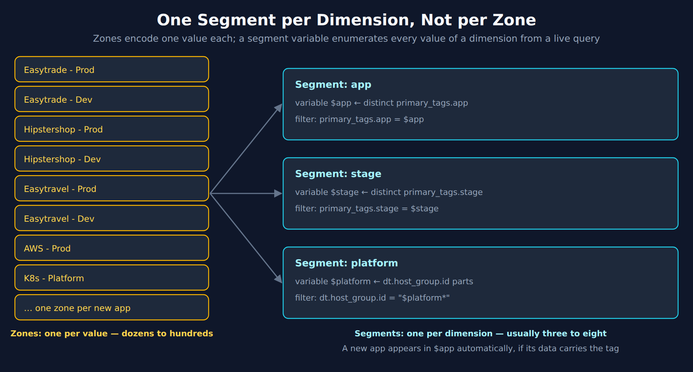
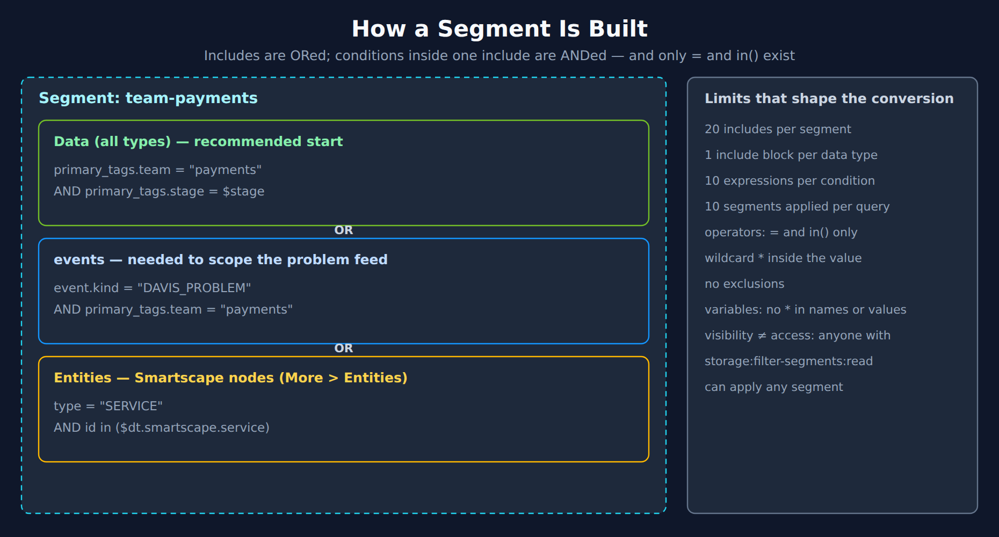
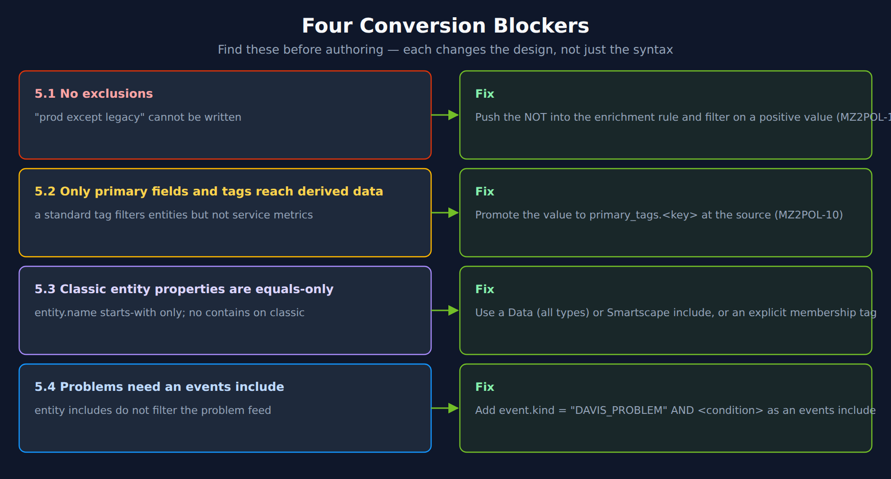

# MZ2POL-05: Migrating Management Zone Filtering to Segments

> **Series:** MZ2POL — Management Zone Migration: Segments, Policies, Workflows | **Notebook:** 6 of 17 | **Created:** December 2025 | **Last Updated:** 10/14/2026

## Overview

Management Zones do three jobs: **access control**, **filtering**, and **alerting** (see MZ2POL-09 for the third). Most migration guidance — including the rest of this series — covers the **access-control** job, which becomes IAM policies, boundaries, and `dt.security_context`. This notebook covers the second job: **filtering and scoping what people see**, which becomes **Segments**.

If your Management Zones are mostly used to scope dashboards, filter views, and give teams a "my stuff only" lens — rather than to enforce who may read what or who gets paged — this notebook is the one you need, and you can read it without working through the access-control notebooks first.

The work is **manual**. There is no button that turns a Management Zone into a segment. What this notebook gives you is the mapping: for each way an MZ is commonly defined, the corresponding way to get the same scope in Grail — plus the four constraints that make some MZs impossible to reproduce exactly.

---

## Table of Contents

1. [Which Job Is Your MZ Doing?](#which-job)
2. [There Is No Automatic Conversion](#no-auto-conversion)
3. [Segment Mechanics: Where They Are Documented](#segment-mechanics)
4. [Migration Scenarios](#migration-scenarios)
5. [Conversion Blockers](#conversion-blockers)
6. [Mapping MZ Rules to Segment Filters](#mapping-mz-rules)
7. [Testing Your Mapping with DQL](#testing-mapping)
8. [Coexistence: Classic Apps and Parallel Running](#coexistence)
9. [Visibility and Permissions](#visibility-and-permissions)
10. [Migration Checklist](#migration-checklist)

---

## Prerequisites

| Requirement | Details |
|-------------|---------|
| **Dynatrace Environment** | SaaS with Grail — segments are a Grail-only construct |
| **Existing Management Zones** | An inventory of the zones you intend to migrate (see MZ2POL-00 and MZ2POL-03) |
| **Permissions** | `storage:filter-segments:read` and `storage:filter-segments:write` to create segments; `storage:entities:read` and `storage:logs:read` to run the validation queries in §7 |
| **Enrichment in place** | Host tags, host groups, or Kubernetes metadata must already reach Grail — see §4 for which scenario applies, and pass the MZ2POL-10 readiness gate first; MZ2POL-11 maps each MZ rule to its target field |
| **Background reading** | ORGNZ-08 and ORGNZ-10 for segment mechanics; this notebook covers the migration, not the feature |

---

---

<a id="which-job"></a>
## 1. Which Job Is Your MZ Doing?

Before mapping anything, classify each Management Zone by what it is actually being used for. The replacement construct differs, and picking the wrong one produces either a security gap or a lot of unnecessary IAM work.

| What the MZ is used for | Replacement | Covered in |
|---|---|---|
| Restricting **who may read** which data | IAM policy + boundary on `dt.security_context` | MZ2POL-04 |
| Scoping **what a user sees** in apps and dashboards | **Segment** | This notebook |
| Deciding **who gets paged** — alerting profile scope | Routing dimensions on a problem-triggered workflow | MZ2POL-09 |
| More than one of the above | Each job migrates independently — they are separate layers | The matching notebook(s) above |

The three are not alternatives and they do not substitute for each other:

> **Segments are not access control.** A segment changes what is *shown*, not what is *permitted*. Anyone with `storage:filter-segments:read` can apply any segment, and a segment never widens what a user is allowed to query — the IAM policy still decides that. If the MZ was load-bearing for security, a segment alone does **not** replace it. Segments also do not replace alerting-profile scoping — see MZ2POL-09.

### A useful heuristic

If removing the Management Zone would let someone see data they are **not allowed** to see, it is doing the access-control job — go to MZ2POL-04. If removing it would only make their dashboards noisy, it is doing the filtering job, and this notebook covers it. If removing it would change who gets paged, it is doing the alerting job — go to MZ2POL-09.

Most MZ estates contain far more of the filtering kind than teams expect. Run the inventory in MZ2POL-00 and MZ2POL-03 first; it classifies the estate for you.

---

<a id="no-auto-conversion"></a>
## 2. There Is No Automatic Conversion

> **There is no automatic Management Zone to Segment conversion.** No button, no API endpoint, no wizard. Unlike Metric Events, which have a supported automatic upgrade path to Anomaly Detectors, Management Zones must be re-expressed as segments by hand.

This matters for planning. A 200-zone estate is 200 hand-authored segment definitions unless you consolidate first — and consolidation is usually the right move, because MZ estates typically accumulate zones that no longer have owners or users.

### What tooling does exist

| Tool | What it does | What it does not do |
|---|---|---|
| MZ2POL-00 SDK analysis tool | Exports `builtin:management-zones`, classifies each rule (tag-based / name-based / SELECTOR / host-group / complex-nested), scores migration readiness | Emits no segments — it is an inventory and triage aid |
| Filter Segments API (`POST /platform/storage/filter-segments/v1/filter-segments`, `storage:filter-segments:write`; SDK: [client-filter-segment-management (Dynatrace Developer)](https://developer.dynatrace.com/develop/sdks/client-filter-segment-management/)) | Creates segments programmatically once you have written the definition | Does not derive the definition from an MZ. Segments are not a Settings 2.0 object — there is no `builtin:filter-segments` schema (the Settings API returns 404 for it) |
| Terraform `dynatrace_segment` / Monaco `type: segment` (Monaco CLI 2.19.0+) | Manages segment definitions as code | Same — you write the include filters yourself, in segment filter syntax (not DQL; only variable definitions are DQL) |

The practical sequence is therefore: **inventory (MZ2POL-00) → consolidate → hand-author the definitions using the scenarios below → deploy as code (ORGNZ-10 §10, AUTOM-04)**.

### Consolidate before you convert: one segment per *dimension*, not per *value*

This is the single most important planning decision, and it changes the arithmetic of the whole migration.

A Management Zone is a **static definition of one value** — `Easytrade`, `Hipstershop`, `Easytravel` are three separate zones, and onboarding a fourth app means authoring a fourth zone. A segment does not work that way: a segment carries **variables**, and a variable's values come from a live DQL query. One segment named `app`, whose variable enumerates every distinct application value, covers every app that exists now and every app added later — with no further configuration.

So the migration is **not** N zones → N segments:

| | Management Zones | Segments |
|---|---|---|
| Unit of definition | One per **value** | One per **dimension** |
| Typical count | Dozens to hundreds | Usually **three to eight** |
| New app onboarded | Author a new zone | Appears automatically, if enrichment is present |

An estate with dozens of zones across three dimensions — app, stage, platform — converges on **three segments**, not dozens. If your target count is climbing past roughly eight, that is the signal that you are converting values instead of dimensions, and it is worth stopping to revisit the dimension design.

> **Segment sprawl is the common failure mode.** Teams migrate zone-for-zone, end up with dozens of overlapping segments, and reproduce exactly the maintenance burden they were trying to escape — with the added downside that users now face a long, confusing segment picker.



<!-- MARKDOWN_TABLE_ALTERNATIVE
| Zones (one per value) | Segments (one per dimension) |
|---|---|
| Easytrade - Prod, Easytrade - Dev, Hipstershop - Prod, Hipstershop - Dev, Easytravel - Prod, Easytravel - Dev, AWS - Prod, K8s - Platform, … one per new app | app: variable $app from distinct primary_tags.app; filter primary_tags.app = $app |
| | stage: variable $stage from distinct primary_tags.stage; filter primary_tags.stage = $stage |
| | platform: variable $platform from dt.host_group.id parts; filter dt.host_group.id = "$platform*" |
| Dozens to hundreds | Usually three to eight; a new app appears in $app automatically if its data carries the tag |
For environments where SVG doesn't render
-->

This rule is canonical in **ORGNZ-10** (§ *Best Practice: One Segment Per Dimension*) and **ORGNZ-99** (rule 46); this notebook applies it to the migration.

### Other reductions worth making

- Zones with no query activity in the last 90 days: delete rather than convert.
- Zones that duplicate a dimension already carried by a Primary Grail field (host group, K8s namespace, cloud tags) — those come nearly free via §4.2 and §4.4.

> <sub>**Sources:** [Best practice examples: from Management Zones to Segments (DT docs)](https://docs.dynatrace.com/docs/platform/upgrade/foundations/upgrade-guide-segments), [Segments (DT docs)](https://docs.dynatrace.com/docs/manage/segments), [Monaco configuration type fields (DT docs)](https://docs.dynatrace.com/docs/deliver/configuration-as-code/monaco/configuration/yaml-configuration-saas-type-fields) — *"the segment type is supported"* (Monaco CLI 2.19.0+), [dynatrace_segment (Dynatrace Terraform provider)](https://registry.terraform.io/providers/dynatrace-oss/dynatrace/latest/docs/resources/segment).</sub>

---

<a id="segment-mechanics"></a>
## 3. Segment Mechanics: Where They Are Documented

This notebook covers the **migration**, not segment mechanics in general. For how segments actually work, the canonical treatment in this corpus is the ORGNZ series:

| Topic | Read |
|---|---|
| Segments vs. buckets, include structure, design patterns, limits | ORGNZ-08 — Grail Segments |
| Filter syntax and operators, include rules, variables, host-group segments, visibility, segments-as-code, Query API, Davis problem includes | ORGNZ-10 — Advanced Segment Definitions |
| Managing segments with Terraform and Monaco | AUTOM-04, AUTOM-97 |

What you need to carry into the migration from those notebooks is a short list of constraints, because they determine which Management Zones can be reproduced faithfully and which cannot:

| Constraint | Value | Why it matters when converting |
|---|---|---|
| Includes per segment | 20 | A complex MZ with many rule types may not fit in one segment |
| Include blocks per data type | 1 | You cannot add two `logs` includes — combine with `OR` inside one |
| Expressions per filter condition | 10 | Caps how many conditions a single MZ rule can become |
| Segments applied per query | 10 | Limits how far you can decompose one MZ into many small segments |
| Segments per environment | 10,000 | Rarely binding, but relevant for very large estates |
| Values in a variable dropdown | 10,000 | Relevant for tenant-wide variables such as host group |
| Selected variable values per segment | 100 | Classic entities; constrains variable-driven consolidation |
| Filter operators | `=` and `in()` only | There is no separate `contains` operator — see below |
| Wildcards | `*` inside the value | Gives starts-with / contains / ends-with matching |
| Classic entity properties | Only `entity.name` accepts wildcards | Every **other** entity property is exact-equals only |

> **Include blocks are ORed.** Data matching *any* include is in scope. Within a single include, conditions are ANDed. An MZ whose rules were implicitly ANDed across entity types will not behave the same way if you map each rule to its own include.



<!-- MARKDOWN_TABLE_ALTERNATIVE
| Part | Content |
|---|---|
| Include: Data (all types) — recommended start | primary_tags.team = "payments" AND primary_tags.stage = $stage |
| Include: events — scopes the problem feed | event.kind = "DAVIS_PROBLEM" AND primary_tags.team = "payments" |
| Include: Entities — Smartscape nodes | type = "SERVICE" AND id in ($dt.smartscape.service) |
| Logic | Includes are ORed; conditions inside one include are ANDed |
| Limits | 20 includes; 1 include block per data type; 10 expressions per condition; 10 segments per query; = and in() only; wildcard inside the value; no exclusions; no * in variable names or values; anyone with storage:filter-segments:read can apply any segment |
For environments where SVG doesn't render
-->

### Start with `Data (all types)`

Segments offer a **`Data (all types)`** include block alongside the type-specific ones, and it is the **recommended** starting point. It applies your filter conditions across signals *and* Smartscape entities in one rule, which means a single include often replaces what would otherwise be several — and it keeps you well clear of the 20-include ceiling.

Reach for a type-specific include only when a dimension genuinely differs by data type, or when you need one of the cases `Data (all types)` does not cover: the `events` include for Davis problems (§5.4), or an `Entities` include for Smartscape service nodes (§8).

> **Classic entity includes are a backward-compatibility path, not the default.** Dynatrace states that entity relationships in segments "are only supported for backward compatibility with classic entities." The includes page describes them for higher-cardinality classic entities (Kubernetes workloads filtered by their related clusters, for example), but the later Services and Smartscape tutorial says *"Do not use legacy dt.entity.* attributes in include blocks in your segments."* A migration should not build on them. For services in particular, §8 has the documented replacement.

> <sub>**Sources:** [Segment limits (DT docs)](https://docs.dynatrace.com/docs/manage/segments/reference/segments-reference-limits), [Include data in segments (DT docs)](https://docs.dynatrace.com/docs/manage/segments/concepts/segments-concepts-includes) — verbatim: entity relationships in segments *"are only supported for backward compatibility with classic entities"*, [Filter Smartscape nodes with segments (DT docs)](https://docs.dynatrace.com/docs/manage/segments/getting-started/segments-getting-started-filter-smartscape-nodes) — the `Data (all types)` include block is the recommended form, [Use segments to scope Services and Smartscape apps (DT docs)](https://docs.dynatrace.com/docs/observe/application-observability/services/segment-services) — as quoted.</sub>

---

<a id="migration-scenarios"></a>
## 4. Migration Scenarios

Dynatrace documents a set of fully supported upgrade scenarios, organized by **how the Management Zone was defined** rather than by what it was called. Find the row matching your MZ's rule type and follow that scenario.

| # | If the MZ is defined by… | Segment approach | Extra tagging needed? |
|---|---|---|---|
| 4.1 | Auto-tagging on process / host / service **name or metadata** | Set the tag at the source as a **host tag** | Yes — move tagging to OneAgent |
| 4.2 | **Host group** membership | Filter on `dt.host_group.id` | No — enriched automatically |
| 4.3 | **Systematic host-group naming** (`<CMDBID>-<app>-<component>-<stage>`) | Parse the name with DPL in a variable definition | No |
| 4.4 | **Kubernetes** cluster or namespace | Filter on the K8s enrichment fields | No — enriched automatically |
| 4.5 | **Host tags / properties** set at OneAgent install | Re-set the tag with a `primary_tags.` prefix and filter a `Data (all types)` include on it | Yes — a plain host tag stays on the host's Smartscape node and does not reach logs, spans or metrics |
| 4.6 | Anything else (rules that do not fit above) | Introduce a **membership tag** whose value is the MZ name, set as `primary_tags.segment` | Yes — the guide gives this for zones built on names or metadata without auto-tags, on host OneAgents; this notebook uses it as the general fallback |
| 4.7 | **Extension** data | Filter on the extension enrichment attributes | No |
| 4.8 | **Cloud-native / application-only injection** | Set `DT_TAGS` and `OTEL_RESOURCE_ATTRIBUTES` on the process | Yes — environment variables |

The guide describes these as its *"fully supported scenarios"* — its stated purpose is *"sharing best practices for fully supported scenarios."* Treat them as the supported set today, not an exhaustive account of every MZ shape.

> <sub>**Sources:** [Best practice examples: from Management Zones to Segments (DT docs)](https://docs.dynatrace.com/docs/platform/upgrade/foundations/upgrade-guide-segments).</sub>

### 4.1 Auto-tagging on process, host, or service names

**The MZ pattern:** an auto-tagging rule derives a tag from a process name, host name, service name, or their metadata, and the Management Zone selects on that tag.

**The move:** stop deriving the tag from observed names and **set it at the source as a primary Grail tag** — a host tag whose key carries the `primary_tags.` prefix (`primary_tags.app=checkout`), set during OneAgent deployment. Tags in that form are enriched onto the signals themselves as fields, which is what makes them usable in segment filter conditions across data types. A host tag *without* the prefix is a standard tag: it stays on the host's Smartscape node and is not enriched onto raw signals.

This is the single most common scenario and also the one that requires the most upfront work, because it changes where tagging happens — from a rule evaluated in Dynatrace to a value supplied at install time. See FAQ-02 for tagging-source strategy and ORGNZ-10 §3 for the enrichment prerequisite and a coverage-audit query.

> **Watch the derived-data caveat.** Derived data — service metrics, Davis events and problems — carries primary Grail fields, the special fields (`dt.security_context`, `dt.cost.costcenter`, `dt.cost.product`) and `primary_tags.*`. Standard tags and signal-local attributes do **not** carry through. The `primary_tags.` prefix is therefore what decides whether a converted tag also works on metric-based dashboards. See §5.2.

> <sub>**Sources:** [Primary Grail fields and tags (DT docs)](https://docs.dynatrace.com/docs/manage/tags/primary-tags) — standard tags: *"Dynatrace doesn't automatically enrich them on raw telemetry signals."*</sub>

### 4.2 Host group membership

**The MZ pattern:** the zone selects hosts by host group.

**The move:** no tagging work at all. Every signal from a OneAgent that belongs to a host group is automatically enriched with **`dt.host_group.id`**. Filter on it directly.

This is the cheapest scenario to migrate and a good first candidate for a pilot conversion. FAQ-01 covers host-group naming strategy, which determines how much you can extract in 4.3.

### 4.3 Extraction from systematic host-group naming

**The MZ pattern:** host groups follow a structured naming convention — for example `<CMDBID>-<AppName>-<component>-<deploymentEnvironment>` — and separate MZs slice on different parts of the name.

**The move:** parse the components out with DPL in a **segment variable definition**, then filter on the extracted value. One segment with a variable replaces the whole family of MZs.

```dql
// Segment variable definition — extract dimensions from systematic host-group naming.
// Pattern: <CMDBID>-<AppName>-<component>-<deploymentEnvironment>
// Live-verified 07/21/2026. smartscapeNodes scans 0 bytes — this costs nothing to run.
smartscapeNodes "HOST"
| filter isNotNull(dt.host_group.id)
| parse dt.host_group.id, "LD:CMDBID '-' LD:app '-' LD:component '-' LD:stage"
| filter isNotNull(CMDBID)
| fields CMDBID
| dedup CMDBID
| sort CMDBID asc
```

> **A segment variable definition is ordinary DQL.** It is not restricted to the classic entity model — `smartscapeNodes` works and is the preferred form. The published upgrade-guide examples use `fetch dt.entity.host_group`, which still works but queries the deprecated classic entity model; the `smartscapeNodes` equivalents above and below were verified against a live tenant on 07/21/2026 and scan **zero bytes**.
>
> The real constraints on a variable query are different ones: the result must be **columnar** — the first column becomes the primary variable and later columns become secondary variables — high-volume data types such as `logs` should be avoided, and **neither variable names nor values may contain `*`** (though a wildcard may *follow* a variable reference in a condition, as `$stage*`).

**There is no `HOST_GROUP` Smartscape node type.** Host groups are a *field* (`dt.host_group.id`) on `HOST` nodes, not nodes of their own — which is why the query above starts from `HOST` and dedups, rather than fetching host groups directly.

If your host groups are *not* systematically named, this scenario is unavailable and you fall back to 4.6. That is a strong argument for fixing host-group naming before migrating rather than after — see FAQ-01.

### 4.4 Kubernetes cluster and namespace

**The MZ pattern:** the zone scopes to a Kubernetes cluster or namespace.

**The move:** Kubernetes signals are automatically enriched with cluster and namespace information — no additional tagging. Build the variable from the namespace entity and filter on the enrichment fields.

That is enough for simple setups. For production the guide recommends a richer baseline: *"For most production environments, use Namespace annotations and labels as the baseline."* Map the namespace labels or annotations your teams already maintain through Kubernetes telemetry enrichment, and filter segments on those ([upgrade guide (DT docs)](https://docs.dynatrace.com/docs/platform/upgrade/foundations/upgrade-guide-segments)).

> **Version gate.** The Kubernetes enrichment page is labelled *"Dynatrace Operator version 1.10+"*, *"OneAgent version 1.333+"* and *"ActiveGate version 1.343+"*; annotations on the workload object itself (`Deployment`, `StatefulSet`, `DaemonSet`) additionally carry *"Dynatrace Operator version 1.11.0+"* and *"ActiveGate version 1.349+"*. Operators, OneAgents and ActiveGates are upgraded cluster by cluster, so verify the versions in each cluster before relying on primary tags there. Until they are in place, the built-in `k8s.cluster.name` and `k8s.namespace.name` fields remain the working path, and namespace-level annotations are the level to use where workload-level ones are not yet supported.
>
> <sub>**Sources:** [Enrich Kubernetes telemetry with primary Grail fields and tags (DT docs)](https://docs.dynatrace.com/docs/manage/tags/primary-tags/tags-domain-k8s) — version labels as quoted; *"Annotations on the workload object itself"* apply *"to every pod created by that workload."*</sub>

```dql
// Segment variable definition — Kubernetes namespaces.
// Live-verified 07/21/2026: K8S_NAMESPACE is a real Smartscape node type; 0 bytes scanned.
smartscapeNodes "K8S_NAMESPACE"
| fields namespace = name
| dedup namespace
| sort namespace asc
```

For the filter conditions themselves, the Primary Grail Fields are `k8s.cluster.name` (cluster-scoped) and `k8s.namespace.name` (namespace-scoped). ORGNZ-10 §5 walks the full four-step build for both the host-group and Kubernetes variants.

> **Kubernetes coverage:** both central enrichment rules and dedicated annotations (`metadata.dynatrace.com/primary_tags.<key>`) reach Kubernetes platform metrics, Kubernetes events and Smartscape Kubernetes entities, so one `primary_tags.*` include scopes K8s metrics, events, logs and spans alike. On the validation tenant on 10/13/2026, 7,377 of 8,617 Kubernetes events in 24 h carried a `primary_tags.*` field, and `dt.kubernetes.container.restarts` split by it. Two documented caveats apply:
>
> - OneAgent-based enrichment needs the **Cloud Native Full Stack** or **Application Monitoring** deployment mode; Classic Full Stack is not supported.
> - The cost-allocation page says **pod** annotations don't reach Kubernetes metrics, events, Smartscape entities or Prometheus metrics, while the Kubernetes page ticks a combined pod/workload/namespace column. Until the pages agree, set any tag that must scope K8s metrics with a central rule or at namespace level.
>
> <sub>**Sources:** [Enrich Kubernetes telemetry with primary Grail fields and tags (DT docs)](https://docs.dynatrace.com/docs/manage/tags/primary-tags/tags-domain-k8s) — *"consistently across logs, metrics, spans, events, and Smartscape entities"*; *"OneAgent-based enrichment requires the Cloud Native Full Stack or Application Monitoring deployment mode. Classic Full Stack is not supported."*, [Configure cost allocation (DT docs)](https://docs.dynatrace.com/docs/manage/tags/tags-cost-allocation) — *"Pod annotations don't enrich Kubernetes metrics, events, Smartscape entities, or Prometheus metrics."*</sub>

### 4.5 Host tags and properties

**The MZ pattern:** the zone selects on tags set during OneAgent installation.

**The move:** re-set the value as a primary Grail tag and filter on that. Don't build a classic `dt.entity.host` include on the existing tag, because Dynatrace advises against `dt.entity.*` attributes in include blocks (§8). If you inventory the old tag in classic DQL, note that host tags added via OneAgent appear **with an `[Environment]` prefix**, so a tag whose key is `App` reads as `[Environment]App`.

A plain host tag does not reach signals (logs, spans, metrics, problems) either. The primary Grail fields and tags page classes tags *"defined at the host or process level"* as standard tags: *"These tags are available only on the respective Smartscape node. Dynatrace doesn't automatically enrich them on raw telemetry signals."* Re-set the value with a `primary_tags.` prefix (`--set-host-tag="primary_tags.app=checkout"`, §4.1) and filter on `primary_tags.app` in a `Data (all types)` include. The upgrade guide's host-tag procedure says the key-value lands *"on every signal as a field value combination"*; the reference page says the opposite for unprefixed tags, so check a log record from a tagged host before relying on an unprefixed key.

> <sub>**Sources:** [Primary Grail fields and tags (DT docs)](https://docs.dynatrace.com/docs/manage/tags/primary-tags) — as quoted, [Best practice examples: from Management Zones to Segments (DT docs)](https://docs.dynatrace.com/docs/platform/upgrade/foundations/upgrade-guide-segments) — *"the tag is visible on the host level with the [Environment] prefix"*.</sub>

```dql
// Segment variable definition — distinct values of a primary tag.
// On Smartscape nodes `tags` is a RECORD: access keys with unquoted bracket notation.
// Live-verified 07/21/2026; 0 bytes scanned.
smartscapeNodes "HOST"
| fieldsAdd app = tags[primary_tags.application]
| filter isNotNull(app)
| fields app
| dedup app
| sort app asc
```

> **Two different tag shapes — this is the trap.** On **Smartscape** nodes, `tags` is a **record**: keys are raw (`primary_tags.application`) and you read them with unquoted bracket notation, `tags[primary_tags.application]`. On the **classic** entity model (`fetch dt.entity.host | expand tag = tags`), `tags` is an **array of `"key:value"` strings**, and host tags added via OneAgent surface there with an `[Environment]` prefix — so a tag whose key is `App` reads as `"[Environment]App:<value>"`.
>
> Mixing the two produces a filter that validates but silently matches nothing. Running `matchesValue(tags, "[Environment]App:x")` against `smartscapeNodes "HOST"` returns the verifier warning *"this parameter should be a string, an array or a smartscape id, but was a record"* followed by *"the query will always return an empty result as the condition can't be true"* — confirmed 07/21/2026. Prefer the Smartscape form and the record accessor.

`dt.security_context` is also worth knowing: on Smartscape nodes it is an **array**, so enumerating its distinct values needs `expand` (see §4.6).

### 4.6 Everything else — the `Segment` tag fallback

**The MZ pattern:** any zone whose definition does not reduce to one of the patterns above — hand-maintained entity lists, complex nested rules, SELECTOR-based rules.

**The move:** introduce a **new tag with a key such as `Segment`, whose value is the name of the Management Zone**, and filter a `Data (all types)` include on it. The guide gives this move for its non-auto-tagging scenario — zones defined by process name, host name, service name, or metadata; using it for every zone that fits no other scenario is this notebook's extension of it.

Two details decide whether the tag actually scopes data:

- **Give it the `primary_tags.` prefix** — `primary_tags.segment=<zone name>`, the same key MZ2POL-11 uses. A plain `Segment` host tag is a standard tag, which stays on the host's Smartscape node and does not reach logs, spans or service metrics (§4.5, §5.2). The prefixed form also reaches derived data.
- **Know where it applies.** The guide scopes this move to *"data coming from OneAgents not running in cloud-native environments, where the OneAgent is injected into the application only"* — it is set as a host tag on full-stack hosts. Application-only workloads have no host tag to carry it; set the same key through `DT_TAGS` and `OTEL_RESOURCE_ATTRIBUTES` (§4.8), and for Kubernetes through a namespace annotation (§4.4).

This is deliberately low-cleverness. It reproduces the zone's membership without trying to re-derive its logic, which is exactly what you want for zones whose rules have accumulated exceptions nobody can explain. The tag becomes the explicit, greppable statement of membership that the MZ rule was only implying.

Two consequences worth accepting up front:

- Membership is now **maintained where the tag is set**, not by a rule that re-evaluates. Entities added later need the tag.
- In community practice it works well as a migration destination and ages less well as a long-term model, because membership is hand-maintained rather than derived from the estate. Where a real dimension exists (host group, namespace, environment), prefer 4.2–4.5 and treat 4.6 as the fallback it is.

### 4.7 Extensions

**The MZ pattern:** the zone scopes extension-collected data.

**The move:** filter on the extension enrichment attributes — **security context**, **product**, and **cost center**, which the guide says can be configured *"for every extension configuration."* They write the three special fields `dt.security_context`, `dt.cost.product` and `dt.cost.costcenter`, which also reach derived data (§5.2).

### 4.8 Cloud-native and application-only injection

**The MZ pattern:** the zone covers workloads instrumented by application-only injection, where there is no host OneAgent to carry host tags.

**The move:** set the enrichment on the process itself, via environment variables — `dt.security_context`, **`DT_TAGS`**, and **`OTEL_RESOURCE_ATTRIBUTES`**.

> **They are not interchangeable.** `DT_TAGS` and `OTEL_RESOURCE_ATTRIBUTES` look similar but separate their key-value pairs differently. The OneAgent enrichment page's `DT_TAGS` example is **space**-separated — `DT_TAGS="primary_tags.environment=production primary_tags.team=bravo"` — while the OpenTelemetry enrichment page's `OTEL_RESOURCE_ATTRIBUTES` example is **comma**-separated — `primary_tags.team=alpha,primary_tags.app=myapp`. Both use `=` between key and value. (The upgrade guide describes the difference as *"a colon instead of a space as a separator"*; follow the two enrichment pages' examples.) Setting one and assuming the other is covered is a reliable way to produce a segment that half-works.

> <sub>**Sources:** [Best practice examples: from Management Zones to Segments (DT docs)](https://docs.dynatrace.com/docs/platform/upgrade/foundations/upgrade-guide-segments) — for non-auto-tagging zones, a new tag *"with the value set to the name of the management zone"*; extensions: *"you can configure the enrichment attributes Security context, Product, and Cost center for every extension configuration"*, [Enrich OneAgent telemetry with primary Grail fields and tags (DT docs)](https://docs.dynatrace.com/docs/manage/tags/primary-tags/tags-domain-oneagent) — `DT_TAGS` example, [Enrich OpenTelemetry with primary Grail fields and tags (DT docs)](https://docs.dynatrace.com/docs/manage/tags/primary-tags/tags-domain-otel) — `OTEL_RESOURCE_ATTRIBUTES` example, [Segment data by Kubernetes clusters (DT docs)](https://docs.dynatrace.com/docs/manage/segments/use-cases/segments-use-cases-kubernetes-clusters).</sub>

### 4.9 Shortcut: reuse `dt.security_context` as a segment dimension

If you are migrating access control at the same time (MZ2POL-04), `dt.security_context` is already being populated across your signals. That makes it available as a ready-made segment dimension at no extra enrichment cost — the values are already there.

The caveat is conceptual, and worth stating plainly: **filtering on `dt.security_context` does not make the segment an access-control mechanism.** The field happens to be convenient and universally populated; the segment is still just a view filter, and the IAM policy is still what decides what the user may read (§1). Use it because the enrichment already exists, not because it sounds secure.

On Smartscape nodes `dt.security_context` is an **array**, so enumerating its distinct values requires `expand`:

```dql
// Segment variable definition — enumerate distinct security-context values.
// dt.security_context is an ARRAY on Smartscape nodes, hence the expand.
// Live-verified 07/21/2026; 0 bytes scanned.
smartscapeNodes "PROCESS"
| fields dt.security_context
| expand dt.security_context
| filter isNotNull(dt.security_context)
| dedup dt.security_context
| sort dt.security_context asc
```

---

<a id="conversion-blockers"></a>
## 5. Conversion Blockers

Four constraints make some Management Zones impossible to reproduce exactly. Find these before you start authoring, not after — each one changes the design rather than just the syntax.



<!-- MARKDOWN_TABLE_ALTERNATIVE
| Blocker | Symptom | Fix |
|---|---|---|
| 5.1 No exclusions | "prod except legacy" cannot be written | Push the NOT into the enrichment rule and filter on a positive value (MZ2POL-11 §5) |
| 5.2 Only primary fields and tags reach derived data | A standard tag filters entities but not service metrics | Promote the value to primary_tags.<key> at the source (MZ2POL-10) |
| 5.3 Classic entity properties are equals-only | entity.name starts-with only; no contains on classic | Use a Data (all types) or Smartscape include, or an explicit membership tag |
| 5.4 Problems need an events include | Entity includes do not filter the problem feed | Add event.kind = "DAVIS_PROBLEM" AND <condition> as an events include |
For environments where SVG doesn't render
-->

### 5.1 Segments cannot express exclusions

**Management Zone rules support exclusions. Segment includes do not.** There is no way to say "everything except team-X" in a segment.

Any MZ built as *broad rule minus exceptions* has to be inverted into an explicit statement of what to include. For a zone defined as "all production hosts except the three legacy boxes," the segment must enumerate or characterize the included set positively.

This is the single most common reason a conversion is not one-to-one, and it is why the fallback tag in §4.6 exists: applying a `Segment` tag to exactly the right entities sidesteps the need to express the exclusion at all.

### 5.2 Only primary fields and tags reach derived data

Derived data — service metrics, Davis events and problems — is enriched with primary Grail fields, the three special fields, and primary Grail tags. Nothing else carries through.

| Kind | Example | Reaches service metrics |
|---|---|---|
| Primary Grail fields | `dt.host_group.id`, `k8s.namespace.name` | **Yes** |
| Special fields | `dt.security_context`, `dt.cost.costcenter`, `dt.cost.product` | **Yes** |
| Primary Grail tags | `primary_tags.<key>` | **Yes** |
| Standard tags | Host tags without the `primary_tags.` prefix, Kubernetes labels and annotations, cloud tags | **No** |
| Signal-local attributes | OpenTelemetry resource attributes that don't use the `primary_tags.` convention | **No** |

A segment built on a standard tag may filter Smartscape-based views correctly and still return unfiltered or empty results on service metrics. If the Management Zone scoped metric-based dashboards, verify that surface specifically — it is the one most likely to silently misbehave after conversion. The fix is to promote the value into a primary Grail tag (§4.1) rather than to give up on the dimension.

> **The upgrade guide is narrower than the reference page.** The Management Zones → Segments guide still says *"Currently, only keys will be carried over to derived data: dt.security_context, dt.cost.costcenter, and dt.cost.product."* The primary Grail fields and tags page says derived signals carry *"the same tags"*, and the OpenTelemetry enrichment page says the same for spans → service metrics. On the validation tenant on 10/06/2026, `timeseries sum(dt.service.request.count)` split cleanly by `dt.security_context`, `dt.host_group.id` and two different `primary_tags.*` keys. Read the guide's sentence as true of **non-primary** tags. FAQ-26 §4 carries the full reach-by-kind matrix.

> <sub>**Sources:**</sub>
> - <sub>[Primary Grail fields and tags (DT docs)](https://docs.dynatrace.com/docs/manage/tags/primary-tags) — *"Dynatrace enriches all derived signals (service metrics, Davis events, and problems) with the same tags."*</sub>
> - <sub>[Enrich OpenTelemetry with primary Grail fields and tags (DT docs)](https://docs.dynatrace.com/docs/manage/tags/primary-tags/tags-domain-otel) — *"Dynatrace automatically propagates the dt.security_context value, along with other primary Grail fields and tags carried on the resource, from spans to the corresponding service metrics."*; non-convention attributes *"aren't automatically propagated across signal types or to Davis events and problems."*</sub>
> - <sub>[Best practice examples: from Management Zones to Segments (DT docs)](https://docs.dynatrace.com/docs/platform/upgrade/foundations/upgrade-guide-segments) — *"Derived data such as service metrics, which are calculated based on span data, don't get every key-value that you add on the OneAgent side as a dimension."*</sub>
> - <sub>**Derived:** "true of non-primary tags" reconciles the guide with the two reference pages; the primary-tag half was checked on `dt.service.request.count`, validation tenant, 10/06/2026.</sub>

### 5.3 Entity properties other than `entity.name` are equals-only

Segment includes offer only two operators: **`=` and `in()`**. There is no distinct `contains` operator — substring and suffix matching are expressed by putting a **wildcard `*` inside the value**.

The restriction that bites during migration is *where* wildcards are allowed on classic entities:

| Entity property | Matching available |
|---|---|
| `entity.name` | **Starts-with only** — `"payment*"`. No contains (`"*payment*"`) or ends-with (`"*-prod"`) |
| Every other property | **Exact equals only** — no wildcards |
| Any property not suggested in the filter field | **Not allowed** |

These restrictions are specific to classic-entity includes. The *Segment limits* page states they do not apply to Smartscape on Grail, where the general `*` wildcard rules hold — verify the Smartscape include in your own tenant before relying on it.

Tag conditions are a separate case: a tag filter tests **membership in the tag set** rather than a substring of a string field, so verify tag-based entity includes against your own tenant before assuming wildcard behavior.


So on a classic-entity include a *service name starts with payment* rule converts (`entity.name = "payment*"`), but a *service name contains payment* rule does **not**, and nor does `host property X contains Y`. For a new segment, don't use the classic include at all: Dynatrace advises against `dt.entity.*` attributes in include blocks (§3, §8). For a contains rule, or for the equals-only properties, the options are, in order of preference: rely on an exact value or an `in()` set, use a Smartscape include, move the condition onto a signal include on a field that carries the same value, or fall back to the `Segment` tag (§4.6).

Wildcards may also follow a variable name in a starts-with condition — `foo = $bar*` — which is what makes the variable-driven consolidation in §2 practical. Variable *values* themselves may never contain `*`.

> **Design values with separators.** The *Permissions in Grail* page advises placing the `*` of an IAM `MATCH` condition immediately before or after a word separator — `-`, `_`, `.`, or `/` — because `storage:dt.host_group.id MATCH ("db-tech-*")` is more efficient than `MATCH ("db-tech*")`. That is IAM guidance, not a documented segment rule, and a performance point rather than a correctness one. It is still a good reason to design host-group and security-context values with explicit separators between dimensions: the same values feed both the segment and the boundary (MZ2POL-04).

### 5.4 Davis problems need an events include

Entity includes alone do **not** filter the problem feed. To scope problems, the segment needs an `events` include with `event.kind = "DAVIS_PROBLEM"` plus the scoping condition.

If the Management Zone was used to give a team a filtered problem view — a very common use — this is the include that does the work. ORGNZ-10 §12 has the full include shape and a worked example.

> <sub>**Sources:** [Segment limits (DT docs)](https://docs.dynatrace.com/docs/manage/segments/reference/segments-reference-limits) — classic entities: *"starts-with, contains, and ends-with are not supported"*, *"entity.name supports starts-with"*, *"Other properties only support equals"*, *"Only selected properties (suggested in the filter field) are allowed"*, *"These limits don't apply to Smartscape on Grail."*, [Permissions in Grail (DT docs)](https://docs.dynatrace.com/docs/platform/grail/organize-data/assign-permissions-in-grail) — *"This is because matchesValue used in DQL queries, performs better when word separators are present."*, [Best practice examples: from Management Zones to Segments (DT docs)](https://docs.dynatrace.com/docs/platform/upgrade/foundations/upgrade-guide-segments), [Problems app (DT docs)](https://docs.dynatrace.com/docs/dynatrace-intelligence/problems-app).</sub>

---

<a id="mapping-mz-rules"></a>
## 6. Mapping MZ Rules to Segment Filters

Rule-level mapping, once you have chosen a scenario from §4. The **Include type** column matters: segment filter conditions are evaluated per data object, so an entity condition and a signal condition are not interchangeable.

| MZ rule | Segment filter | Include type | Notes |
|---|---|---|---|
| Host group equals | `dt.host_group.id = "<group>"` | Data (all types) | Cheapest mapping (§4.2) |
| Host group starts with | `dt.host_group.id = "<prefix>*"` | Data (all types) | Wildcard inside the value |
| Host tag equals | `primary_tags.<key> = "<value>"` | Data (all types) | Re-set the tag with the `primary_tags.` prefix first (§4.5) |
| Kubernetes namespace | `k8s.namespace.name = "<namespace>"` | Data (all types) | Auto-enriched (§4.4) |
| Kubernetes cluster | `k8s.cluster.name = "<cluster>"` | Data (all types) | Auto-enriched |
| Service name (equals, starts with, contains) | `primary_tags.<key> = "<value>"`, after tagging the services at the source | Data (all types) + variable + Entities | Don't use a `dt.entity.service` include: Dynatrace advises against it (§8). Tag the processes that provide the services (§4.1, §4.6) and use the §8 build |
| Other entity property contains | — | — | **Not expressible** — equals-only (§5.3) |
| Cloud provider / arbitrary tag | `primary_tags.<key> = "<value>"` | Data (all types) | Cloud tags stay on their Smartscape node unless promoted; set the value as a primary tag at the source (§4.1, FAQ-02) |
| Anything else | `primary_tags.segment = "<MZ name>"` | Data (all types) | The fallback (§4.6) — the tag must carry the `primary_tags.` prefix to reach signals |
| Broad rule **minus** exceptions | — | — | **Not expressible** — invert to positive (§5.1) |
| Problem feed scoping | `event.kind = "DAVIS_PROBLEM" and <condition>` | Events | Required for problem filtering (§5.4) |

### Worked conversions

**MZ:** hosts with tag `env` = `production`
**Segment:** re-set the tag as `primary_tags.env=production` (§4.5) and filter one `Data (all types)` include on `primary_tags.env = "production"`. One include covers logs, spans and the hosts' Smartscape nodes; no `dt.entity.host` include is needed.

**MZ:** all hosts in host groups beginning `PROD-`
**Segment:** `Data (all types)` include with `dt.host_group.id = "PROD-*"` — wildcard inside the value, one include, no tagging work.

**MZ:** production Kubernetes namespace, and its problems
**Segment:** two includes — `Data (all types)` with `k8s.namespace.name = "production"`, and an `events` include with `event.kind = "DAVIS_PROBLEM" and k8s.namespace.name = "production"`.

**MZ:** "Payments platform" — a hand-maintained list of 40 services
**Segment:** set `primary_tags.segment=payments-platform` on the processes that provide those 40 services (`DT_TAGS`, or a host tag where a host runs only them) and filter a `Data (all types)` include on `primary_tags.segment = "payments-platform"`. Service metrics inherit it from the spans. Add the metrics variable and the `Entities` include (§8) so Smartscape shows the same 40 services. Do not attempt to re-derive the list from naming.

---

<a id="testing-mapping"></a>
## 7. Testing Your Mapping with DQL

Validate the scope **before** creating the segment. Every query below is ad-hoc validation DQL — it uses the modern `smartscapeNodes` form, the same form as the segment-variable definitions in §4 (the published upgrade-guide examples use `fetch dt.entity.*`, which also works).

The question each answers: *does this filter select the same entities the Management Zone did?*

```dql
// Validate a host-group mapping (scenario 4.2).
// Compare this count against the host count in the Management Zone.
smartscapeNodes "HOST"
| filter dt.host_group.id == "PROD-PAYMENTS"
| fields name, dt.host_group.id
| sort name asc
| limit 50
```

```dql
// Validate a prefix-wildcard host-group mapping.
// Verify the prefix is selective enough before using it in a segment.
smartscapeNodes "HOST"
| filter startsWith(dt.host_group.id, "PROD-")
| summarize hosts = count(), by:{dt.host_group.id}
| sort hosts desc
| limit 50
```

```dql
// Validate a tag-based mapping (scenarios 4.1, 4.5, 4.6).
// `tags` is a RECORD on Smartscape nodes -- use unquoted bracket access, NOT matchesValue().
smartscapeNodes "HOST"
| fieldsAdd env = tags[primary_tags.environment]
| filter env == "production"
| fields name, env, dt.host_group.id
| sort name asc
| limit 50
```

```dql
// Coverage audit -- which hosts would the mapping MISS?
// Any host without the tag falls outside the segment. Review this list before cutover:
// these are the hosts that silently disappear from the filtered view.
smartscapeNodes "HOST"
| fieldsAdd env = tags[primary_tags.environment]
| filter isNull(env)
| fields name, dt.host_group.id
| sort name asc
| limit 100
```

```dql
// Validate a Kubernetes namespace mapping against signal data (scenario 4.4).
// Entity-level checks do not prove the signal include works -- test the signal directly.
fetch logs, from:-1h
| filter k8s.namespace.name == "production"
| summarize records = count(), by:{k8s.cluster.name, k8s.namespace.name}
| sort records desc
| limit 20
```

```dql
// Validate the Davis problem include shape (blocker 5.4).
// Entity includes alone do NOT filter the problem feed -- this is the condition that does.
// On problem records k8s.namespace.name is an ARRAY: use in("<value>", field), never ==.
fetch events, from:-24h
| filter event.kind == "DAVIS_PROBLEM"
    and in("production", k8s.namespace.name)
| fields timestamp, event.name, event.status
| sort timestamp desc
| limit 20
```

> **On problem records, entity-derived fields are arrays.** A problem aggregates several events, so `k8s.namespace.name` on a `DAVIS_PROBLEM` record holds a list. `k8s.namespace.name == "production"` against it is always false, and Grail attaches no warning — on the validation tenant (10/05/2026) the `==` form returned 0 of 15,738 problem records for a namespace where `in("<namespace>", k8s.namespace.name)` returned 6. Use `in("<value>", field)` in DQL. The segment include itself (`k8s.namespace.name = "production"` in §6) is segment syntax, which accepts array fields, and does not need this change.

> **Validate the signal surface, not just the entity surface.** A filter that selects the right hosts proves nothing about whether logs, spans, and metrics carry the same field. Derived metrics in particular may not (§5.2). Run at least one signal-level check per data type the segment is meant to scope.

---

<a id="coexistence"></a>
## 8. Coexistence: Classic Apps and Parallel Running

Segments and Management Zones coexist, which makes a staged migration practical.

| Surface | Scoping mechanism during migration |
|---|---|
| Grail-based apps (Logs, Distributed Traces, Problems, Dashboards, Notebooks, SLOs) | Segments |
| Services app | Segments: a `Data (all types)` include on a primary Grail field or tag, which reaches service metrics. No `dt.entity.service` include |
| Smartscape | Segments: a `metrics` variable that collects `dt.smartscape.service` IDs, plus an `Entities` include, `type = "SERVICE" AND id in ($dt.smartscape.service)` |
| Classic apps | Management Zones — segments do not apply |
| Alerting profiles | Management Zones, for as long as you keep the profiles. Segment support for alerting profiles is **not** pending — the exit is a problem-triggered workflow, not a segment |

> **Corrected 10/14/2026: no classic include for services.** Earlier versions of this section said to keep a hand-built classic-entity include (typically an `application:$app` tag filter) so that the Services app's default Explorer could be filtered. Dynatrace's Services and Smartscape segment tutorial says the opposite: *"Do not use dt.entity.service in your segments. Instead, use dt.smartscape.service."* Legacy `dt.entity.*` attributes *"might incorrectly filter the service list"*, and the segment editor shows a warning on them.
>
> Build the service part of a migrated zone in three parts instead:
>
> 1. A `Data (all types)` include for the service list
> 2. A `metrics` variable that collects `dt.smartscape.service` IDs
> 3. An `Entities` include for Smartscape
>
> ORGNZ-08 § *Scoping Services and Smartscape* has the worked build and a validated variable query. Two points from the tutorial:
>
> - *"A segment that covers only metrics filters the service list but leaves the topology view unfiltered."*
> - The variable *"works reliably for up to 10,000 services"*, so split broad zones by cluster or region.
>
> The tutorial checks the result in **Services > Explorer (Early Access)** and does not mention the default Explorer.

> <sub>**Sources:** [Use segments to scope Services and Smartscape apps (DT docs)](https://docs.dynatrace.com/docs/observe/application-observability/services/segment-services) — published 10/07/2026; all quotes above.</sub>

The practical consequence: **do not delete the Management Zones when the segments go live.** Keep both running until the classic surfaces that depend on MZs are themselves retired or migrated. MZ2POL-06 covers the parallel-running period, cutover sequencing, and rollback; MZ2POL-07 covers post-cutover validation.

### Order of operations

1. Build and validate segments alongside the existing MZs (this notebook).
2. Move Grail-app users onto segments; leave MZs untouched.
3. Confirm no classic surface still depends on the MZ.
4. Retire the MZ.

Reversing steps 3 and 4 is the mistake that produces a broken alerting profile discovered at 3 a.m.

---

<a id="visibility-and-permissions"></a>
## 9. Visibility and Permissions

A Management Zone was itself a permission object. A segment is not, and the mental model has to change accordingly.

### Visibility settings

There are exactly two:

| Setting | Effect |
|---|---|
| **Unlisted** (default) | The segment appears only in the owner's segment list |
| **Anyone in the environment** | The segment appears in everyone's segment list |

> **There is no share-with-specific-group mechanism.** Visibility controls only whether a segment is *listed* in someone's picker. Unlisted segments still become reachable when referenced from a shared notebook or dashboard — anyone with access to that app gets read access to the segment.

> **Visibility is not access control.** Anyone holding `storage:filter-segments:read` can access any segment regardless of its visibility setting. Applying a segment never grants data the user's IAM policy does not already permit.

The common team pattern that follows from this: application teams keep their segments **Unlisted** and surface them by reference from team-owned dashboards, rather than adding noise to every user's picker.

### Permission scopes

| Scope | Action |
|---|---|
| `storage:filter-segments:read` | View and use segments |
| `storage:filter-segments:write` | Create and edit segments |
| `storage:filter-segments:share` | Share with others |
| `storage:filter-segments:delete` | Delete your own segments |
| `storage:filter-segments:admin` | Write and delete all segments in the environment, not only your own |

ORGNZ-10 §6 maps these to the default Dynatrace user policies and covers the governance model; ORGNZ-10 §10 covers restricting write scope when segments are managed as code.

> <sub>**Sources:** [Visibility of segments (DT docs)](https://docs.dynatrace.com/docs/manage/segments/concepts/segments-concepts-visibility) — verbatim: any segment can be accessed with `storage:filter-segments:read` regardless of configured visibility, [Dynatrace default policies reference (DT docs)](https://docs.dynatrace.com/docs/manage/identity-access-management/permission-management/default-policies), [IAM policy reference (DT docs)](https://docs.dynatrace.com/docs/manage/identity-access-management/permission-management/manage-user-permissions-policies/advanced/iam-policystatements) — `storage:filter-segments:delete`: *"Delete own filter-segments in grail"*; `storage:filter-segments:admin`: *"Write and delete all filter-segments in grail"*.</sub>

---

<a id="migration-checklist"></a>
## 10. Migration Checklist

**Inventory and triage**
- [ ] Ran the MZ2POL-00 analysis tool; have a classified inventory of every zone
- [ ] Split the estate: access-control zones (→ MZ2POL-04) vs. filtering zones (→ this notebook) vs. both
- [ ] Identified zones with no recent usage — delete rather than convert
- [ ] Counted **dimensions, not zones** — the target is one segment per dimension (usually 3-8 total), not one per Management Zone

**Per zone**
- [ ] Matched the zone to a §4 scenario, or explicitly assigned it the §4.6 fallback
- [ ] Checked it against all four §5 blockers — especially exclusions
- [ ] Confirmed the required enrichment exists on the **records** (`primary_tags.*` key, host group, K8s field, `primary_tags.segment`)
- [ ] Verified the scope with DQL (§7) at both entity **and** signal level
- [ ] Confirmed the segment fits within the §3 limits
- [ ] Added the `events` include if the zone was used for problem filtering
- [ ] Used `Data (all types)`; no legacy `dt.entity.*` include blocks
- [ ] Segments used in Services or Smartscape have the `metrics` variable and `Entities` include (§8)

**Rollout**
- [ ] Segment created, named per convention, visibility set deliberately
- [ ] Dashboards and notebooks repointed from MZ filtering to the segment
- [ ] Users know the segment exists and how to select it
- [ ] MZ left in place for classic apps and alerting profiles
- [ ] Segment promoted to code (Filter Segments API / Terraform `dynatrace_segment` / Monaco `type: segment`) if it is long-lived
- [ ] MZ retired only after confirming no classic surface depends on it

---

## Summary

1. **Classify first** — Management Zones do three jobs: access control, filtering, and alerting. Only the filtering job becomes a segment; access control becomes IAM policy and boundary (MZ2POL-04), and alerting becomes routing dimensions on a problem-triggered workflow (MZ2POL-09).
2. **There is no automatic conversion** — every segment is hand-authored. Consolidate the estate before converting it.
3. **Match the zone to a scenario** — how the MZ was *defined* determines the approach, from free (host group, Kubernetes) to tagging work (name-based auto-tagging) to the `Segment` tag fallback.
4. **Check the blockers** — exclusions cannot be expressed, non-primary tags do not reach derived data, classic entity includes lack `contains` and are legacy, and problems need an `events` include.
5. **Validate both surfaces** — entity-level and signal-level, before cutover.
6. **Coexist deliberately** — classic apps and alerting profiles still need the Management Zone. Retire it last. For Services and Smartscape, use the three-part service build (§8), not a classic `dt.entity.service` include.

## Next Steps

Continue to **MZ2POL-06: Migration Execution** for the phased rollout, parallel-running period, cutover, and rollback procedures. For segment mechanics in depth, read **ORGNZ-08** and **ORGNZ-10**; for managing segments as code, **AUTOM-04**. For the alerting job, see **MZ2POL-09**.

<a id="additional-resources"></a>
## Additional Resources

- [Best practice examples: from Management Zones to Segments (DT docs)](https://docs.dynatrace.com/docs/platform/upgrade/foundations/upgrade-guide-segments)
- [Segments (DT docs)](https://docs.dynatrace.com/docs/manage/segments)
- [Segment limits (DT docs)](https://docs.dynatrace.com/docs/manage/segments/reference/segments-reference-limits)
- [Visibility of segments (DT docs)](https://docs.dynatrace.com/docs/manage/segments/concepts/segments-concepts-visibility)
- [Include data in segments (DT docs)](https://docs.dynatrace.com/docs/manage/segments/concepts/segments-concepts-includes)
- [Segment data by Kubernetes clusters (DT docs)](https://docs.dynatrace.com/docs/manage/segments/use-cases/segments-use-cases-kubernetes-clusters)
- [Filter Smartscape nodes with segments (DT docs)](https://docs.dynatrace.com/docs/manage/segments/getting-started/segments-getting-started-filter-smartscape-nodes)
- [Services app (DT docs)](https://docs.dynatrace.com/docs/observe/application-observability/services/services-app)
- [Use segments to scope Services and Smartscape apps (DT docs)](https://docs.dynatrace.com/docs/observe/application-observability/services/segment-services)
- [Dynatrace default policies reference (DT docs)](https://docs.dynatrace.com/docs/manage/identity-access-management/permission-management/default-policies)

---

<sub>*This notebook was AI-generated from community-submitted and publicly available sources. This notebook series is not officially supported by Dynatrace. Always verify information against official Dynatrace documentation.*</sub>
