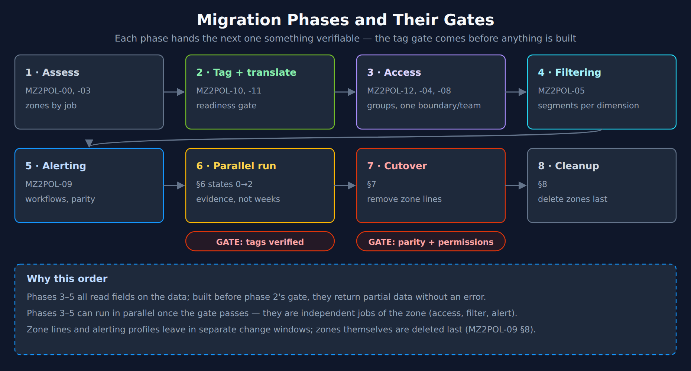
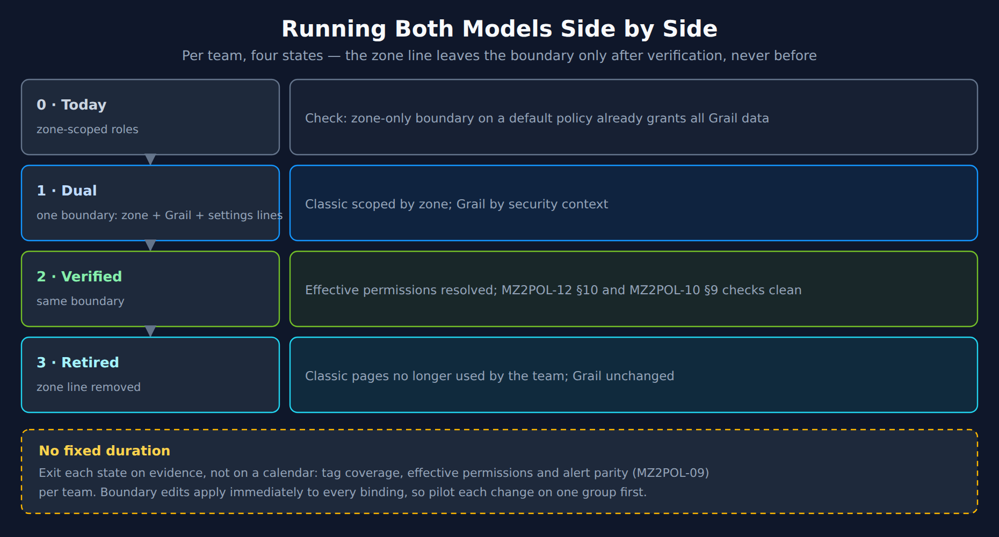

# MZ2POL-06: Migration Execution

> **Series:** MZ2POL — Management Zone Migration: Segments, Policies, Workflows | **Notebook:** 7 of 15 | **Created:** December 2025 | **Last Updated:** 10/13/2026

## Overview

This notebook provides a step-by-step guide for executing your migration from Management Zones to Policies, Boundaries, and Segments. It covers the parallel running period, cutover procedures, and rollback strategies.

---

## Table of Contents

1. [Migration Phase Overview](#migration-phase-overview)
2. [Phase 1: Foundation Setup](#phase-1-foundation-setup)
3. [Phase 2: Security Context Assignment](#phase-2-security-context-assignment)
4. [Phase 3: Policy & Boundary Configuration](#phase-3-policy-boundary-configuration)
5. [Phase 4: Segment Creation](#phase-4-segment-creation)
6. [Phase 5: Parallel Running](#phase-5-parallel-running)
7. [Phase 6: Cutover](#phase-6-cutover)
8. [Phase 7: Cleanup](#phase-7-cleanup)
9. [Rollback Procedures](#rollback-procedures)
10. [Migration Verification Queries](#migration-verification-queries)
11. [Additional Resources](#additional-resources)


---

## Prerequisites

- Completed MZ2POL-01 through MZ2POL-05
- Migration plan document (from MZ2POL-03)
- Policies and boundaries configured (from MZ2POL-04)
- Segments created (from MZ2POL-05)

## Learning Objectives

By the end of this notebook, you will:
1. Know how to execute each migration phase
2. Understand parallel running strategies
3. Be able to perform cutover safely
4. Know how to handle rollback if needed

---

<a id="migration-phase-overview"></a>
## 1. Migration Phase Overview

### Phase Summary



<!-- MARKDOWN_TABLE_ALTERNATIVE
| Phase | Notebooks | Hands over |
|---|---|---|
| 1 · Assess | MZ2POL-00, -03 | Zones classified by job |
| 2 · Tag + translate | MZ2POL-10, -11 | Readiness gate passed — GATE: tags verified |
| 3 · Access | MZ2POL-12, -04, -08 | Groups, one boundary per team |
| 4 · Filtering | MZ2POL-05 | Segments per dimension |
| 5 · Alerting | MZ2POL-09 | Workflows, alert parity |
| 6 · Parallel run | §6, states 0→2 | Evidence, not weeks — GATE: parity + permissions |
| 7 · Cutover | §7 | Zone lines removed |
| 8 · Cleanup | §8 | Zones deleted last |
| Why | Phases 3–5 read fields on the data; built before the gate they return partial data without an error. Phases 3–5 can run in parallel once it passes | |
For environments where SVG doesn't render
-->

The headings below keep this notebook's original phase numbering (Foundation → Cleanup); the diagram adds the two phases the series now runs first — assessment and the tag readiness gate.

### Risk Mitigation Strategy

- **Parallel running**: Both systems active simultaneously
- **Phased rollout**: Migrate groups incrementally
- **Rollback capability**: Document how to revert
- **Testing checkpoints**: Verify at each phase

---

<a id="phase-1-foundation-setup"></a>
## 2. Phase 1: Foundation Setup
### Checklist

- [ ] Create user groups in Account Management
- [ ] Document group → MZ mapping
- [ ] Verify Account Management access
- [ ] Backup current RBAC configuration

### Create User Groups

For each MZ-based access pattern, create a corresponding group:

| MZ Access Pattern | New Group Name |
|-------------------|----------------|
| Frontend Team MZ | `frontend-team` |
| Production MZ viewers | `prod-viewers` |
| SRE full access | `sre-team` |

### Via Account Management

1. Navigate to **Account Management** → **Identity & Access Management**
2. Select **Group Management**
3. Click **Create group**
4. Configure:
   - **Group name**: Match your naming convention
   - **Description**: Purpose and MZ equivalent
5. Add initial members (or leave empty for now)
6. Click **Save**

---

<a id="phase-2-security-context-assignment"></a>
## 3. Phase 2: Security Context Assignment
### Why Security Context?

Security context is the one record field that every Grail table accepts in an IAM condition (MZ2POL-12 §1). Before creating boundaries, the **data** — logs, spans, metrics, events — must carry it, not only the entities. Entity coverage alone is misleading: the classic *Grail Security Context* mapping can copy zone names onto entities, while the records from those entities *"do not inherit the management zones of that entity."*

> <sub>**Sources:** [Grant access to entities with security context (DT docs)](https://docs.dynatrace.com/docs/manage/identity-access-management/use-cases/access-security-context) — *"Logs, spans, metrics, and events powered by Grail that are sent from an entity do not inherit the management zones of that entity."*</sub>

### Query Current Security Context Coverage

```dql
// Security-context coverage on the DATA, per table.
// Records without dt.security_context are invisible to users scoped only by it.
fetch logs, from:-1h
| summarize {records = count(), without_sc = countIf(isNull(dt.security_context))}
| fieldsAdd table = "logs"
| append [fetch spans, from:-1h | summarize {records = count(), without_sc = countIf(isNull(dt.security_context))} | fieldsAdd table = "spans"]
| append [fetch events, from:-1h | summarize {records = count(), without_sc = countIf(isNull(dt.security_context) or arraySize(dt.security_context) == 0)} | fieldsAdd table = "events"]
| fieldsAdd without_pct = round(100.0 * without_sc / records, decimals: 1)
| fields table, records, without_sc, without_pct
```

### Assignment Methods

Set it where the data is produced, cheapest first — MZ2POL-10 §5 has the full ladder:

| Method | Best For |
|---|---|
| OneAgent host tag (`--set-host-tag` / `oneagentctl`) | Whole hosts owned by one team |
| `DT_TAGS` on the process | Shared hosts |
| Kubernetes namespace labels / annotations | Namespaces owned by one team |
| Central *Ingest enrichment configuration* (OneAgent 1.343+) | Values already present as host tags, host groups or naming conventions |
| OpenTelemetry resource attributes | OTel-instrumented services |
| OpenPipeline *Set security context* processor | Last resort — runs after routing |

Auto-tagging rules are **not** a method: they *"have no effect on Smartscape on Grail"* (MZ2POL-10 §2).

### Recommended: Derive It from the Tags You Already Have

If hosts already carry team or environment tags, promote them centrally rather than re-tagging hosts — an ingest enrichment rule reads `host.tags.<key>` and writes `dt.security_context` (and `primary_tags.team` in the same rule):

```text
host tag team:frontend                  → dt.security_context = team-frontend
host tag team:frontend + env:production → dt.security_context = prod/team-frontend
```

> <sub>**Sources:** [Differences between classic auto-tagging and primary Grail tags (DT docs)](https://docs.dynatrace.com/docs/platform/upgrade/foundations/tags-difference-classic) — *"Auto-tagging rules have no effect on Smartscape on Grail and are not used in any Latest Dynatrace app."*</sub>

### Checklist

- [ ] Identify security context naming strategy
- [ ] Map existing tags to security context values
- [ ] Apply security context at every relevant data producer
- [ ] Verify coverage with DQL query
- [ ] Document security context → team/env mapping

---

<a id="phase-3-policy-boundary-configuration"></a>
## 4. Phase 3: Policy & Boundary Configuration
### Verify Policies and Boundaries

Confirm policies and boundaries are created per MZ2POL-04:

- [ ] Built-in policies identified for each user type
- [ ] Custom policies created where needed
- [ ] One boundary per access scope with a line for every domain the bound policies grant — `storage:`, `settings:`, and `environment:management-zone` during the parallel run (MZ2POL-04 §6)
- [ ] Security context conditions configured
- [ ] Boundary naming follows convention
- [ ] Policy and boundary documentation complete

### Create Policy Bindings (Parallel Mode)

During parallel running, users have BOTH:
- Existing MZ-based RBAC access
- New policy-based access

**Important**: Users should see the same data with both systems.

### Binding Process

For each group:

1. Navigate to **Group Management**
2. Select the target group
3. Go to **Permissions** tab
4. Click **Add permission**
5. Configure:
   - **Policy**: Select appropriate policy
   - **Boundary**: Select matching boundary
   - **Environment**: Target environment
6. Click **Save**

### Binding Matrix Template

| Group | Policy | Boundary | Environment |
|-------|--------|----------|-------------|
| frontend-team | Standard User + Read Logs/Spans/Metrics | Frontend Team Scope | Production |
| sre-team | Pro User + All Grail data read access | All Production | Production |
| prod-viewers | Standard User + Read Logs/Metrics | Production Only | Production |

---

<a id="phase-4-segment-creation"></a>
## 5. Phase 4: Segment Creation
### Verify Segments

Confirm segments are created per MZ2POL-05:

- [ ] Segment for each MZ filtering use case
- [ ] Segment filters tested with DQL
- [ ] Segments shared with appropriate users

### Update Dashboards

For dashboards currently using MZ filtering:

1. Open dashboard in edit mode
2. Configure dashboard-level segment
3. Update individual tiles if needed
4. Save and test

### Segment Rollout Strategy

| Phase | Action |
|-------|--------|
| Week 1 | Create all segments, test internally |
| Week 2 | Share segments with pilot users |
| Week 3 | Update key dashboards to use segments |
| Week 4 | Communicate segment availability to all users |

---

<a id="phase-5-parallel-running"></a>
## 6. Phase 5: Parallel Running
### Duration

There is no documented duration. In community practice teams plan a few weeks per batch — but exit each state on evidence (tag coverage, effective permissions, alert parity), not on a calendar.



<!-- MARKDOWN_TABLE_ALTERNATIVE
| State | Boundary | Result |
|---|---|---|
| 0 · Today | Zone-scoped roles | Check: a zone-only boundary on a default policy already grants all Grail data |
| 1 · Dual | One boundary: zone + Grail + settings lines | Classic scoped by zone; Grail by security context |
| 2 · Verified | Same | Effective permissions resolved; MZ2POL-12 §10 and MZ2POL-10 §9 checks clean |
| 3 · Retired | Zone line removed | Classic pages no longer used by the team; Grail unchanged |
For environments where SVG doesn't render
-->

### During Parallel Running

| System | Status | User Experience |
|--------|--------|----------------|
| Management Zones | Active | Users see MZ-filtered data |
| Policies + Boundaries | Active | Access control via ABAC |
| Segments | Active | Users can select segments |

### Validation Queries

Compare data visibility between systems:

```dql
// Compare: Services visible via MZ
// Run as user with MZ access
fetch dt.entity.service
| filter in(managementZones, {"Frontend-Team"})
| summarize mzServiceCount = count()

// Note: dt.entity.* is deprecated, but this is a migration-ASSESSMENT query — it inspects
// the classic constructs this migration replaces, so keep the classic query above:
//   - management zones have NO Smartscape node equivalent; they are what this migration
//     replaces with segments and policies.
```

```dql
// Compare: Services visible via Segment
// Should match MZ count
fetch dt.entity.service
| filter matchesValue(tags, "team:frontend")
| summarize segmentServiceCount = count()

// Note: dt.entity.* is deprecated, but this is a migration-ASSESSMENT query — it inspects
// the classic constructs this migration replaces, so keep the classic query above:
//   - entity tags are not a flat "tags" field on Smartscape (resolve via getNodeField).
```

### Parallel Running Checklist

- [ ] All groups have policy bindings
- [ ] Users added to new groups
- [ ] Segments available and shared
- [ ] Dashboards updated (optional in parallel phase)
- [ ] Test users verify equivalent access
- [ ] Document any discrepancies

### Issue Tracking

Track issues during parallel running:

| Issue | MZ Behavior | New Model Behavior | Resolution |
|-------|-------------|-------------------|-------------|
| Example | Users see 100 services | Users see 95 services | Missing security context on 5 services |

---

<a id="phase-6-cutover"></a>
## 7. Phase 6: Cutover
### Cutover Prerequisites

- [ ] Parallel running completed successfully
- [ ] All discrepancies resolved
- [ ] User training completed
- [ ] Communication sent to stakeholders
- [ ] Rollback plan documented

### Cutover Steps

#### Step 1: Update Dependencies

Before removing MZ access:

- [ ] Alerting profiles: rebuild as problem-triggered workflows. The MZ filter has **no successor** inside the alerting model — route on affected-entity tags plus an optional DQL matcher on the problem record. Segments do not scope alerting
- [ ] API integrations: Update to use new access model
- [ ] Automation workflows: Verify still functional

#### Step 2: Remove RBAC MZ Assignments

For each user/group:

1. Navigate to user/group management
2. Remove MZ-based permission assignments
3. Verify policy-based access still works

#### Step 3: Verify Access

For each user type:

1. Log in as test user
2. Verify expected data access
3. Verify restricted data not accessible
4. Document verification result

#### Step 4: Monitor

For 24-48 hours after cutover:

- Monitor for access issues
- Check support tickets
- Verify critical workflows

### Cutover Communication Template

```
Subject: Dynatrace Access Model Migration - Cutover Complete

Team,

We have completed the migration from Management Zones to the new
Policies/Boundaries/Segments access model.

What changed:
- Access is now controlled via IAM Policies
- Data filtering uses Segments (select in app header)
- Management Zone filters no longer work in new apps

Action required:
- Select your team's Segment when using Logs, Traces, Services apps
- Report any access issues to [contact]

Documentation: [link to internal docs]

Questions? Contact [team/channel]
```

---

<a id="phase-7-cleanup"></a>
## 8. Phase 7: Cleanup
### Post-Cutover Cleanup

After successful cutover (recommended: wait 2+ weeks):

#### Step 1: Archive MZ Configuration

- Export MZ settings via API
- Store in version control or documentation
- Document MZ → new model mapping

#### Step 2: Remove Unused MZs

**Caution**: Only remove MZs no longer referenced anywhere

- [ ] Verify no alerting profiles use MZ (and that each has a live workflow replacement running in parallel)
- [ ] Verify no API integrations use MZ
- [ ] Verify no dashboards rely on MZ filtering
- [ ] Delete MZ via Settings

#### Step 3: Update Documentation

- [ ] Update internal runbooks
- [ ] Update onboarding documentation
- [ ] Archive MZ-related documentation
- [ ] Create new model reference guide

---

<a id="rollback-procedures"></a>
## 9. Rollback Procedures
### When to Rollback

- Critical access issues affecting multiple users
- Data visibility significantly different than expected
- Business-critical workflows broken

### Rollback Steps

#### Quick Rollback (During Parallel Running)

1. Communicate rollback to users
2. Instruct users to use MZ filtering (classic apps)
3. Investigate and resolve issues
4. Re-attempt cutover when ready

#### Full Rollback (After Cutover)

1. Re-enable RBAC MZ assignments, or re-add the `environment:management-zone` line to the team boundary
2. Communicate to users
3. Document what went wrong
4. Create remediation plan
5. Schedule new cutover date

### Rollback Checklist

- [ ] Identify affected users/groups
- [ ] Re-apply MZ-based RBAC
- [ ] Verify access restored
- [ ] Communicate status
- [ ] Document root cause

---

<a id="migration-verification-queries"></a>
## 10. Migration Verification Queries
### Final Verification

```dql
// Verify: security-context coverage on the DATA is complete enough to cut over.
// Entity coverage is not a substitute — entity contexts may be copied from zone names.
fetch logs, from:-1h
| summarize {records = count(), without_sc = countIf(isNull(dt.security_context))}
| fieldsAdd table = "logs"
| append [fetch spans, from:-1h | summarize {records = count(), without_sc = countIf(isNull(dt.security_context))} | fieldsAdd table = "spans"]
| append [fetch events, from:-1h | summarize {records = count(), without_sc = countIf(isNull(dt.security_context) or arraySize(dt.security_context) == 0)} | fieldsAdd table = "events"]
| fieldsAdd without_pct = round(100.0 * without_sc / records, decimals: 1)
| filter without_sc > 0
| fields table, records, without_sc, without_pct
```

```dql
// Verify: the hosts whose DATA carries the replacement tag match the zone's hosts.
// Replace the zone name and the tag condition (see MZ2POL-10 §9 Step 5).
fetch logs, from:-1h
| filter isNotNull(dt.entity.host)
| summarize {tagged = countIf(primary_tags.team == "frontend"), records = count()}, by:{dt.entity.host}
| fieldsAdd carries_tag = tagged > 0
| lookup [fetch dt.entity.host | fields id, entity.name, managementZones],
    sourceField: dt.entity.host, lookupField: id, fields: {entity.name, managementZones}
| fieldsAdd in_zone = in("Frontend-Team", managementZones)
| fieldsAdd verdict = if(in_zone and carries_tag, "match",
    else: if(in_zone, "in zone, tag missing",
    else: if(carries_tag, "tagged, not in zone", else: "neither")))
| summarize {hosts = count()}, by:{verdict}
| sort hosts desc
```

---

## Summary

In this notebook, you learned:

1. **Migration phases**: Foundation → Security Context → Policies → Segments → Parallel → Cutover → Cleanup
2. **Parallel running**: How to run both systems simultaneously
3. **Cutover process**: Step-by-step cutover with verification
4. **Rollback procedures**: How to revert if needed

## Next Steps

Continue to **MZ2POL-07: Validation and Troubleshooting** to:
- Validate migration success
- Troubleshoot common issues
- Perform ongoing maintenance

<a id="additional-resources"></a>
## Additional Resources
- [Upgrade from RBAC to IAM Policies](https://docs.dynatrace.com/docs/manage/identity-access-management/permission-management/manage-user-permissions-policies/advanced/migrate-roles)
- [Management Zones Documentation](https://docs.dynatrace.com/docs/manage/identity-access-management/permission-management/management-zones)
- [Grant Access to Dynatrace](https://docs.dynatrace.com/docs/manage/identity-access-management/use-cases/access-platform)

---

<sub>*This notebook was AI-generated from community-submitted and publicly available sources. This notebook series is not officially supported by Dynatrace. Always verify information against official Dynatrace documentation.*</sub>
