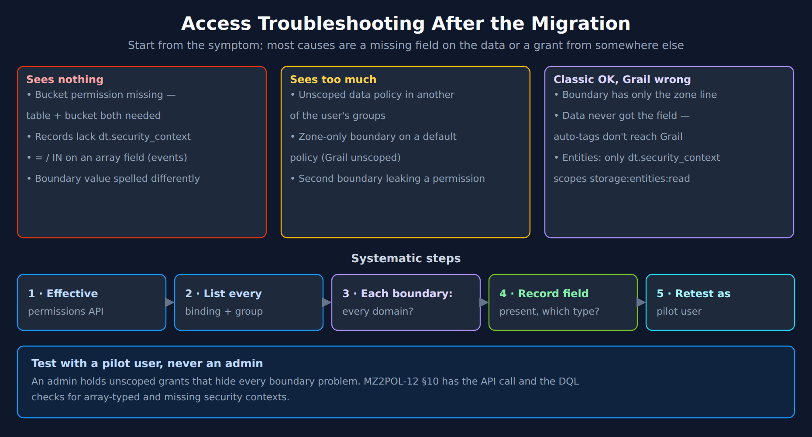

# MZ2POL-07: Validation and Troubleshooting

> **Series:** MZ2POL — Management Zone Migration: Segments, Policies, Workflows | **Notebook:** 8 of 17 | **Created:** December 2025 | **Last Updated:** 10/13/2026

## Overview

This notebook provides comprehensive validation procedures and troubleshooting guidance for your migration from Management Zones to Policies, Boundaries, and Segments. Use this guide to verify your migration success and resolve common issues.

---

## Table of Contents

1. [Migration Validation Checklist](#migration-validation-checklist)
2. [Security Context Validation](#security-context-validation)
3. [Access Control Validation](#access-control-validation)
4. [Segment Validation](#segment-validation)
5. [Common Issues and Troubleshooting](#common-issues-and-troubleshooting)
6. [Diagnostic Queries](#diagnostic-queries)
7. [Ongoing Maintenance](#ongoing-maintenance)
8. [Health Monitoring Queries](#health-monitoring-queries)
9. [Best Practices Summary](#best-practices-summary)
10. [Migration Complete!](#migration-complete)
11. [Additional Resources](#additional-resources)


---

## Prerequisites

- Completed migration (MZ2POL-06), including the tag readiness gate (MZ2POL-10 §9–§10) and, if zones scoped alerting, the workflow cutover (MZ2POL-09)
- Admin access to Dynatrace — to confirm data exists, never to judge access
- Pilot user accounts for validation, one per persona (MZ2POL-12 §7)

## Learning Objectives

By the end of this notebook, you will:
1. Be able to validate migration completeness
2. Know how to troubleshoot common access issues
3. Understand ongoing maintenance requirements
4. Have queries for monitoring access health

---

<a id="migration-validation-checklist"></a>
## 1. Migration Validation Checklist
### Component Validation

| Component | Validation | Status |
|-----------|------------|--------|
| User Groups | All groups created and populated | ☐ |
| Policies | Policies bound to all groups | ☐ |
| Boundaries | Boundaries applied where needed | ☐ |
| Tag readiness | MZ2POL-10 readiness gate passed | ☐ |
| Security Context | Records (logs, spans, events) carry it at the agreed coverage — measured per table, not on entities (§2) | ☐ |
| Segments | Segments created for all filtering needs | ☐ |
| Dashboards | Updated to use segments | ☐ |
| Alerts | Zone-scoped alerting profiles rebuilt as problem-triggered workflows; alert parity confirmed by the receiving teams (MZ2POL-09) — segments do not scope alerting | ☐ |

### Access Validation Matrix

For each user type, verify:

| User Type | Can Access | Cannot Access | Verified |
|-----------|------------|---------------|----------|
| Frontend Dev | Frontend services | Backend services | ☐ |
| SRE | All production | Development | ☐ |
| Viewer | View dashboards | Edit settings | ☐ |

---

<a id="security-context-validation"></a>
## 2. Security Context Validation
### Check Coverage on Records, Not Entities

Measure security context on the **data** — logs, spans, events — the same way as MZ2POL-06 §3 and MZ2POL-12 §10. Entity coverage proves nothing: the classic *Grail Security Context* mapping can copy zone names onto entities, and the records those entities send *"do not inherit the management zones of that entity."* On the validation tenant on 10/13/2026, all 35 services and all 24 hosts carried a security context, while 41.1% of logs and 75.3% of events in the same hour carried none.

`dt.security_context` is an **array** on classic entities, Smartscape nodes, events and problem records alike, and a string on logs and spans on the validation tenant. Count events with `arraySize()`, not `isNull()`; check the type per table with MZ2POL-12 §10 Check 1.

> <sub>**Sources:** [Grant access to entities with security context (DT docs)](https://docs.dynatrace.com/docs/manage/identity-access-management/use-cases/access-security-context) — *"Logs, spans, metrics, and events powered by Grail that are sent from an entity do not inherit the management zones of that entity."* Counts executed against the validation tenant, 10/13/2026.</sub>

```dql
// Validate: security-context coverage on the DATA, per table (same pattern as MZ2POL-06 §3).
// Records without it are invisible to users scoped only by dt.security_context.
// Executed 10/13/2026: logs 58.9% / spans 100% / events 24.7% covered (last hour).
fetch logs, from:-1h
| summarize {records = count(), without_sc = countIf(isNull(dt.security_context))}
| fieldsAdd table = "logs"
| append [fetch spans, from:-1h | summarize {records = count(), without_sc = countIf(isNull(dt.security_context))} | fieldsAdd table = "spans"]
| append [fetch events, from:-1h | summarize {records = count(), without_sc = countIf(isNull(dt.security_context) or arraySize(dt.security_context) == 0)} | fieldsAdd table = "events"]
| fieldsAdd coverage_pct = round(100.0 * (records - without_sc) / records, decimals: 1)
| fields table, records, without_sc, coverage_pct
```

```dql
// Find the PRODUCERS whose records lack a security context.
// Fix these at the source (MZ2POL-10 §5) — not on the entity.
// Executed 10/13/2026: the top rows were Kubernetes namespaces (log collectors, platform namespaces).
fetch logs, from:-1h
| filter isNull(dt.security_context)
| summarize {records = count()}, by:{dt.entity.host, k8s.namespace.name}
| sort records desc
| limit 20
```

```dql
// Validate: event coverage per event kind. dt.security_context is an ARRAY on events.
// Executed 10/13/2026 over 24 h: DAVIS_EVENT 79.1%, DAVIS_PROBLEM 77.7%, FLEET_EVENT 77.5%,
// SYNTHETIC_EVENT 14.6% without a security context.
fetch events, from:-24h
| summarize {records = count(),
             without_sc = countIf(isNull(dt.security_context) or arraySize(dt.security_context) == 0)},
  by:{event.kind}
| fieldsAdd without_pct = round(100.0 * without_sc / records, decimals: 1)
| sort without_sc desc
```

### Verify Security Context Distribution

```dql
// Distribution of security-context values on the DATA.
// Verify expected teams/environments are represented — and nothing unexpected.
// On logs the field is a string on the validation tenant; for events, expand the array first.
fetch logs, from:-1h
| filter isNotNull(dt.security_context)
| summarize {records = count()}, by:{dt.security_context}
| sort records desc
| limit 20
```

---

<a id="access-control-validation"></a>
## 3. Access Control Validation
### Test User Access Scenarios

Test **permissions**, not views. A segment narrows what a query returns whether or not the user is allowed to see more, so a scenario that selects a segment and then sees "only frontend services" proves nothing about access. Run every scenario **with no segment selected**, signed in as a **pilot user** who holds only the persona's groups — never an admin, whose grants hide boundary problems (§5, step 5).

For each test scenario:
1. Resolve the pilot user's effective permissions first (MZ2POL-12 §10) — look for any `storage:*:read` without a condition
2. Sign in as the pilot user, with no segment selected
3. Run the same DQL query the persona will use, and an equivalent query for data outside its scope
4. Document results, including record counts

### Scenario 1: Team-Based Access

**Test User**: Pilot user holding only the `frontend-team` group
**Expected**: Records carrying the frontend security context only

**Validation Steps**:
1. With no segment selected, run `fetch logs, from:-1h | summarize {records = count()}, by:{dt.security_context}` → only the frontend value(s) should appear
2. Open the Services app with no segment selected → only frontend services visible
3. Open a backend service directly by link → should fail or show no data
4. Compare the record count with an admin run of the same query filtered to the frontend value — they should match; a lower count means records without the field (§2)

### Scenario 2: Environment Restriction

**Test User**: Pilot user holding only the `prod-viewers` group
**Expected**: Production data only, no edit

**Validation Steps**:
1. With no segment selected, query logs → only production security-context values appear
2. Query for a non-production value explicitly (`filter dt.security_context == "<non-prod value>"`) → zero records; confirm with an admin that such records exist, so the zero is the boundary and not an empty table
3. Try editing settings → should fail
4. Only then select the "Production" segment and confirm it changes the **view**, not the access — the results should be a subset of step 1

### Scenario 3: Full Access (SRE)

**Test User**: Pilot user holding only the `sre-team` group
**Expected**: Full access to production environment

**Validation Steps**:
1. Open any app with no segment selected
2. Verify data visible across all services, including records **without** a security context (an unscoped grant is the only way to see those)
3. Verify edit capabilities work
4. Verify settings access

---

<a id="segment-validation"></a>
## 4. Segment Validation
### Verify Segment Data Match

Compare segment results with expected MZ results:

```dql
// Compare: MZ entity count vs Segment entity count
// Replace with your MZ name and segment filter
fetch dt.entity.service
| summarize 
    viaMZ = countIf(in(managementZones, {"Frontend-Team"})),
    viaSegment = countIf(matchesValue(tags, "team:frontend"))
| fields viaMZ, viaSegment,
         match = if(viaMZ == viaSegment, then: "MATCH", else: "MISMATCH")

// Note: dt.entity.* is deprecated, but this is a migration-ASSESSMENT query — it inspects
// the classic constructs this migration replaces, so keep the classic query above:
//   - management zones have NO Smartscape node equivalent; they are what this migration
//     replaces with segments and policies.
//   - on Smartscape nodes `tags` is a record read as tags[<key>], and it carries no classic
//     auto-tags (MZ2POL-10 §2) — this check reads the classic tag array on purpose.
```

```dql
// Find entities in MZ but not matching segment filter
// These are migration gaps
fetch dt.entity.service
| filter in(managementZones, {"Frontend-Team"})
| filter NOT matchesValue(tags, "team:frontend")
| fields entity.name, tags, managementZones

// Note: dt.entity.* is deprecated, but this is a migration-ASSESSMENT query — it inspects
// the classic constructs this migration replaces, so keep the classic query above:
//   - management zones have NO Smartscape node equivalent; they are what this migration
//     replaces with segments and policies.
//   - on Smartscape nodes `tags` is a record read as tags[<key>], and it carries no classic
//     auto-tags (MZ2POL-10 §2) — this check reads the classic tag array on purpose.
```

```dql
// Find entities matching segment but not in MZ
// May indicate over-inclusion in new model
fetch dt.entity.service
| filter matchesValue(tags, "team:frontend")
| filter NOT in(managementZones, {"Frontend-Team"})
| fields entity.name, tags, managementZones

// Note: dt.entity.* is deprecated, but this is a migration-ASSESSMENT query — it inspects
// the classic constructs this migration replaces, so keep the classic query above:
//   - management zones have NO Smartscape node equivalent; they are what this migration
//     replaces with segments and policies.
//   - on Smartscape nodes `tags` is a record read as tags[<key>], and it carries no classic
//     auto-tags (MZ2POL-10 §2) — this check reads the classic tag array on purpose.
```

---

<a id="common-issues-and-troubleshooting"></a>
## 5. Common Issues and Troubleshooting


<!-- MARKDOWN_TABLE_ALTERNATIVE
| Symptom | Likely causes |
|---|---|
| Sees nothing | Bucket permission missing (table + bucket both needed); records lack dt.security_context; = / IN on an array field (events); boundary value spelled differently |
| Sees too much | Unscoped data policy in another of the user's groups; zone-only boundary on a default policy (Grail unscoped); second boundary leaking a permission |
| Classic OK, Grail wrong | Boundary has only the zone line; data never got the field (auto-tags don't reach Grail); entities are scoped only by dt.security_context |
| Steps | 1 effective-permissions API → 2 list every binding and group → 3 each boundary covers every domain? → 4 record field present, which type? → 5 retest as a pilot user (never an admin) |
For environments where SVG doesn't render
-->

### Issue 1: User Can't See Any Data

**Symptoms**:
- Apps show empty results
- DQL queries return no records

**Troubleshooting**:

| Check | Action |
|-------|--------|
| Group membership | Verify user is in correct group |
| Policy binding | Verify group has policy bound |
| Boundary scope | Verify boundary isn't too restrictive |
| Data policy | Verify a data-read policy (`Read Logs` / `All Grail data read access`) is included |
| Segment selection | Check if restrictive segment is active |

**Resolution Steps**:
1. Check user's group membership in Account Management
2. Verify group has appropriate policy binding
3. Review boundary conditions
4. Test with admin account to verify data exists

### Issue 2: User Sees Too Much Data

**Symptoms**:
- User sees data outside their scope
- Cross-team data visible

**Troubleshooting**:

| Check | Action |
|-------|--------|
| Boundary conditions | Verify boundary is correctly restrictive |
| Multiple group membership | User may be in multiple groups |
| Security context | Verify the **records** carry the correct value (§2) — entity contexts may be copied from zone names |
| Policy conditions | Check for overly broad conditions |

**Resolution Steps**:
1. Review all groups user belongs to
2. Check all policy bindings for those groups
3. Verify boundary conditions are correct
4. Check the security-context values on the visible records (§2, distribution query)

### Issue 3: Segment Filter Not Working

**Symptoms**:
- Segment selected but data not filtered
- Same data visible with/without segment

**Troubleshooting**:

| Check | Action |
|-------|--------|
| Segment syntax | Verify DQL filter is correct |
| Tag existence | Verify entities have expected tags |
| App support | Verify app supports segments |
| Segment sharing | Verify segment is shared with user |

**Resolution Steps**:
1. Test segment filter as standalone DQL query
2. Verify tags exist on target entities
3. Check segment is shared/public
4. Try segment in different app

### Issue 4: Classic Apps Work, New Apps Don't

**Symptoms**:
- Legacy UI shows expected data
- New apps (Services, Logs) show no/wrong data

**Causes** (the diagram's *Classic OK, Grail wrong* row; MZ2POL-12 §4):
- **The boundary has only the zone line.** It scopes classic pages; the Grail permissions bound with it get no condition from it. On a default policy they come out **unscoped** (MZ2POL-12 §4.2), so the Grail app shows the team more than the classic page did
- **The data lacks the field.** Records the team needs carry no `dt.security_context` value it is granted — typically because the value lived in an auto-tag or a zone, neither of which reaches Grail records (§2, MZ2POL-10 §2)
- **Entities are scoped only by `dt.security_context`.** `storage:entities:read` accepts `dt.security_context` and `entity.type`; zone membership does not scope entity reads in Grail apps, so an entity whose context is missing or zone-derived behaves differently from the classic page

**Resolution**:
1. Resolve the user's effective permissions (MZ2POL-12 §10) and confirm the boundary has a `storage:` line as well as the zone line
2. Run the §2 record-coverage queries for the team's producers; set the value at the source (MZ2POL-10 §5)
3. Retest as the pilot user with **no segment selected** — a segment changes the view, never the access, so it cannot fix this

---

<a id="diagnostic-queries"></a>
## 6. Diagnostic Queries
### Check Entity Tag Distribution

```dql
// Analyze tag patterns for segment creation
fetch dt.entity.service
| expand tag = tags
| parse tag, "LD:key ':' LD:value"
| summarize count = count(), by:{key}
| sort count desc
| limit 20

// Note: dt.entity.* is deprecated, but this is a migration-ASSESSMENT query — it inspects
// the classic constructs this migration replaces, so keep the classic query above:
//   - on Smartscape nodes `tags` is a record read as tags[<key>], and it carries no classic
//     auto-tags (MZ2POL-10 §2) — this check reads the classic tag array on purpose.
```

```dql
// Find entities without standard tags
// These may need tagging for segment filters
fetch dt.entity.service
| filter NOT matchesValue(tags, "team:*")
| filter NOT matchesValue(tags, "env:*")
| fields entity.name, tags
| limit 50

// Note: dt.entity.* is deprecated, but this is a migration-ASSESSMENT query — it inspects
// the classic constructs this migration replaces, so keep the classic query above:
//   - on Smartscape nodes `tags` is a record read as tags[<key>], and it carries no classic
//     auto-tags (MZ2POL-10 §2) — this check reads the classic tag array on purpose.
```

### Check MZ Assignment Health

```dql
// Entities with MZ but no security context.
// dt.security_context is an ARRAY on classic entities (and on Smartscape nodes): test arraySize(), not isNull().
// A pass here proves little — an MZ-derived context counts as present (MZ2POL-12 §10, Check 3).
// Executed 10/13/2026: 0 rows; control: all 35 services carry a one-element array.
fetch dt.entity.service
| filter arraySize(managementZones) > 0
| filter isNull(dt.security_context) or arraySize(dt.security_context) == 0
| fields entity.name, managementZones, tags
| limit 50

// Note: dt.entity.* is deprecated, but this is a migration-ASSESSMENT query — it inspects
// the classic constructs this migration replaces, so keep the classic query above:
//   - management zones have NO Smartscape node equivalent; they are what this migration
//     replaces with segments and policies.
```

```dql
// MZ to tag alignment check
// Verify MZ membership aligns with tags used in segments
fetch dt.entity.service
| expand mz = managementZones
| summarize {
    entityCount = count(),
    withTeamTag = countIf(matchesValue(tags, "team:*")),
    withEnvTag = countIf(matchesValue(tags, "env:*"))
  }, by:{mz}
| sort entityCount desc

// Note: dt.entity.* is deprecated, but this is a migration-ASSESSMENT query — it inspects
// the classic constructs this migration replaces, so keep the classic query above:
//   - management zones have NO Smartscape node equivalent; they are what this migration
//     replaces with segments and policies.
//   - on Smartscape nodes `tags` is a record read as tags[<key>], and it carries no classic
//     auto-tags (MZ2POL-10 §2) — this check reads the classic tag array on purpose.
```

---

<a id="ongoing-maintenance"></a>
## 7. Ongoing Maintenance
### Regular Validation Tasks

| Task | Frequency | Purpose |
|------|-----------|----------|
| Security context audit | Weekly | Ensure new producers' records carry it (§2) |
| Segment effectiveness | Monthly | Verify segments return expected data |
| Access review | Quarterly | Verify user access is appropriate |
| Policy review | Quarterly | Ensure policies match requirements |

### New Entity Onboarding

When new services/hosts are deployed:

1. **Enrichment at source**: Ensure the deployment sets the team and environment values — `--set-host-tag`, `DT_TAGS`, Kubernetes annotations, OTel resource attributes or the central ingest enrichment configuration (MZ2POL-10 §5). Auto-tagging rules do not reach Grail data
2. **Security context**: Verify the new producer's **records** carry it (§2)
3. **Segment inclusion**: Verify entity appears in appropriate segments
4. **Access verification**: Test user access to new entity

### New User Onboarding

When new users join:

1. Add user to appropriate group(s)
2. Communicate available segments
3. Provide access documentation
4. Verify access works as expected

---

<a id="health-monitoring-queries"></a>
## 8. Health Monitoring Queries
### Create Monitoring Dashboard

Use these queries for an access health dashboard:

```dql
// KPI: security-context coverage on the DATA, per table (one bar per table).
// Same pattern as §2 and MZ2POL-06 §3.
fetch logs, from:-1h
| summarize {records = count(), without_sc = countIf(isNull(dt.security_context))}
| fieldsAdd table = "logs"
| append [fetch spans, from:-1h | summarize {records = count(), without_sc = countIf(isNull(dt.security_context))} | fieldsAdd table = "spans"]
| append [fetch events, from:-1h | summarize {records = count(), without_sc = countIf(isNull(dt.security_context) or arraySize(dt.security_context) == 0)} | fieldsAdd table = "events"]
| fieldsAdd coverage_pct = round(100.0 * (records - without_sc) / records, decimals: 1)
| fields table, coverage_pct
```

```dql
// KPI: log records per security-context value.
// Monitor for unexpected growth/decline, and for values no boundary grants.
fetch logs, from:-1h
| filter isNotNull(dt.security_context)
| summarize {records = count()}, by:{dt.security_context}
| sort records desc
| limit 10
```

```dql
// KPI: log records no scope can reach — no security context, no team tag,
// and no built-in field a boundary or segment could use (migration gaps).
// Executed 10/13/2026: 15,432 of 796,892 log records (1.9%) in the last hour.
fetch logs, from:-1h
| summarize {records = count(),
             no_scope = countIf(isNull(dt.security_context) and isNull(primary_tags.team)
                                and isNull(k8s.namespace.name) and isNull(dt.host_group.id))}
| fieldsAdd no_scope_pct = round(100.0 * no_scope / records, decimals: 1)
```

---

<a id="best-practices-summary"></a>
## 9. Best Practices Summary
### Access Control

- ✅ Use groups, not individual user permissions
- ✅ Apply least privilege principle
- ✅ Document all policy bindings
- ✅ Regular access reviews

### Segments

- ✅ Align with organizational structure
- ✅ Use consistent naming conventions
- ✅ Test filters before deployment
- ✅ Share segments appropriately

### Boundaries

- ✅ Create reusable boundaries
- ✅ Use security context for entity-level control
- ✅ Document boundary purpose
- ✅ Keep conditions simple

### Maintenance

- ✅ Automate security context assignment
- ✅ Monitor access health metrics
- ✅ Review and update documentation
- ✅ Train new team members

---

## Summary

In this notebook, you learned:

1. **Validation procedures**: How to verify migration success
2. **Troubleshooting**: Common issues and resolutions
3. **Diagnostic queries**: DQL for investigating access problems
4. **Ongoing maintenance**: Regular tasks for access health
5. **Health monitoring**: Queries for access dashboards

<a id="migration-complete"></a>
## Migration Complete!
Congratulations on completing the MZ2POL migration series. You have:

- ✅ Understood why migration is necessary (MZ2POL-01)
- ✅ Learned the new access control model (MZ2POL-02)
- ✅ Assessed and planned your migration (MZ2POL-03)
- ✅ Configured policies and boundaries (MZ2POL-04)
- ✅ Implemented segments (MZ2POL-05)
- ✅ Executed the migration (MZ2POL-06)
- ✅ Validated and can troubleshoot (MZ2POL-07)
- ✅ Templated policies for scale (MZ2POL-08)
- ✅ Rebuilt zone-scoped alerting as problem-triggered workflows (MZ2POL-09)
- ✅ Put the context on the data and passed the readiness gate (MZ2POL-10)
- ✅ Translated zone rules to values at the source (MZ2POL-11)
- ✅ Checked the access design against the IAM reference architecture (MZ2POL-12)
- ✅ Know what is and is not documented about Spaces (MZ2POL-13)
- ✅ Ran the zone-disposition workshop (MZ2POL-14)

<a id="additional-resources"></a>
## Additional Resources
- [Access Management Concepts](https://docs.dynatrace.com/docs/manage/identity-access-management/permission-management/access-concepts)
- [Dynatrace Community - Boundaries + Policies Best Practices](https://community.dynatrace.com/t5/Open-Q-A/Boundaries-Policies-Best-Practices-Advice/td-p/284808)
- [Segments Documentation](https://docs.dynatrace.com/docs/manage/segments/concepts/segments-concepts-queries)
- [IAM Policy Reference](https://docs.dynatrace.com/docs/manage/identity-access-management/permission-management/manage-user-permissions-policies/advanced/iam-policystatements)
- [Policy Templating](https://docs.dynatrace.com/docs/manage/identity-access-management/permission-management/manage-user-permissions-policies/advanced/iam-policy-templating)

---

<sub>*This notebook was AI-generated from community-submitted and publicly available sources. This notebook series is not officially supported by Dynatrace. Always verify information against official Dynatrace documentation.*</sub>
