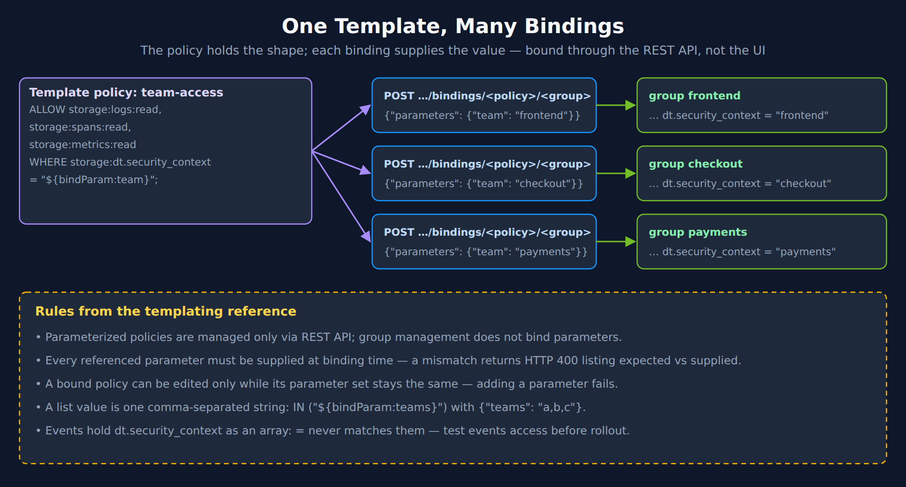
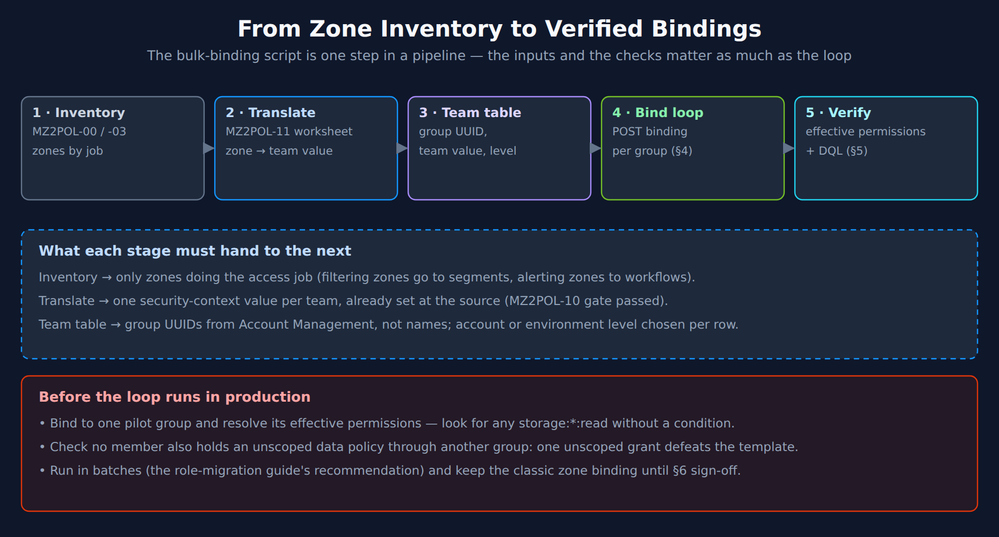

# MZ2POL-08: Templated Policies for MZ Migration

> **Series:** MZ2POL — Management Zone Migration: Segments, Policies, Workflows | **Notebook:** 9 of 17 | **Created:** February 2026 | **Last Updated:** 10/13/2026

## Overview

When migrating from Management Zones at scale, organizations with dozens of MZ-based teams face the challenge of creating and maintaining an equivalent number of IAM policies. Policy templating with `${bindParam:...}` parameters eliminates this duplication.

This notebook shows how to convert common MZ access patterns into parameterized policy templates, bind them at scale via the IAM API, and validate the migrated access using DQL queries.

---

## Table of Contents

1. [Why Templates Matter for MZ Migration](#why-templates-for-migration)
2. [Converting MZ Patterns to Parameterized Policies](#converting-mz-patterns)
3. [Template Patterns for Common MZ Replacements](#template-patterns)
4. [Bulk Binding via IAM API](#bulk-binding)
5. [Validating Migrated Access with DQL](#validating-access)
6. [Before/After Comparison Patterns](#before-after-comparison)

---

## Prerequisites

| Requirement | Details |
|-------------|----------|
| **Dynatrace Environment** | SaaS with Gen3 IAM and Grail enabled |
| **Permissions** | Account permission **View and manage users and groups** for group management in Account Management ([Role-based permissions (DT docs)](https://docs.dynatrace.com/docs/manage/identity-access-management-classic/permission-management/role-based-permissions)) |
| **API Access** | An **OAuth client** — the Account Management API authenticates with OAuth tokens — with `account-idm-read` to list groups ([GET groups (DT docs)](https://docs.dynatrace.com/docs/dynatrace-api/account-management-api/group-management-api/get-all-groups)) and `iam-policies-management` to create policies and bindings ([POST bindings of a policy (DT docs)](https://docs.dynatrace.com/docs/dynatrace-api/account-management-api/policy-management-api/bindings/post-policy-binding) — *"Allow IAM policy configuration for environments"*) |
| **Prior Knowledge** | **MZ2POL-04: Policies and Boundaries** (G-P-B pattern, policy syntax) |
| **Migration Status** | MZ assessment complete (**MZ2POL-03**), security context assigned |

<a id="why-templates-for-migration"></a>
## 1. Why Templates Matter for MZ Migration

### The Scale Problem

In community practice, large estates run to dozens of management zones. Not every zone does an access job — some only filter or route alerts (MZ2POL-03) — but every zone that does would need its own policy if each were translated one-to-one.

| Approach | Policies to Create | Maintenance Effort | Audit Complexity |
|----------|-------------------|-------------------|------------------|
| **One policy per MZ** | One per access zone | High — each permission change is repeated in every policy | One policy per zone to review |
| **Templated policies** | A few templates | Low — edit template once, all bindings updated | A few templates + bindings |

### Where Templates Fit in the Migration Phases

Templates matter most in Phases 3 and 5 of **MZ2POL-06**:

| Phase (MZ2POL-06) | Activity | Template Role |
|-------|----------|---------------|
| Phase 1: Foundation Setup | Create groups, map zones to groups | Classify each zone → pick the template it uses |
| Phase 2: Security Context Assignment | Set security context at the source | Values become template parameter values |
| **Phase 3: Policy & Boundary Configuration** | Create policies and bindings | **Create a few templates instead of one policy per zone; bulk bind via the IAM API** |
| Phase 4: Segment Creation | Segments | No template impact |
| **Phase 5: Parallel Running** | Verify access | **Effective permissions + DQL to validate bindings** |
| Phases 6–7: Cutover, Cleanup | Remove zones | No template impact |

<a id="converting-mz-patterns"></a>
## 2. Converting MZ Patterns to Parameterized Policies

Each MZ type maps to a specific template pattern. Every template below follows three rules:

- **A bucket permission for every table permission.** `storage:buckets:read` is *"Required additionally to a table permission"*. It does not accept `storage:dt.security_context`, so it is scoped by table name; the record condition on the table permission does the team scoping.
- **`IN` with a list-valued parameter** for `logs`, `spans`, `metrics` and `bizevents` — documented for templates, and one binding can then carry several values (Pattern C).
- **Events in their own statement with `MATCH`.** Event records hold `dt.security_context` as an array, which `=`, `IN` and `startsWith` never match (warning below).

### Vertical MZ (Environment-Based)

**Before:** MZ "Production" with host group rules.

**Template:**
```
ALLOW storage:buckets:read
  WHERE storage:table-name IN ("logs", "spans", "metrics", "events", "bizevents");
ALLOW storage:logs:read, storage:spans:read, storage:metrics:read, storage:bizevents:read
  WHERE storage:dt.security_context IN ("${bindParam:environment}");
ALLOW storage:events:read
  WHERE storage:dt.security_context MATCH ("${bindParam:environment}");
ALLOW settings:objects:read
  WHERE settings:dt.security_context IN ("${bindParam:environment}");
```

**Bindings:**
- Production team: `{"parameters": {"environment": "prod"}}`
- Staging team: `{"parameters": {"environment": "staging"}}`

### Horizontal MZ (Team-Based)

**Before:** MZ "Frontend-Team" with service tag rules.

**Template:**
```
ALLOW storage:buckets:read WHERE storage:table-name IN ("logs", "spans", "metrics");
ALLOW storage:logs:read, storage:spans:read, storage:metrics:read
  WHERE storage:dt.security_context IN ("${bindParam:team}");
```

**Binding:** `{"parameters": {"team": "team-frontend"}}`

### LOB MZ (Line of Business)

**Before:** MZ "LOB5" with combined host group + service tag rules.

**Template (Grail and settings — the classic domain is covered below):**
```
ALLOW storage:buckets:read
  WHERE storage:table-name IN ("logs", "spans", "metrics", "events", "bizevents");
ALLOW storage:logs:read, storage:spans:read, storage:metrics:read, storage:bizevents:read
  WHERE storage:dt.security_context IN ("${bindParam:lob}");
ALLOW storage:events:read
  WHERE storage:dt.security_context MATCH ("${bindParam:lob}");
ALLOW settings:objects:read, settings:objects:write
  WHERE settings:dt.security_context IN ("${bindParam:lob}");
```

> **Storage writes cannot be condition-scoped (live-verified 07/2026):** wildcards are rejected and `storage:logs:write WHERE ...` fails with `Invalid condition name`. Where a LOB genuinely needs ingest/write access, grant `storage:logs:write, storage:metrics:write, storage:events:write` unscoped in a separate policy.

> ⚠️ **Events need `MATCH`, and `MATCH` with a parameter is not documented — test before rollout.** Grail's permission docs: *"Using `=`, `STARTSWITH` or `IN` when the field holds an array will always return `false`. If you expect your record filters might contain an array, use the `MATCH` operator in your IAM statements."* On the validation tenant (10/05/2026, 24 h), **every** `events` record that carried `dt.security_context` carried it as an array — `DAVIS_EVENT` 72,235, `SYNTHETIC_EVENT` 27,032, `FLEET_EVENT` 4,576, `DAVIS_PROBLEM` 460, no string-typed record — while logs carried it as a string. A template that puts `storage:events:read` in a `= "${bindParam:…}"`, `IN` or `startsWith` statement therefore gives the bound group none of its own Davis events, problems or synthetic events, and nothing errors — which is why the templates here put events in a separate `MATCH` statement. The policy reference lists `MATCH` for `storage:dt.security_context` on `storage:events:read`, but the templating docs show bound parameters only with `=` and `IN`, so whether `MATCH ("${bindParam:team}")` is accepted — and whether a comma-separated list value expands inside it — is not documented. Before rolling these templates out, bind one to a test group and confirm a member can `fetch events` for the team's context; if not, grant events in a separate, non-templated statement that uses `MATCH` with literal values.

> <sub>**Sources:** [Permissions in Grail (DT docs)](https://docs.dynatrace.com/docs/platform/grail/organize-data/assign-permissions-in-grail) — *"Using `=`, `STARTSWITH` or `IN` when the field holds an array will always return `false`."*, [IAM policy templating (DT docs)](https://docs.dynatrace.com/docs/manage/identity-access-management/permission-management/manage-user-permissions-policies/advanced/iam-policy-templating), [IAM policy reference (DT docs)](https://docs.dynatrace.com/docs/manage/identity-access-management/permission-management/manage-user-permissions-policies/advanced/iam-policystatements) — `storage:buckets:read`: *"Required additionally to a table permission."*</sub>

**Binding:** `{"parameters": {"lob": "LOB5"}}`

The template holds only `storage:` and `settings:` statements and its parameter already scopes them, so it needs no boundary. The classic surface is a separate grant: the group still needs a platform policy — *Standard User* or *Pro User* — to use the environment at all, and both contain `environment:roles:viewer`. Bind that platform policy under **one** boundary that covers every domain, as in MZ2POL-04 §6:

```
// Boundary "LOB5-Scope" — for the platform policy binding
storage:dt.security_context MATCH ("LOB5");
settings:dt.security_context IN ("LOB5");
environment:management-zone IN ("LOB5");   // transitional — delete at retirement
```

Never bind the platform policy under a Grail-only boundary: `environment:roles:viewer` has no condition there that applies to it, so the group would view every classic zone (MZ2POL-12 §4.2).

### Conversion Decision Table

| MZ Type | Template Type | Parameters | Boundary Needed? |
|---------|--------------|------------|------------------|
| Vertical (environment) | Environment-scoped | `environment` | Yes — restrict to environment |
| Horizontal (team) | Team-scoped | `team` | Yes — restrict to security context |
| LOB | Full three-domain | `lob` | On the platform-policy binding — three-domain boundary |
| Bucket-based | Bucket-scoped | `log-bucket`, `span-bucket` | Optional |

> **Transversal access tip:** For organisations where some teams need cross-application access by component type (database, networking, OS), consider a structured `comp:<component>/bu:<business-unit>/app:<application>` context format. A single template with `MATCH('comp:db*')` then covers all database-layer data across every application — no per-app policy per team needed. See **IAM-04: Policy Authoring** for the full pattern.

### How a Template Becomes Many Policies



<!-- MARKDOWN_TABLE_ALTERNATIVE
| Element | Content |
|---|---|
| Template policy | ALLOW storage:logs:read, storage:spans:read, storage:metrics:read WHERE storage:dt.security_context = "${bindParam:team}"; |
| Binding per group | POST …/bindings/<policy>/<group> with {"parameters": {"team": "frontend"}} (and checkout, payments …) |
| Effective policy per group | … dt.security_context = "frontend" |
| Rule | Parameterized policies are managed only via REST API; group management does not bind parameters |
| Rule | Every referenced parameter must be supplied at binding time — a mismatch returns HTTP 400 |
| Rule | A bound policy can be edited only while its parameter set stays the same |
| Rule | A list value is one comma-separated string: IN ("${bindParam:teams}") with {"teams": "a,b,c"} |
| Rule | Events hold dt.security_context as an array: = never matches them — test events access before rollout |
For environments where SVG doesn't render
-->

> <sub>**Sources:** [Policy templating (DT docs)](https://docs.dynatrace.com/docs/manage/identity-access-management/permission-management/manage-user-permissions-policies/advanced/iam-policy-templating) — *"Parameterized policies can be managed only via REST API."*, *"Currently, group management does not support binding policies with parameters."* and *"Modification of bound policies is allowed only if the parameter set doesn’t change"*</sub>

<a id="template-patterns"></a>
## 3. Template Patterns for Common MZ Replacements

These patterns map directly from MZ permission levels to template bindings.

### Pattern A: Read-Only Team Access

**Replaces:** User assigned "Viewer" role in a team MZ.

**Template:** `tpl-team-data-reader`
```
ALLOW storage:buckets:read WHERE storage:table-name IN ("logs", "spans", "metrics");
ALLOW storage:logs:read, storage:spans:read, storage:metrics:read
  WHERE storage:dt.security_context IN ("${bindParam:team}");
ALLOW document:documents:read;
```

**Binding:** `{"parameters": {"team": "checkout"}}`

### Pattern B: Full Team Access

**Replaces:** User assigned "Editor" role in a team MZ.

**Template:** `tpl-team-data-editor`
```
ALLOW storage:buckets:read
  WHERE storage:table-name IN ("logs", "spans", "metrics", "events", "bizevents");
ALLOW storage:logs:read, storage:spans:read, storage:metrics:read, storage:bizevents:read
  WHERE storage:dt.security_context IN ("${bindParam:team}");
ALLOW storage:events:read
  WHERE storage:dt.security_context MATCH ("${bindParam:team}");
ALLOW settings:objects:read, settings:objects:write
  WHERE settings:dt.security_context IN ("${bindParam:team}");
ALLOW document:documents:read, document:documents:write, document:documents:delete;
```

**Binding:** `{"parameters": {"team": "checkout"}}`

### Pattern C: Multi-MZ Access

**Replaces:** User assigned to multiple MZs (e.g., "Checkout" AND "Shared-Services").

**Solution:** Bind the template **once**, with a list value. The templates above use `IN ("${bindParam:team}")`, and the templating docs state that *"A list of values can be assigned to a parameter while binding the policy to a group by providing a comma-separated list within a single string value."*

```bash
# One binding, two scopes
curl -X POST "${API_BASE}/bindings/${POLICY_UUID}/${GROUP_UUID}" \
  -H "Authorization: Bearer ${TOKEN}" \
  -H 'Content-Type: application/json' \
  -d '{"parameters": {"team": "checkout,shared-services"}}'
```

Whether a second POST of the same policy to the same group with a different value adds a second binding or replaces the first is not documented — use the list value. The list does **not** reach the events statement unless your test binding shows that `MATCH` expands it (§2).

> <sub>**Sources:** [Policy templating (DT docs)](https://docs.dynatrace.com/docs/manage/identity-access-management/permission-management/manage-user-permissions-policies/advanced/iam-policy-templating) — *"A list of values can be assigned to a parameter while binding the policy to a group by providing a comma-separated list within a single string value."*</sub>

### Pattern D: Regional MZ Replacement

**Replaces:** MZ "US-East" with region-based host group.

**Template:** `tpl-region-reader`
```
ALLOW storage:buckets:read
  WHERE storage:table-name IN ("logs", "spans", "metrics", "events", "bizevents");
ALLOW storage:logs:read, storage:spans:read, storage:metrics:read, storage:bizevents:read
  WHERE storage:dt.security_context startsWith "${bindParam:region-prefix}";
ALLOW storage:events:read
  WHERE storage:dt.security_context MATCH ("${bindParam:region-prefix}*");
ALLOW settings:objects:read
  WHERE settings:dt.security_context startsWith "${bindParam:region-prefix}";
```

**Binding:** `{"parameters": {"region-prefix": "us-east"}}`

> **Patterns B and D grant `storage:events:read` with `MATCH` and a parameter** — the one combination here the templating docs do not show. Read the warning in §2 and test a binding before rollout. The templating docs likewise show parameters only with `=` and `IN`, so test Pattern D's `startsWith` the same way.

### Pattern Summary

| Pattern | MZ Permission Level | Template | Key Difference |
|---------|-------------------|----------|----------------|
| A | Viewer in MZ | `tpl-team-data-reader` | Read only |
| B | Editor in MZ | `tpl-team-data-editor` | Read + write |
| C | Multiple MZs | Same template, one binding with a list value | Comma-separated parameter |
| D | Regional MZ | `tpl-region-reader` | Prefix match |

<a id="bulk-binding"></a>
## 4. Bulk Binding via IAM API

An estate with dozens of zones is impractical to bind one at a time — and templated bindings cannot be made in the UI at all. Use the IAM API for bulk operations.



<!-- MARKDOWN_TABLE_ALTERNATIVE
| Stage | Input | Hands to the next stage |
|---|---|---|
| 1 · Inventory | MZ2POL-00 / -03 | Only zones doing the access job (filtering → segments, alerting → workflows) |
| 2 · Translate | MZ2POL-11 worksheet | One security-context value per team, already set at the source (MZ2POL-10 gate passed) |
| 3 · Team table | Account Management | Group UUIDs (not names), team value, account or environment level per row |
| 4 · Bind loop | §4 script | One POST binding per group |
| 5 · Verify | Effective permissions + DQL (§5) | — |
| Before production | Pilot group first; check for any storage:*:read without a condition; check no member holds an unscoped data policy through another group; run in batches; keep the classic zone binding until §6 sign-off | |
For environments where SVG doesn't render
-->

> <sub>**Sources:** [Upgrade role-based permissions to Dynatrace IAM policies (DT docs)](https://docs.dynatrace.com/docs/manage/identity-access-management/permission-management/manage-user-permissions-policies/advanced/migrate-roles) — *"Consider deploying your changes in batches rather than all at once."*</sub>

### Preparation Checklist

Before running bulk binding:

1. **Export MZ list** — Use **MZ2POL-00** SDK tool or Settings API
2. **Map each MZ to a group UUID** — List groups via `GET /iam/v1/accounts/{ACCOUNT}/groups`
3. **Map each MZ to a security context value** — This becomes the parameter value
4. **Choose the appropriate template** — Reader, editor, or three-domain

### Bulk Binding Script

```bash
#!/bin/bash
# Bulk bind team-access template to all team groups
ACCOUNT_UUID="<your-account-uuid>"
POLICY_UUID="<team-reader-template-uuid>"
TOKEN="<bearer-token>"
API_BASE="https://api.dynatrace.com/iam/v1/repo/account/${ACCOUNT_UUID}"

# Map: team name → group UUID
declare -A TEAM_GROUPS=(
  ["checkout"]="<group-uuid-checkout>"
  ["payments"]="<group-uuid-payments>"
  ["catalog"]="<group-uuid-catalog>"
  ["search"]="<group-uuid-search>"
  ["frontend"]="<group-uuid-frontend>"
)

echo "Binding template ${POLICY_UUID} to ${#TEAM_GROUPS[@]} groups..."
for team in "${!TEAM_GROUPS[@]}"; do
  GROUP_UUID="${TEAM_GROUPS[$team]}"
  echo -n "  ${team} (${GROUP_UUID})... "
  HTTP_CODE=$(curl -s -X POST \
    "${API_BASE}/bindings/${POLICY_UUID}/${GROUP_UUID}" \
    -H "Authorization: Bearer ${TOKEN}" \
    -H 'Content-Type: application/json' \
    -d "{\"parameters\": {\"team\": \"${team}\"}}" \
    -o /dev/null -w "%{http_code}")
  if [[ "$HTTP_CODE" == 2* ]]; then
    echo "Bound (HTTP ${HTTP_CODE})"
  elif [ "$HTTP_CODE" == "400" ]; then
    echo "HTTP 400: parameter mismatch, or binding may already exist; check with the GET below"
  else
    echo "ERROR (HTTP ${HTTP_CODE})"
  fi
done
echo "Done."
```

### Verification Script

After bulk binding, verify all bindings exist:

```bash
# List all bindings for the template policy
curl -s -X GET \
  "${API_BASE}/bindings/${POLICY_UUID}" \
  -H "Authorization: Bearer ${TOKEN}" | python3 -m json.tool
```

### Error Handling

| HTTP Code | Meaning | Action |
|-----------|---------|--------|
| 2xx | Binding created | Success (the exact code is not stated on the templating page; treat any 2xx as success) |
| 400 | Bad request | The policy templating page documents a 400 when the supplied parameters do not match the template, listing the expected and supplied sets. Check the names, then check whether the binding already exists |
| 401 | Unauthorized | Refresh token |
| 404 | Policy/group not found | Verify UUIDs |

<a id="validating-access"></a>
## 5. Validating Migrated Access with DQL

After binding templated policies, validate that migrated access matches the original MZ-based access.

```dql
// Validate: what share of the RECORDS carry a security context?
// Templates scope records, not entities. Entity coverage misleads: on the validation tenant
// every service carried an MZ-derived context while many logs and events carried none.
// Records without the field are invisible to every group scoped by dt.security_context.
fetch logs, from:-1h
| summarize {records = count(), without_sc = countIf(isNull(dt.security_context))}
| fieldsAdd table = "logs"
| append [fetch spans, from:-1h | summarize {records = count(), without_sc = countIf(isNull(dt.security_context))} | fieldsAdd table = "spans"]
| append [fetch events, from:-1h | summarize {records = count(), without_sc = countIf(isNull(dt.security_context) or arraySize(dt.security_context) == 0)} | fieldsAdd table = "events"]
| fieldsAdd covered_pct = round(100.0 * (records - without_sc) / records, decimals: 1)
| fields table, records, without_sc, covered_pct

// Validation tenant, 10/13/2026: logs 58.9% covered, spans 100%, events 24.6%.
// events holds dt.security_context as an array, so an empty [] counts as missing too.
```

```dql
// Compare: MZ membership vs security context value alignment
// Replace "Frontend-Team" and "team-frontend" with your MZ and context values
fetch dt.entity.service
| summarize
    inMZ = countIf(in(managementZones, {"Frontend-Team"})),
    hasContext = countIf(matchesValue(dt.security_context, "team-frontend")),
    inBoth = countIf(in(managementZones, {"Frontend-Team"}) and matchesValue(dt.security_context, "team-frontend"))
| fields inMZ, hasContext, inBoth,
         match = if(inMZ == 0, then: "ZONE NOT FOUND - check the zone name",
                 else: if(inMZ == inBoth, then: "ALIGNED", else: "GAPS EXIST"))

// A misspelled or deleted zone has no members, so inMZ == inBoth == 0 — without the first
// branch that reads as "ALIGNED". Executed 10/13/2026: a non-existent zone returns
// "ZONE NOT FOUND"; a real zone with no matching context returns "GAPS EXIST".

// Note: dt.entity.* is deprecated, but this is a migration-ASSESSMENT query — it inspects
// the classic constructs this migration replaces, so keep the classic query above:
//   - management zones have NO Smartscape node equivalent; they are what this migration
//     replaces with segments and policies.
//   - dt.security_context is an ARRAY on dt.entity.service too, so it is tested with
//     matchesValue (matches any element). dt.security_context == "team-frontend" compares an
//     array to a string, is always false, and made every run report "GAPS EXIST".
//   - dt.security_context is an ARRAY on Smartscape nodes (empty [] when unset, not null),
//     so isNull / isNotNull(dt.security_context) does not carry over — a Smartscape rewrite
//     would miscount coverage.
```

```dql
// Find entities in MZ but without matching security context
// These need security context before template binding will work
// dt.security_context is an ARRAY here too: `!= "team-frontend"` is always true (Grail INFO
// EQUALITY_COMPARISON_OF_INCOMPATIBLE_TYPES) and would list every MZ member. Use not in(...).
fetch dt.entity.service
| filter in(managementZones, {"Frontend-Team"})
| filter not in("team-frontend", dt.security_context) or isNull(dt.security_context)
| fields entity.name, dt.security_context, managementZones, tags
| sort entity.name asc
| limit 50

// Note: dt.entity.* is deprecated, but this is a migration-ASSESSMENT query — it inspects
// the classic constructs this migration replaces, so keep the classic query above:
//   - management zones have NO Smartscape node equivalent; they are what this migration
//     replaces with segments and policies.
//   - dt.security_context is an ARRAY on classic entities as well, but null when unset;
//     on Smartscape nodes it is an empty [] when unset, not null, so
//     isNull / isNotNull(dt.security_context) does not carry over — a Smartscape rewrite
//     would miscount coverage.
//   - entity tags are not a flat "tags" field on Smartscape (resolve via getNodeField).
```

```dql
// IAM API activity against this environment (migration tracking aid, NOT a change log)
// Data object corrected 09/24/2026. The Dynatrace audit trail is NOT in `logs`: the former
// `fetch logs | filter matchesPhrase(log.source, "audit")` matched nothing, or matched an
// unrelated file-based audit log (a database .aud file on the validation tenant). Environment
// audit records are structured events in `dt.system.events` with event.kind == "AUDIT_EVENT".
// Group, policy, boundary and binding changes are ACCOUNT-level. They are not in an
// environment's audit events; review them in Account Management > Settings > Audit log.
// Policy bindings are account-level, so track binding changes in that audit log. This query
// shows IAM API calls against the environment - useful for spotting automation. Scheduled
// lookup-file uploads (/lookups/iam_*) are excluded; they are not IAM changes.
fetch dt.system.events, from:-30d
| filter event.kind == "AUDIT_EVENT"
| filter contains(resource, "iam") and not startsWith(resource, "/lookups/")
| summarize {requests = count(), last_seen = takeMax(timestamp)}, by:{event.type, user.id}
| sort requests desc
| limit 100
```

<a id="before-after-comparison"></a>
## 6. Before/After Comparison Patterns

### Validation Framework

For each migrated MZ, verify access parity:

| Validation | MZ-Based (Before) | Template-Based (After) | Status |
|-----------|-------------------|----------------------|--------|
| User can query logs in scope | Via MZ filter | Via security context + template binding | ☐ Test |
| User cannot query logs out of scope | MZ excludes | Boundary restricts | ☐ Test |
| Settings access scoped | MZ-based | Settings security context in template | ☐ Test |
| Dashboard access | MZ filter | Segment + boundary | ☐ Test |

### Parallel Running Strategy

During validation, keep both access models active:

1. **Keep MZ active** — Don't remove MZs until template-based access is validated
2. **Add template binding** — Users gain access via both paths temporarily
3. **Test with each model** — Verify same data visible via MZ and via template
4. **Remove MZ assignment** — Only after confirming parity
5. **Monitor for issues** — Watch audit logs for denied events post-cutover

### Migration Completion Checklist (Per MZ)

- [ ] Security context set at the source on the records (logs, spans, metrics, events) this MZ scoped — not only on its entities
- [ ] Template policy created (or existing template identified)
- [ ] Binding created with correct parameter value
- [ ] Boundary created with matching scope (all three domains)
- [ ] DQL validation — security context coverage matches MZ membership
- [ ] User testing — access parity confirmed
- [ ] MZ assignment removed from RBAC
- [ ] Audit log reviewed for denied events

For full validation procedures, see **MZ2POL-07: Validation and Troubleshooting**.

For comprehensive template syntax and patterns, see **IAM-10: Templated Policy-Group Assignments**.

---

## Summary

In this notebook, you learned:

1. Why policy templates are essential for large-scale MZ migration (a few templates instead of one policy per zone)
2. How to convert vertical, horizontal, and LOB MZ patterns to parameterized policies
3. Four template patterns for common MZ replacement scenarios
4. Bulk binding automation via the IAM API
5. DQL queries to validate that migrated access matches original MZ access
6. Before/after comparison patterns for migration verification

## Next Steps

- **MZ2POL-07: Validation and Troubleshooting** — Full validation procedures and ongoing maintenance
- **IAM-10: Templated Policy-Group Assignments** — Deep dive on template syntax, Monaco automation, and advanced patterns

---

## References

- [Policy Templating](https://docs.dynatrace.com/docs/manage/identity-access-management/permission-management/manage-user-permissions-policies/advanced/iam-policy-templating)
- [Policy Management API](https://docs.dynatrace.com/docs/dynatrace-api/account-management-api/policy-management-api)
- [Working with Policies](https://docs.dynatrace.com/docs/manage/identity-access-management/permission-management/manage-user-permissions-policies)
- [Access Management Concepts](https://docs.dynatrace.com/docs/manage/identity-access-management/permission-management/access-concepts)

---

<sub>*This notebook was AI-generated from community-submitted and publicly available sources. This notebook series is not officially supported by Dynatrace. Always verify information against official Dynatrace documentation.*</sub>
