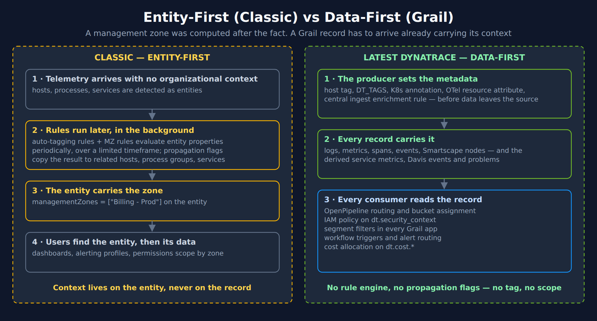
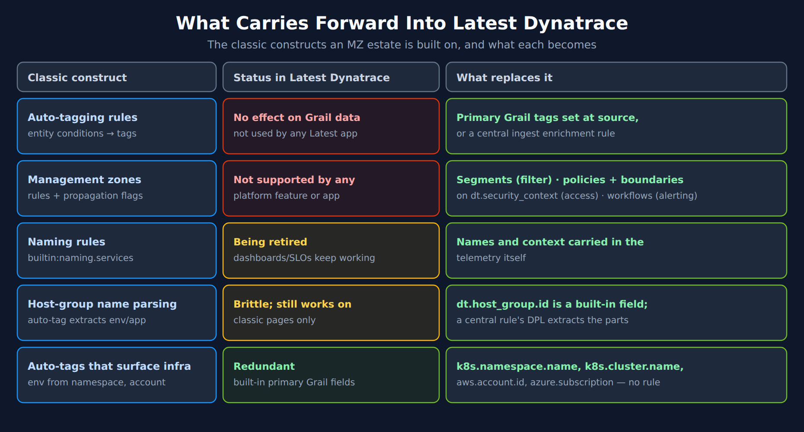
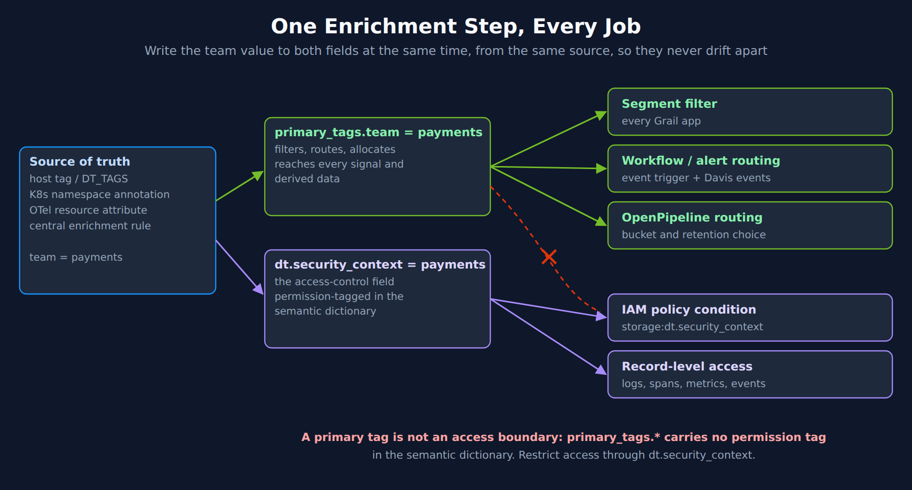
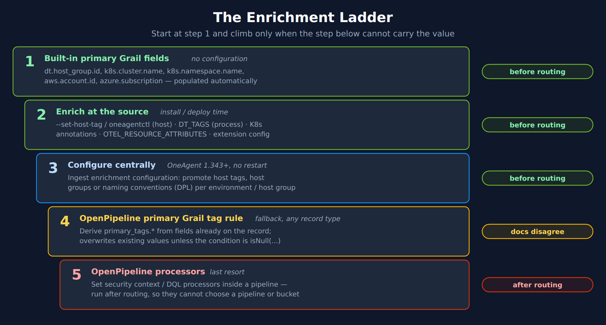
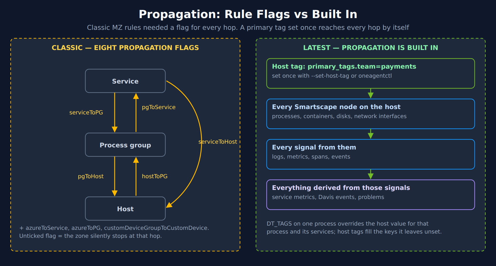
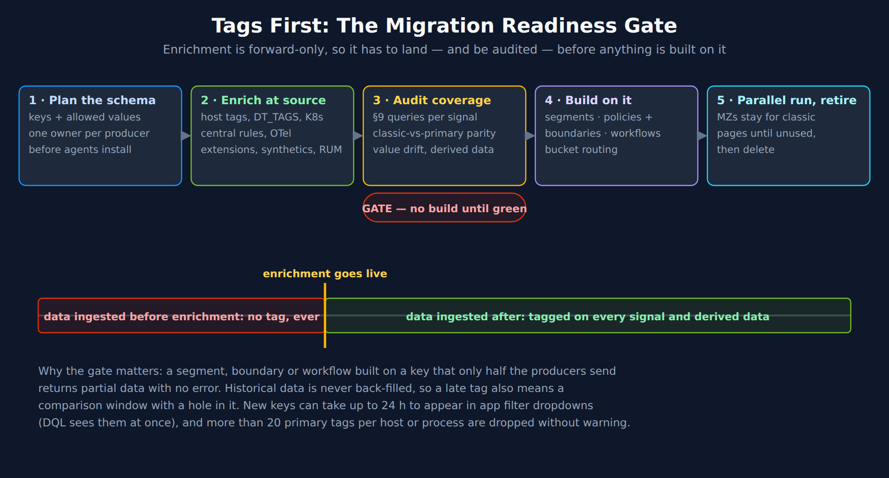

# MZ2POL-10: Tagging at Source — The Foundation Under Every MZ Replacement

> **Series:** MZ2POL — Management Zone to Policy Migration | **Notebook:** 11 of 14 | **Created:** October 2026 | **Last Updated:** 10/13/2026

## Overview

Every replacement for a management zone reads a field on the data. A segment filters on it, an IAM boundary matches it, a workflow routes on it, and an OpenPipeline rule picks a bucket with it. None of them can see an auto-tag or a management zone. So the migration has one prerequisite that sits under all three of its jobs: **the organizational context has to be on the records when they arrive.**

That is a different model, not a new syntax. A management zone was worked out *after* ingest, by rules that ran over the entity graph in the background. A Grail record has no such second pass: Dynatrace's metadata guidance says that on the latest platform *"each data point is treated independently and must carry its own metadata."* If the team, application or stage is not set at the source, or by a rule that runs before routing, then no segment, policy or workflow built later can find it.

This notebook covers that foundation from the migration's point of view: what stops working, which fields replace the zone's logic, where to set them, how propagation changes, and how to prove the tags are ready **before** you build segments (MZ2POL-05), policies and boundaries (MZ2POL-04) or alert routing (MZ2POL-09) on them.

> **Read this notebook before 04, 05 and 09.** It is numbered 10 because it was added to an existing series, not because it comes late. In reading order it belongs right after MZ2POL-03 (assessment). MZ2POL-11 then takes the zone inventory one rule at a time.

It is the migration-specific layer over two general references, which it routes to rather than repeats: **FAQ-02** (tagging sources, standards and naming) and **FAQ-26** (which metadata to set, by producer).

---

## Table of Contents

1. [Why Tagging Comes First](#why-tagging-first)
2. [What Carries Forward and What Does Not](#what-carries-forward)
3. [The Vocabulary: Fields, Tags and Where They Live](#vocabulary)
4. [One Value, Every Job](#one-value-every-job)
5. [Where to Set It: The Enrichment Ladder](#enrichment-ladder)
6. [Three Tag Shapes You Will Query During the Migration](#tag-shapes)
7. [Propagation Without Rules](#propagation)
8. [Timing and the Silent Limits](#timing)
9. [Auditing Tag Readiness with DQL](#auditing)
10. [The Readiness Gate](#readiness-gate)

---

## Prerequisites

| Requirement | Details |
|-------------|---------|
| **Dynatrace Environment** | SaaS on Latest Dynatrace (Grail, Smartscape on Grail) |
| **OneAgent** | 1.333+ for primary Grail field and tag enrichment (one page says 1.337 for `primary_tags.*` and `dt.security_context` — plan on the higher); 1.343+ for central *Ingest enrichment configuration* |
| **Existing management zones** | The classified inventory from MZ2POL-00 and MZ2POL-03 |
| **Permissions** | `storage:logs:read`, `storage:metrics:read` and `storage:entities:read` for the §9 queries; `settings:objects:write` to create central enrichment or OpenPipeline tag rules |
| **Background reading** | FAQ-02 (tag naming and sources), FAQ-26 (metadata by producer), K8S-10 (Kubernetes enrichment) |

<a id="why-tagging-first"></a>
## 1. Why Tagging Comes First

A management zone did its work in three steps, and none of them touched the telemetry itself.

1. **Rules ran later.** Auto-tagging and management-zone rules evaluated entity properties in the background. The settings schema says so directly: *"Management zone rules are executed periodically in the background, for a limited timeframe."*
2. **The entity carried the result.** A host, process group or service gained the zone. Propagation flags copied it to related entities.
3. **Data followed the entity.** Logs and metrics were in scope because their entity was. The classic rules page: *"Note that users automatically get access to logs and metrics associated with entities that are included within their assigned management zones."*

The latest platform removes the second and third steps. There is no background pass over the entity graph that adds context to records, and data is not in scope *because of* an entity. Each record is filtered, routed and authorized on the fields it carries.



<!-- MARKDOWN_TABLE_ALTERNATIVE
| Step | Classic (entity-first) | Latest Dynatrace (data-first) |
|---|---|---|
| 1 | Telemetry arrives with no organizational context; entities are detected | The producer sets the metadata (host tag, DT_TAGS, K8s annotation, OTel resource attribute, central enrichment rule) |
| 2 | Auto-tagging and MZ rules run later, in the background; propagation flags copy results to related entities | Every record carries it: logs, metrics, spans, events, Smartscape nodes, derived service metrics, Davis events, problems |
| 3 | The entity carries the zone (`managementZones`) | Every consumer reads the record: OpenPipeline routing and buckets, IAM on `dt.security_context`, segments, workflows, cost allocation |
| 4 | Users find the entity, then its data | — |
| Result | Context lives on the entity, never on the record | No rule engine, no propagation flags: no tag, no scope |
For environments where SVG doesn't render
-->

### What this means for planning

The order of work changes. In the classic model you could create a zone first and let the rules find the members. In the latest model, the members have to be **labeled first**. A segment, boundary or workflow written before the labels are in place is syntactically valid and returns partial data, with no error to warn you (§8).

That is why Dynatrace's metadata best practice says to *"Resolve enrichment gaps before starting IAM or segment configuration"*, and why this series now treats tag readiness as a gate (§10) between assessment and build.

> <sub>**Sources:**</sub>
> - <sub>[Management zones settings schema (DT docs)](https://docs.dynatrace.com/docs/dynatrace-api/environment-api/settings/schemas/builtin-management-zones) — *"Management zone rules are executed periodically in the background, for a limited timeframe."*</sub>
> - <sub>[Management-zone rules (DT docs)](https://docs.dynatrace.com/docs/manage/identity-access-management/permission-management/management-zones/management-zone-rules) — *"Note that users automatically get access to logs and metrics associated with entities that are included within their assigned management zones."*</sub>
> - <sub>[Best practices for metadata enrichment (DT docs)](https://docs.dynatrace.com/docs/platform/upgrade/best-practices/stage-02-post-ingest-enrichment/metadata-enrichment) — *"In Dynatrace Classic, observability signals were tightly coupled to entities through management zones."* and *"each data point is treated independently and must carry its own metadata."*</sub>
> - <sub>[Differences between classic auto-tagging and primary Grail tags (DT docs)](https://docs.dynatrace.com/docs/platform/upgrade/foundations/tags-difference-classic) — *"You query, route, and filter the data directly, without detours through the topology."*</sub>

<a id="what-carries-forward"></a>
## 2. What Carries Forward and What Does Not

Three classic constructs hold most MZ estates together. Dynatrace documents what happens to each.

| Classic construct | In Latest Dynatrace | Replace with |
|---|---|---|
| **Auto-tagging rules** | *"Auto-tagging rules have no effect on Smartscape on Grail and are not used in any Latest Dynatrace app."* | Primary Grail tags set at the source, or a central ingest enrichment rule (§5) |
| **Management zones** | *"Management zones are not supported by any platform feature or Dynatrace app."* | Segments for filtering (MZ2POL-05), policies and boundaries on `dt.security_context` for access (MZ2POL-04), problem-triggered workflows for alerting (MZ2POL-09) |
| **Service, host and process-group naming rules** | `builtin:naming.services` *"will be retired"*; existing dashboards, SLOs and alerts keep working during the transition | Names and organizational context carried in the telemetry itself |

Two more patterns are common in MZ estates. They are not separate constructs, but they change too.

- **Host-group name parsing.** Auto-tags that pulled environment or app out of a host-group name like `onprem_billing_prod`. Dynatrace calls these *"brittle rules tied to naming conventions"*. The host group itself is now a built-in field, `dt.host_group.id`, and a central enrichment rule can extract the parts with DPL (§5).
- **Auto-tags that only surfaced infrastructure.** Rules that tagged by namespace, cluster or cloud account. These are redundant: the values are built-in primary Grail fields. Dynatrace: *"If your Dynatrace Classic setup used auto-tagging rules to surface these values, those rules are no longer needed."*



<!-- MARKDOWN_TABLE_ALTERNATIVE
| Classic construct | Status in Latest Dynatrace | What replaces it |
|---|---|---|
| Auto-tagging rules (entity conditions → tags) | No effect on Grail data; not used by any Latest app | Primary Grail tags set at source, or a central ingest enrichment rule |
| Management zones (rules + propagation flags) | Not supported by any platform feature or app | Segments (filter), policies + boundaries on dt.security_context (access), workflows (alerting) |
| Naming rules (builtin:naming.services) | Being retired; dashboards/SLOs keep working | Names and context carried in the telemetry itself |
| Host-group name parsing | Brittle; still works on classic pages only | dt.host_group.id is a built-in field; a central rule's DPL extracts the parts |
| Auto-tags that surface infrastructure | Redundant | k8s.namespace.name, k8s.cluster.name, aws.account.id, azure.subscription |
For environments where SVG doesn't render
-->

### "About 80%" — and what the other 20% is

Dynatrace sizes the effect: *"The central primary Grail tag configuration for at-source tagging in cloud, Kubernetes, and OneAgent supersedes approximately 80% of classic auto-tagging and management-zone use cases."*

Read that as a statement about **enrichment**, not about the whole migration. The remaining share is the work MZ2POL-11 catalogs: zones built on exclusions, regular expressions, entity relationships or hand-kept lists, which no single field reproduces. It is also the access-control and alerting design in MZ2POL-04 and MZ2POL-09, which tags enable but do not perform.

### Both models run side by side

Classic constructs do not need to be removed first. Dynatrace answers *"Can I run classic auto-tagging and primary Grail tags at the same time?"* with *"Yes. They don't conflict."* — auto-tags keep serving classic pages while primary tags serve Grail. The guide's last step is to *"Keep any auto-tagging rules still required for Dynatrace Classic pages."* MZ2POL-06 covers the parallel run.

> <sub>**Sources:**</sub>
> - <sub>[Differences between classic auto-tagging and primary Grail tags (DT docs)](https://docs.dynatrace.com/docs/platform/upgrade/foundations/tags-difference-classic) — *"Management zones are not supported by any platform feature or Dynatrace app."* and *"supersedes approximately 80% of classic auto-tagging and management-zone use cases."*</sub>
> - <sub>[Upgrade OneAgent classic auto-tagging to primary Grail tags (DT docs)](https://docs.dynatrace.com/docs/manage/tags/migrate/upgrade-from-oneagent-tagging-classic) — *"Auto-tagging rules and management zones are not evaluated for Grail data and are not used in any app."*</sub>
> - <sub>**Derived:** "the other 20% is rule logic no single field reproduces" pairs the 80% statement with the rule-operator limits catalogued in MZ2POL-11.</sub>

<a id="vocabulary"></a>
## 3. The Vocabulary: Fields, Tags and Where They Live

"Tags" means at least four things on the platform, and a migration goes wrong when they are treated as one. The difference that matters is **where the value lives**, because each MZ replacement reads a specific place.

| Kind | Example | Who defines it | Where it lives | MZ job it can do |
|---|---|---|---|---|
| **Primary Grail fields** | `dt.host_group.id`, `k8s.namespace.name`, `k8s.cluster.name`, `aws.account.id` | Dynatrace — populated automatically | Every signal, Smartscape nodes, derived data | Filter, route, alert — and access where the field is permission-tagged |
| **Special fields** | `dt.security_context`, `dt.cost.costcenter`, `dt.cost.product` | You set the value; the key is fixed | Same as primary fields | `dt.security_context` is **the** access field; the `dt.cost.*` pair allocates cost |
| **Primary Grail tags** | `primary_tags.team`, `primary_tags.app`, `primary_tags.stage` | You — any key under the `primary_tags.` prefix | Same as primary fields | Filter, route, alert — **not** access (§4) |
| **Standard tags** | Cloud tags, Kubernetes labels and annotations, plain host tags | The source system | **Smartscape nodes only** | Entity-list filtering only — invisible to logs, spans, metrics and events |

The last row is the one MZ migrations trip over. A Kubernetes label or an AWS tag *is* on the platform — you can see it on the node — so it looks migrated. Dynatrace's tagging strategy is blunt about the gap: standard tags are *"only available on Smartscape nodes. They don't follow data into the telemetry pipeline, so you can't use them to route data, assign Grail buckets, allocate cost, or enforce access control on logs, metrics, spans, or events."* They have to be **promoted** — to a primary tag or a special field — before a segment, boundary or bucket rule can use them on signals.

### "Grail tags", precisely

In conversation, "Grail tags" usually means primary Grail tags. Two details keep the term honest:

- **You own the keys.** *"The full tag key (for example, primary_tags.team ) is never defined in the semantic dictionary; only the primary_tags.* namespace is reserved."* There is no fixed list to pick from — which is why §4 makes the key and value vocabulary a design decision.
- **The dictionary marks the namespace as `experimental`.** On the validation tenant (10/13/2026), the only `primary_tags` entry was `primary_tags.__key__`, `experimental`, with no tags. The Dynatrace docs describe primary tags as the current model; the stability label is worth checking on your own tenant before you build automation on assumptions about it.

FAQ-26 §2 has the full table, including signal-local fields and ownership tags, and FAQ-02 §2 covers taxonomy and naming.

> <sub>**Sources:** [Plan your tagging strategy (DT docs)](https://docs.dynatrace.com/docs/manage/tags/tags-strategy) — *"They don't follow data into the telemetry pipeline, so you can't use them to route data, assign Grail buckets, allocate cost, or enforce access control on logs, metrics, spans, or events."*, [Primary Grail fields and tags (DT docs)](https://docs.dynatrace.com/docs/manage/tags/primary-tags) — *"Primary Grail tags are customer-defined and follow the primary_tags.* prefix convention."* **Dictionary:** `primary_tags.__key__` (`experimental`, no tags), `dt.security_context` (`stable`, tagged `permission`), `dt.host_group.id` (`stable`, tagged `permission`, `primary-field`), read 10/13/2026.</sub>

<a id="one-value-every-job"></a>
## 4. One Value, Every Job

A management zone did three jobs from one definition. The replacement can do the same — but only if the value is written once, at the source, into the fields each job reads.

The design rule for the migration: **when a dimension must also restrict access, write it to `primary_tags.<key>` and `dt.security_context` in the same enrichment step, from the same source.** The primary tag does the filtering, routing and alerting. The security context does the access control. Written together, they cannot drift apart.



<!-- MARKDOWN_TABLE_ALTERNATIVE
| Field written at source | Jobs it serves |
|---|---|
| primary_tags.team = payments | Segment filters in every Grail app; workflow and alert routing (event triggers, Davis events); OpenPipeline routing and bucket choice |
| dt.security_context = payments | IAM policy condition (storage:dt.security_context); record-level access on logs, spans, metrics, events |
| primary_tags.team → IAM policy | Not usable: primary_tags.* carries no permission tag in the semantic dictionary |
For environments where SVG doesn't render
-->

### Why the primary tag alone is not an access boundary

IAM policy conditions use fields that the semantic dictionary marks with the `permission` tag. On the validation tenant (10/13/2026) that tag is on `dt.security_context` and on built-in fields such as `dt.host_group.id`, and **not** on the `primary_tags` namespace. So `primary_tags.team = "payments"` filters and routes well but cannot be written as a security boundary.

> **A page that reads differently.** The OpenPipeline primary-tag-rule page ends with *"Use the resulting primary_tags.* fields for routing decisions and further processing, such as bucket assignment or access control policies."* Read "access control" there as *through* a bucket or a derived `dt.security_context`. The IAM policy reference lists the record-level conditions for each Grail permission — `storage:dt.security_context`, `storage:dt.host_group.id`, `storage:k8s.namespace.name` and others — and none of them is a `primary_tags` field. The dictionary carries no `permission` tag on it either. Until that changes, route access through `dt.security_context`.

You may not need the security context at all. Dynatrace notes: *"If your organization can rely on deployment-level primary Grail fields such as k8s.namespace.name or dt.host_group.id for access control, you may not need dt.security_context at all."* If your MZ estate already maps one team to one host group or namespace, the boundary can use that field directly (MZ2POL-04).

### Design the values, not just the keys

A zone was one value; a tag key is a whole dimension, and every value under it becomes a filter option, a routing target and potentially a boundary. Three rules from Dynatrace's tagging strategy carry over directly:

| Rule | Dynatrace's wording | What it prevents in a migration |
|---|---|---|
| **Follow the strategy you already have** | *"The core principle is to follow the tagging strategy you already have, not create a new one."* | A third vocabulary next to the cloud tags and the CMDB |
| **Constrain the values that matter** | *"Environment, region, and security classification benefit from an enforced allowlist"* | `prod`, `Prod` and `production` as three segments — Grail filters compare values exactly, where an MZ condition could be case-insensitive |
| **Start lean, automate** | *"A small set of well-maintained tags is more valuable than a large set of stale ones."* and *"Tags that are set up manually drift over time."* | The 20-tag cap (§8) and hand-kept values going stale |

> **A cautionary pattern from validation.** On the validation tenant, a key named like a team key carried values such as a process name followed by a workload pattern (`<process> <workload>-*`) — the output of a DPL extraction pointed at the wrong input field. It populated every record, so any coverage check passed, and it split service metrics into dozens of "teams". **Check what a key's values *are*, not only that they are present** — §9 has the query.

> <sub>**Sources:**</sub>
> - <sub>[Configure security context (DT docs)](https://docs.dynatrace.com/docs/manage/tags/tags-security-context) — *"If your organization can rely on deployment-level primary Grail fields such as k8s.namespace.name or dt.host_group.id for access control, you may not need dt.security_context at all."*</sub>
> - <sub>[Set primary Grail tag rules in OpenPipeline (DT docs)](https://docs.dynatrace.com/docs/platform/openpipeline/get-started/primary-grail-tags) — *"Use the resulting primary_tags.* fields for routing decisions and further processing, such as bucket assignment or access control policies."*</sub>
> - <sub>[IAM policy reference (DT docs)](https://docs.dynatrace.com/docs/manage/identity-access-management/permission-management/manage-user-permissions-policies/advanced/iam-policystatements) — `storage:logs:read` conditions include *"storage:dt.security_context - Custom field for security context."*; no `primary_tags` condition is listed.</sub>
> - <sub>[Plan your tagging strategy (DT docs)](https://docs.dynatrace.com/docs/manage/tags/tags-strategy) — *"Environment, region, and security classification benefit from an enforced allowlist"*</sub>
> - <sub>**Dictionary:** `dt.security_context` (`stable`, tagged `permission`), `primary_tags.__key__` (`experimental`, no `permission` tag), read 10/13/2026. **Derived:** "write both in the same step" follows from the permission tagging.</sub>

<a id="enrichment-ladder"></a>
## 5. Where to Set It: The Enrichment Ladder

Dynatrace orders the ways to attach a value from cheapest to most effort, and says to *"Start at the top and move to the next only if the previous approach doesn't meet your needs."* The ladder below adds the fifth rung that matters for migrations: processors inside a pipeline, which run after routing.



<!-- MARKDOWN_TABLE_ALTERNATIVE
| Step | Mechanism | When | Notes |
|---|---|---|---|
| 1 | Built-in primary Grail fields | Before routing | dt.host_group.id, k8s.cluster.name, k8s.namespace.name, aws.account.id, azure.subscription — no configuration |
| 2 | Enrich at the source | Before routing | --set-host-tag / oneagentctl (host), DT_TAGS (process), K8s annotations, OTEL_RESOURCE_ATTRIBUTES, extension configuration |
| 3 | Central Ingest enrichment configuration | Before routing | OneAgent 1.343+, no restart; promote host tags, host groups or naming conventions (DPL); environment or host-group scope |
| 4 | OpenPipeline primary Grail tag rule | Docs disagree (see below) | Fallback; any record type; overwrites existing values unless the condition is isNull(...) |
| 5 | OpenPipeline processors (Set security context, DQL) | After routing | Cannot choose a pipeline or bucket |
For environments where SVG doesn't render
-->

### Step 2 in practice — OneAgent

These are Dynatrace's own examples. A host-level value reaches every signal from the host; a process-level value overrides it for one process.

Host level — at install time (Linux), or later on an existing installation with `oneagentctl`:

```bash
Dynatrace-OneAgent-Linux.sh --set-host-tag="primary_tags.environment=production" --set-host-tag="dt.security_context=confidential"

oneagentctl --set-host-tag="primary_tags.team=bravo"
oneagentctl --set-host-tag="dt.cost.costcenter=12345"
```

Process level — `DT_TAGS` on one process, values separated by spaces:

```bash
DT_TAGS="primary_tags.environment=production primary_tags.team=bravo primary_tags.application=payment-processing" java -jar checkout-service.jar
```

On serverless code modules (AWS Lambda, Azure Functions) `DT_TAGS` is the only option. On mainframe, process-level enrichment goes in `zremoteagentuserconfig.conf` instead.

### Step 3 in practice — promote what the hosts already carry

Most MZ estates already encode the zone's logic in host tags, host groups or names. *Ingest enrichment configuration* (Settings > Collect and capture > Ingest enrichment configuration) turns that into primary tags **without touching the hosts**. A rule has:

- **A condition** on input fields such as `dt.host_group.id`, `host.name`, `host.tags.<key>`, `k8s.namespace.name` or `aws.account.id`, using `matchesValue` (equals), `matchesPhrase` (contains, begins with, ends with), `isNull`, `isNotNull`, and `AND` / `OR` / `NOT`.
- **An enrichment**: a static value, or a DPL extraction from an input field. Dynatrace's example splits `prod-payments-eu-web-01` into five primary tags with one rule per part. *"If the pattern doesn't match, no tag is applied."*
- **A scope**: environment, or host group — the host-group rule wins.

Two limits matter for MZ translation, and MZ2POL-11 §4 works through them: regular expressions are not supported in the condition, and *"Enriching all data from a host based on a process or service property is not supported."*

### Precedence when a key is set twice

| Wins | Then | Then |
|---|---|---|
| Process level — `DT_TAGS` | Host level — installer or `oneagentctl` | Central ingest enrichment rule |

Host-level tags still fill any key the process did not set. Dynatrace's worked example shows a host with `business_unit=ecommerce` and `environment=dev`, and a .NET process with `DT_TAGS` setting `business_unit=finance`: the process ends up with `finance`, its own team, and the host's `environment=dev`.

### Step 4: two pages disagree on timing

Whether a step-4 tag can steer routing is not settled by the docs. The OpenPipeline page says primary Grail tag rules *"are evaluated before ingest-preprocessing time, before routing"*. The enrichment best-practice page, describing the same rules, says *"OpenPipeline runs after pipeline routing, so tags derived here can't influence which pipeline a record enters."*

Until the two agree, treat a step-4 tag as safe for filtering, segments and alert routing, and **test it** before you depend on it to pick a pipeline or a bucket. If routing depends on the value, set it at step 2 or 3, where both pages agree it is present before routing.

### Step 4 overwrites by default

An OpenPipeline primary Grail tag rule is the right tool for normalizing a key that arrives under different names — `aws.tags.team`, `azure.tags.team`, a Kubernetes label — into one `primary_tags.team`. But *"Existing primary_tags.* values are overwritten by default."* A broad rule added as a "backstop" will silently replace values that were set correctly at the source. Use the documented guard — a matching condition of `isNull(primary_tags.<key>)` — unless overwriting is what you intend.

> <sub>**Sources:**</sub>
> - <sub>[Best practices for enriching primary Grail fields and tags (DT docs)](https://docs.dynatrace.com/docs/manage/tags/tags-best-practices) — *"OpenPipeline runs after pipeline routing, so tags derived here can't influence which pipeline a record enters."*</sub>
> - <sub>[Enrich OneAgent telemetry with primary Grail fields and tags (DT docs)](https://docs.dynatrace.com/docs/manage/tags/primary-tags/tags-domain-oneagent) — *"When the same key is set at both scopes, the process-level value wins for that process."* and *"Enriching all data from a host based on a process or service property is not supported."*</sub>
> - <sub>[Set primary Grail tag rules in OpenPipeline (DT docs)](https://docs.dynatrace.com/docs/platform/openpipeline/get-started/primary-grail-tags) — *"All rules are evaluated before ingest-preprocessing time, before routing, and apply globally, to any incoming record of any type."*</sub>
> - <sub>[Upgrade OneAgent classic auto-tagging to primary Grail tags (DT docs)](https://docs.dynatrace.com/docs/manage/tags/migrate/upgrade-from-oneagent-tagging-classic)</sub>

<a id="tag-shapes"></a>
## 6. Three Tag Shapes You Will Query During the Migration

During the parallel run you query the classic entity model (to see what the zones did) and Grail (to see what the tags do) side by side. The same "tag" looks different in each, and mixing them up produces filters that run and match nothing.

| Where | Shape | Example access | Trap |
|---|---|---|---|
| Classic entities — `fetch dt.entity.host` | `tags` is an **array of strings**, `"key:value"`, with a context prefix for some sources | `expand tags` then `startsWith(tags, "Team:")` | OneAgent host tags appear as `"[Environment]key:value"` |
| Smartscape nodes — `smartscapeNodes "HOST"` | `tags` is a **record**: standard tags and `primary_tags.*` keys together | `tags[primary_tags.team]` (unquoted bracket) | `matchesValue(tags, …)` on a record is always false |
| Signals — `fetch logs` / `spans` / `events`, `timeseries` | `primary_tags.<key>` is a **top-level field** | `filter primary_tags.team == "payments"` | Standard tags are simply absent |

On the validation tenant (10/13/2026) one Smartscape host record held both kinds in the same `tags` record: two standard tags (an owner and a review date) next to `primary_tags.av_code` and `primary_tags.stage`. The classic `dt.entity.host` view of the same estate showed auto-tags — `Team`, `Org`, `Host Group` — on every host, none of which appear as `primary_tags.*` on its signals. That difference is the migration in miniature: the auto-tags exist, and Grail cannot see them.

MZ2POL-05 §4.5 covers the record-vs-array trap in segment variables.

<a id="propagation"></a>
## 7. Propagation Without Rules

Classic propagation was explicit. An auto-tag *"defined on a process group is propagated vertically to related host and service entities,"* and an entity-attribute MZ rule carries its own switches. The management-zone schema has eight:

| Flag in `builtin:management-zones` | What it did | What replaces it |
|---|---|---|
| `serviceToHostPropagation` | Services → their hosts | Built in: the host's own tag |
| `serviceToPGPropagation` | Services → their process groups | Built in: process-level `DT_TAGS` or the host tag |
| `pgToHostPropagation` | Process groups → their hosts | Built in — set the value at host level |
| `pgToServicePropagation` | Process groups → services they provide | Built in: *"a primary_tags.* attribute set via DT_TAGS propagates to all signals from that process and its associated services"* |
| `hostToPGPropagation` | Hosts → processes on them | Built in: host enrichment is inherited by processes, containers, disks and network interfaces |
| `customDeviceGroupToCustomDevicePropagation` | Custom device groups → devices | Set on the producer (extension configuration, API ingest) — see FAQ-26 §5.5 and §5.8 |
| `azureToServicePropagation` | Azure entities → services | Built-in cloud fields plus central cloud enrichment |
| `azureToPGPropagation` | Azure entities → connected process groups | Same |

The Grail model has no flags. Dynatrace: *"With primary Grail tags, propagation is built in. A primary_tags.* attribute defined at the host level is automatically present in logs, metrics, spans, and events on all relevant Smartscape nodes, and in any Davis events and problems they trigger."*



<!-- MARKDOWN_TABLE_ALTERNATIVE
| Classic | Latest Dynatrace |
|---|---|
| Service ↔ process group ↔ host, each hop a separate flag (serviceToPG, pgToService, pgToHost, hostToPG, serviceToHost) plus azureToService, azureToPG, customDeviceGroupToCustomDevice | Host tag set once (--set-host-tag / oneagentctl) |
| An unticked flag stops the zone at that hop | → every Smartscape node on the host (processes, containers, disks, network interfaces) |
| — | → every signal from them (logs, metrics, spans, events) |
| — | → everything derived (service metrics, Davis events, problems) |
| — | DT_TAGS on one process overrides the host value for that process and its services |
For environments where SVG doesn't render
-->

### The direction reverses

Classic propagation could run **upward**: a rule on a *service* could pull its host into the zone. Built-in propagation runs **downward** from where the value is set — host to process to signal to derived data — and Dynatrace states the limit plainly: enriching all data from a host based on a process or service property is not supported.

So a zone whose rule says "services named `payment*`, plus their hosts and process groups" does not translate into a single tag. Set the value where it is true:

- If the **whole host** belongs to the team, set it on the host.
- If only **some processes** do (shared hosts), set it per process with `DT_TAGS` — and accept that the host's own metrics are not that team's.

That is usually more accurate than the zone was. A service-to-host flag put a shared host into every zone that touched it.

> <sub>**Sources:**</sub>
> - <sub>[Management zones settings schema (DT docs)](https://docs.dynatrace.com/docs/dynatrace-api/environment-api/settings/schemas/builtin-management-zones) — the eight propagation properties of the `ManagementZoneAttributeRule` object</sub>
> - <sub>[Differences between classic auto-tagging and primary Grail tags (DT docs)](https://docs.dynatrace.com/docs/platform/upgrade/foundations/tags-difference-classic) — *"A tag defined on a process group is propagated vertically to related host and service entities."* and *"With primary Grail tags, propagation is built in."*</sub>
> - <sub>[Enrich OneAgent telemetry with primary Grail fields and tags (DT docs)](https://docs.dynatrace.com/docs/manage/tags/primary-tags/tags-domain-oneagent) — *"Enrichments defined on a host are inherited by the processes, containers, disks, and network interfaces on that host."*</sub>
> - <sub>**Derived:** the "what replaces it" column maps each flag onto the documented built-in propagation paths; the custom-device and Azure rows route to the producer-specific enrichment in FAQ-26.</sub>

<a id="timing"></a>
## 8. Timing and the Silent Limits

Tags do not fail with errors. Every limit below lets data arrive normally — without the value — so a segment comes back short or a boundary hides nothing, and nobody is told.



<!-- MARKDOWN_TABLE_ALTERNATIVE
| Phase | What happens |
|---|---|
| 1 · Plan the schema | Keys and allowed values; one owner per producer; before agents are installed |
| 2 · Enrich at source | Host tags, DT_TAGS, K8s, central rules, OTel; extensions, synthetics and RUM separately |
| 3 · Audit coverage (gate) | §9 queries per signal; classic-vs-primary parity; value drift; derived data. No build until green |
| 4 · Build on it | Segments, policies and boundaries, workflows, bucket routing |
| 5 · Parallel run, retire | MZs stay for classic pages until unused, then are deleted |
| Timeline | Data ingested before enrichment goes live never carries the tag; data after it carries it on every signal and derived data |
For environments where SVG doesn't render
-->

| Limit | What Dynatrace says | Migration consequence |
|---|---|---|
| **Forward-only** | *"Enrichment applies only to signals ingested after the configuration is active."* | Comparisons that span the switch-over have a hole in them. Turn enrichment on early, well before the cutover window |
| **Plan before install** | *"Plan your Primary Grail Tag schema before installing OneAgent or Dynatrace Operator."* | Renaming a key later means touching every host and every segment, policy and workflow that reads it |
| **20 tags per host or process** | *"Up to 20 primary tags per host or process; excess tags are silently dropped without a warning."* | Converting every auto-tag one-for-one can overflow the cap; the 21st key simply never arrives |
| **Dropdown lag** | *"A newly enriched primary tag key can take up to 24 hours to appear in the filter dropdowns of Dynatrace apps."* | A key missing from the segment editor is not missing from the data — check with DQL before re-doing the rollout |
| **Central rule refresh** | Agents pick up a change in *"typically one refresh cycle, around five minutes"* | Wait before auditing a new rule |
| **No match, no tag** | For DPL extraction: *"If the pattern doesn't match, no tag is applied. There is no partial output."* | Hosts outside the naming convention silently fall out of every segment built on the extracted tag |
| **Version floors** | 1.333+ for enrichment; 1.337+ per the metadata best-practice page for `primary_tags.*` and `dt.security_context`; 1.343+ for central rules | An older OneAgent ignores the rule and its data stays untagged |

> <sub>**Sources:**</sub>
> - <sub>[Best practices for metadata enrichment (DT docs)](https://docs.dynatrace.com/docs/platform/upgrade/best-practices/stage-02-post-ingest-enrichment/metadata-enrichment) — *"Enrichment applies only to signals ingested after the configuration is active."*, *"Plan your Primary Grail Tag schema before installing OneAgent or Dynatrace Operator."* and *"OneAgent version 1.337 or later is required for primary_tags.* and dt.security_context enrichment."*</sub>
> - <sub>[Enrich OneAgent telemetry with primary Grail fields and tags (DT docs)](https://docs.dynatrace.com/docs/manage/tags/primary-tags/tags-domain-oneagent) — *"Up to 20 primary tags per host or process; excess tags are silently dropped without a warning."*, *"A newly enriched primary tag key can take up to 24 hours to appear in the filter dropdowns of Dynatrace apps."* and *"Primary Grail field and tag enrichment requires OneAgent version 1.333+."*</sub>

<a id="auditing"></a>
## 9. Auditing Tag Readiness with DQL

These queries answer the questions the readiness gate asks. Run them in order. Steps 1–3 read the dictionary and the topology and scan **zero bytes**. Steps 4–8 read one hour of logs or metrics; keep the window short on a large tenant.

Replace `primary_tags.team`, the classic tag key `Team:` and the zone name with your own. Every query below was executed against the validation tenant on 10/13/2026, using that tenant's own keys in place of the placeholders.

**Step 1 — which fields can carry access control on this tenant?** The dictionary changes with the platform version, so read it from your own tenant.

```dql
// Which fields can an IAM policy use, and is the primary_tags namespace one of them?
// Reads the semantic dictionary — zero bytes scanned.
fetch dt.semantic_dictionary.fields
| filter in("permission", tags) or startsWith(name, "primary_tags")
| fields name, stability, usable_in_iam = in("permission", tags), tags
| sort usable_in_iam desc, name asc
```

**Step 2 — which classic tag keys does the MZ estate rely on?** Each key here is a candidate for a built-in field, a primary tag, a special field, or retirement (MZ2POL-11). Classic tags exist only on the classic entity model, so this step uses it deliberately.

```dql
// Inventory of classic tag keys on hosts — the vocabulary the zones were built from.
// Classic entity model on purpose: auto-tags live only there. Zero bytes scanned.
fetch dt.entity.host
| fields entity.name, tags
| expand tags
| parse tags, "LD:tag_key ':' LD"
| fieldsAdd tag_key = coalesce(tag_key, tags)
| summarize {hosts = countDistinctExact(entity.name)}, by:{tag_key}
| sort hosts desc
| limit 50
```

On the validation tenant this returned the auto-tag keys `Team`, `Org` and `Host Group` on all 23 hosts, plus cloud-provider keys on a handful. None of the three auto-tags was available on signals as a `primary_tags.*` field — the gap Step 4 measures.

**Step 3 — how much of the topology carries any primary tag or security context?**

```dql
// Host-level readiness: standard tags vs primary tags vs security context.
// On Smartscape nodes `tags` is a record holding both standard and primary_tags.* keys.
// Zero bytes scanned.
smartscapeNodes "HOST"
| fieldsAdd tag_text = toString(tags)
| fieldsAdd has_any_tag = tag_text != "{}",
    has_primary_tag = contains(tag_text, "\"primary_tags."),
    has_security_context = arraySize(dt.security_context) > 0
| summarize {hosts = count(),
    with_any_tag = countIf(has_any_tag),
    with_primary_tag = countIf(has_primary_tag),
    with_security_context = countIf(has_security_context)}
```

**Step 4 — parity: does each host's telemetry carry the value its classic tag implied?** This is the most useful single query in the migration. It compares, per host, the classic tag the zones used with the primary tag on that host's logs — and checks the **values**, not only presence.

```dql
// Classic tag vs primary tag, per host, by presence AND value.
// Replace "Team:" (classic key) and primary_tags.team with your own.
fetch logs, from:-1h
| filter isNotNull(dt.entity.host)
| summarize {records = count(),
    with_primary = countIf(isNotNull(primary_tags.team)),
    primary_values = collectDistinct(primary_tags.team)},
    by:{dt.entity.host}
| lookup [
    fetch dt.entity.host
    | fields id, entity.name, tags
    | expand tags
    | filter startsWith(tags, "Team:")
    | fieldsAdd classic_team = substring(tags, from: 5)
    | fields id, entity.name, classic_team
  ], sourceField: dt.entity.host, lookupField: id, fields: {entity.name, classic_team}
| fieldsAdd primary_pct = round(100.0 * with_primary / records, decimals: 1),
    value_match = in(classic_team, primary_values)
| fieldsAdd status = if(isNull(classic_team), "no classic tag",
    else: if(primary_pct < 100, "classic only - coverage gap",
    else: if(not(value_match), "both - values differ", else: "both - values agree")))
| summarize {hosts = count()}, by:{status}
| sort hosts desc
```

Read the four outcomes:

| Status | Meaning | Action |
|---|---|---|
| `both - values agree` | The tag is ready on this host | None |
| `both - values differ` | Present everywhere, but means something else | Fix the source or the extraction before building on it |
| `classic only - coverage gap` | Some of the host's telemetry lacks the primary tag | Find the producer that is not enriched (FAQ-26 §5) |
| `no classic tag` | The zone never relied on this key for this host | Expected for hosts outside the zones |

On the validation tenant (10/13/2026) **all 15 hosts read `both - values differ`**: every record had the primary tag, and none of the values matched the classic team. A presence-only coverage check would have passed all 15.

**Step 5 — acceptance test for one zone: does the tag select the same hosts the zone did?**

```dql
// Compare one management zone's host membership with the hosts whose data carries the tag value.
// Replace the zone name and the primary tag condition.
fetch logs, from:-1h
| filter isNotNull(dt.entity.host)
| summarize {tagged = countIf(primary_tags.team == "payments"), records = count()},
    by:{dt.entity.host}
| fieldsAdd carries_tag = tagged > 0
| lookup [
    fetch dt.entity.host
    | fields id, entity.name, managementZones
  ], sourceField: dt.entity.host, lookupField: id, fields: {entity.name, managementZones}
| fieldsAdd in_zone = in("Payments - Production", managementZones)
| fieldsAdd verdict = if(in_zone and carries_tag, "match",
    else: if(in_zone, "in zone, tag missing",
    else: if(carries_tag, "tagged, not in zone", else: "neither")))
| summarize {hosts = count()}, by:{verdict}
| sort hosts desc
```

`in zone, tag missing` hosts would disappear from the replacement; `tagged, not in zone` hosts would appear in it for the first time. On the validation tenant, the stand-in zone and tag gave **4 matches and 11 hosts tagged but not in the zone** — a tag broader than the zone it was meant to replace. Either can be correct, but each needs a decision before cutover, not after.

**Step 6 — coverage by host group, including data with no host at all.**

```dql
// Share of logs carrying the primary tag and the security context, per host group.
// The null host-group row is data from producers with no OneAgent host — check it separately.
fetch logs, from:-1h
| summarize {total = count(),
    team = countIf(isNotNull(primary_tags.team)),
    sec_ctx = countIf(isNotNull(dt.security_context))},
    by:{dt.host_group.id}
| fieldsAdd team_pct = round(100.0 * team / total, decimals: 1),
    sec_ctx_pct = round(100.0 * sec_ctx / total, decimals: 1)
| sort total desc
| limit 30
```

On the validation tenant the largest host group was 100% tagged, while the **null host-group row — about 40% of all logs — was only 55% tagged**. Host-based enrichment cannot reach data that has no host: API ingest, log shippers, remote extensions, cloud logs. Those producers need their own enrichment (FAQ-26 §5).

**Step 7 — value drift: one meaning, several spellings.**

```dql
// Values of one key that differ only by case or whitespace — each would be a separate segment value.
fetch logs, from:-1h
| filter isNotNull(primary_tags.team)
| summarize {records = count()}, by:{value = primary_tags.team}
| fieldsAdd normalized = lower(trim(value))
| summarize {spellings = countDistinct(value), variants = collectDistinct(value), records = sum(records)},
    by:{normalized}
| sort spellings desc, records desc
| limit 30
```

Any row with `spellings` above 1 is drift. Read the `variants` column as well: values that are process names, host names or pattern fragments mean the key is being fed from the wrong input (§4).

**Step 8 — do derived service metrics carry the value?** SLOs, dashboards and alert routing mostly read service metrics, not raw spans.

```dql
// Service metrics split by security context and primary tag.
// Rows where a key column is null are the uncovered share.
timeseries requests = sum(dt.service.request.count), from:-2h,
    by:{dt.security_context, primary_tags.team}
| fieldsAdd total = arraySum(requests)
| fieldsRemove requests, timeframe, interval
| sort total desc
| limit 20
```

> **Never trust a zero here on its own.** A `team` column of 0 everywhere usually means the key name is wrong, not that nothing is tagged. Sample the keys first — `fetch logs, from:-30m | fieldsKeep "primary_tags.*" | limit 20` — and treat a zero `total` as no data in the window.

> <sub>**Sources:** [Upgrade OneAgent classic auto-tagging to primary Grail tags (DT docs)](https://docs.dynatrace.com/docs/manage/tags/migrate/upgrade-from-oneagent-tagging-classic) — *"Spot-check a host or process that previously relied on the classic rule and confirm the equivalent primary Grail tag or field is now present on its telemetry."*, [Best practices for metadata enrichment (DT docs)](https://docs.dynatrace.com/docs/platform/upgrade/best-practices/stage-02-post-ingest-enrichment/metadata-enrichment). All eight queries executed against the validation tenant on 10/13/2026.</sub>

<a id="readiness-gate"></a>
## 10. The Readiness Gate

Do not start building segments, boundaries or alert routing until every box is ticked. Each one corresponds to a failure that returns partial data without an error.

**Schema**
- [ ] Keys chosen and written down, following the existing cloud / Kubernetes / CMDB vocabulary rather than a new one
- [ ] Allowed values agreed for constrained keys (environment, stage, region, classification)
- [ ] Each dimension that restricts access is also written to `dt.security_context` in the same step (§4)
- [ ] Fewer than 20 primary tags per host or process, with room to spare
- [ ] Classic auto-tags that only surface built-in fields marked **retire, don't migrate** (§2)

**Enrichment**
- [ ] Every producer in scope has an owner and a mechanism (§5; FAQ-26 §5 for extensions, synthetics, RUM, cloud, OTel)
- [ ] Central rules scoped to host groups where possible
- [ ] Any OpenPipeline primary-tag backstop guarded with `isNull(primary_tags.<key>)`
- [ ] Enrichment live long enough before cutover for the comparison windows you need

**Audit (§9)**
- [ ] Step 4 parity: no `both - values differ` and no unexplained `classic only - coverage gap`
- [ ] Step 5 acceptance test run for each zone being replaced, with every difference decided
- [ ] Step 6: the null host-group row understood and covered
- [ ] Step 7: no drift
- [ ] Step 8: service metrics carry the key

Then continue: segments (MZ2POL-05), policies and boundaries (MZ2POL-04, MZ2POL-08), alert routing (MZ2POL-09).

---

## Summary

1. **Tags first.** Management zones were computed after ingest from entity rules; Grail records must arrive carrying their context. Every MZ replacement reads a field on the record.
2. **Classic constructs don't reach Grail.** Auto-tagging rules and management zones are not evaluated for Grail data. They keep working on classic pages during the parallel run.
3. **Promote, don't assume.** Standard tags — cloud tags, Kubernetes labels, plain host tags — live only on Smartscape nodes. Promote them to `primary_tags.*` or a special field.
4. **One value, every job.** Write dimensions that restrict access to both `primary_tags.<key>` and `dt.security_context`, at the same time, from the same source.
5. **Climb the ladder from the top.** Built-in fields, then source, then central rules, then OpenPipeline tag rules with an `isNull` guard. If routing depends on the value, set it at source or centrally.
6. **Propagation is built in, and downward.** No flags; a value set on a host reaches its processes, signals and derived data, but not the other way round.
7. **Audit values, not just presence**, and pass the readiness gate before building on the tags.

## Next Steps

- **MZ2POL-11: Translating Management Zone Rules into Source Attributes** — the rule-by-rule catalog: every MZ rule type, property and operator, and where its logic goes.
- **MZ2POL-05** for segments, **MZ2POL-04** and **MZ2POL-08** for policies and boundaries, **MZ2POL-09** for alert routing — each assumes this notebook's gate has passed.
- **FAQ-26** for per-producer enrichment, **FAQ-02** for naming, **K8S-10** for Kubernetes.

## Additional Resources

- [Differences between classic auto-tagging and primary Grail tags (DT docs)](https://docs.dynatrace.com/docs/platform/upgrade/foundations/tags-difference-classic)
- [Upgrade OneAgent classic auto-tagging to primary Grail tags (DT docs)](https://docs.dynatrace.com/docs/manage/tags/migrate/upgrade-from-oneagent-tagging-classic)
- [Plan your tagging strategy (DT docs)](https://docs.dynatrace.com/docs/manage/tags/tags-strategy)
- [Primary Grail fields and tags (DT docs)](https://docs.dynatrace.com/docs/manage/tags/primary-tags)
- [Best practices for enriching primary Grail fields and tags (DT docs)](https://docs.dynatrace.com/docs/manage/tags/tags-best-practices)
- [Best practices for metadata enrichment (DT docs)](https://docs.dynatrace.com/docs/platform/upgrade/best-practices/stage-02-post-ingest-enrichment/metadata-enrichment)
- [Enrich OneAgent telemetry with primary Grail fields and tags (DT docs)](https://docs.dynatrace.com/docs/manage/tags/primary-tags/tags-domain-oneagent)
- [Configure security context (DT docs)](https://docs.dynatrace.com/docs/manage/tags/tags-security-context)
- [Set primary Grail tag rules in OpenPipeline (DT docs)](https://docs.dynatrace.com/docs/platform/openpipeline/get-started/primary-grail-tags)
- [Management-zone rules (DT docs)](https://docs.dynatrace.com/docs/manage/identity-access-management/permission-management/management-zones/management-zone-rules)

---

<sub>*This notebook was AI-generated from community-submitted and publicly available sources. This notebook series is not officially supported by Dynatrace. Always verify information against official Dynatrace documentation.*</sub>
