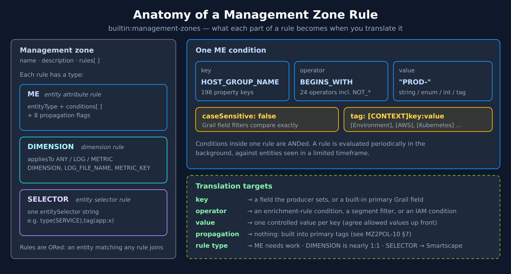
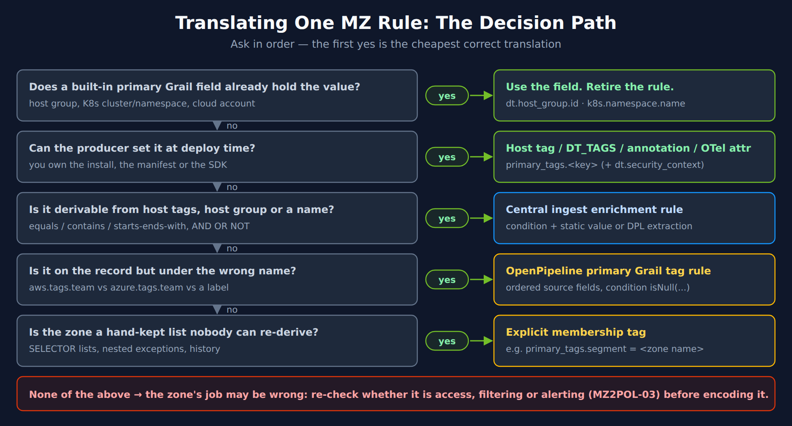
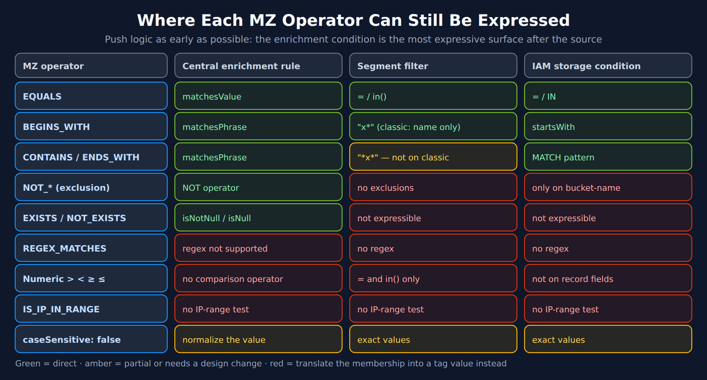
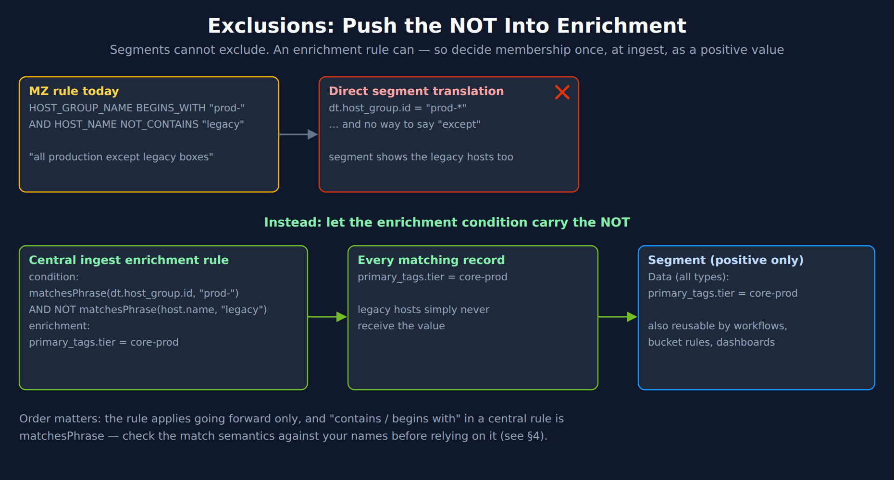

# MZ2POL-11: Translating Management Zone Rules into Source Attributes

> **Series:** MZ2POL — Management Zone Migration: Segments, Policies, Workflows | **Notebook:** 12 of 15 | **Created:** October 2026 | **Last Updated:** 10/13/2026

## Overview

MZ2POL-10 established the principle: every replacement for a management zone reads a field on the record, so the zone's logic has to become a value set at the source. This notebook is the **working catalog** for doing that one rule at a time.

A management zone is a list of rules, and each rule is a property, an operator and a value, plus switches. The migration question for each rule is the same: *where can this logic live now?* There are only a few possible answers, and they differ a lot in cost:

- a **built-in primary Grail field** that already holds the value (free);
- a value **set by the producer** at deploy time;
- a **central ingest enrichment rule** that derives it from what the hosts already carry;
- an **OpenPipeline primary Grail tag rule** that renames a field already on the record;
- an **explicit membership tag**, when the rule cannot be re-derived at all.

The same value then feeds all three replacement jobs — the segment (MZ2POL-05), the policy and boundary (MZ2POL-04), and the alert routing (MZ2POL-09). This notebook decides the value; those notebooks consume it.

> **Reading order:** after MZ2POL-03 (assessment) and MZ2POL-10 (tagging foundation), before MZ2POL-04/05/09. Numbered 11 because it was added to an existing series.

---

## Table of Contents

1. [Anatomy of a Management Zone Rule](#rule-anatomy)
2. [The Decision Path for One Rule](#decision-path)
3. [Catalog by Property Family](#property-catalog)
4. [Translating Operators](#operator-translation)
5. [Exclusions: Push the NOT into Enrichment](#exclusions)
6. [Dimensional-Data Rules](#dimension-rules)
7. [Entity-Selector Rules](#selector-rules)
8. [Worked Translations](#worked-translations)
9. [Verifying Translations with DQL](#verifying)
10. [The Translation Worksheet](#worksheet)

---

## Prerequisites

| Requirement | Details |
|-------------|---------|
| **Dynatrace Environment** | SaaS on Latest Dynatrace; classic management zones still present for the parallel run |
| **Zone inventory** | The rule export and classification from MZ2POL-00 and MZ2POL-03 |
| **Foundation** | MZ2POL-10 read, tag keys and allowed values agreed |
| **Permissions** | `settings.read` (or `settings:objects:read`) to export `builtin:management-zones`; `storage:entities:read` and `storage:logs:read` for §9 |
| **Related** | FAQ-16 (entity selectors → Smartscape), FAQ-26 (enrichment by producer), FAQ-15 (DPL) |

<a id="rule-anatomy"></a>
## 1. Anatomy of a Management Zone Rule

The settings schema `builtin:management-zones` defines exactly what a zone can contain. Knowing its parts tells you what has to be translated.



<!-- MARKDOWN_TABLE_ALTERNATIVE
| Part | Values | Translation target |
|---|---|---|
| Rule type ME (monitored entity) | entityType + conditions + 8 propagation flags | Needs the most work: a value at the producer or a central rule |
| Rule type DIMENSION (dimensional data) | appliesTo ANY / LOG / METRIC; condition types DIMENSION, LOG_FILE_NAME, METRIC_KEY | Nearly 1:1 — fields on the record already |
| Rule type SELECTOR (entity selector) | one entitySelector string | Smartscape (entity lists) or an explicit membership tag (data) |
| Condition key | 198 property keys | A field the producer sets, or a built-in primary Grail field |
| Condition operator | 24 operators incl. NOT_* | An enrichment-rule condition, a segment filter, or an IAM condition |
| caseSensitive | true / false | Grail field filters compare values exactly — normalize values instead |
| tag value format | [CONTEXT]key:value | — |
| Propagation flags | 8 | Nothing: propagation is built into primary tags (MZ2POL-10 §7) |
For environments where SVG doesn't render
-->

### Rule types

| Type in the schema | In the UI | Defined by | Translation difficulty |
|---|---|---|---|
| `ME` | Monitored entity | `entityType` + `conditions[]` + propagation flags | Highest — the logic runs on entity properties that the data does not carry |
| `DIMENSION` | Dimensional data | `appliesTo` (`ANY`, `LOG`, `METRIC`) + conditions of type `DIMENSION`, `LOG_FILE_NAME` or `METRIC_KEY` | Lowest — already data-first (§6) |
| `SELECTOR` | Entity selector | One `entitySelector` string, including relationships | Depends on whether the zone lists entities or scopes data (§7) |

### How rules combine

The classic rules page states the logic: *"Conditions are applied using the AND logic—all conditions within a rule need to be met for the rule to apply to an entity. Rules are applied using the OR logic—any rule must apply for an entity to be included in a management zone."*

That maps cleanly onto segments — **conditions in one include are ANDed, includes are ORed** (MZ2POL-05 §3) — but only once each condition has a field to test.

### What a condition can say

| Part | Range | Why it matters for translation |
|---|---|---|
| **Property key** | 198 keys in the schema, from `HOST_GROUP_NAME` to `QUEUE_TECHNOLOGY` | Each key is a question: does a field on the record answer it? (§3) |
| **Operator** | 24, including a `NOT_` form of most, `EXISTS`, numeric comparisons, `IS_IP_IN_RANGE`, `REGEX_MATCHES`, `TAG_KEY_EQUALS` | Several have no equivalent on any Grail surface (§4) |
| **Case sensitive** | A flag per text condition | Grail filters compare values exactly; case-insensitive zones need normalized values |
| **Tag** | Format `[CONTEXT]tagKey:tagValue` | The classic tag shape — MZ2POL-10 §6 |
| **Value text** | Up to 80 characters; *"wildcard characters are not allowed; regular expressions are allowed in the contains regex and does not contain regex condition operators"* | Regex logic must be rewritten, not copied |

### Classic limits worth knowing

Per environment the classic model allows 5,000 management zones by default, 300 UI-based entity rules, 300 dimensional-data rules, 300 entity-selector rules and 100,000 conditions across all rules, with any one entity in at most 200 zones. Estates near these limits are almost always encoding **values** as zones — the pattern MZ2POL-05 §2 replaces with one segment per **dimension**.

> <sub>**Sources:** [Management zones settings schema (DT docs)](https://docs.dynatrace.com/docs/dynatrace-api/environment-api/settings/schemas/builtin-management-zones), [Management-zone rules (DT docs)](https://docs.dynatrace.com/docs/manage/identity-access-management/permission-management/management-zones/management-zone-rules) — *"Rules are applied using the OR logic—any rule must apply for an entity to be included in a management zone."* **Derived:** the property-key and operator counts were read from the schema's enum lists on 10/13/2026.</sub>

<a id="decision-path"></a>
## 2. The Decision Path for One Rule

Ask these questions in order for each rule. The first *yes* is the cheapest correct translation; going further down the list costs more to build and more to maintain.



<!-- MARKDOWN_TABLE_ALTERNATIVE
| # | Question | If yes |
|---|---|---|
| 1 | Does a built-in primary Grail field already hold the value? (host group, K8s cluster/namespace, cloud account) | Use the field; retire the rule |
| 2 | Can the producer set it at deploy time? (you own the install, manifest or SDK) | Host tag / DT_TAGS / annotation / OTel resource attribute → primary_tags.<key> (+ dt.security_context) |
| 3 | Is it derivable from host tags, host group or a name? (equals / contains / begins-ends with, AND OR NOT) | Central ingest enrichment rule: condition + static value or DPL extraction |
| 4 | Is it on the record already, under the wrong name? (aws.tags.team vs azure.tags.team vs a label) | OpenPipeline primary Grail tag rule with ordered source fields and an isNull(...) condition |
| 5 | Is the zone a hand-kept list nobody can re-derive? | Explicit membership tag, e.g. primary_tags.segment = <zone name> |
| — | None of the above | Re-check which job the zone does (MZ2POL-03) before encoding it |
For environments where SVG doesn't render
-->

Dynatrace's own upgrade guide gives the same first two moves for auto-tags: *"Flag which rules only exist to surface infrastructure context that's now a built-in primary Grail field (host group, Kubernetes namespace/cluster, AWS account, Azure subscription). These rules can typically be retired outright rather than migrated."* and, for the rest, *"If the rule feeds permissions or cost allocation, map it to dt.security_context , dt.cost.costcenter , or dt.cost.product instead of a generic primary tag."*

### Why step 5 is not a failure

The explicit membership tag is the guide's own fallback for zones whose definition is *"based on process name, host name, service name, or metadata"* — a new tag *"with the value set to the name of the management zone"* (MZ2POL-05 §4.6). It is the right answer for a zone whose rules have accumulated exceptions nobody can explain, because it states membership outright instead of re-deriving it. The cost is that membership is now maintained wherever the tag is set; new entities need it.

> <sub>**Sources:** [Upgrade OneAgent classic auto-tagging to primary Grail tags (DT docs)](https://docs.dynatrace.com/docs/manage/tags/migrate/upgrade-from-oneagent-tagging-classic) — *"These rules can typically be retired outright rather than migrated."*, [Best practice examples: from Management Zones to Segments (DT docs)](https://docs.dynatrace.com/docs/platform/upgrade/foundations/upgrade-guide-segments).</sub>

<a id="property-catalog"></a>
## 3. Catalog by Property Family

The 198 property keys fall into a dozen families. For each family, the table names where the value comes from now, the field a segment or boundary filters on, and whether that field can carry access control (*permission* = tagged `permission` in the semantic dictionary).

| MZ property family (schema keys) | Where the value comes from now | Field to filter on | Usable in IAM? |
|---|---|---|---|
| **Host group** — `HOST_GROUP_ID`, `HOST_GROUP_NAME` | Built in | `dt.host_group.id` | **Yes** (permission) |
| **Kubernetes** — `KUBERNETES_CLUSTER_NAME`, `CLOUD_APPLICATION_NAMESPACE_NAME` | Built in | `k8s.cluster.name`, `k8s.namespace.name` | **Yes** (permission) |
| **Kubernetes labels** — `CLOUD_APPLICATION_NAMESPACE_LABELS`, `CLOUD_APPLICATION_LABELS`, `HOST_KUBERNETES_LABELS` | Promote namespace labels/annotations via K8s enrichment (K8S-10) | `primary_tags.<key>` (+ `dt.security_context`) | Via `dt.security_context` only |
| **Cloud account** — `AWS_ACCOUNT_ID`, `AZURE_SUBSCRIPTION_UUID`, `GOOGLE_COMPUTE_INSTANCE_PROJECT_ID` | Built in | `aws.account.id`, `azure.subscription`, `gcp.project.id` | **Yes** (permission) |
| **Cloud tags** — `EC2_INSTANCE_TAGS`, `AZURE_ENTITY_TAGS`, `AWS_*_TAGS` | Central cloud enrichment (new cloud connections, 1.348+; staged rollout) or an OpenPipeline tag rule | `primary_tags.<key>` or `dt.security_context` | Via `dt.security_context` only |
| **Host name** — `HOST_NAME`, `HOST_DETECTED_NAME`, `HOST_ONEAGENT_CUSTOM_HOST_NAME` | Central enrichment rule on `host.name` (condition or DPL extraction) | `primary_tags.<key>` | `storage:host.name` is a documented condition, but the dictionary marks `host.name` `experimental` and names change — prefer `dt.security_context` |
| **Host tags** — `HOST_TAGS` | Central enrichment rule on `host.tags.<key>`, or re-set with a `primary_tags.` prefix | `primary_tags.<key>` | Via `dt.security_context` only |
| **Host metadata** — `HOST_CUSTOM_METADATA` | Move to host tags, then promote (OneAgent 1.345 derives host `primary_tags` from host tags, not host properties) | `primary_tags.<key>` | Via `dt.security_context` only |
| **Process group** — `PROCESS_GROUP_NAME`, `PROCESS_GROUP_DETECTED_NAME`, `PROCESS_GROUP_*_METADATA`, `DOCKER_*` | `DT_TAGS` on the process, or a central rule conditioned on the process group | `primary_tags.<key>` | Via `dt.security_context` only |
| **Service** — `SERVICE_NAME`, `SERVICE_TAGS`, `SERVICE_TYPE`, `SERVICE_WEB_*`, `SERVICE_DATABASE_*` | Set on the **process** that provides the service (`DT_TAGS`); service metrics inherit from its spans | `primary_tags.<key>` | Via `dt.security_context` only |
| **Web and mobile apps** — `WEB_APPLICATION_NAME`, `MOBILE_APPLICATION_NAME` | Frontend definitions; OpenPipeline rules in every RUM scope (FAQ-26 §5.7) | `frontend.name`, `primary_tags.<key>` | **Yes** — `frontend.name` (permission) |
| **Synthetic monitors** — `BROWSER_MONITOR_*`, `HTTP_MONITOR_*`, `NETWORK_AVAILABILITY_MONITOR_*`, `EXTERNAL_MONITOR_*` | Per monitor: primary Grail tags and security context, not inherited (FAQ-26 §5.6) | `primary_tags.<key>`, `dt.security_context` | Via `dt.security_context` |
| **Custom devices and extensions** — `CUSTOM_DEVICE_*`, `CUSTOM_DEVICE_GROUP_*` | Extension monitoring configuration or endpoint; remote extensions inherit nothing (FAQ-26 §5.5) | `primary_tags.<key>`, special fields | Via `dt.security_context` |
| **Network address** — `HOST_IP_ADDRESS` with `IS_IP_IN_RANGE` | No IP-range test exists on any Grail surface; set a subnet or zone value at deploy time | `primary_tags.<key>` | Via `dt.security_context` only |

### Three patterns in the table

**Every "Via `dt.security_context` only" row is the MZ2POL-10 §4 rule in action.** If the zone did the access-control job, write the same value to `dt.security_context` in the same enrichment step.

**Service and process rules move to the process.** A central rule can select hosts and processes — Dynatrace's example condition is on `dt.process_group.detected_name` — but *"Enriching all data from a host based on a process or service property is not supported."* So a zone defined by a service name becomes a `DT_TAGS` value on the processes that provide it, or a central rule that selects those processes. The service metrics follow the spans.

**Host properties need to become host tags first.** FAQ-26 §5.1 documents the OneAgent 1.345 change: host-level `primary_tags` come from host tags, not from `hostcustomproperties.conf`. A zone built on host metadata is translated by moving the value into a host tag, then promoting it.

> <sub>**Sources:**</sub>
> - <sub>[Management zones settings schema (DT docs)](https://docs.dynatrace.com/docs/dynatrace-api/environment-api/settings/schemas/builtin-management-zones) — property-key enum</sub>
> - <sub>[Enrich OneAgent telemetry with primary Grail fields and tags (DT docs)](https://docs.dynatrace.com/docs/manage/tags/primary-tags/tags-domain-oneagent) — *"Enriching all data from a host based on a process or service property is not supported."* and *"Cloud tags are not yet available as input fields for OneAgent."*</sub>
> - <sub>[What's new in OneAgent 1.345 (DT docs)](https://docs.dynatrace.com/docs/whats-new/oneagent/sprint-345) — *"Starting with OneAgent version 1.345, the OS Agent derives primary_tags from host tags (hostautotag.conf) rather than from host properties (hostcustomproperties.conf) at the host level."*</sub>
> - <sub>[IAM policy reference (DT docs)](https://docs.dynatrace.com/docs/manage/identity-access-management/permission-management/manage-user-permissions-policies/advanced/iam-policystatements) — record-level conditions on `storage:logs:read` and `storage:metrics:read` include `storage:dt.host_group.id`, `storage:k8s.namespace.name`, `storage:host.name`, `storage:aws.account.id` and `storage:dt.security_context`; no `primary_tags` condition is listed.</sub>
> - <sub>**Dictionary:** `dt.host_group.id`, `k8s.cluster.name`, `k8s.namespace.name`, `aws.account.id`, `azure.subscription`, `gcp.project.id` (`stable`, tagged `permission`, `primary-field`); `frontend.name` (`stable`, `permission`); `host.name` (`experimental`, `permission`); `primary_tags.__key__` (`experimental`, no tags), read 10/13/2026.</sub>
> - <sub>**Derived:** the family grouping and "where the value comes from now" column combine the schema keys with the per-producer enrichment paths in FAQ-26 §5.</sub>

<a id="operator-translation"></a>
## 4. Translating Operators

The MZ operator set is richer than any single Grail surface. The useful observation is that the **central ingest enrichment rule** is the most expressive place left: it can test contains, begins-with, ends-with, null and not-null, combined with `AND`, `OR` and `NOT`. So when an operator has no segment or IAM equivalent, the answer is usually to evaluate it **once, at enrichment**, and store the result as a value.



<!-- MARKDOWN_TABLE_ALTERNATIVE
| MZ operator | Central enrichment rule | Segment filter | IAM storage condition (record fields) |
|---|---|---|---|
| EQUALS | matchesValue | = / in() | = / IN |
| BEGINS_WITH | matchesPhrase | "x*" (classic entities: entity.name only) | startsWith |
| CONTAINS / ENDS_WITH | matchesPhrase | "*x*" — not on classic entities | MATCH pattern |
| NOT_* (exclusion) | NOT operator | No exclusions | Only on storage:bucket-name |
| EXISTS / NOT_EXISTS | isNotNull / isNull | Not expressible | Not expressible |
| REGEX_MATCHES | Regex not supported | No regex | No regex |
| Numeric > < ≥ ≤ | No comparison operator | = and in() only | Not on record fields |
| IS_IP_IN_RANGE | No IP-range test | No IP-range test | No IP-range test |
| caseSensitive: false | Normalize the value | Exact values | Exact values |
Green = direct; amber = partial or needs a design change; red = translate the membership into a tag value instead.
For environments where SVG doesn't render
-->

### Notes on the hard cases

- **`REGEX_MATCHES`.** The central rule's limitations list regular expressions and nested condition functions as unsupported. Rewrite the regex as one or more `matchesPhrase` conditions where you can, as a DPL extraction where the value is structured (FAQ-15 has a regex-to-DPL translation table), or fall back to an explicit membership tag.
- **`NOT_*` and exclusions.** Segments and record-level IAM conditions cannot exclude, but an enrichment condition can carry `NOT`. §5 works the pattern.
- **`EXISTS` / `NOT_EXISTS`.** Becomes `isNotNull` / `isNull` in the rule condition. The resulting tag is then a positive value that every surface can test.
- **Case-insensitive conditions.** An MZ condition with case sensitivity off matched `Prod`, `PROD` and `prod`. A segment filter or boundary will not. Normalize the value where it is set (an allowlist, MZ2POL-10 §4) rather than adding every spelling to every filter. MZ2POL-10 §9 Step 7 finds the spellings that already exist.
- **`matchesPhrase` is a token matcher.** Dynatrace describes it in the enrichment rule as *contains, begins/ends with*, and its own example is `matchesPhrase(host.name, "prod-host-")`. The DQL reference describes `matchesPhrase` as matching a phrase *"using token matchers"*, not as a raw substring search. Test the condition against your real names — §9 shows how — before relying on it to split a naming convention in the middle of a token.
- **IAM record-level conditions are positive only.** The policy syntax lists `=`, `!=`, `<`, `>`, `IN`, `startsWith`, `NOT IN`, `NOT startsWith` and `MATCH`, and adds *"Not every operator applies to every service attribute."* The IAM policy reference shows what that means for Grail data: on `storage:logs:read`, record fields such as `storage:dt.host_group.id`, `storage:k8s.namespace.name`, `storage:log.source` and `storage:dt.security_context` take `=`, `IN`, `startsWith` and `MATCH`. The negative forms appear only on `storage:bucket-name`. So a boundary cannot say "everything except legacy" on a record field either — the exclusion has to become a value (§5). MZ2POL-04 covers boundary syntax.

> <sub>**Sources:**</sub>
> - <sub>[Enrich OneAgent telemetry with primary Grail fields and tags (DT docs)](https://docs.dynatrace.com/docs/manage/tags/primary-tags/tags-domain-oneagent) — conditions support *"matchesValue (equals), matchesPhrase (contains, begins/ends with), isNull , isNotNull , and the AND , OR , NOT operators."*</sub>
> - <sub>[IAM policy statement syntax and examples (DT docs)](https://docs.dynatrace.com/docs/manage/identity-access-management/permission-management/manage-user-permissions-policies/iam-policystatement-syntax) — *"Not every operator applies to every service attribute."*</sub>
> - <sub>[IAM policy reference (DT docs)](https://docs.dynatrace.com/docs/manage/identity-access-management/permission-management/manage-user-permissions-policies/advanced/iam-policystatements) — `storage:logs:read`: *"storage:dt.host_group.id - Id of the host group."* with operators `=`, `IN`, `startsWith`, `MATCH`; the negative operators are listed only for `storage:bucket-name`.</sub>
> - <sub>[Segment limits (DT docs)](https://docs.dynatrace.com/docs/manage/segments/reference/segments-reference-limits) — classic entities: *"Other properties only support equals"*</sub>
> - <sub>[Management zones settings schema (DT docs)](https://docs.dynatrace.com/docs/dynatrace-api/environment-api/settings/schemas/builtin-management-zones) — operator enum</sub>

<a id="exclusions"></a>
## 5. Exclusions: Push the NOT into Enrichment

"Everything in production except the legacy boxes" is one of the most common MZ shapes, and it is the one a direct translation gets wrong: **segment includes cannot exclude** (MZ2POL-05 §5.1), and record-level IAM conditions on Grail data take only `=`, `IN`, `startsWith` and `MATCH` (§4). Even where a surface could express it, the segment, the boundary, the workflow trigger and the bucket rule would each need the same logic, separately.

The cleaner translation evaluates the exclusion **once**, in the central enrichment rule, and writes the result as a positive value that every downstream surface simply includes.



<!-- MARKDOWN_TABLE_ALTERNATIVE
| Stage | Content |
|---|---|
| MZ rule today | HOST_GROUP_NAME BEGINS_WITH "prod-" AND HOST_NAME NOT_CONTAINS "legacy" ("all production except legacy boxes") |
| Direct segment translation (wrong) | dt.host_group.id = "prod-*" — no way to say "except"; the segment shows the legacy hosts too |
| Central ingest enrichment rule | condition: matchesPhrase(dt.host_group.id, "prod-") AND NOT matchesPhrase(host.name, "legacy"); enrichment: primary_tags.tier = core-prod |
| Every matching record | primary_tags.tier = core-prod; legacy hosts never receive the value |
| Segment (positive only) | Data (all types): primary_tags.tier = core-prod — also reusable by workflows, bucket rules, dashboards |
For environments where SVG doesn't render
-->

Three things to get right:

1. **Name the positive set.** `tier = core-prod` describes what the hosts *are*, not what they are not. A value like `not-legacy` ages badly once the next exception appears.
2. **Give the excluded set a value too, if anyone needs to see it.** A second rule for the legacy hosts (`tier = legacy-prod`) keeps them findable rather than invisible.
3. **Apply it forward.** The rule tags data ingested after it is active (MZ2POL-10 §8), so an exclusion-based segment has no history before that point.

> <sub>**Sources:** [Enrich OneAgent telemetry with primary Grail fields and tags (DT docs)](https://docs.dynatrace.com/docs/manage/tags/primary-tags/tags-domain-oneagent), [Best practice examples: from Management Zones to Segments (DT docs)](https://docs.dynatrace.com/docs/platform/upgrade/foundations/upgrade-guide-segments). **Derived:** moving the exclusion into the enrichment condition combines the rule's `NOT` operator with the segment's lack of exclusions.</sub>

<a id="dimension-rules"></a>
## 6. Dimensional-Data Rules

`DIMENSION` rules are the easiest to translate because they were already data-first: they scoped logs and metrics by fields on the data, not by entities. Their conditions allow only *begins with* and *equals*, which every Grail surface supports.

| MZ condition type | What it tested | Grail field | Segment filter | IAM |
|---|---|---|---|---|
| `LOG_FILE_NAME` | The log file — *"The log filename should match the attribute log.source ."* | `log.source` | `log.source = "/var/log/app/*"` | **Yes** — `log.source` is permission-tagged |
| `METRIC_KEY` | A metric key or prefix | `metric.key` | Applies to metric queries | **Yes** — `metric.key` is permission-tagged |
| `DIMENSION` | A log attribute or metric dimension, key + value | The same field name on the record | `<field> = "<value>"` or `"<prefix>*"` | Only if that field is permission-tagged |

Two cautions:

- **The classic rule's field may not be the one you want long-term.** The classic page's own example scopes logs by `k8s.deployment.name` *begins with* a value. That still works as a segment filter, but a deployment name is not a team. If the zone is really "team X's logs", promote the team to a primary tag at the namespace (K8S-10) and filter on that.
- **Access by `log.source` is fragile.** File paths change with releases. Use it where the path is the real boundary (an audit log, a security log), not as a proxy for ownership.

> <sub>**Sources:** [Management-zone rules (DT docs)](https://docs.dynatrace.com/docs/manage/identity-access-management/permission-management/management-zones/management-zone-rules) — *"Allowed operators are begins with and equals ."* **Dictionary:** `log.source`, `metric.key` (`stable`, tagged `permission`), read 10/13/2026.</sub>

<a id="selector-rules"></a>
## 7. Entity-Selector Rules

`SELECTOR` rules are the most expressive classic rules and the hardest to carry over, because their power is relationships: *"with text-based rules, you can explicitly use relationships to filter your entity selection."* The classic page's example selects services that call a named service:

```text
type(SERVICE),fromRelationship.calls(type(SERVICE),entityName(JourneyService))
```

First decide what the zone is for, because the two answers translate differently.

| If the selector zone is used to… | Translate to | Why |
|---|---|---|
| **List entities** — a service list, a host list, a dependency view | `smartscapeNodes` with `traverse` (FAQ-16) | Smartscape keeps relationships; this is entity-first work and stays entity-first |
| **Scope data** — logs, spans, metrics, problems, access | A primary tag set at the source on the members, or an explicit membership tag | Data does not carry relationships; a segment or boundary cannot follow `calls` |

Relationships also **change**. A selector zone re-evaluated its relationships periodically, so a new caller joined automatically. A tag does not follow call graphs. If the relationship is genuinely what defines the scope — "everything that calls the payment API" — accept that the tag needs an owner who re-checks membership, or keep that view as a Smartscape query rather than a segment.

Selector rules also **did not propagate**: implicit propagation *"does not apply to entity-selector-based rules"*. A selector zone that listed services did not include their hosts. Do not widen the replacement by accident when you tag at host level.

> <sub>**Sources:** [Management-zone rules (DT docs)](https://docs.dynatrace.com/docs/manage/identity-access-management/permission-management/management-zones/management-zone-rules) — *"with text-based rules, you can explicitly use relationships to filter your entity selection."* and *"This does not apply to entity-selector-based rules."* **Derived:** the list-vs-scope split applies FAQ-16's dimension-first rule to selector zones.</sub>

<a id="worked-translations"></a>
## 8. Worked Translations

Six common zone shapes, each taken from the MZ rule to the value, the segment filter and — where the zone also did access control — the boundary condition. Values are illustrative.

### 8.1 Host group equals or begins with

| | |
|---|---|
| **MZ rule** | `ME` on `HOST`: `HOST_GROUP_NAME` `BEGINS_WITH` `"pay-prod-"` |
| **Value** | None needed — `dt.host_group.id` is built in |
| **Segment** | `Data (all types)`: `dt.host_group.id = "pay-prod-*"` |
| **Boundary** | `storage:dt.host_group.id startsWith "pay-prod-"` — a documented condition on `storage:logs:read`, `storage:metrics:read` and other record-level permissions |
| **Retire** | The auto-tags that only copied the host group |

### 8.2 Process-group name contains, propagated to hosts and services

| | |
|---|---|
| **MZ rule** | `ME` on `PROCESS_GROUP`: `PROCESS_GROUP_DETECTED_NAME` `CONTAINS` `"billing"`, with `pgToHostPropagation` and `pgToServicePropagation` on |
| **Value** | `DT_TAGS="primary_tags.team=billing dt.security_context=billing"` on the billing processes — or a central rule conditioned on the process group |
| **Segment** | `Data (all types)`: `primary_tags.team = "billing"` |
| **Boundary** | `storage:dt.security_context = "billing"` |
| **Watch** | `pgToHostPropagation` put the whole host in the zone. If other teams share the host, the process-level value is **more accurate**: the host's own metrics are no longer labelled billing (MZ2POL-10 §7) |

### 8.3 Production except legacy

| | |
|---|---|
| **MZ rule** | `ME` on `HOST`: `HOST_GROUP_NAME` `BEGINS_WITH` `"prod-"` AND `HOST_NAME` `NOT_CONTAINS` `"legacy"` |
| **Value** | Central rule — condition `matchesPhrase(dt.host_group.id, "prod-") AND NOT matchesPhrase(host.name, "legacy")`, enrichment `primary_tags.tier = core-prod` (§5) |
| **Segment** | `Data (all types)`: `primary_tags.tier = "core-prod"` |
| **Boundary** | If needed, write `dt.security_context` in the same rule |

### 8.4 Kubernetes namespace by team label

| | |
|---|---|
| **MZ rule** | `ME` on `CLOUD_APPLICATION_NAMESPACE`: `CLOUD_APPLICATION_NAMESPACE_LABELS` equals `team:checkout` |
| **Value** | Promote the namespace label to `primary_tags.team` and `dt.security_context` via Kubernetes enrichment (K8S-10). Dynatrace's baseline: *"For most production environments, use Namespace annotations and labels as the baseline."* |
| **Segment** | `Data (all types)`: `primary_tags.team = "checkout"` |
| **Boundary** | `storage:dt.security_context = "checkout"` — or `storage:k8s.namespace.name` directly if one namespace is one team |
| **Watch** | Set it at **namespace** level: pod-level annotations do not reach Kubernetes metrics or events (FAQ-26 §5.2) |

### 8.5 Dimensional log rule

| | |
|---|---|
| **MZ rule** | `DIMENSION`, `appliesTo` `LOG`: `DIMENSION` `k8s.deployment.name` `BEGINS_WITH` `"automation-server"` |
| **Value** | None needed — the field is on the record |
| **Segment** | `logs` include: `k8s.deployment.name = "automation-server*"` |
| **Better** | If the zone means "the automation team", promote the team at the namespace and filter on `primary_tags.team` (§6) |

### 8.6 Selector zone: services calling an API

| | |
|---|---|
| **MZ rule** | `SELECTOR`: `type(SERVICE),fromRelationship.calls(type(SERVICE),entityName(JourneyService))` |
| **Entity list** | `smartscapeNodes "SERVICE"` with `traverse` along the calls relationship (FAQ-16) |
| **Data scope** | Tag the calling services' processes `primary_tags.consumer_of = journey` at deploy time, owned by the API team; filter on it |
| **Watch** | New callers no longer join automatically (§7) |

> <sub>**Sources:** [Management-zone rules (DT docs)](https://docs.dynatrace.com/docs/manage/identity-access-management/permission-management/management-zones/management-zone-rules) — examples 4 and 5, [Best practice examples: from Management Zones to Segments (DT docs)](https://docs.dynatrace.com/docs/platform/upgrade/foundations/upgrade-guide-segments) — *"For most production environments, use Namespace annotations and labels as the baseline."*, [Enrich OneAgent telemetry with primary Grail fields and tags (DT docs)](https://docs.dynatrace.com/docs/manage/tags/primary-tags/tags-domain-oneagent). **Derived:** each worked example combines the rule-type and operator mappings in §3–§7.</sub>

<a id="verifying"></a>
## 9. Verifying Translations with DQL

Three checks, from cheapest to most specific. The first two scan **zero bytes**. Every query was executed against the validation tenant on 10/13/2026.

**Check 1 — which zones are really host-group zones?** If every host in a zone shares one host group, the zone translates to `dt.host_group.id` with no tagging work (decision path step 1). Hosts with no host group at all push the zone down to a tag.

```dql
// For each management zone: how many host groups do its hosts span,
// and how many of its hosts have no host group at all?
// Classic entity model on purpose — zone membership lives only there. Zero bytes scanned.
fetch dt.entity.host
| fields entity.name, managementZones, hostGroupName
| expand managementZones
| filter isNotNull(managementZones)
| summarize {hosts = count(),
    without_host_group = countIf(isNull(hostGroupName)),
    host_groups = countDistinct(hostGroupName),
    group_list = collectDistinct(hostGroupName)},
    by:{zone = managementZones}
| fieldsAdd translation = if(without_host_group > 0, "needs a tag - some hosts have no host group",
    else: if(host_groups == 1, "dt.host_group.id = <group>",
    else: if(host_groups <= 5, "in(dt.host_group.id, {...})",
    else: "needs a tag - spans many host groups")))
| sort hosts desc
| limit 100
```

On the validation tenant, five of nine zones translated directly to `dt.host_group.id` — four to a single group, one to a two-group `in()` list. The four largest zones each had 15 of their 17 hosts with no host group at all (application-only monitored workloads), so those zones need a tag.

**Check 2 — does a dimensional rule's field carry the boundary value?** Before using `log.source` (or any `DIMENSION` field) in a segment or boundary, see what it actually contains and whether a security context travels with it.

```dql
// What log sources does a LOG_FILE_NAME-style prefix select, and do they carry a security context?
// Replace the prefix with the zone's condition value.
fetch logs, from:-1h
| filter startsWith(log.source, "/var/log")
| summarize {records = count()}, by:{log.source, dt.security_context}
| sort records desc
| limit 20
```

On the validation tenant the prefix matched Dynatrace's own agent logs alongside the operating-system logs — a broad prefix selects more than the zone's owners probably intended — and none of the matching records carried a security context.

**Check 3 — does the translated value select the zone's hosts?** This is MZ2POL-10 §9 Step 5, the acceptance test, run once per zone after its enrichment goes live. A zone is translated when the result has no `in zone, tag missing` rows, and every `tagged, not in zone` row has been decided on purpose.

```dql
// Acceptance test for one translated zone (see MZ2POL-10 §9 Step 5).
fetch logs, from:-1h
| filter isNotNull(dt.entity.host)
| summarize {tagged = countIf(primary_tags.tier == "core-prod"), records = count()},
    by:{dt.entity.host}
| fieldsAdd carries_tag = tagged > 0
| lookup [
    fetch dt.entity.host
    | fields id, entity.name, managementZones
  ], sourceField: dt.entity.host, lookupField: id, fields: {entity.name, managementZones}
| fieldsAdd in_zone = in("Production (excl. legacy)", managementZones)
| fieldsAdd verdict = if(in_zone and carries_tag, "match",
    else: if(in_zone, "in zone, tag missing",
    else: if(carries_tag, "tagged, not in zone", else: "neither")))
| summarize {hosts = count(), host_names = collectDistinct(entity.name)}, by:{verdict}
| sort hosts desc
```

> **Never trust a zero here on its own.** A zone with no `match` rows may mean the tag value is spelled differently, the enrichment is not live yet, or the hosts sent no logs in the window. Check the key and its values first (MZ2POL-10 §9 Steps 4 and 7), and widen the window once before concluding the translation failed.

<a id="worksheet"></a>
## 10. The Translation Worksheet

One row per rule — not per zone. A zone with three rules needs three rows, because each rule may translate differently. MZ2POL-00 exports the rules; this table is where the decision is recorded.

| Zone | Rule # | Type | Property · operator · value | Job (access / filter / alert) | Decision-path step (§2) | Target field and value | Set where, by whom | Segment filter | Boundary condition | Verified (§9) |
|---|---|---|---|---|---|---|---|---|---|---|
| Payments - Prod | 1 | ME | HOST_GROUP_NAME · BEGINS_WITH · pay-prod- | access + filter | 1 — built in | `dt.host_group.id` | — | `dt.host_group.id = "pay-prod-*"` | `storage:dt.host_group.id startsWith "pay-prod-"` | Check 1, 3 |
| Payments - Prod | 2 | ME | PROCESS_GROUP_DETECTED_NAME · CONTAINS · billing (+pgToHost) | filter | 2 — at source | `primary_tags.team = billing` | `DT_TAGS`, billing release pipeline | `primary_tags.team = "billing"` | — | Check 3 |
| Prod excl. legacy | 1 | ME | HOST_GROUP_NAME BEGINS_WITH prod- AND HOST_NAME NOT_CONTAINS legacy | filter | 3 — central rule | `primary_tags.tier = core-prod` | Ingest enrichment, environment scope | `primary_tags.tier = "core-prod"` | — | Check 3 |
| … | | | | | | | | | | |

Keep the worksheet with the migration plan (MZ2POL-03). It is the record that lets someone retire a zone later and know exactly what replaced each of its rules.

---

## Summary

1. **Translate rules, not zones.** A zone is ORed rules of ANDed conditions; each rule may land somewhere different.
2. **Take the cheapest yes.** Built-in field → set at source → central rule → OpenPipeline tag rule → explicit membership tag.
3. **Most families map to a known producer.** Host group, Kubernetes and cloud accounts are built in; host names and tags go through central rules; process and service rules move to the process; RUM, synthetics and extensions each have their own surface.
4. **Evaluate hard operators once, at enrichment.** Exclusions, `EXISTS`, and contains-style logic become a positive value that every surface can include. Regex, numeric comparisons and IP ranges need a value set at the source.
5. **Dimensional rules are nearly free; selector rules depend on purpose.** Entity lists go to Smartscape; data scope needs a tag.
6. **Verify per zone** with the acceptance test, and keep the worksheet.

## Next Steps

- **MZ2POL-05** — build the segments from the target fields.
- **MZ2POL-12** — the IAM reference architecture the access-control rows feed; then **MZ2POL-04** and **MZ2POL-08** for the policy and boundary syntax and templates.
- **MZ2POL-09** — route alerts on the same fields.
- **MZ2POL-06** — run old and new side by side, then retire each zone using the worksheet.

## Additional Resources

- [Management-zone rules (DT docs)](https://docs.dynatrace.com/docs/manage/identity-access-management/permission-management/management-zones/management-zone-rules)
- [Management zones settings schema (DT docs)](https://docs.dynatrace.com/docs/dynatrace-api/environment-api/settings/schemas/builtin-management-zones)
- [Upgrade OneAgent classic auto-tagging to primary Grail tags (DT docs)](https://docs.dynatrace.com/docs/manage/tags/migrate/upgrade-from-oneagent-tagging-classic)
- [Best practice examples: from Management Zones to Segments (DT docs)](https://docs.dynatrace.com/docs/platform/upgrade/foundations/upgrade-guide-segments)
- [Enrich OneAgent telemetry with primary Grail fields and tags (DT docs)](https://docs.dynatrace.com/docs/manage/tags/primary-tags/tags-domain-oneagent)
- [IAM policy statement syntax and examples (DT docs)](https://docs.dynatrace.com/docs/manage/identity-access-management/permission-management/manage-user-permissions-policies/iam-policystatement-syntax)
- [Segment limits (DT docs)](https://docs.dynatrace.com/docs/manage/segments/reference/segments-reference-limits)

---

<sub>*This notebook was AI-generated from community-submitted and publicly available sources. This notebook series is not officially supported by Dynatrace. Always verify information against official Dynatrace documentation.*</sub>
