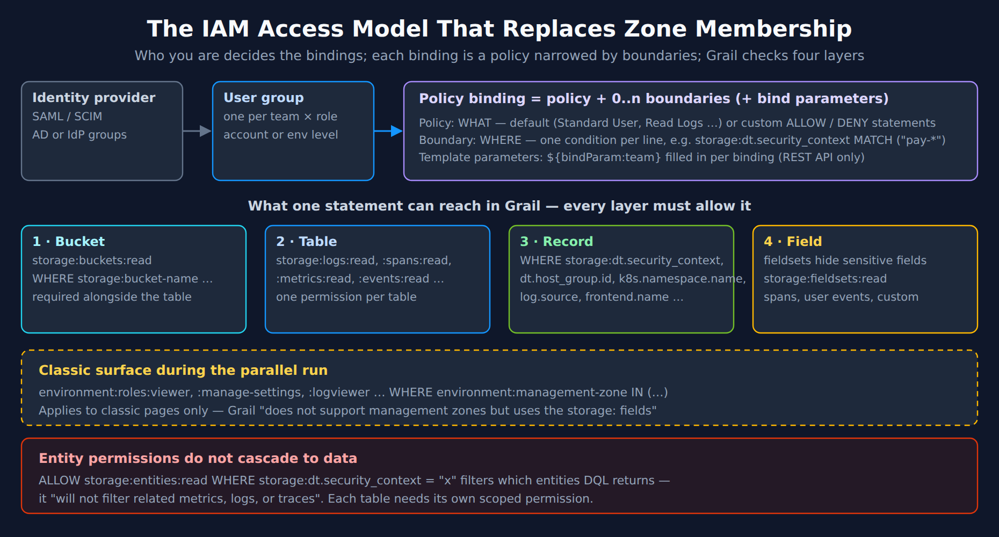
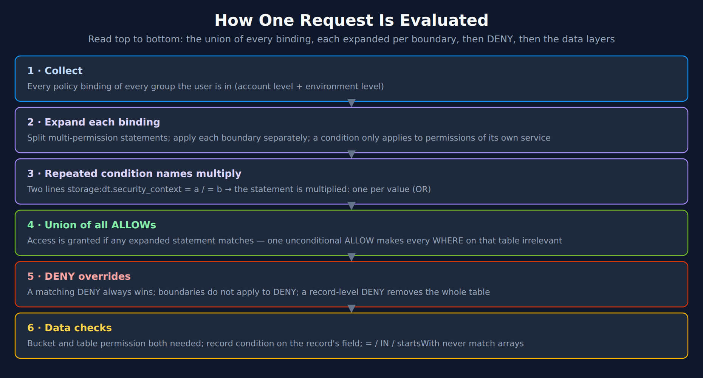
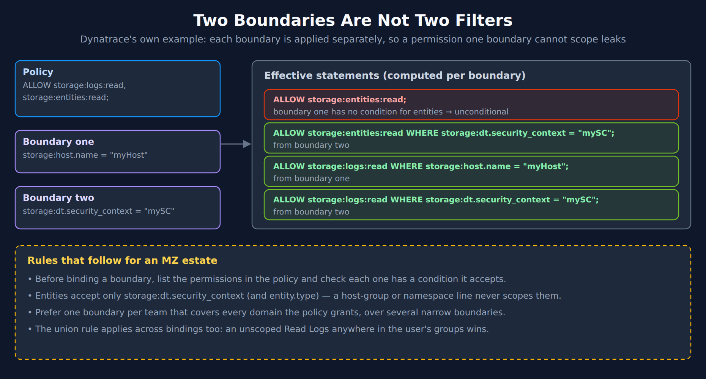
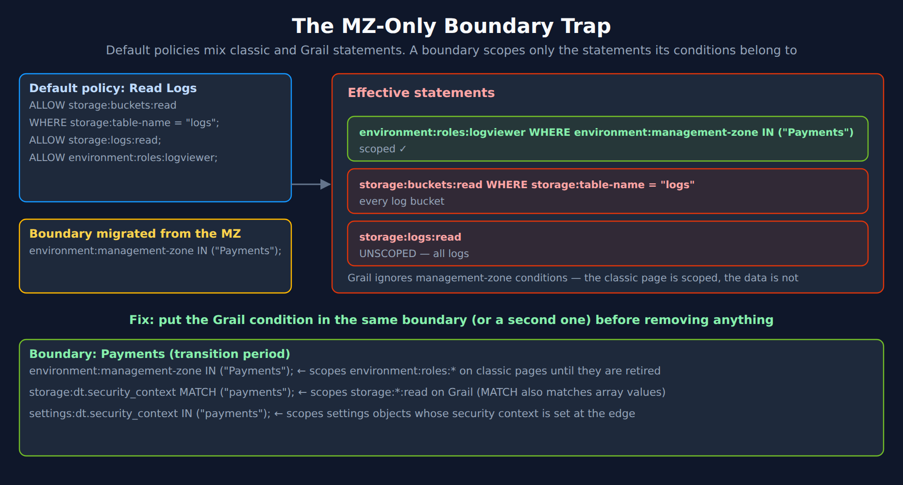
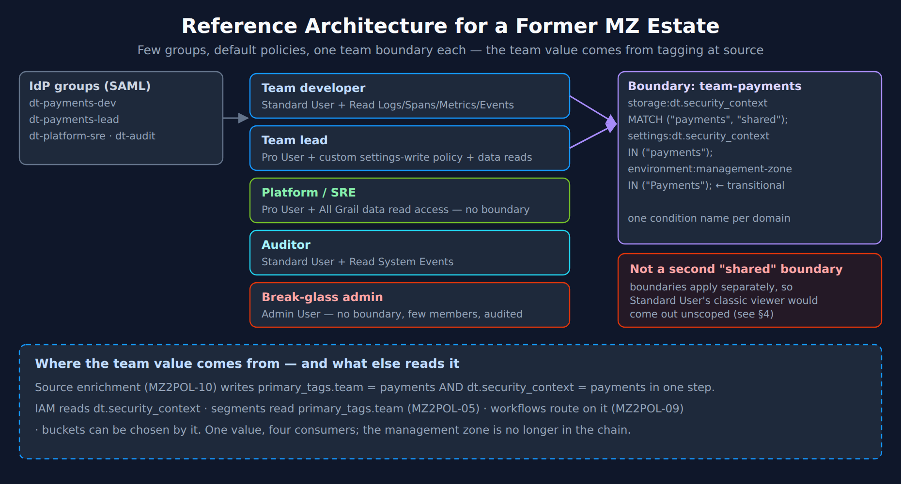

# MZ2POL-12: IAM Reference Architecture for a Former Management-Zone Estate

> **Series:** MZ2POL — Management Zone Migration: Segments, Policies, Workflows | **Notebook:** 13 of 17 | **Created:** October 2026 | **Last Updated:** 10/19/2026

## Overview

MZ2POL-04 explains policy and boundary syntax, and MZ2POL-08 scales it with templates. This notebook is the **architecture** layer above both: how the pieces combine into a design that reproduces what management zones did for access — and the places where a straight translation silently grants more than the zone ever did.

Three facts drive the design:

- **Grail does not evaluate management zones.** Dynatrace's boundary documentation: *"Grail does not support management zones but uses the storage: fields for record level access control."* Every Grail permission has to be scoped by a field on the record — which is why MZ2POL-10's tagging work comes first.
- **Permissions are a union.** Every binding of every group a user belongs to adds access; a single unscoped grant anywhere makes every scoped grant for that table irrelevant.
- **Dynatrace's own role-migration guide stops short of Grail.** It shows how to express classic roles with a `environment:management-zone` condition, and says plainly: *"This guide does not cover how to migrate your use of management zones into Grail permissions."* That gap is what this notebook fills.

> **Reading order:** after MZ2POL-10 and MZ2POL-11, alongside MZ2POL-04. Numbered 12 because it was added to an existing series.

---

## Table of Contents

1. [The Access Model in One Picture](#access-model)
2. [What Changes from Zone-Based Access](#what-changes)
3. [How a Request Is Evaluated](#evaluation)
4. [Boundary Pitfalls That Widen Access](#boundary-pitfalls)
5. [The Scoped-Settings Change](#scoped-settings)
6. [Reference Architecture](#reference-architecture)
7. [Persona Walkthrough](#personas)
8. [Mapping Classic Zone Permissions](#mapping-classic-permissions)
9. [Running Both Models During the Transition](#transition)
10. [Verifying the Design](#verifying)
11. [Design Review Checklist](#checklist)

---

## Prerequisites

| Requirement | Details |
|-------------|---------|
| **Dynatrace Environment** | SaaS on Latest Dynatrace; classic management zones still in place for the parallel run |
| **Account permissions** | Account Management access to policies, boundaries and group bindings; REST API access for templated bindings |
| **Foundation** | MZ2POL-10 readiness gate passed — `dt.security_context` set at the source for the data each team must see |
| **Permissions for §10** | `storage:buckets:read` (needed alongside every table permission), `storage:logs:read`, `storage:spans:read`, `storage:events:read`, `storage:user.events:read`, `storage:smartscape:read`, `storage:entities:read` |
| **Background reading** | MZ2POL-04 (syntax), MZ2POL-08 (templates), IAM-04 (policy authoring), IAM-05 (boundary design), ORGNZ-06 (security context) |

<a id="access-model"></a>
## 1. The Access Model in One Picture

A management zone was a single object: membership rules plus, through role assignments, the permissions scoped to it. The replacement is several objects, each with one job:

| Object | Job | Replaces |
|---|---|---|
| **User group** (from SAML/SCIM) | Who | The group that held MZ-scoped roles |
| **Policy** — default or custom | What — `ALLOW` / `DENY` statements | The classic role (`Access environment`, `View logs` …) |
| **Boundary** | Where — conditions, one per line | The zone's membership, re-expressed on record fields |
| **Binding** | Policy + 0..n boundaries (+ template parameters) on a group, at account or environment level | The role-to-zone assignment |
| **Segment** | What a user *looks at*, not what they may read | The zone selector in the UI (MZ2POL-05) |

Grail then checks permissions at four layers. *"Permissions can be assigned at the bucket, table, record, and field level. Without permissions, your users can't query data from Grail."*



<!-- MARKDOWN_TABLE_ALTERNATIVE
| Layer | Permission | Scoped by |
|---|---|---|
| Identity | SAML / SCIM → user group (one per team × role; account or environment level) | — |
| Binding | Policy (WHAT) + boundaries (WHERE) + optional ${bindParam:…} template parameters (REST API only) | — |
| 1 · Bucket | storage:buckets:read | storage:bucket-name — required alongside the table permission |
| 2 · Table | storage:logs:read, :spans:read, :metrics:read, :events:read … | one permission per table |
| 3 · Record | WHERE on a record field | storage:dt.security_context, dt.host_group.id, k8s.namespace.name, log.source, frontend.name … |
| 4 · Field | storage:fieldsets:read | fieldsets hide sensitive fields (spans, user events, custom) |
| Classic surface | environment:roles:* WHERE environment:management-zone | Classic pages only — Grail does not support management zones |
| Entities | storage:entities:read WHERE storage:dt.security_context | Does not filter related metrics, logs or traces |
For environments where SVG doesn't render
-->

### The record fields IAM can use

Only some record fields can carry a permission, and each only on some tables. From Dynatrace's *Permissions in Grail* reference:

| IAM condition | Tables |
|---|---|
| `storage:dt.security_context` | events, security.events, bizevents, system, logs, metrics, spans, entities, smartscape, user.events, user.sessions |
| `storage:dt.host_group.id`, `storage:host.name`, `storage:k8s.namespace.name`, `storage:k8s.cluster.name` | events, security.events, bizevents, logs, metrics, spans, smartscape |
| `storage:aws.account.id`, `storage:azure.subscription`, `storage:azure.resource.group`, `storage:gcp.project.id` | events, security.events, bizevents, logs, metrics, spans, smartscape |
| `storage:log.source` | logs |
| `storage:metric.key` | metrics |
| `storage:frontend.name` | user.events, user.sessions, metrics, smartscape |
| `storage:event.kind`, `storage:event.type`, `storage:event.provider` | events, security.events, bizevents, system |

Two consequences shape the whole architecture:

- **`dt.security_context` is the only field that reaches every table**, including entities and RUM sessions. A design built only on host group or namespace leaves entities, user sessions and system data unscopeable.
- **No `primary_tags` condition exists.** The team tag that drives segments and alert routing (MZ2POL-10 §4) cannot drive IAM; the same value must also be written to `dt.security_context`.

> <sub>**Sources:**</sub>
> - <sub>[Permissions in Grail (DT docs)](https://docs.dynatrace.com/docs/platform/grail/organize-data/assign-permissions-in-grail) — *"Permissions can be assigned at the bucket, table, record, and field level. Without permissions, your users can't query data from Grail."*</sub>
> - <sub>[Policy boundaries (DT docs)](https://docs.dynatrace.com/docs/manage/identity-access-management/permission-management/manage-user-permissions-policies/iam-policy-boundaries) — *"Grail does not support management zones but uses the storage: fields for record level access control."*</sub>
> - <sub>[Grant access to entities with security context (DT docs)](https://docs.dynatrace.com/docs/manage/identity-access-management/use-cases/access-security-context) — *"will not filter related metrics, logs, or traces."*</sub>
> - <sub>[Policy templating (DT docs)](https://docs.dynatrace.com/docs/manage/identity-access-management/permission-management/manage-user-permissions-policies/advanced/iam-policy-templating) — *"Parameterized policies can be managed only via REST API."*</sub>

<a id="what-changes"></a>
## 2. What Changes from Zone-Based Access

| Zone-based access (classic) | Policy-based access (Grail) | Why it matters in the migration |
|---|---|---|
| Data was in scope because its entity was — *"users automatically get access to logs and metrics associated with entities that are included within their assigned management zones"* | Each table needs its own scoped permission; entity access does not cascade | A team that could see "its" logs through the zone needs an explicit, scoped `storage:logs:read` |
| Membership computed by rules in the background | Membership is a field on the record, set at ingest | Records without the field are invisible to scoped users (§10) |
| One zone, one scope across every feature | One boundary per binding; conditions apply only to permissions of their own service | A boundary must cover every domain its policy grants (§4) |
| Roles assigned per zone | Default policies bound with a boundary | Dynatrace: *"Make use of default policies whenever possible and define your business-specific access conditions in policy boundaries."* |
| Entity security context could be derived from zones (Settings > Topology model > Grail Security Context) | Data records *"do not inherit the management zones of that entity"* | An MZ-derived entity security context does nothing for logs, spans or metrics — and stops matching for settings (§5) |

That last row is easy to miss on a real tenant. Dynatrace documents that *"managementZones is the default value for the majority of entity types"* in the Grail Security Context mapping. On the validation tenant (10/13/2026), **every one of 23 classic host entities** had a security context matching one of its management-zone names. Of the 15 that sent logs in the same hour, **none** had a log record whose security context matched any zone name — the entity and its data were scoped by unrelated values.

> <sub>**Sources:** [Grant access to entities with security context (DT docs)](https://docs.dynatrace.com/docs/manage/identity-access-management/use-cases/access-security-context) — *"Logs, spans, metrics, and events powered by Grail that are sent from an entity do not inherit the management zones of that entity."*, [Upgrade role-based permissions to Dynatrace IAM policies (DT docs)](https://docs.dynatrace.com/docs/manage/identity-access-management/permission-management/manage-user-permissions-policies/advanced/migrate-roles) — *"Make use of default policies whenever possible and define your business-specific access conditions in policy boundaries."*, [Management-zone rules (DT docs)](https://docs.dynatrace.com/docs/manage/identity-access-management-classic/permission-management/management-zones/management-zone-rules).</sub>

<a id="evaluation"></a>
## 3. How a Request Is Evaluated

Most access surprises in an MZ migration come from evaluation order, not syntax. These are the documented rules, in the order they bite.



<!-- MARKDOWN_TABLE_ALTERNATIVE
| Step | Rule |
|---|---|
| 1 · Collect | Every policy binding of every group the user is in (account level and environment level) |
| 2 · Expand each binding | Multi-permission statements are split; each boundary is applied separately; a condition applies only to permissions of its own service |
| 3 · Repeated condition names multiply | Two lines on the same condition name produce one statement per value (OR) |
| 4 · Union of all ALLOWs | Access is granted if any expanded statement matches; one unconditional ALLOW makes every WHERE on that table irrelevant |
| 5 · DENY overrides | A matching DENY always wins; boundaries do not apply to DENY; a conditional DENY on a Grail table permission removes the whole table |
| 6 · Data checks | Bucket and table permissions are both needed; record conditions test the record's field; =, IN and startsWith never match arrays |
For environments where SVG doesn't render
-->

The rules, with Dynatrace's wording:

| Rule | Dynatrace's wording |
|---|---|
| Conditions stay in their own service | *"Only conditions added to service configuration will be applied to relative permissions."* Global conditions are the exception: *"This rule doesn't apply to global conditions."* |
| Repeated names multiply | *"When a boundary contains repeated condition names, then each policy statement is multiplied by such conditions."* |
| Each boundary separately | *"When more than one boundary applies to a policy, then effective statements are calculated for each boundary separately"* |
| No boundaries on DENY | *"Boundaries don't apply to DENY statements"* |
| One unscoped grant wins | *"If there is an unconditional table permission in any other policy available for a user, the WHERE clause is irrelevant and the user will always be able to view all records from that table."* |
| Arrays need MATCH | *"Using = , STARTSWITH or IN when the field holds an array will always return false ."* |
| Conditional DENY on tables | *"Conditional DENY statements involving Grail table permissions are not supported"* — they run as unconditional DENY |

The "one unscoped grant wins" rule is the most common post-migration finding. A team group bound to *Read Logs* with a boundary is correctly scoped — until the same users are also in a broad "all developers" group that was given *Read Logs* without one.

> <sub>**Sources:**</sub>
> - <sub>[Policy boundaries (DT docs)](https://docs.dynatrace.com/docs/manage/identity-access-management/permission-management/manage-user-permissions-policies/iam-policy-boundaries) — *"Only conditions added to service configuration will be applied to relative permissions."*</sub>
> - <sub>[Permissions in Grail (DT docs)](https://docs.dynatrace.com/docs/platform/grail/organize-data/assign-permissions-in-grail) — *"If there is an unconditional table permission in any other policy available for a user, the WHERE clause is irrelevant and the user will always be able to view all records from that table."*</sub>
> - <sub>[IAM policy statement syntax and examples (DT docs)](https://docs.dynatrace.com/docs/manage/identity-access-management/permission-management/manage-user-permissions-policies/iam-policystatement-syntax) — *"Conditional DENY statements involving Grail table permissions are not supported"*</sub>

<a id="boundary-pitfalls"></a>
## 4. Boundary Pitfalls That Widen Access

Both pitfalls below produce a binding that looks scoped and is not. Neither raises an error.

### 4.1 Two boundaries are not two filters

Dynatrace's boundary page carries its own warning example. A policy granting `storage:logs:read` and `storage:entities:read`, bound with a host-name boundary and a security-context boundary, expands to four statements — and one of them is unconditional, because the host-name boundary has no condition that applies to entities. Dynatrace: *"In certain configurations this may cause unintended unconditional access."*



<!-- MARKDOWN_TABLE_ALTERNATIVE
| Effective statement | Origin | Result |
|---|---|---|
| ALLOW storage:entities:read; | Boundary one (storage:host.name) has no condition for entities | Unconditional |
| ALLOW storage:entities:read WHERE storage:dt.security_context = "mySC"; | Boundary two | Scoped |
| ALLOW storage:logs:read WHERE storage:host.name = "myHost"; | Boundary one | Scoped |
| ALLOW storage:logs:read WHERE storage:dt.security_context = "mySC"; | Boundary two | Scoped |
Rules: check each permission in the policy has a condition it accepts; entities accept only dt.security_context (and entity.type); prefer one boundary per team covering every domain; an unscoped grant in any binding wins.
For environments where SVG doesn't render
-->

Entities are where this bites an MZ estate: `storage:entities:read` accepts only `storage:dt.security_context` and `storage:entity.type`, so a host-group or namespace boundary never scopes it.

### 4.2 The MZ-only boundary on a default policy

The default policies are not pure Grail policies. They include classic statements. *Read Logs* is:

```text
ALLOW storage:buckets:read WHERE storage:table-name = "logs";
ALLOW storage:logs:read;
ALLOW environment:roles:logviewer;
```

*Standard User*, *Pro User* and *Admin User* likewise each contain an `environment:roles:viewer` statement among their classic permissions.

So consider the most natural first step of a migration — re-creating each zone as a boundary with `environment:management-zone IN ("<zone>")` and attaching it to the default policies the group already uses. The classic statements are scoped to the zone. The Grail statements are not, because the boundary holds no condition that applies to them. The group can now read **all** logs in Grail.



<!-- MARKDOWN_TABLE_ALTERNATIVE
| Effective statement (Read Logs + boundary environment:management-zone IN ("Payments")) | Result |
|---|---|
| environment:roles:logviewer WHERE environment:management-zone IN ("Payments") | Scoped |
| storage:buckets:read WHERE storage:table-name = "logs" | Every log bucket |
| storage:logs:read | Unscoped — all logs |
| Fix — boundary for the transition period | environment:management-zone IN ("Payments"); storage:dt.security_context MATCH ("payments"); settings:dt.security_context IN ("payments"); |
For environments where SVG doesn't render
-->

The reverse mistake exists too. A boundary that holds only `storage:` and `settings:` conditions, attached to *Standard User*, leaves `environment:roles:viewer` unscoped — classic pages for the whole environment — for as long as classic pages are in use.

**The rule:** a boundary must hold a condition for **every domain the policy grants**. During the parallel run that means the `environment:management-zone` line *and* the Grail lines, in the same boundary. Dynatrace's own boundary page shows exactly this shape — a `Kubernetes` boundary with an `environment:management-zone startsWith "[Kubernetes]"` line and a `storage:k8s.namespace.name IN (...)` line together.

> **Unverified — test with a dry run before relying on it.** `settings:objects:read` and `settings:objects:write` accept both `environment:management-zone` and `settings:dt.security_context`, so in the transitional boundary both lines land on the same settings statements. The boundary page says what *repeated* condition names do — *"each policy statement is multiplied by such conditions"* — but not what two *different* names on one permission do. If they combine with AND, a settings object has to match the zone **and** the security context. Once the scoped-settings change makes zone conditions *"never match"* (§5), every settings grant under the boundary stops — including the settings read that *Standard User* and *Pro User* carry. Before rolling the boundary out, resolve a pilot user's settings permissions with `POST /iam/resolution/{level-type}/{level-id}/effectivepermissions:dry-run`. It takes the bindings with their boundaries before you apply them (§10). The alternative that avoids the question is to keep the zone line out of this boundary: bind `environment:roles:viewer` in its own classic-only policy, under a boundary that holds only the `environment:management-zone` line.

> <sub>**Sources:**</sub>
> - <sub>[Policy boundaries (DT docs)](https://docs.dynatrace.com/docs/manage/identity-access-management/permission-management/manage-user-permissions-policies/iam-policy-boundaries) — *"In certain configurations this may cause unintended unconditional access."* and *"Be aware that the management zones referenced in your boundaries only apply to policy statements that support management zones."*</sub>
> - <sub>[Dynatrace default policies reference (DT docs)](https://docs.dynatrace.com/docs/manage/identity-access-management/permission-management/default-policies) — *Read Logs*, *Standard User*, *Pro User* and *Admin User* policy statements</sub>
> - <sub>[IAM policy reference (DT docs)](https://docs.dynatrace.com/docs/manage/identity-access-management/permission-management/manage-user-permissions-policies/advanced/iam-policystatements) — `storage:entities:read` conditions: `storage:entity.type`, `storage:dt.security_context`</sub>
> - <sub>[IAM policy reference (DT docs)](https://docs.dynatrace.com/docs/manage/identity-access-management/permission-management/manage-user-permissions-policies/advanced/iam-policystatements) — `settings:objects:read` / `settings:objects:write` conditions include `environment:management-zone` and `settings:dt.security_context`</sub>
> - <sub>[Upgrade your security policies for scoped settings access (DT docs)](https://docs.dynatrace.com/docs/platform/upgrade/set-up-your-environment/upgrade-scoped-settings-objects) — *"Because management zones no longer exist, these conditions never match."*</sub>
> - <sub>**Derived:** the effective statements follow from applying the boundary page's service-scoping rule to the default policies' published statements.</sub>

<a id="scoped-settings"></a>
## 5. The Scoped-Settings Change

Settings access is the third domain, and it is changing under the migration. Dynatrace's upgrade guide for scoped settings (published 08/29/2026) describes a **breaking change** that applies to settings objects scoped to monitored entities as the Smartscape transition reaches a tenant:

- **Zone conditions stop matching.** *"Because management zones no longer exist, these conditions never match."* That includes `environment:management-zone` on settings statements and *"Security context conditions that are derived from management zones."*
- **Both directions break.** *"ALLOW statements stop granting access."* and *"DENY statements stop blocking access. Restrictions that relied on these conditions no longer take effect, which can unintentionally widen access."*
- **Host groups are addressed by name.** `settings:scope = "HOST_GROUP-…"` becomes `settings:scope = "dt.host_group.id:<name>"`; `settings:entity.hostGroup` keeps working.
- **Security context must be set at the edge.** *"if you want IAM conditions to match based on security context, security context must be set at the edge."* Enrichment for all Smartscape nodes is described as planned for a later phase.

Treat this as rolling out: the guide asks you to review policies *"before this change reaches your environment."* Until it reaches yours, existing zone-scoped settings statements keep working; the migration should replace them anyway, because they have no future.

**For the architecture:** `settings:dt.security_context` is the documented replacement, and it only works where the security context was set at the source — the MZ2POL-10 readiness gate again. Where a settings scope has no edge-set security context (the guide names process groups as having *"no direct replacement"*), use `settings:schemaId` to limit *which kinds* of settings a team may edit, and accept that the scope is coarser.

> <sub>**Sources:**</sub>
> - <sub>[Upgrade your security policies for scoped settings access (DT docs)](https://docs.dynatrace.com/docs/platform/upgrade/set-up-your-environment/upgrade-scoped-settings-objects) — *"Because management zones no longer exist, these conditions never match."*, *"DENY statements stop blocking access."* and *"if you want IAM conditions to match based on security context, security context must be set at the edge."*</sub>

<a id="reference-architecture"></a>
## 6. Reference Architecture

The design below is this series' recommendation for an estate leaving management zones. It follows Dynatrace's guidance to use default policies with boundaries, and adds the coverage rule from §4.



<!-- MARKDOWN_TABLE_ALTERNATIVE
| Group (from IdP) | Policies | Boundary |
|---|---|---|
| Team developer | Standard User + Read Logs / Read Spans / Read Metrics / Read Events | team-payments |
| Team lead | Pro User + custom settings-write policy + data reads | team-payments |
| Platform / SRE | Pro User + All Grail data read access | none — whole estate |
| Auditor | Standard User + Read System Events | none |
| Break-glass admin | Admin User | none — few members, audited |
| Boundary team-payments | storage:dt.security_context MATCH ("payments", "shared"); settings:dt.security_context IN ("payments"); environment:management-zone IN ("Payments"); (transitional) | one condition name per domain |
| Not recommended | A second "shared" boundary on the same binding — boundaries apply separately, so Standard User's classic viewer comes out unscoped | |
| Source of the team value | MZ2POL-10 enrichment writes primary_tags.team and dt.security_context together; IAM reads dt.security_context, segments read primary_tags.team, workflows route on it | |
For environments where SVG doesn't render
-->

### Design principles

1. **Groups by team × role, not by zone.** A zone estate typically has many more zones than teams. Consolidate first (MZ2POL-05 §2's "one per dimension" applies to boundaries too).
2. **Default policies for the "what", boundaries for the "where".** Custom policies only for `DENY` carve-outs or permissions no default covers — settings write is one: *Settings Writer*, *Settings Reader*, *Storage Default Monitoring Read*, *Storage All System Data Read* and the *Environment role - …* policies are legacy defaults that *"are not accessible for new policy assignments"*. A team lead's settings-write policy is a few lines (MZ2POL-04 §10).
3. **One boundary per team, covering every domain the bound policies grant.** `storage:` for Grail, `settings:` for settings, `environment:management-zone` only while classic pages are in use. Test the settings lines with a dry run first (§4.2 caveat).
4. **Shared data is a security-context value, not a second boundary.** Give shared infrastructure its own value (`shared`) and add it to the team's `MATCH` list. A list on one condition multiplies the statement (OR) inside one boundary; a second boundary is evaluated separately and can leak (§4.1). Dynatrace's boundary page does suggest more boundaries for a team that needs more than ten lines — *"Only 10 restrictions per boundary, to keep them manageable."* If you split, every boundary on the binding needs a condition for every permission the policy grants, or the permission comes out unconditional under the boundary that omits it.
5. **`MATCH` for `storage:dt.security_context` wherever the permission accepts it.** Dynatrace warns that record fields *"might contain an array"*, and on the validation tenant every event record did (§10); `MATCH` is the only operator with *"for any value"* semantics on records. Two exceptions have no `MATCH`: `settings:dt.security_context` (`IN`, `=`, `startsWith`) and `storage:entities:read` (`=`, `IN`, `startsWith`). For entities, Dynatrace says the context *"Can be a multi-value field and startsWith will evaluate for any matching value"* — it does not say the same for `=` or `IN`, nor what a boundary's `MATCH` line does when it lands on `storage:entities:read` (as it does under *Read Entities* or *All Grail data read access*). That combination is unverified: test entity access with a pilot user before relying on it.
6. **No broad unscoped data policy for team groups.** One unscoped *Read Logs* in any of the user's groups defeats every boundary (§3).
7. **Templates when teams exceed a handful.** The same boundary shape becomes one parameterized policy bound per team (MZ2POL-08) — managed via REST API.

> <sub>**Sources:**</sub>
> - <sub>[Upgrade role-based permissions to Dynatrace IAM policies (DT docs)](https://docs.dynatrace.com/docs/manage/identity-access-management/permission-management/manage-user-permissions-policies/advanced/migrate-roles) — *"Build your own custom policies only when provided default policies don't fit your requirements or when you want to further limit default policies."*</sub>
> - <sub>[Permissions in Grail (DT docs)](https://docs.dynatrace.com/docs/platform/grail/organize-data/assign-permissions-in-grail) — *"you must use the MATCH operator to get "for any value" set semantic."* and *"If you expect your record filters might contain an array, use the MATCH operator in your IAM statements."*</sub>
> - <sub>[Policy boundaries (DT docs)](https://docs.dynatrace.com/docs/manage/identity-access-management/permission-management/manage-user-permissions-policies/iam-policy-boundaries) — *"Only 10 restrictions per boundary, to keep them manageable."*</sub>
> - <sub>[Dynatrace default policies reference (DT docs)](https://docs.dynatrace.com/docs/manage/identity-access-management/permission-management/default-policies) — legacy default policies: *"They are not accessible for new policy assignments, but existing assignments of these policies remain until removed."*</sub>
> - <sub>[Grant access to entities with security context (DT docs)](https://docs.dynatrace.com/docs/manage/identity-access-management/use-cases/access-security-context) — *"Can be a multi-value field and startsWith will evaluate for any matching value."*; [IAM policy reference (DT docs)](https://docs.dynatrace.com/docs/manage/identity-access-management/permission-management/manage-user-permissions-policies/advanced/iam-policystatements) — operators per permission</sub>
> - <sub>**Derived:** principles 3, 4 and 6 apply the evaluation rules in §3 and §4 to the default policies.</sub>

<a id="personas"></a>
## 7. Persona Walkthrough

Six personas, each traced from the zone setup they had to the bindings that replace it. Policy names are current Dynatrace default policies, except the team lead's custom settings-write policy — no current default grants settings write below *Admin User*.

| Persona | Classic setup (zone-scoped roles) | Group and policies | Boundary | Sees in Grail | Convenience layer |
|---|---|---|---|---|---|
| **Payments developer** | Access environment + View logs on zone *Payments* | Standard User, Read Logs, Read Spans, Read Metrics, Read Events | team-payments | Records with `dt.security_context` *payments* or *shared* | Segment `team = payments` as default (MZ2POL-05) |
| **Payments team lead** | + Change monitoring settings on *Payments* | Pro User, custom settings-write policy (MZ2POL-04 §10), data reads | team-payments | Same data; edits settings objects with an edge-set *payments* context | Same segment |
| **Platform SRE** | Access environment on every zone | Pro User, All Grail data read access | none | Every Grail table and bucket | Segments per team for focus |
| **NOC operator** | Access environment on a *Production* zone | Standard User, Read Events, Read Logs | `storage:dt.security_context MATCH ("prod/*")` — only works if context values carry the stage, e.g. `prod/payments` | Production records of every team | Segment `stage = prod`; problem notifications via MZ2POL-09 |
| **Auditor** | Viewer on audit dashboards | Standard User, Read System Events | none | The `dt.system.events` table — audit and billing events, among others | — |
| **Support engineer needing request data** | View sensitive request data on *Payments* | Read Sensitive Data, under the team boundary | team-payments | Unmasked sensitive fieldsets — note *Read Sensitive Data* grants `storage:fieldsets:read` unconditionally | — |

Three things the table makes visible:

- **The NOC row only works if the stage is inside the security context value.** A context like `payments` cannot express "production"; `prod/payments` can. MZ2POL-04 §4 and IAM-05 cover structured, separator-delimited context values for exactly this.
- **The support-engineer row is a real gap.** Fieldset access is not record-scoped in the default policy, so the zone that limited *View sensitive request data* to one team has no exact equivalent. Decide per case whether the data-access boundary is sufficient, or grant a custom `storage:fieldsets:read WHERE storage:fieldset-name = "…"` statement.
- **Segments are on every row as convenience, never as control.** They change the view, not the permission.

> <sub>**Sources:** [Dynatrace default policies reference (DT docs)](https://docs.dynatrace.com/docs/manage/identity-access-management/permission-management/default-policies) — *"Read Sensitive Data Grants unconditional permissions to read sensitive data in Dynatrace."* and *"Read System Events Grants read access to all Dynatrace system events data."*, [Permissions in Grail (DT docs)](https://docs.dynatrace.com/docs/platform/grail/organize-data/assign-permissions-in-grail). **Derived:** each row combines the default-policy contents with the boundary rules in §3–§4.</sub>

<a id="mapping-classic-permissions"></a>
## 8. Mapping Classic Zone Permissions

Each classic RBAC role has an `environment:roles:*` permission. Dynatrace's role-migration guide tabulates most of them and shows the `environment:roles:viewer` form in an example; the IAM policy reference lists the rest. All but two can be scoped to a zone, which keeps classic pages working. The third column is what the same intent needs on Grail.

| Classic role | IAM permission (classic) | Grail / platform equivalent |
|---|---|---|
| Access environment | `environment:roles:viewer` | Standard User + per-table read policies, under a record-scoped boundary |
| View logs | `environment:roles:logviewer` | Read Logs, under `storage:dt.security_context` (or `storage:log.source` / `storage:dt.host_group.id`) |
| Change monitoring settings | `environment:roles:manage-settings` | A custom policy with `settings:objects:write` (+ `settings:schemas:read`), under `settings:dt.security_context` (edge-set context only) and/or narrowed by `settings:schemaId` / `settings:schemaGroup` |
| View sensitive request data | `environment:roles:view-sensitive-request-data` | Read Sensitive Data (`storage:fieldsets:read`) — see the §7 gap |
| Replay sessions (with / without masking) | `environment:roles:replay-sessions-with-masking` / `-without-masking` | Read User Replays (`storage:user.replays:read`); RUM data access via `storage:frontend.name` |
| View / manage security problems | `environment:roles:view-security-problems` / `manage-security-problems` | Read Security Events; vulnerability service permissions (APPSEC series) |
| Download / install OneAgent | `environment:roles:agent-install` — **not zone-scopable** (no `environment:management-zone` condition) | Fleet-management permissions; note the classic role *"also able to view monitoring data for all management zones"* |
| Configure capture of sensitive data | `environment:roles:configure-request-capture-data` — **not zone-scopable** (no `environment:management-zone` condition) | Settings permissions on the capture schemas; the classic role likewise sees all zones |

The two "all management zones" rows matter for the inventory: a group holding either role already sees every zone on classic pages, whatever its zone assignments say. Its zone scoping was never as narrow as it looked — and a `WHERE environment:management-zone` on either permission scopes nothing, because neither accepts the condition.

> <sub>**Sources:**</sub>
> - <sub>[Upgrade role-based permissions to Dynatrace IAM policies (DT docs)](https://docs.dynatrace.com/docs/manage/identity-access-management/permission-management/manage-user-permissions-policies/advanced/migrate-roles) — RBAC role table (logviewer, manage-settings, view-sensitive-request-data, replay and security-problem roles) and the `environment:roles:viewer` example; *"This guide does not cover how to migrate your use of management zones into Grail permissions."*</sub>
> - <sub>[IAM policy reference (DT docs)](https://docs.dynatrace.com/docs/manage/identity-access-management/permission-management/manage-user-permissions-policies/advanced/iam-policystatements) — `environment:roles:agent-install`: *"Users who have this permission assigned are also able to view monitoring data for all management zones."* (the same sentence is on `configure-request-capture-data`); neither permission lists a condition</sub>
> - <sub>[Dynatrace default policies reference (DT docs)](https://docs.dynatrace.com/docs/manage/identity-access-management/permission-management/default-policies) — *Read User Replays*, *Read Security Events*, *Read Sensitive Data* statements; the *Environment role - Download/install OneAgent* and *- Configure capture of sensitive data* policies: *"Management zones not supported."*</sub>
> - <sub>**Derived:** the Grail-equivalent column pairs each classic intent with the default policy that grants the same data, scoped by the record fields in §1.</sub>

<a id="transition"></a>
## 9. Running Both Models During the Transition

Dynatrace recommends a phased approach: *"Consider deploying your changes in batches rather than all at once."* For an MZ estate the batches are teams, and each team moves through four states.

| State | Boundary content | Classic pages | Grail |
|---|---|---|---|
| **0 · Today** | Zone-scoped RBAC roles or `environment:management-zone` only | Scoped | **Unscoped if default policies are bound** (§4.2) |
| **1 · Dual** | `environment:management-zone` + `storage:dt.security_context` + `settings:dt.security_context` in one boundary — dry-run the settings lines first (§4.2) | Scoped by zone | Scoped by security context |
| **2 · Verified** | Same | Same | Effective permissions checked, §10 queries clean |
| **3 · Retired** | Remove the `environment:management-zone` line once the team no longer uses classic pages | — | Unchanged |

Two operational notes:

- **Boundary edits apply immediately.** *"A change in the boundary will have an immediate effect on the user permissions that are assigned with this boundary."* Removing the zone line in state 3 needs no rebinding — and a mistaken edit hits every group at once. Test on a copy bound to a pilot group first.
- **State 0 may already be a leak.** If any group today has a default data policy bound with a zone-only boundary, it already reads all of that table in Grail. Find these first: they are the migration's highest-risk items, and they exist before you change anything.

> <sub>**Sources:** [Upgrade role-based permissions to Dynatrace IAM policies (DT docs)](https://docs.dynatrace.com/docs/manage/identity-access-management/permission-management/manage-user-permissions-policies/advanced/migrate-roles) — *"Consider deploying your changes in batches rather than all at once."*, [Policy boundaries (DT docs)](https://docs.dynatrace.com/docs/manage/identity-access-management/permission-management/manage-user-permissions-policies/iam-policy-boundaries) — *"A change in the boundary will have an immediate effect on the user permissions that are assigned with this boundary."*</sub>

<a id="verifying"></a>
## 10. Verifying the Design

Two kinds of check. The **API** tells you what a user is granted. **DQL** tells you what the data will let that grant reach. Both are needed: a correct policy over records without a security context returns nothing.

### The effective-permissions API

Dynatrace's role-migration guide points to the account API for resolving what a user actually holds:

```text
GET https://api.dynatrace.com/iam/v1/resolution/account/{accountId}/effectivepermissions?entityType=user&entityId={userId}
```

Run it for one pilot user per persona (§7) before and after each state change in §9. Look for any `storage:*:read` permission without a condition — that is §3's "one unscoped grant wins". The guide gives this endpoint as an example request and does not document the response shape, so read what comes back rather than relying on a fixed field.

Call it with an OAuth client that holds `iam:effective-permissions:read`. Don't confuse that with `platform-management:effective-permissions:resolve` in the *Standard User* policy, which answers only for the calling user — apps use it to decide which actions to show (**IAM-97** § 2.5).

To check a binding **before** it is applied, the same IAM API has a dry-run form. The 1.332 API changelog lists it, with `boundaries` and `parameters` in the request's bindings:

```text
POST /iam/resolution/{level-type}/{level-id}/effectivepermissions:dry-run
```

Use it to settle the §4.2 caveat for your boundary shape before state 1 reaches any real group.

### DQL checks

Every query below was executed against the validation tenant on 10/13/2026.

**Check 1 — which tables hold `dt.security_context` as an array?** Any `array` row means `=`, `IN` and `startsWith` conditions miss those records; use `MATCH`.

```dql
// Type of dt.security_context per table. An "array" row needs MATCH in every policy and boundary.
fetch logs, from:-1h
| filter isNotNull(dt.security_context)
| fieldsAdd sc_type = type(dt.security_context)
| summarize {records = count()}, by:{sc_type}
| fieldsAdd table = "logs"
| append [fetch spans, from:-1h | filter isNotNull(dt.security_context) | fieldsAdd sc_type = type(dt.security_context) | summarize {records = count()}, by:{sc_type} | fieldsAdd table = "spans"]
| append [fetch events, from:-24h | filter isNotNull(dt.security_context) | fieldsAdd sc_type = type(dt.security_context) | summarize {records = count()}, by:{sc_type} | fieldsAdd table = "events"]
| fields table, sc_type, records
```

On the validation tenant, logs (458,666 records) and spans (362,178) held a string; **events (103,365 in 24 h) held an array** — every one.

**Check 2 — what share of each table would a security-context-scoped user never see?** Records without the field cannot match any record condition on it.

```dql
// Share of records with no security context, per table — invisible to users scoped only by dt.security_context.
fetch logs, from:-1h
| summarize {records = count(), without_sc = countIf(isNull(dt.security_context))}
| fieldsAdd table = "logs"
| append [fetch spans, from:-1h | summarize {records = count(), without_sc = countIf(isNull(dt.security_context))} | fieldsAdd table = "spans"]
| append [fetch events, from:-1h | summarize {records = count(), without_sc = countIf(isNull(dt.security_context) or arraySize(dt.security_context) == 0)} | fieldsAdd table = "events"]
| append [fetch user.events, from:-1h | summarize {records = count(), without_sc = countIf(isNull(dt.security_context))} | fieldsAdd table = "user.events"]
| fieldsAdd invisible_pct = round(100.0 * without_sc / records, decimals: 1)
| fields table, records, without_sc, invisible_pct
```

On the validation tenant: spans and RUM user events 0%, **logs 45.6% and events 67.4%**. Those records are visible only to unscoped users (platform, SRE) — a team scoped by security context loses them. Either enrich the producers (MZ2POL-10, FAQ-26 §5) or add a second record field the team may use, such as `storage:dt.host_group.id`.

**Check 3 — is the entity security context still derived from management zones?** If yes, it scopes classic entity queries today and stops matching for scoped settings after the transition (§5).

```dql
// Classic host entities whose security context equals one of their management-zone names.
// Classic entity model on purpose — this is the mapping being retired. Zero bytes scanned.
fetch dt.entity.host
| fields entity.name, managementZones, dt.security_context
| fieldsAdd sc_from_mz = arraySize(arrayRemoveNulls(iCollectArray(if(in(dt.security_context[], managementZones), dt.security_context[])))) > 0
| summarize {hosts = count(),
    with_sc = countIf(arraySize(dt.security_context) > 0),
    sc_matches_an_mz = countIf(sc_from_mz)}
```

On the validation tenant: 23 hosts, 23 with a security context, **23 matching a zone name**.

**Check 4 — how much of the Smartscape topology carries an edge-set security context?** This bounds what `storage:smartscape:read` and scoped settings can reach today.

```dql
// Smartscape nodes with a security context, per node type. Zero bytes scanned.
smartscapeNodes "*"
| fieldsAdd has_sc = arraySize(dt.security_context) > 0
| summarize {nodes = count(), with_sc = countIf(has_sc)}, by:{type}
| fieldsAdd with_sc_pct = round(100.0 * with_sc / nodes, decimals: 1)
| sort nodes desc
| limit 30
```

On the validation tenant: containers 53%, Kubernetes pods 42%, processes 14%, and **0% for every cloud resource type** listed (AWS IAM roles, EC2 instances and volumes, Azure locations) and synthetic locations. Cloud resources reach Grail through cloud connections, not OneAgent, so host enrichment never touches them (FAQ-26 §5.4). The zero is real, not a type artefact: re-checked 10/19/2026, every Smartscape node returned `dt.security_context` as an array, and all 174 AWS IAM roles and 93 synthetic locations held an empty one.

> **Never trust a zero here on its own.** A 0% may mean the producer is not enriched, or that the window had no data of that type. Widen the window once, and confirm with a control (a node type or table you know is enriched) before acting on it.

> <sub>**Sources:** [Upgrade role-based permissions to Dynatrace IAM policies (DT docs)](https://docs.dynatrace.com/docs/manage/identity-access-management/permission-management/manage-user-permissions-policies/advanced/migrate-roles) — effective-permissions endpoint, [IAM policy reference (DT docs)](https://docs.dynatrace.com/docs/manage/identity-access-management/permission-management/manage-user-permissions-policies/advanced/iam-policystatements) — `iam:effective-permissions:read`, [Platform management SDK (Dynatrace Developer)](https://developer.dynatrace.com/develop/sdks/client-platform-management-service/) — *"Get the effective permissions of the calling user"*, [Dynatrace API changelog 1.332 (DT docs)](https://docs.dynatrace.com/docs/whats-new/dynatrace-api/sprint-332) — *"POST /iam/resolution/{level-type}/{level-id}/effectivepermissions:dry-run"*, [Permissions in Grail (DT docs)](https://docs.dynatrace.com/docs/platform/grail/organize-data/assign-permissions-in-grail). All four queries executed on the validation tenant, 10/13/2026.</sub>

<a id="checklist"></a>
## 11. Design Review Checklist

**Model**
- [ ] Groups are team × role, sourced from the IdP; zones consolidated before groups are created
- [ ] Default policies used wherever they fit; custom policies justified
- [ ] Every team's data has `dt.security_context` set at the source (MZ2POL-10 gate passed)

**Boundaries**
- [ ] Each boundary holds a condition for **every domain** its policies grant — `storage:`, `settings:`, and `environment:management-zone` while classic pages are used
- [ ] `storage:dt.security_context` conditions use `MATCH` where the permission accepts it (the field may be an array; events were on the validation tenant); `storage:entities:read` and `settings:dt.security_context` have no `MATCH` — entity access tested with a pilot user
- [ ] A boundary that mixes `environment:management-zone` and `settings:dt.security_context` checked with an effective-permissions dry run for a pilot user (§4.2)
- [ ] No legacy default policy (*Settings Reader/Writer*, *Storage … Read*, *Environment role - …*) in the design
- [ ] Shared data reached by an extra value on the same condition, not a second boundary
- [ ] No boundary relies on a host-group or namespace line to scope entities

**Union and DENY**
- [ ] No team member holds an unscoped data policy through any other group
- [ ] No record-level conditional `DENY` (it removes the whole table)
- [ ] Classic roles that see all zones (`agent-install`, `configure-request-capture-data`) inventoried — neither can be zone-scoped

**Settings**
- [ ] No settings statement depends on `environment:management-zone` or an MZ-derived security context
- [ ] Host-group settings scopes use `dt.host_group.id:<name>` or `settings:entity.hostGroup`

**Verification**
- [ ] Effective permissions resolved for one pilot user per persona, before and after each state change
- [ ] §10 Checks 1–4 run; invisible-record share understood per table

---

## Summary

1. **Grail does not evaluate zones.** Every Grail permission is scoped by a record field; `dt.security_context` is the only one that reaches every table.
2. **Access is a union.** Each binding adds; one unscoped grant anywhere defeats every boundary for that table.
3. **Boundaries scope only their own domain.** A zone-only boundary on a default policy leaves Grail unscoped; a Grail-only boundary leaves classic pages unscoped. Cover every domain in one boundary.
4. **Two boundaries are two evaluations.** Use a list on one condition for shared data.
5. **Settings scoped by zones stop matching** as the Smartscape transition arrives; edge-set security context is the replacement.
6. **Verify both ways** — effective permissions for the grant, DQL for what the data lets it reach.

## Next Steps

- **MZ2POL-04** — statement and boundary syntax for the architecture above.
- **MZ2POL-08** — the same boundary shape as one templated policy bound per team.
- **MZ2POL-06** and **MZ2POL-07** — execute the state changes in §9 and validate them.
- **IAM-05** — structured security-context values for transversal teams.
- **MZ2POL-13** — what is and is not documented about Spaces, and the preparation that pays off either way.

## Additional Resources

- [Policy boundaries (DT docs)](https://docs.dynatrace.com/docs/manage/identity-access-management/permission-management/manage-user-permissions-policies/iam-policy-boundaries)
- [Permissions in Grail (DT docs)](https://docs.dynatrace.com/docs/platform/grail/organize-data/assign-permissions-in-grail)
- [Upgrade role-based permissions to Dynatrace IAM policies (DT docs)](https://docs.dynatrace.com/docs/manage/identity-access-management/permission-management/manage-user-permissions-policies/advanced/migrate-roles)
- [Upgrade your security policies for scoped settings access (DT docs)](https://docs.dynatrace.com/docs/platform/upgrade/set-up-your-environment/upgrade-scoped-settings-objects)
- [Dynatrace default policies reference (DT docs)](https://docs.dynatrace.com/docs/manage/identity-access-management/permission-management/default-policies)
- [IAM policy reference (DT docs)](https://docs.dynatrace.com/docs/manage/identity-access-management/permission-management/manage-user-permissions-policies/advanced/iam-policystatements)
- [Grant access to entities with security context (DT docs)](https://docs.dynatrace.com/docs/manage/identity-access-management/use-cases/access-security-context)
- [Policy templating (DT docs)](https://docs.dynatrace.com/docs/manage/identity-access-management/permission-management/manage-user-permissions-policies/advanced/iam-policy-templating)

---

<sub>*This notebook was AI-generated from community-submitted and publicly available sources. This notebook series is not officially supported by Dynatrace. Always verify information against official Dynatrace documentation.*</sub>
