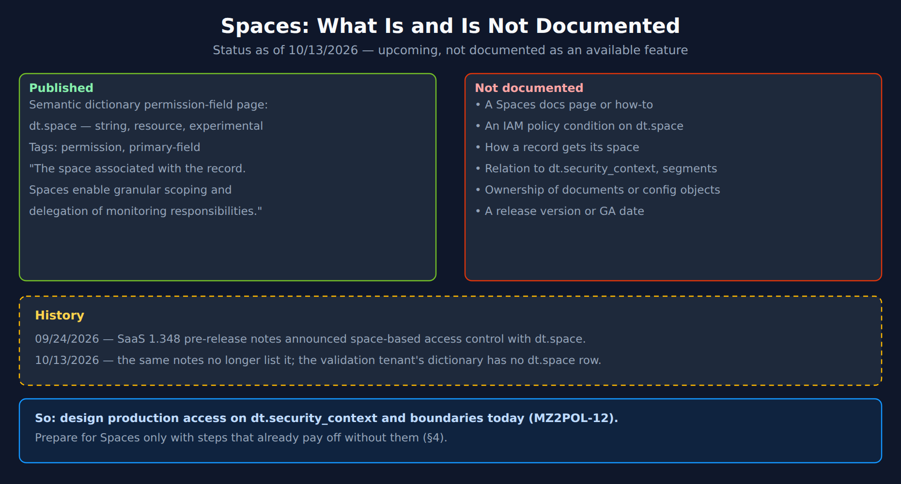
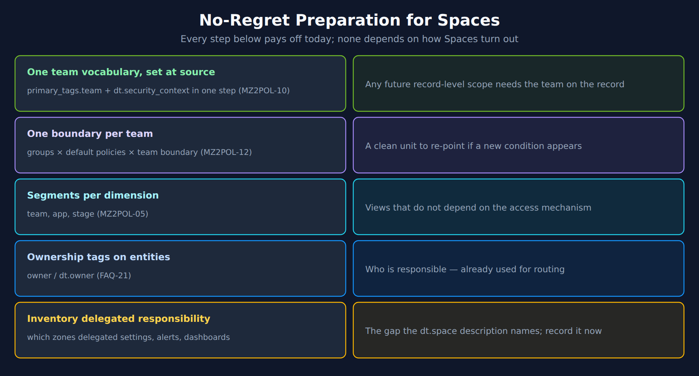

# MZ2POL-13: Spaces — What Is Coming and How to Prepare

> **Series:** MZ2POL — Management Zone Migration: Segments, Policies, Workflows | **Notebook:** 14 of 14 | **Created:** October 2026 | **Last Updated:** 10/13/2026

## Overview

> **Status (10/13/2026): upcoming — not documented as an available feature.** Everything in this notebook that goes beyond the single published dictionary entry is marked as unknown or as this series' own recommendation. Do not design production access around Spaces until Dynatrace documents them.

"Spaces" comes up in almost every management-zone conversation, usually as "the thing that will replace zones". That expectation is understandable: a zone was a named slice of the environment that a team owned, and the one published description of Spaces talks about *"granular scoping and delegation of monitoring responsibilities."*

This notebook separates what is published from what is not, explains where a space field would sit relative to the mechanisms this series already uses, and lists the preparation steps that pay off **whether or not** Spaces arrive in the form people expect. It is deliberately short on mechanics, because none are documented.

> **Reading order:** after MZ2POL-12. Numbered 13 because it was added to an existing series.

---

## Table of Contents

1. [What Is Published](#what-is-published)
2. [What Is Not Documented](#what-is-not-documented)
3. [Where a Space Field Would Sit](#where-it-would-sit)
4. [No-Regret Preparation](#no-regret-preparation)
5. [Checking the Status on Your Tenant](#checking-status)
6. [What Would Change This Guidance](#what-would-change)

---

## Prerequisites

| Requirement | Details |
|-------------|---------|
| **Dynatrace Environment** | Any Latest Dynatrace SaaS tenant (the §5 checks scan zero bytes) |
| **Background reading** | MZ2POL-10 (tagging at source), MZ2POL-12 (IAM reference architecture), FAQ-02 §2 (where Spaces appears in the tagging model) |

<a id="what-is-published"></a>
## 1. What Is Published

One public source describes `dt.space`: the semantic dictionary's permission-field page. It lists the field as `experimental`, of type `string`, with the tags `permission` and `primary-field`, and describes it in one sentence: *"The space associated with the record. Spaces enable granular scoping and delegation of monitoring responsibilities."*

Read narrowly, that entry says three things:

| From the entry | What it implies — and only that |
|---|---|
| Tagged `permission` | It belongs to the set of fields Dynatrace marks as usable for access control — the same tag `dt.security_context` carries |
| Tagged `primary-field` | It is grouped with built-in fields such as `dt.host_group.id` and `k8s.namespace.name` |
| *"associated with the record"* | It is a field on data records, like the security context — not an entity property alone |
| `experimental` | Its definition can still change |

Nothing else about Spaces — how a record gets one, who defines them, what they grant — is in that entry.



<!-- MARKDOWN_TABLE_ALTERNATIVE
| Published | Not documented | History |
|---|---|---|
| Semantic dictionary permission-field page: dt.space — string, resource, experimental; tags permission, primary-field; "The space associated with the record. Spaces enable granular scoping and delegation of monitoring responsibilities." | A Spaces docs page or how-to; an IAM policy condition on dt.space; how a record gets its space; relation to dt.security_context and segments; ownership of documents or configuration objects; a release version or GA date | 09/24/2026: SaaS 1.348 pre-release notes announced space-based access control with dt.space. 10/13/2026: the same notes no longer list it; the validation tenant's dictionary has no dt.space row |
Conclusion: design production access on dt.security_context and boundaries today (MZ2POL-12); prepare for Spaces only with steps that pay off without them (§4).
For environments where SVG doesn't render
-->

> <sub>**Sources:** [Permission fields — semantic dictionary (DT docs)](https://docs.dynatrace.com/docs/semantic-dictionary/tags/permission) — *"The space associated with the record. Spaces enable granular scoping and delegation of monitoring responsibilities."* (listed `experimental`, tags `permission`, `primary-field`; read 10/13/2026).</sub>

<a id="what-is-not-documented"></a>
## 2. What Is Not Documented

As of 10/13/2026, checked this session:

| Question | Status | Checked against |
|---|---|---|
| Is there a Spaces documentation page or how-to? | **No page found** | Dynatrace docs search |
| Can an IAM policy condition on `dt.space`? | **Not listed** — the reference has no `storage:dt.space` condition on any Grail permission | IAM policy reference |
| Is it in a release? | **Not in the current SaaS 1.348 notes.** The pre-release notes listed space-based access control on 09/24/2026 and no longer do | What's new in SaaS 1.348 (pre-release) |
| Is the field on a tenant? | **Not on the validation tenant** — no `dt.space` row in `dt.semantic_dictionary.fields`, while the control field `dt.security_context` is present | §5 query |
| How does a record get a space? | Not documented | — |
| How do spaces relate to `dt.security_context`, segments, buckets? | Not documented | — |
| Do spaces own documents or configuration (alerts, SLOs, settings)? | Not documented — the field description's "delegation of monitoring responsibilities" is not a documented mechanism | — |

**What this means for a migration plan:** none of the MZ2POL replacements may depend on Spaces. Access goes through `dt.security_context` and boundaries (MZ2POL-12), filtering through segments (MZ2POL-05), alerting through workflows (MZ2POL-09). Those are documented and available, and they do not need to be undone if Spaces arrive.

> <sub>**Sources:** [IAM policy reference (DT docs)](https://docs.dynatrace.com/docs/manage/identity-access-management/permission-management/manage-user-permissions-policies/advanced/iam-policystatements) — no `dt.space` condition, checked 10/13/2026. [What's new in Dynatrace SaaS 1.348 (DT docs)](https://docs.dynatrace.com/docs/whats-new/saas/sprint-348) — pre-release; read 09/24/2026 with a Spaces entry and 10/13/2026 without one. **Dictionary:** no `dt.space` row under `filter contains(name, "space")`, read 10/13/2026 (control: `dt.security_context` returned, `stable`, tagged `permission`).</sub>

<a id="where-it-would-sit"></a>
## 3. Where a Space Field Would Sit

Given only the two tags and the one sentence, the most that can be said is where such a field would **fit** in the model this series has built. This is an orientation, not a prediction.

| Layer in this series | Field it uses today | Where a record-level, permission-tagged `dt.space` would fit |
|---|---|---|
| Access (MZ2POL-12) | `dt.security_context`, built-in fields | Another field of the same kind — *if* IAM conditions on it are introduced |
| Filtering (MZ2POL-05) | `primary_tags.*`, built-in fields | A primary field can be filtered like `dt.host_group.id` is today |
| Alerting (MZ2POL-09) | Entity tags, DQL matcher on the problem | Not indicated by the entry |
| Configuration ownership | **Nothing today** — settings permissions, `settings:schemaId` | The entry's "delegation of monitoring responsibilities" points at this gap, but no mechanism is documented |

The last row is the honest reason Spaces attract so much interest from teams leaving management zones. A zone let a central team hand a slice of the environment — and often its settings, dashboards and alerts — to an application team. Today's replacements cover **data** access and **views** well; delegating **configuration** is the part with no clean equivalent, which FAQ-02 §2 also records. If Spaces close that gap, they will matter. Until it is documented, treat that as hope, not plan.

> <sub>**Derived:** the "where it would fit" column places the published tags (`permission`, `primary-field`) next to the mechanisms in MZ2POL-05, -09 and -12; it states no Spaces behaviour.</sub>

<a id="no-regret-preparation"></a>
## 4. No-Regret Preparation

These steps are this series' recommendation. Each one is already worth doing for the documented migration, and none of them depends on how Spaces turn out.



<!-- MARKDOWN_TABLE_ALTERNATIVE
| Step | How | Why it pays off either way |
|---|---|---|
| One team vocabulary, set at source | primary_tags.team + dt.security_context in one enrichment step (MZ2POL-10) | Any future record-level scope needs the team on the record |
| One boundary per team | Groups × default policies × team boundary (MZ2POL-12) | A clean unit to re-point if a new condition appears |
| Segments per dimension | Team, app, stage (MZ2POL-05) | Views that do not depend on the access mechanism |
| Ownership tags on entities | owner / dt.owner (FAQ-21) | Who is responsible — already used for routing |
| Inventory delegated responsibility | Which zones delegated settings, alerts, dashboards | The gap the dt.space description names; record it now |
For environments where SVG doesn't render
-->

### Why these and not others

- **Team values on the record are the common denominator.** Whatever a future scope is called, it can only act on records that say whose they are. The MZ2POL-10 gate is the preparation.
- **One boundary per team is the cheapest thing to change later.** If a new condition becomes available, it is one line in one boundary per team, not a redesign of every binding.
- **The delegation inventory is information you lose at cutover.** When zones are deleted, the record of which team was trusted with which settings, dashboards and alerting profiles goes with them. Export it during assessment (MZ2POL-00, -03) and keep it with the translation worksheet (MZ2POL-11 §10).

### What not to do

- Do not keep management zones alive "until Spaces arrive". Zones are not evaluated for Grail data, and zone-scoped settings conditions stop matching as the Smartscape transition arrives (MZ2POL-12 §5) — waiting buys nothing.
- Do not invent your own `dt.space` field in enrichment. A self-made field with the same name as a published, still-undocumented platform field can collide with the real one when it ships.
- Do not promise teams a Spaces-based model in migration plans or contracts.

<a id="checking-status"></a>
## 5. Checking the Status on Your Tenant

The semantic dictionary changes with the platform version, so the field can appear on one tenant before another. This query reads the dictionary at zero cost and includes a control row so that an empty result means something.

```dql
// Is dt.space defined on this tenant? dt.security_context is the control —
// if it is missing too, the query surface is broken, not the field.
// Zero bytes scanned.
fetch dt.semantic_dictionary.fields
| filter name == "dt.space" or name == "dt.security_context"
| fields name, stability, tags, description
```

On the validation tenant (10/13/2026) this returned one row — `dt.security_context` (`stable`, tagged `permission`) — and no `dt.space`.

If `dt.space` appears on your tenant, check three more things before relying on it:

1. **The IAM policy reference** — is there a `storage:dt.space` condition, and on which permissions?
2. **A Spaces documentation page** — how values are assigned, and by whom.
3. **The release notes** for your tenant's version — whether the feature is announced as available, and with what rollout.

Until all three exist, keep the MZ2POL-12 design.

<a id="what-would-change"></a>
## 6. What Would Change This Guidance

This notebook will be revised when any of the following is published:

| Trigger | What changes |
|---|---|
| A Spaces documentation page | §1–§3 rewritten from the documented behaviour, with version-gated framing |
| `dt.space` as an IAM condition | MZ2POL-12 gains a Spaces option in the reference architecture; boundaries may gain a line |
| Spaces delegating configuration ownership | MZ2POL-03's inventory and MZ2POL-11's worksheet gain a "delegated to space" column |
| `dt.space` moving to `stable` | The §5 check becomes a readiness check rather than a watch |

---

## Summary

1. **One published entry:** `dt.space` is an `experimental` record field tagged `permission` and `primary-field`, described as enabling *"granular scoping and delegation of monitoring responsibilities."*
2. **Everything else is undocumented** — no page, no IAM condition, no release entry, not on the validation tenant.
3. **Build the migration on documented mechanisms** — `dt.security_context` and boundaries, segments, workflows.
4. **Prepare with no-regret steps** — team values on the record, one boundary per team, segments per dimension, ownership tags, and an inventory of delegated responsibility.
5. **Check your tenant** with the §5 query, and re-check on each platform release.

## Next Steps

- **MZ2POL-12** — the access design to build now.
- **MZ2POL-10** — the tagging foundation every option depends on.
- **FAQ-02 §2** — where Spaces appears in the tagging model, kept current with this notebook.

## Additional Resources

- [Permission fields — semantic dictionary (DT docs)](https://docs.dynatrace.com/docs/semantic-dictionary/tags/permission)
- [IAM policy reference (DT docs)](https://docs.dynatrace.com/docs/manage/identity-access-management/permission-management/manage-user-permissions-policies/advanced/iam-policystatements)
- [What's new in Dynatrace SaaS 1.348 (DT docs)](https://docs.dynatrace.com/docs/whats-new/saas/sprint-348)

---

<sub>*This notebook was AI-generated from community-submitted and publicly available sources. This notebook series is not officially supported by Dynatrace. Always verify information against official Dynatrace documentation.*</sub>
