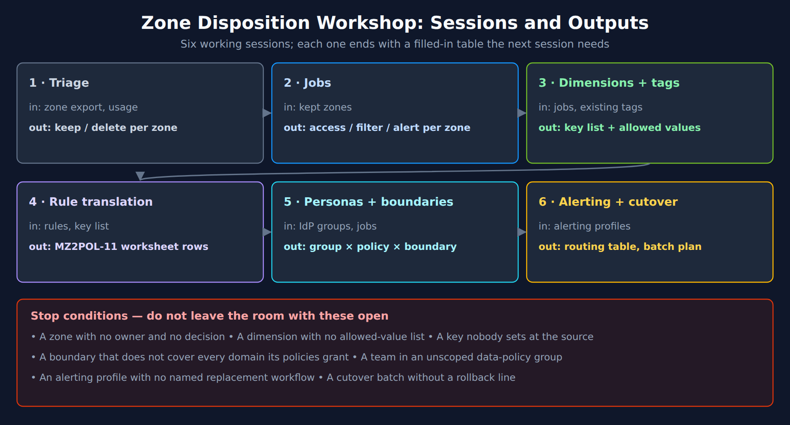
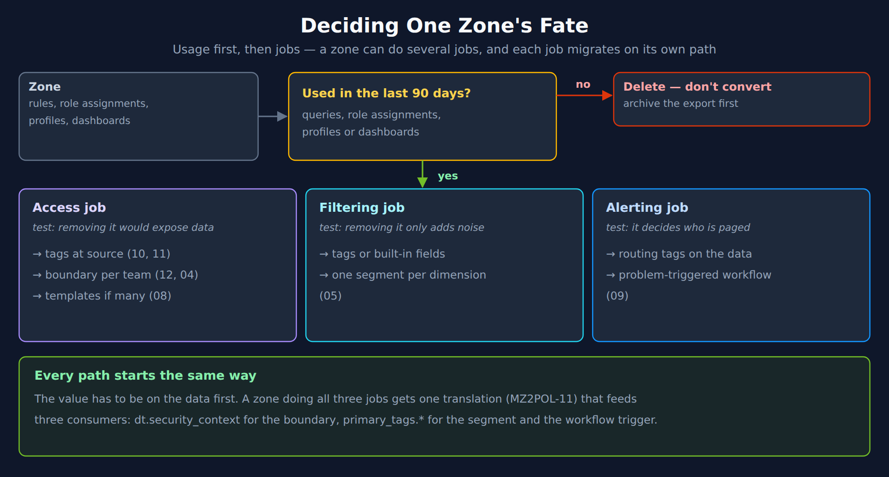

# MZ2POL-14: Zone Disposition Workshop

> **Series:** MZ2POL — Management Zone to Policy Migration | **Notebook:** Bonus Workshop | **Created:** October 2026 | **Last Updated:** 10/13/2026

## Overview

A management-zone migration stalls on decisions, not on configuration. Somebody has to say which zones die, which job each surviving zone does, what the team and stage values are, who sets them, and what each group may see. This workshop is a structured way to get those decisions made by the people who own them, in one series of working sessions, with every decision written into a table the build work can use.

> **Workshop Format:** a hands-on planning exercise that turns MZ2POL-00 and -03 output into the inputs MZ2POL-10, -11, -12, -05 and -09 need. It does not build anything. MZ2POL-95 LAB is the worked example: the same sessions applied to a fictional eight-zone estate.

---

## Table of Contents

1. [Who Should Attend](#who-attends)
2. [Before the Workshop](#before)
3. [The Six Sessions](#sessions)
4. [Session 1 — Triage](#session-1)
5. [Session 2 — Jobs](#session-2)
6. [Session 3 — Dimensions and Tags](#session-3)
7. [Session 4 — Rule Translation](#session-4)
8. [Session 5 — Personas and Boundaries](#session-5)
9. [Session 6 — Alerting and Cutover](#session-6)
10. [Facilitator Notes: Traps to Name Out Loud](#facilitator-notes)
11. [Outputs and Next Steps](#outputs)

---

## Prerequisites

| Requirement | Details |
|-------------|---------|
| **Inputs** | MZ2POL-00 rule export; the classified inventory from MZ2POL-03; IdP group list; alerting profile list |
| **Reading for the facilitator** | MZ2POL-10, -11, -12 — the workshop asks the questions those notebooks answer |
| **Tenant access** | `storage:entities:read` for the two pre-work queries (zero bytes scanned) |
| **Time** | In community practice, one long day for a few dozen zones; split sessions 4–6 across days for large estates |

<a id="who-attends"></a>
## 1. Who Should Attend

| Role | Why they are needed | Decides |
|---|---|---|
| **Observability platform owner** (facilitator) | Knows the zone estate and the target model | Running order, stop conditions |
| **IAM / identity owner** | Owns IdP groups and the account | Group design, who binds what |
| **One owner per application team** | Knows what the zone was actually for | Keep / delete, job, team value |
| **Infrastructure / Kubernetes owner** | Controls host tags, OneAgent install, namespaces | Where values are set, by whom |
| **On-call / incident lead** | Owns alerting profiles and destinations | Routing replacements, parity window |
| **Security or compliance (for P1 zones)** | Signs off restricted data | Boundary values for regulated data |

A team that does not send an owner cannot have its zones decided. Park them — do not guess.

<a id="before"></a>
## 2. Before the Workshop

Run these two queries and bring the output. Both read the classic entity model, scan zero bytes, and were executed on the validation tenant on 10/13/2026.

**Pre-work A — which tag keys do the zones rely on?** (MZ2POL-10 §9, Step 2)

```dql
// Classic tag keys on hosts: the vocabulary the zones were built from. Zero bytes scanned.
fetch dt.entity.host
| fields entity.name, tags
| expand tags
| parse tags, "LD:tag_key ':' LD"
| fieldsAdd tag_key = coalesce(tag_key, tags)
| summarize {hosts = countDistinctExact(entity.name)}, by:{tag_key}
| sort hosts desc
| limit 50
```

**Pre-work B — which zones are really host-group zones?** (MZ2POL-11 §9, Check 1)

```dql
// Per zone: how many host groups its hosts span, and how many hosts have none. Zero bytes scanned.
fetch dt.entity.host
| fields entity.name, managementZones, hostGroupName
| expand managementZones
| filter isNotNull(managementZones)
| summarize {hosts = count(),
    without_host_group = countIf(isNull(hostGroupName)),
    host_groups = countDistinct(hostGroupName),
    group_list = collectDistinct(hostGroupName)},
    by:{zone = managementZones}
| fieldsAdd translation = if(without_host_group > 0, "needs a tag - some hosts have no host group",
    else: if(host_groups == 1, "dt.host_group.id = <group>",
    else: if(host_groups <= 5, "in(dt.host_group.id, {...})",
    else: "needs a tag - spans many host groups")))
| sort hosts desc
| limit 100
```

Also bring, as exports or screenshots:

- **Role assignments per zone** — which groups hold which classic roles on which zones (the access job).
- **Alerting profiles** with their zone filters and destinations (the alerting job).
- **Dashboard and query usage per zone** for the last 90 days (the filtering job — and the "unused" evidence for deletion).

<a id="sessions"></a>
## 3. The Six Sessions



<!-- MARKDOWN_TABLE_ALTERNATIVE
| Session | In | Out |
|---|---|---|
| 1 · Triage | Zone export, usage | Keep / delete per zone |
| 2 · Jobs | Kept zones | Access / filter / alert per zone |
| 3 · Dimensions + tags | Jobs, existing tags | Key list + allowed values |
| 4 · Rule translation | Rules, key list | MZ2POL-11 worksheet rows |
| 5 · Personas + boundaries | IdP groups, jobs | Group × policy × boundary |
| 6 · Alerting + cutover | Alerting profiles | Routing table, batch plan |
| Stop conditions | A zone with no owner and no decision; a dimension with no allowed-value list; a key nobody sets at the source; a boundary that does not cover every domain its policies grant; a team in an unscoped data-policy group; an alerting profile with no named replacement workflow; a cutover batch without a rollback line | |
For environments where SVG doesn't render
-->

Every session ends with its table filled in. If it cannot be, the open items go on the stop list and the session after it works only on the zones that are complete.

<a id="session-1"></a>
## 4. Session 1 — Triage

**Question:** does this zone still do anything?



<!-- MARKDOWN_TABLE_ALTERNATIVE
| Decision | Test | Path |
|---|---|---|
| Delete | No queries, role assignments, alerting profiles or dashboards in 90 days | Archive the export first |
| Access job | Removing it would let someone see data they must not | Tags at source (10, 11) → boundary per team (12, 04) → templates if many (08) |
| Filtering job | Removing it only adds noise | Tags or built-in fields → one segment per dimension (05) |
| Alerting job | It decides who is paged | Routing tags on entities → problem-triggered workflow (09) |
| All paths | The value has to be on the data first; one translation (MZ2POL-11) feeds three consumers | dt.security_context for the boundary; primary_tags.* for the segment and the trigger |
For environments where SVG doesn't render
-->

| Zone | Owner | Used in 90 days? (evidence) | Decision |
|---|---|---|---|
| | | queries / roles / profiles / dashboards | keep / delete / park |

Delete aggressively. A zone nobody uses is a zone nobody needs translated, tagged, tested or explained. MZ2POL-05 §2 makes the same point for filtering zones.

<a id="session-2"></a>
## 5. Session 2 — Jobs

**Question:** for each kept zone, which of the three jobs does it do? A zone can do more than one, and each job migrates separately.

| Zone | Access? | Filtering? | Alerting? | Priority (MZ2POL-03) | Notes |
|---|---|---|---|---|---|
| | removing it exposes data | removing it adds noise | it decides who is paged | P1 – P3 | |

Use the series' test word for word: *if removing it would let someone see data they must not, it is access; if it would only make dashboards noisy, it is filtering; if it decides who is paged, it is alerting.* Teams routinely overestimate the access share — most estates are mostly filtering (MZ2POL-05 §1).

<a id="session-3"></a>
## 6. Session 3 — Dimensions and Tags

**Question:** what are the few dimensions behind all these zones, and what are their allowed values?

| Dimension | Key | Allowed values | Constrained? | Also written to `dt.security_context`? | Set by (producer, owner) |
|---|---|---|---|---|---|
| Team | `primary_tags.team` | payments, checkout, … | yes — allowlist | yes, as `<stage>/<team>` | central rule / DT_TAGS / namespace annotation |
| Stage | `primary_tags.stage` | prod, staging, dev | yes | inside the context value | host group or install |
| App | `primary_tags.app` | | open | no | deployment pipeline |

Rules the session enforces (MZ2POL-10 §4–§8):

- **Follow the vocabulary you already have** — cloud tags, Kubernetes labels, the CMDB.
- **Constrain** stage, region and classification; agree spellings now (Grail compares exactly).
- **Write access dimensions to `dt.security_context` too** — a primary tag cannot carry IAM.
- **Stay well under 20 primary tags per host or process.**
- **Name an owner for every producer**, including the ones that inherit nothing: remote extensions, synthetic monitors, RUM, API ingest (FAQ-26 §5).

<a id="session-4"></a>
## 7. Session 4 — Rule Translation

**Question:** where does each rule's logic live now?

Fill one worksheet row per **rule**, not per zone — the format is MZ2POL-11 §10. Walk the decision path in order: built-in field → set at source → central enrichment rule → OpenPipeline tag rule → explicit membership tag.

| Zone | Rule # | Property · operator · value | Decision step | Target field = value | Set where, by whom |
|---|---|---|---|---|---|
| | | | 1–5 | | |

Call out, as each appears:

- **Exclusions** (`NOT_*`) — push the `NOT` into the enrichment condition; segments and record-level IAM cannot exclude (MZ2POL-11 §5).
- **Regex, numeric, IP-range** — no Grail surface evaluates them; the value must be computed at the source.
- **Propagation flags** — decide where the value is really true (host or process), instead of copying the flag (MZ2POL-10 §7).
- **Entity selectors with relationships** — list-type zones go to Smartscape queries; data-scope zones need a tag (MZ2POL-11 §7).

<a id="session-5"></a>
## 8. Session 5 — Personas and Boundaries

**Question:** which groups exist, what may each read and change, and which boundary scopes it?

| IdP group | Persona | Policies (defaults first) | Boundary | Boundary lines — one per domain the policies grant |
|---|---|---|---|---|
| | developer / lead / SRE / auditor | | | `storage:dt.security_context MATCH (…)`; `settings:dt.security_context IN (…)`; `environment:management-zone IN (…)` while classic pages are used |

The facilitator checks every row against MZ2POL-12 before the session closes:

- **Every domain covered.** A zone-only boundary on a default policy leaves Grail unscoped; a Grail-only boundary on Standard User leaves classic pages unscoped (MZ2POL-12 §4.2).
- **One boundary per binding** for team scope; shared data as an extra value on the same condition, not a second boundary (MZ2POL-12 §4.1).
- **No unscoped data policy** in any group a team member also belongs to (§3).
- **`MATCH`** on `storage:dt.security_context` wherever events are in scope.
- **Settings** scoped by edge-set security context or `settings:schemaId` — not by zones (§5).

<a id="session-6"></a>
## 9. Session 6 — Alerting and Cutover

**Question:** what replaces each alerting profile, and in what order do zones leave?

**Routing table** (MZ2POL-09):

| Alerting profile | Zone | Replacement workflow | Trigger tag / DQL matcher | Minimum duration (from delay) | Destination | Parity window |
|---|---|---|---|---|---|---|
| | | | | | | |

**Batch plan** (MZ2POL-06 §6 states):

| Batch | Zones | Exit evidence for "verified" | Rollback line | Owner |
|---|---|---|---|---|
| | P1 first | tag gate green; effective permissions clean; alert parity | re-add the zone line / re-enable the profile | |

Two sequencing rules are not negotiable: alerting profiles are **disabled** before anything is deleted, and **zones are deleted last**, in a separate change window (MZ2POL-09 §8).

<a id="facilitator-notes"></a>
## 10. Facilitator Notes: Traps to Name Out Loud

Each of these has cost real migrations time, and each looks correct on paper. Say them before the session where they apply.

| Session | Trap | Why it bites |
|---|---|---|
| 1 | "Keep it, just in case" | Every kept zone costs a translation, a tag, a test and a cutover step |
| 2 | Treating filtering zones as access | Turns a segment into an IAM project |
| 3 | A tag key with no allowed values | `prod`, `Prod` and `production` become three segment values |
| 3 | "We'll tag it in OpenPipeline later" | A backstop rule overwrites source values unless guarded with `isNull` |
| 4 | Copying `pgToHost` propagation | Puts a shared host's metrics in front of one team |
| 5 | Re-creating zones as zone-only boundaries | Grail is unscoped — every default data policy reads everything |
| 5 | Adding a second boundary for shared data | Boundaries are computed separately; a permission one cannot scope leaks |
| 5 | Testing access as an admin | Admin grants hide every boundary problem |
| 6 | Deleting zones and disabling profiles together | No way to tell which caused a regression |
| Any | "Wait for Spaces" | Not documented as available; build on documented mechanisms (MZ2POL-13) |

<a id="outputs"></a>
## 11. Outputs and Next Steps

| Output | Feeds |
|---|---|
| Triage table (keep / delete) | Deletion list; MZ2POL-03 inventory |
| Jobs table | Which of MZ2POL-12/04, -05, -09 each zone goes to |
| Dimension and tag table | MZ2POL-10 enrichment work and its readiness gate |
| Rule worksheet | MZ2POL-11 §10; the record kept until each zone is retired |
| Persona and boundary table | MZ2POL-12 design; MZ2POL-08 templates if teams are many |
| Routing table and batch plan | MZ2POL-09 workflows; MZ2POL-06 execution |
| Stop list | The next workshop's agenda |

The build starts with the tag work — nothing else can be tested until the MZ2POL-10 gate passes.

---

## Summary

1. **Decisions, not configuration** — the workshop exists to get owners to decide.
2. **Six sessions, six tables**; each table is the next session's input.
3. **Triage hard**: delete unused zones before translating anything.
4. **One translation per rule** feeds the boundary, the segment and the workflow.
5. **Name the traps** before the session where they apply.

---

<sub>*This notebook was AI-generated from community-submitted and publicly available sources. This notebook series is not officially supported by Dynatrace. Always verify information against official Dynatrace documentation.*</sub>
