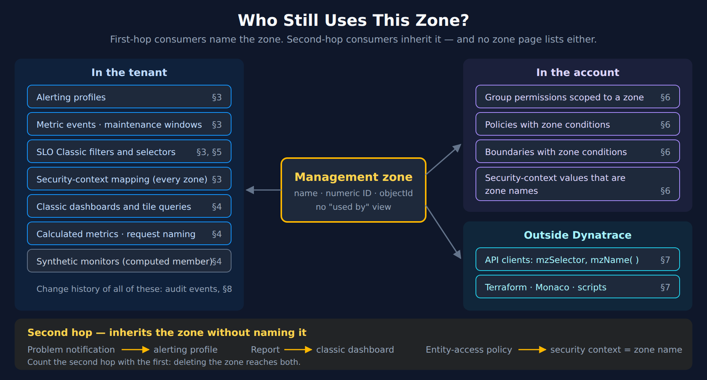
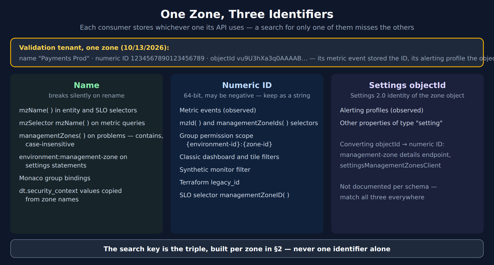
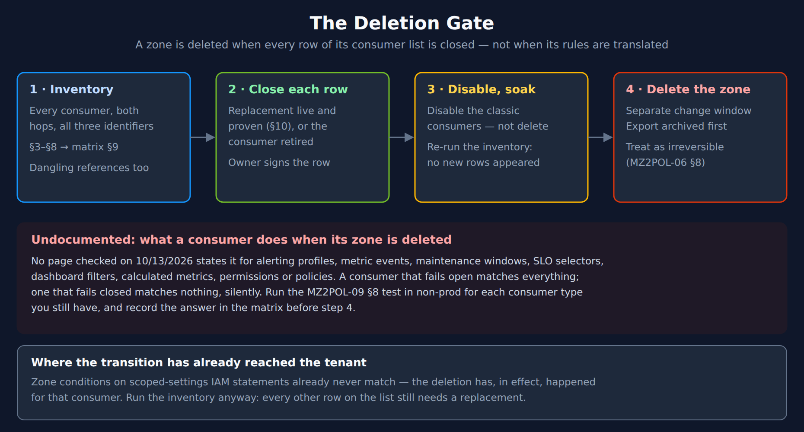

# MZ2POL-15: Finding Every Zone Consumer

> **Series:** MZ2POL — Management Zone Migration: Segments, Policies, Workflows | **Notebook:** 16 of 17 | **Created:** October 2026 | **Last Updated:** 10/14/2026

> **Purpose:** Before a zone can be deleted, everything that still uses it has to be found. A zone has no "used by" view, consumers store it in three different identifier formats, and some consumers reach it only through another object. This notebook finds them — in tenant settings, in classic configuration, in the account, and in code outside Dynatrace — and turns the result into the dependency matrix that gates deletion.

## What This Notebook Does

1. **Explains why a zone outlives its rules** — first-hop consumers that name it, second-hop consumers that inherit it
2. **Builds the identifier triple per zone** — name, numeric ID and settings objectId, because each consumer stores a different one
3. **Searches tenant settings** — the five zone-aware schemas, the notification-to-profile second hop, and the security-context mapping that consumes every zone at once
4. **Searches classic configuration** — dashboards, reports, calculated service metrics, request naming and synthetic monitors
5. **Asks the SLO API** which classic SLOs it relates to each zone
6. **Searches the account** — zone-scoped group permissions, policies and boundaries
7. **Searches code outside the tenant** — API clients, Terraform, Monaco
8. **Reads the change history in Grail** — zone references in settings changes, zone renames, and which API callers to chase
9. **Assembles the dependency matrix and the deletion gate**
10. **Names the replacement per consumer** — only where Dynatrace documents one

This notebook complements MZ2POL-00 (zone rules and usage), MZ2POL-03 §6 (the dependency checklist this notebook fills in), MZ2POL-09 §3 and §8 (alerting-profile inventory and the deletion test) and the evidence column of the MZ2POL-14 workshop, Session 1.

---

## Table of Contents

1. [Why a Zone Outlives Its Rules](#why-a-zone-outlives-its-rules)
2. [One Zone, Three Identifiers](#one-zone-three-identifiers)
3. [Settings Consumers](#settings-consumers)
4. [Classic Configuration API Consumers](#classic-configuration-api-consumers)
5. [Classic SLOs](#classic-slos)
6. [Access Consumers](#access-consumers)
7. [Code Outside the Tenant](#code-outside-the-tenant)
8. [Evidence from Grail](#evidence-from-grail)
9. [Dependency Matrix and the Deletion Gate](#dependency-matrix-and-the-deletion-gate)
10. [Replacement per Consumer](#replacement-per-consumer)
11. [Summary and Next Steps](#summary-and-next-steps)

---

## Prerequisites

| Requirement | Details |
|-------------|---------|
| **Dynatrace Environment** | SaaS with management zones still configured — see *Transition status* in §1 |
| **Permissions (notebook cells)** | `settings:objects:read` for the TypeScript cells in §2, §3 and §5 (the SLO API accepts it too); for the DQL cells in §8, `storage:system:read` on `AUDIT_EVENT` records and `storage:buckets:read` on `dt_system_events` |
| **Classic access token (§4 script)** | `ReadConfig` for dashboards, reports, calculated metrics and request naming; `ReadSyntheticData` for synthetic monitors |
| **Account OAuth client (§6 script)** | `account-idm-read` and `iam-policies-management`; token exchange as in IAM-12 §1 |
| **Runtime** | A Dynatrace notebook for §2, §3, §5 and §8 (`@dynatrace-sdk/client-classic-environment-v2`); `bash`, `curl` and `jq` for §4 and §6; a code search tool for §7 |
| **Identity** | Run the settings cells as a user who can see every object: the Settings API returns only *accessible* objects (§3) |
| **Before this** | MZ2POL-00 — the zone export and the 90-day usage metric |

---

<a id="why-a-zone-outlives-its-rules"></a>
## 1. Why a Zone Outlives Its Rules

Translating a zone's rules (MZ2POL-11) answers *what the zone selected*. It does not answer *who still depends on the zone*. Those are different lists, kept in different places, and only the second one decides whether the zone can be deleted.

Nothing in Dynatrace keeps the second list. A zone is referenced *by* other objects — an alerting profile, a metric event, a group permission, a script — and the zone object itself records none of them. MZ2POL-03 §6 lists the categories; this notebook finds the actual objects.



<!-- MARKDOWN_TABLE_ALTERNATIVE
| Where | Consumer | How it reaches the zone | Section |
|---|---|---|---|
| Tenant settings | Alerting profiles | Names the zone (first hop) | §3 |
| Tenant settings | Metric events, maintenance windows | Name the zone | §3 |
| Tenant settings | SLO Classic | Selector in the SLO filter; SLO API relation | §3, §5 |
| Tenant settings | Grail security-context mapping | Copies every zone name onto entities | §3 |
| Classic configuration | Classic dashboards and tile queries | Dashboard and tile filters, selectors in queries | §4 |
| Classic configuration | Calculated service metrics, request naming | managementZones arrays | §4 |
| Classic configuration | Synthetic monitors | Computed membership, not configured | §4 |
| Account | Group permissions, policies, boundaries | Zone scope or zone condition | §6 |
| Account | Policies on dt.security_context | A value that is a zone name | §6 |
| Outside Dynatrace | API clients, Terraform, Monaco, scripts | Selectors and resource references | §7 |
| Second hop | Problem notification → alerting profile; report → classic dashboard; entity-access policy → security context copied from a zone | Inherits the zone without naming it | §3, §4, §6 |
For environments where SVG doesn't render
-->

### First hop and second hop

A **first-hop** consumer names the zone. A **second-hop** consumer names a first-hop consumer and inherits the zone through it:

| Second-hop consumer | Reaches the zone through | What the documentation says |
|---|---|---|
| Problem notification | Its alerting profile | The notification's `alertingProfile` property selects *"an alerting profile … to control the delivery of problem notifications"*; the profile's `managementZone` property selects the entities |
| Report | Its classic dashboard | A report carries only `dashboardId` — *"The ID of the associated dashboard."* |
| Entity-access policy | An entity security context copied from zone names | *"By default, Grail uses the management zones to set the dt.security_context."* |

A deletion reaches both hops. A notification with no zone of its own still stops — or starts — paging when its profile's zone goes.

### Transition status

The upgrade guide for scoped settings says *"Management zones have been discontinued as part of the Smartscape transition."* and that zone conditions on scoped-settings statements *"never match"* once the change arrives. It asks for a review *"before this change reaches your environment"*, so it is rolling out rather than everywhere at once. On a tenant the transition has not reached, zones are still created and used: on the validation tenant, the Settings audit log recorded 2 zone creations and 3 zone updates in the 90 days to 10/13/2026, and 11 zones answered queries in the same window.

Run the inventory whichever side of the transition your tenant is on. Before the transition, it is the deletion gate. After it, the zone conditions on settings statements have already stopped matching (MZ2POL-12 §5), and the inventory tells you what else is still waiting for a replacement.

> <sub>**Sources:**</sub>
> - <sub>[Problem notifications settings schema (DT docs)](https://docs.dynatrace.com/docs/dynatrace-api/environment-api/settings/schemas/builtin-problem-notifications) — `alertingProfile`: *"Select an alerting profile"*</sub>
> - <sub>[Alerting profile settings schema (DT docs)](https://docs.dynatrace.com/docs/dynatrace-api/environment-api/settings/schemas/builtin-alerting-profile) — `managementZone`: *"Entities which are part of the configured management zones will match this alerting profile."*</sub>
> - <sub>[Reports API - GET a report (DT docs)](https://docs.dynatrace.com/docs/dynatrace-api/configuration-api/reports-api/get-report) — *"The ID of the associated dashboard."*</sub>
> - <sub>[Grail security context settings schema (DT docs)](https://docs.dynatrace.com/docs/dynatrace-api/environment-api/settings/schemas/builtin-monitoredentities-grail-security-context) — *"By default, Grail uses the management zones to set the dt.security_context."*</sub>
> - <sub>[Upgrade your security policies for scoped settings access (DT docs)](https://docs.dynatrace.com/docs/platform/upgrade/set-up-your-environment/upgrade-scoped-settings-objects) — *"Management zones have been discontinued as part of the Smartscape transition."*, *"Because management zones no longer exist, these conditions never match."*, *"before this change reaches your environment"*</sub>

---

<a id="one-zone-three-identifiers"></a>
## 2. One Zone, Three Identifiers

Every zone has three identifiers, and consumers do not agree on which one to store:

| Identifier | Example shape | Stored by (documented or observed) |
|---|---|---|
| **Name** | `Payments Prod` | `mzName(…)` in entity selectors and SLO filters; `mzName(…)` inside `mzSelector` on metric queries; `managementZones(…)` on the Problems API (*"contains, case-insensitive"*); the settings-service `environment:management-zone` condition (*"The name of a management zone."*); Monaco group bindings; entity security contexts copied from zones |
| **Numeric ID** | `1234567890123456789` | `mzId(…)` and `managementZoneIds(…)` selectors; group-permission scope *"in {environment-id}:{management-zone-id} format"*; classic dashboard and tile filters; the synthetic-monitor filter; Terraform `legacy_id`; metric events (observed) |
| **Settings objectId** | `vu9U3hXa3q0AAAAB…` | Alerting profiles (observed — the property is documented as type `setting`) |



<!-- MARKDOWN_TABLE_ALTERNATIVE
| Identifier | Notes | Consumers |
|---|---|---|
| Name | Breaks silently on rename | mzName() selectors, mzSelector on metric queries, managementZones() on problems (contains, case-insensitive), environment:management-zone on settings statements, Monaco group bindings, security contexts copied from zone names |
| Numeric ID | 64-bit, may be negative; keep as a string | Metric events (observed), mzId() and managementZoneIds() selectors, group permission scope {environment-id}:{zone-id}, classic dashboard and tile filters, synthetic monitor filter, Terraform legacy_id, SLO selector managementZoneID() |
| Settings objectId | Settings 2.0 identity of the zone object | Alerting profiles (observed); convert objectId to numeric ID with the management-zone details endpoint |
| Rule | | Search for all three identifiers of every zone, never one alone |
For environments where SVG doesn't render
-->

**Observed on the validation tenant (10/13/2026; zone names and IDs anonymized).** One zone, `Payments Prod`, is referenced by a metric event and by an alerting profile. The metric event's `queryDefinition.managementZone` holds the numeric ID `1234567890123456789`; the alerting profile's `managementZone` holds the zone's settings objectId. A search for the zone's name finds neither. Of the 11 zones with query activity in the last 90 days, 3 had a **negative** numeric ID — so treat IDs as strings, never as numbers. A JavaScript `number` cannot hold a 19-digit ID exactly.

**Names change.** The same tenant's audit log shows a zone renamed from `Payments prod` to `Payments Prod` on 10/08/2026. Every name-based consumer of that zone — a selector, a policy condition, a Monaco binding — stopped matching it at that moment, because name matching is exact and case-sensitive outside the Problems API. The Terraform provider warns about the same thing: *"Be careful when renaming"*. §8 lists renames from the audit log.

### Build the triple

This cell lists every zone with all three identifiers. The numeric ID comes from the management-zone details endpoint, which exists for exactly this conversion: *"Allows to convert from an objectId to the ID of the management zone"*. Save the result — the scripts in §4 and §6 read it as `zones.tsv` (name, numeric ID, objectId; tab-separated, no header).

> **Execution status:** not yet executed against a tenant — verified against the SDK typings and API docs on 10/13/2026.

> <sub>**Sources:**</sub>
> - <sub>[Classic environment v2 SDK (Dynatrace Developer)](https://developer.dynatrace.com/develop/sdks/client-classic-environment-v2/) — `getManagementZoneDetails`: *"Allows to convert from an objectId to the ID of the management zone"*</sub>
> - <sub>[Entity selector (DT docs)](https://docs.dynatrace.com/docs/dynatrace-api/environment-api/entity-v2/entity-selector) — `mzId`: *"The ID of the management zone to which the requested entities belong."*; `mzName`: *"The name of the management zone to which the requested entities belong."*</sub>
> - <sub>[Problems API v2 - GET problems list (DT docs)](https://docs.dynatrace.com/docs/dynatrace-api/environment-api/problems-v2/problems/get-problems-list) — `managementZoneIds("mZId-1", "mzId-2")`; *"Management zone name (contains, case-insensitive): managementZones("value-1","value-2")"*</sub>
> - <sub>[Permission management API - GET permissions (DT docs)](https://docs.dynatrace.com/docs/dynatrace-api/account-management-api/permission-management-api/get-permissions) — *"The ID of the management zone from an environment in {environment-id}:{management-zone-id} format."*</sub>
> - <sub>[IAM policy reference (DT docs)](https://docs.dynatrace.com/docs/manage/identity-access-management/permission-management/manage-user-permissions-policies/advanced/iam-policystatements) — settings-service `environment:management-zone`: *"The name of a management zone."*</sub>
> - <sub>[dynatrace_management_zone_v2 (Dynatrace GitHub)](https://raw.githubusercontent.com/dynatrace-oss/terraform-provider-dynatrace/main/docs/resources/management_zone_v2.md) — `legacy_id`: *"The ID of this setting when referred to by the Config REST API V1"*; *"Be careful when renaming"*</sub>
> - <sub>**Derived:** the metric-event and alerting-profile formats are read from the validation tenant's Settings audit events (§8), 10/13/2026.</sub>

```python
import { settingsObjectsClient, settingsManagementZonesClient } from "@dynatrace-sdk/client-classic-environment-v2";

// One row per zone: the three identifiers a consumer can store.
// numericId stays a string — zone IDs are 64-bit and can be negative; a JS number would round them.
interface ZoneIds { name: string; numericId: string; objectId: string }

async function getZones(): Promise<ZoneIds[]> {
  const zones: ZoneIds[] = [];
  const add = (items: { objectId?: string; value?: unknown }[]) => items.forEach((o) => zones.push({
    // The Settings API returns value as an untyped object; builtin:management-zones always has a name.
    name: String((o.value as { name?: string } | undefined)?.name ?? ""),
    numericId: "",
    objectId: o.objectId ?? "",
  }));
  let resp = await settingsObjectsClient.getSettingsObjects({
    schemaIds: "builtin:management-zones", pageSize: 500, fields: "objectId,value",
  });
  add(resp.items);
  while (resp.nextPageKey) {
    // On later pages every other parameter must be omitted.
    resp = await settingsObjectsClient.getSettingsObjects({ nextPageKey: resp.nextPageKey });
    add(resp.items);
  }
  // objectId -> numeric ID: the management-zone details endpoint exists for exactly this conversion.
  for (const zone of zones) {
    const details = await settingsManagementZonesClient.getManagementZoneDetails({ objectId: zone.objectId });
    zone.numericId = details.id ?? "";
  }
  return zones;
}

export default async function () {
  return (await getZones()).sort((a, b) => a.name.localeCompare(b.name));
}
```

---

<a id="settings-consumers"></a>
## 3. Settings Consumers

Dynatrace publishes its own list of zone-aware settings schemas — in the IAM policy reference, under the settings-service `environment:management-zone` condition. It applies to *"settings objects of the schemas builtin:alerting.maintenance-window, builtin:alerting.profile,"* *"builtin:anomaly-detection.metric-events, builtin:monitoring.slo and builtin:problem.notifications."* That list is the seed for this search:

| Schema | Where the zone lives | Hop |
|---|---|---|
| `builtin:alerting.profile` | `managementZone` — *"Entities which are part of the configured management zones will match this alerting profile."* One zone per profile | 1 |
| `builtin:alerting.maintenance-window` | `filters[].managementZones` — *"Entities which are part of all the configured management zones will match this maintenance window."* | 1 |
| `builtin:anomaly-detection.metric-events` | `queryDefinition.managementZone`, and entity-filter conditions of type `MANAGEMENT_ZONE`; a metric selector can also carry `mzName(…)` inside an entity selector | 1 |
| `builtin:monitoring.slo` | The `filter` property is an entity selector — the zone appears as `mzName(…)` or `mzId(…)` | 1 |
| `builtin:problem.notifications` | No zone property — `alertingProfile` points at a profile | 2 |

Two schema pages add the same advice next to the zone property: *"It is recommended to use manual tags instead."*

### One more consumer: the security-context mapping

`builtin:monitoredentities.grail.security.context` does not name a zone — it consumes all of them. Where an entity type's destination property is `managementZones`, the entity's `dt.security_context` is a copy of its zone names, and *"managementZones is the default value for the majority of entity types."* Every entity-access policy or boundary that matches on such a value is a hidden consumer of that zone's **name** (§6). The cell reports these mappings as `(every zone)` rows. MZ2POL-00 §5 Check C measures how many entities carry such copies.

### How the cell matches

The cell reads every object of the five schemas plus the mapping schema, walks each object's value, and checks every string against all three identifiers of every zone:

- **objectId or numeric ID** — an exact match anywhere in the value
- **name** — an exact match only under a property whose name contains `managementZone`, `mzId` or `mzName` (an alerting profile is often *named* after its zone; that is not a reference)
- **selector arguments** — `mzName(…)`, `mzId(…)`, `managementZone(…)`, `managementZoneID(…)`, `managementZoneIds(…)` and `managementZones(…)` inside any string, with `~"` unescaped; `managementZones(…)` matches by *contains, case-insensitive*, as the Problems API does
- **dangling references** — a zone property whose value matches no current zone is reported as `(no current zone)`. That is the evidence that something already points at a deleted zone
- **second hop** — each problem notification whose `alertingProfile` is a matched profile is reported with `hop = 2` and the profile it goes through

> **Read the result as a floor, not a total.** The Settings API answers *"Accessible objects returned."* — an identity that cannot see an object gets no row for it, not an error. Run the cell as a user with read access to every object. If your identity also holds `settings:objects:admin`, `adminAccess: true` on the request makes it *"act as if the user is the owner of all objects"*.

> **Execution status:** not yet executed against a tenant — verified against the SDK typings and API docs on 10/13/2026. The matching logic was exercised against hand-built objects shaped like the validation tenant's audit records (§8).

> <sub>**Sources:**</sub>
> - <sub>[IAM policy reference (DT docs)](https://docs.dynatrace.com/docs/manage/identity-access-management/permission-management/manage-user-permissions-policies/advanced/iam-policystatements) — *"or settings objects of the schemas builtin:alerting.maintenance-window, builtin:alerting.profile,"* *"builtin:anomaly-detection.metric-events, builtin:monitoring.slo and builtin:problem.notifications."*</sub>
> - <sub>[Alerting profile settings schema (DT docs)](https://docs.dynatrace.com/docs/dynatrace-api/environment-api/settings/schemas/builtin-alerting-profile) — *"It is recommended to use manual tags instead."*</sub>
> - <sub>[Upgrade from Classic problem notification to simple workflows (DT docs)](https://docs.dynatrace.com/docs/platform/upgrade/keep-problems-and-alerting-working/upgrade-guide-alert-notification) — *"an alerting profile can also select only one management zone"*</sub>
> - <sub>[Maintenance window settings schema (DT docs)](https://docs.dynatrace.com/docs/dynatrace-api/environment-api/settings/schemas/builtin-alerting-maintenance-window) — *"Entities which are part of all the configured management zones will match this maintenance window."*</sub>
> - <sub>[Metric events settings schema (DT docs)](https://docs.dynatrace.com/docs/dynatrace-api/environment-api/settings/schemas/builtin-anomaly-detection-metric-events) — `managementZone`; entity filter type `MANAGEMENT_ZONE`</sub>
> - <sub>[SLO settings schema (DT docs)](https://docs.dynatrace.com/docs/dynatrace-api/environment-api/settings/schemas/builtin-monitoring-slo) — `filter`: *"Entity selector"*</sub>
> - <sub>[Grant access to entities with security context (DT docs)](https://docs.dynatrace.com/docs/manage/identity-access-management/use-cases/access-security-context) — *"managementZones is the default value for the majority of entity types."*</sub>
> - <sub>[Settings API - GET objects (DT docs)](https://docs.dynatrace.com/docs/dynatrace-api/environment-api/settings/objects/get-objects) — *"Accessible objects returned."*; `adminAccess`: *"act as if the user is the owner of all objects"*; on later pages *"you must omit all other query parameters"*</sub>

```python
import { settingsObjectsClient, settingsManagementZonesClient } from "@dynatrace-sdk/client-classic-environment-v2";

// The five schemas the IAM policy reference lists as zone-aware, plus the Grail security-context mapping.
const SCHEMAS = [
  "builtin:alerting.profile",
  "builtin:alerting.maintenance-window",
  "builtin:anomaly-detection.metric-events",
  "builtin:monitoring.slo",
  "builtin:problem.notifications",
];
const SECURITY_CONTEXT_SCHEMA = "builtin:monitoredentities.grail.security.context";

interface ZoneIds { name: string; numericId: string; objectId: string }
interface SettingsItem { objectId?: string; schemaId?: string; summary?: string; value?: unknown }
interface Hit { zone: string; matchedBy: string; hop: number; schema: string; objectId: string; summary: string; path: string; via: string }

async function getObjects(schemaIds: string): Promise<SettingsItem[]> {
  const items: SettingsItem[] = [];
  let resp = await settingsObjectsClient.getSettingsObjects({
    schemaIds, pageSize: 500, fields: "objectId,schemaId,summary,value",
  });
  items.push(...resp.items);
  while (resp.nextPageKey) {
    resp = await settingsObjectsClient.getSettingsObjects({ nextPageKey: resp.nextPageKey });
    items.push(...resp.items);
  }
  return items;
}

async function getZones(): Promise<ZoneIds[]> {
  const objects = await getObjects("builtin:management-zones");
  const zones: ZoneIds[] = [];
  for (const o of objects) {
    const details = await settingsManagementZonesClient.getManagementZoneDetails({ objectId: o.objectId ?? "" });
    // value is untyped in the SDK; builtin:management-zones always carries a name.
    zones.push({ name: String((o.value as { name?: string } | undefined)?.name ?? ""), numericId: details.id ?? "", objectId: o.objectId ?? "" });
  }
  return zones;
}

// Every string leaf of a settings value, with its JSON path.
function leaves(value: unknown, path = "value"): { path: string; text: string }[] {
  if (typeof value === "string") return [{ path, text: value }];
  if (typeof value === "number") return [{ path, text: String(value) }];
  if (Array.isArray(value)) return value.flatMap((v, i) => leaves(v, `${path}[${i}]`));
  if (value && typeof value === "object") {
    return Object.entries(value as Record<string, unknown>).flatMap(([k, v]) => leaves(v, `${path}.${k}`));
  }
  return [];
}

// Arguments of selector functions inside a string: mzName("a","b"), mzId(1,2), managementZone("a"), managementZoneIds(...).
const SELECTOR = /\b(mzName|mzId|managementZones?|managementZoneIds|managementZoneID)\(([^)]*)\)/g;
function selectorArgs(text: string): { fn: string; arg: string }[] {
  const out: { fn: string; arg: string }[] = [];
  for (const m of text.matchAll(SELECTOR)) {
    // Unescape ~" (selector escaping) before stripping the surrounding quotes.
    m[2].split(",").map((a) => a.trim().replace(/~"/g, "\"").replace(/^"|"$/g, "")).filter(Boolean)
      .forEach((arg) => out.push({ fn: m[1], arg }));
  }
  return out;
}

const isZoneKey = (path: string) => /managementzone|mzid|mzname/i.test(path.split(".").pop() ?? "");

// Which zone, and by which identifier, does one string leaf reference?
function match(path: string, text: string, zones: ZoneIds[]): { zone: string; matchedBy: string }[] {
  const found: { zone: string; matchedBy: string }[] = [];
  zones.forEach((z) => {
    if (text === z.objectId) found.push({ zone: z.name, matchedBy: "objectId" });
    else if (z.numericId && text === z.numericId) found.push({ zone: z.name, matchedBy: "numeric ID" });
    else if (isZoneKey(path) && text === z.name) found.push({ zone: z.name, matchedBy: "name" });
    selectorArgs(text).forEach(({ fn, arg }) => {
      if (z.numericId && arg === z.numericId) found.push({ zone: z.name, matchedBy: `numeric ID in ${fn}()` });
      // managementZones() on the Problems API is "contains, case-insensitive"; the others match exactly.
      else if (fn === "managementZones" ? z.name.toLowerCase().includes(arg.toLowerCase()) : arg === z.name) {
        found.push({ zone: z.name, matchedBy: `name in ${fn}()` });
      }
    });
  });
  return found;
}

export default async function () {
  const zones = await getZones();
  const objects = await getObjects(SCHEMAS.join(","));
  const hits: Hit[] = [];

  objects.forEach((o) => {
    leaves(o.value).forEach(({ path, text }) => {
      const matched = match(path, text, zones);
      matched.forEach((m) => hits.push({ ...m, hop: 1, schema: o.schemaId ?? "", objectId: o.objectId ?? "", summary: o.summary ?? "", path, via: "" }));
      // A zone-typed property whose value matches no current zone: a dangling reference.
      if (matched.length === 0 && isZoneKey(path) && text !== "") {
        hits.push({ zone: "(no current zone)", matchedBy: `unresolved: ${text}`, hop: 1, schema: o.schemaId ?? "", objectId: o.objectId ?? "", summary: o.summary ?? "", path, via: "" });
      }
    });
  });

  // Second hop: problem notifications reach a zone only through their alerting profile.
  const profileHits = hits.filter((h) => h.schema === "builtin:alerting.profile" && h.hop === 1);
  objects.filter((o) => o.schemaId === "builtin:problem.notifications").forEach((n) => {
    // problem.notifications always carries an alertingProfile objectId; the SDK types value as unknown.
    const profileId = (n.value as { alertingProfile?: string } | undefined)?.alertingProfile;
    profileHits.filter((p) => p.objectId === profileId).forEach((p) => hits.push({
      zone: p.zone, matchedBy: p.matchedBy, hop: 2, schema: n.schemaId ?? "", objectId: n.objectId ?? "",
      summary: n.summary ?? "", path: "value.alertingProfile", via: `alerting profile: ${p.summary}`,
    }));
  });

  // Zone-wide consumer: entity types whose Grail security context is copied from zone names.
  const scMappings = await getObjects(SECURITY_CONTEXT_SCHEMA);
  scMappings.forEach((o) => {
    // The schema has two text properties: entityType and destinationProperty.
    const v = (o.value ?? {}) as { entityType?: string; destinationProperty?: string };
    if (v.destinationProperty === "managementZones") {
      hits.push({ zone: "(every zone)", matchedBy: "zone names copied to dt.security_context", hop: 1, schema: SECURITY_CONTEXT_SCHEMA, objectId: o.objectId ?? "", summary: `entity type: ${v.entityType ?? ""}`, path: "value.destinationProperty", via: "" });
    }
  });

  return hits.sort((a, b) => a.zone.localeCompare(b.zone) || a.hop - b.hop || a.schema.localeCompare(b.schema));
}
```

---

<a id="classic-configuration-api-consumers"></a>
## 4. Classic Configuration API Consumers

Classic dashboards, reports, calculated service metrics and request naming rules are not Settings 2.0 objects. They are read through Configuration API v1, which has **no `@dynatrace-sdk` client** — the classic-environment SDK packages checked on 10/13/2026 (`client-classic-environment-v1` 2.1.1, `-v2` 9.1.0) cover none of these endpoints. This section is therefore a script, run outside the notebook with a classic access token. It only sends GET requests.

| Consumer | Endpoint | Zone field | Format |
|---|---|---|---|
| Classic dashboard | `GET /api/config/v1/dashboards`, then `/{id}` | `dashboardMetadata.dashboardFilter.managementZone`, `tiles[].tileFilter.managementZone` — *"The short representation of a Dynatrace entity."*; plus `mzName(…)` / `mzId(…)` written into tile queries | `{id, name}`; the documented example ID is numeric |
| Report | `GET /api/config/v1/reports` | None — `dashboardId` only (second hop) | — |
| Calculated service metric | `GET /api/config/v1/calculatedMetrics/service`, then `/{metricKey}` | `managementZones` — *"Restricts the metric usage to specified management zones."* | Not stated — the script matches all three |
| Request naming rule | `GET /api/config/v1/service/requestNaming`, then `/{id}` | `managementZones` — DEPRECATED | Not stated — the script matches all three |
| Synthetic monitor | `GET /api/v1/synthetic/monitors?managementZone={id}` | Membership: *"A set of management zones to which the monitor belongs to."* | Numeric ID |

Three of these deserve a note:

- **Dashboards carry a usage signal.** The dashboard list returns `lastViewed` — *"The timestamp of the last dashboard view, in UTC milliseconds."* A zone-filtered dashboard nobody has opened in months is a weaker reason to keep the zone than one opened daily. Pull it into the matrix (§9).
- **Calculated metrics and request naming already lose the zone in Phase 3.** The request naming rule's `managementZones` is documented as *"Not available in Phase 3."* and *"Management zones are not supported and this field will be ignored."*; the calculated metric's request-attribute `managementZone` carries the same notice. MZ2POL-01 records the API 1.337 deprecation of these properties. List them anyway — a metric that silently loses its zone restriction counts different requests.
- **Synthetic monitors are members, not consumers.** A monitor's zones are computed by the zone rules; nothing on the monitor is configured. The script lists them so you know which monitors lose zone-scoped visibility. The zone ID is passed as a string — the SDK types this parameter as a `number`, which cannot hold a 19-digit ID exactly, which is one more reason this section uses REST.

```bash
#!/usr/bin/env bash
# Zone references in Configuration API v1 objects and synthetic monitors. READ-ONLY: GET requests only.
# Needs: curl, jq; a classic access token with ReadConfig (dashboards, reports, calculated metrics,
# request naming) and ReadSyntheticData (synthetic monitors).
# Input: zones.tsv — the §2 result exported as name<TAB>numericId<TAB>objectId, no header.
# Output: one TSV row per reference: consumer, id, name, field, reference, zone.
set -euo pipefail

ENV_URL="https://<your-environment-id>.live.dynatrace.com"   # classic environment URL, no trailing slash
API_TOKEN="${DT_CLASSIC_TOKEN:?export DT_CLASSIC_TOKEN first}"
ZONES_FILE="zones.tsv"

api() { curl -sf --header "Authorization: Api-Token ${API_TOKEN}" "${ENV_URL}$1"; }

# Map any identifier (name, numeric ID, objectId) to the zone name.
ZONES_JSON=$(jq -R -s 'split("\n") | map(select(length > 0) | split("\t"))
  | map({key: .[0], value: .[0]}, {key: .[1], value: .[0]}, {key: .[2], value: .[0]}) | from_entries' "${ZONES_FILE}")
emit() { # consumer id name field reference
  jq -r -n --argjson z "${ZONES_JSON}" --arg c "$1" --arg i "$2" --arg n "$3" --arg f "$4" --arg r "$5" \
    '[$c, $i, $n, $f, $r, ($z[$r] // "(no current zone)")] | @tsv'
}

printf 'consumer\tid\tname\tfield\treference\tzone\n'

# 1. Classic dashboards: dashboard-wide filter, per-tile filters, and selectors written into tile queries.
for id in $(api "/api/config/v1/dashboards" | jq -r '.dashboards[].id'); do
  d=$(api "/api/config/v1/dashboards/${id}")
  name=$(jq -r '.dashboardMetadata.name' <<<"$d")
  jq -r '.dashboardMetadata.dashboardFilter.managementZone.id // empty' <<<"$d" | while read -r r; do
    emit dashboard "$id" "$name" dashboardFilter "$r"; done
  jq -r '.tiles[].tileFilter.managementZone.id // empty' <<<"$d" | while read -r r; do
    emit dashboard "$id" "$name" tileFilter "$r"; done
  # Selector arguments, unescaped (~" and \" both occur) and stripped of quotes.
  jq -r '[.. | strings | scan("(?:mzName|mzId)\\(([^)]*)\\)")[0] | split(",")[]
      | gsub("~\"|\\\\\""; "\"") | gsub("^\\s*\"|\"\\s*$"; "")] | unique[]' \
    <<<"$d" | while read -r r; do emit dashboard "$id" "$name" "tile query selector" "$r"; done
done

# 2. Reports: no zone field of their own — they inherit it from the dashboard they mail out (second hop).
api "/api/config/v1/reports" | jq -r '.values[] | [.id, .dashboardId] | @tsv' | while IFS=$'\t' read -r rid did; do
  printf 'report\t%s\t\tdashboardId (second hop)\t%s\t(see the dashboard rows)\n' "$rid" "$did"
done

# 3. Calculated service metrics and 4. request naming rules: managementZones arrays.
for key in $(api "/api/config/v1/calculatedMetrics/service" | jq -r '.values[].id'); do
  m=$(api "/api/config/v1/calculatedMetrics/service/${key}")
  jq -r '.managementZones[]? ' <<<"$m" | while read -r r; do emit calculated-metric "$key" "$(jq -r .name <<<"$m")" managementZones "$r"; done
done
for id in $(api "/api/config/v1/service/requestNaming" | jq -r '.values[].id'); do
  n=$(api "/api/config/v1/service/requestNaming/${id}")
  jq -r '.managementZones[]?' <<<"$n" | while read -r r; do emit request-naming "$id" "$(jq -r .namingPattern <<<"$n")" managementZones "$r"; done
done

# 5. Synthetic monitors: membership is computed by the zone rules, not configured on the monitor.
#    Listed so you know which monitors lose zone-scoped visibility. The ID stays a string here.
cut -f1,2 "${ZONES_FILE}" | while IFS=$'\t' read -r zname zid; do
  api "/api/v1/synthetic/monitors?managementZone=${zid}" | jq -r '.monitors[] | [.entityId, .name] | @tsv' |
    while IFS=$'\t' read -r mid mname; do emit synthetic-monitor "$mid" "$mname" "member of zone (computed)" "$zid"; done
done
```

The script prints one TSV row per reference. `zone` is resolved from any of the three identifiers; `(no current zone)` is a dangling reference.

> **Execution status:** not yet executed against a tenant — verified against the Configuration API docs on 10/13/2026, and dry-run against mocked responses.

> <sub>**Sources:**</sub>
> - <sub>[Dashboards Classic API - GET a dashboard (DT docs)](https://docs.dynatrace.com/docs/dynatrace-api/configuration-api/dashboards-api/get-dashboard) — `managementZone`: *"The short representation of a Dynatrace entity."*</sub>
> - <sub>[Dashboards Classic API - GET all dashboards (DT docs)](https://docs.dynatrace.com/docs/dynatrace-api/configuration-api/dashboards-api/get-all) — `lastViewed`: *"The timestamp of the last dashboard view, in UTC milliseconds."*</sub>
> - <sub>[Reports API - GET all reports (DT docs)](https://docs.dynatrace.com/docs/dynatrace-api/configuration-api/reports-api/get-all)</sub>
> - <sub>[Service metrics API - GET a metric (DT docs)](https://docs.dynatrace.com/docs/dynatrace-api/configuration-api/calculated-metrics/service-metrics/get-calculated-metric) — `managementZones`: *"Restricts the metric usage to specified management zones."*</sub>
> - <sub>[Service metrics API - PUT a metric (DT docs)](https://docs.dynatrace.com/docs/dynatrace-api/configuration-api/calculated-metrics/service-metrics/put-calculated-metric) — *"Not available in Phase 3."*, *"Management zones are not supported and configurations using this field will be ignored."*</sub>
> - <sub>[Request naming API - GET a request naming rule (DT docs)](https://docs.dynatrace.com/docs/dynatrace-api/configuration-api/service-api/request-naming-api/get-a-rule) — `managementZones`: *"Management zones are not supported and this field will be ignored."*</sub>
> - <sub>[Synthetic monitors API - GET all monitors (DT docs)](https://docs.dynatrace.com/docs/dynatrace-api/environment-api/synthetic/synthetic-monitors/get-all-monitors) — `managementZone`: *"Filters the resulting set of monitors to those which are part of the specified management zone."*</sub>
> - <sub>[Synthetic monitors API - GET a monitor (DT docs)](https://docs.dynatrace.com/docs/dynatrace-api/environment-api/synthetic/synthetic-monitors/get-a-monitor) — *"A set of management zones to which the monitor belongs to."*</sub>

---

<a id="classic-slos"></a>
## 5. Classic SLOs

§3 already finds SLO Classic objects whose `filter` names a zone. The SLO API offers a second, server-side view: its `sloSelector` accepts `managementZoneID("123")`, which *"Filters for all SLOs that are related to the given management zone ID. Returned SLOs are evaluated against the given management zone."*

The two views answer different questions, and the docs do not define "related to":

| View | Answers | Use it for |
|---|---|---|
| §3 text match on `filter` | Which SLO definitions **name** the zone | The rewrite list — these SLOs break when the zone goes |
| §5 `sloSelector` per zone | Which SLOs the SLO API **relates** to the zone, evaluated in its scope | The visibility list — SLOs a zone-scoped user sees today |

The cell flags `filterNamesZone` for each row. A row with `filterNamesZone = false` is an SLO the API relates to the zone without the definition naming it — record it, and confirm what it means on your tenant before relying on it. The zone's numeric ID is passed inside the selector string, so it is never rounded. `enabledSlos: "all"` includes disabled SLOs; `showGlobalSlos: false` leaves out SLOs that would be returned *"regardless of the selected filter"*.

> **Execution status:** not yet executed against a tenant — verified against the SDK typings and API docs on 10/13/2026.

> <sub>**Sources:**</sub>
> - <sub>[Service-level objectives API - GET all SLOs (DT docs)](https://docs.dynatrace.com/docs/dynatrace-api/environment-api/service-level-objectives-classic/get-all) — *"Filters for all SLOs that are related to the given management zone ID. Returned SLOs are evaluated against the given management zone."*; `showGlobalSlos`: *"regardless of the selected filter"*</sub>
> - <sub>[Classic environment v2 SDK (Dynatrace Developer)](https://developer.dynatrace.com/develop/sdks/client-classic-environment-v2/) — `serviceLevelObjectivesClient.getSlo` parameters `sloSelector`, `enabledSlos`, `showGlobalSlos`, `evaluate`, `nextPageKey`</sub>

```python
import { settingsObjectsClient, settingsManagementZonesClient, serviceLevelObjectivesClient } from "@dynatrace-sdk/client-classic-environment-v2";

interface ZoneIds { name: string; numericId: string; objectId: string }

async function getZones(): Promise<ZoneIds[]> {
  const zones: ZoneIds[] = [];
  let resp = await settingsObjectsClient.getSettingsObjects({
    schemaIds: "builtin:management-zones", pageSize: 500, fields: "objectId,value",
  });
  const add = (items: { objectId?: string; value?: unknown }[]) => items.forEach((o) =>
    // value is untyped in the SDK; builtin:management-zones always carries a name.
    zones.push({ name: String((o.value as { name?: string } | undefined)?.name ?? ""), numericId: "", objectId: o.objectId ?? "" }));
  add(resp.items);
  while (resp.nextPageKey) {
    resp = await settingsObjectsClient.getSettingsObjects({ nextPageKey: resp.nextPageKey });
    add(resp.items);
  }
  for (const z of zones) {
    z.numericId = (await settingsManagementZonesClient.getManagementZoneDetails({ objectId: z.objectId })).id ?? "";
  }
  return zones;
}

// SLOs the SLO API relates to one zone. The ID goes inside the selector string, so it is never rounded.
async function slosForZone(numericId: string) {
  const slos: { id: string; name: string; filter: string; enabled: boolean }[] = [];
  let resp = await serviceLevelObjectivesClient.getSlo({
    sloSelector: `managementZoneID("${numericId}")`, pageSize: 500,
    evaluate: "false", enabledSlos: "all", showGlobalSlos: false,
  });
  slos.push(...resp.slo.map((s) => ({ id: s.id, name: s.name, filter: s.filter, enabled: s.enabled })));
  while (resp.nextPageKey) {
    resp = await serviceLevelObjectivesClient.getSlo({ nextPageKey: resp.nextPageKey });
    slos.push(...resp.slo.map((s) => ({ id: s.id, name: s.name, filter: s.filter, enabled: s.enabled })));
  }
  return slos;
}

export default async function () {
  const rows: Record<string, string | boolean>[] = [];
  for (const zone of await getZones()) {
    for (const s of await slosForZone(zone.numericId)) {
      const named = s.filter.includes(zone.name) || s.filter.includes(zone.numericId);
      rows.push({ zone: zone.name, slo: s.name, sloId: s.id, enabled: s.enabled, filter: s.filter, filterNamesZone: named });
    }
  }
  return rows;
}
```

---

<a id="access-consumers"></a>
## 6. Access Consumers

Access is configured in the **account**, not the tenant, so a tenant identity cannot read it. This is a script for an account-level OAuth client — the same setup as IAM-12 §1, which carries the token exchange and error handling this script leaves out. It only sends GET requests.

| Consumer | Endpoint | What marks a zone | Scope |
|---|---|---|---|
| Classic group permission | `GET /iam/v1/accounts/{accountUuid}/groups`, then `/groups/{groupUuid}/permissions` | `scopeType` = `management-zone`; `scope` is *"in {environment-id}:{management-zone-id} format"* | `account-idm-read` |
| Policy | `GET /iam/v1/repo/{levelType}/{levelId}/policies/aggregate`, then `/policies/{policyUuid}` | A condition named `environment:management-zone` or `extensions:management-zone` in `statements[].conditions[]` | `iam-policies-management` |
| Boundary | `GET /iam/v1/repo/account/{accountId}/boundaries` | The same condition names in `boundaryConditions[]` | `iam-policies-management` |
| Policy or boundary on `dt.security_context` | as above | A value that **equals a zone name**, where entity security contexts are copied from zones (§3) | as above |

What each condition means:

- `environment:management-zone` on the **environment** service scopes the classic roles — `environment:roles:viewer`, `manage-settings`, `logviewer` and the rest — to a zone. The role-migration guide shows the form: `ALLOW environment:roles:viewer WHERE environment:management-zone=…` (MZ2POL-12 §8 maps each role).
- `environment:management-zone` on the **settings** service scopes `settings:objects:read` / `write`. This is the condition the scoped-settings upgrade says will *"never match"* after the transition (MZ2POL-12 §5).
- `extensions:management-zone` — *"A string that uniquely identifies a single management zone for monitoring configuration assignment"* — scopes Extensions 2.0 monitoring-configuration permissions to a zone.
- A `dt.security_context` value that is a zone name names no zone at all, yet it stops matching the moment the zone is renamed, deleted, or the mapping in §3 is changed. The upgrade guide lists *"Security context conditions that are derived from management zones."* among the affected conditions.

Group permissions are filtered to the environments you list, because a zone ID is only unique within its environment.

```bash
#!/usr/bin/env bash
# Zone references in account-level access: classic group permissions, policies, boundaries.
# READ-ONLY: GET requests only. Not run inside a notebook — it needs an account-level OAuth client.
# Scopes: account-idm-read (groups, permissions) and iam-policies-management (policies, boundaries).
# Token exchange and error handling: see the IAM-12 auth boilerplate; this script assumes ${TOKEN}.
# Input: zones.tsv from §2 (name<TAB>numericId<TAB>objectId).
set -euo pipefail

ACCOUNT_UUID="<your-account-uuid>"
ENVIRONMENT_IDS=("<environment-id>")          # every environment whose zones you are inventorying
TOKEN="${TOKEN:?obtain a bearer token first (IAM-12, section 1)}"
ZONES_FILE="zones.tsv"
IAM="https://api.dynatrace.com/iam/v1"

api() { curl -sf --header "Authorization: Bearer ${TOKEN}" "${IAM}$1"; }
ZONES_JSON=$(jq -R -s 'split("\n") | map(select(length > 0) | split("\t"))
  | map({key: .[0], value: .[0]}, {key: .[1], value: .[0]}, {key: .[2], value: .[0]}) | from_entries' "${ZONES_FILE}")

printf 'kind\tid\tname\tcondition\tvalue\tzone\n'

# 1. Classic group permissions scoped to a zone: scope is "{environment-id}:{management-zone-id}".
api "/accounts/${ACCOUNT_UUID}/groups" | jq -r '.items[] | [.uuid, .name] | @tsv' |
while IFS=$'\t' read -r guuid gname; do
  api "/accounts/${ACCOUNT_UUID}/groups/${guuid}/permissions" | jq -r --argjson z "${ZONES_JSON}" --arg g "$gname" --arg u "$guuid" \
      --argjson envs "$(printf '%s\n' "${ENVIRONMENT_IDS[@]}" | jq -R . | jq -s .)" '
    .permissions[] | select(.scopeType == "management-zone")
    | (.scope | split(":")) as $s | select($s[0] | IN($envs[]))     # zone IDs are per environment
    | ["group-permission", $u, $g, .permissionName, .scope, ($z[$s[1]] // "(no current zone)")] | @tsv'
done

# 2. Policies (account level, and environment level for each environment). Global policies are
#    Dynatrace-managed and are skipped. A statement can name a zone directly (environment:management-zone,
#    extensions:management-zone) or indirectly: a dt.security_context value that is a zone name, where
#    entity security contexts are still copied from zones (§3, last row type).
policy_refs() { # levelType levelId uuid name
  api "/repo/$1/$2/policies/$3" | jq -r --argjson z "${ZONES_JSON}" --arg u "$3" --arg n "$4" '
    .statements[]?.conditions[]? | select(.name | test("management-zone|security_context")) as $c
    | $c.values[] | . as $v
    # A zone condition always reports; a security-context value only when it equals a zone name.
    | ($z[$v] // (if ($c.name | test("management-zone")) then "(no current zone)" else null end)) as $zone
    | select($zone != null) | ["policy", $u, $n, $c.name, $v, $zone] | @tsv'
}
{ api "/repo/account/${ACCOUNT_UUID}/policies/aggregate"
  for env in "${ENVIRONMENT_IDS[@]}"; do api "/repo/environment/${env}/policies/aggregate"; done
} | jq -r -s '[.[].policyOverviewList[] | select(.levelType != "global")] | unique_by(.uuid)[]
      | [.levelType, .levelId, .uuid, .name] | @tsv' |
while IFS=$'\t' read -r ltype lid puuid pname; do policy_refs "$ltype" "$lid" "$puuid" "$pname"; done

# 3. Boundaries (account level), paged.
page=1
while :; do
  b=$(api "/repo/account/${ACCOUNT_UUID}/boundaries?page=${page}&size=100")
  jq -r --argjson z "${ZONES_JSON}" '.content[] | . as $b | .boundaryConditions[]?
    | select(.name | test("management-zone|security_context")) as $c | $c.values[]
    | . as $v | ($z[$v] // (if ($c.name | test("management-zone")) then "(no current zone)" else null end)) as $zone
    | select($zone != null) | ["boundary", $b.uuid, $b.name, $c.name, $v, $zone] | @tsv' <<<"$b"
  [[ $(jq '.pageNumber * .pageSize < .totalCount' <<<"$b") == "true" ]] || break
  page=$((page + 1))
done
```

> **Execution status:** not run — it needs an account-level OAuth client, which this notebook cannot hold. Verified against the Account Management API docs on 10/13/2026 and dry-run against mocked responses.

> <sub>**Sources:**</sub>
> - <sub>[Group management API - GET all groups (DT docs)](https://docs.dynatrace.com/docs/dynatrace-api/account-management-api/group-management-api/get-all-groups) — scope `account-idm-read`</sub>
> - <sub>[Permission management API - GET permissions (DT docs)](https://docs.dynatrace.com/docs/dynatrace-api/account-management-api/permission-management-api/get-permissions) — *"The ID of the management zone from an environment in {environment-id}:{management-zone-id} format."*</sub>
> - <sub>[Policy management API - GET all policies (DT docs)](https://docs.dynatrace.com/docs/dynatrace-api/account-management-api/policy-management-api/policies/get-all-policies) — *"Lists all access policies that are available at a policy level, including those inherited from higher levels."*</sub>
> - <sub>[Policy management API - GET a policy (DT docs)](https://docs.dynatrace.com/docs/dynatrace-api/account-management-api/policy-management-api/policies/get-policy) — `statementQuery`, `statements[].conditions[]`</sub>
> - <sub>[Policy management API - GET all policy boundaries (DT docs)](https://docs.dynatrace.com/docs/dynatrace-api/account-management-api/policy-management-api/boundaries/get-all-boundaries) — `boundaryQuery`, `boundaryConditions`</sub>
> - <sub>[IAM policy reference (DT docs)](https://docs.dynatrace.com/docs/manage/identity-access-management/permission-management/manage-user-permissions-policies/advanced/iam-policystatements) — `extensions:management-zone`: *"A string that uniquely identifies a single management zone for monitoring configuration assignment"*</sub>
> - <sub>[Upgrade role-based permissions to Dynatrace IAM policies (DT docs)](https://docs.dynatrace.com/docs/manage/identity-access-management/permission-management/manage-user-permissions-policies/advanced/migrate-roles) — *"Classic RBAC roles can also be expressed in policies."*</sub>
> - <sub>[Upgrade your security policies for scoped settings access (DT docs)](https://docs.dynatrace.com/docs/platform/upgrade/set-up-your-environment/upgrade-scoped-settings-objects) — *"Security context conditions that are derived from management zones."*</sub>

---

<a id="code-outside-the-tenant"></a>
## 7. Code Outside the Tenant

Scripts, integrations and configuration-as-code repositories reference zones in request parameters and resource definitions. Dynatrace cannot list them: the classic API audit record keeps the request **path** but not its query string (checked below), so a `mzSelector` sent by a client leaves no trace of the zone it named. The search has to happen in the code.

| Where | Search for | Identifier it carries |
|---|---|---|
| Metric queries (API v2) | `mzSelector` — *"The management zone scope of the query."* — with `mzId(…)` / `mzName(…)` | numeric ID, name |
| Entity selectors (entities, SLOs, settings filters) | `mzId(`, `mzName(` | numeric ID, name |
| Problems API v2 | `managementZoneIds(`, `managementZones(` | numeric ID, name (contains, case-insensitive) |
| SLO API | `managementZone(`, `managementZoneID(` | name, numeric ID |
| Synthetic API v1 | `managementZone=` | numeric ID |
| Terraform | `dynatrace_management_zone_v2`, `dynatrace_management_zone`, `management_zone`, `management_zones`, `legacy_id` | resource reference, numeric ID |
| Monaco | `builtin:management-zones`, `managementZoneId`, `managementZones:` in account group files | reference, numeric ID, name |
| Anything else | each zone's name, numeric ID and objectId from §2 | all three |

One search over every repository that talks to Dynatrace covers the first seven rows. Run it from the root of each repository, or from a directory that holds all of them:

```bash
rg -n --hidden -g '!.git' \
  -e 'mzSelector' -e 'mzName\(' -e 'mzId\(' -e 'managementZoneIds?\(' -e 'managementZones?\(' -e 'managementZoneID\(' \
  -e 'managementZone=' -e 'dynatrace_management_zone' -e 'management_zones?\b' -e 'legacy_id' \
  -e 'builtin:management-zones' -e 'managementZoneId' -e 'managementZones:'
```

Then search for each zone's three identifiers from §2. That last step catches zone IDs hard-coded into dashboards-as-JSON, runbooks and alert templates that none of the patterns above describe.

Monaco's documentation marks zone-scoped group permissions as `# classic Dynatrace only`, and its classic-dashboard example binds a zone by ID: `"id": "{{ .managementZoneId }}"`, a dashboard filter that *"Sets a management zone filter on the entire dashboard"*.

### Which API callers to chase

The audit log cannot show the selector, but it can name the callers that use the endpoints that accept one. Each token and origin in the result is an owner to ask, or a repository to search.

> <sub>**Sources:**</sub>
> - <sub>[Metrics API - GET metric data points (DT docs)](https://docs.dynatrace.com/docs/dynatrace-api/environment-api/metric-v2/get-data-points) — `mzSelector`: *"The management zone scope of the query."*, *"Only metrics data relating to the specified management zones are included to the response."*</sub>
> - <sub>[Entity selector (DT docs)](https://docs.dynatrace.com/docs/dynatrace-api/environment-api/entity-v2/entity-selector) — `mzId("123456789","987654321")`</sub>
> - <sub>[Problems API v2 - GET problems list (DT docs)](https://docs.dynatrace.com/docs/dynatrace-api/environment-api/problems-v2/problems/get-problems-list) — `managementZoneIds("mZId-1", "mzId-2")`</sub>
> - <sub>[Monaco configuration YAML - type fields (DT docs)](https://docs.dynatrace.com/docs/deliver/configuration-as-code/monaco/configuration/yaml-configuration-saas-type-fields) — *"classic Dynatrace only"*</sub>
> - <sub>[Monaco configuration YAML - special configuration types (DT docs)](https://docs.dynatrace.com/docs/deliver/configuration-as-code/monaco/configuration/special-configuration-types-saas) — *"Sets a management zone filter on the entire dashboard"*</sub>
> - <sub>[dynatrace_management_zone_v2 (Dynatrace GitHub)](https://raw.githubusercontent.com/dynatrace-oss/terraform-provider-dynatrace/main/docs/resources/management_zone_v2.md) — *"The resource `dynatrace_management_zone_v2` covers configuration for management zones"*</sub>

```dql
// API callers of the classic endpoints that accept zone selectors. The audit record keeps the path only,
// so this names the callers whose code to search — it cannot show the selector itself.
fetch dt.system.events, from:-30d
| filter event.kind == "AUDIT_EVENT" and event.provider == "CLASSIC_API"
| filter startsWith(resource, "/api/v2/metrics/query") or startsWith(resource, "/api/v2/entities")
    or startsWith(resource, "/api/v2/problems") or startsWith(resource, "/api/v2/slo")
    or startsWith(resource, "/api/config/v1/dashboards")
| summarize {calls = count(), endpoints = collectDistinct(resource, maxLength: 5), last_call = max(timestamp)},
    by:{caller = authentication.token, origin = origin.address}
| sort calls desc
| limit 50
```

On the validation tenant (10/13/2026), 30 days of classic API audit events held 204,923 records, all with a `resource` path and none with a query string. The caller query returned 6 token-and-origin pairs — 3 distinct tokens — with 50 calls to the entities, problems and classic dashboard endpoints.

> **Never read an empty result here as "no API clients use zones".** Callers that ran outside the window, used another endpoint, or authenticate in a way the audit does not attribute are all absent. The code search above is the inventory; this query only tells you where to start.

---

<a id="evidence-from-grail"></a>
## 8. Evidence from Grail

Grail holds no consumer list, but its audit log records every settings change with the value before and after. *"These events are stored for one year."* That makes it a **change log** — it finds zone references in objects that were created or changed in the last year, shows the exact identifier each one stored, and records zone renames. It does **not** find an object nobody has touched in a year, so it confirms and dates the §3–§4 results; it never replaces them. All three queries scan zero billable bytes on the validation tenant.

The fields used — `details.dt.settings.schema_id`, `details.dt.settings.object_id`, `details.json_after` — were observed on the validation tenant's `SETTINGS` audit events. The two `dt.settings.*` names are in the semantic dictionary as `experimental`; `json_after` is not in the dictionary at all, so re-check it on your tenant.

For zone **usage** — query activity per zone over 90 days — use MZ2POL-00 §3; it is not repeated here.

**Query 1 — which schemas have zone references in the change log?**

```dql
// Settings changes in the last year whose new value mentions a zone. A change log, not an inventory.
fetch dt.system.events, from:-365d
| filter event.kind == "AUDIT_EVENT" and event.provider == "SETTINGS"
| filter contains(details.json_after, "managementZone") or contains(details.json_after, "mzName(")
    or contains(details.json_after, "mzId(") or contains(details.json_after, "mzSelector")
| summarize {changes = count(), objects = countDistinct(details.dt.settings.object_id), last_change = max(timestamp)},
    by:{schema = details.dt.settings.schema_id}
| sort changes desc
```

On the validation tenant (10/13/2026, 365 days): `builtin:monitoredentities.grail.security.context` 1,630 changes across 255 objects (the mapping consumes every zone — §3); `builtin:anomaly-detection.metric-events` 4 changes, 1 object; `builtin:alerting.profile` 2 changes, 2 objects; `SERVICE_REQUEST_NAMING` 1 change, 1 object. The last row is a Configuration API v1 request naming rule — classic configuration changes appear in the same audit stream, under their own schema names.

A looser filter that also matched the bare text `management-zone` returned 7 classic `MARKDOWN` tile changes whose text merely *mentioned* zones. The filter above requires the property name `managementZone` (with any suffix) or a selector call, which excludes them.

**Query 2 — one row per changed object, with the identifier it stored.**

```dql
// One row per changed object, with the zone identifier its most recent value stored.
// The security-context mapping is left out: it consumes every zone and names none (section 3).
fetch dt.system.events, from:-365d
| filter event.kind == "AUDIT_EVENT" and event.provider == "SETTINGS"
| filter details.dt.settings.schema_id != "builtin:monitoredentities.grail.security.context"
| filter contains(details.json_after, "managementZone") or contains(details.json_after, "mzName(")
    or contains(details.json_after, "mzId(") or contains(details.json_after, "mzSelector")
| sort timestamp asc
| summarize {changes = count(), last_change = max(timestamp), last_action = takeLast(event.type),
    last_value = takeLast(details.json_after)},
    by:{schema = details.dt.settings.schema_id, object_id = details.dt.settings.object_id}
| parse last_value, "LD 'managementZone' ALPHA* PUNCT{2} SPACE? '['? DQS:zone_property"
| parse last_value, "LD 'mzName' PUNCT LD:name_selector ')'"
| parse last_value, "LD 'mzId' PUNCT LD:id_selector ')'"
// Strip selector escaping (~" and \") from names taken out of selector strings.
| fieldsAdd reference = replacePattern(coalesce(zone_property, name_selector, id_selector), "('~' | '\\\\' | '\"')", "")
| fields schema, object_id, changes, last_change, last_action, reference
| sort last_change desc
```

On the validation tenant: the metric event stored a numeric ID; both alerting profiles stored a zone objectId; the request naming rule's `managementZoneIds` was an empty array, so `reference` is empty — the property exists, no zone is set. Resolve each `reference` with the §2 triple. A reference that matches no current zone is a consumer of a zone that no longer exists.

**Query 3 — zone objects changed in the last year, with every name each one has carried.**

```dql
// Zone objects changed in the last year: objectId, every name it has carried, and the last action.
fetch dt.system.events, from:-365d
| filter event.kind == "AUDIT_EVENT" and event.provider == "SETTINGS"
| filter details.dt.settings.schema_id == "builtin:management-zones"
| parse details.json_after, "JSON:after"
| parse details.json_before, "JSON:before"
| fieldsAdd zone_name = coalesce(after[name], before[name])
| sort timestamp asc
| summarize {names = collectDistinct(zone_name), changes = count(), last_change = max(timestamp),
    last_action = takeLast(event.type)}, by:{object_id = details.dt.settings.object_id}
| fieldsAdd renamed = arraySize(names) > 1
| sort last_change desc
```

On the validation tenant: 10 zone objects changed in 365 days, and one was renamed (`Payments prod` → `Payments Prod`, 10/08/2026). Every row with `renamed = true` is a zone whose name-based consumers (§2) may still use the old spelling — search §3, §6 and §7 for each old name too.

> **Proving the surface.** Before reading an empty result as "nothing references zones", run `fetch dt.system.events, from:-90d | filter event.kind == "AUDIT_EVENT" and event.provider == "SETTINGS" | summarize count()`. On the validation tenant it returned 19,787 settings audit events across 132 schemas in 90 days. A zero there is a permission problem, not an empty tenant.

> <sub>**Sources:** [Audit logs on Grail (DT docs)](https://docs.dynatrace.com/docs/manage/data-privacy-and-security/configuration/audit-logs-grail) — *"These events are stored for one year."*; required permissions `storage:system:read` and `storage:buckets:read` on `dt_system_events`. **Dictionary:** `dt.settings.schema_id` (`experimental`), `dt.settings.object_id` (`experimental`), no row for `json_after` under `filter contains(name, "json_after")`, read 10/13/2026 (control: the same query matched `event.provider` → 1 row).</sub>

---

<a id="dependency-matrix-and-the-deletion-gate"></a>
## 9. Dependency Matrix and the Deletion Gate

Put every row from §3–§8 into one matrix: one row per **zone × consumer**. It is the evidence column for MZ2POL-14 Session 1 (*"queries / roles / profiles / dashboards"*) and the "referenced anywhere" check in MZ2POL-06 §8, Step 2.

| Zone | Consumer type | Consumer (ID, name) | Hop | Identifier stored | Found by | Owner | Replacement (§10) | Deletion behaviour tested? | Row closed |
|---|---|---|---|---|---|---|---|---|---|
| | alerting profile / metric event / maintenance window / SLO / notification / dashboard / report / calculated metric / request naming / synthetic monitor / group permission / policy / boundary / security-context mapping / code | | 1 / 2 | name / numeric ID / objectId | §3 … §8 | | live and proven / retired / none documented | MZ2POL-09 §8 result | date, by |

Add two kinds of rows that belong to no single zone:

- **`(no current zone)` rows** — consumers already pointing at a deleted zone. Decide now what they should do; they are evidence of what a deletion leaves behind.
- **`(every zone)` rows** — security-context mappings. Each zone deletion or rename changes the security context of its entities, and therefore what every policy on `dt.security_context` grants.



<!-- MARKDOWN_TABLE_ALTERNATIVE
| Step | Action | Detail |
|---|---|---|
| 1 · Inventory | Every consumer, both hops, all three identifiers | §3–§8 into the matrix (§9); dangling references too |
| 2 · Close each row | Replacement live and proven (§10), or the consumer retired | The owner signs the row |
| 3 · Disable, soak | Disable the classic consumers — do not delete | Re-run the inventory: no new rows appeared |
| 4 · Delete the zone | Separate change window, export archived first | Treat as irreversible (MZ2POL-06 §8) |
| Undocumented | What a consumer does when its zone is deleted | No page checked on 10/13/2026 states it for any consumer type; run the MZ2POL-09 §8 test in non-prod per consumer type and record the answer before step 4 |
| After the transition | Zone conditions on scoped-settings IAM statements already never match | Run the inventory anyway: every other row still needs a replacement |
For environments where SVG doesn't render
-->

### What deletion does to a consumer is not documented

No Dynatrace page checked on 10/13/2026 states what an alerting profile, metric event, maintenance window, SLO selector, dashboard filter, calculated metric, group permission or policy does when the zone it names is deleted. The one documented case is the scoped-settings transition, where zone conditions *"never match"*, and where the guide warns that *"DENY statements stop blocking access"* — so a failure can widen access as well as narrow it.

So the matrix carries a column for it. For every consumer **type** you still have, run the MZ2POL-09 §8 test in a non-production tenant — positive baseline, negative baseline, delete, re-run — and record whether it failed open or closed. MZ2POL-09 §8 also explains what each answer changes about the order of disabling and deleting.

### The gate

A zone is deleted when — and only when —

1. every row for that zone is closed: a replacement is live and proven, or the consumer is retired, and the owner has signed the row;
2. the classic consumers have been **disabled** and have soaked, and a re-run of §3–§8 finds no new rows;
3. the deletion behaviour of each remaining consumer type is known from the test above;
4. the deletion happens in its own change window, after the export in MZ2POL-06 §8 Step 1 has been archived.

> <sub>**Sources:** [Upgrade your security policies for scoped settings access (DT docs)](https://docs.dynatrace.com/docs/platform/upgrade/set-up-your-environment/upgrade-scoped-settings-objects) — *"Because management zones no longer exist, these conditions never match."*, *"DENY statements stop blocking access."*</sub>

---

<a id="replacement-per-consumer"></a>
## 10. Replacement per Consumer

Only replacements a Dynatrace page names are listed. Where no page does, the cell says **not documented** — that is a decision for your migration plan, not a gap this notebook can fill.

| Consumer | Documented replacement | Where in this series |
|---|---|---|
| Alerting profile | Problem-triggered workflow — the trigger *"filters problems directly with DQL matchers"* on the problem | MZ2POL-09 |
| Problem notification | The same workflow, which owns routing and destination | MZ2POL-09 §5, §6 |
| Metric event | Custom alert — *"To create a custom alert, use"* Anomaly Detection; scope it with segments: *"Segment filters are automatically applied to your query during execution."* The transform drops the zone: *"Management zones aren't supported in Anomaly Detection and will be lost after transforming metric events."* Set the segment scope before relying on the new alert | MZ2POL-05 for the segments |
| Maintenance window | A Latest maintenance window, recreated by hand. The upgrade guide (published 09/09/2026): *"Classic maintenance windows are not migrated automatically, so use this guide to recreate them in Latest Dynatrace."* and *"Translate the scope from management zones and entity IDs to DQL matcher filter criteria on Grail primary fields."* The classic schema already recommends tags over zones: *"It is recommended to use manual tags instead."* **Version-gated:** the new windows arrived with SaaS 1.341 (staged tenant rollout from 06/16/2026) — *"Maintenance windows are available in Early Access."* Verify they have reached your tenant; classic windows remain the working path until then. | MZ2POL-10 for the primary fields; WFLOW-02 §2 for the workflow filter |
| SLO Classic | New SLO with segments — *"In this step, management zones become segments"* | MZ2POL-05; SLO series |
| Classic dashboard | Dashboards with segments — *"Instead of management zones, use segments in the latest Dynatrace for data segmentation."* No automatic upgrade of the zone filter | MZ2POL-05 |
| Report | Not documented | — |
| Calculated service metric, request naming rule | Not documented; the zone fields are documented as ignored in Phase 3 | MZ2POL-01 |
| Synthetic monitor | Not applicable — membership is computed, nothing to rewrite | — |
| Group permission (classic role on a zone) | A policy with the zone condition keeps classic pages working: *"Classic RBAC roles can also be expressed in policies."* Grail access is separate: *"This guide does not cover how to migrate your use of management zones into Grail permissions."* | MZ2POL-04, MZ2POL-12 §8 |
| Policy or boundary with a settings zone condition | `settings:schemaId` — *"Scope access by schema instead of by management zone"* — or `settings:dt.security_context`, where *"security context must be set at the edge"* | MZ2POL-12 §5 |
| Security-context mapping from zones | Security context set at the source rather than copied from zones | MZ2POL-10, MZ2POL-12 §5 |
| API client using zone selectors | For SLO filters, the upgrade table maps `mzId / mzName` to *"Use Segments"*; for other clients, not documented — DQL with built-in fields or segments | FAQ-16 |
| Terraform, Monaco | Not documented — rewrite onto the replacement resources above | AUTOM series |

Three cautions from the same pages:

- **Segments are filters, not access.** *"Segments aren't related to permissions or access control."* A zone that did an access job needs a policy and boundary, not only a segment (MZ2POL-14 Session 2).
- **Custom alerts moved.** The Anomaly Detection page says that starting with Dynatrace version 1.344, *"custom alerts have moved to Settings"*, and *"Because Anomaly Detection is deprecated"* it recommends Settings. Check which surface your tenant shows before writing a runbook against it.
- **The mapping from zone to segment is yours to define.** No page maps a given zone to a given segment; MZ2POL-11 translates the rules and MZ2POL-05 builds one segment per dimension.

> <sub>**Sources:**</sub>
> - <sub>[Upgrade from Classic problem notification to simple workflows (DT docs)](https://docs.dynatrace.com/docs/platform/upgrade/keep-problems-and-alerting-working/upgrade-guide-alert-notification) — *"filters problems directly with DQL matchers"*</sub>
> - <sub>[Upgrade Metric Alerting (DT docs)](https://docs.dynatrace.com/docs/platform/upgrade/keep-problems-and-alerting-working/metric-alerting) — *"To create a custom alert, use"*</sub>
> - <sub>[Configure a simple custom alert (DT docs)](https://docs.dynatrace.com/docs/dynatrace-intelligence/anomaly-detection/anomaly-detection-app/configure-a-simple-ad) — *"Management zones aren't supported in Anomaly Detection and will be lost after transforming metric events."*</sub>
> - <sub>[Use segments with Anomaly Detection custom alerts (DT docs)](https://docs.dynatrace.com/docs/dynatrace-intelligence/use-cases/use-segments-anomaly-detection) — *"Segment filters are automatically applied to your query during execution."*</sub>
> - <sub>[Anomaly Detection app (DT docs)](https://docs.dynatrace.com/docs/dynatrace-intelligence/anomaly-detection/anomaly-detection-app) — *"custom alerts have moved to Settings"*, *"Because Anomaly Detection is deprecated"*</sub>
> - <sub>[Maintenance window settings schema (DT docs)](https://docs.dynatrace.com/docs/dynatrace-api/environment-api/settings/schemas/builtin-alerting-maintenance-window) — *"It is recommended to use manual tags instead."*</sub>
> - <sub>[Upgrade from Classic maintenance windows to Latest maintenance windows (DT docs)](https://docs.dynatrace.com/docs/platform/upgrade/upgrade-from-classic-maintenance-windows) — *"Classic maintenance windows are not migrated automatically, so use this guide to recreate them in Latest Dynatrace."*, *"Translate the scope from management zones and entity IDs to DQL matcher filter criteria on Grail primary fields."*</sub>
> - <sub>[SaaS 1.341 release notes (DT docs)](https://docs.dynatrace.com/docs/whats-new/saas/sprint-341) — *"Maintenance windows are available in Early Access."*</sub>
> - <sub>[Upgrade from Service-Level Objectives Classic to Service-Level Objectives (DT docs)](https://docs.dynatrace.com/docs/platform/upgrade/keep-problems-and-alerting-working/service-level-objective-upgrade-classic) — *"In this step, management zones become segments"*, *"Segments aren't related to permissions or access control."*</sub>
> - <sub>[Upgrade from Dashboards Classic to Dashboards (DT docs)](https://docs.dynatrace.com/docs/platform/upgrade/get-apps-and-surfaces-working/upgrade-guide-dashboards) — *"Management zones no longer exist in the latest Dynatrace, however, so there is no automatic upgrade available."*, *"Instead of management zones, use segments in the latest Dynatrace for data segmentation."*</sub>
> - <sub>[Upgrade role-based permissions to Dynatrace IAM policies (DT docs)](https://docs.dynatrace.com/docs/manage/identity-access-management/permission-management/manage-user-permissions-policies/advanced/migrate-roles) — *"Classic RBAC roles can also be expressed in policies."*, *"This guide does not cover how to migrate your use of management zones into Grail permissions."*</sub>
> - <sub>[Upgrade your security policies for scoped settings access (DT docs)](https://docs.dynatrace.com/docs/platform/upgrade/set-up-your-environment/upgrade-scoped-settings-objects) — *"Scope access by schema instead of by management zone"*, *"security context must be set at the edge"*</sub>

---

<a id="summary-and-next-steps"></a>
## 11. Summary and Next Steps

| Finding | What to do |
|---|---|
| A zone has no "used by" view; consumers live in settings, classic configuration, the account and code | Run §3–§8 for every zone you plan to delete |
| Consumers store the name, the numeric ID or the objectId | Search with the §2 triple; keep IDs as strings — they can be negative and exceed a JavaScript `number` |
| Notifications, reports and entity-access policies reach zones through another object | Count the second hop (§3, §4, §6) |
| The security-context mapping consumes every zone at once | Treat each zone deletion or rename as an access change (§3, §6) |
| The audit log is a one-year change log | Use it to date and confirm findings and to catch renames (§8) — never as the inventory |
| What a consumer does when its zone is deleted is undocumented | Test each consumer type with MZ2POL-09 §8 before the gate (§9) |
| Some consumers have no documented replacement | Mark them **not documented** in the matrix and decide explicitly (§10) |

### Next steps

1. Fill the §9 matrix and bring it to MZ2POL-14 Session 1 as the evidence column.
2. For every consumer with a documented replacement, build it: workflows (MZ2POL-09), segments (MZ2POL-05), policies and boundaries (MZ2POL-04, MZ2POL-12).
3. Run the MZ2POL-09 §8 deletion test per consumer type in non-prod.
4. Delete zones through the gate in §9, in the order MZ2POL-06 §8 sets out.

### Related Notebooks

- **MZ2POL-00**: SDK Management Zone Analysis Tool — zone rules and 90-day usage
- **MZ2POL-03**: Assessment and Migration Planning — §6 dependency checklist
- **MZ2POL-06**: Migration Execution — §8 cleanup
- **MZ2POL-09**: Migrating Management Zone-Scoped Alerting and Notifications — §3 inventory, §8 deletion test
- **MZ2POL-12**: IAM Reference Architecture for a Former Management-Zone Estate — §5 scoped settings, §8 classic role mapping
- **MZ2POL-14**: Zone Disposition Workshop — Session 1 triage
- **IAM-12**: API Provisioning & Validation Scripts — OAuth setup for §6

---

<sub>*This notebook was AI-generated from community-submitted and publicly available sources. This notebook series is not officially supported by Dynatrace. Always verify information against official Dynatrace documentation.*</sub>
