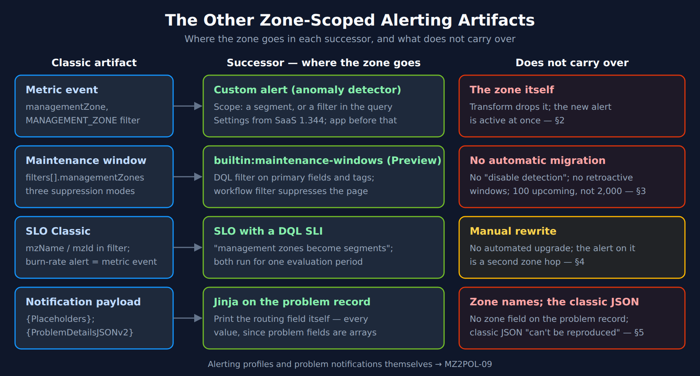
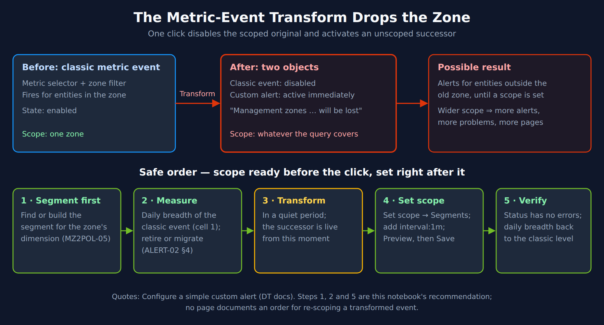
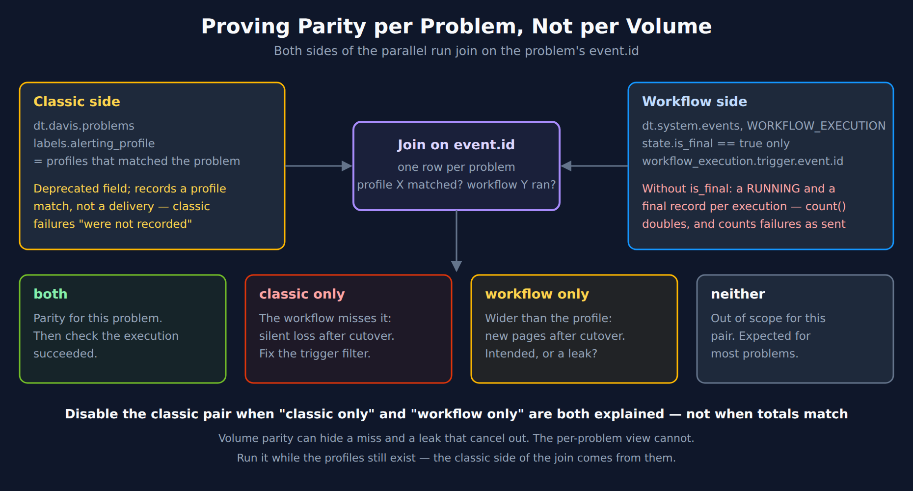

# MZ2POL-16: Migrating the Rest of Zone-Scoped Alerting

> **Series:** MZ2POL — Management Zone Migration: Segments, Policies, Workflows | **Notebook:** 17 of 17 | **Created:** October 2026 | **Last Updated:** 10/14/2026

> **Purpose:** MZ2POL-09 moves zone-scoped alerting profiles and problem notifications onto problem-triggered workflows. A zone also scopes metric events, maintenance windows and classic SLOs, and notification payloads may have printed it. Each of these has its own successor, its own upgrade guide and its own trap. This notebook migrates them, then proves the result per problem before anything classic is switched off.

## What This Notebook Does

1. **Maps each remaining zone consumer to its successor** — the rows MZ2POL-15 §3 finds besides alerting profiles
2. **Migrates metric events** without the transform silently widening their scope
3. **Recreates maintenance windows** on the new model, and keeps notification suppression working during the parallel run
4. **Moves classic SLOs** from zone filters to segments, and runs both for one evaluation period
5. **Rewrites notification payloads** that relied on zone names or the classic JSON
6. **Proves parity per problem** — which problems a classic profile matched, and which a workflow acted on
7. **Measures overlap** that turns into duplicate pages, and where de-duplication actually happens
8. **Sets the rollback window and cutover order** for all of the above

This notebook complements MZ2POL-09 (alerting profiles and notifications), MZ2POL-15 (finding the consumers) and MZ2POL-06 §8–§9 (cleanup and rollback).

---

## Table of Contents

1. [The Other Zone Consumers](#the-other-zone-consumers)
2. [Metric Events: the Transform Drops the Zone](#metric-events)
3. [Maintenance Windows](#maintenance-windows)
4. [Classic SLOs](#classic-slos)
5. [Notification Payloads](#notification-payloads)
6. [Proving Parity per Problem](#proving-parity)
7. [Overlap and Duplicate Pages](#overlap-and-duplicate-pages)
8. [Rollback and Cutover Order](#rollback-and-cutover-order)
9. [Checklist and Summary](#checklist-and-summary)

---

## Prerequisites

| Requirement | Details |
|-------------|---------|
| **Dynatrace Environment** | SaaS with Grail, with management zones still configured and classic alerting still in use — the parity queries in §6 need both sides running |
| **Permissions (DQL cells)** | `storage:events:read` for `dt.davis.events`, `dt.davis.problems` and `dt.maintenance.windows`; `storage:system:read` for workflow execution events in `dt_system_events` |
| **Permissions (configuration)** | Custom alerts: Anomaly Detection permissions, plus `storage:filter-segments:read` / `write` to apply segments (§2). Maintenance windows: `settings:objects:read`, `settings:objects:write`, `settings:schemas:read` on `builtin:maintenance-windows` (§3) |
| **Inventory** | The MZ2POL-15 dependency matrix — §3 of that notebook finds the metric events, maintenance windows and SLOs that name each zone |
| **Routing values** | The dimension each zone stood for, set on the data as a primary field or `primary_tags.*` (MZ2POL-10, MZ2POL-11) — every successor in this notebook filters on it |
| **Before this** | MZ2POL-09 — the workflows that replace alerting profiles. §6 and §7 here measure them |

---

<a id="the-other-zone-consumers"></a>
## 1. The Other Zone Consumers

MZ2POL-15 §3 searches five zone-aware schemas. MZ2POL-09 handles two of them, alerting profiles and problem notifications. This notebook handles the rest, plus the one zone dependency that lives outside any schema — the payload a receiver parses.

| Consumer (MZ2POL-15 §3) | Where the zone lives | Successor | Section |
|---|---|---|---|
| Metric event — `builtin:anomaly-detection.metric-events` | `managementZone`; entity-filter conditions of type `MANAGEMENT_ZONE` | Custom alert (anomaly detector), scoped by a segment | §2 |
| Maintenance window — `builtin:alerting.maintenance-window` | `filters[].managementZones` | `builtin:maintenance-windows`, scoped by a DQL filter | §3 |
| SLO Classic — `builtin:monitoring.slo` | `mzName(…)` / `mzId(…)` in the entity-selector `filter` | An SLO with a DQL SLI, scoped by a segment | §4 |
| Problem notification payload | Zone names, if the receiver read them from the classic JSON | Jinja over the problem record | §5 |



<!-- MARKDOWN_TABLE_ALTERNATIVE
| Classic artifact | Successor — where the zone goes | Does not carry over |
|---|---|---|
| Metric event (managementZone, MANAGEMENT_ZONE filter) | Custom alert: scope with a segment or a filter in the query; in Settings from SaaS 1.344, the Anomaly Detection app before that | The zone itself — the transform drops it, and the new alert is active at once (§2) |
| Maintenance window (filters[].managementZones, three suppression modes) | builtin:maintenance-windows (Preview): DQL filter on primary fields and tags; a workflow filter suppresses the page | No automatic migration; no "disable detection"; no retroactive windows; 100 upcoming, not 2,000 (§3) |
| SLO Classic (mzName / mzId in the filter; burn-rate alert = metric event) | SLO with a DQL SLI: "management zones become segments"; run both for one evaluation period | Manual rewrite — no automated upgrade; the alert on it is a second zone hop (§4) |
| Notification payload ({Placeholders}, {ProblemDetailsJSONv2}) | Jinja on the problem record: print the routing field itself, every value | Zone names; the classic JSON "can't be reproduced" (§5) |
| Alerting profiles and problem notifications | MZ2POL-09 | |
For environments where SVG doesn't render
-->

### The classic schemas are on the removal list

All five schemas are listed on Dynatrace's *Removed settings schemas* page (published 08/12/2026), each with its successor: metric events → custom alerts, maintenance windows → maintenance windows, SLO definitions → Service-Level Objectives, alerting profiles and problem notifications → Workflows. The page says *"None of the schemas on this page are visible in Latest Dynatrace"*, and asks for automations that reference them by ID to be updated *"before the schemas are removed from your environment."* §8 explains what that does to rollback.

The alert-notification upgrade guide describes alerting profiles and problem notifications as Dynatrace Classic that *"continue to work and are not being removed on a published schedule"*. The two pages do not conflict: one describes Classic, the other what Latest Dynatrace shows. Neither gives a removal date.

> <sub>**Sources:**</sub>
> - <sub>[Removed settings schemas (DT docs)](https://docs.dynatrace.com/docs/dynatrace-api/environment-api/settings/removed-schemas) — *"None of the schemas on this page are visible in Latest Dynatrace"*; *"If you use configuration-as-code or other automations that reference these schemas by ID, you need to update these automations before the schemas are removed from your environment."*</sub>
> - <sub>[Upgrade from Classic problem notification to simple workflows (DT docs)](https://docs.dynatrace.com/docs/platform/upgrade/keep-problems-and-alerting-working/upgrade-guide-alert-notification) — *"They continue to work and are not being removed on a published schedule, but they'll not receive new capabilities."*</sub>
> - <sub>[Metric events settings schema (DT docs)](https://docs.dynatrace.com/docs/dynatrace-api/environment-api/settings/schemas/builtin-anomaly-detection-metric-events) — `managementZone`; filter type `MANAGEMENT_ZONE`</sub>

---

<a id="metric-events"></a>
## 2. Metric Events: the Transform Drops the Zone

The successor to a metric event is a custom alert: *"To create a custom alert, use Anomaly Detection."* ALERT-02 §4 covers the first decision — measure which metric events still fire, then retire or migrate each one — and that only metric-selector events can be transformed. This section covers the step after it for a zone-scoped event, which no upgrade guide spells out.

### What the transform does to a zone

The *Configure a simple custom alert* page, under *Transform a metric event configuration*, says:

> *"Management zones aren't supported in Anomaly Detection and will be lost after transforming metric events."*
>
> *"The converted metric event is automatically disabled, and the newly created configuration is active instead."*

The *Upgrade Metric Alerting* guide does not mention zones. Read together, the two sentences mean that transforming a zone-scoped metric event disables the scoped original and activates a successor without the zone, in one step. Until a scope is set on the successor, it evaluates whatever its query returns — potentially the whole environment rather than the zone. More entities in scope can mean more alerts, more problems and more pages.



<!-- MARKDOWN_TABLE_ALTERNATIVE
| Stage | State | Scope |
|---|---|---|
| Before | Classic metric event, metric selector + zone filter, enabled | One zone |
| Transform (one click) | Classic event disabled; custom alert active immediately; "Management zones … will be lost" | Whatever the query covers |
| Possible result | Alerts for entities outside the old zone until a scope is set | Wider scope means more alerts, problems and pages |
| Safe order 1 | Find or build the segment for the zone's dimension (MZ2POL-05) | |
| Safe order 2 | Measure the classic event's daily breadth (cell below); retire or migrate (ALERT-02 §4) | |
| Safe order 3 | Transform in a quiet period — the successor is live from this moment | |
| Safe order 4 | Set scope → Segments; add interval:1m; Preview, then Save | |
| Safe order 5 | Status has no errors; daily breadth back to the classic level | |
| Note | Steps 1, 2 and 5 are this notebook's recommendation; no page documents an order for re-scoping a transformed event | |
For environments where SVG doesn't render
-->

### Re-scoping the successor

Scope a custom alert with a segment. In *Set scope*: *"In Segments, choose one or more segments you want to filter by."* The segments page adds two rules: *"Don't duplicate filters that are already covered by segments you've selected. Segment filters are automatically applied to your query during execution."*, and *"Select Preview to verify that the segments have been applied to your query."* Applying segments needs `storage:filter-segments:write` and `storage:filter-segments:read`.

A filter written into the DQL query also narrows the scope. No page maps a zone to a segment or says which of the two to prefer for a migrated zone. A segment is reusable across alerts and dashboards, so a zone that scoped several metric events usually maps to one segment (MZ2POL-05 builds one segment per dimension).

**Recommended order** (this notebook's recommendation — no page documents one):

1. **Segment first.** Before the transform, find or build the segment for the dimension the zone stood for.
2. **Measure.** Record the classic event's daily breadth with the cell below, so there is a baseline to compare against.
3. **Transform** in a quiet period. From this moment the successor is live and unscoped.
4. **Set scope** on the successor: select the segment, add `interval:1m` to the query as the transform steps say, *Preview*, *Save*.
5. **Verify.** *"Check the Status of the new configuration shortly after creation to ensure there are no errors in the execution."* Then re-run the breadth cell and compare.

Metric-key events cannot be transformed (*"You can only transform metric selectors."*). They are rebuilt by hand, and the scope is set in the same form before the first save, so the trap does not arise.

> **Where custom alerts live (SaaS 1.344).** *"Starting with Dynatrace version 1.344, custom alerts have moved to Settings. Because Anomaly Detection is deprecated, we highly recommend that you use Settings to access your existing configurations and create new ones."* The UI path is *Settings > Analyze and alert > Alerts > All alerts* → *Custom alerts*. SaaS 1.344's rollout started 07/29/2026 and reaches tenants in stages — confirm your tenant's version. Before 1.344 arrives, the Anomaly Detection app is where you create and scope custom alerts, and the *Improve metric events with DQL* transform is in that app.

### Measure the breadth before and after

Each alert carries the settings object that raised it, so the history shows how widely a configuration fires. The cell counts distinct source entities per day for every classic metric event and every custom alert. A successor whose daily count is well above its classic predecessor's is the signature of a dropped zone. Classic and successor objects have different IDs; match them by name in the respective settings list.

```dql
// Daily breadth of each classic metric event and each custom alert: distinct source entities per day.
// Compare a classic event's breadth before its transform with its successor's breadth after it.
// Days with no alert are absent from sources_per_day.
fetch dt.davis.events, from:-7d
| filter in(dt.settings.schema_id, {"builtin:anomaly-detection.metric-events", "builtin:davis.anomaly-detectors"})
| fieldsKeep timestamp, dt.settings.schema_id, dt.settings.object_id, dt.source_entity
| summarize {sources = countDistinctExact(dt.source_entity)},
    by:{dt.settings.schema_id, dt.settings.object_id, day = bin(timestamp, 24h)}
| sort day asc
| summarize {days_firing = count(), sources_per_day = collectArray(sources), max_sources = max(sources)},
    by:{dt.settings.schema_id, dt.settings.object_id}
| sort max_sources desc
| limit 20
```

On the validation tenant (10/14/2026, 7 days): 1 classic metric event and 5 custom alerts raised alerts, each from one source entity per day. The query scanned about 7 GB of events; narrow the window or filter on `dt.settings.object_id` once you know which configurations you are watching.

Filter on `dt.settings.schema_id`, not on `event.provider` — ALERT-02 §4 shows that the provider value is shared with built-in detection.

> **The custom-alert actor is not a zone.** *"Every execution of custom alert is performed in the context of a user."* No page says whether that user's permissions narrow what the detector evaluates. Do not rely on the actor's access to replace a zone; set the scope explicitly.

> <sub>**Sources:**</sub>
> - <sub>[Upgrade Metric Alerting (DT docs)](https://docs.dynatrace.com/docs/platform/upgrade/keep-problems-and-alerting-working/metric-alerting) — *"To create a custom alert, use"*; *"You can only transform metric selectors."*</sub>
> - <sub>[Configure a simple custom alert (DT docs)](https://docs.dynatrace.com/docs/dynatrace-intelligence/anomaly-detection/anomaly-detection-app/configure-a-simple-ad) — *"Management zones aren't supported in"*, *"and will be lost after transforming metric events."*; *"The converted metric event is automatically disabled, and the newly created configuration is active instead."*; *"Check the Status of the new configuration shortly after creation to ensure there are no errors in the execution."*; *"Settings > Analyze and alert > Alerts > All alerts"*</sub>
> - <sub>[Use segments with Anomaly Detection custom alerts (DT docs)](https://docs.dynatrace.com/docs/dynatrace-intelligence/use-cases/use-segments-anomaly-detection) — *"In Segments , choose one or more segments you want to filter by."*; *"Don't duplicate filters that are already covered by segments you've selected."*; *"Segment filters are automatically applied to your query during execution."*; *"storage:filter-segments:write and storage:filter-segments:read permissions."*</sub>
> - <sub>[Anomaly Detection app (DT docs)](https://docs.dynatrace.com/docs/dynatrace-intelligence/anomaly-detection/anomaly-detection-app) — *"custom alerts have moved to"*; *"Every execution of custom alert is performed in the context of a user."*</sub>
> - <sub>[SaaS 1.344 release notes (DT docs)](https://docs.dynatrace.com/docs/whats-new/saas/sprint-344) — *"Rollout start on Jul 29, 2026"*</sub>
> - <sub>**Dictionary:** `dt.settings.schema_id` (`experimental`), `dt.settings.object_id` (`experimental`), read 10/14/2026. **Derived:** the widening follows from the two *Configure a simple custom alert* quotes together.</sub>

---

<a id="maintenance-windows"></a>
## 3. Maintenance Windows

A dedicated upgrade guide for maintenance windows was published on 09/09/2026. Its summary: *"Latest Dynatrace scopes windows with DQL matcher expressions on Grail data instead of management zones, and suppresses notifications through a workflow Problem trigger filter instead of built-in detection modes."* MZ2POL-15 §10 predates it and lists maintenance windows as having no documented replacement; read this section instead.

> **New maintenance windows are in Early Access and labelled Preview.** SaaS 1.341 (rollout started 06/16/2026) introduced them: *"Maintenance windows are available in Early Access."* Every page describing the new model carries a *Preview* label. Confirm that *Settings > General > Maintenance windows* exists on your tenant before planning around it. Until it does, classic maintenance windows remain the working path, and nothing below replaces them.

### What changes

| | Classic (`builtin:alerting.maintenance-window`) | Latest (`builtin:maintenance-windows`) |
|---|---|---|
| Scope | Filters by entity type, entity, tags and management zones; *"If no filter is defined, the maintenance window is valid for the whole environment."* | A `filter` property, *"DQL Filter"*, marked Required — on *"Grail primary fields such as host.name or k8s.cluster.name, and Grail primary tags"* |
| What happens to problems | Three modes: `DETECT_PROBLEMS_AND_ALERT`, `DETECT_PROBLEMS_DONT_ALERT`, `DONT_DETECT_PROBLEMS` | *"Dynatrace always detects problems."* Suppression is a workflow trigger filter; *"There is no equivalent to disabling problem detection entirely."* |
| Count | Two thousand | *"up to 100 upcoming maintenance window configurations"* |
| Duration | — | *"The maximum duration of a maintenance window is 7 days."* |
| Past windows | Retroactive windows allowed | *"Retroactive maintenance windows are not supported."* |
| Migration | — | *"Classic maintenance windows aren't migrated automatically."* |

Two consequences need a decision before the rebuild:

- **More than 100 windows.** *"If you currently use more than 100 active or upcoming maintenance windows, you need to consolidate them before migrating."* The guide notes that the newer scheduling rules let one window replace several classic ones.
- **Availability reporting.** *"If your availability reporting relies on retroactive maintenance windows, plan for that gap as part of your upgrade."*

The capability map lists maintenance windows as *"Recreated as Latest Dynatrace settings"* and *"No action needed"*. The upgrade guide, which is specific to maintenance windows, says they are not migrated automatically and walks through recreating them. Follow the upgrade guide.

### Translating the zone into the filter

The guide's step: *"Translate the scope from management zones and entity IDs to DQL matcher filter criteria on Grail primary fields."* A zone is not on the telemetry, so translate it into the field or tag its rules stood for (MZ2POL-11), then keep the classic logic:

- Within one classic filter, zones combine with AND: *"Entities which are part of all the configured management zones will match this maintenance window."*
- Across classic filters, OR: *"Each filter is evaluated separately (OR)."*

So a classic window with filter 1 = zones A and B, and filter 2 = zone C, becomes `(<field for A> and <field for B>) or <field for C>`. The create page gives the forms — `k8s.cluster.name == "k8s-02"`, `primary_tags.environment == "staging"`, and for several values `matchesValue(primary_tags.environment, {"staging", "production", "testing"})`.

Keep the new filter as narrow as the classic one. A broad filter written to keep things simple marks more telemetry as under maintenance, and every workflow that filters on the flag then pages less.

### Suppressing the page

Suppression moves to the workflow. The upgrade guide's step 2: *"In the Problem trigger of your workflow, add maintenance.is_under_maintenance == false as a filter to exclude problems that occur during a maintenance window."* The *Use maintenance window data* page gives the same filter as `maintenance.is_under_maintenance != true`.

On the **Davis event trigger**, the trigger has its own *Maintenance window* option: *"Always"* (the default), *"Inside maintenance window only"* or *"Outside maintenance window only"*. The problem trigger has no such option, so it needs the custom filter. WFLOW-02 §2–§3 cover both triggers.

The two filter forms behave the same where the flag is always set, and differently where it is absent. The cell measures both surfaces.

```dql
// The maintenance flag is true, false or absent. Count each, and what each filter form lets through.
fetch dt.davis.events, from:-24h
| summarize {records = count(),
    flag_true = countIf(maintenance.is_under_maintenance == true),
    flag_false = countIf(maintenance.is_under_maintenance == false),
    flag_absent = countIf(isNull(maintenance.is_under_maintenance)),
    passes_ne_true = countIf(maintenance.is_under_maintenance != true),
    passes_coalesce = countIf(coalesce(maintenance.is_under_maintenance, false) == false),
    with_window_ids = countIf(arraySize(dt.maintenance_window_ids) > 0)}
| fieldsAdd surface = "dt.davis.events"
| append [fetch dt.davis.problems, from:-24h
    | summarize {records = count(),
        flag_true = countIf(maintenance.is_under_maintenance == true),
        flag_false = countIf(maintenance.is_under_maintenance == false),
        flag_absent = countIf(isNull(maintenance.is_under_maintenance)),
        passes_ne_true = countIf(maintenance.is_under_maintenance != true),
        passes_coalesce = countIf(coalesce(maintenance.is_under_maintenance, false) == false),
        with_window_ids = countIf(arraySize(dt.maintenance_window_ids) > 0)}
    | fieldsAdd surface = "dt.davis.problems"]
| fields surface, records, flag_true, flag_false, flag_absent, passes_ne_true, passes_coalesce, with_window_ids
```

On the validation tenant (10/14/2026, 24 hours):

| `surface` | `records` | `flag_true` | `flag_false` | `flag_absent` | `passes_ne_true` | `passes_coalesce` |
|---|---:|---:|---:|---:|---:|---:|
| `dt.davis.problems` | 559 | 134 | 425 | 0 | 425 | 425 |
| `dt.davis.events` | 28,661 | 316 | 28,013 | 332 | 28,013 | 28,345 |

- **On problems the flag was always set** (0 absent here, and 0 of 5,290 over 7 days in a wider run the same day), so `== false` and `!= true` matched the same problems. The problem trigger is the documented place for this filter.
- **On Davis events the flag was absent on about 1% of records** — all 332 from the `ROOT_CAUSE_ANALYSIS` provider. In DQL both documented forms drop those records; `coalesce(…, false) == false` keeps them. Whether the trigger's matcher evaluates an absent field the same way is not documented. If you filter a **Davis event trigger** on the flag, prefer its built-in *Maintenance window* option, or test the matcher against a record without the field.
- `maintenance.is_under_maintenance` has no row in the semantic dictionary; `dt.maintenance_window_ids` is `experimental`.

### Which model set the flag?

The lifecycle page documents the new model's enrichment: Davis events get *"maintenance.is_under_maintenance=true , dt.maintenance_window_ids"*, and start and end events are *"aggregated into the dt.maintenance.windows view for querying."* It does not say whether classic windows set the same flag. The next two cells show what one tenant does.

```dql
// New-model maintenance windows that have run: one row per configuration.
fetch dt.maintenance.windows, from:-30d
| summarize {runs = count(), first_start = min(start_time), last_end = max(end_time),
    titles = collectDistinct(maintenance_window.title), filters = collectDistinct(maintenance_window.filter)},
    by:{dt.settings.object_id}
| sort last_end desc
```

```dql
// Problems flagged as under maintenance per day, and how many carry a new-model window ID.
fetch dt.davis.problems, from:-14d
| filter maintenance.is_under_maintenance == true
| summarize {problems = count(), with_window_ids = countIf(arraySize(dt.maintenance_window_ids) > 0)},
    by:{day = bin(event.start, 24h)}
| sort day asc
```

On the validation tenant (10/14/2026): one new-model window ran in 30 days — a single 5-minute run on 10/08/2026 with the filter `matchesValue(dt.host_group.id, "…")`. Yet 103–669 problems a day were flagged `maintenance.is_under_maintenance == true` on each of the 14 days, and only **1** of them carried `dt.maintenance_window_ids`, on the day of that run.

**Tenant observation, not documentation:** on this tenant something other than the new model — most likely its classic maintenance windows — sets the same flag on problems, and only the new model adds the window IDs. If that holds on your tenant, a workflow filtered on the flag keeps suppressing during the parallel run whichever model raised it. Run both cells on your own tenant before relying on it, and use `dt.maintenance_window_ids` to tell the two apart.

### Order of work

1. Export the classic windows and decide which are still needed. Consolidate below 100.
2. Recreate each one on `builtin:maintenance-windows` with the translated filter, *Preview* the matched data, and save.
3. Add the maintenance filter to every problem-triggered workflow that replaces a profile (MZ2POL-09). A classic window in `DETECT_PROBLEMS_DONT_ALERT` mode maps onto this filter; a window in `DONT_DETECT_PROBLEMS` mode has no equivalent, and problems will now open during the window.
4. Check that the new window's start and end appear in `dt.maintenance.windows`, and that problems in scope carry `dt.maintenance_window_ids`.
5. Disable the classic window only after its replacement has run once.

Pausing or deleting a running window does not end it: *"Neither action stops a window that is already running; it continues until its configured end time."*

> **Synthetic monitors and availability — version-gated.** SaaS 1.343 (rollout started 07/14/2026) added maintenance-window-aware availability for hosts and process group instances: *"Infrastructure & Operations now supports maintenance-window-aware availability reporting for hosts and process group instances (PGIs)."* SaaS 1.348 is still marked pre-release, with a rollout planned from 09/22/2026; its notes add *"Support for maintenance windows defined in Settings"* for Synthetic. Verify both versions on your tenant. Until they arrive, synthetic monitors and availability calculations keep using classic windows. The 1.341 note also listed *"Problem suppression, synthetic disabling, and SLO time exclusions"* as *"planned for upcoming releases"*; the newer upgrade guide says there is no equivalent to disabling problem detection — follow the newer page.

> <sub>**Sources:**</sub>
> - <sub>[Upgrade from Classic maintenance windows to Latest maintenance windows (DT docs)](https://docs.dynatrace.com/docs/platform/upgrade/upgrade-from-classic-maintenance-windows) — *"Latest Dynatrace scopes windows with DQL matcher expressions on Grail data instead of management zones, and suppresses notifications through a workflow Problem trigger filter instead of built-in detection modes."*; *"Classic maintenance windows aren't migrated automatically."*; *"Latest Dynatrace supports up to 100 upcoming maintenance window configurations, compared to two thousand in Dynatrace Classic."*; *"If you currently use more than 100 active or upcoming maintenance windows, you need to consolidate them before migrating."*; *"Translate the scope from management zones and entity IDs to DQL matcher filter criteria on Grail primary fields ."*; *"There is no equivalent to disabling problem detection entirely."*; *"Retroactive maintenance windows are not supported."*; *"If your availability reporting relies on retroactive maintenance windows, plan for that gap as part of your upgrade."*</sub>
> - <sub>[Maintenance windows (DT docs)](https://docs.dynatrace.com/docs/analyze-explore-automate/alerting-and-notifications/maintenance-windows) — *"The maximum duration of a maintenance window is 7 days."*</sub>
> - <sub>[Create a maintenance window (DT docs)](https://docs.dynatrace.com/docs/analyze-explore-automate/alerting-and-notifications/maintenance-windows/create-maintenance-window) — *"You can filter on Grail primary fields such as host.name or k8s.cluster.name , and Grail primary tags ."*; *"Neither action stops a window that is already running; it continues until its configured end time."*</sub>
> - <sub>[Maintenance window lifecycle (DT docs)](https://docs.dynatrace.com/docs/analyze-explore-automate/alerting-and-notifications/maintenance-windows/maintenance-windows-lifecycle) — *"Start and end events are aggregated into the dt.maintenance.windows view for querying."*</sub>
> - <sub>[Use maintenance window data (DT docs)](https://docs.dynatrace.com/docs/analyze-explore-automate/alerting-and-notifications/maintenance-windows/use-maintenance-window-data-grail) — *"During maintenance, Dynatrace still creates alerts and groups them into problems."*</sub>
> - <sub>[Maintenance windows settings schema, classic (DT docs)](https://docs.dynatrace.com/docs/dynatrace-api/environment-api/settings/schemas/builtin-alerting-maintenance-window) — *"If no filter is defined, the maintenance window is valid for the whole environment."*; *"Each filter is evaluated separately ( OR )."*; *"Entities which are part of all the configured management zones will match this maintenance window."*</sub>
> - <sub>[Maintenance Windows settings schema (DT docs)](https://docs.dynatrace.com/docs/dynatrace-api/environment-api/settings/schemas/builtin-maintenance-windows) — `filter`: *"DQL Filter"*, Required</sub>
> - <sub>[Event triggers for workflows (DT docs)](https://docs.dynatrace.com/docs/analyze-explore-automate/workflows/build/trigger/event-trigger) — *"Inside maintenance window only"*; *"Outside maintenance window only"*</sub>
> - <sub>[Capability mapping, Classic to Latest (DT docs)](https://docs.dynatrace.com/docs/platform/upgrade/foundations/capability-mapping-classic-to-latest) — *"Recreated as Latest Dynatrace settings"*</sub>
> - <sub>[SaaS 1.341 release notes (DT docs)](https://docs.dynatrace.com/docs/whats-new/saas/sprint-341) — *"Maintenance windows are available in Early Access."*; *"Problem suppression, synthetic disabling, and SLO time exclusions are planned for upcoming releases."*</sub>
> - <sub>[SaaS 1.343 release notes (DT docs)](https://docs.dynatrace.com/docs/whats-new/saas/sprint-343) — *"Infrastructure & Operations now supports maintenance-window-aware availability reporting for hosts and process group instances (PGIs)."*</sub>
> - <sub>[SaaS 1.348 release notes (DT docs)](https://docs.dynatrace.com/docs/whats-new/saas/sprint-348) — *"Support for maintenance windows defined in Settings"*</sub>
> - <sub>**Dictionary:** no row for `maintenance.is_under_maintenance` under `filter contains(name, "under_maintenance")`, read 10/14/2026 (control: the same query matched 4 `dt.automation_engine.workflow.*` rows); `dt.maintenance_window_ids` (`experimental`). **Derived:** the AND-within / OR-across translation combines the two classic schema quotes.</sub>

---

<a id="classic-slos"></a>
## 4. Classic SLOs

The SLO upgrade guide replaces the zone with a segment. Its capability table lists *Segmenting* as *"Management zones"* in SLO Classic and *"Segments"* in the new app, and the procedure says: *"In this step, management zones become segments"*. For the selectors, *"mzId / mzName"* map to *"Use Segments."*, with a caution: *"Segments aren't related to permissions or access control."* A zone that also restricted who could see an SLO needs the access model of MZ2POL-04 and MZ2POL-12, not only a segment.

There is no automated path: *"An automated upgrade flow is under consideration; however, given the highly customized nature of SLOs, manual review is expected to yield the best results."* *"If the Classic SLO used entity selectors, management zones, or SLO tags, you may have to upgrade metrics, entities, and filters separately."*

### Run both for one evaluation period

The guide's verification rule is the SLO counterpart of the parallel run for workflows: *"To verify the upgraded SLO, keep both SLOs running for one evaluation period and compare the values before you remove the Classic SLO."* For a 30-day SLO, that is 30 days. Put the date in the cutover plan (§8).

### The alert on the SLO is a metric event

The *Upgrade Metric Alerting* guide lists SLO alerts among metric events created by other solutions: *"In Service-Level Objectives Classic you have the option to create a burn rate or status alerts."* — and adds *"SLO use functional metrics which behave different during transformation. We're working on a separated guide"*. A zone-scoped SLO with an alert therefore has two zone dependencies: the SLO's filter, and the metric event that alerts on it. Rebuild the SLO first, then build its burn-rate alert on the new SLO (SLO-04). Do not transform the classic SLO's metric event; until the separate guide exists, the transform's behavior for it is undocumented.

The guide's example DQL uses `entityName(dt.entity.service)`. FAQ-16 covers writing the same filter on Smartscape fields. For configuration as code, SLO-05 §2 covers `dynatrace_platform_slo` and its segment argument.

> <sub>**Sources:**</sub>
> - <sub>[Upgrade from Service-Level Objectives Classic to Service-Level Objectives (DT docs)](https://docs.dynatrace.com/docs/platform/upgrade/keep-problems-and-alerting-working/service-level-objective-upgrade-classic) — *"In this step, management zones become segments"*; *"Segments aren't related to permissions or access control."*; *"If the Classic SLO used entity selectors, management zones, or SLO tags, you may have to upgrade metrics, entities, and filters separately."*; *"To verify the upgraded SLO, keep both SLOs running for one evaluation period and compare the values before you remove the Classic SLO."*; *"An automated upgrade flow is under consideration; however, given the highly customized nature of SLOs, manual review is expected to yield the best results."*</sub>
> - <sub>[Upgrade Metric Alerting (DT docs)](https://docs.dynatrace.com/docs/platform/upgrade/keep-problems-and-alerting-working/metric-alerting) — *"In Service-Level Objectives Classic you have the option to create a burn rate or status alerts."*; *"SLO use functional metrics which behave different during transformation. We're working on a separated guide"*</sub>

---

<a id="notification-payloads"></a>
## 5. Notification Payloads

A notification can depend on a zone without filtering on one: the receiver may have read the zone from the payload — to pick an assignment group, a channel or a ticket field. The workflow that replaces the notification (MZ2POL-09 §5) has no zone to print.

### Where a zone name could have come from

- **No zone placeholder.** The classic problem-notification schema documents seventeen placeholders — `{State}`, `{ProblemID}`, `{PID}`, `{ProblemTitle}`, `{ProblemSeverity}`, `{ProblemImpact}`, `{ImpactedEntity}`, `{ImpactedEntities}`, `{ImpactedEntityNames}`, `{NamesOfImpactedEntities}`, `{Tags}`, `{ProblemDetailsText}`, `{ProblemDetailsMarkdown}`, `{ProblemDetailsHTML}`, `{ProblemDetailsJSON}`, `{ProblemDetailsJSONv2}`, and `{ProblemURL}`. None is a zone (read 10/14/2026).
- **The classic JSON.** `{ProblemDetailsJSONv2}` is *"Problem as json object following the structure from the Dynatrace Problems V2 API"*, and that API's problem object has `managementZones`: *"A list of all management zones that the problem belongs to."* A receiver that parsed this payload may have read zone names from it.

That second path does not survive: *"ProblemDetailsJSON and ProblemDetailsJSONv2 can't be reproduced from a workflow."* The guide offers two options — adapt the receiver to the Grail problem record (`{{ event() | to_json }}`), or build the payload explicitly from Grail fields. The problem record has no zone field (MZ2POL-09 §5 measured it), so either way the receiver loses the zone.

### What to print instead

Print the field the workflow routes on. If the workflow selects a team with `primary_tags.team`, put `primary_tags.team` in the payload; the receiver then sees exactly what decided the route.

The upgrade guide's placeholder table maps the rest. WFLOW-02 §7 already carries the Jinja side of it; the rows that matter for a zone migration:

| Classic | Problem record | Note from the guide |
|---|---|---|
| `{Tags}` | `primary_tags.*` | *"entity_tags still exists but is deprecated (Dynatrace Classic)"* |
| `{ImpactedEntity}`, `{ImpactedEntities}` | `smartscape.affected_entities` | *"Record array; each element has id , type , name"* |
| `{ProblemDetailsJSON}`, `{ProblemDetailsJSONv2}` | `{{ event() \| to_json }}` | *"Different structure and content from Dynatrace Classic."* |
| `{ProblemDetailsHTML}` | — | *"Not supported"* |
| — (new) | `dt.security_context` | *"Access-scoping context propagated from the affected entities"* |
| — (new) | `dt.cost.costcenter`, `dt.cost.product` | *"Cost Allocation, propagated from the affected entities"* |

These fields hold **every** value from the problem's events: *"If two affected services carry primary_tags.team with different values, the problem holds both. There is no way to determine which value came from which entity."* A zone gave one name per notification; the replacement field can give several. Template it as a list (`| join(", ")`) and make sure the receiver accepts more than one value. The cell measures how often that happens.

```dql
// What a payload that used to print a zone name can print instead, and how often it holds more than one value.
fetch dt.davis.problems, from:-7d
| summarize {problems = count(),
    with_security_context = countIf(arraySize(dt.security_context) > 0),
    multi_security_context = countIf(arraySize(dt.security_context) > 1),
    with_entity_tags = countIf(arraySize(entity_tags) > 0),
    with_cost_center = countIf(arraySize(dt.cost.costcenter) > 0),
    with_affected_entities = countIf(arraySize(smartscape.affected_entities) > 0)}
```

On the validation tenant (10/14/2026, 7 days, 5,290 problems): 1,391 carried a `dt.security_context`, and **512 of those carried more than one value**; 2,897 carried classic `entity_tags`; 4,157 carried `smartscape.affected_entities`; none carried `dt.cost.costcenter` (cost allocation is not configured there). Replace `dt.security_context` with your own routing field — `primary_tags.<key>` — before reading the result; MZ2POL-09 §4 measures routing coverage.

WFLOW-06 covers templates and enrichment, and WFLOW-05 the receivers (ServiceNow, PagerDuty).

> <sub>**Sources:**</sub>
> - <sub>[Problem notifications settings schema (DT docs)](https://docs.dynatrace.com/docs/dynatrace-api/environment-api/settings/schemas/builtin-problem-notifications) — *"Problem as json object following the structure from the Dynatrace Problems V2 API"*</sub>
> - <sub>[Problems API v2 - GET problem details (DT docs)](https://docs.dynatrace.com/docs/dynatrace-api/environment-api/problems-v2/problems/get-problem-details) — `managementZones`: *"A list of all management zones that the problem belongs to."*</sub>
> - <sub>[Upgrade from Classic problem notification to simple workflows (DT docs)](https://docs.dynatrace.com/docs/platform/upgrade/keep-problems-and-alerting-working/upgrade-guide-alert-notification) — *"ProblemDetailsJSON and ProblemDetailsJSONv2 can't be reproduced from a workflow."*; *"entity_tags still exists but is deprecated (Dynatrace Classic)"*; *"Access-scoping context propagated from the affected entities"*; *"If two affected services carry primary_tags.team with different values, the problem holds both. There is no way to determine which value came from which entity."*</sub>
> - <sub>**Dictionary:** `dt.security_context` (`stable`), `dt.cost.costcenter` (`stable`), no row for `entity_tags` or `smartscape.affected_entities` under `filter in(name, …)`, read 10/14/2026 (control: `event.id` → `stable` in the same query). **Derived:** that a receiver may have read zone names from `{ProblemDetailsJSONv2}` combines the schema and Problems API quotes.</sub>

---

<a id="proving-parity"></a>
## 6. Proving Parity per Problem

MZ2POL-09 §9 makes alert parity the acceptance test. The upgrade guide's procedure is volume-based: *"Leave the Dynatrace Classic notification enabled for one full business cycle and compare volumes on both sides. Disable the Dynatrace Classic pair only once the counts match."* Matching totals can hide a problem the workflow misses and another it adds. This section measures per problem.



<!-- MARKDOWN_TABLE_ALTERNATIVE
| Part | Detail |
|---|---|
| Classic side | dt.davis.problems, labels.alerting_profile = profiles that matched the problem. Deprecated field; records a profile match, not a delivery; classic failures "were not recorded" |
| Workflow side | dt.system.events WORKFLOW_EXECUTION, state.is_final == true only, workflow_execution.trigger.event.id. Without is_final, each execution has a RUNNING and a final record — count() doubles and counts failures as sent |
| Join | On the problem's event.id: one row per problem — did profile X match, did workflow Y run? |
| both | Parity for this problem; then check the execution succeeded |
| classic only | The workflow misses it — silent loss after cutover; fix the trigger filter |
| workflow only | Wider than the profile — new pages after cutover; intended or a leak? |
| neither | Out of scope for this pair; expected for most problems |
| Rule | Disable the classic pair when "classic only" and "workflow only" are both explained — not when totals match |
For environments where SVG doesn't render
-->

### Before the first run: Query past events

The trigger's *Query past events* *"reports how many events would have matched over the last hour, day, and seven days."* A zero in all three windows on a busy tenant *"almost always means your default category selection and your custom filter contradict each other."* Run it for each new trigger before the parallel run starts.

### Count executions, not records

The guide's query counts records: `fetch dt.system.events | filter event.kind == "WORKFLOW_EVENT" and … | summarize count = count(), by: {dt.automation_engine.workflow.title}`. On the validation tenant each execution wrote a `RUNNING` record and a final record (`SUCCESS` or `ERROR`), so that query returned 9,392 for a workflow that ran 4,696 times — every one of which failed. Count distinct execution IDs on final records, split by outcome:

```dql
// Executions per workflow, counted once each, split by outcome.
fetch dt.system.events, from:-7d
| filter event.kind == "WORKFLOW_EVENT" and event.provider == "AUTOMATION_ENGINE" and event.type == "WORKFLOW_EXECUTION"
| filter dt.automation_engine.workflow_execution.trigger.type == "Event"
| filter dt.automation_engine.state.is_final == true
| summarize {executions = countDistinctExact(dt.automation_engine.workflow_execution.id),
    succeeded = countDistinctExact(if(dt.automation_engine.state == "SUCCESS", dt.automation_engine.workflow_execution.id)),
    failed = countDistinctExact(if(dt.automation_engine.state == "ERROR", dt.automation_engine.workflow_execution.id))},
    by:{workflow = dt.automation_engine.workflow.title}
| sort executions desc
| limit 20
```

On the validation tenant (10/14/2026, 7 days, event-triggered workflows; names anonymized):

| Workflow | Records (guide's query) | `executions` | `succeeded` | `failed` |
|---|---:|---:|---:|---:|
| ServiceNow incident workflow | 9,392 | 4,696 | 0 | 4,696 |
| Email workflow | 3,096 | 1,548 | 43 | 1,505 |
| A third workflow | 98 | 49 | 0 | 49 |

Across all trigger types in the same week: 160,998 records for 80,499 executions. A record count reads twice the real volume, and a volume comparison that ignores `failed` reports deliveries that never happened.

### Per problem: which side acted on which problem

For an event-triggered workflow, `dt.automation_engine.workflow_execution.trigger.event.id` is the `event.id` of the problem that triggered it. On the validation tenant, every final execution of the three workflows over two days matched a problem in `dt.davis.problems` (984 of 984, 379 of 379, 11 of 11). Executions can outnumber problems — the third workflow ran 11 times on 6 problems, because the *Updates* option and the closed phase re-trigger.

The classic side is on the problem record too: `labels.alerting_profile` lists the profiles that matched the problem. The guide says *"The labels.alerting_profile field on the problem record is deprecated."* — and asks you to stop routing on it. It is still the only Grail-side record of which classic profile matched, so use it **for the comparison, during the parallel run, and nothing else**. Two limits: it records that a profile matched, not that a notification was delivered (*"Classic notification failures were not recorded."*), and the comparison is only possible while the profiles exist.

Set the profile name and the workflow title on the second line, then run:

```dql
// Parity for one classic profile and the workflow that replaces it. Set both names on the next line.
fetch dt.davis.problems, from:-7d
| fieldsAdd profile_name = "Default Alerting Profile", workflow_name = "Route - Team A"
| fields event.id, labels.alerting_profile, profile_name, workflow_name
| lookup [fetch dt.system.events, from:-7d
    | filter event.kind == "WORKFLOW_EVENT" and event.provider == "AUTOMATION_ENGINE" and event.type == "WORKFLOW_EXECUTION"
    | filter dt.automation_engine.workflow_execution.trigger.type == "Event" and dt.automation_engine.state.is_final == true
    | summarize workflows = collectDistinct(dt.automation_engine.workflow.title), by:{trigger_event_id = dt.automation_engine.workflow_execution.trigger.event.id}],
    sourceField:event.id, lookupField:trigger_event_id, fields:{workflows}
| fieldsAdd classic = coalesce(in(profile_name, labels.alerting_profile), false), new = coalesce(in(workflow_name, workflows), false)
| fieldsAdd outcome = if(classic and new, "both", else: if(classic, "classic only", else: if(new, "workflow only", else: "neither")))
| summarize problems = countDistinctExact(event.id), by:{outcome}
| sort problems desc
```

As written, with a workflow that does not exist, the cell returned `classic only` 3,030 and `neither` 2,258 on the validation tenant (10/14/2026) — the shape of a cutover that would lose every page. With a real workflow title it returned `both` 1,548, `classic only` 1,482 and `neither` 2,258. That pair is not a profile and its replacement; it shows that the join works and what a partial match looks like.

To read the result:

- **`classic only`** — problems the profile matched and the workflow did not act on. After cutover these stop paging. Fix the trigger filter, or record why the problem should not page.
- **`workflow only`** — problems the workflow acted on that the profile did not match. After cutover these start paging. Usually the routing field is broader than the zone was.
- **Then check `failed`** from the first cell. A workflow that acts on the right problems and fails every time has parity only on paper.

Disable the classic pair when both mismatch rows are zero or explained. The guide also advises: *"Test against a low-impact source first."*

> <sub>**Sources:**</sub>
> - <sub>[Upgrade from Classic problem notification to simple workflows (DT docs)](https://docs.dynatrace.com/docs/platform/upgrade/keep-problems-and-alerting-working/upgrade-guide-alert-notification) — *"Leave the Dynatrace Classic notification enabled for one full business cycle and compare volumes on both sides."*; *"Disable the Dynatrace Classic pair only once the counts match."*; *"It reports how many events would have matched over the last hour, day, and seven days."*; *"almost always means your default category selection and your custom filter contradict each other."*; *"Classic notification failures were not recorded."*; *"The labels.alerting_profile field on the problem record is deprecated."*; *"Test against a low-impact source first."*</sub>
> - <sub>[Event triggers for workflows (DT docs)](https://docs.dynatrace.com/docs/analyze-explore-automate/workflows/build/trigger/event-trigger) — *"Each distinct combination of selected field values triggers the workflow at most once"*</sub>
> - <sub>**Dictionary:** `dt.automation_engine.state` (`experimental`), `dt.automation_engine.state.is_final` (`experimental`), `dt.automation_engine.workflow_execution.id` (`experimental`), `dt.automation_engine.workflow_execution.trigger.event.id` (`experimental`), `dt.automation_engine.workflow_execution.trigger.type` (`experimental`), `dt.automation_engine.workflow.title` (`experimental`); no row for `labels.alerting_profile` under `filter contains(name, "alerting_profile")`, read 10/14/2026 (control: the same query returned 4 `dt.automation_engine.workflow.*` rows).</sub>

---

<a id="overlap-and-duplicate-pages"></a>
## 7. Overlap and Duplicate Pages

Zones overlap, so one problem could match several zone-scoped profiles: *"Keep in mind that management zones can overlap. If a problem is detected on a service that is defined within multiple management zones, multiple filters will be applied."* Workflows keep that property — a problem whose routing field holds two values matches both teams' workflows (§5). Before cutover, measure how much overlap the classic estate already has, and how much the workflow fleet produces.

```dql
// How many classic profiles matched each problem? Overlap on the classic side, measured before cutover.
fetch dt.davis.problems, from:-7d
| fieldsAdd non_default = arrayRemoveNulls(iCollectArray(if(not(in(labels.alerting_profile[], {"Default", "Default Alerting Profile"})), labels.alerting_profile[])))
| fieldsAdd matched = if(isNull(labels.alerting_profile), "no profile label",
    else: if(arraySize(non_default) == 0, "default profile only",
    else: if(arraySize(non_default) == 1, "one non-default profile", else: "two or more non-default profiles")))
| summarize problems = count(), by:{matched}
| sort problems desc
```

```dql
// Workflow side: how many event-triggered workflows acted on each problem?
fetch dt.system.events, from:-7d
| filter event.kind == "WORKFLOW_EVENT" and event.provider == "AUTOMATION_ENGINE" and event.type == "WORKFLOW_EXECUTION"
| filter dt.automation_engine.workflow_execution.trigger.type == "Event" and dt.automation_engine.state.is_final == true
| summarize {workflows = countDistinctExact(dt.automation_engine.workflow.id), executions = countDistinctExact(dt.automation_engine.workflow_execution.id)},
    by:{trigger_event_id = dt.automation_engine.workflow_execution.trigger.event.id}
| summarize {problems = count(), executions = sum(executions)}, by:{workflows_per_problem = workflows}
| sort workflows_per_problem asc
```

On the validation tenant (10/14/2026, 7 days): of 5,288 problems, **542 (10.2%) matched two or more non-default profiles**, 816 exactly one, 1,672 only a default profile, and 2,258 carried no profile label. On the workflow side, 1,571 of 4,696 triggering problems (33.5%) were acted on by two workflows and 1 by three. Edit the default-profile names in the first cell if yours differ.

A problem acted on by two workflows is not necessarily a duplicate page — two workflows can send to different destinations on purpose. It is a duplicate when they reach the same people.

### Where to remove duplicates

| Layer | What the docs say | Use it for |
|---|---|---|
| **Workflow design** | *"Consolidate by destination, not by filter."* — and *"Trigger on problems, not on Davis events."*, because *"Triggering on raw events bypasses that grouping and floods the channel."* | One workflow per destination (MZ2POL-09 §5). Two overlapping profiles that paged the same channel become one workflow |
| **Team isolation** | *"Split workflows when teams need isolation, even if the destination is identical."* | Accept two workflows to one destination only when the teams own them separately |
| **Re-triggering** | *"Each distinct combination of selected field values triggers the workflow at most once"*; *"Any change to the set of selected fields for Updates may cause one extra trigger on the next change to each affected problem."* | Expect one extra execution after editing *Updates* |
| **Receiver** | No page documents de-duplication across workflows | Key the receiver on the problem: PagerDuty `dedupKey`, ServiceNow search-before-create (WFLOW-05 §7, ALERT-04) |

Escalation that classic profiles achieved with several delayed profiles on the same zone — page the team, then the lead after 30 minutes — is a workflow pattern now, not a second profile: WFLOW-04 §6 covers timed and multi-tier escalation, and MZ2POL-09 §6.1 the *Minimum duration* option.

> <sub>**Sources:**</sub>
> - <sub>[Problem alerting profiles (DT docs)](https://docs.dynatrace.com/docs/analyze-explore-automate/notifications-and-alerting/alerting-profiles) — *"Keep in mind that management zones can overlap. If a problem is detected on a service that is defined within multiple management zones, multiple filters will be applied."*</sub>
> - <sub>[Upgrade from Classic problem notification to simple workflows (DT docs)](https://docs.dynatrace.com/docs/platform/upgrade/keep-problems-and-alerting-working/upgrade-guide-alert-notification) — *"Consolidate by destination, not by filter."*; *"Trigger on problems, not on Davis events."*; *"Triggering on raw events bypasses that grouping and floods the channel."*; *"Split workflows when teams need isolation, even if the destination is identical."*</sub>
> - <sub>[Event triggers for workflows (DT docs)](https://docs.dynatrace.com/docs/analyze-explore-automate/workflows/build/trigger/event-trigger) — *"Each distinct combination of selected field values triggers the workflow at most once"*; *"Any change to the set of selected fields for Updates may cause one extra trigger on the next change to each affected problem."*</sub>

---

<a id="rollback-and-cutover-order"></a>
## 8. Rollback and Cutover Order

### Rollback lasts only as long as Classic does

Every rollback in this migration is "re-enable the classic object": the profile and notification pair (MZ2POL-06 §9), the disabled metric event, the classic maintenance window, the classic SLO. Two things limit it:

- **The removed-schemas page.** *"None of the schemas on this page are visible in Latest Dynatrace"* — so once the environment runs on Latest Dynatrace, the classic objects cannot be re-enabled from the UI. Rollback to a classic object is available only while the environment is still on Classic.
- **The zone.** A re-enabled classic object that names a zone works only while the zone exists, which is why MZ2POL-09 §8 deletes zones last.

What re-enabling does is documented for none of them. One case can be reasoned from the docs: the transformed metric event is disabled and its successor is active, so re-enabling the classic event without disabling the successor runs both. Disable one when you enable the other, the same rule MZ2POL-06 §9 gives for profiles and workflows.

### Cutover order

| Step | Action | Proof before the next step |
|---|---|---|
| 1 | Routing values on the data (MZ2POL-10, MZ2POL-11); segments for each zone dimension (MZ2POL-05) | MZ2POL-09 §4 coverage at 100 |
| 2 | Build the workflows (MZ2POL-09) with the maintenance filter (§3) | *Query past events* non-zero for each trigger |
| 3 | Recreate maintenance windows on the new model (§3), where your tenant has it | A run appears in `dt.maintenance.windows` |
| 4 | Rebuild SLOs on segments (§4); transform or rebuild metric events with scope set (§2) | SLOs: one full evaluation period side by side. Alerts: breadth back to the classic level |
| 5 | Parallel run for one full business cycle | §6: mismatch rows zero or explained; `failed` zero. §7: duplicates explained |
| 6 | **Disable** classic profiles, notifications, windows, SLOs and metric events — do not delete | One soak period with no regressions |
| 7 | Delete management zones, in a separate change window, through the MZ2POL-15 §9 gate | The MZ2POL-09 §8 deletion test recorded |

The guide's last step for the profile pair is *"Delete it once you're confident you're getting the right notification."* Keep the disabled classic objects until step 7 is done and the rollback window has passed.

> <sub>**Sources:**</sub>
> - <sub>[Removed settings schemas (DT docs)](https://docs.dynatrace.com/docs/dynatrace-api/environment-api/settings/removed-schemas) — *"None of the schemas on this page are visible in Latest Dynatrace"*</sub>
> - <sub>[Configure a simple custom alert (DT docs)](https://docs.dynatrace.com/docs/dynatrace-intelligence/anomaly-detection/anomaly-detection-app/configure-a-simple-ad) — *"The converted metric event is automatically disabled, and the newly created configuration is active instead."*</sub>
> - <sub>[Upgrade from Classic problem notification to simple workflows (DT docs)](https://docs.dynatrace.com/docs/platform/upgrade/keep-problems-and-alerting-working/upgrade-guide-alert-notification) — *"Delete it once you're confident you're getting the right notification."*</sub>
> - <sub>**Derived:** the rollback limit combines the removed-schemas quote with the transform quote; that both objects fire when both are enabled is an inference, not a documented behavior.</sub>

---

<a id="checklist-and-summary"></a>
## 9. Checklist and Summary

**Metric events (§2)**

- [ ] Retire-or-migrate decision per event (ALERT-02 §4)
- [ ] Segment for each zone exists **before** the transform
- [ ] Breadth measured before; scope, `interval:1m`, *Preview* and *Status* checked right after
- [ ] Custom alerts created where your tenant's version puts them — Settings from SaaS 1.344

**Maintenance windows (§3)**

- [ ] New model available on your tenant (Early Access, SaaS 1.341); classic windows kept until it is
- [ ] Upcoming windows consolidated to 100 or fewer
- [ ] Zone filters translated: AND within a classic filter, OR across filters
- [ ] Maintenance filter on every replacement problem trigger; *Maintenance window* option on Davis event triggers
- [ ] `DONT_DETECT_PROBLEMS` windows and retroactive-window reporting have a recorded decision

**SLOs (§4)**

- [ ] Zone filter replaced by a segment; access needs handled separately
- [ ] Both SLOs run for one evaluation period and compared
- [ ] Burn-rate alerts rebuilt on the new SLO, not transformed

**Payloads (§5)**

- [ ] Receivers that read zone names or the classic JSON identified
- [ ] Payload prints the routing field, as a list

**Parity, overlap, cutover (§6–§8)**

- [ ] Executions counted on final records; `failed` checked
- [ ] Per-problem parity run for every profile and its workflow, while the profiles still exist
- [ ] Overlap measured on both sides; duplicates removed by destination or at the receiver
- [ ] Classic objects disabled, not deleted, until zones are gone and the rollback window has passed

| Finding | What to do |
|---|---|
| Transforming a zone-scoped metric event drops the zone and activates the successor at once | Segment first; set the scope straight after the transform; compare breadth (§2) |
| Maintenance windows have an upgrade guide, a Preview model and no automatic migration | Recreate them with DQL filters; suppress in the workflow; nothing replaces disabling detection (§3) |
| The maintenance flag can be absent on Davis events | Prefer the Davis event trigger's *Maintenance window* option; test the matcher (§3) |
| SLOs move zone → segment by hand and need one evaluation period side by side | Plan the date; rebuild the SLO alert on the new SLO (§4) |
| No problem field carries the zone, and the classic JSON cannot be reproduced | Print the routing field; accept several values (§5) |
| The documented execution query counts records and failures | Count final executions, split by outcome; compare per problem (§6) |
| Overlap carries over through multi-value routing fields | Consolidate by destination; de-duplicate at the receiver (§7) |
| Rollback means re-enabling classic objects | Possible only while the environment is on Classic and the zone exists (§8) |

### Related Notebooks

- **MZ2POL-05**: Segments Implementation — the segments §2 and §4 scope with
- **MZ2POL-06**: Migration Execution — §8 cleanup, §9 rollback
- **MZ2POL-09**: Migrating Management Zone-Scoped Alerting and Notifications — profiles, notifications, §8 deletion test, §9 validation
- **MZ2POL-11**: Translating Management Zone Rules to Source Attributes — the field each zone becomes
- **MZ2POL-15**: Finding Every Zone Consumer — §3 inventory, §9 deletion gate
- **ALERT-02**: Choosing and Building Detection — §4 metric-event triage
- **AIOPS-02**: Anomaly Detection — building and tuning detectors
- **SLO-04**: Burn-Rate Alerting; **SLO-05**: SLOs as Code
- **WFLOW-02**: Triggers — §2–§3 trigger options, §7 placeholder mapping
- **WFLOW-04**: Notification Routing — §6 escalation
- **WFLOW-05**: Incident Management — §7 de-duplication
- **WFLOW-06**: Custom Templates
- **FAQ-21**: Getting the Right Alerts to the Right People

---

<sub>*This notebook was AI-generated from community-submitted and publicly available sources. This notebook series is not officially supported by Dynatrace. Always verify information against official Dynatrace documentation.*</sub>
