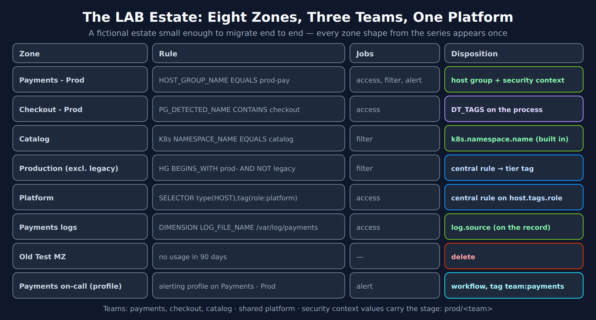
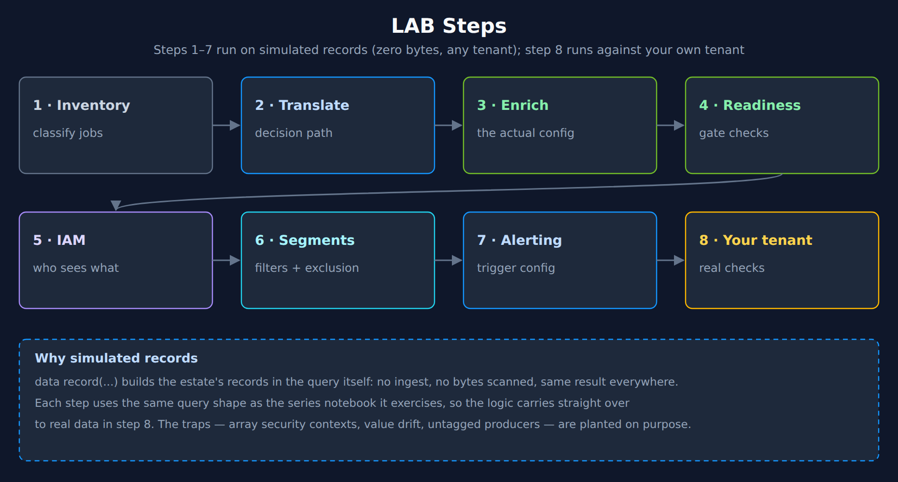

# MZ2POL-95 LAB: Migrating a Sample Zone Estate End to End

> **Series:** MZ2POL — Management Zone to Policy Migration | **Reference:** 95 — End-to-End Migration LAB | **Created:** October 2026 | **Last Updated:** 10/13/2026

## Overview

This LAB takes a small fictional estate — eight zones, three teams, one shared platform — through the whole migration the series describes: inventory, rule translation, enrichment, the readiness gate, IAM, segments, alerting, and the checks you then run on your own tenant.

Steps 1–7 run on **simulated records** built with `data record(...)` inside the query itself. They need no ingest, scan **zero bytes**, and return the same result on any tenant, so you can run the whole LAB safely and compare your output with the expected results given after each step. The simulated data has the series' traps planted in it on purpose — an array-typed security context, a mis-cased team value, untagged producers, a legacy host that must be excluded — and each step shows which check catches which trap.

Step 8 switches to real data on your tenant.

> **What the simulation does and does not prove.** The DQL steps reproduce the *logic* of each check. They do not execute IAM policies or segments. Where a step models an IAM operator, it follows the documented rule: Dynatrace ties `MATCH` to DQL's `matchesValue`, and states that `=`, `IN` and `startsWith` are always false on an array. Confirm real access with the effective-permissions API (MZ2POL-12 §10).

---

## Table of Contents

1. [The Estate](#the-estate)
2. [Step 1 — Inventory and Classify](#step-1)
3. [Step 2 — Translate Each Rule](#step-2)
4. [Step 3 — Write the Enrichment](#step-3)
5. [Step 4 — Run the Readiness Gate](#step-4)
6. [Step 5 — Design IAM and Test Who Sees What](#step-5)
7. [Step 6 — Segments and the Pushed-Down Exclusion](#step-6)
8. [Step 7 — Replace the Alerting Profile](#step-7)
9. [Step 8 — Run the Real Checks on Your Tenant](#step-8)
10. [Cutover Plan for the Estate](#cutover-plan)

---

## Prerequisites

| Requirement | Details |
|-------------|---------|
| **Dynatrace Environment** | Any Latest Dynatrace SaaS tenant; Steps 1–7 scan zero bytes |
| **Permissions** | None for Steps 1–7; `storage:logs:read`, `storage:events:read`, `storage:spans:read` for Step 8 |
| **Background reading** | MZ2POL-10 (tagging), MZ2POL-11 (rule translation), MZ2POL-12 (IAM), MZ2POL-05 (segments), MZ2POL-09 (alerting) |
| **Time** | In community practice about two hours, or one workshop session (MZ2POL-14) |

<a id="the-estate"></a>
## 1. The Estate

Northwind (fictional) runs three application teams — **payments**, **checkout** and **catalog** — and a **platform** team that owns shared hosts. Its management-zone estate has grown to eight objects:



<!-- MARKDOWN_TABLE_ALTERNATIVE
| Zone | Rule | Jobs | Disposition |
|---|---|---|---|
| Payments - Prod | HOST_GROUP_NAME EQUALS prod-pay | access, filter, alert | Host group + security context |
| Checkout - Prod | PROCESS_GROUP_DETECTED_NAME CONTAINS checkout (+ pgToHost) | access | DT_TAGS on the process |
| Catalog | CLOUD_APPLICATION_NAMESPACE_NAME EQUALS catalog | filter | k8s.namespace.name (built in) |
| Production (excl. legacy) | HOST_GROUP_NAME BEGINS_WITH prod- AND HOST_NAME NOT_CONTAINS legacy | filter | Central rule → primary_tags.tier |
| Platform | SELECTOR type(HOST),tag(role:platform) | access | Central rule on host.tags.role |
| Payments logs | DIMENSION LOG_FILE_NAME BEGINS_WITH /var/log/payments | access | log.source (on the record) |
| Old Test MZ | No usage in 90 days | — | Delete |
| Payments on-call (alerting profile) | Scoped to Payments - Prod | alert | Workflow on tag team:payments |
Teams: payments, checkout, catalog; shared platform. Security context values carry the stage: prod/<team>.
For environments where SVG doesn't render
-->

Host groups are `prod-pay` (payments), `prod-shared` (checkout and platform processes share these hosts) and `prod-legacy`. The catalog team runs in the `catalog` Kubernetes namespace. Some logs arrive through an API integration with no host at all.

The design decision taken up front, following MZ2POL-12 §6: security-context values carry the stage and the team — `prod/payments`, `prod/checkout`, `prod/catalog`, `prod/shared` — and the same team name goes into `primary_tags.team`.



<!-- MARKDOWN_TABLE_ALTERNATIVE
| Step | Content | Data |
|---|---|---|
| 1 · Inventory | Classify jobs | Simulated |
| 2 · Translate | Decision path | Simulated |
| 3 · Enrich | The actual configuration | Configuration text |
| 4 · Readiness | Gate checks | Simulated |
| 5 · IAM | Who sees what | Simulated |
| 6 · Segments | Filters and exclusion | Simulated |
| 7 · Alerting | Trigger configuration | Configuration text |
| 8 · Your tenant | Real checks | Your data |
For environments where SVG doesn't render
-->

<a id="step-1"></a>
## 2. Step 1 — Inventory and Classify

MZ2POL-00 exports zones and MZ2POL-03 classifies them. Here the export is simulated as one record per zone with its usage counts. The classification rule is the series' test: role assignments mean the **access** job, alerting profiles the **alerting** job, dashboards or query activity the **filtering** job; no usage at all means delete.

```dql
// Step 1 — classify the estate's zones by job and priority. Zero bytes scanned.
data record(zone = "Payments - Prod", role_assignments = 3, alerting_profiles = 1, dashboards = 4, queries_90d = 812),
     record(zone = "Checkout - Prod", role_assignments = 2, alerting_profiles = 0, dashboards = 0, queries_90d = 0),
     record(zone = "Catalog", role_assignments = 0, alerting_profiles = 0, dashboards = 3, queries_90d = 95),
     record(zone = "Production (excl. legacy)", role_assignments = 0, alerting_profiles = 0, dashboards = 6, queries_90d = 410),
     record(zone = "Platform", role_assignments = 1, alerting_profiles = 0, dashboards = 0, queries_90d = 0),
     record(zone = "Payments logs", role_assignments = 1, alerting_profiles = 0, dashboards = 0, queries_90d = 0),
     record(zone = "Old Test MZ", role_assignments = 0, alerting_profiles = 0, dashboards = 0, queries_90d = 0)
| fieldsAdd used = role_assignments + alerting_profiles + dashboards + queries_90d > 0,
    access_job = role_assignments > 0,
    alert_job = alerting_profiles > 0,
    filter_job = dashboards > 0 or queries_90d > 0
| fieldsAdd jobs = if(not(used), "none",
    else: concat(if(access_job, "access ", else: ""), if(filter_job, "filter ", else: ""), if(alert_job, "alert", else: "")))
| fieldsAdd priority = if(not(used), "P4 - delete",
    else: if(access_job and in(zone, {"Payments - Prod", "Payments logs"}), "P1",
    else: if(access_job or alert_job, "P2", else: "P3")))
| fields zone, jobs, priority
| sort priority asc, zone asc
```

**Expected:** *Payments - Prod* (access, filter, alert) and *Payments logs* (access) at P1 — payments data is the regulated estate in this scenario; *Checkout - Prod* and *Platform* (access) at P2; *Catalog* and *Production (excl. legacy)* (filter) at P3; *Old Test MZ* at P4 — delete, after archiving its export.

The alerting profile is handled with its zone: *Payments - Prod* carries the alerting job.

<a id="step-2"></a>
## 3. Step 2 — Translate Each Rule

Each rule goes through the MZ2POL-11 decision path: built-in field → set at source → central enrichment rule → OpenPipeline tag rule → explicit membership tag. The query encodes that path for this estate's rules.

```dql
// Step 2 — translate each rule with the MZ2POL-11 decision path. Zero bytes scanned.
data record(zone = "Payments - Prod", rule_type = "ME", property = "HOST_GROUP_NAME", operator = "EQUALS", value = "prod-pay"),
     record(zone = "Checkout - Prod", rule_type = "ME", property = "PROCESS_GROUP_DETECTED_NAME", operator = "CONTAINS", value = "checkout"),
     record(zone = "Catalog", rule_type = "ME", property = "CLOUD_APPLICATION_NAMESPACE_NAME", operator = "EQUALS", value = "catalog"),
     record(zone = "Production (excl. legacy)", rule_type = "ME", property = "HOST_GROUP_NAME + HOST_NAME", operator = "BEGINS_WITH + NOT_CONTAINS", value = "prod- / legacy"),
     record(zone = "Platform", rule_type = "SELECTOR", property = "tag(role:platform)", operator = "SELECTOR", value = "role:platform"),
     record(zone = "Payments logs", rule_type = "DIMENSION", property = "LOG_FILE_NAME", operator = "BEGINS_WITH", value = "/var/log/payments")
| fieldsAdd step = if(in(property, {"HOST_GROUP_NAME", "CLOUD_APPLICATION_NAMESPACE_NAME", "KUBERNETES_CLUSTER_NAME", "AWS_ACCOUNT_ID"}), "1 - built-in field",
    else: if(rule_type == "DIMENSION", "1 - field on the record",
    else: if(startsWith(property, "PROCESS_GROUP") or startsWith(property, "SERVICE"), "2 - set at source (DT_TAGS)",
    else: if(contains(operator, "NOT_") or contains(property, "tag(") or startsWith(property, "HOST_"), "3 - central enrichment rule",
    else: "5 - explicit membership tag"))))
| fieldsAdd target = if(property == "HOST_GROUP_NAME", "dt.host_group.id",
    else: if(property == "CLOUD_APPLICATION_NAMESPACE_NAME", "k8s.namespace.name",
    else: if(property == "LOG_FILE_NAME", "log.source",
    else: if(zone == "Checkout - Prod", "primary_tags.team = checkout + dt.security_context = prod/checkout",
    else: if(zone == "Platform", "dt.security_context = prod/shared (from host.tags.role)",
    else: "primary_tags.tier = core-prod")))))
| fields zone, rule_type, step, target
```

**Expected:** three rules need no new values — host group, namespace and log source are already on the records. *Checkout* moves to the process (step 2); *Production (excl. legacy)* and *Platform* become central enrichment rules (step 3). Nothing falls through to step 5 here.

Two refinements the query does not show, both from the series:

- **Payments also gets a security context**, although `storage:dt.host_group.id` could scope its logs, spans and metrics. Entities, user sessions and system data accept only `storage:dt.security_context` (MZ2POL-12 §1), and the alerting profile's replacement needs a team tag.
- **Checkout's zone propagated to hosts** (`pgToHost`), so the zone put the shared hosts' own metrics in front of the checkout team. The process-level tag deliberately does not (MZ2POL-10 §7).

<a id="step-3"></a>
## 4. Step 3 — Write the Enrichment

The actual configuration for this estate, cheapest rung first (MZ2POL-10 §5). Values set here are what Steps 4–7 read.

**Payments — central rule on the host group** (Settings > Collect and capture > Ingest enrichment configuration, OneAgent 1.343+):

| Field | Value |
|---|---|
| Scope | Environment (or host group `prod-pay`) |
| Condition | `matchesValue(dt.host_group.id, "prod-pay")` |
| Enrichments | Security context = `prod/payments`; primary tag `team` = `payments` |

**Checkout — process level, in the checkout deployment:**

```bash
DT_TAGS="primary_tags.team=checkout dt.security_context=prod/checkout" java -jar checkout-service.jar
```

**Catalog — namespace annotations**, so Kubernetes metrics and events carry them too:

```yaml
metadata:
  annotations:
    metadata.dynatrace.com/primary_tags.team: catalog
    metadata.dynatrace.com/dt.security_context: prod/catalog
```

**Platform — central rule on the existing host tag:**

| Field | Value |
|---|---|
| Scope | Environment |
| Condition | `matchesValue(host.tags.role, "platform")` |
| Enrichments | Security context = `prod/shared`; primary tag `team` = `platform` |

**Production (excl. legacy) — the exclusion pushed into enrichment** (MZ2POL-11 §5):

| Field | Value |
|---|---|
| Scope | Environment |
| Condition | `matchesPhrase(dt.host_group.id, "prod-") AND NOT matchesPhrase(host.name, "legacy")` |
| Enrichments | Primary tag `tier` = `core-prod` |

**Payments logs** — nothing to set: `log.source` is on every log record.

**API-ingested logs** — no host, so none of the above reaches them. The integration owner adds `dt.security_context` and `primary_tags.team` to the payload, or an OpenPipeline primary Grail tag rule fills them with an `isNull(primary_tags.team)` guard (FAQ-26 §5.8).

> <sub>**Sources:** [Enrich OneAgent telemetry with primary Grail fields and tags (DT docs)](https://docs.dynatrace.com/docs/manage/tags/primary-tags/tags-domain-oneagent) — *"Ingest enrichment configuration requires OneAgent version 1.343+ ."*, [Enrich Kubernetes telemetry with primary Grail fields and tags (DT docs)](https://docs.dynatrace.com/docs/manage/tags/primary-tags/tags-domain-k8s) — `metadata.dynatrace.com/primary_tags.<key>` and `metadata.dynatrace.com/dt.security_context` annotation format.</sub>

<a id="step-4"></a>
## 5. Step 4 — Run the Readiness Gate

The records below are what the estate's telemetry looks like *after* Step 3 — including three mistakes a real rollout produces: one host whose team value was typed as `Payments`, a legacy host and an API integration that nobody enriched, and events whose security context is an array. The gate (MZ2POL-10 §10) must catch all of them before anything is built.

**Check 4a — coverage by host group and table.**

```dql
// Step 4a — coverage of team tag and security context, per table and host group. Zero bytes scanned.
data record(table = "logs", host = "pay-prod-01", `dt.host_group.id` = "prod-pay", `primary_tags.team` = "payments", `dt.security_context` = "prod/payments"),
     record(table = "logs", host = "pay-prod-02", `dt.host_group.id` = "prod-pay", `primary_tags.team` = "Payments", `dt.security_context` = "prod/payments"),
     record(table = "logs", host = "shared-prod-03", `dt.host_group.id` = "prod-shared", `primary_tags.team` = "checkout", `dt.security_context` = "prod/checkout"),
     record(table = "logs", host = "shared-prod-03", `dt.host_group.id` = "prod-shared", `primary_tags.team` = "platform", `dt.security_context` = "prod/shared"),
     record(table = "logs", host = "legacy-prod-07", `dt.host_group.id` = "prod-legacy"),
     record(table = "logs", `k8s.namespace.name` = "catalog", `primary_tags.team` = "catalog", `dt.security_context` = "prod/catalog"),
     record(table = "logs", `log.source` = "api-ingest"),
     record(table = "events", `primary_tags.team` = "payments", `dt.security_context` = array("prod/payments", "prod/shared")),
     record(table = "events", `primary_tags.team` = "catalog", `dt.security_context` = array("prod/catalog"))
| summarize {records = count(),
    team_tagged = countIf(isNotNull(primary_tags.team)),
    sc_set = countIf(isNotNull(dt.security_context)),
    sc_types = collectDistinct(type(dt.security_context))},
    by:{table, dt.host_group.id}
| fieldsAdd team_pct = round(100.0 * team_tagged / records, decimals: 0)
| sort table asc, team_pct asc
```

**Expected:** `prod-legacy` at 0% — the legacy host is unenriched; the logs row with **no host group** at 50% — the catalog pod is tagged, the API integration is not; `prod-pay` and `prod-shared` at 100%; **events** at 100% with `sc_types` = `array`.

**Gate verdict:** not green. The legacy host is out of scope by design (it is excluded from *core-prod* anyway) but still needs an owner's security context if anyone must read it; the API integration needs its payload fixed; the array finding drives Step 5's operator choice.

**Check 4b — value drift.**

```dql
// Step 4b — one meaning, several spellings. Zero bytes scanned.
data record(`primary_tags.team` = "payments"), record(`primary_tags.team` = "Payments"), record(`primary_tags.team` = "payments "),
     record(`primary_tags.team` = "checkout"), record(`primary_tags.team` = "platform"), record(`primary_tags.team` = "catalog")
| summarize {records = count()}, by:{value = primary_tags.team}
| fieldsAdd normalized = lower(trim(value))
| summarize {spellings = countDistinct(value), variants = collectDistinct(value), records = sum(records)}, by:{normalized}
| sort spellings desc, normalized asc
```

**Expected:** `payments` with **3 spellings** — `payments`, `Payments`, `payments ` (trailing space). Every one becomes a separate value in segment variables and workflow filters. Fix at the source; add `team` to the allowed-values list (MZ2POL-10 §4).

<a id="step-5"></a>
## 6. Step 5 — Design IAM and Test Who Sees What

The access design, following MZ2POL-12 §6 — one group per team and role, default policies, one boundary per team covering every domain:

| Group | Policies | Boundary |
|---|---|---|
| `nw-payments-dev` | Standard User, Read Logs, Read Spans, Read Metrics, Read Events | `team-payments` |
| `nw-payments-lead` | Pro User, Settings Writer, the same data reads | `team-payments` |
| `nw-checkout-dev` | Standard User, Read Logs, Read Spans, Read Metrics, Read Events | `team-checkout` |
| `nw-platform-sre` | Pro User, Storage Default Monitoring Read | none |

```text
// Boundary "team-payments" — parallel-run version
storage:dt.security_context MATCH ("prod/payments", "prod/shared");
settings:dt.security_context IN ("prod/payments");
environment:management-zone IN ("Payments - Prod", "Payments logs");
```

The `environment:management-zone` line keeps classic pages scoped while they are in use, and is deleted at retirement (MZ2POL-06 §6).

The query below shows what the payments developer would see under that boundary, and what they would see if the Grail line used `IN` instead of `MATCH`. It models the documented rules: `MATCH` behaves like DQL's `matchesValue` ("for any value"), and `=` / `IN` are false on an array.

```dql
// Step 5 — what the payments boundary reaches, MATCH vs IN, plus the payments segment. Zero bytes scanned.
// iam_in models the documented rule: = / IN / startsWith are always false on an array.
data record(table = "logs", host = "pay-prod-01", `primary_tags.team` = "payments", `dt.security_context` = "prod/payments"),
     record(table = "logs", host = "pay-prod-02", `primary_tags.team` = "Payments", `dt.security_context` = "prod/payments"),
     record(table = "logs", host = "shared-prod-03", `primary_tags.team` = "checkout", `dt.security_context` = "prod/checkout"),
     record(table = "logs", host = "shared-prod-03", `primary_tags.team` = "platform", `dt.security_context` = "prod/shared"),
     record(table = "logs", host = "legacy-prod-07"),
     record(table = "logs", `primary_tags.team` = "catalog", `dt.security_context` = "prod/catalog"),
     record(table = "logs", `log.source` = "api-ingest"),
     record(table = "events", `primary_tags.team` = "payments", `dt.security_context` = array("prod/payments", "prod/shared")),
     record(table = "events", `primary_tags.team` = "catalog", `dt.security_context` = array("prod/catalog"))
| fieldsAdd iam_match = coalesce(matchesValue(dt.security_context, {"prod/payments", "prod/shared"}), false),
    iam_in = coalesce(type(dt.security_context) == "string" and in(dt.security_context, {"prod/payments", "prod/shared"}), false),
    segment_hit = coalesce(primary_tags.team == "payments", false)
| summarize {boundary_MATCH = countIf(iam_match),
    boundary_IN = countIf(iam_in),
    segment_team_payments = countIf(segment_hit),
    no_security_context = countIf(isNull(dt.security_context))},
    by:{table}
```

**Expected:**

| table | boundary_MATCH | boundary_IN | segment_team_payments | no_security_context |
|---|---|---|---|---|
| events | 1 | **0** | 1 | 0 |
| logs | 3 | 3 | **1** | **2** |

Three findings, each one a trap from the series:

1. **`IN` loses the team's own events** — the array-typed security context never matches. `MATCH` is required (MZ2POL-12 §6, principle 5).
2. **The segment shows one payments log, not two** — `Payments` is a different value. Segments compare exactly; the boundary did not care, because the security context was spelled correctly. Drift hides in the layer you test least.
3. **Two logs have no security context** — the legacy host and the API integration. No team-scoped user will ever see them, under any boundary.

> <sub>**Sources:** [Permissions in Grail (DT docs)](https://docs.dynatrace.com/docs/platform/grail/organize-data/assign-permissions-in-grail) — *"This is because matchesValue used in DQL queries, performs better when word separators are present."* (the guidance on `MATCH` wildcards) and *"Using = , STARTSWITH or IN when the field holds an array will always return false ."*</sub>

<a id="step-6"></a>
## 7. Step 6 — Segments and the Pushed-Down Exclusion

Segments for the estate, one per dimension (MZ2POL-05 §2):

| Segment | Include | Filter |
|---|---|---|
| `team` | Data (all types) | `primary_tags.team = $team` (variable from distinct `primary_tags.team`) |
| `tier` | Data (all types) | `primary_tags.tier = "core-prod"` |
| `team` problems | events | `event.kind = "DAVIS_PROBLEM"` AND `primary_tags.team = $team` |

*Catalog* needs no segment of its own: `k8s.namespace.name = "catalog"` is a built-in field, and the `team` segment covers it once the namespace annotation is in place.

The *Production (excl. legacy)* zone becomes the `tier` segment. The exclusion is decided by the Step 3 central rule, not by the segment. The query below applies that rule's logic to the hosts and shows who ends up in the segment.

```dql
// Step 6 — the enrichment rule's logic (startsWith stands in for matchesPhrase here), then the segment filter.
// Zero bytes scanned.
data record(host = "pay-prod-01", `dt.host_group.id` = "prod-pay", `primary_tags.team` = "payments"),
     record(host = "pay-prod-02", `dt.host_group.id` = "prod-pay", `primary_tags.team` = "Payments"),
     record(host = "shared-prod-03", `dt.host_group.id` = "prod-shared", `primary_tags.team` = "checkout"),
     record(host = "shared-prod-03", `dt.host_group.id` = "prod-shared", `primary_tags.team` = "platform"),
     record(host = "legacy-prod-07", `dt.host_group.id` = "prod-legacy")
| fieldsAdd `primary_tags.tier` = if(startsWith(dt.host_group.id, "prod-") and not(contains(host, "legacy")), "core-prod")
| fieldsAdd in_core_prod_segment = coalesce(primary_tags.tier == "core-prod", false)
| fields host, dt.host_group.id, primary_tags.tier, in_core_prod_segment
```

**Expected:** four records with `tier = core-prod` and `in_core_prod_segment = true`; `legacy-prod-07` with no tier and `false`. The segment itself is a plain positive filter — the `NOT` lives in exactly one place, the enrichment rule.

<a id="step-7"></a>
## 8. Step 7 — Replace the Alerting Profile

The *Payments on-call* profile was scoped to *Payments - Prod*. Its replacement is a problem-triggered workflow (MZ2POL-09 §2, §5):

| Setting | Value |
|---|---|
| Trigger | Problem trigger |
| Problem state | Active |
| Severity | As the profile's severity rules |
| Affected entities | Include entities carrying the payments team tag — on Smartscape nodes it appears under the key `primary_tags.team`; pick the exact key in the trigger's tag selector |
| Custom filter query | Optional DQL matcher on the problem record |
| Minimum duration | The profile's delay, mapped to the nearest available value (MZ2POL-09 §6.1) |
| Action | Payments on-call destination |

Two estate-specific notes:

- **The routing tag comes from Step 3.** The central rule on `prod-pay` enriches the hosts, and host-level enrichment is inherited by the processes on them. Confirm the tag on the affected entities of a real payments problem before switching the profile off.
- **Visibility is separate.** Who may *see* payments problems is decided by the `team-payments` boundary on `dt.security_context` — with `MATCH`, because problem records hold it as an array (MZ2POL-09 §7).

<a id="step-8"></a>
## 9. Step 8 — Run the Real Checks on Your Tenant

Everything above used simulated records. These two checks run against your own data — the same shapes, now reading real tables.

**8a — which tables hold `dt.security_context` as an array?** (MZ2POL-12 §10, Check 1)

```dql
// Step 8a — real data: security-context type per table.
fetch logs, from:-1h
| filter isNotNull(dt.security_context)
| fieldsAdd sc_type = type(dt.security_context)
| summarize {records = count()}, by:{sc_type}
| fieldsAdd table = "logs"
| append [fetch events, from:-24h | filter isNotNull(dt.security_context) | fieldsAdd sc_type = type(dt.security_context) | summarize {records = count()}, by:{sc_type} | fieldsAdd table = "events"]
| fields table, sc_type, records
```

**8b — what share of each table has no security context?** (MZ2POL-12 §10, Check 2)

```dql
// Step 8b — real data: records a security-context-scoped user would never see.
fetch logs, from:-1h
| summarize {records = count(), without_sc = countIf(isNull(dt.security_context))}
| fieldsAdd table = "logs"
| append [fetch spans, from:-1h | summarize {records = count(), without_sc = countIf(isNull(dt.security_context))} | fieldsAdd table = "spans"]
| append [fetch events, from:-1h | summarize {records = count(), without_sc = countIf(isNull(dt.security_context) or arraySize(dt.security_context) == 0)} | fieldsAdd table = "events"]
| fieldsAdd without_pct = round(100.0 * without_sc / records, decimals: 1)
| fields table, records, without_sc, without_pct
```

On the validation tenant (10/13/2026), 8a showed logs as `string` and events as `array`; 8b showed about 44% of logs and 67% of events without a security context. Compare your own numbers with the simulated estate: the same three findings usually appear, just larger.

For the full set — parity, per-zone acceptance, drift and derived-data reach — continue with MZ2POL-10 §9.

<a id="cutover-plan"></a>
## 10. Cutover Plan for the Estate

Batches follow priority (Step 1). Each batch moves through the states in MZ2POL-06 §6 and exits on evidence, not dates.

| Batch | Zones | Exit criteria for state 2 (verified) | Then |
|---|---|---|---|
| 1 | Payments - Prod, Payments logs, Payments on-call | Step 4 green for payments; effective permissions for one `nw-payments-dev` user show no unscoped `storage:*:read`; alert parity over the agreed window (MZ2POL-09 §8) | Disable the profile; later, remove the zone lines |
| 2 | Checkout - Prod, Platform | Same, for checkout and platform; shared-host metrics confirmed visible to platform, not checkout | Remove the zone lines |
| 3 | Catalog, Production (excl. legacy) | Segments return the same views as the zones on the busiest dashboards | Repoint dashboards; zones unused |
| 4 | Old Test MZ | Export archived | Delete |
| Last | All zones | No role assignment, profile, dashboard or API call references any zone | Delete zones in a separate change window |

---

## Summary

1. **Seven of eight zones translated without an explicit membership tag** — built-in fields, one process tag, three central rules.
2. **The gate caught three problems before anything was built** — an unenriched host, an unenriched integration, and a mis-cased team value.
3. **`MATCH` mattered**: `IN` would have hidden the payments team's own events.
4. **Drift hid in the segment, not the boundary** — test both layers.
5. **The exclusion lives in one rule**, and the segment stays a positive filter.

## Next Steps

- Run **MZ2POL-14** (the disposition workshop) on your real estate, with this LAB as the worked example.
- Use **MZ2POL-10 §9** and **MZ2POL-12 §10** for the full check set on your data.

## Additional Resources

- [Permissions in Grail (DT docs)](https://docs.dynatrace.com/docs/platform/grail/organize-data/assign-permissions-in-grail)
- [Enrich OneAgent telemetry with primary Grail fields and tags (DT docs)](https://docs.dynatrace.com/docs/manage/tags/primary-tags/tags-domain-oneagent)
- [Enrich Kubernetes telemetry with primary Grail fields and tags (DT docs)](https://docs.dynatrace.com/docs/manage/tags/primary-tags/tags-domain-k8s)
- [Policy boundaries (DT docs)](https://docs.dynatrace.com/docs/manage/identity-access-management/permission-management/manage-user-permissions-policies/iam-policy-boundaries)

---

<sub>*This notebook was AI-generated from community-submitted and publicly available sources. This notebook series is not officially supported by Dynatrace. Always verify information against official Dynatrace documentation.*</sub>
