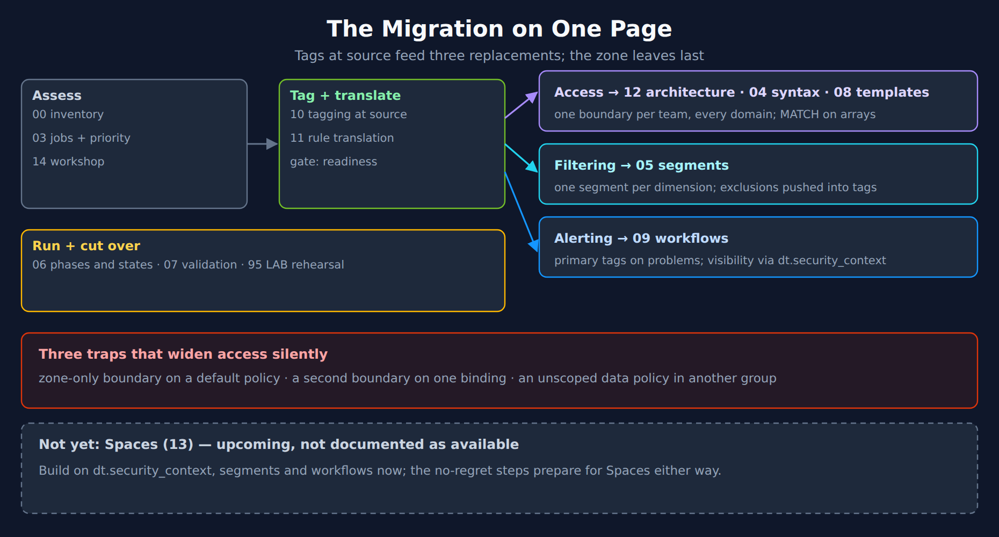

# MZ2POL-99: Best Practice Summary

> **Series:** MZ2POL — Management Zone Migration: Segments, Policies, Workflows | **Notebook:** 99 | **Created:** March 2026 | **Last Updated:** 10/13/2026

## Overview

This notebook consolidates the actionable practices from the whole MZ2POL series — notebooks 00–13, the MZ2POL-14 workshop and the MZ2POL-95 LAB — into one checklist. Each row gives the practice, the concrete setting or value, a priority, and the notebook that explains and sources it.

It was rewritten on 10/13/2026. The previous version recommended practices the series has since corrected: splitting zone and Grail conditions into separate boundaries as a rule, describing boundary lines as always OR-combined, measuring security-context coverage on entities, setting security context with auto-tagging rules, and a fixed 2–4-week parallel run. Those rows are gone; where the correction matters, the row that replaces it says so.

<!-- MARKDOWN_TABLE_ALTERNATIVE
| Stage | Notebooks | Key point |
|---|---|---|
| Assess | 00 inventory, 03 jobs + priority, 14 workshop | Classify zones by job |
| Tag + translate | 10 tagging at source, 11 rule translation | Readiness gate before anything is built |
| Access | 12 architecture, 04 syntax, 08 templates | One boundary per team covering every domain; MATCH on arrays |
| Filtering | 05 segments | One segment per dimension; exclusions pushed into tags |
| Alerting | 09 workflows | Routing tags; visibility via dt.security_context |
| Run + cut over | 06 phases and states, 07 validation, 95 LAB rehearsal | Exit on evidence; delete zones last |
| Traps | Zone-only boundary on a default policy; a second boundary on one binding; an unscoped data policy in another group | All widen access silently |
| Not yet | 13 Spaces | Upcoming, not documented as available |
For environments where SVG doesn't render
-->

**Reading paths** — take the lane for the job your zones do (MZ2POL-01 §6):

| Path | Use it when | Read in this order |
|---|---|---|
| **Filtering only** | Your zones only scope views and dashboards | 00 → 03 → 10 → 11 → 05 → 06 → 07 |
| **Access control** | Your zones restrict who may read what | 00 → 03 → 10 → 11 → 12 → 04 → 08 → 06 → 07 |
| **Alerting** | Your zones scope alerting profiles | 00 → 03 → 10 → 11 → 09 → 06 |
| **Full migration** | Your zones do several of these jobs | 01 → 02 → 00 → 03 → 14 → 10 → 11 → 12 → 04 → 08 → 05 → 09 → 06 → 07 → 95 → 99 |
| **Decision makers** | You need scope, approach and what is not ready yet | 01 → 02 → 13 → 99 |

---

## Table of Contents

1. [Model and Assessment](#model-and-assessment)
2. [Tagging at Source](#tagging-at-source)
3. [Rule Translation](#rule-translation)
4. [Access: Policies and Boundaries](#access)
5. [Settings Access](#settings-access)
6. [Filtering: Segments](#filtering)
7. [Buckets](#buckets)
8. [Alerting](#alerting)
9. [Execution and Cutover](#execution)
10. [Validation and Ongoing Checks](#validation)
11. [Spaces](#spaces)

---

## Prerequisites

| Requirement | Details |
|-------------|---------|
| **Use** | A checklist alongside the series — every row names the notebook that explains and sources it |
| **Status** | Reflects the series as of 10/13/2026, including the corrections in MZ2POL-04, -06 and -12 |

## 1. Model and Assessment

| Practice | Setting / value | Priority | Notebook |
|---|---|---|---|
| Classify every zone by job before anything else | Access (removing it exposes data), filtering (removing it adds noise), alerting (it decides who is paged); a zone can do several | Critical | 03, 05 §1, 14 |
| Delete unused zones instead of converting them | No queries, role assignments, profiles or dashboards in 90 days → archive the export, delete | Critical | 05 §2, 14 |
| Know what does not carry forward | Auto-tagging rules have no effect on Grail data; zones are not supported by any platform feature or Latest app | Critical | 10 §2 |
| Prioritize by risk | P1 security/compliance access · P2 team access and alerting scope · P3 filtering only · P4 unused | Critical | 03 |
| Export rules with the SDK tool | `builtin:management-zones` flattened per rule | Recommended | 00 |
| Inventory dependencies per zone | Role assignments, alerting profiles, dashboards, SLOs, API calls, automation | Critical | 03, 06 |
| Run the disposition workshop with the owners | Six sessions, six tables, stop list | Recommended | 14 |

## 2. Tagging at Source

| Practice | Setting / value | Priority | Notebook |
|---|---|---|---|
| Put the context on the data before building anything | Every replacement reads a field on the record; enrichment is forward-only | Critical | 10 §1, §8 |
| Use built-in fields first | `dt.host_group.id`, `k8s.namespace.name`, `k8s.cluster.name`, cloud account fields — no configuration | Critical | 10 §5 |
| Promote standard tags | Cloud tags, K8s labels, plain host tags live only on Smartscape nodes — promote to `primary_tags.*` or a special field | Critical | 10 §3 |
| Write access dimensions twice, in one step | `primary_tags.team` (filter, route) **and** `dt.security_context` (IAM) from the same source | Critical | 10 §4 |
| Climb the enrichment ladder from the top | Built-in → source (`--set-host-tag`, `DT_TAGS`, K8s annotations, OTel attributes) → central Ingest enrichment configuration (OneAgent 1.343+) → OpenPipeline primary Grail tag rule | Critical | 10 §5 |
| Guard OpenPipeline tag rules | Condition `isNull(primary_tags.<key>)` — rules overwrite existing values by default | Critical | 10 §5 |
| Set routing-critical values at source or centrally | Docs disagree on whether OpenPipeline tag rules run before routing | Recommended | 10 §5 |
| Constrain values | Allowlists for stage, region, classification; Grail compares exactly | Critical | 10 §4 |
| Stay under the tag cap | Fewer than 20 primary tags per host or process — extras are dropped silently | Critical | 10 §8 |
| Move host properties to host tags | From OneAgent 1.345 host `primary_tags` come from host tags | Recommended | 11 §3 |
| Pass the readiness gate | Parity by value, per-zone acceptance, coverage by host group (incl. no-host data), drift, derived-data reach | Critical | 10 §9–§10 |

## 3. Rule Translation

| Practice | Setting / value | Priority | Notebook |
|---|---|---|---|
| Translate rules, not zones | A zone is ORed rules of ANDed conditions; each rule may land elsewhere | Critical | 11 §1 |
| Take the first yes on the decision path | Built-in field → set at source → central rule → OpenPipeline tag rule → explicit membership tag | Critical | 11 §2 |
| Push exclusions into enrichment | `NOT` in the central-rule condition; filter on a positive value | Critical | 11 §5 |
| Compute what no surface can evaluate | Regex, numeric comparisons, IP ranges → a value set at the source | Critical | 11 §4 |
| Replace propagation flags deliberately | Set the value where it is true (host or process); propagation is built in and downward | Recommended | 10 §7 |
| Treat selector zones by purpose | Entity lists → Smartscape queries; data scope → a tag | Recommended | 11 §7 |
| Keep the per-rule worksheet | Zone, rule, step, target, owner, segment, boundary, verified | Critical | 11 §10 |

## 4. Access: Policies and Boundaries

| Practice | Setting / value | Priority | Notebook |
|---|---|---|---|
| Scope Grail data by record fields | Grail does not evaluate zones; `dt.security_context` is the only field every table accepts | Critical | 12 §1 |
| Default policies for "what", boundaries for "where" | Standard / Pro / Admin User + Read Logs, Read Spans, Read Metrics, Read Events, Settings Reader/Writer | Critical | 04 §3, 12 §6 |
| **One boundary covers every domain its policies grant** | `storage:` line, `settings:` line, and `environment:management-zone` while classic pages are used. *Corrects the earlier "never mix, two bindings" rule* — mixing is documented; a missing domain is unscoped | **Critical** | 04 §6, 12 §4 |
| Never attach a zone-only boundary to a default policy | Default policies carry classic and Grail statements; the Grail ones come out unscoped | **Critical** | 12 §4.2 |
| Don't add a second boundary for shared data | Boundaries are computed separately; add the shared value to the same condition | Critical | 12 §4.1, §6 |
| Use `MATCH` on `storage:dt.security_context` | Events hold it as an array; `=`, `IN`, `startsWith` never match arrays | Critical | 12 §6, 08 §2 |
| Repeated lines on one condition multiply (OR) | *Corrects "every line is OR-combined"* — lines on different conditions each scope their own permissions | Recommended | 04 §4–§5 |
| Expect no negation on record fields | Record conditions take `=`, `IN`, `startsWith`, `MATCH`; negation exists only on `storage:bucket-name` | Recommended | 04 §4, 11 §4 |
| Keep team members out of unscoped data groups | One unscoped table permission anywhere wins | Critical | 12 §3 |
| No record-level conditional `DENY` | It runs as an unconditional DENY on the whole table | Critical | 04 §2, 12 §3 |
| Entities scope only by security context | `storage:entities:read` accepts `dt.security_context` and `entity.type` | Recommended | 12 §4.1 |
| Groups by team × role from the IdP | Not one group per zone | Critical | 12 §6 |
| Template when teams are many | `${bindParam:…}` via REST API; bound policies editable only while parameters are unchanged | Recommended | 08 |
| Inventory classic roles that see all zones | `agent-install`, `configure-request-capture-data` | Recommended | 12 §8 |

## 5. Settings Access

| Practice | Setting / value | Priority | Notebook |
|---|---|---|---|
| Replace zone-scoped settings conditions | `environment:management-zone` and MZ-derived security contexts stop matching settings as the Smartscape transition arrives (rolling out) | Critical | 12 §5 |
| Use edge-set security context for settings | `settings:dt.security_context` matches only where the context was set at the source | Critical | 12 §5 |
| Address host groups by name | `settings:scope = "dt.host_group.id:<name>"` or `settings:entity.hostGroup` | Recommended | 12 §5 |
| Fall back to schema scoping | `settings:schemaId` where no edge-set context exists (e.g. process groups) | Recommended | 12 §5 |

## 6. Filtering: Segments

| Practice | Setting / value | Priority | Notebook |
|---|---|---|---|
| Segments are views, never access | Anyone with `storage:filter-segments:read` can apply any segment | Critical | 05 §1, §9 |
| One segment per dimension | Variables from live queries; usually three to eight segments | Critical | 05 §2 |
| Start with `Data (all types)` | Classic-entity includes only for backward compatibility | Recommended | 05 §3 |
| Use only `=` and `in()` | Wildcard `*` inside the value; no exclusions | Critical | 05 §3 |
| Add an events include for problems | `event.kind = "DAVIS_PROBLEM"` AND the condition | Critical | 05 §5.4 |
| Filter derived data on primary fields or tags | Standard tags do not reach service metrics | Critical | 05 §5.2 |
| Validate at entity and signal level | Before creating the segment | Critical | 05 §7 |

## 7. Buckets

| Practice | Setting / value | Priority | Notebook |
|---|---|---|---|
| Grant bucket and table permissions together | `storage:buckets:read` plus the table permission; record conditions on top | Critical | 12 §1 |
| Use buckets for isolation or retention, not for views | Views are segments; bucket design is in ORGNZ-02/03 | Recommended | 02 §4, ORGNZ-03 |
| Route to buckets with values present before routing | Source or central enrichment | Recommended | 10 §5 |

## 8. Alerting

| Practice | Setting / value | Priority | Notebook |
|---|---|---|---|
| Replace zone-scoped profiles with problem-triggered workflows | Trigger filters on affected-entity tags plus an optional DQL matcher; segments do not scope alerting | Critical | 09 §2 |
| Tag entities before building workflows | Routing tags at full coverage | Critical | 09 §4 |
| Map delay to Minimum duration | Fixed values; decide rounding per profile | Recommended | 09 §6.1 |
| Keep visibility on `dt.security_context` | With `MATCH` — problem records hold it as an array | Critical | 09 §7 |
| Prove parity, disable, soak, then delete zones | Disable and delete in separate change windows | Critical | 09 §8 |
| Test zone deletion on a profile in non-prod | Fail-open vs fail-closed is undocumented | Critical | 09 §8 |

## 9. Execution and Cutover

| Practice | Setting / value | Priority | Notebook |
|---|---|---|---|
| Follow the phase order with gates | Assess → tag + translate (gate) → access / filtering / alerting → parallel run → cutover → cleanup | Critical | 06 §1 |
| Move each team through four states | Today → dual boundary → verified → zone line removed | Critical | 06 §6, 12 §9 |
| Check "today" first | A zone-only boundary on a default policy may already grant all Grail data | Critical | 12 §9 |
| Exit states on evidence, not on a calendar | Tag gate, effective permissions, alert parity. *Replaces the fixed "2–4 weeks"* | Critical | 06 §6 |
| Pilot every boundary change on one group | Boundary edits apply immediately to every binding | Critical | 12 §9 |
| Rehearse on the LAB estate | Steps 1–8 | Recommended | 95 |
| Keep a rollback line per batch | Re-add the zone line; re-enable the profile | Critical | 06 §9 |
| Delete zones last, in their own window | After profiles are disabled and dashboards repointed | Critical | 06 §8, 09 §8 |

## 10. Validation and Ongoing Checks

| Practice | Setting / value | Priority | Notebook |
|---|---|---|---|
| Measure security context on **records**, not entities | Per table: logs, spans, events. *Replaces entity coverage* — entity contexts can be copied from zone names and read 100% while data reads far less | **Critical** | 06 §3, 12 §10 |
| Check the type per table | Any `array` row needs `MATCH` | Critical | 12 §10 |
| Compare zone and tag per zone on data | The acceptance test: match / in zone, tag missing / tagged, not in zone | Critical | 10 §9, 06 §10 |
| Resolve effective permissions per persona | Account API, one pilot user each; no `storage:*:read` without a condition | Critical | 12 §10 |
| Test as a pilot user, never an admin | Admin grants hide boundary problems | Critical | 07 §5 |
| Re-run drift and coverage on a schedule | New producers arrive unenriched | Recommended | 10 §9 |

## 11. Spaces

| Practice | Setting / value | Priority | Notebook |
|---|---|---|---|
| Do not design access around Spaces yet | `dt.space` is an `experimental` dictionary entry; no docs page, IAM condition or release entry as of 10/13/2026 | Critical | 13 §1–§2 |
| Do not keep zones waiting for Spaces | Zones are not evaluated for Grail data | Recommended | 13 §4 |
| Prepare with no-regret steps | Team values at source, one boundary per team, segments per dimension, ownership tags, inventory of delegated responsibility | Recommended | 13 §4 |
| Re-check each platform release | Dictionary query with a control row | Optional | 13 §5 |

---

*This notebook was AI-generated from community-submitted and publicly available sources. This notebook series is not officially supported by Dynatrace. Always verify information against official Dynatrace documentation.*
