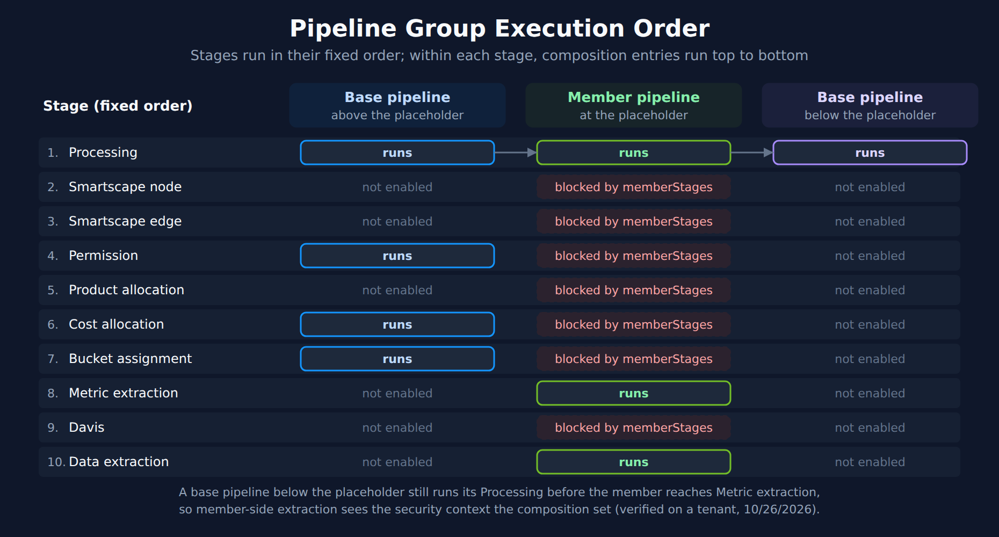

# OPIPE-07: Pipeline Group Governance Patterns

> **Series:** OPIPE — OpenPipeline Beyond Logs | **Notebook:** 7 of 7 | **Created:** October 2026 | **Last Updated:** 10/26/2026

## Central Control, Team Autonomy

A pipeline group lets a central team enforce stages — permissions, cost and product allocation, bucket assignment, masking — on many pipelines that other teams own. **OPIPE-01** covers *when* a group is the right tool. This notebook covers *how to run one*: who owns which object, which stages to mandate or hand to teams, how the composition executes, what to budget for, how to gate changes, and how to verify that data really flows through the group.

Every behavior below that goes beyond the documentation was reproduced on a SaaS tenant on 10/26/2026 with throwaway pipelines in the logs scope. Where a recommendation is practitioner experience rather than documented behavior, the text says so.

---

## Table of Contents

1. [What a Pipeline Group Is](#what-a-pipeline-group-is)
2. [Ownership Model](#ownership-model)
3. [Stage Allocation Tiers](#stage-allocation-tiers)
4. [Stage Overlap and memberStages](#stage-overlap-and-memberstages)
5. [Composition Layout and Execution Order](#composition-layout-and-execution-order)
6. [Grouping Topologies](#grouping-topologies)
7. [Routing Into a Group](#routing-into-a-group)
8. [Capacity Budgeting](#capacity-budgeting)
9. [Extending Ready-Made Extension Pipelines](#extending-ready-made-extension-pipelines)
10. [Risks of Member-Side Extraction](#risks-of-member-side-extraction)
11. [Enablement and Automated Gating](#enablement-and-automated-gating)
12. [Verification and Monitoring](#verification-and-monitoring)
13. [Anti-Patterns](#anti-patterns)
14. [Configuration-as-Code Example](#configuration-as-code-example)
15. [Summary](#summary)
16. [References](#references)

---

## Prerequisites

| Requirement | Details |
|-------------|---------|
| **Dynatrace Environment** | SaaS with Grail and OpenPipeline |
| **Permissions** | `settings:objects:read` and `settings:objects:write` for `builtin:openpipeline.<scope>.pipelines`, `.pipeline-groups` and `.routing`; `storage:logs:read` and `storage:system:read` for the verification queries |
| **Recommended** | **OPIPE-01** (stages, matching conditions vs. pipelines vs. groups) and **OPIPE-04** (cardinality) |

<a id="what-a-pipeline-group-is"></a>
## 1. What a Pipeline Group Is

A pipeline group binds three things together inside one configuration scope (logs, spans, events, and so on):

| Part | What it is | Who owns it |
|------|-----------|-------------|
| **Base pipelines** | Pipelines with the `basePipeline` role. They carry the shared processing. | Administrators |
| **Composition** | The ordered list of base pipelines plus one **member pipeline placeholder**, and the stages each base pipeline runs | Administrators |
| **Member pipelines** | Pipelines with the `memberPipeline` role that hold team-specific processing, limited to the stages the group allows (`memberStages`) | Development teams |

Facts that shape every design decision:

- **A member pipeline belongs to one group; a base pipeline can serve several.** The concepts page says *"A pipeline belongs to only one pipeline group at a time."* The multi-cloud tutorial, though, builds one global base pipeline that *"will be used by both groups (AWS pipelines and Azure pipelines) to assign buckets and dt.cost.cost_center"*. The two agree once you read the group schema: it enforces uniqueness on `memberPipelines` across groups, and nothing on the base pipelines in a composition. On a tenant (10/26/2026), a second group reusing a base pipeline saved, and a second group listing an existing member was rejected with *"[memberPipelines] must be unique"*.
- **Groups can't be nested.** In the docs' words, *"Pipeline groups can't be nested."*
- **The role is fixed at creation.** The limits page says *"The pipeline role is permanent."* An attempt to change a member pipeline to `basePipeline` was rejected (10/26/2026). Decide the role before you create the pipeline.
- **A base pipeline does nothing on its own.** It *"Can exist standalone but is inactive unless part of a pipeline group."*
- **`compositionPipeline` is the old name for `basePipeline`.** The pipelines schema (version 1.77, read 10/26/2026) lists both values and marks `compositionPipeline` as deprecated. Exports and older examples, including the Terraform provider's own example, still use it. Use `basePipeline` in new configuration.

> <sub>**Sources:** [OpenPipeline pipeline groups (DT docs)](https://docs.dynatrace.com/docs/platform/openpipeline/concepts/pipeline-groups), [Configure multi-cloud ingest governance with pipeline groups (DT docs)](https://docs.dynatrace.com/docs/platform/openpipeline/use-cases/pipeline-groups-multicloud), [OpenPipeline limits (DT docs)](https://docs.dynatrace.com/docs/platform/openpipeline/reference/limits). Schema constraints and the rejected requests were read and reproduced on a tenant on 10/26/2026 (`builtin:openpipeline.logs.pipeline-groups`, `builtin:openpipeline.logs.pipelines`, schema version 1.77).</sub>

<a id="ownership-model"></a>
## 2. Ownership Model

The docs split ownership in two: *"Administrators own and manage the group, as well as its compositions"*, while *"Development teams own their member pipelines which operate within the group's boundaries."* The multi-cloud tutorial adds a middle layer — a mid-level team that owns cloud-specific processing and the security-context pipelines — which is the model most large estates end up with.

| Object | Platform admins | Domain / mid-level team | Development team |
|--------|-----------------|-------------------------|------------------|
| Pipeline group and composition | **Owns** | Consulted | Informed |
| Member assignment (`memberPipelines`) | **Owns** — *"Only administrators can manage member pipeline assignment to a group."* | Consulted | Requests |
| Global base pipeline (bucket, cost center) | **Owns** | Informed | Informed |
| Domain base pipelines (processing, permission, product allocation) | Approves | **Owns** | Consulted |
| Member pipeline | Approves when gating fails | Consulted | **Owns** |
| Routing table | **Owns** (see §7) | Consulted | Requests |

How the access control works underneath:

- **Pipelines and groups are owned objects.** Both settings schemas use owner-based access control (read 10/26/2026), so a team can be given its own member pipeline without being able to edit the composition. The processing page puts it this way: *"By adding custom pipelines per team, you can manage them via owner-based access control."*
- **The routing table is not.** The access-control page says *"Owner-based control is available for pipelines and ingest sources, and not routing."* Each scope has a single routing object (`builtin:openpipeline.<scope>.routing`), so a write permission on a scope's schemas covers every route in it — the page's own example warns that such a policy *"gives users write permissions to all routes for a configuration scope and should therefore be used with caution."* A team that can edit routes can point another team's traffic at its own pipeline. Keep route edits with the platform team.
- **API scopes.** The tutorial lists *"settings:objects:read and settings:objects:write with builtin:openpipeline.<configuration-scope>.pipeline-groups scope"* for group management. The same pair on `.pipelines` and `.routing` covers the rest.

> <sub>**Sources:**</sub>
> - <sub>[OpenPipeline pipeline groups (DT docs)](https://docs.dynatrace.com/docs/platform/openpipeline/concepts/pipeline-groups)</sub>
> - <sub>[Configure multi-cloud ingest governance with pipeline groups (DT docs)](https://docs.dynatrace.com/docs/platform/openpipeline/use-cases/pipeline-groups-multicloud)</sub>
> - <sub>[Processing in OpenPipeline (DT docs)](https://docs.dynatrace.com/docs/platform/openpipeline/concepts/processing)</sub>
> - <sub>[Owner-based access control in OpenPipeline (DT docs)](https://docs.dynatrace.com/docs/platform/openpipeline/concepts/access-control)</sub>
> - <sub>Owner-based access control on the pipeline and pipeline-group schemas, and the single routing object, were read from the settings schemas on 10/26/2026.</sub>

<a id="stage-allocation-tiers"></a>
## 3. Stage Allocation Tiers

The group decides which stages a member pipeline may run. The stage identifiers the API and Terraform accept (group schema version 1.77, read 10/26/2026) are:

| Stage (UI) | API / Terraform value |
|------------|-----------------------|
| Processing | `processing` |
| Smartscape node | `smartscapeNodeExtraction` |
| Smartscape edge | `smartscapeEdgeExtraction` |
| Permission | `securityContext` |
| Product allocation | `productAllocation` |
| Cost allocation | `costAllocation` |
| Bucket assignment | `storage` |
| Metric extraction | `metricExtraction` |
| Davis | `davis` |
| Data extraction | `dataExtraction` |

The schema also lists a `security` stage value that the processing page's stage table does not describe; leave it out of policy until it is documented.

**Which tier each stage belongs in is a design decision, not documented behavior.** The Dynatrace multi-cloud example gives members only `processing`. In community practice, the following split is a common starting point — adapt it to your teams:

| Tier | Stages | Why |
|------|--------|-----|
| **Always central** | Permission (`securityContext`), Cost allocation, Product allocation, Bucket assignment (`storage`) | These decide who can see the data, who pays for it, and how long it is kept. A team that can set them can widen its own access or move cost elsewhere. |
| **Member by default** | Processing, Metric extraction, Data extraction (business and SDLC events) | Domain knowledge lives with the team; the risks (§10) are manageable with naming and cardinality gates (§11). |
| **Judgment call** | Davis, Smartscape node/edge, and Bucket assignment for a team with a real retention need | Davis events open problems for everyone who watches the environment; Smartscape extraction creates topology others rely on. Grant them to teams that have shown they can tune them. |

Teams can still add their own stages after the mandated ones — *"Teams can add optional stages after mandated ones, but can't override restricted stages."*

> <sub>**Sources:** [OpenPipeline pipeline groups (DT docs)](https://docs.dynatrace.com/docs/platform/openpipeline/concepts/pipeline-groups), [Configure multi-cloud ingest governance with pipeline groups (DT docs)](https://docs.dynatrace.com/docs/platform/openpipeline/use-cases/pipeline-groups-multicloud). Stage values read from `builtin:openpipeline.logs.pipeline-groups` (version 1.77) on 10/26/2026.</sub>

<a id="stage-overlap-and-memberstages"></a>
## 4. Stage Overlap and memberStages

**Stages are not exclusive.** If a base pipeline and a member pipeline both enable the same stage, both run: *"When a base pipeline and a member pipeline both have the same stage enabled, both run—stages are not mutually exclusive."* Mandating a stage in a base pipeline does **not** stop a member from also running it. To stop the member, exclude the stage in the group's `memberStages`.

`memberStages` takes one of three forms (group schema, read 10/26/2026):

| `type` | Meaning | Example |
|--------|---------|---------|
| `includeAll` | Members may run every stage | `{"type": "includeAll"}` |
| `include` | Members may run only the listed stages | `{"type": "include", "include": ["processing", "metricExtraction"]}` |
| `exclude` | Members may run everything except the listed stages | `{"type": "exclude", "exclude": ["securityContext", "storage"]}` |

Two details that catch people out:

- **"No stages" is a UI state, not an API payload.** The docs say that with *Enable all stages* off, *"If off and no stages are selected, member stages are blocked."* Through the API, an empty `include` list is rejected — the list needs at least one entry (reproduced 10/26/2026). In configuration as code, block members with an `include` list of the stages you do allow, or an `exclude` list of the ones you don't.
- **Prefer `include` over `exclude` for the central stages.** With `exclude`, a stage added to the platform later is open to members until someone notices. With `include`, it is closed until someone opens it. This is a recommendation, not documented behavior.

**Verified on a tenant (10/26/2026).** A member pipeline set its own security context while the group's `memberStages` allowed only `processing` and `metricExtraction`. Every stored record carried the value set by the base pipeline, not the member's.

> <sub>**Sources:** [OpenPipeline pipeline groups (DT docs)](https://docs.dynatrace.com/docs/platform/openpipeline/concepts/pipeline-groups).</sub>

<a id="composition-layout-and-execution-order"></a>
## 5. Composition Layout and Execution Order

The composition is an ordered list. The docs: *"Base pipelines above the placeholder run before the member pipeline; those below run after."* What "before" and "after" mean is easy to misread, so it was tested.



<!-- MARKDOWN_TABLE_ALTERNATIVE
| Stage (fixed order) | Base pipeline above the placeholder | Member pipeline | Base pipeline below the placeholder |
|---|---|---|---|
| 1. Processing | runs | runs | runs |
| 2. Smartscape node | not enabled | blocked by memberStages | not enabled |
| 3. Smartscape edge | not enabled | blocked by memberStages | not enabled |
| 4. Permission | runs | blocked by memberStages | not enabled |
| 5. Product allocation | not enabled | blocked by memberStages | not enabled |
| 6. Cost allocation | runs | blocked by memberStages | not enabled |
| 7. Bucket assignment | runs | blocked by memberStages | not enabled |
| 8. Metric extraction | not enabled | runs | not enabled |
| 9. Davis | not enabled | blocked by memberStages | not enabled |
| 10. Data extraction | not enabled | runs | not enabled |
Stages run in their fixed order; within each stage, composition entries run top to bottom. A base pipeline below the placeholder still runs its Processing before the member reaches Metric extraction, so member-side extraction sees the security context the composition set (verified on a tenant, 10/26/2026).
-->

**What the test showed (10/26/2026).** Three pipelines each appended one letter to the same field in their Processing stage: `A` (base, above the placeholder), `M` (member), `B` (base, below). The member also extracted a counter metric split by that field and by `dt.security_context`. Stored records carried `AMB`, and so did the member's metric. So the member's Metric extraction stage already saw the change from the base pipeline *below* the placeholder, and it saw the security context set by the base pipeline above.

The stage sequence is fixed — *"The sequence of stages is fixed for all pipelines and cannot be modified."* Within a group, composition position orders the pipelines **inside each stage**. "Below the placeholder" therefore means *after the member within each stage*, not *after the whole member pipeline*. Two consequences:

- **A base pipeline below the placeholder can override member Processing**, and its result is what member extraction sees. Put normalization that must win (schema enforcement, field clean-up) below the placeholder.
- **Central Permission, Cost allocation, Product allocation and Bucket assignment run before any extraction stage**, wherever their base pipeline sits, because those stages come earlier in the fixed sequence. Member-extracted metrics and events see the central values. This was tested for the security context; cost and bucket follow from the same stage order.

**Reference layout** (community practice — adjust to your stages):

| Position | Base pipeline | Stages it runs | Owner |
|----------|---------------|----------------|-------|
| 1 (above) | Masking and security context | `processing` (masking processors only), `securityContext` | Platform |
| 2 (above) | Domain processing | `processing`, and any extraction the domain team owns | Domain team |
| 3 (above) | Cost, product and bucket | `costAllocation`, `productAllocation`, `storage` | Platform |
| 4 | **Member placeholder** | per `memberStages` | Dev teams |
| 5 (below) | Normalization that must win | `processing` | Platform or domain team |

Masking goes in position 1 so no member processor ever sees the raw value — **OPMIG-08** covers masking order. The masking pipeline only protects downstream processors; routing still sees the raw record (§7).

> <sub>**Sources:** [OpenPipeline pipeline groups (DT docs)](https://docs.dynatrace.com/docs/platform/openpipeline/concepts/pipeline-groups), [Processing in OpenPipeline (DT docs)](https://docs.dynatrace.com/docs/platform/openpipeline/concepts/processing). **Derived:** the stage-by-stage reading of composition order combines the fixed stage sequence with the tenant test above.</sub>

<a id="grouping-topologies"></a>
## 6. Grouping Topologies

Pick one grouping axis per scope and keep it. Common choices, in community practice:

| Axis | Group per… | Works well when |
|------|-----------|-----------------|
| Cloud provider | AWS, Azure, GCP, on-premises | Cost and access split by provider — the Dynatrace multi-cloud example |
| Business unit | BU or product line | Each BU has its own security context and cost center |
| Data domain | Payments, identity, logistics | Domain teams own processing; one platform team owns access |
| Environment | prod / non-prod | Retention and access differ sharply between environments |

Constraints that limit the design:

- A member pipeline is in **one** group, and groups can't be nested (§1). A record cannot be governed by a BU group *and* an environment group. Use one axis for groups and handle the other with conditions inside the base pipelines — for example, a bucket-assignment processor that matches on `deployment.release_stage`.
- A base pipeline **can** serve several groups (§1), so a global pipeline (bucket, cost center) is written once and listed in every group's composition.
- Every group counts against the scope's limits (§8).

<a id="routing-into-a-group"></a>
## 7. Routing Into a Group

Data enters a group only through a route to one of its **member** pipelines:

- **Base pipelines are not routable.** The docs: *"base pipelines are typically not routable"*, with standalone ready-made extension pipelines as the exception. A route pointing at a custom base pipeline was rejected by the API on 10/26/2026.
- **First match wins.** *"Each record is routed to and processed by only one member pipeline, according to the first matching route."* Order routes from specific to general, and keep conditions mutually exclusive.
- **Watch the default route.** Records that match no route skip the group entirely — no central permission, cost or bucket. The query in §12 shows how much traffic lands there.
- **Routing sees raw data.** Routing runs before any pipeline processor, so masking in a base pipeline does not protect a route condition. Keep PII out of route matchers (**OPMIG-08**).
- **The platform team owns the routing table** (§2). Routing has no owner-based access control, so a team that can edit a route can capture another team's traffic.

> <sub>**Sources:** [OpenPipeline pipeline groups (DT docs)](https://docs.dynatrace.com/docs/platform/openpipeline/concepts/pipeline-groups), [Configure multi-cloud ingest governance with pipeline groups (DT docs)](https://docs.dynatrace.com/docs/platform/openpipeline/use-cases/pipeline-groups-multicloud), [Owner-based access control in OpenPipeline (DT docs)](https://docs.dynatrace.com/docs/platform/openpipeline/concepts/access-control).</sub>

<a id="capacity-budgeting"></a>
## 8. Capacity Budgeting

| Limit | Value | Applies to |
|-------|-------|-----------|
| Pipeline groups | 100 | per configuration scope |
| Pipelines (all types, including base and member) | 100 | per configuration scope |
| Pipeline slots | 10 | per group |
| Member pipelines | 1,000 | per group |
| Processors in a base pipeline | 100 | per base pipeline (1,000 in other pipelines) |
| Pipelines a record can be extracted in | 5 | per record (`dt.openpipeline.pipelines`) |

What to plan for:

- **Base pipelines are small.** At 100 processors each, keep each base pipeline to one job (masking, permission, cost and bucket) rather than one large shared pipeline.
- **Base and member pipelines share the 100-pipeline budget of the scope.** Thirty teams with one member pipeline each, plus five base pipelines, use 35 of 100.
- **The extraction limit.** *"You can extract data on a single record in a maximum of five different pipelines"*, and past that *"The record continues to be processed and persisted."* — without further extraction. On a tenant (10/26/2026) a record processed by two base pipelines and one member carried **one** entry in `dt.openpipeline.pipelines`: `logs:<member>(<group name>)`. The docs do not say whether extraction inside base pipelines draws on the limit separately. Until they do, treat each pipeline that extracts from the same record — base or member — as using one of the five, and recheck with the §12 query.

**Worked example.** A logs group has a global base pipeline (cost, bucket), a security base pipeline (masking, permission) and a domain base pipeline that extracts two metrics and a business event. The domain team's member pipeline also extracts metrics. Counted conservatively, two pipelines extract from each record — domain base and member — which leaves three of five for downstream re-ingestion chains, such as a business event that is extracted again in its own scope. Add a base pipeline that extracts and you are at three.

> <sub>**Sources:** [OpenPipeline limits (DT docs)](https://docs.dynatrace.com/docs/platform/openpipeline/reference/limits).</sub>

<a id="extending-ready-made-extension-pipelines"></a>
## 9. Extending Ready-Made Extension Pipelines

Ready-made pipelines that extensions install are view-only — you cannot edit their processors. A group lets you add to them: one documented use case is to *"Extend an immutable extension pipeline by adding a base pipeline to the group that applies custom processing"*, for example to drop records the extension would keep.

The docs allow a ready-made pipeline in either role — base or member — and a standalone ready-made base pipeline stays routable, while one inside a group does not. They do not give a worked composition for this case, and it was not tested for this notebook. Before relying on it, confirm on a non-production tenant that your added processing runs where you expect: §5's stage-by-stage order means a base pipeline's Processing runs before every pipeline's extraction stages, whatever its position.

> <sub>**Sources:** [OpenPipeline pipeline groups (DT docs)](https://docs.dynatrace.com/docs/platform/openpipeline/concepts/pipeline-groups), [Processing in OpenPipeline (DT docs)](https://docs.dynatrace.com/docs/platform/openpipeline/concepts/processing).</sub>

<a id="risks-of-member-side-extraction"></a>
## 10. Risks of Member-Side Extraction

Handing Metric extraction, Davis or Data extraction to teams moves three risks out of the platform team's view:

| Risk | What happens | Control |
|------|--------------|---------|
| **Cardinality** | A team adds `k8s.pod.name` or a request ID as a metric dimension; storage and query cost grow with every pod | Dimension allow-list and the cardinality budget from **OPIPE-04** |
| **Metric-key collisions** | Two teams both extract `log.error_count` with different meanings | Prefix keys with the team or domain (`log.payments.error_count`) — a naming convention, enforced in CI (§11) |
| **Davis noise and attribution** | Davis events open problems for everyone; an event without a real `dt.smartscape_source.id` lands on the environment entity and merges with unrelated events | Allow the Davis stage only for teams that set `dt.smartscape_source.id` — **OPLOGS-03** covers the prerequisite |

None of these is stopped by `memberStages` alone, which is all-or-nothing per stage for the whole group. The finer control is a pipeline check (§11).

<a id="enablement-and-automated-gating"></a>
## 11. Enablement and Automated Gating

**Train before you assign.** Only administrators can assign a member pipeline to a group (§2), which gives you a natural gate: make completing onboarding — naming conventions, allowed stages, cardinality rules, routing rules — the condition for assignment.

**Gate member changes in CI.** When pipelines live in configuration as code, these checks catch most problems before they reach the tenant. They are community practice, not product features:

| Check | Fails when |
|-------|-----------|
| Metric key prefix | A `counterMetric` / `valueMetric` key does not start with the team's prefix |
| Davis allow-list | A `davis` processor appears in a pipeline whose team is not on the allow-list |
| Dimension deny-list | A metric dimension is a known high-cardinality field (`k8s.pod.name`, `trace.id`, request or session IDs) |
| Processor count | A member pipeline nears 1,000 processors, or a base pipeline nears 100 |
| Extraction count | More than five pipelines on one data path extract (§8) |
| Route scope | A route matcher references fields outside the team's own sources, or a PII field |
| Role and routing | A new pipeline lacks an explicit `groupRole` and `routing` — both are permanent (§1) |

**Roll the checks out gradually.** Start every rule as a warning, then switch it to a failure once the existing pipelines pass — the same warn-then-deny approach as the policy-as-code gates in **AUTOM-07**. Before deploying, run the payload through the Settings API with `validateOnly=true` (**AUTOM-02**); the server applies the full validation, including the group uniqueness and minimum-size constraints shown in §1 and §4.

**Why CI rather than another group.** `memberStages` applies to every member of a group. Allowing Davis for two teams but not the other twenty would otherwise mean a separate group for those two. A CI rule keyed on the team is the finer control.

<a id="verification-and-monitoring"></a>
## 12. Verification and Monitoring

`dt.openpipeline.pipelines` records the path a record took. A record processed by a group carries `<scope>:<member custom ID>(<group name>)` — for example `logs:payments-member(Payments group)`. Records on the default route carry `logs:default`.

**Which pipelines and groups carry your data:**

```dql
// Records per pipeline path; group members show as "<scope>:<member>(<group>)"
fetch logs, from:-15m
| summarize {records = count()}, by:{dt.openpipeline.pipelines}
| sort records desc
| limit 20
```

**How much traffic skips every group** — records on the default route get none of the central stages:

```dql
// Share of records on the default route (no group, no central stages)
fetch logs, from:-15m
| summarize {total = count(),
    on_default = countIf(iAny(dt.openpipeline.pipelines[] == "logs:default"))}
| fieldsAdd pct_on_default = round(100.0 * toDouble(on_default) / toDouble(total), decimals: 1)
```

**Whether the mandated Permission stage actually applied** — any group path with records that lack a security context points at a composition that does not cover them:

```dql
// Records without a security context, per pipeline path
fetch logs, from:-15m
| summarize {records = count(),
    without_context = countIf(isNull(dt.security_context))},
    by:{dt.openpipeline.pipelines}
| fieldsAdd pct_without_context = round(100.0 * toDouble(without_context) / toDouble(records), decimals: 1)
| sort without_context desc
| limit 20
```

**Who changed configuration.** Settings writes appear as audit events. Updates and deletes name the object ID in `resource`; match it against the object IDs of your groups and base pipelines (from your configuration-as-code state). New objects are created by a `POST` to the collection, so the `resource` of a create does not name the object.

```dql
// Updates and deletions of settings objects in the last 7 days
fetch dt.system.events, from:-7d
| filter event.kind == "AUDIT_EVENT" and in(event.type, {"PUT", "DELETE"})
| filter contains(resource, "settings/objects/")
| fields timestamp, event.type, event.outcome, user.id, resource
| sort timestamp desc
| limit 50
```

All four queries were executed on a SaaS tenant on 10/26/2026. Change the scope prefix (`logs:`) and the data object for other configuration scopes.

<a id="anti-patterns"></a>
## 13. Anti-Patterns

| Anti-pattern | Problem | Instead |
|--------------|---------|---------|
| One group for everything | Every team gets the same `memberStages`; the composition becomes a shared bottleneck | One group per axis value (§6) |
| Security context, masking or bucket assignment left to member pipelines | A team can widen its own access, unmask data or change retention | Mandate them in base pipelines and exclude them from `memberStages` (§3–4) |
| Mandating a stage but not excluding it | Both the base and member versions run (§4) | Exclude the stage in `memberStages` |
| Extraction stages without naming and cardinality rules | Metric-key collisions and cost growth (§10) | CI checks (§11) |
| A group where a matching condition would do | Extra pipelines and slots for a difference one processor could express | Matching conditions inside one pipeline — **OPIPE-01** |
| Base pipelines near 100 processors | No headroom; one change hits the limit | One job per base pipeline (§8) |
| Editing groups in the UI JSON view | The JSON view is read-only — *"You can copy the JSON from there, but not edit it directly."* | Edit in the UI forms, or manage the objects as code (§14) |
| Development teams with write access to routing | One routing object per scope — a team can redirect another team's traffic (§2) | Platform team owns routes |

> <sub>**Sources:** [OpenPipeline pipeline groups (DT docs)](https://docs.dynatrace.com/docs/platform/openpipeline/concepts/pipeline-groups).</sub>

<a id="configuration-as-code-example"></a>
## 14. Configuration-as-Code Example

The Settings API and the Terraform provider manage the same three object types. The payloads below are the shapes that were created on a tenant on 10/26/2026, renamed for readability. Create base and member pipelines first, then the group (it references their object IDs), then the route.

**Base pipeline** — `POST /api/v2/settings/objects`, schema `builtin:openpipeline.logs.pipelines`:

```json
{
  "schemaId": "builtin:openpipeline.logs.pipelines",
  "scope": "environment",
  "value": {
    "customId": "platform-security-context",
    "displayName": "Platform - security context",
    "groupRole": "basePipeline",
    "routing": "notRoutable",
    "securityContext": {
      "processors": [{
        "type": "securityContext",
        "id": "set-security-context",
        "description": "Central security context",
        "enabled": true,
        "matcher": "true",
        "securityContext": {"value": {"type": "constant", "constant": "payments"}}
      }]
    }
  }
}
```

**Member pipeline** — same schema; note `memberPipeline` and `routable`:

```json
{
  "schemaId": "builtin:openpipeline.logs.pipelines",
  "scope": "environment",
  "value": {
    "customId": "payments-checkout",
    "displayName": "Payments - checkout",
    "groupRole": "memberPipeline",
    "routing": "routable",
    "processing": {
      "processors": [{
        "type": "dql",
        "id": "parse-checkout",
        "description": "Parse order ID",
        "enabled": true,
        "matcher": "true",
        "dql": {"script": "parse content, \"LD 'order=' LD:order.id\""}
      }]
    },
    "metricExtraction": {
      "processors": [{
        "type": "counterMetric",
        "id": "checkout-errors",
        "description": "Checkout errors",
        "enabled": true,
        "matcher": "matchesValue(status, \"ERROR\")",
        "counterMetric": {
          "metricKey": "log.payments.checkout_errors",
          "dimensions": [{"extractionType": "field", "sourceFieldName": "service.name"}]
        }
      }]
    }
  }
}
```

**Pipeline group** — schema `builtin:openpipeline.logs.pipeline-groups`:

```json
{
  "schemaId": "builtin:openpipeline.logs.pipeline-groups",
  "scope": "environment",
  "value": {
    "displayName": "Payments group",
    "memberPipelines": ["<payments-checkout-object-id>"],
    "memberStages": {"type": "include", "include": ["processing", "metricExtraction"]},
    "composition": [
      {"isPipelinePlaceholder": false, "pipelineId": "<platform-security-context-object-id>",
        "stages": {"type": "include", "include": ["securityContext"]}},
      {"isPipelinePlaceholder": true}
    ]
  }
}
```

**Route** — add an entry to the scope's single routing object (`builtin:openpipeline.logs.routing`) that points at the **member** pipeline. Because the routing object holds every route, read it, insert the entry and write the whole list back; never write a list that drops existing entries.

```json
{
  "enabled": true,
  "pipelineType": "custom",
  "pipelineId": "<payments-checkout-object-id>",
  "matcher": "matchesValue(k8s.namespace.name, \"payments\")",
  "description": "Payments namespace to the payments member pipeline"
}
```

**Terraform.** The provider has one group resource per scope — `dynatrace_openpipeline_v2_logs_pipelinegroups`, `..._spans_pipelinegroups`, and so on — alongside the `..._pipelines` and `..._routing` resources:

```hcl
resource "dynatrace_openpipeline_v2_logs_pipelinegroups" "payments" {
  display_name = "Payments group"
  composition {
    pipeline_group_composition {
      is_pipeline_placeholder = false
      pipeline_id             = dynatrace_openpipeline_v2_logs_pipelines.platform_security_context.id
      stages {
        type    = "include"
        include = ["securityContext"]
      }
    }
    pipeline_group_composition {
      is_pipeline_placeholder = true
    }
  }
  member_stages {
    type    = "include"
    include = ["processing", "metricExtraction"]
  }
  member_pipelines = [dynatrace_openpipeline_v2_logs_pipelines.payments_checkout.id]
}
```

The provider's own example sets `group_role = "compositionPipeline"` on the base pipeline; use `basePipeline` (§1). The provider page recommends platform credentials, because they set an owner on the created object — **AUTOM-04** covers provider authentication.

> <sub>**Sources:** [OpenPipeline pipeline groups (DT docs)](https://docs.dynatrace.com/docs/platform/openpipeline/concepts/pipeline-groups), [Configure multi-cloud ingest governance with pipeline groups (DT docs)](https://docs.dynatrace.com/docs/platform/openpipeline/use-cases/pipeline-groups-multicloud), [dynatrace_openpipeline_v2_logs_pipelinegroups (Terraform Registry)](https://registry.terraform.io/providers/dynatrace-oss/dynatrace/latest/docs/resources/openpipeline_v2_logs_pipelinegroups).</sub>

---

<a id="summary"></a>
## 15. Summary

- **A member pipeline belongs to one group; a base pipeline can serve several.** Roles are permanent, and groups don't nest.
- **Mandating a stage does not stop members from running it.** Exclude it in `memberStages`; via the API, an empty `include` list is rejected.
- **Composition order applies within each stage.** A base pipeline below the placeholder still runs before member extraction, and member-extracted data sees the central security context.
- **Routes go to member pipelines only, and the routing table is one shared object** — keep it with the platform team and watch the default route.
- **Budget the limits:** 100 processors per base pipeline, 10 slots per group, 100 pipelines per scope, five extracting pipelines per record.
- **`memberStages` is coarse; CI gating is fine-grained.** Train teams before assigning them, and roll out checks warn-first.

---

## Next Steps

- **OPIPE-01** — deciding between matching conditions, pipelines and groups
- **OPIPE-04** — the cardinality budget behind member-side metric extraction
- **OPMIG-05** and **OPMIG-08** — routing, buckets, and masking order
- **AUTOM-04** and **AUTOM-07** — managing the objects as code and gating changes in CI

---

<a id="references"></a>
## 16. References

- [OpenPipeline pipeline groups (DT docs)](https://docs.dynatrace.com/docs/platform/openpipeline/concepts/pipeline-groups)
- [Configure multi-cloud ingest governance with pipeline groups (DT docs)](https://docs.dynatrace.com/docs/platform/openpipeline/use-cases/pipeline-groups-multicloud)
- [OpenPipeline limits (DT docs)](https://docs.dynatrace.com/docs/platform/openpipeline/reference/limits)
- [Processing in OpenPipeline (DT docs)](https://docs.dynatrace.com/docs/platform/openpipeline/concepts/processing)
- [Owner-based access control in OpenPipeline (DT docs)](https://docs.dynatrace.com/docs/platform/openpipeline/concepts/access-control)
- [dynatrace_openpipeline_v2_logs_pipelinegroups (Terraform Registry)](https://registry.terraform.io/providers/dynatrace-oss/dynatrace/latest/docs/resources/openpipeline_v2_logs_pipelinegroups)

---

<sub>*This notebook was AI-generated from community-submitted and publicly available sources. This notebook series is not officially supported by Dynatrace. Always verify information against official Dynatrace documentation.*</sub>
