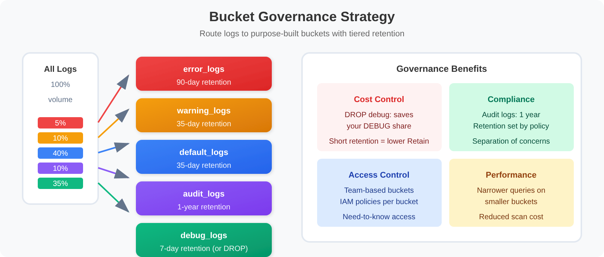

# OPLOGS-04: Buckets & Data Governance

> **Series:** OPLOGS — OpenPipeline Logs | **Notebook:** 4 of 8 | **Created:** December 2025 | **Last Updated:** 10/23/2026

## Strategic Storage Management for OpenPipeline Logs
This notebook covers Grail bucket architecture, retention policies, routing configuration, access control, and cost optimization strategies.

---

## Table of Contents

1. [Discovering Your Buckets](#discovering-your-buckets)
2. [Strategic Bucket Design](#strategic-bucket-design)
3. [Retention Policies](#retention-policies)
4. [Bucket Routing Configuration](#bucket-routing-configuration)
5. [Access Control & Data Governance](#access-control-data-governance)
6. [Query Optimization with Buckets](#query-optimization-with-buckets)
7. [Cost Optimization Strategies](#cost-optimization-strategies)
8. [Bucket Management Best Practices](#bucket-management-best-practices)
9. [📝 Summary](#summary)
10. [➡️ Next Steps](#next-steps)
11. [📚 References](#references)

---


## Prerequisites

- ✅ Access to a Dynatrace environment with log data
- ✅ Understanding of OpenPipeline basics (OPLOGS-01 to OPLOGS-03)
- ✅ Admin access for bucket configuration (optional)

<a id="discovering-your-buckets"></a>
## 1. Discovering Your Buckets

Start with what already exists: which buckets hold log data, how their volume moves, and which log levels land in each.

```dql
// Discover all buckets with log data
fetch logs, from: now() - 24h
| summarize {log_count = count()}, by: {dt.system.bucket}
| sort log_count desc
```

```dql
// Bucket volume analysis over time
fetch logs, from: now() - 7d
| makeTimeseries {count = count()}, by: {dt.system.bucket}, interval: 24h
| limit 100
```

```dql
// Bucket composition by log level
fetch logs, from: now() - 24h
| summarize {count = count()}, by: {dt.system.bucket, loglevel}
| sort dt.system.bucket asc, count desc
```

<a id="strategic-bucket-design"></a>
## 2. Strategic Bucket Design
Design buckets based on **access patterns**, **retention requirements**, and **cost optimization**.



<!-- MARKDOWN_TABLE_ALTERNATIVE
Bucket Governance Strategy:

Bucket Types by Purpose:
1. default_logs - General purpose, 35 days, All teams
2. debug_logs - Development troubleshooting, 7 days, Dev teams
3. error_logs - Incident investigation, 90 days, SRE/Ops
4. audit_logs - Compliance, 365 days, Audit team
5. security_logs - Security operations, 180 days, SecOps
6. archive_logs - Long-term storage, 730 days, Compliance

Access Control:
- Team-based permissions
- Role-based access
- Bucket-level isolation
-->

### Recommended Bucket Strategy

| Bucket Name | Purpose | Retention | Access | Data Types |
|-------------|---------|-----------|--------|------------|
| `default_logs` | General purpose | 35 days | All teams | Standard logs |
| `debug_logs` | Development troubleshooting | 7 days | Dev teams | DEBUG, TRACE |
| `error_logs` | Incident investigation | 90 days | SRE/Ops | ERROR, FATAL |
| `audit_logs` | Compliance | 365 days | Audit team | Auth, access |
| `security_logs` | Security operations | 180 days | SecOps | Security events |
| `archive_logs` | Long-term storage | 730 days | Compliance | Critical events |

### Bucket Naming Convention

```
<purpose>_logs
<team>_<purpose>_logs
<environment>_<purpose>_logs
```

Examples:
- `platform_debug_logs`
- `prod_security_logs`
- `payment_audit_logs`

```dql
// Analyze current log distribution for bucket planning
// status == "ERROR" covers every error-class level (ERROR, SEVERE, CRITICAL, FATAL, …);
// loglevel == "ERROR" alone misses SEVERE and the rest
fetch logs, from: now() - 24h
| summarize {
    total = count(),
    debug = countIf(loglevel == "DEBUG" OR loglevel == "TRACE"),
    info = countIf(loglevel == "INFO" OR loglevel == "NOTICE"),
    warn = countIf(loglevel == "WARN"),
    error = countIf(status == "ERROR")
  }
| fieldsAdd debug_pct = round((debug * 100.0) / total, decimals: 1)
| fieldsAdd info_pct = round((info * 100.0) / total, decimals: 1)
| fieldsAdd warn_pct = round((warn * 100.0) / total, decimals: 1)
| fieldsAdd error_pct = round((error * 100.0) / total, decimals: 1)
```

```dql
// Identify audit/security logs for specialized bucket
fetch logs, from: now() - 24h
| filter contains(content, "auth")
        OR contains(content, "login")
        OR contains(content, "logout")
        OR contains(content, "permission")
        OR contains(content, "access")
| summarize {count = count()}, by: {k8s.namespace.name, loglevel}
| sort count desc
| limit 20
```

```dql
// Volume by source - helps determine routing needs
fetch logs, from: now() - 24h
| summarize {count = count()}, by: {dt.openpipeline.source, dt.system.bucket}
| sort count desc
```

<a id="retention-policies"></a>
## 3. Retention Policies
### Retention Strategy Matrix

Starting points from community practice — your audit, legal and investigation needs set the real numbers:

| Data Type | Min Retention | Recommended | Max | Rationale |
|-----------|---------------|-------------|-----|------------|
| DEBUG/TRACE | 3 days | 7 days | 14 days | High volume, temporary |
| INFO | 7 days | 35 days | 90 days | Standard operations |
| WARN | 14 days | 60 days | 180 days | Trend analysis |
| ERROR | 30 days | 90 days | 365 days | Incident investigation |
| Audit | 365 days | 365 days | 730 days | Compliance |
| Security | 90 days | 180 days | 365 days | SIEM/forensics |

### Retention Cost Impact

Under DPS, Log Management & Analytics has separate **Ingest & Process**, **Retain** and **Query** dimensions (usage-based model; *Retain with Included Queries* is the alternative model). Retention changes only the **Retain** dimension:

```text
Retain consumption per day = GiB stored × Retain GiB-day price
GiB stored (steady state)  ≈ daily volume × retention days

Example (DEBUG logs):
- 100 GB/day × 35 days = 3,500 GB stored
- 100 GB/day ×  7 days =   700 GB stored
- Result: 80% fewer DEBUG GiB-days retained
- Ingest & Process is billed per GiB ingested, so it does not change
```

> <sub>**Sources:** [Log Analytics overview (DT docs)](https://docs.dynatrace.com/docs/license/capabilities/log-analytics) — *"In the usage-based model, Log - Retain and Log - Query are charged separately"*, [Log Management & Analytics - Retain (DT docs)](https://docs.dynatrace.com/docs/license/capabilities/log-analytics/dps-log-retain) — *"consumption per day = (volume of uncompressed logs stored in GiB) x (GiB-day price for Retain on your rate card)"*, [Log Management & Analytics - Ingest & Process (DT docs)](https://docs.dynatrace.com/docs/license/capabilities/log-analytics/dps-log-ingest) — *"It is calculated per gibibyte (GiB)."*</sub>

```dql
// Estimate storage by log level
fetch logs, from: now() - 24h
| fieldsAdd content_bytes = stringLength(content)
| summarize {
    log_count = count(),
    total_mb = round(sum(content_bytes) / 1048576.0, decimals: 2),
    avg_bytes = round(avg(content_bytes), decimals: 0)
  }, by: {loglevel}
| sort total_mb desc
```

```dql
// Retained DEBUG/TRACE volume at 35 vs 7 days (steady state)
// Retain is billed per GiB-day stored; Ingest & Process (per GiB ingested) does not change with retention
fetch logs, from: now() - 24h
| filter loglevel == "DEBUG" OR loglevel == "TRACE"
| fieldsAdd content_bytes = stringLength(content)
| summarize {daily_mb = sum(content_bytes) / 1048576.0}
| fieldsAdd daily_ingest_gb = round(daily_mb / 1024, decimals: 2)
| fieldsAdd stored_35d_gb = round(daily_mb * 35 / 1024, decimals: 2)
| fieldsAdd stored_7d_gb = round(daily_mb * 7 / 1024, decimals: 2)
| fieldsAdd retain_gib_days_avoided_per_day = round(daily_mb * (35 - 7) / 1024, decimals: 2)
| fieldsAdd daily_mb = round(daily_mb, decimals: 2)
```

```dql
// Retention planning: volume by bucket and loglevel
fetch logs, from: now() - 24h
| fieldsAdd content_bytes = stringLength(content)
| summarize {
    log_count = count(),
    daily_mb = round(sum(content_bytes) / 1048576.0, decimals: 2)
  }, by: {dt.system.bucket, loglevel}
| sort dt.system.bucket asc, daily_mb desc
```

<a id="bucket-routing-configuration"></a>
## 4. Bucket Routing Configuration
A **route** sends a record to a **pipeline**; the **bucket** is chosen inside that pipeline by **Bucket assignment** processors in the Bucket assignment stage. There is no route-level bucket setting.

### Bucket Assignment Processors

| # | Matching condition | Bucket |
|---|---|---|
| 1 | `loglevel == "DEBUG" OR loglevel == "TRACE"` | `debug_logs` |
| 2 | `status == "ERROR"` | `error_logs` |
| 3 | `matchesValue(content, "*audit*") OR matchesValue(k8s.namespace.name, "*security*")` | `audit_logs` |

`contains()` is not enabled in OpenPipeline matching conditions, hence `matchesValue`. `status == "ERROR"` covers SEVERE, CRITICAL and FATAL as well as ERROR.

### Assignment Priority
1. Bucket assignment is **first match only** — the first processor whose condition matches decides
2. Order processors from specific to general
3. A last processor with condition `true` makes the fallback explicit; in community practice, records that match none land in the default bucket

> <sub>**Sources:** [Processing in OpenPipeline (DT docs)](https://docs.dynatrace.com/docs/platform/openpipeline/concepts/processing) — Bucket assignment stage: *"Assign records to the best-fit bucket."*, executed *first match only*.</sub>

```dql
// Preview routing decision logic over the whole hour (the summarize bounds the output;
// a limit before it lets the first records decide the mix and hides whole branches)
fetch logs, from: now() - 1h
| fieldsAdd target_bucket = if(loglevel == "DEBUG" OR loglevel == "TRACE", "debug_logs",
                            else: if(status == "ERROR", "error_logs",
                            else: if(contains(content, "audit") OR contains(content, "security"), "audit_logs",
                            else: "default_logs")))
| summarize {count = count()}, by: {target_bucket, loglevel}
| sort target_bucket asc, count desc
```

```dql
// Validate current routing effectiveness
fetch logs, from: now() - 24h
| summarize {
    total = count(),
    in_default = countIf(dt.system.bucket == "default_logs")
  }, by: {loglevel}
| fieldsAdd default_pct = round((in_default * 100.0) / total, decimals: 1)
| sort default_pct desc
```

```dql
// Namespace-based routing analysis
fetch logs, from: now() - 24h
| filter isNotNull(k8s.namespace.name)
| fieldsAdd suggested_bucket = if(contains(k8s.namespace.name, "prod"), "prod_logs",
                               else: if(contains(k8s.namespace.name, "staging"), "staging_logs",
                               else: "dev_logs"))
| summarize {count = count()}, by: {k8s.namespace.name, suggested_bucket}
| sort count desc
| limit 20
```

<a id="access-control-data-governance"></a>
## 5. Access Control & Data Governance
### Bucket-Level Access Control

| Bucket | Read Access | Write Access | Use Case |
|--------|-------------|--------------|----------|
| `default_logs` | All authenticated | OpenPipeline | General access |
| `debug_logs` | Dev teams | OpenPipeline | Development |
| `audit_logs` | Audit team only | OpenPipeline | Compliance |
| `security_logs` | SecOps only | OpenPipeline | Security ops |

### IAM Policy Integration

Configure in **Account Management → Identity & access management → Policy management**. Policies are written in the policy statement language, not JSON, and bucket access needs **two** statements — read on the bucket, plus the table permission:

```text
ALLOW storage:buckets:read WHERE storage:bucket-name="audit_logs";
ALLOW storage:logs:read WHERE storage:bucket-name="audit_logs";
```

> <sub>**Sources:** [Permissions in Grail (DT docs)](https://docs.dynatrace.com/docs/platform/grail/organize-data/assign-permissions-in-grail) — *"All bucket permissions need to start with storage:buckets:read"*, [Manage IAM policies (DT docs)](https://docs.dynatrace.com/docs/manage/identity-access-management/permission-management/manage-user-permissions-policies/iam-policy-mgt) — *"Go to Account Management > Identity & access management > Policy management."*</sub>

```dql
// Identify sensitive data patterns for access control planning
fetch logs, from: now() - 24h
| filter contains(content, "password")
        OR contains(content, "secret")
        OR contains(content, "token")
        OR contains(content, "api_key")
        OR contains(content, "credential")
| summarize {count = count()}, by: {dt.system.bucket, k8s.namespace.name}
| sort count desc
| limit 15
```

```dql
// Data governance audit: bucket access patterns
fetch logs, from: now() - 24h
| summarize {
    total_logs = count(),
    unique_sources = countDistinct(dt.openpipeline.source)
  }, by: {dt.system.bucket}
| sort total_logs desc
```

<a id="query-optimization-with-buckets"></a>
## 6. Query Optimization with Buckets
### Target Specific Buckets

Querying specific buckets **reduces scan costs** and **improves performance**. An unscoped `fetch logs` reads every log bucket in the timeframe.

On a validation tenant (10/23/2026, a 15-minute window with four populated log buckets), the unscoped query scanned 731.8 MB. `bucket:{"easytrade"}` scanned 317.1 MB (−57%) and `bucket:{"hipstershop"}` 156.6 MB (−79%). The four single-bucket scans added up exactly to the unscoped one.

- `filter dt.system.bucket == "easytrade"` pruned exactly like `bucket:{"easytrade"}`: same bytes, same records read.
- Filtering on an ordinary field does not prune. `filter k8s.namespace.name == "hipstershop"` returned the same rows as the `hipstershop` bucket but read all 3.5M records and scanned 292.8 MB, nearly twice the bucket-scoped query.
- A bucket name that does not exist is skipped without a warning, even inside a list next to a real one.

Measure on your own data. The `scannedBytes` value in the query metadata is the number to compare.

> <sub>**Sources:** [Anomaly Detection DQL optimization guide (DT docs)](https://docs.dynatrace.com/docs/dynatrace-intelligence/anomaly-detection/anomaly-detection-app/anomaly-detection-dql-optimization) — *"By applying a bucket filter, you can direct Grail to analyze only the specific storage locations where the relevant data is expected, instead of scanning the entire storage."*</sub>

**✅ Efficient - targets specific bucket:**
```
fetch logs, bucket: {"error_logs"}, from: now() - 7d
| filter status == "ERROR"
| limit 100
```

**❌ Inefficient - scans all buckets:**
```
fetch logs, from: now() - 7d
| filter status == "ERROR"
| limit 100
```

### Multi-Bucket Queries

```
// Query multiple specific buckets
fetch logs, bucket: {"prod_logs", "error_logs"}, from: now() - 24h
| filter status == "ERROR"
```

```dql
// Query specific bucket (efficient)
fetch logs, bucket: {"default_logs"}, from: now() - 1h
| summarize {count = count()}, by: {loglevel}
| sort count desc
```

```dql
// Which log buckets received data in the last 24 hours, and how much?
// Reads billing usage events, not logs: an unscoped fetch logs would cost
// as much as the queries this section is meant to optimize.
fetch dt.system.events, from: now() - 24h
| filter event.kind == "BILLING_USAGE_EVENT" and event.type == "Log Management & Analytics - Ingest & Process"
| dedup event.id
| summarize {ingested_bytes = sum(billed_bytes)}, by: {usage.bucket}
| sort ingested_bytes desc
```

```dql
// Bucket-aware dashboarding: hourly ingest volume by bucket
// Billing usage events again, so a refreshing tile does not re-scan 24 h of logs
fetch dt.system.events, from: now() - 24h
| filter event.kind == "BILLING_USAGE_EVENT" and event.type == "Log Management & Analytics - Ingest & Process"
| dedup event.id
| makeTimeseries {ingested_bytes = sum(billed_bytes)}, by: {usage.bucket}, interval: 1h
```

<a id="cost-optimization-strategies"></a>
## 7. Cost Optimization Strategies
### Storage Cost Reduction Tactics

| Strategy | Effect | Implementation |
|----------|--------|----------------|
| Shorten DEBUG retention | Retained DEBUG volume falls with retention (7 of 35 days ≈ 80% less) | Bucket assignment to a 7-day bucket |
| Drop health check logs | Saves your health-check share — measure it first (OPLOGS-03 §7) | Drop record processor |
| Trim long content | Depends on how much of each record you can remove | DQL processor (`fieldsRemove`, or a shortened `content`) |

### ROI Calculation

```
Current State:
- 100 GB/day total logs
- 35-day retention all buckets
- Total storage: 3,500 GB

Optimized State:
- 60 GB/day INFO/WARN (35d) = 2,100 GB
- 30 GB/day DEBUG (7d) = 210 GB  
- 10 GB/day ERROR (90d) = 900 GB
- Total storage: 3,210 GB

Stored volume: ~8% lower (Retain); ingest unchanged
```

```dql
// Stored volume per log level: everything at 35 days vs tiered retention
// delta_gb > 0: less stored; delta_gb < 0: more stored (90-day error retention adds Retain cost)
// Rounding happens only on the outputs, so the products are not distorted
fetch logs, from: now() - 24h
| fieldsAdd content_bytes = stringLength(content)
| summarize {daily_gb = sum(content_bytes) / 1073741824.0, log_count = count()}, by: {loglevel}
| fieldsAdd tiered_retention_days = if(loglevel == "DEBUG" OR loglevel == "TRACE", 7,
                                    else: if(in(loglevel, {"ERROR", "SEVERE", "CRITICAL", "FATAL", "ALERT", "EMERGENCY"}), 90,
                                    else: 35))
| fieldsAdd stored_35d_gb = round(daily_gb * 35, decimals: 1)
| fieldsAdd stored_tiered_gb = round(daily_gb * tiered_retention_days, decimals: 1)
| fieldsAdd delta_gb = round(daily_gb * (35 - tiered_retention_days), decimals: 1)
| fieldsAdd daily_gb = round(daily_gb, decimals: 3)
| sort delta_gb desc
```

```dql
// Identify high-volume low-value logs
fetch logs, from: now() - 24h
| filter loglevel == "DEBUG" OR loglevel == "INFO"
| fieldsAdd content_bytes = stringLength(content)
| summarize {
    log_count = count(),
    total_mb = round(sum(content_bytes) / 1048576.0, decimals: 2)
  }, by: {k8s.namespace.name, k8s.workload.name}
| sort total_mb desc
| limit 20
```

<a id="bucket-management-best-practices"></a>
## 8. Bucket Management Best Practices
### ✅ Do's

1. **Start with clear bucket strategy** before configuring pipelines
2. **Name buckets descriptively** with purpose and team
3. **Set retention based on data value**, not convenience
4. **Review bucket distribution** weekly
5. **Query specific buckets** for performance
6. **Document bucket purposes** and access policies

### ❌ Don'ts

1. **Don't put everything in default bucket** - defeats purpose
2. **Don't set uniform retention** - wastes storage on low-value data
3. **Don't ignore bucket metrics** - monitor distribution
4. **Don't create too many buckets** - complexity overhead
5. **Don't skip access controls** - security risk

```dql
// Weekly bucket health check query
// error_pct uses status == "ERROR", which includes SEVERE, CRITICAL, FATAL, …
fetch logs, from: now() - 7d
| summarize {
    total_logs = count(),
    unique_sources = countDistinct(dt.openpipeline.source),
    debug_pct = round((countIf(loglevel == "DEBUG") * 100.0) / count(), decimals: 1),
    error_pct = round((countIf(status == "ERROR") * 100.0) / count(), decimals: 1)
  }, by: {dt.system.bucket}
| sort total_logs desc
```

```dql
// Bucket routing effectiveness
fetch logs, from: now() - 24h
| summarize {count = count()}, by: {dt.system.bucket, dt.openpipeline.pipelines}
| sort count desc
```

---

<a id="summary"></a>
## 📝 Summary
In this notebook, you learned:

✅ **Bucket Architecture** - How Grail organizes log storage  
✅ **Strategic Design** - Creating purpose-driven buckets  
✅ **Retention Policies** - Optimizing data lifecycle costs  
✅ **Routing Rules** - Directing logs to appropriate storage  
✅ **Access Control** - Implementing data governance  
✅ **Query Optimization** - Targeting buckets for efficiency  

### Key Takeaway

> **Buckets are foundational.** Design your bucket strategy first - it impacts security, cost, and every query you'll write.

---

<a id="next-steps"></a>
## ➡️ Next Steps
Continue to **OPLOGS-05: Querying & Parsing** to learn advanced DQL techniques for log analysis.

---

<a id="references"></a>
## 📚 References
- [Use Grail buckets to partition data (DT docs)](https://docs.dynatrace.com/docs/platform/grail/organize-data/partition-data)
- [Configure data storage and retention for logs (DT docs)](https://docs.dynatrace.com/docs/analyze-explore-automate/logs/lma-bucket-assignment)
- [Data retention periods (DT docs)](https://docs.dynatrace.com/docs/manage/data-privacy-and-security/data-privacy/data-retention-periods)
- [Working with policies (DT docs)](https://docs.dynatrace.com/docs/manage/identity-access-management/permission-management/manage-user-permissions-policies)
- [Permissions in Grail (DT docs)](https://docs.dynatrace.com/docs/platform/grail/organize-data/assign-permissions-in-grail)
- [Log Management & Analytics - Retain (DT docs)](https://docs.dynatrace.com/docs/license/capabilities/log-analytics/dps-log-retain)
- [Log Management & Analytics - Ingest & Process (DT docs)](https://docs.dynatrace.com/docs/license/capabilities/log-analytics/dps-log-ingest)

---

<sub>*This notebook was AI-generated from community-submitted and publicly available sources. This notebook series is not officially supported by Dynatrace. Always verify information against official Dynatrace documentation.*</sub>
