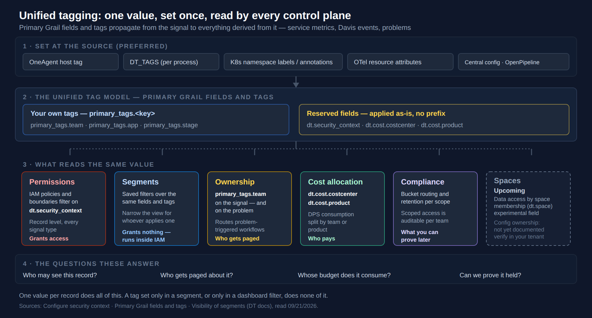
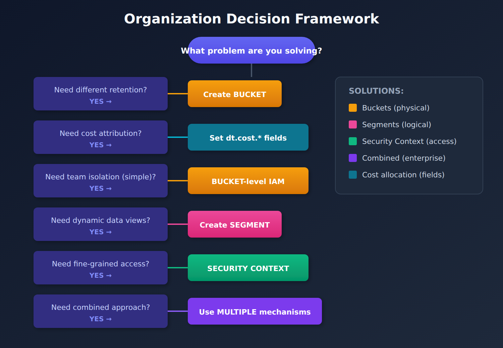

# ORGNZ-01: Introduction to Organizing Data in Grail

> **Series:** ORGNZ — Organize Data: Buckets, Segments, Security | **Notebook:** 1 of 10 | **Created:** January 2026 | **Last Updated:** 10/14/2026

## Overview

Dynatrace Grail organizes data in **buckets**, **tables**, and **views** to ensure efficient storage, flexible access, and scalable querying. Understanding how to organize your data is fundamental to achieving optimal query performance, compliance requirements, and access control.

## Prerequisites

| Requirement | Details |
|-------------|----------|
| **Dynatrace Environment** | SaaS environment with Grail enabled |
| **Permissions** | `storage:buckets:read`, `storage:logs:read` |
| **Knowledge** | Basic Dynatrace navigation |
| **Data** | At least 1 hour of log data |

---

## Table of Contents

1. [Why Organize Data?](#why-organize-data)
2. [The Grail Data Model](#the-grail-data-model)
3. [Three Pillars of Data Organization](#three-pillars-of-data-organization)
4. [When to Use Each Mechanism](#when-to-use-each-mechanism)
5. [Permission Levels in Grail](#permission-levels-in-grail)
6. [Exploring Your Data Organization](#exploring-your-data-organization)
7. [Organization Decision Framework](#organization-decision-framework)

---

## Learning Objectives

By the end of this notebook, you will:
- Understand why data organization matters in Grail
- Know the three pillars of data organization: buckets, segments, and security
- Recognize when to use each organization mechanism
- Understand the Grail data model structure

<a id="why-organize-data"></a>
## Why Organize Data?
Effective data organization in Grail enables:

| Benefit | Description |
|---------|-------------|
| **Query Performance** | Reduce query execution time by limiting data scope |
| **Cost Control** | Cost allocation by field (`dt.cost.costcenter`, `dt.cost.product`) across signals; retention per bucket |
| **Access Control** | Fine-grained permissions from bucket to field level |
| **Compliance** | Meet retention and data residency requirements |
| **Operational Clarity** | Teams see only relevant data for faster troubleshooting |

<a id="the-grail-data-model"></a>
## The Grail Data Model
Grail organizes data hierarchically with tables (data types), buckets (storage containers), and segments (logical views):


<!-- MARKDOWN_TABLE_ALTERNATIVE
| Level | Examples |
|-------|----------|
| Tables | logs, metrics, spans, events, bizevents, security_events |
| Buckets | default_logs, default_metrics, custom_buckets |
| Segments | team-based segments, application segments |
For environments where SVG doesn't render
-->

<a id="three-pillars-of-data-organization"></a>
## Three Pillars of Data Organization

All three pillars read metadata that was set once, upstream of them. This is the layered view — where tagging happens, and what consumes it:



<!-- MARKDOWN_TABLE_ALTERNATIVE
| Layer | What it holds |
|---|---|
| 1 - Set at the source (preferred) | OneAgent host tag, DT_TAGS (per process), K8s namespace labels/annotations, OTel resource attributes, central config / OpenPipeline |
| 2 - The unified tag model | Your own tags: primary_tags.<key> (team, app, stage). Reserved fields applied as-is: dt.security_context, dt.cost.costcenter, dt.cost.product |
| 3 - What reads the same value | Permissions (IAM filters on dt.security_context - grants access); Segments (saved filters - grant nothing, run inside IAM); Ownership (primary_tags.team - routes problem-triggered workflows); Cost allocation (dt.cost.* - who pays); Compliance (bucket routing, retention, auditability); Spaces (dt.space - upcoming: experimental permission field announced for data access by space membership, not yet documented as available; ownership of configuration objects not yet documented) |
| 4 - The questions these answer | Who may see this record? Who gets paged about it? Whose budget does it consume? Can we prove it held? |
For environments where SVG doesn't render
-->

Dynatrace states the ordering plainly: *"At-source enrichment is always preferred over OpenPipeline-based enrichment for the security context."* The value then travels, because *"Dynatrace enriches all derived signals (service metrics, Davis events, and problems) with the same tags."* Buckets, segments and security context are three consumers of that one value; ownership routing and cost allocation are two more. **FAQ-02** covers the tagging side in full.

> **Spaces — upcoming; not yet documented as an available feature (status 10/13/2026).** `dt.space` is listed in the published semantic dictionary as an `experimental` permission field: *"The space associated with the record. Spaces enable granular scoping and delegation of monitoring responsibilities."* An earlier pre-release version of the SaaS 1.348 release notes announced space-based data access control in Grail (read 09/24/2026); the current version of those notes no longer lists it, and the IAM policy reference has no `dt.space` policy condition. Treat Spaces as **announced and subject to change** — the direction is a data-access control beside `dt.security_context`, deciding which *records* a team may read — and do not design access control around it until Dynatrace documents it as available on your tenant.
>
> The gap this column was first drawn for is only partly closed in what Dynatrace documents. Owner-based access control lets a team own individual settings objects where a schema supports it — in OpenPipeline, *"Owner-based control is available for pipelines and ingest sources, and not routing"*, and *"Owners manage settings objects and can share access with other users or transfer ownership at any time, without relying on centralized administrator intervention."* There is no per-team container for all of a team's configuration, though: where a settings schema has no owner-based control, a change still goes through whoever holds the settings permissions, which is how a central team becomes a queue. Whether spaces will also delegate ownership of configuration objects is **not documented**: as of 10/13/2026 there is no docs page for spaces, and `dt.space` was not in this validation tenant's `dt.semantic_dictionary.fields` — check yours. The field description's "delegation of monitoring responsibilities" is not a documented mechanism for owning configuration objects. Until Spaces is documented — and for configuration ownership in any case — design against what the other columns give you today.
>
> <sub>**Sources:** [Owner-based access control in OpenPipeline (DT docs)](https://docs.dynatrace.com/docs/platform/openpipeline/concepts/access-control) — published 01/09/2026, as quoted. [Permission fields — semantic dictionary (DT docs)](https://docs.dynatrace.com/docs/semantic-dictionary/tags/permission) — *"The space associated with the record. Spaces enable granular scoping and delegation of monitoring responsibilities."* (listed `experimental`). [What's new in Dynatrace SaaS 1.348 (DT docs)](https://docs.dynatrace.com/docs/whats-new/saas/sprint-348) — pre-release; read 09/24/2026 with a Spaces entry and 10/13/2026 without one. [IAM policy reference (DT docs)](https://docs.dynatrace.com/docs/manage/identity-access-management/permission-management/manage-user-permissions-policies/advanced/iam-policystatements) — no `dt.space` condition, checked 10/13/2026. **Dictionary:** no row for `dt.space` in the validation tenant under `filter contains(name, "space")`, read 10/13/2026 (control: the same filter returned 23 other fields, including `dt.security_context`).</sub>

Sources: [Configure security context (DT docs)](https://docs.dynatrace.com/docs/manage/tags/tags-security-context), [Primary Grail fields and tags (DT docs)](https://docs.dynatrace.com/docs/manage/tags/primary-tags).

### 1. Buckets (Physical Organization)

Buckets are logical storage containers where records are stored:

| Aspect | Description |
|--------|-------------|
| **Purpose** | Physical data partitioning and retention control |
| **Scope** | One data type per bucket (logs, metrics, etc.) |
| **Retention** | 1 day to 10 years per bucket |
| **Access** | IAM policies can grant bucket-level access |
| **Cost** | Retention, and so storage cost, is set per bucket; attributing cost to teams uses `dt.cost.*` fields, not buckets |

### 2. Segments (Logical Organization)

Segments provide dynamic, cross-signal data views:

| Aspect | Description |
|--------|-------------|
| **Purpose** | Real-time filtering without physical separation |
| **Scope** | Spans multiple data types and buckets |
| **Flexibility** | Rule-based, can use variables and relationships |
| **Access** | Governed by existing access controls |
| **Cost** | No direct storage cost impact |

### 3. Security Context (Access Control)

Security context enables fine-grained permissions:

| Aspect | Description |
|--------|-------------|
| **Purpose** | Record-level access control |
| **Mechanism** | `dt.security_context` attribute on records |
| **Flexibility** | Custom values, hierarchical encoding |
| **Enforcement** | IAM policies filter at query time |

<a id="when-to-use-each-mechanism"></a>
## When to Use Each Mechanism
| Need | Solution | Rationale |
|------|----------|-----------|
| Different retention periods | **Buckets** | Retention is set per bucket |
| Cost attribution by team | **Cost allocation fields** (`dt.cost.costcenter`, `dt.cost.product`) | Field-based, so it covers logs, traces, metrics and events without a bucket per team; add a bucket only where retention or access also differ |
| Broad team isolation | **Buckets** | Simple bucket-level IAM policies |
| Dynamic data views | **Segments** | Filter across data types at query time |
| Application-centric views | **Segments** | Group related entities and signals |
| Record-level access control | **Security Context** | Fine-grained ABAC |
| Multi-team shared buckets | **Security Context** | Filter records within same bucket |

> <sub>**Sources:** [Set up Cost Allocation (DT docs)](https://docs.dynatrace.com/docs/manage-your-costs/allocate/plan-and-set-up) — *"Tags applied at the OneAgent, Kubernetes, or telemetry-ingest layer flow through Grail as dt.cost.costcenter and dt.cost.product attributes"*; *"Telemetry enrichment with Cost Allocation attributes is possible for all supported ingest methods, whether logs, traces, metrics, or events."*</sub>

<a id="permission-levels-in-grail"></a>
## Permission Levels in Grail
Grail supports permissions at multiple levels:

| Level | Granularity | Example Use Case |
|-------|-------------|------------------|
| **Bucket** | All records in a bucket | Team owns entire bucket |
| **Table** | All records of a data type | Access to all logs |
| **Record** | Individual records by attribute | By host group, namespace, security context |
| **Field** | Specific fields on records | Hide sensitive fields (fieldsets) |

> **Important**: Without permissions, users cannot query data from Grail. Permissions must be explicitly granted.

<a id="exploring-your-data-organization"></a>
## Exploring Your Data Organization

### DQL: Bucket Discovery

Use the following query to explore your Grail bucket configuration:

```dql
// List all buckets — foundational discovery query for your Grail environment
fetch dt.system.buckets
| fields name, display_name, dt.system.table, retention_days, estimated_uncompressed_bytes
| sort dt.system.table asc, name asc
```

<a id="organization-decision-framework"></a>
## Organization Decision Framework
Use this framework to decide how to organize your data:



<!-- MARKDOWN_TABLE_ALTERNATIVE
| Question | YES Answer |
|----------|------------|
| Need different retention? | Create custom BUCKET |
| Need cost attribution? | Set dt.cost.* fields (cost allocation) |
| Need team isolation (simple)? | Use BUCKET-level IAM policies |
| Need dynamic views across data? | Create SEGMENT |
| Need fine-grained access? | Configure SECURITY CONTEXT |
| Need combined approach? | Use MULTIPLE mechanisms |
For environments where SVG doesn't render
-->

## Series Overview

This series covers data organization in depth:

| Notebook | Topic | Focus |
|----------|-------|-------|
| ORGNZ-01 | Introduction | Why and how to organize data |
| ORGNZ-02 | Grail Buckets | Bucket fundamentals and limits |
| ORGNZ-03 | Bucket Strategy | Naming, retention, design patterns |
| ORGNZ-04 | Permissions Overview | Permission levels and policy management |
| ORGNZ-05 | Bucket-Level Access | IAM policies for bucket access |
| ORGNZ-06 | Security Context | Fine-grained access with dt.security_context |
| ORGNZ-07 | Advanced Permissions | Record-level and field-based access |
| ORGNZ-08 | Grail Segments | Dynamic data organization |
| ORGNZ-09 | Enterprise Patterns | Combined approaches and best practices |
| ORGNZ-10 | Advanced Segment Definitions | Filter syntax, enrichment, variables, troubleshooting |

## Next Steps

Continue with the ORGNZ series:
- **ORGNZ-02**: Understanding Grail Buckets

## References

- [Organize data](https://docs.dynatrace.com/docs/platform/grail/organize-data)
- [Permissions in Grail](https://docs.dynatrace.com/docs/platform/grail/organize-data/assign-permissions-in-grail)
- [Grail data model](https://docs.dynatrace.com/docs/platform/grail/organize-data)

---

<sub>*This notebook was AI-generated from Dynatrace documentation and enterprise best practices. It is not officially supported by Dynatrace. Always verify information against official Dynatrace documentation.*</sub>
