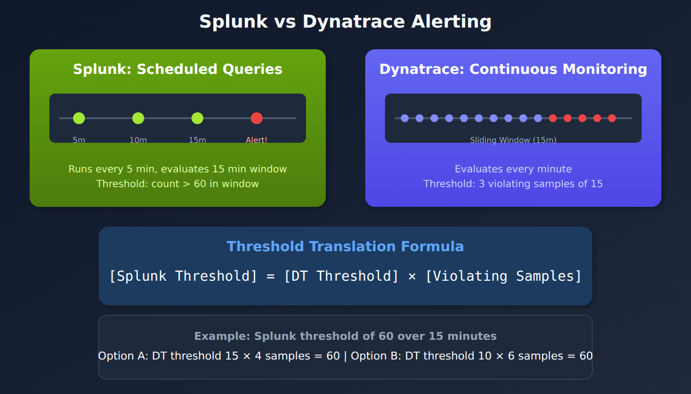

# S2D-04: Alert Migration - Anomaly Detectors

> **Series:** S2D — Splunk to Dynatrace Migration | **Notebook:** 4 of 9 | **Created:** January 2026 | **Last Updated:** 10/23/2026

## Overview

This notebook explains how to translate Splunk alert conditions into Dynatrace Anomaly Detectors. Understanding the fundamental differences between scheduled queries and continuous monitoring is essential for successful alert migration.



<!-- MARKDOWN_TABLE_ALTERNATIVE
| Aspect | Splunk | Dynatrace |
|---|--------|------------|
| Execution | Scheduled | Continuous (every minute) |
| Evaluation | Single point-in-time | Sliding window |
| Threshold | Total over period | Per-minute with samples |
For environments where SVG doesn't render
-->

---

## Table of Contents

1. [Splunk vs Dynatrace Alerting](#splunk-vs-dynatrace-alerting)
2. [The Sliding Window Concept](#the-sliding-window-concept)
3. [Threshold Translation Formula](#threshold-translation-formula)
4. [Migration Strategies](#migration-strategies)
5. [Concept Mapping](#concept-mapping)
6. [Creating an Anomaly Detector](#creating-a-davis-anomaly-detector)
7. [Migration Decision Tree](#migration-decision-tree)
8. [Validation Query](#validation-query)

---

## Prerequisites

| Requirement | Details |
|-------------|----------|
| **Dynatrace Environment** | SaaS with Grail enabled |
| **Permissions** | `logs.read`, `settings.write` |
| **Knowledge** | Understanding of source Splunk alert logic |

## Learning Objectives

By the end of this notebook, you will be able to:

1. Explain the difference between Splunk scheduled alerts and Anomaly Detectors
2. Apply the threshold translation formula
3. Choose the appropriate migration strategy for different alert types
4. Configure Anomaly Detector parameters correctly

<a id="splunk-vs-dynatrace-alerting"></a>
## Splunk vs Dynatrace Alerting
### Splunk Alerting Model

In Splunk, alerts are **scheduled queries** that:
- Run at defined intervals (e.g., every 5 minutes)
- Evaluate a query over a timeframe (e.g., last 15 minutes)
- Trigger when results exceed a threshold (e.g., count > 10)
- Apply suppression to prevent repeated alerts

### Dynatrace Alerting Model

Anomaly Detectors provide **continuous monitoring** that:
- Evaluate every minute (1-minute granularity)
- Use a sliding window approach
- Require multiple violating samples to trigger
- Require dealerting samples to close

### Key Parameters

| Parameter | Description | Maximum |
|-----------|-------------|----------|
| **Threshold** | Value triggering a violation | Unlimited |
| **Sliding Window** | Time range evaluated | 60 minutes |
| **Violating Samples** | Minutes above threshold to alert | 60 |
| **Dealerting Samples** | Minutes below threshold to close | 60 |

<a id="the-sliding-window-concept"></a>
## The Sliding Window Concept
Anomaly Detectors continuously evaluate metrics using a sliding window.

**Example Configuration:**
- Metric: Error Log Count
- Threshold: 5 errors/minute
- Sliding Window: 15 minutes
- Violating Samples: 3
- Dealerting Samples: 5

**Behavior:**
1. Every minute, the detector checks if error count > 5
2. If 3 of the last 15 minutes exceed the threshold → Alert opens
3. Alert closes once at least 5 samples in the window are back below threshold *and* the number of violating samples has fallen below 3

<a id="threshold-translation-formula"></a>
## Threshold Translation Formula
The key insight for translation is that both platforms should require roughly the same number of events to trigger:

```
[Splunk Threshold] = [Dynatrace Threshold] × [Dynatrace Violating Samples]
```

### Example Translation

**Splunk Alert:**
- Runs every 5 minutes
- Timeframe: last 15 minutes
- Threshold: 60 error logs
- Suppress: 15 minutes

**Dynatrace Options (each needs roughly 60 errors before it can fire):**

| Option | DT Threshold | Violating Samples | Product |
|--------|--------------|-------------------|----------|
| A | 15 | 4 | 60 |
| B | 10 | 6 | 60 |
| C | 30 | 2 | 60 |
| D | 20 | 3 | 60 |

The product is a floor, not a total. Each violating sample must be above the threshold on its own, so these settings fire only when the errors are concentrated in that many minutes. 60 errors spread evenly across 15 minutes (4 per minute) fire none of them, while the Splunk alert would. The options below handle that trade-off differently, and all of them use this one example: **60 error logs in 15 minutes**.

<a id="migration-strategies"></a>
## Migration Strategies
### Option 1: Alert Reimagined (Recommended)

**Strategy:** Pick a threshold × violating-samples pair from the table above that most closely replicates the Splunk behavior. Here, row D: 20 × 3 = 60.

**Parameters:**
- Threshold: 20
- Sliding Window: 15
- Violating Samples: 3 (fires when 3 of the 15 one-minute samples each exceed 20 errors, so more than 60 errors concentrated in 3 minutes)
- Dealerting Samples: 15

**Pros:**
- Best balance between sensitivity and stability
- Closest to expected alert behavior

**Cons:**
- Requires threshold recalculation
- Mindset shift for teams used to Splunk
- Misses errors spread thinly across the window (see the note under the formula)

**Custom-alert query** (paste this version into the alert; it has no `from:`/`to:`, see Step 1 below):

```dql
// Paste into the custom alert WITHOUT from:/to: — the alert supplies its own sliding window
// dt.entity.cloud_application is deprecated (semantic dictionary); its Smartscape successors are not on log records yet (10/2026)
fetch logs
| filter status == "ERROR"
| filter matchesPhrase(k8s.cluster.name, "production")
| filter matchesPhrase(k8s.deployment.name, "checkout-service")
| makeTimeseries count = count(), by:{dt.entity.cloud_application}, interval:1m
```

> **Query cost.** A DQL custom alert runs its query every minute, and a log query is billed per GiB scanned on every run. Dynatrace's log-alerting guidance calls this method *"not typically recommended as the primary alerting strategy"* and marks metrics based on logs as recommended. On a validation tenant (10/23/2026), one hour of `filter status == "ERROR" | makeTimeseries count = count(), interval:1m` over all logs scanned 348 MB. The same per-minute counts from the built-in `dt.log.status_per_entity_count` metric scanned 0 bytes and matched the log query exactly.
>
> Where its dimensions fit, alert on the metric instead. On that tenant it carried `status`, `k8s.cluster.name`, `k8s.namespace.name`, `k8s.workload.name` and `dt.entity.cloud_application`, but not `k8s.deployment.name`, so filter on the workload:
>
> ```dql
> // Metric form of the custom-alert query: no log scan on each evaluation
> timeseries count = sum(dt.log.status_per_entity_count), filter:{status == "ERROR" and k8s.cluster.name == "production" and k8s.workload.name == "checkout-service"}, by:{dt.entity.cloud_application}, interval:1m
> ```
>
> Confirm the metric exists on your tenant first (`metrics | filter metric.key == "dt.log.status_per_entity_count"`). For a condition it cannot express, extract your own metric at ingest (FAQ-09, OPIPE), and keep the log query only where no metric fits. The thresholds below apply to either form.
>
> <sub>**Sources:** [Log alerts (DT docs)](https://docs.dynatrace.com/docs/analyze-explore-automate/logs/alerting-on-logs) — *"Keep in mind that these queries are executed every minute, which can increase license consumption."*; *"This method is not typically recommended as the primary alerting strategy."* [Log Management & Analytics - Query (DT docs)](https://docs.dynatrace.com/docs/license/capabilities/log-analytics/dps-log-query) — *"It is calculated per gibibyte scanned (GiB scanned)."*</sub>

The cell below is the same log query with `from:-24h`, so you can preview it in a notebook.

```dql
// Option 1: Alert Reimagined - notebook PREVIEW of the custom-alert query above
// Remove from:-24h when you paste it into the custom alert
// Threshold: 20, Violating Samples: 3, Sliding Window: 15
// dt.entity.cloud_application is deprecated (semantic dictionary); its Smartscape successors are not on log records yet (10/2026)
fetch logs, from:-24h
| filter status == "ERROR"
| filter matchesPhrase(k8s.cluster.name, "production")
| filter matchesPhrase(k8s.deployment.name, "checkout-service")
| makeTimeseries count = count(), by:{dt.entity.cloud_application}, interval:1m
```

### Option 2: Single-Minute Spike

**Strategy:** Use the Splunk total as a per-minute threshold, with a single violating sample.

**Parameters:**
- Threshold: 60 (same as the Splunk total)
- Sliding Window: 15
- Violating Samples: 1 (fires when more than 60 errors land in a single minute)
- Dealerting Samples: 15

**Pros:**
- Easy to understand and explain
- Preserves the original threshold number
- Fires in the minute a burst happens

**Cons:**
- Misses errors spread across the window, so it fires less often than Splunk: a minute above 60 always puts the 15-minute total above 60, but not the reverse
- One burst minute is enough to open an event

The custom-alert query is the same as Option 1 (no `from:`/`to:`); only the detector settings change. The cell below is the notebook preview.

```dql
// Option 2: Single-minute spike - notebook PREVIEW (remove from:-24h in the custom alert)
// Threshold: 60, Violating Samples: 1, Sliding Window: 15
// dt.entity.cloud_application is deprecated (semantic dictionary); its Smartscape successors are not on log records yet (10/2026)
fetch logs, from:-24h
| filter status == "ERROR"
| filter matchesPhrase(k8s.cluster.name, "production")
| filter matchesPhrase(k8s.deployment.name, "checkout-service")
| makeTimeseries count = count(), by:{dt.entity.cloud_application}, interval:1m
```

### Option 3: Sustained Presence

**Strategy:** Divide the Splunk total by the sliding window for a per-minute threshold, and require every sample to violate it.

**Parameters:**
- Threshold: 4 (60 ÷ 15 = 4 per minute; counts are whole numbers, so each minute needs at least 5 errors to be above it)
- Sliding Window: 15
- Violating Samples: 15 (all samples must violate)
- Dealerting Samples: 15

This is a sustained-presence rule, not a total. 300 errors in one minute followed by 14 quiet minutes never fires; 5 errors in every one of 15 minutes (75 in total) does.

**Pros:**
- Very stable: fires only on errors that persist minute after minute
- Ignores brief spikes, so the fewest false positives from bursts

**Cons:**
- Misses short bursts, however large
- Fires only after the full 15 minutes

### Option 4: Data-Driven

**Strategy:** Analyze actual data patterns to determine optimal thresholds.

**Steps:**
1. Query historical data at the grain the detector evaluates (1-minute samples) to understand baseline patterns
2. Identify normal vs. problematic periods
3. Set thresholds that would have caught past incidents
4. Tune based on observed alert frequency

**Pros:**
- Most accurate for the specific environment
- Data-backed decisions

**Cons:**
- Requires more analysis effort
- Needs historical data availability

```dql
// Data-driven threshold: per-minute error distribution (detectors evaluate 1-minute samples)
// Keep the window at 24h or less: over longer windows interval:1m is coarsened silently
fetch logs, from:now()-24h
| filter status == "ERROR"
| filter matchesPhrase(k8s.deployment.name, "checkout-service")
| makeTimeseries count = count(), interval:1m
| fieldsAdd per_min_avg = arrayAvg(count), per_min_p95 = arrayPercentile(count, 95), per_min_max = arrayMax(count)
```

<a id="concept-mapping"></a>
## Concept Mapping
| Splunk Concept | Dynatrace Equivalent | Notes |
|----------------|---------------------|--------|
| Query Timeframe | Sliding Window | Both define evaluation period |
| Suppress / throttle | No direct equivalent | An open event absorbs repeat violations until it closes (de-alerting samples); re-notification is controlled in the routing workflow |
| Threshold | Threshold × Violating Samples | Must calculate product |
| Schedule Frequency | Delay (default 1 minute, up to 60) | Evaluation stays per-minute; Delay only batches executions |

The configuration page says: *"While the default delay period between custom alert executions is 1 Minute, you can configure the query execution to longer intervals"*, and *"the delay can't be longer than 60 Minutes."* On de-alerting: *"The number of violating samples must be lower than the threshold number to raise the problem. The number of "normal" samples must be greater than or equal to the number of de-alerting samples. Both criteria must be met to close the event."*

<a id="creating-a-davis-anomaly-detector"></a>
## Creating an Anomaly Detector
### Step 1: Create the DQL Query

Your query must return timeseries data with a 1-minute interval.

**Do not include `from:` or `to:` in the query you paste into the custom alert.** The DQL writing guide says: *"Don't use from: and to: when creating a DQL query for the custom alert. Otherwise, you'll get failures whenever the custom alert tries to execute your query."* The alert applies its own sliding window. Keep `from:` only in the notebook preview.

**About `dt.entity.cloud_application`.** The semantic dictionary marks this field `deprecated` (*"An entity ID of an entity of type CLOUD_APPLICATION."*). Its Smartscape successors are the `K8S_DEPLOYMENT`, `K8S_STATEFULSET`, `K8S_DAEMONSET`, `K8S_REPLICASET`, `K8S_JOB` and `K8S_CRONJOB` nodes (`dt.smartscape.k8s_deployment` and its siblings, `stable`), but those IDs are not on log records yet. On a validation tenant on 10/14/2026, 0 of 19.4M logs in 24 hours carried `dt.smartscape.k8s_deployment`, while 15.0M carried `dt.entity.cloud_application`. It is still the only workload entity ID on logs, so the templates keep it. Switch to the Smartscape ID once it appears on your log records. `k8s.workload.name` (`stable`) is a name, not an entity ID.

> <sub>**Dictionary:** `dt.entity.cloud_application` (`deprecated`), `dt.smartscape.k8s_deployment` (`stable`), `k8s.workload.name` (`stable`); `dt.semantic_dictionary.models` maps `dt.entity.cloud_application` to the six `K8S_*` node types above; read 10/14/2026.</sub>

**Custom-alert template:**

```dql
// Paste into the custom alert WITHOUT from:/to:
// dt.entity.cloud_application is deprecated (semantic dictionary); its Smartscape successors are not on log records yet (10/2026)
fetch logs
| filter status == "ERROR"
| filter matchesPhrase(k8s.cluster.name, "your-cluster")
| filter matchesPhrase(k8s.namespace.name, "your-namespace")
| makeTimeseries count = count(), by:{dt.entity.cloud_application}, interval:1m
```

Notebook preview of the same template:

```dql
// Notebook PREVIEW of the custom-alert template above
// Remove from:-24h when you paste it into the custom alert
// dt.entity.cloud_application is deprecated (semantic dictionary); its Smartscape successors are not on log records yet (10/2026)
fetch logs, from:-24h
| filter status == "ERROR"
| filter matchesPhrase(k8s.cluster.name, "your-cluster")
| filter matchesPhrase(k8s.namespace.name, "your-namespace")
| makeTimeseries count = count(), by:{dt.entity.cloud_application}, interval:1m
```

### Step 2: Configure Detector Settings

| Setting | Value | Rationale |
|---------|-------|-----------|
| **Name** | `[AppName] High Error Count` | Clear identification |
| **Threshold** | Calculated per formula | See translation formula |
| **Sliding Window** | Match Splunk timeframe | Usually 15-60 minutes |
| **Violating Samples** | Depends on strategy | See migration options |
| **Dealerting Samples** | How many back-to-normal samples close the event | Prevents alert flapping (not the same as Splunk suppress) |

### Step 3: Configure Event Properties

| Property | Example | Purpose |
|----------|---------|----------|
| **Event Name** | `[AppName] P2 - {dims:host.name} - High Errors` | Alert identification |
| **Event Type** | `ERROR_EVENT` | Severity classification |
| **Description** | Dynamic with affected entity | Context for responders |

Placeholders take the form `{dims:<dimension>}`. The configuration page says: *"{dims} - a list of all dimensions (and their values) of the metric that violated the threshold. You can also specify a particular dimension: {dims:dt.entity.<entity>}."* Type `{` in the Event name field to list the placeholders available for your query (*"To see available placeholders, type { in the input field."*).

<a id="migration-decision-tree"></a>
## Migration Decision Tree
Use this decision tree to choose your migration approach:

1. **Is the Splunk alert timeframe > 1 hour?**
   - Yes → Use Workflows (see S2D-05) or ArrayMovingSum (see S2D-06)
   - No → Continue

2. **Is the alert scheduled infrequently (< 6 times/day)?**
   - Yes → Consider Workflows (see S2D-05)
   - No → Continue

3. **Do you have historical data for analysis?**
   - Yes → Use Option 4 (Data-Driven)
   - No → Continue

4. **What should the alert catch?**
   - Errors that persist minute after minute, ignoring brief spikes (fewest false positives) → Use Option 3 (Sustained Presence)
   - Sudden bursts, as early as possible → Use Option 2 (Single-Minute Spike)
   - Otherwise → Use Option 1 (Alert Reimagined)

<a id="validation-query"></a>
## Validation Query
Before creating an Anomaly Detector, validate your query returns expected results:

```dql
// Validate alert query returns timeseries data (notebook preview)
// Remove from:now()-24h and the limit when you paste it into the custom alert
// dt.entity.cloud_application is deprecated (semantic dictionary); its Smartscape successors are not on log records yet (10/2026)
fetch logs, from:now()-24h
| filter status == "ERROR"
| filter matchesPhrase(k8s.deployment.name, "checkout-service")
| makeTimeseries count = count(), by:{dt.entity.cloud_application}, interval:1m
| limit 100
```

## Next Steps

- **S2D-05: Alert Migration - Workflows** - For alerts that don't fit the Dynatrace Intelligence model
- **S2D-06: ArrayMovingSum** - For timeframes exceeding 1 hour

## References

- [anomaly-detection (DT docs)](https://docs.dynatrace.com/docs/dynatrace-intelligence/anomaly-detection)
- [Anomaly detection metric events (DT docs)](https://docs.dynatrace.com/docs/dynatrace-intelligence/anomaly-detection-classic/metric-events)
- [Anomaly detection configuration (DT docs)](https://docs.dynatrace.com/docs/dynatrace-intelligence/anomaly-detection/anomaly-detection-configuration)
- [Anomaly Detection DQL writing guide (DT docs)](https://docs.dynatrace.com/docs/dynatrace-intelligence/anomaly-detection/anomaly-detection-app/anomaly-detection-dql-best-practice)
- [Alerting profiles — classic surface (DT docs)](https://docs.dynatrace.com/docs/shortlink/alerting-profiles)

---

<sub>*This notebook was AI-generated from community-submitted and publicly available sources. This notebook series is not officially supported by Dynatrace. Always verify information against official Dynatrace documentation.*</sub>
