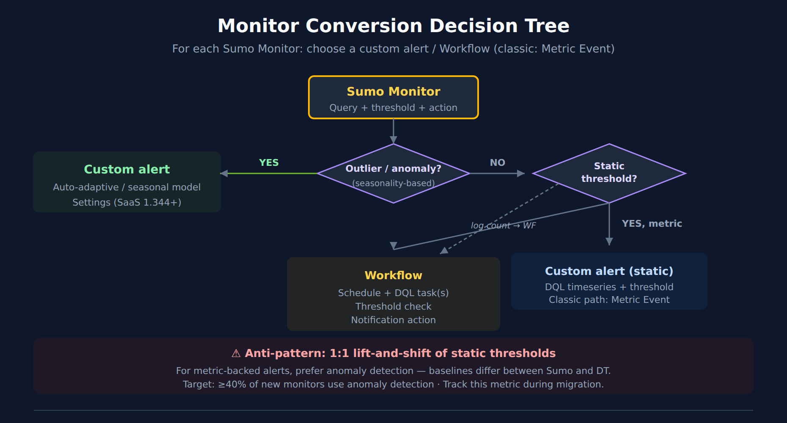

# SL2DT-05: Monitor & Alert Conversion

> **Series:** SL2DT — Sumo Logic to Dynatrace | **Notebook:** 5 of 11 | **Created:** April 2026 | **Last Updated:** 10/14/2026

## Overview

**Goal of this step:** rebuild Sumo Monitors in Dynatrace, choosing the right target for each (a custom alert, a Workflow with a DQL threshold, or — on the classic surface — a metric event). This is the notebook where the biggest fidelity-vs-better-approach decisions happen.

The anti-pattern to avoid: 1:1 static-threshold lift-and-shift. It produces noisy alerts, misses real anomalies, and under-uses Dynatrace's capabilities. The pattern to prefer: custom alerts with an adaptive or seasonal model for metric-backed alerts, Workflows for complex multi-condition logic, and a static-threshold custom alert for thresholds that genuinely are static.

---

## Table of Contents

1. [What You'll Produce](#outputs)
2. [The Monitor Conversion Decision Framework](#framework)
3. [Anomaly Detection — When & How](#davis)
4. [Metric Events — Simple Static Thresholds](#metric-events)
5. [Workflows — Complex or Multi-Condition Alerts](#workflows)
6. [Rebuilding Notification Actions](#actions)
7. [Handling Rare Alert Classes](#rare)
8. [Tuning & Noise Reduction](#tuning)
9. [Step Exit Criteria](#gate)
10. [References](#references)

---

## Prerequisites

| Requirement | Details |
|-------------|---------|
| **Audience** | Core migration engineers + app-team reviewers |
| **Inputs** | `inventory/monitors.json`, translations from SL2DT-04 |
| **Dynatrace access** | Platform token or OAuth client with `settings:objects:write` (custom alerts are Settings objects), `automation:workflows:write`, and `iam:service-users:use` (custom alerts that run as a service user) or `davis:analyzers:execute`; plus Grail read access to the data each alert queries (for example `storage:buckets:read`, `storage:metrics:read`, `storage:logs:read`) |
| **Prior reading** | SL2DT-04 for query translations; OPLOGS-09 for log-based alert patterns |

<a id="outputs"></a>
## 1. What You'll Produce

| Artifact | Purpose |
|----------|---------|
| `monitors/decision-matrix.csv` | Per-monitor: custom alert vs Workflow vs Metric Event decision |
| `monitors/configs/` | Terraform + JSON for custom alerts (anomaly detectors), Workflows, Metric Events |
| `notifications/action-map.md` | Sumo webhook/email → DT notification target map |
| `monitor-rebuild-report.md` | Progress per team |

<a id="framework"></a>
## 2. The Monitor Conversion Decision Framework

For each Sumo monitor, pick one of three targets:

### Decision Rules

| Sumo Monitor Type | Target | Why |
|-------------------|--------|-----|
| Outlier / anomaly / seasonality-based | **Custom alert** — auto-adaptive or seasonal-baseline model | Learns the baseline instead of a hand-picked number |
| Static threshold on metric (CPU > 90%) | **Custom alert** — static-threshold model (classic: **Metric Event**) | A DQL `timeseries` query and a threshold, as a Settings object |
| Static threshold on log count | **Workflow with DQL** | Query runs on schedule, threshold in task condition |
| Missing data alert | **Workflow** | Use `isNull` / `count == 0` checks |
| Multi-condition (X AND Y but not Z) | **Workflow** | Multiple DQL tasks + branching |
| SLO-backed alert | **SLO burn-rate alert** (if Dynatrace SLO) | Native SLO product |



<!-- MARKDOWN_TABLE_ALTERNATIVE
| Input | Output | Rationale |
|-------|--------|-----------|
| Outlier/anomaly monitor | Custom alert (auto-adaptive or seasonal model) | Learned baseline |
| Metric static threshold | Custom alert (static model); classic: Metric Event | DQL query + threshold |
| Log count static threshold | Workflow + DQL | Scheduled query |
| Missing data | Workflow | isNull/count check |
| Multi-condition | Workflow | Branching logic |
| SLO-backed | SLO burn-rate | Native product |
For environments where SVG doesn't render
-->

<a id="davis"></a>
## 3. Anomaly Detection — When & How

A **custom alert** evaluates a DQL `timeseries` query with one of three models — static threshold, auto-adaptive, or seasonal baseline — and raises an event when the signal violates it. The auto-adaptive and seasonal models learn the baseline. Best for:

- Any Sumo outlier monitor (`outlier _count window=N threshold=K`)
- Static thresholds where the "normal" value drifts seasonally (weekly cycle, business hours)
- Static thresholds that fire too often in Sumo (false positives from workload swings)

### Where custom alerts live (SaaS 1.344)

From SaaS 1.344 custom alerts are created and managed in **Settings**, and the Anomaly Detection app that used to hold them is deprecated. SaaS versions reach tenants in a staged rollout: on a tenant that is not yet on 1.344, the same custom alerts are still configured in the Anomaly Detection app. Programmatically, a custom alert is a Settings object of schema `builtin:davis.anomaly-detectors`.

### Configuration

```json
{
  "schemaId": "builtin:davis.anomaly-detectors",
  "scope": "environment",
  "value": {
    "enabled": true,
    "title": "API error count anomaly",
    "description": "Migrated from the Sumo outlier monitor on prod/api",
    "source": "sumo-migration",
    "executionSettings": {"actor": null, "queryOffset": null},
    "analyzer": {
      "name": "dt.statistics.ui.anomaly_detection.AutoAdaptiveAnomalyDetectionAnalyzer",
      "input": [
        {"key": "query", "value": "timeseries sum(log.sumo.api_error_count), interval:1m, by:{dt.entity.host}"},
        {"key": "numberOfSignalFluctuations", "value": "1"},
        {"key": "alertCondition", "value": "ABOVE"},
        {"key": "alertOnMissingData", "value": "false"},
        {"key": "violatingSamples", "value": "3"},
        {"key": "slidingWindow", "value": "5"},
        {"key": "dealertingSamples", "value": "5"}
      ]
    },
    "eventTemplate": {
      "properties": [
        {"key": "event.type", "value": "CUSTOM_ALERT"},
        {"key": "event.name", "value": "API error count above baseline on {dims:dt.entity.host.name}"},
        {"key": "event.description", "value": "Error-log count for prod/api is above its learned baseline."},
        {"key": "dt.source_entity", "value": "{dims:dt.entity.host}"}
      ]
    }
  }
}
```

The query must return a timeseries (`timeseries` or `makeTimeseries`), set `interval:1m`, and carry no `from:` / `to:`. For a fixed threshold, use `dt.statistics.ui.anomaly_detection.StaticThresholdAnomalyDetectionAnalyzer` with a `threshold` input; for a weekly or daily pattern, `dt.statistics.ui.anomaly_detection.SeasonalBaselineAnomalyDetectionAnalyzer` with `tolerance`. `source` is free text — a shared value such as `sumo-migration` lets you filter every migrated alert in the UI.

> <sub>**Sources:**</sub>
> - <sub>[Anomaly Detection app (DT docs)](https://docs.dynatrace.com/docs/dynatrace-intelligence/anomaly-detection/anomaly-detection-app) — *"Starting with Dynatrace version 1.344, custom alerts have moved to"* Settings; *"Because Anomaly Detection is deprecated, we highly recommend that you use"* Settings.</sub>
> - <sub>[Set up anomaly detectors via API (DT docs)](https://docs.dynatrace.com/docs/dynatrace-intelligence/anomaly-detection/set-up-anomaly-detectors-via-api) — schema `builtin:davis.anomaly-detectors`; *"The query must have a time interval explicitly set to interval:1m. You can't set timeframes using from: and to: DQL operators with this configuration."*</sub>

### Sumo outlier → custom alert example

**Sumo:**
```
_sourceCategory=prod/api | timeslice 1m | count | outlier _count window=10 threshold=3
```

**Dynatrace:**
1. Create a counter metric from the matching logs in OpenPipeline (next subsection).
2. Create a custom alert on that metric with the auto-adaptive model (the JSON above).
3. Route the resulting problem to the Sumo monitor's notification target with a problem-triggered Workflow (§6).

### Metric Extraction from Logs

If the Sumo monitor was log-count-based, extract a metric first. In **OpenPipeline → Logs**, open the pipeline that processes these records, select the **Metric extraction** tab, and add a **Counter metric** processor:

| Field | Value |
|-------|-------|
| Matching condition | `sumo.source_category == "prod/api" and status == "ERROR"` |
| Metric key | `log.sumo.api_error_count` |
| Dimensions | `dt.entity.host` |

Log metric keys carry the `log.` prefix. A new log metric has data only for logs ingested after it is created, so give it time to fill before the custom alert's baseline means anything.

> <sub>**Sources:** [Log metrics (DT docs)](https://docs.dynatrace.com/docs/analyze-explore-automate/logs/lma-log-processing/lma-log-metrics) — *"All metrics based on a log monitoring query have a metric key with the `log.` prefix."*, *"A created log metric is available only when new log data is ingested."*; [Metric extraction (DT docs)](https://docs.dynatrace.com/docs/platform/openpipeline/concepts/extraction/metric-extraction).</sub>

### Classic path — metric events

Tenants that already manage alerting as classic metric events (`builtin:anomaly-detection.metric-events`) can keep that surface; it evaluates Metrics Classic keys, not DQL. An adaptive or seasonal model there needs a `METRIC_SELECTOR` query definition — *"Metric key based query definitions only support static thresholds"* — and every model needs its full set of sample counts plus an event template. New monitors in this migration should use custom alerts (above).

```json
{
  "schemaId": "builtin:anomaly-detection.metric-events",
  "scope": "environment",
  "value": {
    "enabled": true,
    "summary": "API error rate anomaly",
    "queryDefinition": {
      "type": "METRIC_SELECTOR",
      "metricSelector": "custom.metric.api_error_rate:splitBy(\"dt.entity.host\"):avg"
    },
    "modelProperties": {
      "type": "AUTO_ADAPTIVE_THRESHOLD",
      "signalFluctuation": 1.0,
      "tolerance": 4.0,
      "alertCondition": "ABOVE",
      "alertOnNoData": false,
      "samples": 5,
      "violatingSamples": 3,
      "dealertingSamples": 5
    },
    "eventTemplate": {
      "title": "API error rate anomaly",
      "description": "The API error rate is above its learned baseline.",
      "eventType": "ERROR",
      "davisMerge": true,
      "metadata": []
    }
  }
}
```

> <sub>**Sources:** [builtin:anomaly-detection.metric-events schema (DT docs)](https://docs.dynatrace.com/docs/dynatrace-api/environment-api/settings/schemas/builtin-anomaly-detection-metric-events); [Metric events (DT docs)](https://docs.dynatrace.com/docs/dynatrace-intelligence/anomaly-detection-classic/metric-events) — *"We encourage you to try Anomaly Detection"*.</sub>

### Validation

```dql
// Confirm the log metric is producing data (it fills only from logs ingested after it was created)
timeseries c = sum(log.sumo.api_error_count), from:-1h, by:{dt.entity.host}
| fieldsAdd c_max = arrayMax(c)
| filter c_max > 0
```

<a id="metric-events"></a>
## 4. Metric Events — Simple Static Thresholds

When the threshold truly is static and the underlying metric is well-defined:

- CPU > 90%
- Memory available < 5%
- Disk full
- Certificate expiry < 30 days

A custom alert with the static-threshold model (§3) covers this case on a DQL query and is the current path. Where you keep classic metric events, use `builtin:anomaly-detection.metric-events`:

```json
{
  "schemaId": "builtin:anomaly-detection.metric-events",
  "scope": "environment",
  "value": {
    "enabled": true,
    "summary": "Host CPU > 90%",
    "queryDefinition": {
      "type": "METRIC_KEY",
      "metricKey": "builtin:host.cpu.usage",
      "aggregation": "AVG",
      "entityFilter": {
        "dimensionKey": "dt.entity.host",
        "conditions": [
          {"type": "HOST_GROUP_NAME", "operator": "EQUALS", "value": "prod-web"}
        ]
      }
    },
    "modelProperties": {
      "type": "STATIC_THRESHOLD",
      "threshold": 90.0,
      "alertCondition": "ABOVE",
      "alertOnNoData": false,
      "samples": 5,
      "violatingSamples": 3,
      "dealertingSamples": 5
    },
    "eventTemplate": {
      "title": "Host CPU > 90%",
      "description": "CPU usage has been above 90% for 3 of the last 5 minutes.",
      "eventType": "RESOURCE",
      "davisMerge": true,
      "metadata": []
    }
  }
}
```

The schema's only scope is `environment`; narrow the alert to particular hosts with the `entityFilter` (here a host group), not with an entity ID as the scope. Metric events read Metrics Classic, so the key is `builtin:host.cpu.usage` — the Grail key `dt.host.cpu.usage` is for DQL.

### When NOT to use Metric Events

- Threshold depends on workload (use a custom alert with an auto-adaptive or seasonal model)
- Condition involves multiple metrics (use Workflow)
- Alert requires custom notification payload (use Workflow)

<a id="workflows"></a>
## 5. Workflows — Complex or Multi-Condition Alerts

Workflows are the equivalent of Sumo's more complex monitors. Use when:

- Alert logic needs multiple DQL queries
- Conditional branches required
- Custom notification payload (ServiceNow incident with specific fields, etc.)
- Scheduled evaluation (every N minutes)

### Workflow Structure

The schedule (cron `*/5 * * * *`, every 5 minutes) is the workflow's trigger, set in the editor rather than written into the task list. The HTTP task authenticates with a Credential Vault credential selected in its **Authentication** field.

```yaml
tasks:
  - name: check_error_rate
    action: dynatrace.automations:execute-dql-query
    input:
      query: |
        fetch logs, from:-5m
        | filter sumo.source_category == "prod/api"
        | summarize {total = count(), errors = countIf(contains(content, "error", caseSensitive:false))}
        | fieldsAdd error_pct = 100.0 * toDouble(errors) / toDouble(total)
  - name: check_threshold
    action: dynatrace.automations:http-function   # ServiceNow Table API — see §6
    predecessors: [check_error_rate]
    conditions:
      states:
        check_error_rate: SUCCESS
      custom: '{{ result("check_error_rate")["records"] | length > 0 and result("check_error_rate")["records"][0]["error_pct"] > 5 }}'
    input:
      method: POST
      url: https://<instance>.service-now.com/api/now/table/incident
      headers:
        Content-Type: application/json
      payload: |
        {
          "short_description": "API error rate {{ result('check_error_rate').records[0].error_pct }}%",
          "assignment_group": "Payments Platform",
          "priority": "2"
        }
```

A DQL task in state *Success* can still return no records, and reading `records[0]` from an empty result makes the condition error. Guard with `| length > 0`, as above.

> <sub>**Sources:** [DQL query action (DT docs)](https://docs.dynatrace.com/docs/analyze-explore-automate/workflows/default-workflow-actions/dql-query-workflow-action) — *"Accessing a specific record without first checking the array length will cause a condition error."*</sub>

### Scheduled Search → Workflow

A Sumo scheduled search (query + schedule + action) maps directly:

| Sumo Scheduled Search Field | Workflow Equivalent |
|------------------------------|---------------------|
| Query | **Execute DQL Query** task (`dynatrace.automations:execute-dql-query`) |
| Schedule (run every N) | Schedule trigger with a cron rule, set in the editor |
| Alert condition | `conditions.custom` on the notification task (a Jinja expression; check `records \| length > 0` before reading `records[0]`) |
| Webhook action | HTTP Request task (`dynatrace.automations:http-function`) or a connector action |
| Email action | **Send email** task (`dynatrace.email:send-email`) |

### DQL in Workflow Tasks

The translated DQL from SL2DT-04 goes directly here. Wrap long queries in `|` to preserve formatting:

```yaml
tasks:
  - name: find_slow_transactions
    action: dynatrace.automations:execute-dql-query
    input:
      query: |
        fetch logs, from:-5m
        | filter sumo.source_category == "prod/api"
        | parse content, "LD? 'latency=' INT:latency"
        | filter latency > 2000
        | summarize c = count(), by:{http.path}
        | sort c desc
        | limit 20
```

<a id="actions"></a>
## 6. Rebuilding Notification Actions

Every Sumo monitor has one or more actions. Map each to a Dynatrace notification target.

| Sumo Action | Dynatrace Target | Notes |
|-------------|------------------|-------|
| Email | **Send email** task (`dynatrace.email:send-email`) | Same recipient list; at most ten per field |
| Webhook → ServiceNow | HTTP Request task to the Table API, or ServiceNow **Create Incident** (`dynatrace.servicenow:snow-create-incident`) | Rebuild incident payload |
| Webhook → Slack | Slack **Send message** task (`dynatrace.slack:slack-send-message`) | Rebuild message format |
| Webhook → PagerDuty | PagerDuty **Send event** task (`dynatrace.pagerduty:send-event`) | Rebuild event payload |
| Webhook → custom HTTP | HTTP Request task (`dynatrace.automations:http-function`) | |
| Mobile push | Workflow + Dynatrace Mobile app | |

### ServiceNow Integration — Specific Patterns

ServiceNow is the most common target and the highest-risk translation (wrong field mapping → misrouted incidents).

**Sumo webhook payload:**
```json
{
  "incident": {
    "short_description": "{{Name}}: {{Description}}",
    "u_affected_service": "{{ClusterName}}",
    "assignment_group": "{{Team}}",
    "priority": "{{Priority}}"
  }
}
```

**Dynatrace Workflow equivalent:**
```yaml
- name: create_servicenow_incident
  action: dynatrace.automations:http-function
  input:
    method: POST
    url: https://<instance>.service-now.com/api/now/table/incident
    # Authentication: select a Credential Vault credential (Basic) in the task's
    # Authentication field. Never put the credential in a static Authorization header.
    headers:
      Content-Type: application/json
    payload: |
      {
        "short_description": "API error rate {{ result('check_error_rate').records[0].error_pct }}%",
        "u_affected_service": "{{ result('check_error_rate').records[0]['dt.entity.service'] }}",
        "assignment_group": "Payments Platform",
        "priority": "2"
      }
```

The request body goes in `payload`, and dotted field names need bracket access (`records[0]['dt.entity.service']`). The HTTP route keeps custom fields such as `u_affected_service`. The ServiceNow Connector's **Create Incident** action (`dynatrace.servicenow:snow-create-incident`) is the alternative when the standard fields are enough. It takes named inputs (`shortDescription`, `description`, `impact`, `urgency`, `category`, `group`, `correlationId`, …) rather than a raw body. For the query above, `u_affected_service` stays empty unless the query groups by `dt.entity.service`.

> <sub>**Sources:** [HTTP request action (DT docs)](https://docs.dynatrace.com/docs/analyze-explore-automate/workflows/default-workflow-actions/http-request-workflow-action) — *"Payload : The payload of the HTTP request."*, *"We strictly advise against providing any static Authorization header and therefore, leak a secret."*; [wftpl_sample_servicenow_incident_man.yaml (Dynatrace GitHub)](https://raw.githubusercontent.com/Dynatrace/Dynatrace-workflow-samples/main/samples/Messaging%20and%20Incident%20Management/wftpl_sample_servicenow_incident_man.yaml) — *"action: dynatrace.servicenow:snow-create-incident"*.</sub>

**Verify** with a test incident before flipping production traffic.

<a id="rare"></a>
## 7. Handling Rare Alert Classes

### Missing Data Alerts

Sumo:
```
_sourceCategory=prod/heartbeat | count
| where _count == 0
```

Dynatrace Workflow:
```yaml
tasks:
  - name: check_heartbeat
    action: dynatrace.automations:execute-dql-query
    input:
      query: |
        fetch logs, from:-10m
        | filter sumo.source_category == "prod/heartbeat"
        | summarize c = count()
  - name: alert_if_missing
    action: dynatrace.email:send-email
    predecessors: [check_heartbeat]
    conditions:
      custom: '{{ result("check_heartbeat")["records"] | length == 0 or result("check_heartbeat")["records"][0]["c"] == 0 }}'
    input:
      to: ["oncall@example.com"]
      cc: []
      bcc: []
      subject: "No heartbeat from prod/heartbeat"
      content: "No heartbeat logs from prod/heartbeat in the last 10 minutes."
```

An ungrouped `summarize c = count()` returns one record with `c = 0` when nothing matches, so the second clause is the one that fires; the `length == 0` clause treats an empty result as missing data too, instead of erroring.

### Change Detection Alerts

Sumo:
```
_sourceCategory=audit | logcompare timeshift=24h
```

Dynatrace: Change detection or two-fetch comparison workflow. See OPLOGS-08.

### Multi-Metric Correlation

Sumo: two separate monitors with same target; Dynatrace: one Workflow with two DQL tasks + AND condition.

<a id="tuning"></a>
## 8. Tuning & Noise Reduction

Expect more alerts in the first week post-cutover — baselines aren't learned yet, and Workflow thresholds may be too aggressive.

### First-week discipline

1. Monitor alert volume daily. Dashboard the total count of detected problems + Workflow triggers.
2. For every alert, triage: real issue, false positive, or threshold too tight?
3. Adjust thresholds daily until noise drops below Sumo baseline.

### anomaly detection — let it learn

Dynatrace Intelligence needs ~2 weeks of data to build a stable baseline. During week 1–2, expect more sensitivity alerts. Keep them in a separate "tuning" severity class if possible; don't page on-call for them.

### Checking alert volume

```dql
// Alert volume over time — compare Sumo baseline
// dt.davis.problems holds one record per problem; `fetch events | filter event.kind == "DAVIS_PROBLEM"`
// returns every update of every problem and over-counts many times over.
fetch dt.davis.problems, from:-7d
| makeTimeseries problems = count(), interval:24h, time:event.start

```

### Silence during load tests

Configure a maintenance window before load tests, CI/CD deployments, or controlled outages. In Latest Dynatrace the Settings schema is `builtin:maintenance-windows`, and a window is scoped with DQL matcher expressions on Grail primary fields and tags. Latest Dynatrace always detects problems during a window — there is no option to disable detection — so muting is done in the notification path: problems raised during a window carry `maintenance.is_under_maintenance = true`, and a problem-triggered Workflow skips them when its trigger's additional custom filter query is `maintenance.is_under_maintenance != true`.

On a classic tenant, maintenance windows use the classic schema `builtin:alerting.maintenance-window`, whose `suppression` option chooses between *Detect problems and alert*, *Detect problems but don't alert*, and *Disable problem detection during maintenance*. Classic windows are not migrated automatically when you upgrade; recreate them as Latest Dynatrace windows.

A scheduled DQL workflow (§5, §7) is not a problem trigger, and the maintenance-window pages do not say it consults the window. In community practice, disable those workflows for the window, or move the alert to a custom alert plus a problem-triggered workflow so the filter above applies.

> <sub>**Sources:** [Upgrade from classic maintenance windows (DT docs)](https://docs.dynatrace.com/docs/platform/upgrade/upgrade-from-classic-maintenance-windows) — *"Latest Dynatrace always detects problems."*, *"There is no equivalent to disabling problem detection entirely."*, *"Window scope uses DQL matcher filter criteria on Grail primary fields and tags."*, *"Classic maintenance windows are not migrated automatically"*; [builtin:maintenance-windows schema (DT docs)](https://docs.dynatrace.com/docs/dynatrace-api/environment-api/settings/schemas/builtin-maintenance-windows); [builtin:alerting.maintenance-window schema (DT docs)](https://docs.dynatrace.com/docs/dynatrace-api/environment-api/settings/schemas/builtin-alerting-maintenance-window); [Use maintenance window data in Grail (DT docs)](https://docs.dynatrace.com/docs/analyze-explore-automate/alerting-and-notifications/maintenance-windows/use-maintenance-window-data-grail) — *"maintenance.is_under_maintenance != true"*.</sub>

### Severity mapping

Dynatrace has no P1/P2/P3 severity. A problem carries an `event.category` (for example `AVAILABILITY`, `ERROR`, `SLOWDOWN`, `RESOURCE_CONTENTION`, `CUSTOM_ALERT`), and routing happens in the problem-triggered Workflow. Carry the Sumo priority across as an extra key-value property on the custom alert's event template (for example `sumo.priority`), confirm it appears on the resulting problem in your tenant, and route on it; FAQ-21 covers the routing pattern.

| Sumo Priority | Route on | Notification |
|---------------|----------|--------------|
| Critical | `sumo.priority == "critical"`, or `event.category` `AVAILABILITY` / `ERROR` | PagerDuty + ServiceNow |
| High | `sumo.priority == "high"` | ServiceNow |
| Warning | `sumo.priority == "warning"` | Email |
| Info | (no alert) | Logged only |

<a id="gate"></a>
## 9. Step Exit Criteria

**G5 — Monitors Rebuilt**

- [ ] Every Sumo monitor has a decision logged (custom alert / Workflow / Metric Event / retire)
- [ ] ≥40% of new monitors use anomaly detection (not static thresholds) — track this metric
- [ ] Top-10 business-critical monitors validated end-to-end (fires on known-bad condition, doesn't fire on normal)
- [ ] Notification integrations (ServiceNow, Slack, PagerDuty) tested with live test incidents
- [ ] First-week alert volume ≤ Sumo baseline
- [ ] App teams trained on monitor rebuild (train-the-trainer — see SL2DT-01)

**Next step:** **SL2DT-06 — Dashboard Conversion** (rebuild dashboards using the translation output).

---

<a id="references"></a>
## 10. References

### Dynatrace alerting and intelligence
- [Anomaly detection (DT docs)](https://docs.dynatrace.com/docs/dynatrace-intelligence/anomaly-detection)
- [Workflows (DT docs)](https://docs.dynatrace.com/docs/analyze-explore-automate/workflows)
- [Notifications and alerting (DT docs)](https://docs.dynatrace.com/docs/analyze-explore-automate/alerting-and-notifications-classic)
- [Problems app (DT docs)](https://docs.dynatrace.com/docs/dynatrace-intelligence/problems-app)
- [Maintenance windows (DT docs)](https://docs.dynatrace.com/docs/analyze-explore-automate/alerting-and-notifications-classic/maintenance-windows)

### Sumo Logic monitor and alert reference (source)
- [Sumo Logic monitors (Sumo Logic docs)](https://www.sumologic.com:443/help/docs/alerts/monitors/)

---

<sub>*This notebook was AI-generated from community-submitted and publicly available sources. This notebook series is not officially supported by Dynatrace or Sumo Logic. Always verify information against the official [Dynatrace documentation](https://docs.dynatrace.com/docs) and [Sumo Logic documentation](https://www.sumologic.com:443/help/docs/).*</sub>
