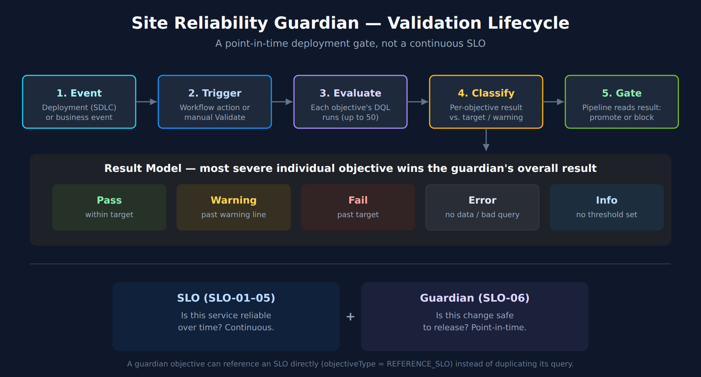

# SLO-06: Site Reliability Guardians

> **Series:** SLO — Service Level Objectives | **Notebook:** 6 of 6 | **Created:** August 2026 | **Last Updated:** 10/14/2026

## Overview

An SLO answers *"is this service reliable over time?"* — evaluated continuously against a rolling or calendar window (SLO-01). A **Site Reliability Guardian (SRG)** answers a narrower, sharper question: *"is this specific change safe to release?"* — a set of DQL-based objectives validated once, at a point in time, against a deployment or business event. This notebook covers what a guardian validates, how objectives and thresholds work, creating and triggering guardians, provisioning them as code, where guardians plug into a CI/CD pipeline, and how guardians and SLOs complement rather than compete with each other.

---

## Table of Contents

1. [What a Guardian Validates](#what)
2. [Objectives, Thresholds, and the Result Model](#objectives)
3. [Creating a Guardian](#creating)
4. [Triggering Validation](#triggering)
5. [Guardians as Code](#as-code)
6. [CI/CD Pipeline Integration](#cicd)
7. [Guardian vs SLO — Which One, or Both](#decision)

---

## Prerequisites

| Requirement | Details |
|-------------|---------|
| **Dynatrace Environment** | SaaS Gen3 with the Site Reliability Guardian app |
| **Permissions** | `app-settings:objects:read` / `app-settings:objects:write` (read and write guardian configurations); `storage:buckets:read`; `storage:events:write` (write business events during validations); the read scopes your objectives touch (`storage:logs:read`, `storage:metrics:read`, `storage:bizevents:read`, `storage:events:read`, `storage:spans:read`, `storage:entities:read`). For automation: `automation:workflows:read`, `automation:workflows:admin`, and `automation:workflows:run` (the last only if the pipeline triggers the workflow via API) |
| **Tooling (as code)** | Terraform with the `dynatrace-oss/dynatrace` provider, or Monaco |
| **Prior reading** | SLO-01 (SLI/SLO fundamentals), SLO-02 (writing DQL SLI queries — the same DQL skill authors guardian objectives) |

> <sub>**Sources:** [Site Reliability Guardian (DT docs)](https://docs.dynatrace.com/docs/deliver/site-reliability-guardian), permissions table read 10/12/2026.</sub>

<a id="what"></a>
## 1. What a Guardian Validates

A **Site Reliability Guardian** is a Dynatrace app that automates change impact analysis to validate service availability, performance, and capacity objectives for a set of guarded entities. Where an SLO is a standing promise evaluated continuously, a guardian is a **point-in-time validation** run against a specific event. The app supports two guardian types:

| Guardian type | `eventKind` | Triggered by |
|---|---|---|
| **Lifecycle guardian** | `SDLC_EVENT` | Software delivery events — a deployment, a release-stage transition |
| **Business guardian** | `BIZ_EVENT` | Business events — a marketing-campaign launch, a pricing change |

Both guardian types share the same mechanics: a named group of **objectives**, each one a DQL query evaluated against a chosen timeframe, checked against thresholds, and rolled up into a single result for the guardian as a whole.



<!-- MARKDOWN_TABLE_ALTERNATIVE
| Step | Action |
|------|--------|
| 1 Event | Deployment or business event occurs |
| 2 Trigger | Workflow (or manual Validate) starts guardian validation |
| 3 Evaluate | Each objective's DQL query runs against the event timeframe |
| 4 Classify | Per-objective result: Pass / Warning / Fail / Error / Info |
| 5 Roll up | Guardian result = most severe individual objective result |
| 6 Gate | CI/CD pipeline reads the result and promotes or blocks |
For environments where SVG doesn't render
-->

<a id="objectives"></a>
## 2. Objectives, Thresholds, and the Result Model

Each objective is, at its core, a DQL query returning a single scalar value, checked against a threshold. This is the same DQL skill from SLO-02 — a guardian objective and an SLO's SLI query are structurally the same *good ÷ total* or scalar-metric shape. What differs is the timeframe (a short deployment window, not a rolling 30 days) and what happens with the result (gate a release, not accumulate an error budget).

### Objective type

| `objectiveType` | What it evaluates |
|---|---|
| **`DQL`** | A DQL query you write, evaluated over the guardian's validation timeframe |
| **`REFERENCE_SLO`** | An existing **Classic** SLO, by its `func:slo.*` metric key. The docs mark this option **deprecated**. For an SLO built in the modern SLO app (SLO-01/02), reuse its SLI query in a `DQL` objective instead |

### Threshold type

| Threshold type | Behavior |
|---|---|
| **No thresholds** | Informational only — the objective reports a value but never fails the guardian |
| **Static thresholds** | Fixed `target` (fail point) and `warning` (soft threshold) values |
| **Auto-adaptive thresholds** | Threshold computed from history by the Dynatrace Intelligence threshold analyzer. It needs at least 5 validations first, and returns **Info** during that learning phase. DQL objectives only |

A `comparisonOperator` says which direction is good — "a higher value is good" (`GREATER_THAN_OR_EQUAL`) or "a lower value is good" (`LESS_THAN_OR_EQUAL`). An error-rate objective is a lower-is-good comparison against a `target`/`warning` pair; a request-count or bizevent-count objective is usually higher-is-good.

### Result model

Each objective resolves to one of five states, and **the guardian's overall result is the most severe individual objective result**:

| Result | Meaning |
|---|---|
| **Pass** | Value within the acceptable range |
| **Warning** | Value crossed the warning threshold but not the fail threshold |
| **Fail** | Value crossed the fail threshold |
| **Error** | The indicator could not be derived (bad query, no data) |
| **Info** | Informational objective (no threshold), or an auto-adaptive objective still learning — never drives Fail |

Two objective queries below, live-verified against the validation tenant, in the shape a guardian would actually run them — a short window, since a guardian validates one change, not a rolling reliability posture.

> <sub>**Sources:** [Add Site Reliability Guardian objective (DT docs)](https://docs.dynatrace.com/docs/deliver/site-reliability-guardian/reference) — under a *Deprecated* badge: *"If you want to reference a Classic SLO, you need to create a Classic SLO first and then the SRG allows you to select it."* [Site Reliability Guardian (DT docs)](https://docs.dynatrace.com/docs/deliver/site-reliability-guardian) — *"The Dynatrace Intelligence threshold analyzer requires a minimum of 5 validations for auto-adaptive thresholds to take effect. During this learning phase, the objective validation returns an info state."* Read 10/12/2026.</sub>

**Error rate — lower is good (`LESS_THAN_OR_EQUAL` comparison):**

```dql
// Guardian objective — error rate. Lower is good; compare against target/warning with LESS_THAN_OR_EQUAL.
// Live-verified 10/12/2026: returned 3.08% over the last 30 minutes, notifications [].
// Drop from: when pasting into a guardian objective — the validation sets the window.
timeseries {
  total = sum(dt.service.request.count),
  failures = sum(dt.service.request.failure_count)
}, from:-30m
| fieldsAdd errorRate = arraySum(failures) / arraySum(total) * 100
| fields errorRate
```

**Availability — higher is good (`GREATER_THAN_OR_EQUAL` comparison):**

```dql
// Guardian objective — availability. Higher is good; compare against target/warning with GREATER_THAN_OR_EQUAL.
// Live-verified against the validation tenant: returned ~95.6% over the last 30 minutes.
// Drop from: when pasting into a guardian objective — the validation sets the window.
timeseries {
  total = sum(dt.service.request.count),
  failures = sum(dt.service.request.failure_count)
}, from:-30m
| fieldsAdd availability = ((arraySum(total) - arraySum(failures)) / arraySum(total)) * 100
| fields availability
```

<a id="creating"></a>
## 3. Creating a Guardian

Two ways to create a guardian in the app:

- **From a template** — pick a template, run its prefilled DQL query to select guarded entities (or select all rows on the current page), then refine the pre-populated objectives.
- **Blank** — set the guardian type and name, then add objectives with your own DQL queries. When you select an entity, the app prefills the query with the correct scoping — replace any remaining placeholder (e.g. `HOST-PLACEHOLDER`) with your actual value.

**Limit:** a guardian supports a maximum of **50 objectives**.

**Variables** parameterize a guardian at the group level — define a guardian-level variable (prefixed `$`, e.g. `$MyTotal`), reference it inside an objective's DQL query, and set its value either at creation time or per validation run. This is what makes one guardian definition reusable across environments (dev / staging / prod) instead of hardcoding a threshold or entity per guardian copy.

<a id="triggering"></a>
## 4. Triggering Validation

A guardian's objectives don't evaluate themselves — validation is triggered one of two ways:

- **On-demand** — an operator opens the guardian and selects **Validate**. Useful while authoring objectives, or for an ad hoc check.
- **Automated, via Workflow** — a workflow with an event trigger runs the `dynatrace.site.reliability.guardian:validate-guardian-action` task, which validates a named guardian over a timeframe whenever a matching event arrives.

Dynatrace's release-validation tutorial *"recommends using SDLC events to implement the release validation use case. Business events are also supported."* Its trigger filter matches finished deployments: `event.kind == "SDLC_EVENT" AND event.type == "deployment" AND event.status == "finished"`. Add `AND cicd.deployment.release_stage == "staging"` (or your stage) to scope validation to the deployment that just happened, not every deployment across every service. The tutorial sets the action's timeframe to *"Last 2 hours"*, to be adjusted to your deployment and stabilization window, and maps guardian variables from the triggering event so the release metadata is stored with the result:

| Guardian variable | Expression |
|---|---|
| `deployment.name` | `{{event()['cicd.deployment.name']}}` |
| `service.id` | `{{event()['cicd.deployment.service.id']}}` |
| `commit_revision` | `{{event()['vcs.ref.base.revision']}}` |
| `version` | `{{event()['event.version']}}` |

The Monaco example on the Site Reliability Guardian as code page parameterizes the trigger differently, as `eventFilters` with `application: easytrade` and `stage: production`. Use whichever matches the events your pipeline actually sends.

This is ordinary Workflow mechanics — event trigger, filter condition, action — covered in general by the **WFLOW series**. What's specific to guardians is the action type and the fact that its result (Pass / Warning / Fail) is what a CI/CD pipeline reads back to decide whether to proceed (§6).

> <sub>**Sources:** [Set up automated release validation with Site Reliability Guardian (DT docs)](https://docs.dynatrace.com/docs/deliver/quality-gates) — updated Jul 20, 2026, read 10/14/2026. [Site Reliability Guardian as code (DT docs)](https://docs.dynatrace.com/docs/deliver/site-reliability-guardian/config-as-code-srg) — the `eventFilters` example; updated Aug 23, 2026, read 10/14/2026.</sub>

<a id="as-code"></a>
## 5. Guardians as Code

A guardian evaluated only by hand in the UI doesn't scale past one team's first pipeline. Provision it the same way SLO-05 provisions SLOs.

### Terraform

The `dynatrace_site_reliability_guardian` resource — schema confirmed against the `dynatrace-oss/dynatrace` provider registry, 08/31/2026:

```terraform
# dynatrace_site_reliability_guardian — schema confirmed against the
# dynatrace-oss/dynatrace provider registry, 08/31/2026.
resource "dynatrace_site_reliability_guardian" "checkout_release_gate" {
  name       = "Checkout Release Gate"
  event_kind = "SDLC_EVENT"
  tags       = ["stage:staging"]

  objectives {
    objective {
      name                = "Error rate"
      objective_type      = "DQL"
      comparison_operator = "LESS_THAN_OR_EQUAL"
      # No from: — the validation (workflow timeframeSelector or Validate dialog) sets the window.
      dql_query           = <<-EOT
        timeseries { total = sum(dt.service.request.count), failures = sum(dt.service.request.failure_count) }
        | fieldsAdd errorRate = arraySum(failures) / arraySum(total) * 100
        | fields errorRate
      EOT
      target  = 8
      warning = 6
    }
    objective {
      name                = "Checkout volume"
      objective_type      = "DQL"
      comparison_operator = "GREATER_THAN_OR_EQUAL"
      # No from: — the validation sets the window.
      dql_query           = <<-EOT
        fetch bizevents
        | filter event.type == "checkout"
        | summarize count()
      EOT
      target  = 50
      warning = 55
    }
  }
}
```

A few things this schema encodes, and where it diverges from the SLO-05 Terraform resource so you don't carry that field naming over by mistake:

- **`target` / `warning`**, not SLO-05's `target_success` / `target_warning` — two different resources, two different argument names for a similar idea.
- **`comparison_operator`** takes exactly `GREATER_THAN_OR_EQUAL` or `LESS_THAN_OR_EQUAL` — not the SLO app's own comparison vocabulary.
- **`objective_type = "REFERENCE_SLO"`** is the alternative to `DQL`: set `reference_slo` to a **Classic** SLO's `func:slo.*` metric key instead of writing a query. The docs mark referencing a Classic SLO as deprecated (§2), and a modern SLO-app SLO cannot be selected this way.
- **`event_kind`** is `SDLC_EVENT` or `BIZ_EVENT` — matching the guardian-type distinction from §1.

### Monaco

Monaco projects use a three-file convention rather than a single settings object:

| File | Holds |
|---|---|
| `guardian.json` | The guardian definition — name, `eventKind`, tags, and the `objectives` array (`objectiveType`, `dqlQuery` or a reference, `target`, `warning`, `comparisonOperator`) |
| `workflow.json` | The automation template that triggers validation — an event trigger with a filter condition, and a task invoking the guardian-validate action |
| `config.yaml` | Shared parameters both files reference, so one edit updates both the guardian and the workflow that validates it |

### dtctl: no dedicated resource, but reachable as settings

As of `dtctl` 0.40.0 (checked 09/28/2026), `dtctl get --help` lists no dedicated `guardians` resource. Guardians are Settings 2.0 objects, though — the Site Reliability Guardian as code page's Monaco example deploys them to the `app:dynatrace.site.reliability.guardian:guardians` schema — so `dtctl get settings --schema app:dynatrace.site.reliability.guardian:guardians` lists them (verified against a validation tenant the same day), and a settings object read that way can be round-tripped through `dtctl apply`. Terraform and Monaco remain the documented config-as-code paths; the settings route is a convenience for inspection and one-off edits.

<a id="cicd"></a>
## 6. CI/CD Pipeline Integration

The guardian mechanics above only pay off wired into a pipeline. The shape is consistent across CI/CD platforms:

1. **Deploy** the change to the target environment.
2. **Emit a deployment event** (an SDLC event, if using a lifecycle guardian) so Dynatrace has something to correlate the validation window against.
3. **Trigger the guardian workflow** — either directly from the pipeline (call the workflow/guardian API) or let the event trigger from step 2 fire it automatically (§4).
4. **Read back the result** with the results query at the end of this section. A Pass gates the pipeline forward; a Fail blocks promotion; a Warning is a judgment call — treat it like the slow-burn tier in SLO-04, a signal to the team rather than an automatic block.

**AUTOM-07** documents the working samples for this: `github_pipeline_observability` / `gitlab_pipeline_observability` / `argocd_observability` (Monaco and Terraform variants) ingest SDLC events via OpenPipeline with pre-built dashboards, and the former [dynatrace-automation-tools](https://github.com/Dynatrace/dynatrace-automation-tools) CLI, which wrapped guardian validation, is now **archived and no longer maintained** (its README points to dtctl). For new pipelines, send the SDLC event through the native CI/CD integrations. AUTOM-07's Community Resources section has the full sample matrix across GitHub Actions, GitLab CI, Azure DevOps, and ArgoCD.

**Results query.** After the guardian completes a validation, *"Dynatrace emits a validation finished SDLC event"*. The release-validation tutorial reads it with the query below: `validation.result` is the guardian's overall result, and `dt.srg.validation.summary` holds the per-objective results. For one row per objective, filter on `event.type == "validation.objective"` instead. Replace `payment-api` with your guardian's tag. This query runs on the validation tenant but returns no rows there, because that tenant has no guardian validations, so it has not been checked against real guardian output.

> <sub>**Sources:** [Set up automated release validation with Site Reliability Guardian (DT docs)](https://docs.dynatrace.com/docs/deliver/quality-gates) — the results query, read 10/14/2026; `from:` added here. Executed 10/14/2026: no error, notifications `[]`, 0 rows; the same tenant held 10.1M events and 0 `SDLC_EVENT` records over 30 days.</sub>

```dql
// Guardian validation results — the release-validation tutorial's query
// Executed 10/14/2026: runs, notifications [], 0 rows (no guardian validations on that tenant)
// Replace "payment-api" with your guardian's tag
fetch events, from:-24h
| filter event.kind == "SDLC_EVENT"
| filter event.provider == "dynatrace.site.reliability.guardian"
| filter event.type == "validation"
| filter event.status == "finished"
| filter contains(dt.srg.tags, "payment-api")
| fields timestamp, validation.result, version = event.version, guardian_name = dt.srg.name, guardian_id = dt.srg.id, guardian_objective_results = dt.srg.validation.summary, executed_workflow = dt.automation_engine.workflow.id
```

<a id="decision"></a>
## 7. Guardian vs SLO — Which One, or Both

| | SLO (SLO-01–05) | Site Reliability Guardian |
|---|---|---|
| **Question answered** | Is this service reliable over time? | Is this specific change safe to release? |
| **Evaluation** | Continuous, rolling or calendar window (SLO-01 §4, SLO-03 §5) | Point-in-time, triggered by an event |
| **Output** | Error budget consumption, burn rate (SLO-03) | Pass / Warning / Fail / Error / Info per objective |
| **Alerting fit** | Burn-rate alerting, ongoing (SLO-04) | Pipeline gate — block or promote a deployment |
| **As code** | `dynatrace_platform_slo` (SLO-05) | `dynatrace_site_reliability_guardian` (§5) |

They are not competing mechanisms. To use both together, reuse the SLO's SLI query as a `DQL` objective — or its burn-rate form, which the SLO docs describe as *"input for regularly scheduled evaluations via Site-Reliability Guardian"*. (`REFERENCE_SLO` works only with a Classic SLO, and the docs mark it deprecated, §2.) The division of labor: **the SLO defines what "reliable" means for the service on an ongoing basis; the guardian asks whether the change you're about to ship keeps it that way.** A team with no SLOs yet can still use guardians standalone with DQL objectives (§2) — a guardian doesn't require an SLO to exist first — but a mature setup typically has SLOs defining the target and guardians enforcing it at every release.

## Summary

In this notebook you learned:

1. **What a guardian validates** — point-in-time change validation, not continuous reliability; Lifecycle (`SDLC_EVENT`) vs Business (`BIZ_EVENT`) guardian types
2. **Objectives and thresholds** — `DQL` objectives (and the deprecated, Classic-only `REFERENCE_SLO`), static / auto-adaptive / no-threshold modes, and the five-state Pass / Warning / Fail / Error / Info result model (most severe wins)
3. **Creating a guardian** — template vs blank, the 50-objective limit, guardian-level variables
4. **Triggering validation** — on-demand Validate vs the automated Workflow action
5. **Guardians as code** — the `dynatrace_site_reliability_guardian` Terraform resource, the Monaco three-file convention, and reaching guardians through `dtctl` settings
6. **CI/CD integration** — the deploy → event → trigger → gate shape, and where AUTOM-07's working samples plug in
7. **Guardian vs SLO** — complementary, not competing; a guardian objective reuses the SLO's SLI query

## Series Summary

| Notebook | Topic | Key Takeaway |
|----------|-------|--------------|
| SLO-01 | Fundamentals | SLI/SLO/error-budget building blocks, modern vs classic SLO app |
| SLO-02 | Defining SLIs | Good/total DQL for availability, latency, error-rate, and business SLIs |
| SLO-03 | Composition & Error Budgets | Burn-rate math, composite/weighted-global SLOs, rolling vs calendar windows |
| SLO-04 | Alerting | Burn-rate over threshold-on-SLI; fast/slow-burn multiwindow alerts |
| SLO-05 | SLOs as Code | Terraform/Monaco/API provisioning for the modern SLO app |
| SLO-06 | Site Reliability Guardians | Point-in-time deployment validation gates, complementary to ongoing SLOs |

> <sub>**Sources:** [Site Reliability Guardian (DT docs)](https://docs.dynatrace.com/docs/deliver/site-reliability-guardian), [Create a Site Reliability Guardian (DT docs)](https://docs.dynatrace.com/docs/deliver/site-reliability-guardian/create-srg), [Add Site Reliability Guardian objective (DT docs)](https://docs.dynatrace.com/docs/deliver/site-reliability-guardian/reference), [Site Reliability Guardian as code (DT docs)](https://docs.dynatrace.com/docs/deliver/site-reliability-guardian/config-as-code-srg), [dynatrace_site_reliability_guardian resource (Dynatrace provider docs)](https://registry.terraform.io/providers/dynatrace-oss/dynatrace/latest/docs/resources/site_reliability_guardian). Terraform schema and the objective/threshold model fetched at source 08/31/2026; the two DQL objective queries in §2 were executed against the validation tenant the same day. On 10/12/2026 the error-rate objective was rewritten to count failures (it had measured the share of requests slower than 500 ms) and re-executed, and the `REFERENCE_SLO`, auto-adaptive and permissions statements were re-read against the pages above; the SLO-docs quote in §7 is from [Service-Level Objectives (DT docs)](https://docs.dynatrace.com/docs/analyze-explore-automate/service-level-objectives). The `dtctl` note in §5 is a dated check (`dtctl` 0.40.0, `dtctl get --help`, `dtctl apply --help` (its examples include updating a settings object) and `dtctl get settings --schema app:dynatrace.site.reliability.guardian:guardians`, 09/28/2026); the schema ID is the one the Site Reliability Guardian as code page's Monaco example uses.</sub>

---

<sub>*This notebook was AI-generated from community-submitted and publicly available sources. This notebook series is not officially supported by Dynatrace. Always verify information against official Dynatrace documentation.*</sub>
