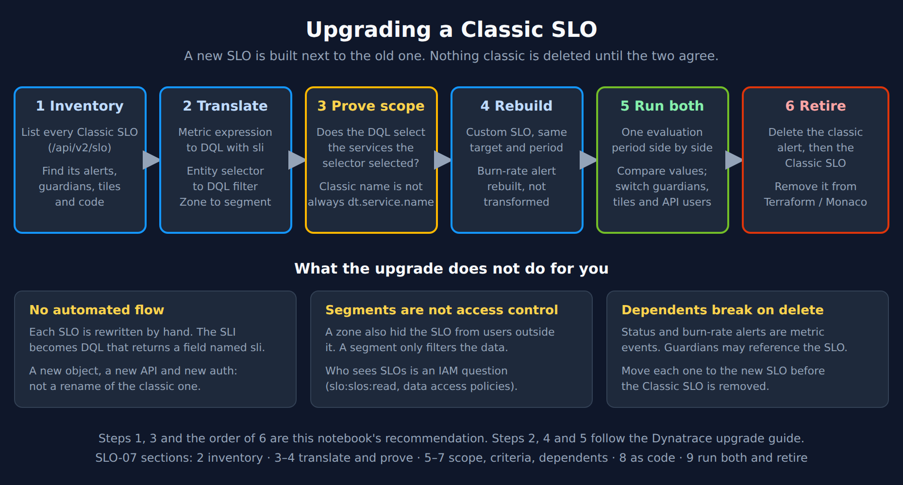

# SLO-07: Upgrading Classic SLOs

> **Series:** SLO — Service Level Objectives | **Notebook:** 7 of 7 | **Created:** November 2026 | **Last Updated:** 11/19/2026

## Overview

SLO-01 to SLO-06 build SLOs in the Service-Level Objectives app from scratch. This notebook is for the other starting point: a tenant that already has **SLO Classic** definitions, and the alerts, guardians, dashboards and Terraform that depend on them.

Dynatrace publishes an upgrade guide, and it is the procedure this notebook follows. The guide covers one SLO at a time, by hand. It does not cover finding every Classic SLO, what else points at each one, or checking that the rewritten query measures the same services. Those are the steps that go wrong, so most of this notebook is about them:

- **Inventory and classify** every Classic SLO before rewriting any of them
- **Translate** the metric expression and entity selector to a DQL SLI, following the guide
- **Prove the scope** — on the validation tenant, a name filter written the obvious new way selected five services where the classic selector selected one
- **Move the dependents** — status and burn-rate alerts, guardian objectives, dashboard tiles, API users and Terraform state
- **Run both for one evaluation period**, then retire the Classic SLO last

---

## Table of Contents

1. [What Changes](#what-changes)
2. [Inventory and Classify](#inventory)
3. [Translate the SLI](#translate)
4. [Prove the Query Selects the Same Services](#prove-scope)
5. [Scope and Access](#scope-and-access)
6. [Criteria](#criteria)
7. [Alerts and Other Dependents](#dependents)
8. [SLOs as Code](#as-code)
9. [Run Both, Then Retire](#run-both)
10. [Checklist and Summary](#checklist)

---

## Prerequisites

| Requirement | Details |
|-------------|---------|
| **Dynatrace Environment** | SaaS with Grail and the Service-Level Objectives app, with SLO Classic definitions still present |
| **Permissions (new SLOs)** | `slo:slos:read` and `slo:slos:write`, plus read access to the data the SLI queries (`storage:metrics:read` for the service metrics used here); `storage:filter-segments:read` to apply a segment (SLO-01 §3) |
| **Permissions (inventory)** | A classic API token with `slo.read` for the Classic SLO list and `settings.read` for the metric-event search (§2) |
| **Prior reading** | SLO-01 (the two SLO generations), SLO-02 (SLI query shapes), SLO-04 (burn-rate alerts), SLO-05 (SLOs as code) |
| **If zones are involved** | MZ2POL-12 (the access model) and MZ2POL-16 §4 (classic SLOs as one of several zone consumers) |

<a id="what-changes"></a>
## 1. What Changes

The upgrade guide sums up the difference in one table. The rows that change the work:

| | SLO Classic | Service-Level Objectives |
|---|---|---|
| **SLI** | A percentage metric expression over built-in or calculated metrics | A DQL query that returns a field named `sli` — over metrics, spans, logs, events or business events |
| **Data filtering** | Management zones | Segments |
| **Tags** | None | SLO tags (key-value pairs) |
| **Dashboard tile** | Classic dashboard tile | Dashboards SLO tile |
| **API** | Service-level Objectives API classic (`/api/v2/slo`) | SLO Service Public API |
| **Settings schema** | `builtin:monitoring.slo` | None — the SLO service is the store |
| **Terraform** | `dynatrace_slo_v2` | `dynatrace_platform_slo` |

**There is no automated path.** The guide: *"An automated upgrade flow is under consideration; however, given the highly customized nature of SLOs, manual review is expected to yield the best results."* Each Classic SLO becomes a new SLO, created by hand or by code, next to the old one.

**The classic schema is on the removal list.** `builtin:monitoring.slo` (*Service-level objective definitions*) appears on Dynatrace's list of Settings 2.0 schemas removed in Latest Dynatrace, replaced by Service-Level Objectives. The page says *"None of the schemas on this page are visible in Latest Dynatrace."* and asks for automations that reference these schemas by ID to be updated *"before the schemas are removed from your environment."* It gives no removal date. SLO-01 §3 explains how this relates to the tenant upgrade readiness scan, which flags the classic surfaces as blocked at upgrade.



<!-- MARKDOWN_TABLE_ALTERNATIVE
| Step | What happens | Source |
|------|--------------|--------|
| 1 Inventory | List every Classic SLO (/api/v2/slo); find its alerts, guardians, tiles and code | This notebook's recommendation |
| 2 Translate | Metric expression to DQL with sli; entity selector to DQL filter; zone to segment | Upgrade guide |
| 3 Prove scope | Check the DQL selects the services the selector selected — the classic name is not always dt.service.name | This notebook's recommendation |
| 4 Rebuild | Custom SLO with the same target and period; burn-rate alert rebuilt, not transformed | Upgrade guide; metric alerting guide |
| 5 Run both | One evaluation period side by side; compare values; switch guardians, tiles and API users | Upgrade guide |
| 6 Retire | Delete the classic alert, then the Classic SLO; remove it from Terraform or Monaco | Order is this notebook's recommendation |
| Not automated | Each SLO is rewritten by hand; a new object, API and auth, not a rename | |
| Not access control | A zone also hid the SLO; a segment only filters data; visibility is IAM | |
| Dependents | Status and burn-rate alerts are metric events; guardians may reference the SLO | |
For environments where SVG doesn't render
-->

> <sub>**Sources:**</sub>
> - <sub>[Upgrade from Service-Level Objectives Classic to Service-Level Objectives (DT docs)](https://docs.dynatrace.com/docs/platform/upgrade/keep-problems-and-alerting-working/service-level-objective-upgrade-classic) — *"An automated upgrade flow is under consideration; however, given the highly customized nature of SLOs, manual review is expected to yield the best results."*</sub>
> - <sub>[Settings 2.0 schemas that are removed in Latest Dynatrace (DT docs)](https://docs.dynatrace.com/docs/dynatrace-api/environment-api/settings/removed-schemas) — *"None of the schemas on this page are visible in Latest Dynatrace."*; *"If you use configuration-as-code or other automations that reference these schemas by ID, you need to update these automations before the schemas are removed from your environment."*</sub>
> - <sub>[Service-level Objectives API classic (DT docs)](https://docs.dynatrace.com/docs/dynatrace-api/environment-api/service-level-objectives-classic), [Service-Level Objectives API (DT docs)](https://docs.dynatrace.com/docs/dynatrace-api/platform-api/platform-slo-v1), [platform_slo.md (Dynatrace GitHub)](https://github.com/dynatrace-oss/terraform-provider-dynatrace/blob/main/docs/resources/platform_slo.md), [slo_v2.md (Dynatrace GitHub)](https://github.com/dynatrace-oss/terraform-provider-dynatrace/blob/main/docs/resources/slo_v2.md)</sub>

<a id="inventory"></a>
## 2. Inventory and Classify

The guide starts from one SLO you have already chosen. Start one step earlier: list them all, and decide for each one what the upgrade involves. A Classic SLO that is disabled, or that nobody reads, is cheaper to retire than to upgrade.

The Classic SLO API lists every SLO with the fields this notebook needs: `metricExpression` (*"The percentage-based metric expression for the calculation of the SLO."*), `filter` (*"The entity filter for the SLO evaluation."*), `timeframe`, `target`, `warning`, `enabled` and `metricKey`, the `func:slo.*` key of the SLO's status metric.

```shellscript
# List every Classic SLO, enabled or not, one row each, into classic-slos.tsv.
# Token: classic API token with slo.read (a platform token or OAuth client needs settings:objects:read).
# pageSize 10000 is the documented maximum. If totalCount is larger, call again with nextPageKey
# and no other parameters.
curl -sS -G "https://${DT_ENV_ID}.live.dynatrace.com/api/v2/slo" \
  -H "Authorization: Api-Token ${DT_API_TOKEN}" \
  --data-urlencode "pageSize=10000" \
  --data-urlencode "enabledSlos=all" \
  --data-urlencode "showGlobalSlos=true" \
| jq -r '"id\tname\tenabled\ttimeframe\ttarget\twarning\tmetricKey\tfilter\tmetricExpression",
         (.slo[] | [.id, .name, .enabled, .timeframe, .target, .warning, .metricKey, .filter, .metricExpression] | @tsv)' \
> classic-slos.tsv
```

To list one zone's SLOs, add `--data-urlencode 'sloSelector=managementZone("Payments Prod")'`. MZ2POL-15 §3 finds every SLO whose `filter` names a zone, by name or ID.

**Find the alerts.** A Classic SLO's status and burn-rate alerts are metric events: *"Your newly created SLO or burn rate alert will appear on the Metric events page, where you can configure it further."* The cell below searches every metric-event object for a `func:slo.` key. That the alert stores the key in its value is an assumption, not documented, so compare the result with the Metric events page before trusting it — a zero here proves nothing on its own.

```shellscript
# Metric events that mention an SLO func metric, into slo-alerts.tsv: objectId, summary, func:slo keys.
# Token: classic API token with settings.read. Follows nextPageKey until it is empty.
url="https://${DT_ENV_ID}.live.dynatrace.com/api/v2/settings/objects"
params=(--data-urlencode "schemaIds=builtin:anomaly-detection.metric-events"
        --data-urlencode "fields=objectId,value"
        --data-urlencode "pageSize=500")
: > slo-alerts.tsv
while :; do
  page=$(curl -sS -G "$url" -H "Authorization: Api-Token ${DT_API_TOKEN}" "${params[@]}")
  echo "$page" | jq -r '.items[]
    | (.value | tostring) as $v
    | select($v | test("func:slo\\."))
    | [.objectId, (.value.summary // ""), ([$v | scan("func:slo\\.[A-Za-z0-9_.]+")] | unique | join(","))]
    | @tsv' >> slo-alerts.tsv
  next=$(echo "$page" | jq -r '.nextPageKey // empty')
  [ -z "$next" ] && break
  params=(--data-urlencode "nextPageKey=${next}")
done
```

> **Execution status:** the two cells above were **not executed** for this notebook. The CLI session to the validation tenant was unavailable on 11/19/2026. The endpoints, parameters and response fields follow the API reference pages cited below. Run them against a non-production tenant first and check the row counts against the Classic SLO and Metric events pages.

**Classify each row.** One question per column:

| Question | How to tell | What it means for the upgrade |
|---|---|---|
| Is it worth upgrading? | `enabled` is false, or nobody reads it | Retire instead of upgrading |
| Simple or complex SLI? | `metricExpression` uses only service request and failure counts | Simple: §3. Complex: the metric-selector conversion guide, and some transformations have no DQL form (§3) |
| Does a zone scope it? | `filter` contains `mzName(…)` or `mzId(…)` | A segment for the data, and IAM for who can see it (§5) |
| Does a name select its entities? | `filter` contains `entityName…(…)` | Prove the new query selects the same services (§4) |
| Does it alert? | A row in `slo-alerts.tsv` for its `metricKey` family | Rebuild the alert on the new SLO, don't transform it (§7) |
| Does a guardian reference it? | A guardian objective of type Reference SLO | Replace the objective with a DQL one before retiring (§7) |
| Is it managed as code? | A `dynatrace_slo_v2` resource or a Monaco `builtin:monitoring.slo` config | Add the new resource, retire the old one last (§8) |

> <sub>**Sources:**</sub>
> - <sub>[List all SLOs — Service-level Objectives API classic (DT docs)](https://docs.dynatrace.com/docs/dynatrace-api/environment-api/service-level-objectives-classic/get-all) — *"The maximal allowed page size is 10000."*; *"When the nextPageKey is set to obtain subsequent pages, you must omit all other query parameters."*; *"The percentage-based metric expression for the calculation of the SLO."*; *"The entity filter for the SLO evaluation."*</sub>
> - <sub>[Configure and monitor service-level objectives (SLOs Classic) (DT docs)](https://docs.dynatrace.com/docs/analyze-explore-automate/service-level-objectives-classic/configure-and-monitor-slo) — *"Burn rate alerts are sent when the error budget of an SLO decreases at a specific rate."*; *"will appear on the Metric events page, where you can configure it further."*</sub>
> - <sub>[Settings API (DT docs)](https://docs.dynatrace.com/docs/dynatrace-api/environment-api/settings)</sub>

<a id="translate"></a>
## 3. Translate the SLI

### The documented path

For a simple SLO, the guide's procedure turns the classic expression into DQL through Data Explorer. In outline: open the Classic SLO, select **View in Data Explorer**, then **Open with… > Add to notebook**. In the notebook, rename the result field on the last line of the query to `sli` — *"The SLO requires the query to return a field named `sli`."* Copy the query, create a **Custom SLO** in Service-Level Objectives, paste it into **Custom DQL** and select **Refresh** to see it in the preview. Then set the criteria (§6) and the name, and save.

Two warnings from the same page. Data Explorer uses its own timeframe, so the value it shows will not match the Classic SLO — compare values in §9, not here. And *"If the Classic SLO used entity selectors, management zones, or SLO tags, you may have to upgrade metrics, entities, and filters separately."*

### Metric keys

Most Classic SLOs measure service success. The classic keys they use map to two Grail metrics:

| Classic metric key | Grail metric |
|---|---|
| `builtin:service.requestCount.server`, `builtin:service.requestCount.total` | `dt.service.request.count` |
| `builtin:service.errors.server.successCount`, `builtin:service.errors.total.successCount` | `dt.service.request.count` with `failed == false` |
| `builtin:service.errors.total.count` | `dt.service.request.failure_count` |

The service metric migration guide: *"To convert the Classic service metrics that track the count and rate of successful versus failed requests, use the `dt.service.request.count` Grail-based metric filtered by `failed == false` or `failed == true`."* Subtracting `dt.service.request.failure_count` from the total gives the same number: on the validation tenant both forms returned 99.889% for the same service over 24 h (11/19/2026). The `server` and `total` variants of a classic key map to the same Grail metric, and neither page explains the difference — one more reason to compare values in §9.

For anything beyond these keys — `:fold`, `:rollup`, `:default`, arithmetic between selectors — follow the metric-selector conversion guide. It says *"Not all Classic metric selectors have equivalent DQL."* For example, *"The Classic `smooth` transformation has no equivalent in DQL."* A Classic SLO built on one of those has no one-to-one upgrade: decide what it should measure now, and build that (SLO-02).

### Entity selectors

The guide maps entity-selector conditions to DQL:

| Classic entity selector | DQL in the guide |
|---|---|
| `type("SERVICE")` | `by: {dt.entity.service}` |
| `entityId("SERVICE-…")` | `filter in(dt.entity.service, …)` |
| `entityName.equals / .in / .contains / .startsWith(…)` | `fieldsAdd name = entityName(dt.entity.service)`, then filter on `name` |
| `tag("myTag")` | `fieldsAdd tags = entityAttr(dt.entity.service, "tags")`, then filter on `tags` |
| `mzId(…)` / `mzName(…)` | Use segments (§5) |
| `toRelationship` / `fromRelationship` | The relationship mapping table for querying entities in Grail |

### A worked translation

The cell translates a Classic SLO that measures three services together. `:splitBy()` with no dimension merged the selected services into one series, so the `summarize` merges them back into one, element by element. Without it, the query returns one `sli` series per service.

On the validation tenant this query matched **one** service, not three. §4 shows why, and why the other obvious translation is worse.

```dql
// Classic SLO, translated:
//   metricExpression: (100)*(builtin:service.errors.server.successCount:splitBy())/(builtin:service.requestCount.server:splitBy())
//   filter:           type("SERVICE"),entityName.in("frontend","recommendationservice","offerservice")
// entityName() returns the classic entity name, the name the selector matched (§4).
// summarize merges the services into one series, as :splitBy() did.
// Executed 11/19/2026: one service matched, 145 ten-minute buckets, notifications []
// Remove from: when pasting into the SLO app; the SLO's criteria set the period
timeseries {
  total = sum(dt.service.request.count),
  failures = sum(dt.service.request.failure_count)
}, by: { dt.entity.service }, from:-24h
| fieldsAdd name = entityName(dt.entity.service)
| filter in(name, {"frontend", "recommendationservice", "offerservice"})
| summarize {
    total = sum(total[]),
    failures = sum(failures[]),
    timeframe = takeAny(timeframe),
    interval = takeAny(interval)
  }
| fieldsAdd sli = ((total[] - failures[]) / total[]) * 100
```

The query keeps `timeframe` and `interval` after the `summarize`, as the guide's own example keeps them in its final `fields`. The merged form was run as a notebook query only. Check it in the SLO app's preview before saving: the app requires *"an `sli` field that returns an array of `double` type values"*.

> <sub>**Sources:**</sub>
> - <sub>[Upgrade from Service-Level Objectives Classic to Service-Level Objectives (DT docs)](https://docs.dynatrace.com/docs/platform/upgrade/keep-problems-and-alerting-working/service-level-objective-upgrade-classic) — *"The SLO requires the query to return a field named `sli`."*; *"If the Classic SLO used entity selectors, management zones, or SLO tags, you may have to upgrade metrics, entities, and filters separately."*; *"For complex metric expressions, you might need to manually adapt the DQL queries."*</sub>
> - <sub>[Service metric migration (DT docs)](https://docs.dynatrace.com/docs/platform/upgrade/preserve-metrics-and-service-visibility/metrics/service-metric-migration) — *"To convert the Classic service metrics that track the count and rate of successful versus failed requests, use the `dt.service.request.count` Grail-based metric filtered by `failed == false` or `failed == true`."*</sub>
> - <sub>[Built-in Metrics on Grail (DT docs)](https://docs.dynatrace.com/docs/analyze-explore-automate/metrics/built-in-metrics-on-grail) — the classic keys listed under `dt.service.request.count` and `dt.service.request.failure_count`</sub>
> - <sub>[Upgrade metric selectors to DQL (DT docs)](https://docs.dynatrace.com/docs/platform/upgrade/preserve-metrics-and-service-visibility/metrics/metric-selector-conversion) — *"Not all Classic metric selectors have equivalent DQL."*; *"The Classic `smooth` transformation has no equivalent in DQL."*</sub>
> - <sub>[Create service-level objectives (DT docs)](https://docs.dynatrace.com/docs/analyze-explore-automate/service-level-objectives/create-slo) — *"Your query must include an `sli` field that returns an array of `double` type values"*</sub>

<a id="prove-scope"></a>
## 4. Prove the Query Selects the Same Services

A Classic SLO's `entityName` condition matches the **classic entity name**. Grail service metrics also carry `dt.service.name`, which the semantic dictionary describes as *"The Dynatrace service name derived from service detection rules. It is equal to the Smartscape service node name."* The two are not always the same string, and the difference changes which services an SLO measures.

The cell lists every service that either name matches, with both names side by side.

```dql
// Which services does each name select? One row per service that either name matches.
// Executed 11/19/2026: 5 rows. The classic name matched 1 service; dt.service.name matched all 5.
timeseries total = sum(dt.service.request.count), by: { dt.entity.service, dt.service.name }, from:-24h
| fieldsAdd classic_name = entityName(dt.entity.service), requests = arraySum(total)
| filter in(dt.service.name, {"frontend", "recommendationservice", "offerservice"})
    or in(classic_name, {"frontend", "recommendationservice", "offerservice"})
| fields dt.entity.service, classic_name, dt.service.name, requests
| sort requests desc
```

**What the validation tenant returned (11/19/2026, names shortened).** Five services:

| Classic name | `dt.service.name` | Requests, 24 h |
|---|---|---|
| `[cluster] - frontend` | `frontend` | 249,595 |
| `[cluster] - recommendationservice` | `recommendationservice` | 198,354 |
| `[cluster] - offerservice` | `offerservice` | 144,269 |
| `frontend` | `frontend` | 29,633 |
| `[cluster] - frontend` | `frontend` | 2,164 |

Three different services are called `frontend` in `dt.service.name`. Most classic names carry a prefix that `dt.service.name` does not. So the two filters share one service out of five:

- A **classic-name** filter on `frontend` selects only the service whose classic name is exactly `frontend` — 29,633 requests. That is what a Classic SLO with `entityName.equals("frontend")` measured. Its 24 h success rate was **97.03%**.
- A **`dt.service.name`** filter on `frontend` selects all three `frontend` services — about 281,000 requests, at **99.59%**.

Nothing errors in either case. An SLO rebuilt on `dt.service.name` would report a higher success rate, measured over different services, and the parallel run in §9 is the only place that difference shows.

**Choose the form deliberately:**

| Filter on | Selects | Use when |
|---|---|---|
| `entityName(dt.entity.service)` (the guide's form) | Exactly what the classic name selector selected | You need the same result as the Classic SLO. `dt.entity.service` is `deprecated` in the semantic dictionary, so plan to move off it |
| `dt.smartscape.service` IDs, with `toSmartscapeId("SERVICE-…")` | A fixed list of services | The set of services is fixed. Resolve the IDs with this cell, then pin them — SLO-02 §2 shows the filter |
| `dt.service.name` | Services by their Smartscape name — possibly more than before | The cell above shows the same set as the classic name, or you mean to change the scope |

Run the cell for every SLO whose `filter` selects by name, with that SLO's names. Do the same for `tag(…)` conditions: compare the services the tag selects with the ones the new filter selects.

> <sub>**Dictionary:** `dt.service.name` (`stable`) — *"The Dynatrace service name derived from service detection rules. It is equal to the Smartscape service node name."*; `dt.smartscape.service` (`stable`, type `smartscapeId`); `dt.entity.service` (`deprecated`), read 11/19/2026.</sub>

<a id="scope-and-access"></a>
## 5. Scope and Access

A management zone did two jobs for a Classic SLO. It **filtered the data** — `mzName(…)` in the SLO's `filter` — and it **controlled who could see the SLO**: *"If you add an SLO to a management zone, only users who have access to that management zone can see it"*.

Only the first job moves to a segment. The guide: *"In this step, management zones become segments."* In a Custom SLO, *"The selected segments are stored with the SLO definition."* and a segment *"is an additional filter to the query."* In Terraform it is `custom_sli.filter_segments` (§8). MZ2POL-05 covers building a segment that matches a zone.

The second job does not move at all. The guide's own entity-selector table says *"Segments aren't related to permissions or access control."*, and the segments documentation adds that *"All queries, with or without segments, always respect data access permissions enforced by IAM policies."* Who can see SLOs in the new app is set by IAM (`slo:slos:read`, SLO-01 §3), and what data a viewer's SLO queries return is set by their data-access policies. If a zone was hiding SLOs from some users, design that with MZ2POL-12 before the Classic SLO goes away.

> <sub>**Sources:**</sub>
> - <sub>[Configure and monitor service-level objectives (SLOs Classic) (DT docs)](https://docs.dynatrace.com/docs/analyze-explore-automate/service-level-objectives-classic/configure-and-monitor-slo) — *"If you add an SLO to a management zone, only users who have access to that management zone can see it"*</sub>
> - <sub>[Upgrade from Service-Level Objectives Classic to Service-Level Objectives (DT docs)](https://docs.dynatrace.com/docs/platform/upgrade/keep-problems-and-alerting-working/service-level-objective-upgrade-classic) — *"In this step, management zones become segments."*; *"Segments aren't related to permissions or access control."*</sub>
> - <sub>[Create service-level objectives (DT docs)](https://docs.dynatrace.com/docs/analyze-explore-automate/service-level-objectives/create-slo) — *"The selected segments are stored with the SLO definition."*</sub>
> - <sub>[Visibility of segments (DT docs)](https://docs.dynatrace.com/docs/manage/segments/concepts/segments-concepts-visibility) — *"All queries, with or without segments, always respect data access permissions enforced by IAM policies."*</sub>

<a id="criteria"></a>
## 6. Criteria

The guide's instruction is to enter the same target and evaluation period as the Classic SLO, with an optional warning. The fields map directly:

| Classic SLO (API / `dynatrace_slo_v2`) | Service-Level Objectives (app / `dynatrace_platform_slo`) |
|---|---|
| `target` / `target_success` | **Target** / `criteria_detail.target` |
| `warning` / `target_warning` | **Show warning at** / `criteria_detail.warning` |
| `timeframe` / `evaluation_window`, e.g. `-30d` | Evaluation period / `criteria_detail.timeframe_from` and `timeframe_to`, e.g. `now-30d` and `now` |
| `evaluationType` (`AGGREGATE` only) | No equivalent field |

Keep the target and period the same during the parallel run, even if you plan to change them. A changed target makes the §9 comparison meaningless. Change it after the Classic SLO is retired.

> <sub>**Sources:** [Upgrade from Service-Level Objectives Classic to Service-Level Objectives (DT docs)](https://docs.dynatrace.com/docs/platform/upgrade/keep-problems-and-alerting-working/service-level-objective-upgrade-classic), [Create service-level objectives (DT docs)](https://docs.dynatrace.com/docs/analyze-explore-automate/service-level-objectives/create-slo), [platform_slo.md (Dynatrace GitHub)](https://github.com/dynatrace-oss/terraform-provider-dynatrace/blob/main/docs/resources/platform_slo.md), [slo_v2.md (Dynatrace GitHub)](https://github.com/dynatrace-oss/terraform-provider-dynatrace/blob/main/docs/resources/slo_v2.md). **Derived:** the field mapping pairs the two resources' schemas; no page lists it.</sub>

<a id="dependents"></a>
## 7. Alerts and Other Dependents

Everything that points at a Classic SLO stops working when it is deleted. Move each dependent to the new SLO during the parallel run.

### Status and burn-rate alerts

The metric alerting upgrade guide lists SLO alerts among the metric events other solutions create: *"In Service-Level Objectives Classic you have the option to create a burn rate or status alerts."* It also warns *"SLO use functional metrics which behave different during transformation."* and *"We're working on a separated guide, covering SLOs and how to upgrade them."* No such guide is linked as of 11/19/2026.

So **do not transform** a Classic SLO's metric event. Build the alert again on the new SLO with the burn-rate recipe in SLO-04 §3, and route it with SLO-04 §4. One difference to plan for: *"Segments are currently not supported by Anomaly Detection."* A burn-rate alert for a segment-scoped SLO must carry the scope as a filter in its own DQL.

During the parallel run, both alerts can fire for the same breach. Send the new one to a test channel until cutover, or accept duplicate pages for one period — decide which before the new alert goes live.

### Site Reliability Guardian objectives

A guardian objective can reference a Classic SLO. The guardian reference marks that option **Deprecated**: *"If you want to reference a Classic SLO, you need to create a Classic SLO first and then the SRG allows you to select it."* Replace each such objective with a DQL objective that reuses the new SLO's SLI query (SLO-06 §2) before the Classic SLO is deleted.

### Dashboards, API users and other readers

- **Dashboard tiles.** Classic SLO tiles live on classic dashboards. Add the new SLO to a dashboard with **Add to Dashboard** from the SLO's actions.
- **API users.** Scripts on `/api/v2/slo` move to the SLO Service Public API — a different API with different auth.
- **`func:slo.*` readers.** Charts and metric events that read a Classic SLO's status, error-budget or burn-rate metrics read nothing once it is gone. The `slo-alerts.tsv` search in §2 finds the metric events, not the charts.

> <sub>**Sources:**</sub>
> - <sub>[Upgrade Metric Alerting (DT docs)](https://docs.dynatrace.com/docs/platform/upgrade/keep-problems-and-alerting-working/metric-alerting) — *"In Service-Level Objectives Classic you have the option to create a burn rate or status alerts."*; *"SLO use functional metrics which behave different during transformation."*; *"We're working on a separated guide, covering SLOs and how to upgrade them."*</sub>
> - <sub>[Service-Level Objectives (DT docs)](https://docs.dynatrace.com/docs/analyze-explore-automate/service-level-objectives) — *"Segments are currently not supported by Anomaly Detection."*</sub>
> - <sub>[Add Site Reliability Guardian objective (DT docs)](https://docs.dynatrace.com/docs/deliver/site-reliability-guardian/reference) — *"If you want to reference a Classic SLO, you need to create a Classic SLO first and then the SRG allows you to select it."*</sub>
> - <sub>[Service-level objective tile view (DT docs)](https://docs.dynatrace.com/docs/analyze-explore-automate/service-level-objectives/service-level-objective-tile-view), [Service-Level Objectives API (DT docs)](https://docs.dynatrace.com/docs/dynatrace-api/platform-api/platform-slo-v1)</sub>

<a id="as-code"></a>
## 8. SLOs as Code

A Classic SLO in Terraform is a `dynatrace_slo_v2` resource. Its successor is a `dynatrace_platform_slo` resource — a different resource type, on a different API, with different auth:

| | `dynatrace_slo_v2` | `dynatrace_platform_slo` |
|---|---|---|
| Writes to | `builtin:monitoring.slo` | The SLO Service |
| Auth | Classic API token: `slo.read`, `slo.write`, `settings.read`, `settings.write` | OAuth client: `slo:slos:read`, `slo:slos:write` |
| SLI | `metric_expression` (metric selector) | `custom_sli.indicator` (DQL) |
| Zone or segment | `mzName(…)` in `filter` | `custom_sli.filter_segments` |
| Export | `terraform-provider-dynatrace -export dynatrace_slo_v2` | Excluded by default — name it explicitly |

**It is a new object, not a rename.** Terraform can move an object between resource types only where the provider supports it: *"Refer to the provider documentation for details on which resources can move between types."* The `platform_slo` documentation (read 11/19/2026) describes no move from `slo_v2` and has no import section. So add the new resource next to the old one, rather than editing the old block into the new type:

```terraform
# Before: the Classic SLO, unchanged during the parallel run
resource "dynatrace_slo_v2" "checkout_availability" {
  name              = "Checkout availability"
  enabled           = true
  evaluation_type   = "AGGREGATE"
  evaluation_window = "-30d"
  filter            = "type(\"SERVICE\"),mzName(\"Payments Prod\")"
  metric_expression = "(100)*(builtin:service.errors.server.successCount:splitBy())/(builtin:service.requestCount.server:splitBy())"
  metric_name       = "checkout_availability"
  target_success    = 99.5
  target_warning    = 99.9

  error_budget_burn_rate {
    burn_rate_visualization_enabled = true
  }
}

# After: a new SLO on the SLO Service, added next to the classic one.
# Same target, warning and period (Section 6). The zone becomes a segment (Section 5).
resource "dynatrace_platform_slo" "checkout_availability" {
  name        = "Checkout availability"
  description = "Upgraded from the Classic SLO checkout_availability"
  tags        = ["upgraded-from:classic"]

  criteria {
    criteria_detail {
      target         = 99.5
      warning        = 99.9
      timeframe_from = "now-30d"
      timeframe_to   = "now"
    }
  }

  custom_sli {
    indicator = <<-EOT
      timeseries {
        total    = sum(dt.service.request.count),
        failures = sum(dt.service.request.failure_count)
      }
      | fieldsAdd sli = ((total[] - failures[]) / total[]) * 100
      | fieldsRemove total, failures
    EOT

    filter_segments {
      filter_segment {
        id = var.payments_prod_segment_id # the segment built for the zone
      }
    }
  }
}
```

After the parallel run (§9), delete the `dynatrace_slo_v2` block. The next `terraform apply` deletes the Classic SLO. If the Classic SLO must outlive Terraform's management of it — someone else deletes it later — use a `removed` block instead: *"Set `destroy` to `false` to remove the resource from state without destroying the actual resource."*

```terraform
removed {
  from = dynatrace_slo_v2.checkout_availability

  lifecycle {
    destroy = false
  }
}
```

If the classic alert is in Terraform too, retire it in the same change, after its replacement is live (§7).

**Monaco.** A classic config of `builtin:monitoring.slo` moves to the `slo-v2` type (SLO-05 §4). The two are not interchangeable: *"These two configuration types are incompatible,"* says the Monaco type reference. Validate the SLI in a notebook, create the SLO, and capture it with `monaco download` rather than hand-writing the JSON.

> <sub>**Sources:**</sub>
> - <sub>[platform_slo.md (Dynatrace GitHub)](https://github.com/dynatrace-oss/terraform-provider-dynatrace/blob/main/docs/resources/platform_slo.md) — *"This resource is excluded by default in the export utility"*</sub>
> - <sub>[slo_v2.md (Dynatrace GitHub)](https://github.com/dynatrace-oss/terraform-provider-dynatrace/blob/main/docs/resources/slo_v2.md) — *"downloads all existing service-level objectives configuration"*</sub>
> - <sub>[Refactoring (HashiCorp)](https://developer.hashicorp.com/terraform/language/modules/develop/refactoring) — *"Refer to the provider documentation for details on which resources can move between types."*</sub>
> - <sub>[removed block reference (HashiCorp)](https://developer.hashicorp.com/terraform/language/block/removed) — *"Set `destroy` to `false` to remove the resource from state without destroying the actual resource."*</sub>
> - <sub>[Monaco YAML configuration: SaaS type fields (DT docs)](https://docs.dynatrace.com/docs/deliver/configuration-as-code/monaco/configuration/yaml-configuration-saas-type-fields) — *"These two configuration types are incompatible,"*</sub>
> - <sub>[Upgrade from Service-Level Objectives Classic to Service-Level Objectives (DT docs)](https://docs.dynatrace.com/docs/platform/upgrade/keep-problems-and-alerting-working/service-level-objective-upgrade-classic) — *"Configuration as Code via Terraform overview support the SLO Service Public API since v1.78.0"*</sub>

<a id="run-both"></a>
## 9. Run Both, Then Retire

The guide's verification rule: *"To verify the upgraded SLO, keep both SLOs running for one evaluation period and compare the values before you remove the Classic SLO."* For a 30-day SLO, that is 30 days. Put the end date in the plan when the new SLO goes live.

To compare at any point, read the new SLI once over the Classic SLO's timeframe and set it next to `evaluatedPercentage` from `GET /api/v2/slo/{id}`. The cell divides window totals, as SLO-02 §2 does. Averaging the per-bucket ratios weights a quiet bucket like a busy one.

```dql
// The new SLI as one number over the Classic SLO's timeframe (here "-1d").
// Compare with evaluatedPercentage from GET /api/v2/slo/{id} for the same timeframe.
// Executed 11/19/2026: 97.03 for the one service the classic name matched (Section 4)
timeseries {
  total = sum(dt.service.request.count),
  failures = sum(dt.service.request.failure_count)
}, by: { dt.entity.service }, from:-24h
| fieldsAdd name = entityName(dt.entity.service)
| filter in(name, {"frontend", "recommendationservice", "offerservice"})
| summarize { total = sum(total[]), failures = sum(failures[]) }
| fieldsAdd window_sli = (arraySum(total) - arraySum(failures)) / arraySum(total) * 100
| fields window_sli
```

**Where a difference comes from.** Work down this list before you accept a gap or wave one through:

1. **Different services** — run the §4 cell again with the SLO's names.
2. **Different metrics** — a `server` key and a `total` key map to the same Grail metric (§3).
3. **Different windows** — the classic `timeframe` and the new evaluation period must match (§6). Data Explorer's timeframe is neither.
4. **Merged or not** — a classic `:splitBy()` with no dimension is one series. A query without the `summarize` is one series per service.

**Retire in this order.** Each step removes something the next one would otherwise still need:

1. The new SLO is live, with the same target and period.
2. The new burn-rate alert is live and routed (§7).
3. Guardian objectives, dashboard tiles and API users point at the new SLO (§7).
4. One full evaluation period has passed, and the values agree, or every difference is explained.
5. Delete the classic status and burn-rate alerts (the metric events from §2).
6. Delete the Classic SLO — from Terraform or Monaco if it is managed there (§8), otherwise in the app.

Rollback lasts until step 6: while the Classic SLO exists, it keeps evaluating, and a problem found in step 4 costs nothing more than a fix to the new SLO. The guide does not describe carrying a Classic SLO's past results over to the new one. If you report on them, export them before step 6.

> <sub>**Sources:** [Upgrade from Service-Level Objectives Classic to Service-Level Objectives (DT docs)](https://docs.dynatrace.com/docs/platform/upgrade/keep-problems-and-alerting-working/service-level-objective-upgrade-classic) — *"To verify the upgraded SLO, keep both SLOs running for one evaluation period and compare the values before you remove the Classic SLO."*; [List all SLOs — Service-level Objectives API classic (DT docs)](https://docs.dynatrace.com/docs/dynatrace-api/environment-api/service-level-objectives-classic/get-all) — the `evaluatedPercentage` field. **Derived:** the retirement order follows from which dependents need the Classic SLO to exist (§7); no page sets an order.</sub>

<a id="checklist"></a>
## 10. Checklist and Summary

One row per Classic SLO:

| Step | Done when |
|---|---|
| **Inventoried** | A row in `classic-slos.tsv`, with its alerts from `slo-alerts.tsv` (§2) |
| **Classified** | Upgrade or retire decided; simple or complex SLI; zone, name and code dependencies noted (§2) |
| **SLI translated** | DQL returns `sli`; the preview accepts it (§3) |
| **Scope proven** | The §4 cell selects the same services as the classic filter |
| **Access designed** | Anyone the zone hid the SLO from is handled by IAM, not a segment (§5) |
| **Criteria matched** | Same target, warning and period as the Classic SLO (§6) |
| **Alert rebuilt** | Burn-rate alert built on the new SLO and routed; classic alert not transformed (§7) |
| **Dependents moved** | Guardians, tiles, API users and `func:slo.*` readers point at the new SLO (§7) |
| **As code** | `dynatrace_platform_slo` or Monaco `slo-v2` in place; classic resource still present (§8) |
| **Parallel run** | One evaluation period; values agree or every difference is explained (§9) |
| **Retired** | Classic alert deleted, then the Classic SLO, then its code (§9) |

### Summary

- There is no automated upgrade. Each Classic SLO becomes a new SLO with a DQL SLI, built next to the old one.
- The classic name a selector matched is not always `dt.service.name`. Prove the scope before trusting the new numbers.
- A segment replaces a zone's data filter, not its access control.
- Status and burn-rate alerts are metric events. Rebuild them on the new SLO, don't transform them.
- In Terraform, `dynatrace_platform_slo` is a new resource, not a renamed one.
- Run both for one evaluation period, then retire dependents first and the Classic SLO last.

### Related Notebooks

- **SLO-01** — the two SLO generations, and the readiness scan
- **SLO-02** — SLI query shapes and the SLO-ready form
- **SLO-04** — burn-rate alerting and routing
- **SLO-05** — `dynatrace_platform_slo` and Monaco `slo-v2` in depth
- **SLO-06** — guardian DQL objectives
- **MZ2POL-16 §4** — classic SLOs as one of the zone consumers in a management zone migration
- **FAQ-16** — translating classic entity selectors to Smartscape

---

<sub>*This notebook was AI-generated from community-submitted and publicly available sources. This notebook series is not officially supported by Dynatrace. Always verify information against official Dynatrace documentation.*</sub>
